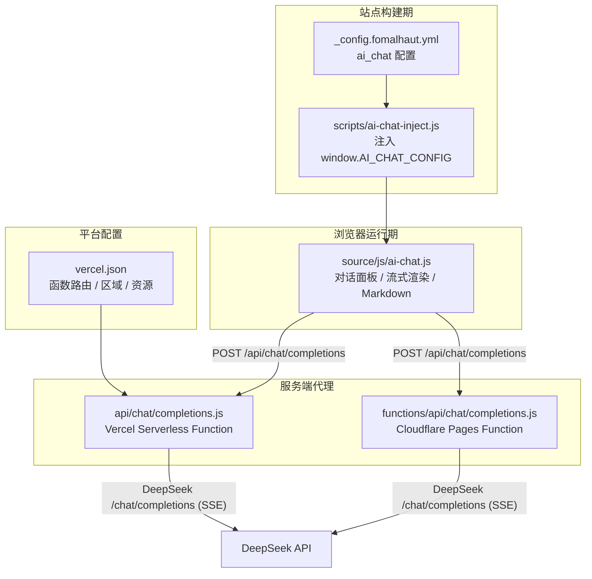
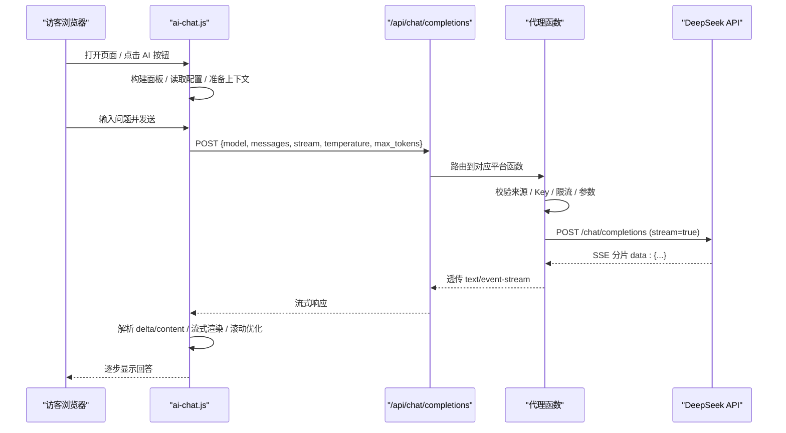
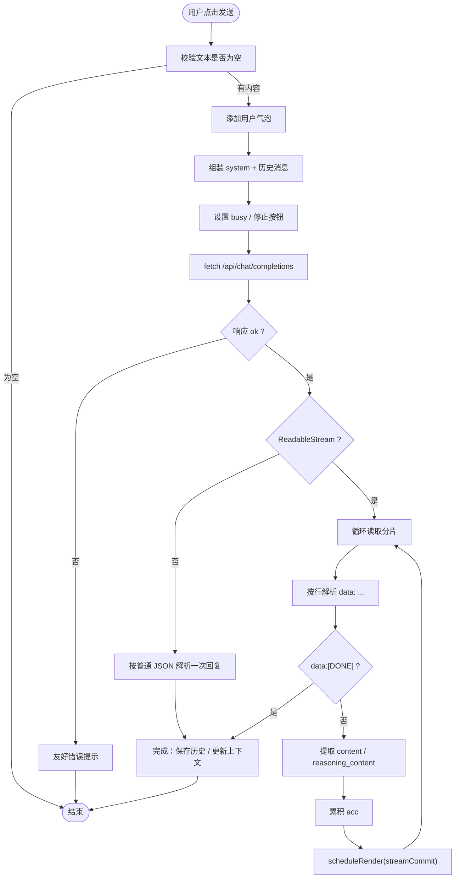
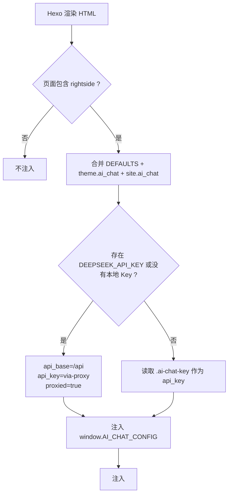
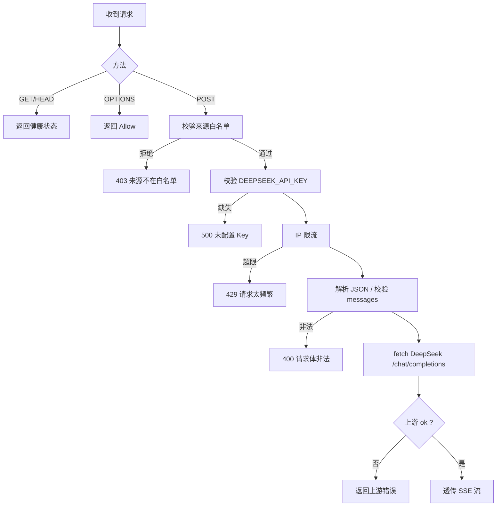
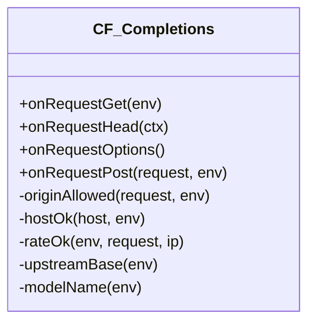
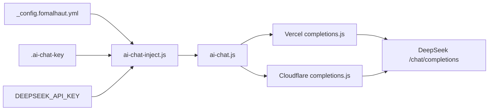

# AI 聊天功能集成

<cite>
**本文引用的文件**   
- [ai-chat.js](file://source/js/ai-chat.js)
- [ai-chat-inject.js](file://scripts/ai-chat-inject.js)
- [completions.js（Vercel）](file://api/chat/completions.js)
- [completions.js（Cloudflare Pages）](file://functions/api/chat/completions.js)
- [vercel.json](file://vercel.json)
- [_config.fomalhaut.yml](file://_config.fomalhaut.yml)
</cite>

## 目录
1. [简介](#简介)
2. [项目结构](#项目结构)
3. [核心组件](#核心组件)
4. [架构总览](#架构总览)
5. [详细组件分析](#详细组件分析)
6. [依赖关系分析](#依赖关系分析)
7. [性能与体验优化](#性能与体验优化)
8. [安全机制](#安全机制)
9. [部署指南](#部署指南)
10. [常见问题排查](#常见问题排查)
11. [结论](#结论)

## 简介
本技术文档围绕博客中的 AI 聊天功能，从前端对话面板、后端 API 代理、Serverless 函数部署、安全机制到运维监控进行系统化说明。该功能通过浏览器侧的轻量 JS 实现流式对话、Markdown 渲染和滚动优化；通过 Vercel 或 Cloudflare Pages 的同源代理函数调用 DeepSeek 接口，避免把 API Key 暴露给浏览器；同时提供请求来源白名单、IP 限流、消息长度限制等安全策略。

## 项目结构
AI 聊天功能涉及“站点构建注入 + 前端运行时 + 服务端代理 + 平台配置”四个层面：

**图表来源**
- [ai-chat-inject.js:71-100](file://scripts/ai-chat-inject.js#L71-L100)
- [ai-chat.js:11-44](file://source/js/ai-chat.js#L11-L44)
- [completions.js（Vercel）:26-35](file://api/chat/completions.js#L26-L35)
- [completions.js（Cloudflare Pages）:23-26](file://functions/api/chat/completions.js#L23-L26)
- [vercel.json:1-11](file://vercel.json#L1-L11)

**章节来源**
- [ai-chat-inject.js:1-106](file://scripts/ai-chat-inject.js#L1-L106)
- [ai-chat.js:1-44](file://source/js/ai-chat.js#L1-L44)
- [completions.js（Vercel）:1-35](file://api/chat/completions.js#L1-L35)
- [completions.js（Cloudflare Pages）:1-26](file://functions/api/chat/completions.js#L1-L26)
- [vercel.json:1-11](file://vercel.json#L1-L11)

## 核心组件
- **站点注入器**：在 Hexo 生成 HTML 时注入 `window.AI_CHAT_CONFIG`，并加载 `/js/ai-chat.js`。它负责根据是否具备本地 Key 或构建环境变量，决定前端直连 DeepSeek 还是走同源代理。
- **前端对话面板**：纯原生 JS 实现，不依赖 jQuery/Vue。负责按钮挂载、面板 DOM、样式、Markdown 渲染、流式输出、历史存储、上下文统计、面板缩放、事件委托。
- **Vercel 代理函数**：Node.js 风格的 Serverless 函数，处理来源校验、Key 校验、限流、请求体校验、转发 SSE 流。
- **Cloudflare Pages 代理函数**：基于 Web Fetch API 的实现，逻辑等价但运行环境不同，适配 Pages 的函数目录约定。
- **平台配置**：`vercel.json` 声明函数路径、超时、内存和部署区域。

**章节来源**
- [ai-chat-inject.js:1-106](file://scripts/ai-chat-inject.js#L1-L106)
- [ai-chat.js:1-44](file://source/js/ai-chat.js#L1-L44)
- [completions.js（Vercel）:1-35](file://api/chat/completions.js#L1-L35)
- [completions.js（Cloudflare Pages）:1-26](file://functions/api/chat/completions.js#L1-L26)
- [vercel.json:1-11](file://vercel.json#L1-L11)

## 架构总览
整体数据流如下：

**图表来源**
- [ai-chat.js:825-1025](file://source/js/ai-chat.js#L825-L1025)
- [completions.js（Vercel）:118-207](file://api/chat/completions.js#L118-L207)
- [completions.js（Cloudflare Pages）:116-175](file://functions/api/chat/completions.js#L116-L175)

## 详细组件分析

### 前端对话面板：ai-chat.js
该文件是用户可见的 AI 助手本体，职责包括：
- 动态注入 CSS、创建右侧 AI 按钮与悬浮面板。
- 从 `_config.fomalhaut.yml` 与构建注入结果合并配置。
- 自动判断是否使用同源代理：当没有浏览器端 Key 但有 `proxy_api_base` 时，自动切换到 `/api`。
- 提取当前页面正文作为系统提示的一部分，构造发送给模型的上下文。
- 实现轻量 Markdown 渲染，支持代码块、行内代码、粗斜体、链接、标题、列表、引用、分隔线。
- 实现流式输出：按行边界切分已定稿内容，每帧只重渲染尾部，避免整段重绘。
- 管理本地历史：按页面路径分桶，限制页面数和消息数。
- 提供面板拖拽缩放、恢复默认大小、清空历史、快捷键、移动端适配。

#### 关键流程：发送与流式接收

**图表来源**
- [ai-chat.js:825-1025](file://source/js/ai-chat.js#L825-L1025)

**章节来源**
- [ai-chat.js:11-44](file://source/js/ai-chat.js#L11-L44)
- [ai-chat.js:400-462](file://source/js/ai-chat.js#L400-L462)
- [ai-chat.js:464-594](file://source/js/ai-chat.js#L464-L594)
- [ai-chat.js:744-800](file://source/js/ai-chat.js#L744-L800)
- [ai-chat.js:825-1025](file://source/js/ai-chat.js#L825-L1025)
- [ai-chat.js:1028-1147](file://source/js/ai-chat.js#L1028-L1147)

### 站点注入器：ai-chat-inject.js
注入器的核心目标是“不改主题源码”，在 Hexo 渲染后向每个包含右侧部件的页面注入：
- `window.AI_CHAT_CONFIG`：来自 `_config.fomalhaut.yml` 的 `ai_chat` 段，以及站点级配置。
- `/js/ai-chat.js`：带版本参数的脚本标签，避免浏览器缓存旧文件。
- 代理模式切换：如果构建环境存在 `DEEPSEEK_API_KEY`，或者本地没有 Key，则把 `api_base` 改为 `/api`，并把 `api_key` 设为占位符，从而让浏览器端不出现真实 Key。

**图表来源**
- [ai-chat-inject.js:35-56](file://scripts/ai-chat-inject.js#L35-L56)
- [ai-chat-inject.js:58-69](file://scripts/ai-chat-inject.js#L58-L69)
- [ai-chat-inject.js:71-100](file://scripts/ai-chat-inject.js#L71-L100)

**章节来源**
- [ai-chat-inject.js:1-106](file://scripts/ai-chat-inject.js#L1-L106)
- [_config.fomalhaut.yml:1567-1586](file://_config.fomalhaut.yml#L1567-L1586)

### 后端 API 代理：Vercel 函数
`api/chat/completions.js` 是 Vercel Serverless Function 的实现，主要职责：
- 健康检查：GET/HEAD 返回是否配置了 Key、当前模型、允许的后缀、额外来源等。
- 来源白名单：校验 `origin` / `referer`，默认放行 `example.com` 及其子域，也放行本地调试域名和平台预览域名。
- Key 校验：要求 `DEEPSEEK_API_KEY` 存在。
- IP 限流：按小时窗口统计每个 IP 的请求次数，默认上限 120。
- 请求体校验：限制最大字节数、必须包含 `messages`、限制消息条数和每条内容长度。
- 上游转发：以 `Authorization: Bearer <key>` 调用 DeepSeek `/chat/completions`，并透传 SSE 流。

**图表来源**
- [completions.js（Vercel）:118-207](file://api/chat/completions.js#L118-L207)

**章节来源**
- [completions.js（Vercel）:1-35](file://api/chat/completions.js#L1-L35)
- [completions.js（Vercel）:47-95](file://api/chat/completions.js#L47-L95)
- [completions.js（Vercel）:98-116](file://api/chat/completions.js#L98-L116)
- [completions.js（Vercel）:118-207](file://api/chat/completions.js#L118-L207)

### 后端 API 代理：Cloudflare Pages 函数
`functions/api/chat/completions.js` 是 Cloudflare Pages 函数的实现，逻辑与 Vercel 版本基本等价，差异在于：
- 使用 Web Fetch API 和 `Request`/`Response`。
- 通过 `cf-connecting-ip` 获取客户端 IP。
- 通过 `export function onRequestPost` 等命名导出注册路由。
- 注释中明确说明为什么需要这个文件：Cloudflare Pages 不会把 `api/chat/completions.js` 当作函数，而是静态文件，因此需要在 `functions/` 下再放一份。

**图表来源**
- [completions.js（Cloudflare Pages）:91-115](file://functions/api/chat/completions.js#L91-L115)
- [completions.js（Cloudflare Pages）:116-175](file://functions/api/chat/completions.js#L116-L175)

**章节来源**
- [completions.js（Cloudflare Pages）:1-26](file://functions/api/chat/completions.js#L1-L26)
- [completions.js（Cloudflare Pages）:36-84](file://functions/api/chat/completions.js#L36-L84)
- [completions.js（Cloudflare Pages）:86-115](file://functions/api/chat/completions.js#L86-L115)
- [completions.js（Cloudflare Pages）:116-175](file://functions/api/chat/completions.js#L116-L175)

## 依赖关系分析
- 前端依赖：
  - 主题右侧容器：`#rightside` 或 `#rightside-config-show`。
  - 全局主题变量：`--theme-color`、`--card-bg`、`--font-color` 等 CSS 变量。
  - 可选 pjax：用于页面切换后重新挂接按钮和清理面板状态。
- 构建期依赖：
  - Hexo 主题配置 `_config.fomalhaut.yml`。
  - 可选站点根 `.ai-chat-key`。
  - 构建环境变量 `DEEPSEEK_API_KEY`。
- 服务端依赖：
  - Vercel：`api/chat/completions.js` + `vercel.json`。
  - Cloudflare Pages：`functions/api/chat/completions.js`。
  - DeepSeek API：`/chat/completions`，支持 SSE。

**图表来源**
- [ai-chat-inject.js:35-56](file://scripts/ai-chat-inject.js#L35-L56)
- [ai-chat-inject.js:58-69](file://scripts/ai-chat-inject.js#L58-L69)
- [ai-chat-inject.js:71-100](file://scripts/ai-chat-inject.js#L71-L100)
- [completions.js（Vercel）:26-35](file://api/chat/completions.js#L26-L35)
- [completions.js（Cloudflare Pages）:91-96](file://functions/api/chat/completions.js#L91-L96)

**章节来源**
- [ai-chat.js:271-289](file://source/js/ai-chat.js#L271-L289)
- [ai-chat.js:1102-1141](file://source/js/ai-chat.js#L1102-L1141)
- [ai-chat-inject.js:35-100](file://scripts/ai-chat-inject.js#L35-L100)
- [completions.js（Vercel）:26-35](file://api/chat/completions.js#L26-L35)
- [completions.js（Cloudflare Pages）:91-96](file://functions/api/chat/completions.js#L91-L96)

## 性能与体验优化
### 流式输出与渲染调度
- 前端将流式累积文本拆分为“已定稿部分”和“尾部正在写的部分”。
- 使用 `requestAnimationFrame` 和定时器合并渲染，避免每个 SSE 分片都触发 DOM 写入和滚动计算。
- 滚动位置通过 `scrollTop = 1e9` 赋值，避免频繁读 `scrollHeight` 造成强制同步布局。

**章节来源**
- [ai-chat.js:748-780](file://source/js/ai-chat.js#L748-L780)
- [ai-chat.js:859-877](file://source/js/ai-chat.js#L859-L877)

### Markdown 渲染优化
- 自定义轻量 Markdown 解析器，优先处理代码块和行内代码，避免后续正则误伤。
- 流式场景下使用 `tailCut` 判断可安全切分的行边界，保证“前段已定稿、尾段增量渲染”。

**章节来源**
- [ai-chat.js:400-462](file://source/js/ai-chat.js#L400-L462)

### 面板冷启动优化
- 鼠标靠近按钮时提前构建面板 DOM，并在空闲回调中预构建，减少首次展开时的长任务。
- 面板样式通过 `<style>` 注入，避免外部 CSS 阻塞。

**章节来源**
- [ai-chat.js:263-289](file://source/js/ai-chat.js#L263-L289)
- [ai-chat.js:363-372](file://source/js/ai-chat.js#L363-L372)
- [ai-chat.js:1110-1116](file://source/js/ai-chat.js#L1110-L1116)

### 上下文与历史控制
- 页面正文超长时采用“开头 + 结尾 + 小节标题”策略，避免把整页塞进模型。
- 历史消息限制条数，并按页面路径分桶存储，防止 localStorage 无限增长。

**章节来源**
- [ai-chat.js:499-594](file://source/js/ai-chat.js#L499-L594)
- [ai-chat.js:464-497](file://source/js/ai-chat.js#L464-L497)

## 安全机制
### API Key 保护
- 推荐方式：通过 Vercel 或 Cloudflare 的环境变量 `DEEPSEEK_API_KEY`，只在服务端使用。
- 本地开发方式：站点根 `.ai-chat-key`，且已在忽略规则中，避免提交到仓库。
- 构建期注入器会根据是否有本地 Key 或构建环境变量，决定是否让浏览器走 `/api` 代理。

**章节来源**
- [ai-chat-inject.js:35-56](file://scripts/ai-chat-inject.js#L35-L56)
- [ai-chat-inject.js:58-69](file://scripts/ai-chat-inject.js#L58-L69)
- [ai-chat-inject.js:83-92](file://scripts/ai-chat-inject.js#L83-L92)
- [completions.js（Vercel）:138-139](file://api/chat/completions.js#L138-L139)
- [completions.js（Cloudflare Pages）:121-124](file://functions/api/chat/completions.js#L121-L124)

### 请求来源验证
- 代理函数校验 `origin` / `referer`，默认放行 `example.com` 及其子域。
- 额外域名可通过 `AI_PROXY_ORIGINS` 配置，支持裸域名、通配域名和全放行。
- 始终放行本地调试域名和平台预览域名。

**章节来源**
- [completions.js（Vercel）:47-95](file://api/chat/completions.js#L47-L95)
- [completions.js（Cloudflare Pages）:36-84](file://functions/api/chat/completions.js#L36-L84)

### 速率限制
- Vercel 版本：按 IP 维护时间窗口内的请求数组，超过每小时上限返回 429。
- Cloudflare 版本：按 IP 维护 Map 记录，超过每小时上限返回 429。
- 默认上限为 120，可通过 `AI_PROXY_MAX_PER_HOUR` 调整。

**章节来源**
- [completions.js（Vercel）:98-110](file://api/chat/completions.js#L98-L110)
- [completions.js（Cloudflare Pages）:97-106](file://functions/api/chat/completions.js#L97-L106)

### 请求体与参数限制
- 最大请求体字节数：约 400KB。
- 最大消息条数：24。
- 每条消息内容最大字符数：约 40000。
- `max_tokens` 被钳制到合理范围，默认上限 8192。
- `temperature` 被钳制到 0-2。

**章节来源**
- [completions.js（Vercel）:29-35](file://api/chat/completions.js#L29-L35)
- [completions.js（Vercel）:143-162](file://api/chat/completions.js#L143-L162)
- [completions.js（Cloudflare Pages）:23-26](file://functions/api/chat/completions.js#L23-L26)
- [completions.js（Cloudflare Pages）:133-146](file://functions/api/chat/completions.js#L133-L146)

## 部署指南
### 环境变量配置
- **DeepSeek API Key**：
  - Vercel：在 Settings → Environment Variables 中添加 `DEEPSEEK_API_KEY`。
  - Cloudflare Pages：在 Workers 和 Pages → 项目 → 设置 → 变量和密钥中添加 `DEEPSEEK_API_KEY`。
- **模型与基础地址**：
  - `DEEPSEEK_MODEL`：默认 `deepseek-chat`。
  - `DEEPSEEK_API_BASE`：默认 `https://api.deepseek.com`。
- **域名白名单**：
  - `AI_PROXY_ORIGINS`：逗号分隔，支持裸域名、通配域名和 `*`。
  - `AI_PROXY_ALLOW_SUFFIXES`：修改默认允许的后缀。
- **限流**：
  - `AI_PROXY_MAX_PER_HOUR`：默认 120。

**章节来源**
- [completions.js（Vercel）:13-20](file://api/chat/completions.js#L13-L20)
- [completions.js（Cloudflare Pages）:13-21](file://functions/api/chat/completions.js#L13-L21)
- [completions.js（Vercel）:26-35](file://api/chat/completions.js#L26-L35)
- [completions.js（Cloudflare Pages）:91-106](file://functions/api/chat/completions.js#L91-L106)

### 域名绑定与代理模式
- 如果配置了 `DEEPSEEK_API_KEY`，注入器会把前端 `api_base` 改为 `/api`，浏览器不再直连 DeepSeek。
- 如果未配置 Key，前端会尝试直连 `https://api.deepseek.com`，此时需要确保浏览器能访问该域名且不被插件拦截。

**章节来源**
- [ai-chat-inject.js:83-92](file://scripts/ai-chat-inject.js#L83-L92)
- [ai-chat.js:28-44](file://source/js/ai-chat.js#L28-L44)

### 平台差异：Vercel 与 Cloudflare Pages
- **Vercel**：
  - 函数路径：`api/chat/completions.js`。
  - 配置：`vercel.json` 中声明 `functions.api.chat.completions.js` 的 `maxDuration`、`memory` 和部署区域。
- **Cloudflare Pages**：
  - 函数路径：`functions/api/chat/completions.js`。
  - 原因：Pages 不把 `api/chat/completions.js` 当函数，而是静态文件，因此需要单独放在 `functions/` 下。

**章节来源**
- [vercel.json:1-11](file://vercel.json#L1-L11)
- [completions.js（Cloudflare Pages）:1-11](file://functions/api/chat/completions.js#L1-L11)

### 监控设置建议
- 建议在 Vercel 和 Cloudflare Pages 控制台查看函数日志，重点关注：
  - 403 来源不在白名单。
  - 500 未配置 `DEEPSEEK_API_KEY`。
  - 429 请求太频繁。
  - 502 连不上上游 DeepSeek。
- 前端错误会通过友好提示展示 HTTP 状态码和后端返回信息，便于定位问题。

**章节来源**
- [ai-chat.js:940-959](file://source/js/ai-chat.js#L940-L959)
- [completions.js（Vercel）:133-176](file://api/chat/completions.js#L133-L176)
- [completions.js（Cloudflare Pages）:117-167](file://functions/api/chat/completions.js#L117-L167)

## 常见问题排查
### 浏览器端报错
- “还没配 API Key”：检查 `_config.fomalhaut.yml` 的 `ai_chat.api_key` 或站点根 `.ai-chat-key`。
- “API Key 无效或已失效”：检查 Key 是否正确，重新生成站点。
- “请求太频繁了”：等待一段时间或提高 `AI_PROXY_MAX_PER_HOUR`。
- “模型名不可用”：把 `ai_chat.model` 换成可用模型，例如 `deepseek-chat`。
- “代理连不上 DeepSeek”：检查服务端 Key 和网络，查看函数日志。

**章节来源**
- [ai-chat.js:835-843](file://source/js/ai-chat.js#L835-L843)
- [ai-chat.js:940-959](file://source/js/ai-chat.js#L940-L959)

### 服务端报错
- 403：来源不在白名单，检查 `AI_PROXY_ORIGINS`。
- 500：服务端没配 `DEEPSEEK_API_KEY`。
- 429：请求太频繁，检查 `AI_PROXY_MAX_PER_HOUR`。
- 400：请求体不是合法 JSON 或缺少 `messages`。
- 413：请求体太大。
- 502：连不上上游接口。

**章节来源**
- [completions.js（Vercel）:133-176](file://api/chat/completions.js#L133-L176)
- [completions.js（Cloudflare Pages）:117-167](file://functions/api/chat/completions.js#L117-L167)

### 流式输出异常
- 思考型模型只吐思考过程：可能是 `max_tokens` 不够，导致正文被截断。
- 长时间无新内容：前端会在超时后保留已收到的内容并提示可重试。
- 流中断：可能是用户点击停止、网络断开或上游 abort。

**章节来源**
- [ai-chat.js:878-938](file://source/js/ai-chat.js#L878-L938)
- [ai-chat.js:1006-1015](file://source/js/ai-chat.js#L1006-L1015)

## 结论
该 AI 聊天功能通过“前端轻量面板 + 构建期注入 + 服务端代理 + 平台函数”的组合，实现了安全的流式对话体验。前端负责交互、Markdown 渲染和性能优化；后端负责 Key 保护、来源校验、限流和上游转发；平台配置则确保函数正确部署。实际使用中应优先通过环境变量配置 Key，并根据业务需求调整模型、Token 上限、限流阈值和白名单域名。