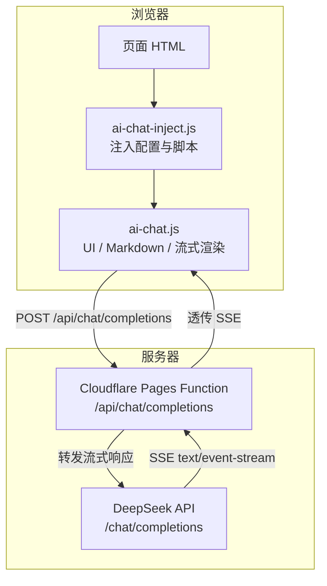
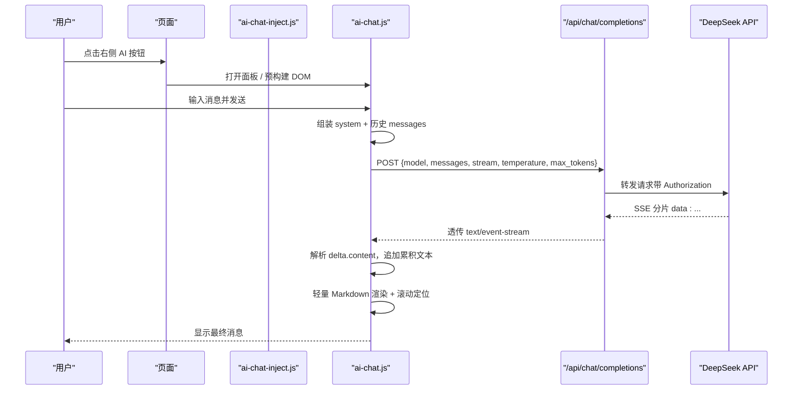
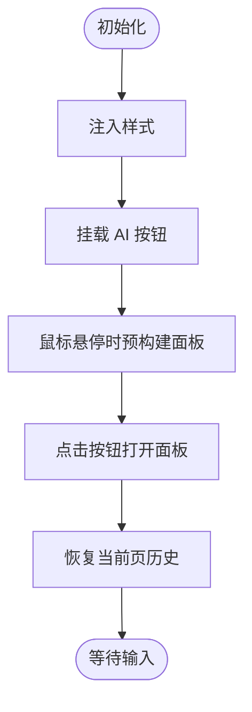
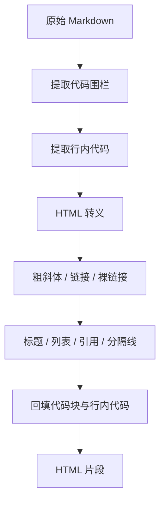
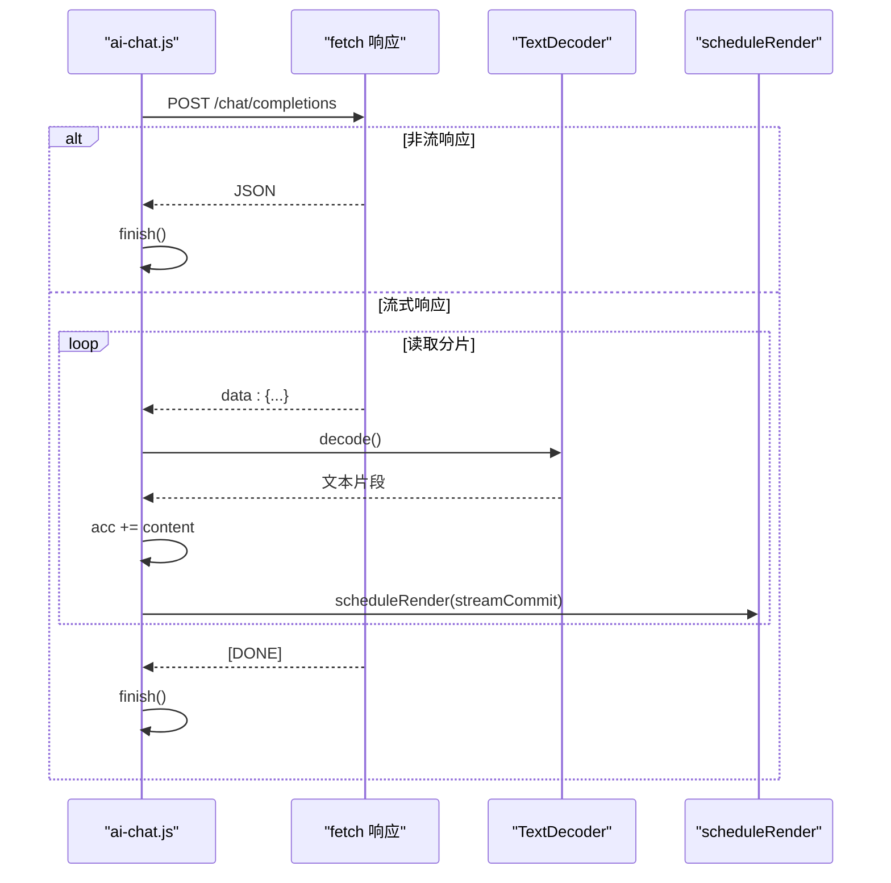
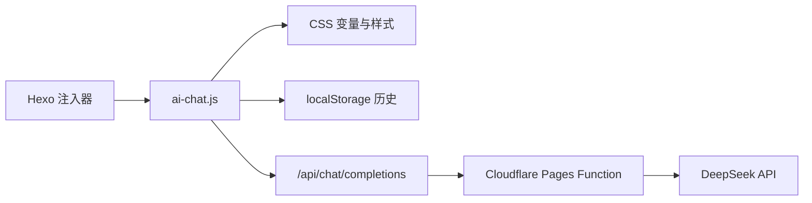
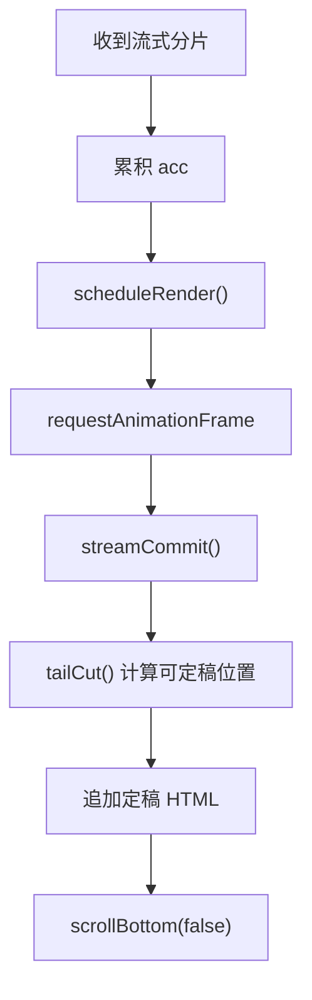

# 前端对话界面

<cite>
**本文引用的文件**   
- [source/js/ai-chat.js](file://source/js/ai-chat.js)
- [scripts/ai-chat-inject.js](file://scripts/ai-chat-inject.js)
- [functions/api/chat/completions.js](file://functions/api/chat/completions.js)
- [_config.fomalhaut.yml](file://_config.fomalhaut.yml)
</cite>

## 目录
1. [简介](#简介)
2. [项目结构](#项目结构)
3. [核心组件](#核心组件)
4. [架构总览](#架构总览)
5. [详细组件分析](#详细组件分析)
6. [依赖关系分析](#依赖关系分析)
7. [性能与滚动优化](#性能与滚动优化)
8. [配置选项说明](#配置选项说明)
9. [常见问题排查](#常见问题排查)
10. [结论](#结论)

## 简介
本技术文档聚焦博客站点中的 AI 聊天功能前端实现，覆盖以下方面：
- 对话面板 UI 组件：按钮挂载、面板构建、消息列表渲染、输入框交互、快捷问题。
- Markdown 渲染机制：轻量解析器对代码块、行内代码、粗斜体、链接、标题、列表、引用、分隔线的处理；流式输出时的“定稿 + 尾部重渲染”策略。
- 滚动优化：自动贴底、防抖合并渲染、避免强制布局、内存管理（历史条数与页面数量上限）。
- 后端通信协议：请求格式、流式响应解析、错误提示、超时与停止生成。
- 配置项：主题定制、行为参数、样式覆盖点。
- 故障排查与性能建议。

该功能由 Hexo 注入器在页面中注入配置脚本与前端本体，不修改主题源码，通过运行时动态创建按钮和面板。

## 项目结构
AI 聊天相关代码分布在三个层面：
- 站点侧前端本体：`source/js/ai-chat.js`，负责 UI、Markdown、本地历史、API 调用。
- Hexo 注入器：`scripts/ai-chat-inject.js`，在 HTML 末尾注入 `window.AI_CHAT_CONFIG` 与 `<script src="/js/ai-chat.js">`。
- 服务端代理函数：`functions/api/chat/completions.js`，提供同源 `/api/chat/completions` 代理，转发 DeepSeek 流式接口。
- 站点配置：`_config.fomalhaut.yml` 的 `ai_chat` 段决定开关、模型、Key、面板尺寸等。

**图表来源**
- [scripts/ai-chat-inject.js:71-100](file://scripts/ai-chat-inject.js#L71-L100)
- [source/js/ai-chat.js:820-823](file://source/js/ai-chat.js#L820-L823)
- [functions/api/chat/completions.js:116-175](file://functions/api/chat/completions.js#L116-L175)

**章节来源**
- [scripts/ai-chat-inject.js:1-106](file://scripts/ai-chat-inject.js#L1-L106)
- [source/js/ai-chat.js:1-1147](file://source/js/ai-chat.js#L1-L1147)
- [functions/api/chat/completions.js:1-184](file://functions/api/chat/completions.js#L1-L184)
- [_config.fomalhaut.yml:1559-1587](file://_config.fomalhaut.yml#L1559-L1587)

## 核心组件
- 注入器：负责把配置对象写入页面，并加载前端脚本。
- 前端本体：负责 DOM 构建、样式注入、事件绑定、Markdown 渲染、本地历史、流式请求。
- 代理函数：校验来源、限频、限制请求体大小、截断消息长度，再转发到上游模型接口。
- 站点配置：控制是否启用、模型、温度、最大 token、历史轮数、面板尺寸、超时时间、欢迎语等。

**章节来源**
- [scripts/ai-chat-inject.js:20-69](file://scripts/ai-chat-inject.js#L20-L69)
- [source/js/ai-chat.js:11-45](file://source/js/ai-chat.js#L11-L45)
- [functions/api/chat/completions.js:23-34](file://functions/api/chat/completions.js#L23-L34)
- [_config.fomalhaut.yml:1564-1586](file://_config.fomalhaut.yml#L1564-L1586)

## 架构总览
从用户点击右侧 “AI” 按钮开始，到收到模型回复，整体流程如下：

**图表来源**
- [source/js/ai-chat.js:826-1026](file://source/js/ai-chat.js#L826-L1026)
- [functions/api/chat/completions.js:116-175](file://functions/api/chat/completions.js#L116-L175)

## 详细组件分析

### 注入器：scripts/ai-chat-inject.js
职责：
- 读取主题配置与站点配置，合并默认值。
- 根据环境变量或本地 Key 文件决定是否走同源代理。
- 在 `</body>` 前注入 `window.AI_CHAT_CONFIG` 与前端脚本。
- 为前端脚本附加版本参数，避免缓存旧代码。

关键点：
- 当存在构建环境 `DEEPSEEK_API_KEY` 或没有本地 Key 时，自动切换到 `proxy_api_base` 与 `proxy_key_stub`，使页面不携带真实 Key。
- 仅当页面包含右侧容器时才注入，避免无关页面增加开销。

**章节来源**
- [scripts/ai-chat-inject.js:20-69](file://scripts/ai-chat-inject.js#L20-L69)
- [scripts/ai-chat-inject.js:71-100](file://scripts/ai-chat-inject.js#L71-L100)

### 前端本体：source/js/ai-chat.js

#### UI 组件与面板生命周期
- 按钮挂载：优先插入到右侧设置齿轮附近，保证与右侧部件同显隐。
- 面板构建：包含头部（Logo、模型名、清空、复位、关闭）、消息区、快捷问题、输入区、上下文提示。
- 冷启动优化：鼠标靠近按钮时提前构建面板 DOM 并触发一次布局计算，减少首次展开卡顿。
- 可调整尺寸：右下角拖拽手柄支持自由缩放，尺寸持久化到 localStorage；提供“恢复默认大小”按钮。
- 移动端适配：窄屏下改为满宽、底部贴合、隐藏拖拽手柄。

**图表来源**
- [source/js/ai-chat.js:263-398](file://source/js/ai-chat.js#L263-L398)
- [source/js/ai-chat.js:1028-1051](file://source/js/ai-chat.js#L1028-L1051)

**章节来源**
- [source/js/ai-chat.js:47-80](file://source/js/ai-chat.js#L47-L80)
- [source/js/ai-chat.js:263-398](file://source/js/ai-chat.js#L263-L398)
- [source/js/ai-chat.js:652-742](file://source/js/ai-chat.js#L652-L742)

#### 消息列表渲染
- 用户消息：纯文本气泡，右对齐。
- AI 消息：使用轻量 Markdown 渲染，左对齐，带头像。
- 错误消息：红色背景气泡，附带友好提示。
- 快捷问题：面板顶部提供“总结这个页面”等预设问题。
- 历史恢复：按页面路径分桶存储，打开面板时恢复当前页历史。

**章节来源**
- [source/js/ai-chat.js:781-798](file://source/js/ai-chat.js#L781-L798)
- [source/js/ai-chat.js:1028-1051](file://source/js/ai-chat.js#L1028-L1051)

#### 输入框交互
- Enter 发送，Shift+Enter 换行。
- 输入框自动增高，最多固定高度后出现滚动条。
- 发送按钮在生成中切换为“停止生成”，点击可中止请求。
- 快捷键 Esc 收起面板。

**章节来源**
- [source/js/ai-chat.js:812-823](file://source/js/ai-chat.js#L812-L823)
- [source/js/ai-chat.js:1084-1101](file://source/js/ai-chat.js#L1084-L1101)

#### Markdown 渲染机制
轻量解析器不支持完整 Markdown，但覆盖了常见场景：
- 代码围栏：提取为 `<pre><code>`，后续交由主题 Prism 或高亮方案处理。
- 行内代码：包裹 `<code>`。
- 粗体、斜体：转换为 `<strong>`、`<em>`。
- 链接：自动转 `<a>`，新窗口打开并加安全属性。
- 标题、无序/有序列表、引用、分隔线：逐行解析并转为对应标签。
- 流式优化：通过 `tailCut` 判断“可定稿”位置，已定稿部分只追加一次，尾部持续重渲染光标。

注意：数学公式、复杂表格、Mermaid 图不在轻量解析范围内；若需要，可在系统提示或外部工具层扩展。

**图表来源**
- [source/js/ai-chat.js:400-437](file://source/js/ai-chat.js#L400-L437)
- [source/js/ai-chat.js:438-462](file://source/js/ai-chat.js#L438-L462)

**章节来源**
- [source/js/ai-chat.js:400-462](file://source/js/ai-chat.js#L400-L462)

#### 流式输出与错误处理
- 请求：POST 到 `api_base/chat/completions`，携带 model、messages、stream、temperature、max_tokens。
- 响应：优先走 `ReadableStream` 解析 SSE；若非流则回退为普通 JSON。
- 累积文本：每个分片的 `delta.content` 追加到 `acc`，并通过 `scheduleRender` 合并提交。
- 超时保护：首字未到达或中途长时间无新内容会中止请求，并给出友好提示。
- 停止生成：点击停止按钮触发 AbortController，保留已收到的内容。
- 错误提示：将 HTTP 状态码与上游错误信息翻译为用户可读文案，如 401、402、429、400、403、502、500、404。

**图表来源**
- [source/js/ai-chat.js:961-1026](file://source/js/ai-chat.js#L961-L1026)

**章节来源**
- [source/js/ai-chat.js:826-1026](file://source/js/ai-chat.js#L826-L1026)

#### 本地历史与上下文
- 存储键：`storage_key`，默认 `ai_chat_history_v1`。
- 数据结构：按页面路径分桶，每页最多保留一定数量的消息。
- 上下文估算：系统提示 + 本页正文 + 对话历史字符数，用于显示“上下文 ≈ X 字”。
- 页面正文抽取：优先取文章容器，否则回退到 iframe 正文或整页清理后的文本；超长文章采用“开头 + 结尾 + 小节标题”策略。

**章节来源**
- [source/js/ai-chat.js:464-497](file://source/js/ai-chat.js#L464-L497)
- [source/js/ai-chat.js:499-604](file://source/js/ai-chat.js#L499-L604)
- [source/js/ai-chat.js:606-650](file://source/js/ai-chat.js#L606-L650)

### 代理函数：functions/api/chat/completions.js
职责：
- 来源白名单校验：允许 example.com 及其子域、localhost、预览域名等。
- 限频：基于 IP 的小时级计数，默认 120 次。
- 请求体限制：最大字节数、消息条数、单条消息字符数。
- 上游转发：构造 DeepSeek 请求，透传 SSE 流。
- 健康检查：GET/HEAD 返回当前模式、模型、是否配置 Key。

关键边界：
- 如果上游不是 `text/event-stream`，会把响应体作为错误信息返回。
- 缺少 `DEEPSEEK_API_KEY` 时返回 500。
- 请求太频繁返回 429。

**章节来源**
- [functions/api/chat/completions.js:23-34](file://functions/api/chat/completions.js#L23-L34)
- [functions/api/chat/completions.js:43-84](file://functions/api/chat/completions.js#L43-L84)
- [functions/api/chat/completions.js:97-111](file://functions/api/chat/completions.js#L97-L111)
- [functions/api/chat/completions.js:116-175](file://functions/api/chat/completions.js#L116-L175)

## 依赖关系分析
- 前端本体不依赖 jQuery、Vue 或其他组件库，仅使用原生 DOM、Fetch、AbortController、MutationObserver。
- 注入器依赖 Hexo 钩子 `after_render:html`。
- 代理函数依赖 Cloudflare Pages Functions 路由约定与环境变量。
- 主题样式变量：面板颜色派生自 `--theme-color`、`--card-bg`、`--font-color`、`--on-theme` 等 CSS 变量。

**图表来源**
- [scripts/ai-chat-inject.js:71-100](file://scripts/ai-chat-inject.js#L71-L100)
- [source/js/ai-chat.js:135-260](file://source/js/ai-chat.js#L135-L260)
- [functions/api/chat/completions.js:116-175](file://functions/api/chat/completions.js#L116-L175)

**章节来源**
- [source/js/ai-chat.js:1-10](file://source/js/ai-chat.js#L1-L10)
- [scripts/ai-chat-inject.js:71-100](file://scripts/ai-chat-inject.js#L71-L100)
- [functions/api/chat/completions.js:116-175](file://functions/api/chat/completions.js#L116-L175)

## 性能与滚动优化
- 冷启动摊平：鼠标悬停按钮时预构建面板 DOM，避免首次展开长帧。
- 流式渲染合并：使用 `requestAnimationFrame` 与定时器兜底，确保每帧最多一次 DOM 提交。
- 避免强制布局：滚动位置用越界赋值 `scrollTop = 1e9`，避免读 `scrollHeight`。
- 滚动状态异步维护：通过 passive scroll 事件维护 `stick` 标记，不在每个分片里读布局属性。
- 历史上限：每页最多保留若干条消息，全局最多保留若干页面记录，防止 localStorage 膨胀。
- 面板尺寸持久化：自由缩放后保存宽高与位置，避免重复计算。

**图表来源**
- [source/js/ai-chat.js:748-780](file://source/js/ai-chat.js#L748-L780)
- [source/js/ai-chat.js:862-877](file://source/js/ai-chat.js#L862-L877)

**章节来源**
- [source/js/ai-chat.js:363-372](file://source/js/ai-chat.js#L363-L372)
- [source/js/ai-chat.js:748-780](file://source/js/ai-chat.js#L748-L780)
- [source/js/ai-chat.js:464-497](file://source/js/ai-chat.js#L464-L497)

## 配置选项说明
以下选项来自 `_config.fomalhaut.yml` 的 `ai_chat` 段，也可由注入器合并站点配置。

| 配置项 | 含义 | 默认值或说明 |
|---|---|---|
| enable | 总开关 | false 时不注入按钮与面板 |
| api_base | 上游 API 地址 | 直连 DeepSeek 或同源代理 |
| api_key | API Key | 推荐留空，改用 api_key_file |
| api_key_file | Key 文件路径 | 相对站点根目录，默认 `.ai-chat-key` |
| proxy_api_base | 同源代理地址 | 部署模式下默认 `/api` |
| proxy_key_stub | 代理占位 Key | 默认 `via-proxy` |
| model | 模型名称 | 默认 `deepseek-chat` |
| temperature | 随机性 | 默认 0.7 |
| max_tokens | 单次回复上限 | 默认 8192 |
| max_history | 带给模型的最近历史轮数 | 默认 12 |
| max_page_chars | 页面正文上限 | 默认 32000 |
| storage_key | 本地历史存储键 | 默认 `ai_chat_history_v1` |
| panel_width | 面板宽度 | 默认 460 |
| panel_height | 面板高度 | 默认 640 |
| panel_right | 面板右边缘距离 | 默认 88 |
| timeout_ms | 超时时间 | 默认 10000 毫秒 |
| welcome | 欢迎消息 | 自定义开场文案 |
| first_question | 首次自动提问 | 例如“总结这个页面” |
| system_prompt | 系统提示词 | 定义助手角色与回答风格 |

主题定制与样式覆盖要点：
- 面板颜色派生自 CSS 变量：`--theme-color`、`--card-bg`、`--font-color`、`--on-theme`。
- 选中色在支持 `color-mix` 的浏览器中实时跟随主题色；旧浏览器通过 JS 计算 fallback。
- 可通过主题自定义 CSS 覆盖面板样式，但需注意优先级（面板使用 id 选择器与 `!important` 覆盖全局选中色）。

**章节来源**
- [_config.fomalhaut.yml:1559-1587](file://_config.fomalhaut.yml#L1559-L1587)
- [source/js/ai-chat.js:86-116](file://source/js/ai-chat.js#L86-L116)
- [source/js/ai-chat.js:135-260](file://source/js/ai-chat.js#L135-L260)

## 常见问题排查

| 现象 | 可能原因 | 排查与修复 |
|---|---|---|
| 面板不出现 | `ai_chat.enable` 为 false，或页面没有右侧容器 | 检查配置文件；确认页面包含右侧部件 |
| 提示“还没配 API Key” | 前端没有拿到 Key，且未走代理 | 检查 `api_key` 或 `api_key_file`；或在构建环境设置 `DEEPSEEK_API_KEY` |
| 401 无效 Key | Key 错误或过期 | 更新 `.ai-chat-key` 或环境变量，重新生成站点 |
| 402 余额不足 | DeepSeek 账户余额不足 | 充值后再试 |
| 429 请求太频繁 | 被上游或代理限频 | 稍后再试；检查代理限频配置 |
| 400 模型不可用 | `model` 配置不正确 | 改为可用模型，如 `deepseek-chat` |
| 403 来源未放行 | 代理域名白名单不包含当前域名 | 配置 `AI_PROXY_ORIGINS` 并重新部署 |
| 502 连不上上游 | 代理无法连接 DeepSeek | 检查网络与代理日志 |
| 500 服务端出错 | 代理未配置 `DEEPSEEK_API_KEY` | 在 Cloudflare Pages 环境变量中添加密钥 |
| 404 接口不通 | `api_base` 配置错误 | 检查直连地址或代理路径 |
| 流式输出卡住 | 模型思考型回复较长或网络中断 | 增大 `max_tokens` 或更换非思考模型；重试 |
| 面板尺寸异常 | 自由缩放后位置超出视口 | 点击“恢复默认大小”或刷新页面 |

**章节来源**
- [source/js/ai-chat.js:835-843](file://source/js/ai-chat.js#L835-L843)
- [source/js/ai-chat.js:940-959](file://source/js/ai-chat.js#L940-L959)
- [functions/api/chat/completions.js:116-175](file://functions/api/chat/completions.js#L116-L175)

## 结论
该 AI 聊天前端以零依赖方式实现了完整的对话面板：轻量 Markdown 渲染、流式输出、本地历史、可调整面板尺寸与主题色适配。注入器保证了不改动主题源码即可上线，代理函数提供了同源安全转发与基础防护。通过流式渲染合并、滚动优化与历史上限控制，系统在长回复场景下仍能保持较好的交互流畅度。实际部署时，应重点关注 Key 管理、代理域名白名单、模型与 token 上限配置，并结合站点主题变量进行样式定制。