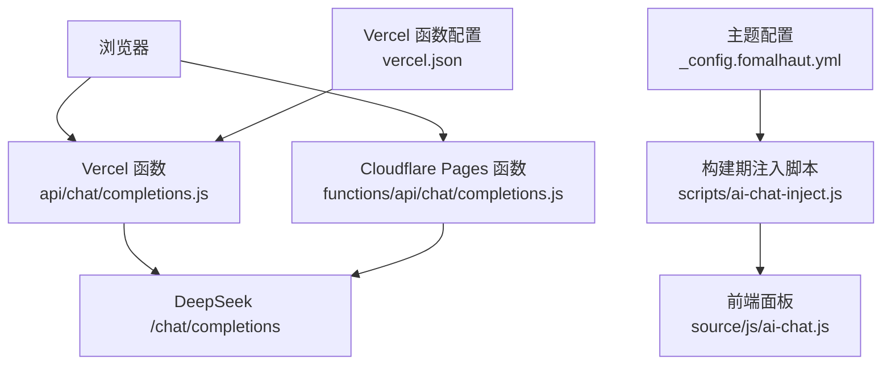
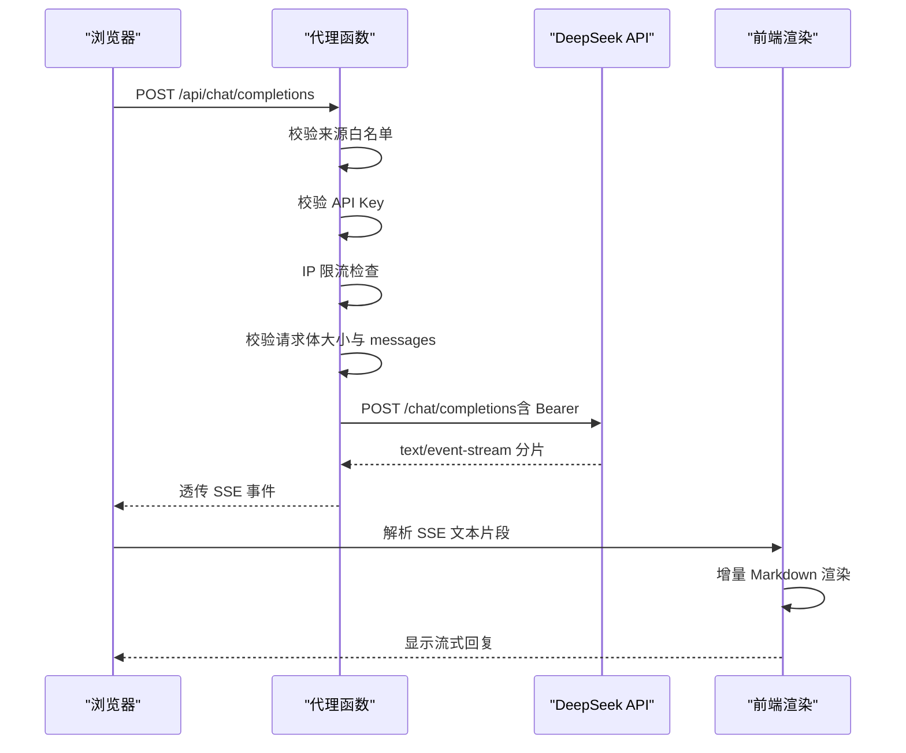
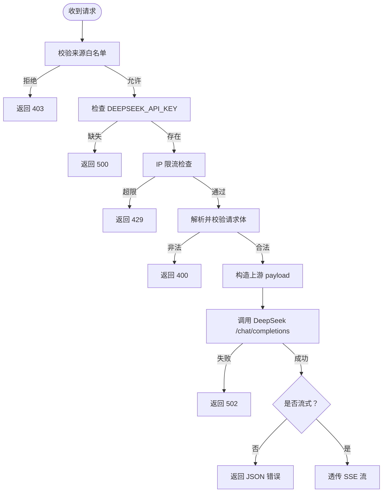
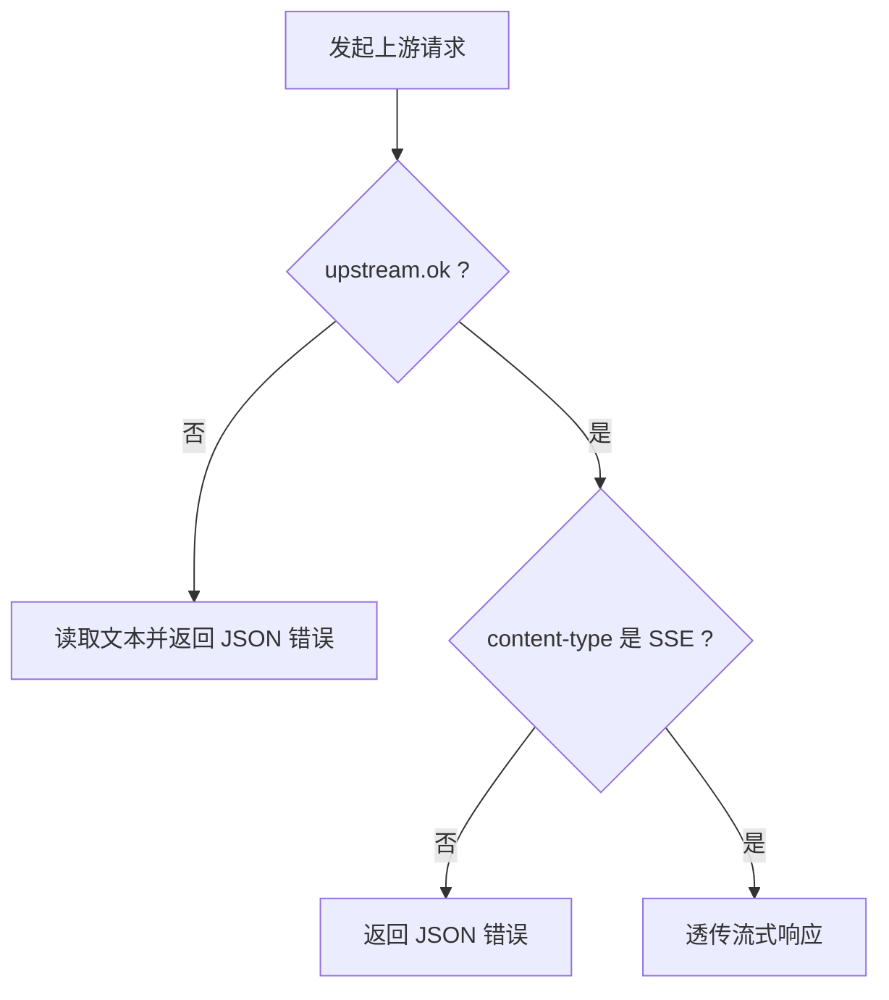
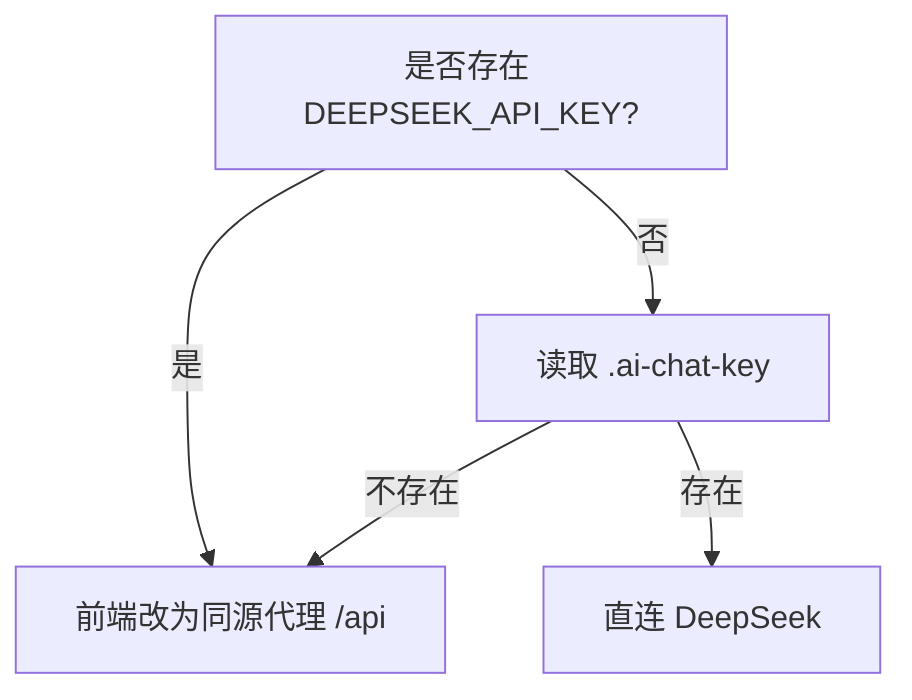
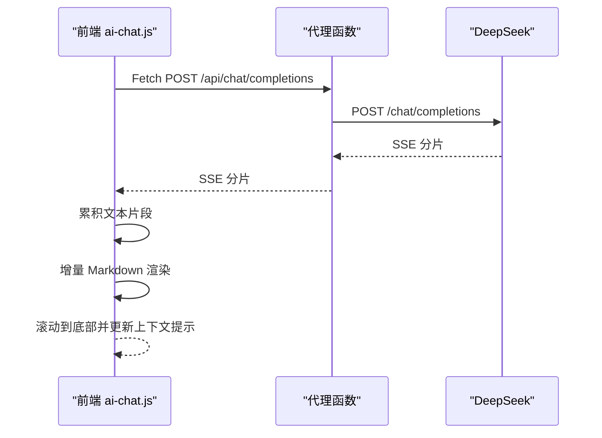
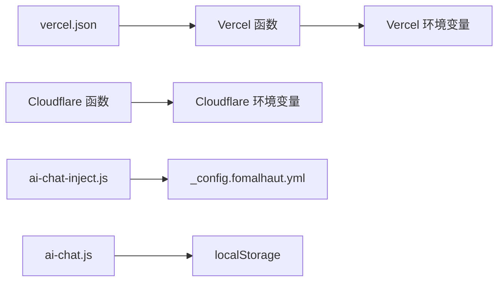

# 后端代理服务

<cite>
**本文引用的文件**   
- [functions/api/chat/completions.js](file://functions/api/chat/completions.js)
- [api/chat/completions.js](file://api/chat/completions.js)
- [vercel.json](file://vercel.json)
- [scripts/ai-chat-inject.js](file://scripts/ai-chat-inject.js)
- [source/js/ai-chat.js](file://source/js/ai-chat.js)
- [_config.fomalhaut.yml](file://_config.fomalhaut.yml)
</cite>

## 目录
1. [简介](#简介)
2. [项目结构](#项目结构)
3. [核心组件](#核心组件)
4. [架构总览](#架构总览)
5. [详细组件分析](#详细组件分析)
6. [依赖关系分析](#依赖关系分析)
7. [性能与流式传输](#性能与流式传输)
8. [部署指南](#部署指南)
9. [故障排除](#故障排除)
10. [结论](#结论)

## 简介
本项目包含一个面向 DeepSeek 的 AI 聊天后端代理，用于在博客站点中安全地转发前端请求、限制来源、限流并流式返回模型回复。代码同时提供两套实现：
- Vercel Serverless Function：`api/chat/completions.js`
- Cloudflare Pages Function：`functions/api/chat/completions.js`

两者职责一致：接收浏览器对 `/api/chat/completions` 的请求，校验来源白名单、IP 限流、请求体大小与消息数量，再调用上游 DeepSeek `/chat/completions`，并以 `text/event-stream` 把 SSE 数据透传回前端。

## 项目结构
与本代理直接相关的文件如下：
- 后端代理函数
  - `api/chat/completions.js`：Vercel 函数入口
  - `functions/api/chat/completions.js`：Cloudflare Pages 函数入口
- 前端注入与运行时
  - `scripts/ai-chat-inject.js`：构建期注入 `window.AI_CHAT_CONFIG`，决定走直连还是同源代理
  - `source/js/ai-chat.js`：前端 UI、SSE 消费、Markdown 渲染与历史管理
- 配置与部署
  - `_config.fomalhaut.yml`：主题侧 AI 助手默认配置
  - `vercel.json`：Vercel 函数超时与内存设置

**图表来源**
- [api/chat/completions.js:1-209](file://api/chat/completions.js#L1-L209)
- [functions/api/chat/completions.js:1-184](file://functions/api/chat/completions.js#L1-L184)
- [scripts/ai-chat-inject.js:1-106](file://scripts/ai-chat-inject.js#L1-L106)
- [source/js/ai-chat.js:1-800](file://source/js/ai-chat.js#L1-L800)
- [_config.fomalhaut.yml:1567-1586](file://_config.fomalhaut.yml#L1567-L1586)
- [vercel.json:1-12](file://vercel.json#L1-L12)

**章节来源**
- [api/chat/completions.js:1-209](file://api/chat/completions.js#L1-L209)
- [functions/api/chat/completions.js:1-184](file://functions/api/chat/completions.js#L1-L184)
- [scripts/ai-chat-inject.js:1-106](file://scripts/ai-chat-inject.js#L1-L106)
- [source/js/ai-chat.js:1-800](file://source/js/ai-chat.js#L1-L800)
- [_config.fomalhaut.yml:1567-1586](file://_config.fomalhaut.yml#L1567-L1586)
- [vercel.json:1-12](file://vercel.json#L1-L12)

## 核心组件
- 请求处理入口
  - Vercel：导出 Node 风格的 handler，根据 `req.method` 分发 GET/HEAD/OPTIONS/POST。
  - Cloudflare：导出 `onRequestGet/onRequestHead/onRequestOptions/onRequestPost/onRequest`。
- 安全校验
  - 来源白名单：基于 `origin` / `referer` 解析 host，支持裸域名、通配域名、平台预览域名和默认后缀。
  - IP 限流：按小时窗口统计每个 IP 请求数，超过阈值返回 429。
  - 请求体限制：最大字节数、消息条数、单条内容长度、token 上限、温度范围。
- 上游转发
  - 拼接 `DEEPSEEK_API_BASE + /chat/completions`，携带 Bearer Token。
  - 非流响应或错误时返回 JSON；流响应时透传 `text/event-stream`。
- 前端集成
  - 构建期注入器根据环境变量决定是否使用同源代理。
  - 前端通过 Fetch 读取 SSE，逐片渲染 Markdown，维护本地历史与面板状态。

**章节来源**
- [api/chat/completions.js:118-209](file://api/chat/completions.js#L118-L209)
- [functions/api/chat/completions.js:108-184](file://functions/api/chat/completions.js#L108-L184)
- [scripts/ai-chat-inject.js:71-105](file://scripts/ai-chat-inject.js#L71-L105)
- [source/js/ai-chat.js:1-800](file://source/js/ai-chat.js#L1-L800)

## 架构总览
下图展示一次完整的聊天请求从浏览器到上游模型的流程，包括安全校验、参数裁剪、流式响应与前端渲染。

**图表来源**
- [api/chat/completions.js:118-209](file://api/chat/completions.js#L118-L209)
- [functions/api/chat/completions.js:116-176](file://functions/api/chat/completions.js#L116-L176)
- [source/js/ai-chat.js:744-800](file://source/js/ai-chat.js#L744-L800)

## 详细组件分析

### 请求处理与安全校验
两个代理函数都实现了相似的安全边界：
- 来源白名单
  - 允许 `localhost`、`127.0.0.1`、`::1`、`.local` 以及平台预览域名。
  - 支持额外域名列表 `AI_PROXY_ORIGINS`，可填 `*` 全放行。
  - 默认允许 `example.com` 及其子域，可通过 `AI_PROXY_ALLOW_SUFFIXES` 修改。
- IP 限流
  - 默认每小时每 IP 最多 120 次，可通过 `AI_PROXY_MAX_PER_HOUR` 调整。
  - Vercel 使用内存 Map 记录时间戳数组；Cloudflare 使用对象计数加时间戳。
- 请求体验证
  - 最大请求体 400KB。
  - 必须包含 `messages` 数组，最多保留最近若干条。
  - 每条消息内容截断到固定字符数。
  - `max_tokens` 被钳制到 1~8192，`temperature` 被钳制到 0~2。

**图表来源**
- [api/chat/completions.js:47-110](file://api/chat/completions.js#L47-L110)
- [functions/api/chat/completions.js:36-106](file://functions/api/chat/completions.js#L36-L106)
- [api/chat/completions.js:133-177](file://api/chat/completions.js#L133-L177)
- [functions/api/chat/completions.js:116-176](file://functions/api/chat/completions.js#L116-L176)

**章节来源**
- [api/chat/completions.js:47-110](file://api/chat/completions.js#L47-L110)
- [functions/api/chat/completions.js:36-106](file://functions/api/chat/completions.js#L36-L106)
- [api/chat/completions.js:133-177](file://api/chat/completions.js#L133-L177)
- [functions/api/chat/completions.js:116-176](file://functions/api/chat/completions.js#L116-L176)

### 上游转发与错误处理
- 上游地址由 `DEEPSEEK_API_BASE` 决定，默认 `https://api.deepseek.com`。
- 模型名由 `DEEPSEEK_MODEL` 决定，默认 `deepseek-chat`。
- 如果上游返回非 2xx 或非 `text/event-stream`，代理会尝试读取文本并返回 JSON 错误。
- 网络异常时返回 502，附带错误信息。
- Cloudflare 版本直接透传 `upstream.body`；Vercel 版本使用 ReadableStream Reader 逐块写入响应。

**图表来源**
- [api/chat/completions.js:168-206](file://api/chat/completions.js#L168-L206)
- [functions/api/chat/completions.js:148-176](file://functions/api/chat/completions.js#L148-L176)

**章节来源**
- [api/chat/completions.js:148-206](file://api/chat/completions.js#L148-L206)
- [functions/api/chat/completions.js:148-176](file://functions/api/chat/completions.js#L148-L176)

### 环境变量与配置
- 必填
  - `DEEPSEEK_API_KEY`：上游密钥，仅服务端使用。
- 可选
  - `DEEPSEEK_MODEL`：模型名称，默认 `deepseek-chat`。
  - `DEEPSEEK_API_BASE`：上游基础地址，默认 `https://api.deepseek.com`。
  - `AI_PROXY_ORIGINS`：额外来源域名，逗号分隔，支持 `*.domain` 与 `*`。
  - `AI_PROXY_ALLOW_SUFFIXES`：默认域名后缀，默认 `example.com`。
  - `AI_PROXY_MAX_PER_HOUR`：每小时每 IP 请求上限，默认 120。
- 前端注入逻辑
  - 若构建环境存在 `DEEPSEEK_API_KEY`，则前端自动改用同源代理 `/api`，并在页面中使用占位 key。
  - 否则优先读取本地 `.ai-chat-key` 文件直连上游。

**图表来源**
- [scripts/ai-chat-inject.js:83-92](file://scripts/ai-chat-inject.js#L83-L92)
- [source/js/ai-chat.js:35-44](file://source/js/ai-chat.js#L35-L44)

**章节来源**
- [functions/api/chat/completions.js:13-21](file://functions/api/chat/completions.js#L13-L21)
- [api/chat/completions.js:13-25](file://api/chat/completions.js#L13-L25)
- [scripts/ai-chat-inject.js:83-92](file://scripts/ai-chat-inject.js#L83-L92)
- [source/js/ai-chat.js:35-44](file://source/js/ai-chat.js#L35-L44)
- [_config.fomalhaut.yml:1567-1586](file://_config.fomalhaut.yml#L1567-L1586)

### 流式数据传输与前端渲染
- 后端
  - Vercel：使用 `ReadableStream.getReader()` 循环读取上游分片并写入响应。
  - Cloudflare：直接返回 `upstream.body`，由运行时完成流式传输。
- 前端
  - 使用 Fetch 读取 SSE，逐片追加文本。
  - 轻量 Markdown 渲染器支持代码块、行内代码、粗斜体、链接、标题、列表、引用、分隔线。
  - 流式渲染调度合并 DOM 更新，避免频繁强制布局导致掉帧。
  - 本地历史存储在 `localStorage`，按页面路径分桶，限制条目数量。

**图表来源**
- [api/chat/completions.js:188-206](file://api/chat/completions.js#L188-L206)
- [functions/api/chat/completions.js:160-176](file://functions/api/chat/completions.js#L160-L176)
- [source/js/ai-chat.js:744-800](file://source/js/ai-chat.js#L744-L800)

**章节来源**
- [api/chat/completions.js:188-206](file://api/chat/completions.js#L188-L206)
- [functions/api/chat/completions.js:160-176](file://functions/api/chat/completions.js#L160-L176)
- [source/js/ai-chat.js:400-462](file://source/js/ai-chat.js#L400-L462)
- [source/js/ai-chat.js:744-800](file://source/js/ai-chat.js#L744-L800)

## 依赖关系分析
- 后端函数依赖
  - Vercel：Node.js 运行时、`process.env`、`fetch`、`AbortController`。
  - Cloudflare：Pages Functions 运行时、`env`、`request.signal`。
- 前端依赖
  - 构建期：Hexo 插件 `scripts/ai-chat-inject.js`。
  - 运行期：浏览器原生 Fetch、DOM API、`localStorage`。
- 配置依赖
  - `_config.fomalhaut.yml` 中的 `ai_chat` 段影响前端默认行为。
  - `vercel.json` 控制 Vercel 函数的超时与内存。

**图表来源**
- [api/chat/completions.js:1-209](file://api/chat/completions.js#L1-L209)
- [functions/api/chat/completions.js:1-184](file://functions/api/chat/completions.js#L1-L184)
- [scripts/ai-chat-inject.js:1-106](file://scripts/ai-chat-inject.js#L1-L106)
- [_config.fomalhaut.yml:1567-1586](file://_config.fomalhaut.yml#L1567-L1586)
- [vercel.json:1-12](file://vercel.json#L1-L12)

**章节来源**
- [api/chat/completions.js:1-209](file://api/chat/completions.js#L1-L209)
- [functions/api/chat/completions.js:1-184](file://functions/api/chat/completions.js#L1-L184)
- [scripts/ai-chat-inject.js:1-106](file://scripts/ai-chat-inject.js#L1-L106)
- [_config.fomalhaut.yml:1567-1586](file://_config.fomalhaut.yml#L1567-L1586)
- [vercel.json:1-12](file://vercel.json#L1-L12)

## 性能与流式传输
- 后端
  - 流式透传避免完整缓冲整个响应，降低内存占用与首字延迟。
  - 请求体与消息数量限制防止恶意放大请求。
  - IP 限流保护上游额度与代理实例。
- 前端
  - 流式渲染使用 `requestAnimationFrame` 与定时器合并 DOM 更新，减少强制布局。
  - Markdown 渲染器按行边界切分，避免代码围栏与列表项中间截断。
  - 本地历史限制页面数与消息数，避免 `localStorage` 膨胀。

[本节为通用性能讨论，不直接分析具体文件]

## 部署指南

### Vercel 函数配置
- 在 Vercel 项目的 Environment Variables 中添加：
  - `DEEPSEEK_API_KEY`：必填。
  - `DEEPSEEK_MODEL`：可选，默认 `deepseek-chat`。
  - `DEEPSEEK_API_BASE`：可选，默认 `https://api.deepseek.com`。
  - `AI_PROXY_ORIGINS`：可选，额外来源域名。
  - `AI_PROXY_ALLOW_SUFFIXES`：可选，默认域名后缀。
  - `AI_PROXY_MAX_PER_HOUR`：可选，默认 120。
- `vercel.json` 已声明函数超时与内存：
  - `maxDuration`: 60 秒
  - `memory`: 512MB
  - `regions`: hkg1

**章节来源**
- [api/chat/completions.js:13-25](file://api/chat/completions.js#L13-L25)
- [vercel.json:1-12](file://vercel.json#L1-L12)

### Cloudflare Pages 函数配置
- 在 Cloudflare Pages 项目的 Environment variables 中添加：
  - `DEEPSEEK_API_KEY`：必填。
  - `DEEPSEEK_MODEL`：可选。
  - `DEEPSEEK_API_BASE`：可选。
  - `AI_PROXY_ORIGINS`：可选。
  - `AI_PROXY_ALLOW_SUFFIXES`：可选。
  - `AI_PROXY_MAX_PER_HOUR`：可选。

**章节来源**
- [functions/api/chat/completions.js:13-21](file://functions/api/chat/completions.js#L13-L21)

### 监控与告警建议
- 监控指标
  - 代理函数错误率（4xx/5xx）。
  - 上游连接失败次数。
  - IP 限流触发次数。
  - 上游响应时间与 SSE 首字节延迟。
- 告警策略
  - 当 502 比例上升时通知运维。
  - 当 429 比例异常升高时检查限流阈值。
  - 当上游响应时间超过阈值时触发告警。

[本节为通用监控建议，不直接分析具体文件]

## 故障排除

### 常见问题
- 返回 403：来源不在白名单
  - 检查 `origin` / `referer` 是否在默认允许范围内。
  - 如需额外域名，配置 `AI_PROXY_ORIGINS`。
- 返回 500：未配置 `DEEPSEEK_API_KEY`
  - 在对应平台的环境变量中添加密钥并重新部署。
- 返回 429：请求太频繁
  - 调整 `AI_PROXY_MAX_PER_HOUR` 或降低请求频率。
- 返回 400：请求体不是合法 JSON 或缺少 messages
  - 检查前端发送的 payload 结构。
- 返回 413：请求体太大
  - 减少消息数量或缩短消息内容。
- 返回 502：连不上上游接口
  - 检查 `DEEPSEEK_API_BASE` 与网络连通性。

**章节来源**
- [api/chat/completions.js:133-177](file://api/chat/completions.js#L133-L177)
- [functions/api/chat/completions.js:116-176](file://functions/api/chat/completions.js#L116-L176)

### 调试步骤
1. 访问 `/api/chat/completions` 的 GET 端点，确认 `hasKey` 与 `mode`。
2. 使用 curl 或 Postman 测试 POST 请求，观察返回状态码。
3. 检查浏览器控制台的网络面板，确认 SSE 流是否正常到达。
4. 查看前端面板的错误气泡，定位渲染或历史存储问题。

**章节来源**
- [api/chat/completions.js:118-131](file://api/chat/completions.js#L118-L131)
- [functions/api/chat/completions.js:108-131](file://functions/api/chat/completions.js#L108-L131)
- [source/js/ai-chat.js:744-800](file://source/js/ai-chat.js#L744-L800)

## 结论
该后端代理服务通过严格的来源白名单、IP 限流与请求体验证，确保 DeepSeek API 的安全调用；通过流式透传与前端增量渲染，提供良好的用户体验。两套实现分别适配 Vercel 与 Cloudflare Pages，便于在不同平台部署。配合环境变量与主题配置，可在不改动主题源码的前提下启用 AI 助手功能。

[本节为总结性内容，不直接分析具体文件]