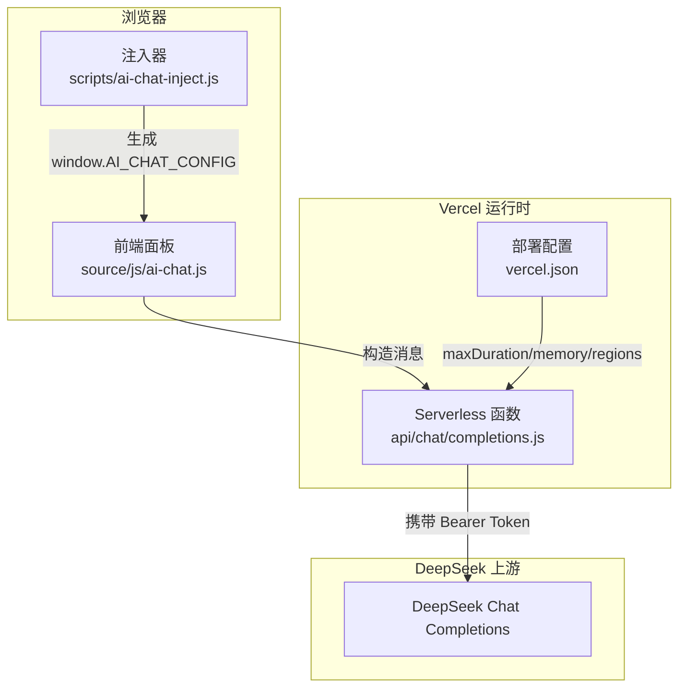
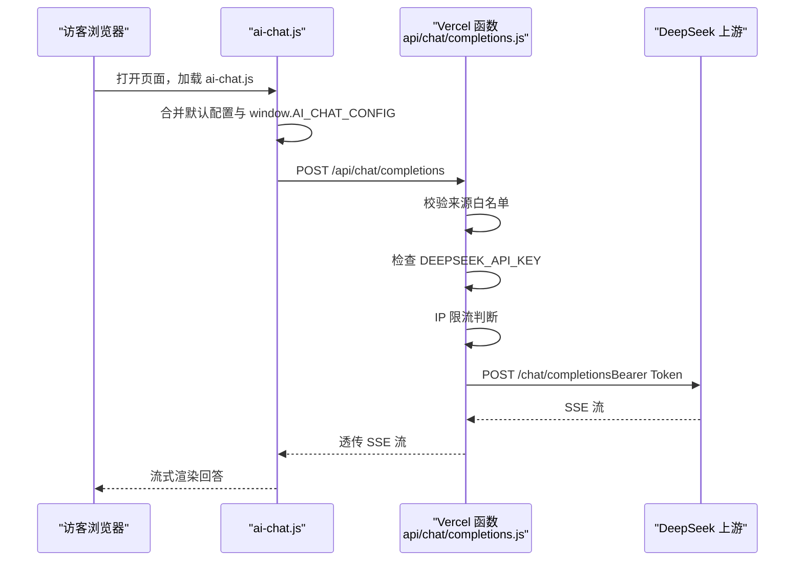
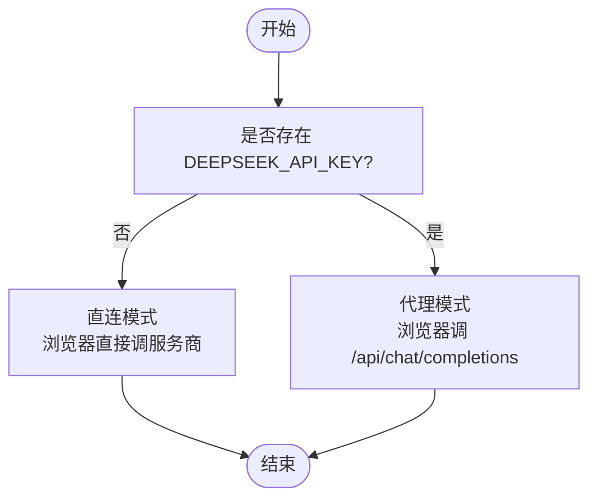
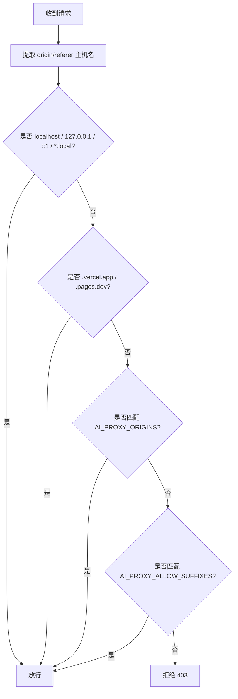
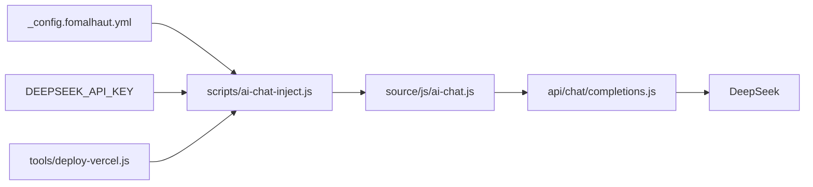

# 部署与配置

<cite>
**本文引用的文件**   
- [vercel.json](file://vercel.json)
- [api/chat/completions.js](file://api/chat/completions.js)
- [functions/api/chat/completions.js](file://functions/api/chat/completions.js)
- [scripts/ai-chat-inject.js](file://scripts/ai-chat-inject.js)
- [source/js/ai-chat.js](file://source/js/ai-chat.js)
- [tools/deploy-vercel.js](file://tools/deploy-vercel.js)
- [_config.fomalhaut.yml](file://_config.fomalhaut.yml)
- [README.md](file://README.md)
</cite>

## 目录
1. [引言](#引言)
2. [项目结构](#项目结构)
3. [核心组件](#核心组件)
4. [架构总览](#架构总览)
5. [详细组件分析](#详细组件分析)
6. [依赖关系分析](#依赖关系分析)
7. [性能与容量特性](#性能与容量特性)
8. [监控与日志](#监控与日志)
9. [常见问题排查](#常见问题排查)
10. [最佳实践建议](#最佳实践建议)
11. [结论](#结论)

## 引言
本指南面向需要在 Vercel 上部署博客 AI 聊天功能的读者，目标是给出从项目初始化、环境变量配置、域名绑定到构建脚本设置的完整流程，并解释直连模式、代理模式以及混合模式的适用场景。文档同时覆盖关键环境变量（如 `DEEPSEEK_API_KEY`、`DEEPSEEK_MODEL`、`AI_PROXY_ORIGINS`、`AI_PROXY_MAX_PER_HOUR`）、域名白名单策略、监控与日志思路，以及常见问题的排障方法。

## 项目结构
本项目是一个基于 Hexo 的博客站点，AI 聊天功能由“前端面板 + 注入器 + 服务端代理函数”三部分构成：
- 前端面板：`source/js/ai-chat.js`，负责 UI、对话历史、流式渲染等。
- 注入器：`scripts/ai-chat-inject.js`，在构建时向页面注入 `window.AI_CHAT_CONFIG` 和前端脚本。
- 服务端代理：`api/chat/completions.js`（Vercel Serverless Function），把浏览器请求转发给 DeepSeek。
- 平台适配实现：`functions/api/chat/completions.js`（Cloudflare Pages 函数）。
- 部署配置：`vercel.json` 声明函数超时、内存与区域。
- 本地一键部署脚本：`tools/deploy-vercel.js`，自动注入 API Key 并执行 Hexo 构建部署。
- 主题配置：`_config.fomalhaut.yml` 的 `ai_chat` 段控制开关、模型、温度、上下文长度等。
- 用户文档：`README.md` 说明两种用法（直连 / 同源代理）与常用配置项。

**图表来源**
- [source/js/ai-chat.js:1-45](file://source/js/ai-chat.js#L1-L45)
- [scripts/ai-chat-inject.js:71-100](file://scripts/ai-chat-inject.js#L71-L100)
- [api/chat/completions.js:118-208](file://api/chat/completions.js#L118-L208)
- [vercel.json:1-12](file://vercel.json#L1-L12)

**章节来源**
- [source/js/ai-chat.js:1-45](file://source/js/ai-chat.js#L1-L45)
- [scripts/ai-chat-inject.js:71-100](file://scripts/ai-chat-inject.js#L71-L100)
- [api/chat/completions.js:1-25](file://api/chat/completions.js#L1-L25)
- [vercel.json:1-12](file://vercel.json#L1-L12)

## 核心组件
- **前端面板**：提供悬浮按钮、可拖拽面板、Markdown 渲染、流式打字效果、本地历史存储、上下文统计显示。
- **注入器**：根据 `_config.fomalhaut.yml` 与构建环境中的 `DEEPSEEK_API_KEY`，决定前端走直连还是同源代理；若存在服务端 key，则把 `api_base` 改为 `/api`，并把 `api_key` 替换为占位符。
- **Vercel 代理函数**：校验来源白名单、读取 `DEEPSEEK_API_KEY`、限制请求频率、裁剪消息体、转发到上游接口，并以 SSE 流返回。
- **部署配置**：`vercel.json` 指定函数路径、最大运行时间、内存与区域。
- **一键部署脚本**：从 `.ai-chat-key` 或 YAML 中读取 key，设置环境变量后执行 `hexo clean/generate/deploy`。

**章节来源**
- [source/js/ai-chat.js:1-45](file://source/js/ai-chat.js#L1-L45)
- [scripts/ai-chat-inject.js:35-100](file://scripts/ai-chat-inject.js#L35-L100)
- [api/chat/completions.js:26-35](file://api/chat/completions.js#L26-L35)
- [vercel.json:1-12](file://vercel.json#L1-L12)
- [tools/deploy-vercel.js:35-82](file://tools/deploy-vercel.js#L35-L82)

## 架构总览
AI 聊天在 Vercel 上的推荐部署是“同源代理模式”：浏览器只访问同源的 `/api/chat/completions`，真实密钥保存在 Vercel 环境变量中，不会进入页面源码。

**图表来源**
- [source/js/ai-chat.js:33-44](file://source/js/ai-chat.js#L33-L44)
- [api/chat/completions.js:118-208](file://api/chat/completions.js#L118-L208)

## 详细组件分析

### Vercel 部署流程
1. **项目初始化**
   - 将仓库连接到 Vercel。
   - 确保根目录包含 `vercel.json`，其中已声明函数路径、超时、内存与区域。
2. **环境变量配置**
   - 在 Vercel 项目的 Environment Variables 中添加 `DEEPSEEK_API_KEY`。
   - 可选添加 `DEEPSEEK_MODEL`、`AI_PROXY_ORIGINS`、`AI_PROXY_MAX_PER_HOUR`、`DEEPSEEK_API_BASE`。
3. **域名绑定**
   - 在 Vercel 项目中绑定自定义域名。
   - 如需额外域名访问 AI 面板，通过 `AI_PROXY_ORIGINS` 或 `AI_PROXY_ALLOW_SUFFIXES` 放行。
4. **构建脚本设置**
   - 使用 `npm run deploy:vercel` 或 `node tools/deploy-vercel.js`，脚本会自动注入 `DEEPSEEK_API_KEY` 并执行 Hexo 构建部署。
   - 构建时若检测到 `DEEPSEEK_API_KEY`，注入器会把前端 `api_base` 改为 `/api`，避免真 key 进入页面。

**章节来源**
- [vercel.json:1-12](file://vercel.json#L1-L12)
- [api/chat/completions.js:13-21](file://api/chat/completions.js#L13-L21)
- [scripts/ai-chat-inject.js:83-92](file://scripts/ai-chat-inject.js#L83-L92)
- [tools/deploy-vercel.js:60-82](file://tools/deploy-vercel.js#L60-L82)

### 不同部署模式与适用场景
- **直连模式**
  - 浏览器直接调用 `api_base`（例如 `https://api.deepseek.com`）。
  - 适合本地开发或内网测试。
  - 风险：API Key 会随页面下发，任何人 F12 都能看到。
- **代理模式**
  - 浏览器调用同源 `/api/chat/completions`，服务端函数持有 `DEEPSEEK_API_KEY`。
  - 适合公网生产环境。
  - 优势：密钥不暴露、支持白名单、限流、统一错误处理。
- **混合模式**
  - 本地无 `DEEPSEEK_API_KEY` 时走直连；构建环境有 key 时走代理。
  - 由注入器根据 `process.env.DEEPSEEK_API_KEY` 决定是否切换 `api_base`。

**图表来源**
- [scripts/ai-chat-inject.js:83-92](file://scripts/ai-chat-inject.js#L83-L92)
- [source/js/ai-chat.js:33-44](file://source/js/ai-chat.js#L33-L44)

**章节来源**
- [README.md:959-972](file://README.md#L959-L972)
- [scripts/ai-chat-inject.js:83-92](file://scripts/ai-chat-inject.js#L83-L92)

### 环境变量配置详解
- **必填**
  - `DEEPSEEK_API_KEY`：DeepSeek 服务密钥，仅服务端使用。
- **可选**
  - `DEEPSEEK_MODEL`：模型名称，默认 `deepseek-chat`。
  - `AI_PROXY_ORIGINS`：额外放行的来源域名，逗号分隔；支持裸域名、通配符 `*.example.com`，填 `*` 表示全放行。
  - `AI_PROXY_ALLOW_SUFFIXES`：默认域名后缀列表，默认 `example.com`。
  - `AI_PROXY_MAX_PER_HOUR`：每 IP 每小时请求上限，默认 120。
  - `DEEPSEEK_API_BASE`：上游接口地址，默认 `https://api.deepseek.com`。

这些变量在 Vercel 的 Environment Variables 中配置，并在代理函数中读取。

**章节来源**
- [api/chat/completions.js:26-35](file://api/chat/completions.js#L26-L35)
- [api/chat/completions.js:47-54](file://api/chat/completions.js#L47-L54)
- [functions/api/chat/completions.js:13-20](file://functions/api/chat/completions.js#L13-L20)

### 域名白名单配置
代理函数对请求来源进行校验，逻辑如下：
- 始终放行：`localhost`、`127.0.0.1`、`::1`、`[::1]`、以 `.local` 结尾的域名。
- 平台预览域名：`.vercel.app`、`.pages.dev`。
- 额外域名：通过 `AI_PROXY_ORIGINS` 配置，支持：
  - 裸域名：自动补 `https://`。
  - 通配域名：`*.example.com`。
  - 全放行：`*`。
- 默认后缀：通过 `AI_PROXY_ALLOW_SUFFIXES` 配置，默认 `example.com`，匹配该域名及其子域。

**图表来源**
- [api/chat/completions.js:71-86](file://api/chat/completions.js#L71-L86)
- [functions/api/chat/completions.js:60-75](file://functions/api/chat/completions.js#L60-L75)

**章节来源**
- [api/chat/completions.js:47-86](file://api/chat/completions.js#L47-L86)
- [functions/api/chat/completions.js:36-75](file://functions/api/chat/completions.js#L36-L75)

### 监控与日志
当前代码未内置第三方监控 SDK，但可通过以下方式获得基础可观测性：
- **访问统计**
  - 使用 Vercel Analytics 或第三方统计脚本（项目已有 `51la.js`、`stats.js`）。
- **错误追踪**
  - 代理函数返回结构化错误对象，便于前端展示与服务端日志采集。
  - 可在 Vercel 函数日志中查看 `sendJson` 或 `fail` 的输出。
- **性能监控**
  - 前端流式渲染已做性能优化，减少强制布局。
  - 后端通过 `maxDuration`、`memory` 限制资源使用。

**章节来源**
- [api/chat/completions.js:37-42](file://api/chat/completions.js#L37-L42)
- [source/js/ai-chat.js:748-780](file://source/js/ai-chat.js#L748-L780)
- [vercel.json:1-12](file://vercel.json#L1-L12)

## 依赖关系分析
- 前端依赖注入器生成的 `window.AI_CHAT_CONFIG`。
- 注入器依赖 `_config.fomalhaut.yml` 与构建环境 `DEEPSEEK_API_KEY`。
- 代理函数依赖 Vercel 环境变量。
- 部署脚本依赖 `.ai-chat-key` 或 YAML 中的 key。

**图表来源**
- [scripts/ai-chat-inject.js:71-100](file://scripts/ai-chat-inject.js#L71-L100)
- [api/chat/completions.js:118-208](file://api/chat/completions.js#L118-L208)
- [tools/deploy-vercel.js:60-82](file://tools/deploy-vercel.js#L60-L82)

**章节来源**
- [scripts/ai-chat-inject.js:71-100](file://scripts/ai-chat-inject.js#L71-L100)
- [api/chat/completions.js:118-208](file://api/chat/completions.js#L118-L208)
- [tools/deploy-vercel.js:60-82](file://tools/deploy-vercel.js#L60-L82)

## 性能与容量特性
- **前端流式渲染**
  - 使用 `requestAnimationFrame` 与定时器合并 DOM 更新，避免频繁强制布局。
  - 滚动位置更新采用边界值赋值，减少读布局属性。
- **后端限流**
  - 按 IP 记录每小时请求数，超过阈值返回 429。
  - 内存中 Map 定期清理，防止无限增长。
- **函数资源**
  - `vercel.json` 设置 `maxDuration: 60`、`memory: 512`，区域为 `hkg1`。

**章节来源**
- [source/js/ai-chat.js:748-780](file://source/js/ai-chat.js#L748-L780)
- [api/chat/completions.js:103-110](file://api/chat/completions.js#L103-L110)
- [vercel.json:1-12](file://vercel.json#L1-L12)

## 监控与日志
- **访问统计**
  - 项目已集成 `51la.js` 与 `stats.js`，可用于基础访问统计。
- **错误追踪**
  - 代理函数返回结构化错误，便于前端提示与日志采集。
- **性能监控**
  - 前端流式渲染已优化，后端函数资源受限。

**章节来源**
- [source/js/ai-chat.js:748-780](file://source/js/ai-chat.js#L748-L780)
- [api/chat/completions.js:37-42](file://api/chat/completions.js#L37-L42)

## 常见问题排查
- **问题：页面显示“还没配 API Key”**
  - 原因：构建环境没有 `DEEPSEEK_API_KEY`，注入器退回到直连模式。
  - 解决：在 Vercel 环境变量中添加 `DEEPSEEK_API_KEY`，或使用 `tools/deploy-vercel.js` 自动注入。
- **问题：CORS 白名单拒绝**
  - 原因：访问来源不在白名单。
  - 解决：添加 `AI_PROXY_ORIGINS` 或调整 `AI_PROXY_ALLOW_SUFFIXES`。
- **问题：请求太频繁**
  - 原因：超过 `AI_PROXY_MAX_PER_HOUR` 限制。
  - 解决：降低请求频率或提高配额。
- **问题：上游连接失败**
  - 原因：DeepSeek 接口不可达或返回非 SSE。
  - 解决：检查 `DEEPSEEK_API_BASE` 与网络连通性。

**章节来源**
- [scripts/ai-chat-inject.js:83-92](file://scripts/ai-chat-inject.js#L83-L92)
- [api/chat/completions.js:133-141](file://api/chat/completions.js#L133-L141)
- [api/chat/completions.js:168-185](file://api/chat/completions.js#L168-L185)

## 最佳实践建议
- **生产环境务必使用代理模式**，避免密钥泄露。
- **合理配置白名单**，仅放行必要域名。
- **设置合理的限流阈值**，防止滥用。
- **使用 `.ai-chat-key` 管理密钥**，不要提交到仓库。
- **监控函数日志**，及时发现上游错误或限流问题。

**章节来源**
- [README.md:959-972](file://README.md#L959-L972)
- [api/chat/completions.js:47-86](file://api/chat/completions.js#L47-L86)

## 结论
本项目提供了完整的 AI 聊天功能部署方案，支持直连、代理与混合模式。推荐在生产环境使用 Vercel 代理模式，结合环境变量、域名白名单与限流机制，确保安全与稳定。通过前端流式渲染与后端函数资源限制，兼顾用户体验与性能。