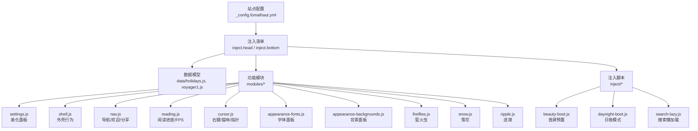
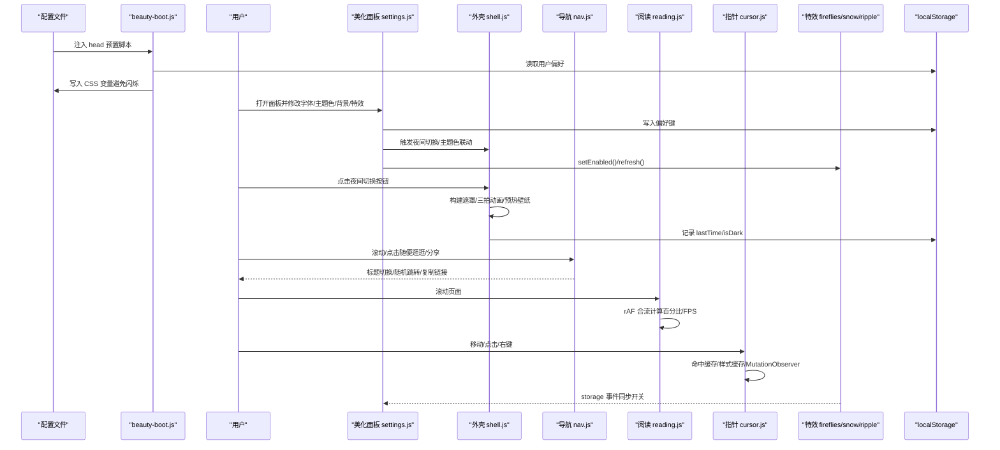
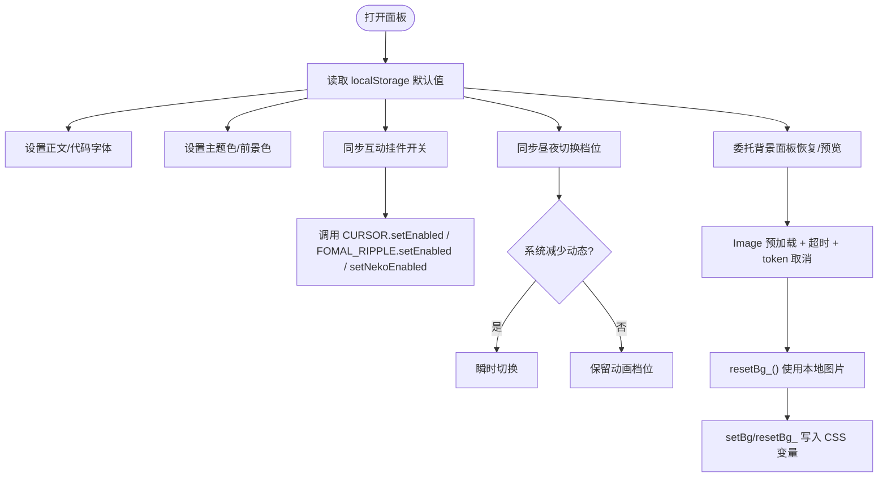
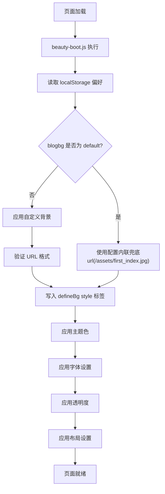
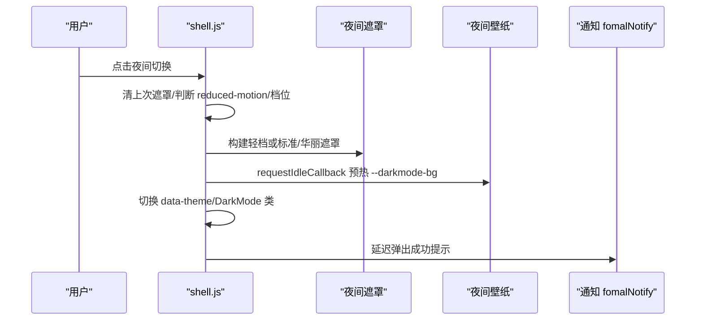
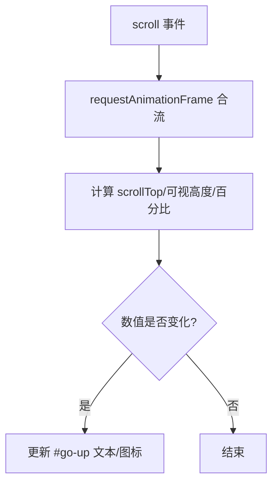
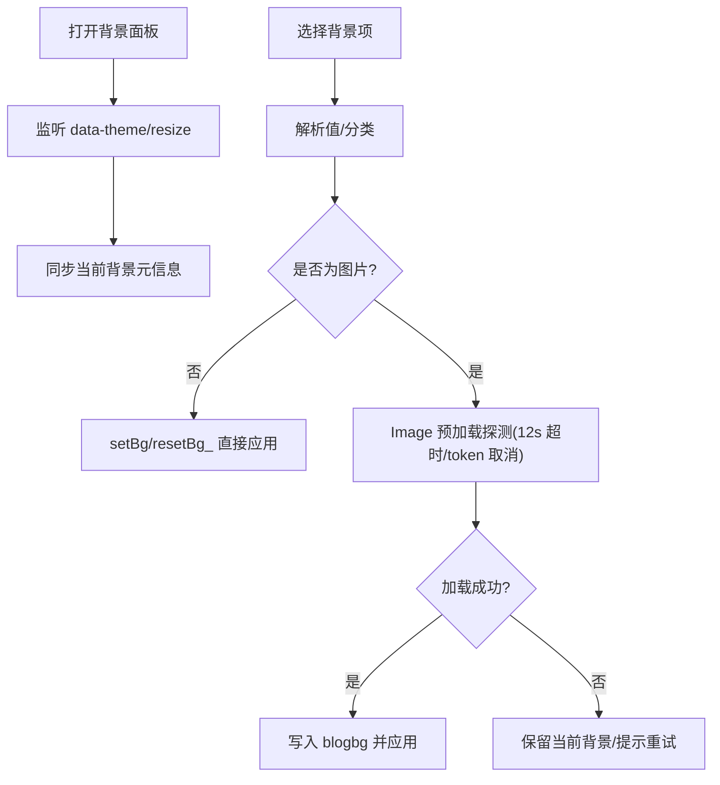
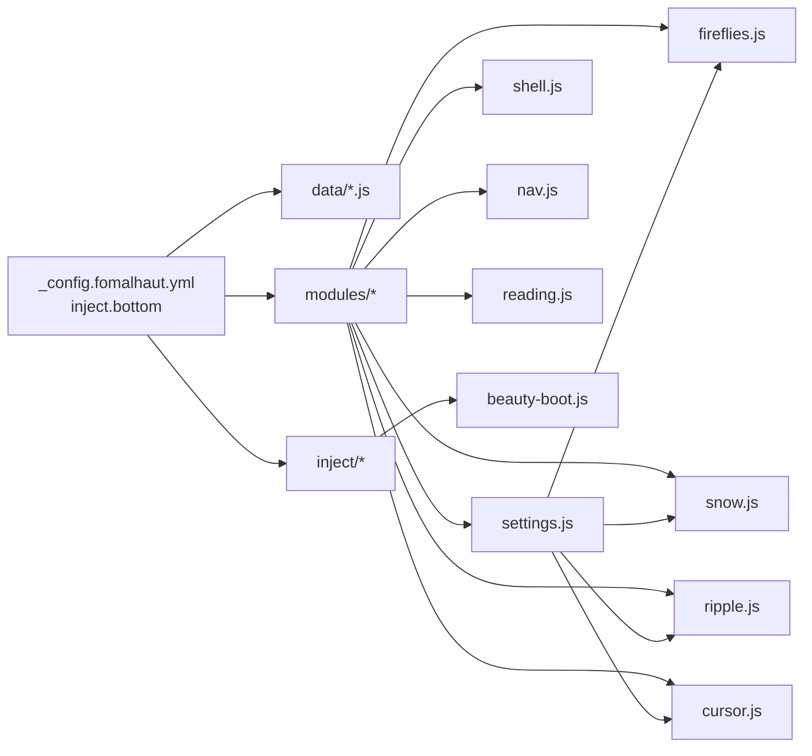

# JavaScript 模块系统

<cite>
**本文引用的文件**   
- [README.md](file://README.md)
- [_config.fomalhaut.yml](file://_config.fomalhaut.yml)
- [source/js/modules/settings.js](file://source/js/modules/settings.js)
- [source/js/inject/beauty-boot.js](file://source/js/inject/beauty-boot.js)
- [source/js/modules/shell.js](file://source/js/modules/shell.js)
- [source/js/modules/nav.js](file://source/js/modules/nav.js)
- [source/js/modules/reading.js](file://source/js/modules/reading.js)
- [source/js/modules/cursor.js](file://source/js/modules/cursor.js)
- [source/js/modules/appearance-fonts.js](file://source/js/modules/appearance-fonts.js)
- [source/js/modules/appearance-backgrounds.js](file://source/js/modules/appearance-backgrounds.js)
- [source/js/modules/fireflies.js](file://source/js/modules/fireflies.js)
- [source/js/modules/snow.js](file://source/js/modules/snow.js)
- [source/js/modules/ripple.js](file://source/js/modules/ripple.js)
</cite>

## 更新摘要
**变更内容**   
- 更新了美化设置面板章节，反映 resetBg_() 函数的增强功能
- 新增了首屏预置脚本章节，详细说明 beauty-boot.js 的改进
- 更新了背景系统架构说明，强调 URL 一致性要求
- 优化了性能考量部分，突出本地图片路径的优势

## 目录
1. [引言](#引言)
2. [项目结构](#项目结构)
3. [核心组件](#核心组件)
4. [架构总览](#架构总览)
5. [详细组件分析](#详细组件分析)
6. [依赖关系分析](#依赖关系分析)
7. [性能考量](#性能考量)
8. [故障排查指南](#故障排查指南)
9. [结论](#结论)
10. [附录：开发与扩展指南](#附录开发与扩展指南)

## 引言
本仓库是一个基于 Hexo 的卡片式博客主题，站点侧脚本从早期单文件拆分为"数据模型 + 功能模块 + 注入脚本"的结构。站点级 JS 通过配置注入加载，模块之间通过全局对象、事件与 localStorage 协作；美化面板负责用户偏好持久化与实时预览；站点外壳统一处理快捷键、夜间切换与搜索框交互；特效模块（萤火虫、雪花、涟漪）遵循"可关闭即停止"的性能原则。

**最新更新**：背景系统已优化为使用本地图片 `/assets/first_index.jpg` 作为所有模式的统一默认值，显著提升了首屏加载性能和用户体验的一致性。

## 项目结构
站点脚本组织方式如下：
- 数据模型：`source/js/data/`（页脚计时器、旅行者距离等纯数据）。
- 功能模块：`source/js/modules/`（设置面板、外壳行为、导航、阅读进度、鼠标、字体与背景、特效等）。
- 注入脚本：`source/js/inject/`（首屏预置、日夜模式、搜索懒加载、归档页增强等）。
- 独立功能脚本：按需引入或页面内联（AI 助手、日历、统计、评论等）。

图表来源
- [_config.fomalhaut.yml:1342-1353](file://_config.fomalhaut.yml#L1342-L1353)
- [README.md:527-589](file://README.md#L527-L589)

章节来源
- [README.md:259-340](file://README.md#L259-L340)
- [README.md:527-589](file://README.md#L527-L589)
- [_config.fomalhaut.yml:1342-1353](file://_config.fomalhaut.yml#L1342-L1353)

## 核心组件
- 美化设置面板：集中管理字体、主题色、背景、特效开关、透明度、侧栏布局等，所有选择写入 `localStorage`，并即时更新 CSS 变量与 DOM。
- **首屏预置脚本**：在页面渲染前快速应用用户偏好，避免闪烁，确保背景图、主题色、字体等立即生效。
- 站点外壳：拦截快捷键、夜间模式动画、标题恶搞、搜索框尺寸自适应、手机端滚动条绘制。
- 导航与欢迎：滚动时显示文章标题、首屏欢迎语、随机跳转、分享复制。
- 阅读进度与 FPS：节流合并滚动计算，按帧输出 FPS 状态。
- 指针相关：自定义右键菜单、小猫咪滚动条、可跟随与悬停变形的指针。
- 外观面板：字体与背景的分组预览、预加载校验、失败回退与取消。
- 特效模块：萤火虫（纯 CSS）、雪花（Canvas 分层）、涟漪（DOM 节点回收），均支持"减少动态效果"自动暂停。

章节来源
- [source/js/modules/settings.js:1-137](file://source/js/modules/settings.js#L1-L137)
- [source/js/inject/beauty-boot.js:1-81](file://source/js/inject/beauty-boot.js#L1-L81)
- [source/js/modules/shell.js:1-29](file://source/js/modules/shell.js#L1-L29)
- [source/js/modules/nav.js:1-26](file://source/js/modules/nav.js#L1-L26)
- [source/js/modules/reading.js:1-18](file://source/js/modules/reading.js#L1-L18)
- [source/js/modules/cursor.js:1-29](file://source/js/modules/cursor.js#L1-L29)
- [source/js/modules/appearance-fonts.js:1-24](file://source/js/modules/appearance-fonts.js#L1-L24)
- [source/js/modules/appearance-backgrounds.js:1-4](file://source/js/modules/appearance-backgrounds.js#L1-L4)
- [source/js/modules/fireflies.js:1-9](file://source/js/modules/fireflies.js#L1-L9)
- [source/js/modules/snow.js:1-10](file://source/js/modules/snow.js#L1-L10)
- [source/js/modules/ripple.js:1-9](file://source/js/modules/ripple.js#L1-L9)

## 架构总览
站点运行期由"配置注入 → 模块初始化 → 用户交互 → 状态持久化"构成闭环。模块间通信主要采用：
- 全局对象：如 `window.FOMAL_FIREFLIES`、`window.FOMAL_SNOW`、`window.FROM_RIPPLE`、`CURSOR`、`fomalNotify`。
- 事件总线：`pjax:complete`、`DOMContentLoaded`、`visibilitychange`、`storage`、`pointerdown` 等。
- 全局状态：`localStorage` 键值（如 `font`、`codeFont`、`blogbg`、`themeColor`、`nekoOn`、`cursorOn`、`rippleOn`、`snow`、`fireflies`、`darkTransition`）。
- 生命周期钩子：模块在 `DOMContentLoaded`、`pjax:complete`、`resize`、`pagehide/pageshow` 等时机刷新或清理。

图表来源
- [source/js/inject/beauty-boot.js:13-80](file://source/js/inject/beauty-boot.js#L13-L80)
- [source/js/modules/settings.js:238-295](file://source/js/modules/settings.js#L238-L295)
- [source/js/modules/shell.js:315-382](file://source/js/modules/shell.js#L315-L382)
- [source/js/modules/nav.js:178-229](file://source/js/modules/nav.js#L178-L229)
- [source/js/modules/reading.js:23-81](file://source/js/modules/reading.js#L23-L81)
- [source/js/modules/cursor.js:574-785](file://source/js/modules/cursor.js#L574-L785)
- [source/js/modules/fireflies.js:70-88](file://source/js/modules/fireflies.js#L70-L88)
- [source/js/modules/snow.js:150-178](file://source/js/modules/snow.js#L150-L178)
- [source/js/modules/ripple.js:106-121](file://source/js/modules/ripple.js#L106-L121)

## 详细组件分析

### 美化设置面板（settings.js）
职责与要点：
- 初始化默认项与旧键迁移，提供字体、代码字体、主题色、背景、透明度、侧栏位置、FPS、昼夜切换档位等控制。
- 主题色预设与自定义 HEX 校验，计算实底前景色 `--on-theme`，联动 GitCalendar 与光标颜色。
- 互动挂件开关（猫咪、听话鼠标、涟漪）与雪花/萤火虫互斥逻辑。
- 昼夜切换档位（off/light/standard/flourish）与"减少动态效果"自动瞬时切换。
- 背景面板委托 appearance-backgrounds.js，字体面板委托 appearance-fonts.js。

**更新**：`resetBg_()` 函数现已增强，使用本地图片路径 `/assets/first_index.jpg` 作为所有四种背景模式（default、darkmode、mobileday、mobilenight）的统一默认值，确保首屏加载的一致性和性能。

图表来源
- [source/js/modules/settings.js:114-137](file://source/js/modules/settings.js#L114-L137)
- [source/js/modules/settings.js:238-295](file://source/js/modules/settings.js#L238-L295)
- [source/js/modules/settings.js:299-335](file://source/js/modules/settings.js#L299-L335)
- [source/js/modules/settings.js:338-363](file://source/js/modules/settings.js#L338-L363)
- [source/js/modules/settings.js:751-774](file://source/js/modules/settings.js#L751-L774)

章节来源
- [source/js/modules/settings.js:1-137](file://source/js/modules/settings.js#L1-L137)
- [source/js/modules/settings.js:238-295](file://source/js/modules/settings.js#L238-L295)
- [source/js/modules/settings.js:299-335](file://source/js/modules/settings.js#L299-L335)
- [source/js/modules/settings.js:338-363](file://source/js/modules/settings.js#L338-L363)
- [source/js/modules/settings.js:751-774](file://source/js/modules/settings.js#L751-L774)

### 首屏预置脚本（beauty-boot.js）
职责与要点：
- 在页面渲染前快速执行，提前将用户偏好写入 CSS 变量，消除"刷新时先闪默认壁纸/字体，再跳成自定义"的一帧闪烁。
- 智能处理自定义壁纸：当 `blogbg` 为 `default` 或缺失时，不覆盖 `defineBg`，让配置里的内联兜底生效。
- 与 `settings.js` 的 `resetBg_()` 保持 URL 值完全一致，防止浏览器重复下载背景图。
- 同时处理主题色、字体、透明度、侧边栏等所有首屏关键样式。

**更新**：增强了自定义壁纸初始化逻辑，添加了更详细的注释说明 `blogbg` 设置与内联回退机制的关系，确保 URL 值与配置文件的 `<style id='defineBg'>` 完全匹配。

图表来源
- [source/js/inject/beauty-boot.js:13-80](file://source/js/inject/beauty-boot.js#L13-L80)

章节来源
- [source/js/inject/beauty-boot.js:1-81](file://source/js/inject/beauty-boot.js#L1-L81)

### 站点外壳（shell.js）
职责与要点：
- 快捷键拦截与防抖提示。
- 夜间模式切换：轻档转盘、标准/华丽档三拍剧场 + 圆形揭幕，连点二次收尾不重播，尊重"减少动态效果"。
- 标题恶搞：离开标签页改文案，返回后恢复。
- 搜索框修复：移动端 Algolia 结果区高度自适应。
- 手机端自绘滚动条：读阶段采样、写阶段更新，避免强制布局。

图表来源
- [source/js/modules/shell.js:100-127](file://source/js/modules/shell.js#L100-L127)
- [source/js/modules/shell.js:187-288](file://source/js/modules/shell.js#L187-L288)
- [source/js/modules/shell.js:292-313](file://source/js/modules/shell.js#L292-L313)
- [source/js/modules/shell.js:315-382](file://source/js/modules/shell.js#L315-L382)

章节来源
- [source/js/modules/shell.js:31-95](file://source/js/modules/shell.js#L31-L95)
- [source/js/modules/shell.js:100-127](file://source/js/modules/shell.js#L100-L127)
- [source/js/modules/shell.js:187-288](file://source/js/modules/shell.js#L187-L288)
- [source/js/modules/shell.js:292-313](file://source/js/modules/shell.js#L292-L313)
- [source/js/modules/shell.js:315-382](file://source/js/modules/shell.js#L315-L382)
- [source/js/modules/shell.js:424-439](file://source/js/modules/shell.js#L424-L439)
- [source/js/modules/shell.js:448-538](file://source/js/modules/shell.js#L448-L538)

### 导航与欢迎（nav.js）
职责与要点：
- 滚动到正文后顶栏中间淡入文章标题。
- 首屏欢迎语：腾讯位置服务 IP 定位，时间问候与距离计算，pjax 兼容。
- 随便逛逛：解析 sitemap 随机跳转同源相对路径。
- 分享按钮：复制标题与链接，防抖保护。

章节来源
- [source/js/modules/nav.js:32-65](file://source/js/modules/nav.js#L32-L65)
- [source/js/modules/nav.js:77-169](file://source/js/modules/nav.js#L77-L169)
- [source/js/modules/nav.js:178-229](file://source/js/modules/nav.js#L178-L229)

### 阅读进度与 FPS（reading.js）
职责与要点：
- 阅读进度：rAF 合流 scroll 回调，仅当百分比变化才写 DOM。
- FPS 检测：闭包封装，generation 防悬挂，后台挂起，可见性变化恢复。

图表来源
- [source/js/modules/reading.js:23-81](file://source/js/modules/reading.js#L23-L81)
- [source/js/modules/reading.js:87-184](file://source/js/modules/reading.js#L87-L184)

章节来源
- [source/js/modules/reading.js:23-81](file://source/js/modules/reading.js#L23-L81)
- [source/js/modules/reading.js:87-184](file://source/js/modules/reading.js#L87-L184)

### 指针与右键（cursor.js）
职责与要点：
- 小猫咪：高频输入只记最新值，下一帧先读几何再增量写，WeakMap 缓存样式，ResizeObserver 监听布局。
- 右键菜单：根据选中内容/元素类型动态显示菜单项，兼容 pjax。
- 听话鼠标：指针缓动拖尾，hover 可点元素变形，MutationObserver 过滤已知纯输出变更，WeakMap 缓存命中结果。

章节来源
- [source/js/modules/cursor.js:31-224](file://source/js/modules/cursor.js#L31-L224)
- [source/js/modules/cursor.js:228-537](file://source/js/modules/cursor.js#L228-L537)
- [source/js/modules/cursor.js:539-800](file://source/js/modules/cursor.js#L539-L800)

### 字体面板（appearance-fonts.js）
职责与要点：
- 分组展示阅读字体与代码字体，当前选择高亮，预览区实时更新。
- 使用 `document.fonts.load` 校验字体加载，12 秒超时，最新请求胜，失败不写偏好并可重试。
- 重置仅恢复两个字体键，不影响其他设置。

章节来源
- [source/js/modules/appearance-fonts.js:1-121](file://source/js/modules/appearance-fonts.js#L1-L121)

### 背景面板（appearance-backgrounds.js）
职责与要点：
- 分类懒渲染缩略图，打开分类才赋 `src`，切换走 `Image` 预加载 + 12 秒超时 + token 取消。
- 自定义图片链接 HTTPS 校验，预览验证成功后才可应用到全站。
- 恢复默认背景时先同步本地保存值，避免首闪默认图。

图表来源
- [source/js/modules/appearance-backgrounds.js:424-449](file://source/js/modules/appearance-backgrounds.js#L424-L449)
- [source/js/modules/appearance-backgrounds.js:560-598](file://source/js/modules/appearance-backgrounds.js#L560-L598)
- [source/js/modules/appearance-backgrounds.js:601-631](file://source/js/modules/appearance-backgrounds.js#L601-L631)
- [source/js/modules/appearance-backgrounds.js:640-668](file://source/js/modules/appearance-backgrounds.js#L640-L668)

章节来源
- [source/js/modules/appearance-backgrounds.js:424-449](file://source/js/modules/appearance-backgrounds.js#L424-L449)
- [source/js/modules/appearance-backgrounds.js:560-598](file://source/js/modules/appearance-backgrounds.js#L560-L598)
- [source/js/modules/appearance-backgrounds.js:601-631](file://source/js/modules/appearance-backgrounds.js#L601-L631)
- [source/js/modules/appearance-backgrounds.js:640-668](file://source/js/modules/appearance-backgrounds.js#L640-L668)

### 特效模块（fireflies.js / snow.js / ripple.js）
共同特性：
- 受"减少动态效果"影响自动暂停或禁用。
- 通过 `pjax:complete`、`visibilitychange`、`storage` 等事件保持状态一致。
- 关闭即停止：萤火虫移除 DOM 层，雪花停止 rAF 清空画布，涟漪解绑 pointerdown 并回收节点。

章节来源
- [source/js/modules/fireflies.js:1-89](file://source/js/modules/fireflies.js#L1-L89)
- [source/js/modules/snow.js:1-179](file://source/js/modules/snow.js#L1-L179)
- [source/js/modules/ripple.js:1-122](file://source/js/modules/ripple.js#L1-L122)

## 依赖关系分析
- 加载顺序由 `_config.fomalhaut.yml` 的 `inject.bottom` 决定，先数据模型，再模块，最后主引导。
- 模块对外暴露全局 API：
  - `FOMAL_FIREFLIES`、`FOMAL_SNOW`、`FOMAL_RIPPLE`：供 settings.js 控制开关与同步 UI。
  - `CURSOR`：供 settings.js 启用/禁用指针。
  - `fomalNotify`：通用通知组件。
- 事件耦合：
  - `pjax:complete`：导航标题、欢迎语、FPS、特效刷新、指针重建。
  - `storage`：特效模块跨标签同步开关。
  - `visibilitychange`：FPS 与特效挂起/恢复。

图表来源
- [_config.fomalhaut.yml:1342-1353](file://_config.fomalhaut.yml#L1342-L1353)
- [source/js/modules/settings.js:299-335](file://source/js/modules/settings.js#L299-L335)
- [source/js/modules/fireflies.js:70-88](file://source/js/modules/fireflies.js#L70-L88)
- [source/js/modules/snow.js:150-178](file://source/js/modules/snow.js#L150-L178)
- [source/js/modules/ripple.js:106-121](file://source/js/modules/ripple.js#L106-L121)

章节来源
- [_config.fomalhaut.yml:1342-1353](file://_config.fomalhaut.yml#L1342-L1353)
- [source/js/modules/settings.js:299-335](file://source/js/modules/settings.js#L299-L335)
- [source/js/modules/fireflies.js:70-88](file://source/js/modules/fireflies.js#L70-L88)
- [source/js/modules/snow.js:150-178](file://source/js/modules/snow.js#L150-L178)
- [source/js/modules/ripple.js:106-121](file://source/js/modules/ripple.js#L106-L121)

## 性能考量
- **首屏优化**：beauty-boot.js 在 head 中同步执行，提前写入 CSS 变量避免闪烁；夜间壁纸空闲预热；字体 preload。
- **本地资源优先**：默认背景图使用本地路径 `/assets/first_index.jpg`，减少网络请求，提升加载速度。
- **URL 一致性保障**：settings.js 的 `resetBg_()` 与 beauty-boot.js 的默认值严格保持一致，防止浏览器重复下载同一张图片。
- 懒加载：搜索脚本按需拉取；背景缩略图仅在分类打开时赋值 `src`；字体按需 `document.fonts.load`。
- 内存管理：特效关闭时清理定时器、rAF、Observer 与 DOM；涟漪同屏上限与 TTL 回收；雪花 epoch 防过期回调。
- 事件监听优化：滚动事件 passive；FPS 与阅读进度用 rAF 合流；指针命中与样式 WeakMap 缓存；MutationObserver 精确豁免已知输出节点。

[本节为通用指导，不直接分析具体文件]

## 故障排查指南
常见问题与定位建议：
- **背景图重复下载问题**：检查 `settings.js` 的 `resetBg_()` 与 `_config.fomalhaut.yml` 中的 `<style id="defineBg">` 是否使用相同的 URL 值。
- 夜间切换卡顿或白屏：检查"减少动态效果"与档位设置；确认夜间壁纸预热是否执行；查看遮罩节点是否被重复创建。
- 背景闪烁或加载失败：确认 `blogbg` 值是否合法；查看 Image 探针是否超时；尝试"重试加载"。
- 字体未生效：确认浏览器是否支持 `document.fonts.load`；检查 12 秒超时与"最新请求胜"逻辑；重试失败选项。
- 特效不消失：检查对应开关是否真正调用 `setEnabled(false)`；确认 `pjax:complete` 后是否重新 refresh。
- 滚动掉帧：确认阅读进度与 FPS 是否开启；检查是否有重复 scroll 绑定或假节流。

章节来源
- [source/js/modules/settings.js:751-774](file://source/js/modules/settings.js#L751-L774)
- [source/js/inject/beauty-boot.js:26-31](file://source/js/inject/beauty-boot.js#L26-L31)
- [_config.fomalhaut.yml:1210-1213](file://_config.fomalhaut.yml#L1210-L1213)
- [source/js/modules/shell.js:315-382](file://source/js/modules/shell.js#L315-L382)
- [source/js/modules/appearance-backgrounds.js:560-598](file://source/js/modules/appearance-backgrounds.js#L560-L598)
- [source/js/modules/appearance-fonts.js:74-95](file://source/js/modules/appearance-fonts.js#L74-L95)
- [source/js/modules/fireflies.js:70-88](file://source/js/modules/fireflies.js#L70-L88)
- [source/js/modules/snow.js:150-178](file://source/js/modules/snow.js#L150-L178)
- [source/js/modules/ripple.js:106-121](file://source/js/modules/ripple.js#L106-L121)
- [source/js/modules/reading.js:23-81](file://source/js/modules/reading.js#L23-L81)

## 结论
该 JavaScript 模块系统以"配置注入 + 模块化拆分"为核心，将站点外壳、美化面板、导航、阅读进度、指针与特效解耦。模块间通过全局对象、事件与 localStorage 协作，兼顾用户体验与性能。**最新的背景系统优化通过使用本地图片和严格的 URL 一致性保证，显著提升了首屏加载性能和视觉体验的一致性**。新增功能应遵循现有命名规范与生命周期约定，优先使用 CSS 变量与可控开关，确保可关闭即停止。

[本节为总结性内容，不直接分析具体文件]

## 附录：开发与扩展指南
- 命名规范
  - 模块文件放在 `source/js/modules/`，注入脚本放在 `source/js/inject/`。
  - 对外暴露的全局对象使用大写前缀（如 `FOMAL_*`），避免污染全局。
  - 偏好键集中在 `localStorage`，键名语义清晰（如 `font`、`codeFont`、`blogbg`、`themeColor`、`nekoOn`、`cursorOn`、`rippleOn`、`snow`、`fireflies`、`darkTransition`）。
- 调试技巧
  - 控制台自检：`__fomal.check()`（见 README 说明）。
  - 观察事件：监听 `pjax:complete`、`visibilitychange`、`storage` 等关键事件。
  - 性能观测：开启 FPS 面板，关注强制布局与长任务。
- 测试方法
  - 回归脚本位于 `tools/tests/`，使用 Node 自带 `node:test`，无需额外依赖。
  - 新增模块应补充对应测试，覆盖开关启停、状态同步、pjax 重入与减少动态效果分支。
- 最佳实践
  - 首屏关键链尽量短，非关键功能延迟或按需加载。
  - 所有动画与轮询必须可停止，并在隐藏/后台时挂起。
  - 使用 CSS 变量驱动主题色与背景，避免硬编码颜色。
  - 对第三方接口增加超时与失败回退，保证降级可用。
  - **背景图 URL 一致性**：确保 `settings.js` 的 `resetBg_()` 与配置文件中的 `<style id="defineBg">` 使用完全相同的 URL 值，避免重复下载。

章节来源
- [README.md:527-589](file://README.md#L527-L589)
- [README.md:605-626](file://README.md#L605-L626)
- [source/js/modules/settings.js:114-137](file://source/js/modules/settings.js#L114-L137)
- [source/js/modules/settings.js:751-774](file://source/js/modules/settings.js#L751-L774)
- [source/js/inject/beauty-boot.js:26-31](file://source/js/inject/beauty-boot.js#L26-L31)
- [_config.fomalhaut.yml:1210-1213](file://_config.fomalhaut.yml#L1210-L1213)
- [source/js/modules/fireflies.js:70-88](file://source/js/modules/fireflies.js#L70-L88)
- [source/js/modules/snow.js:150-178](file://source/js/modules/snow.js#L150-L178)
- [source/js/modules/ripple.js:106-121](file://source/js/modules/ripple.js#L106-L121)