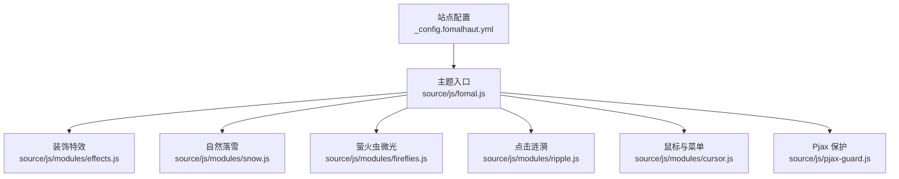
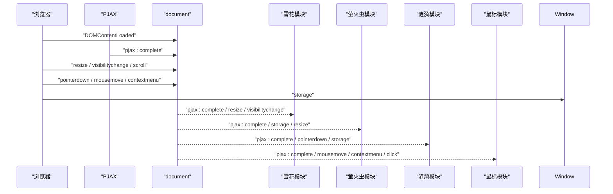
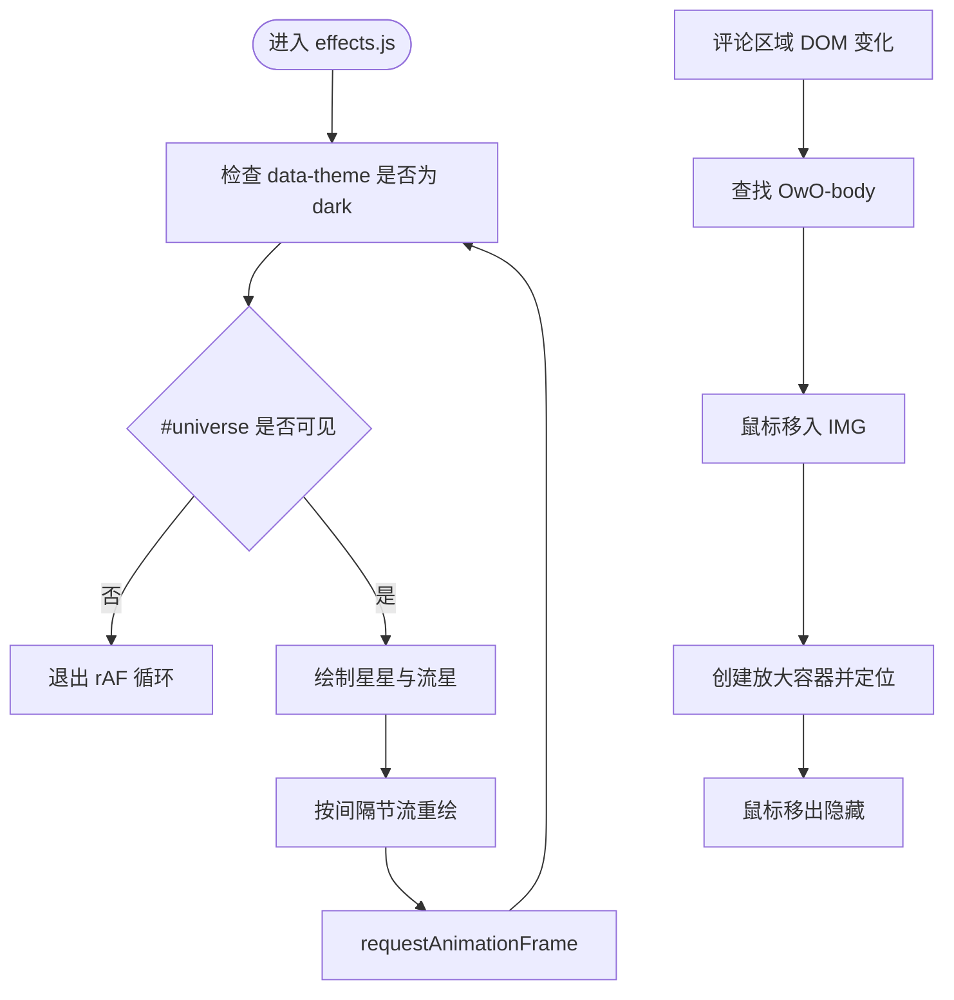
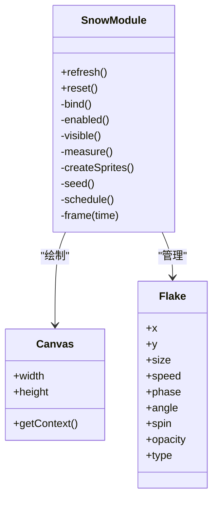
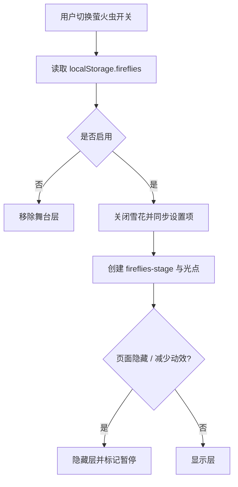
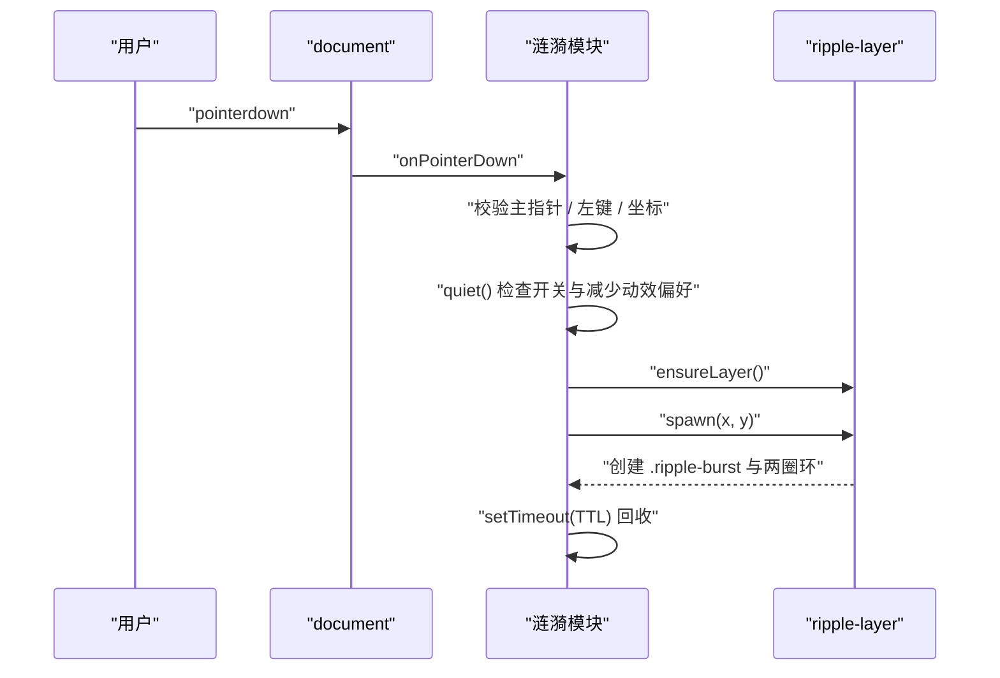
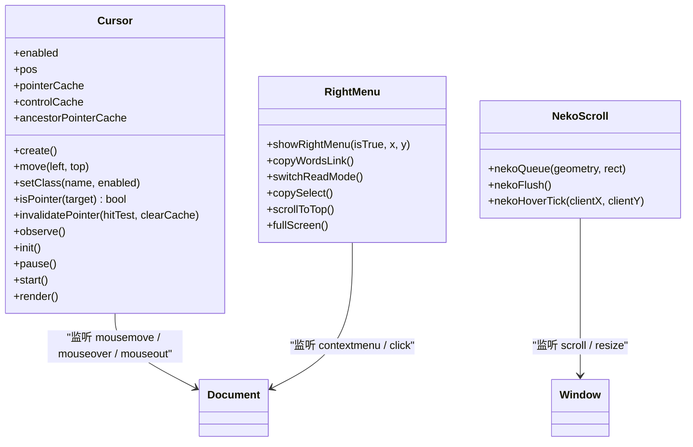
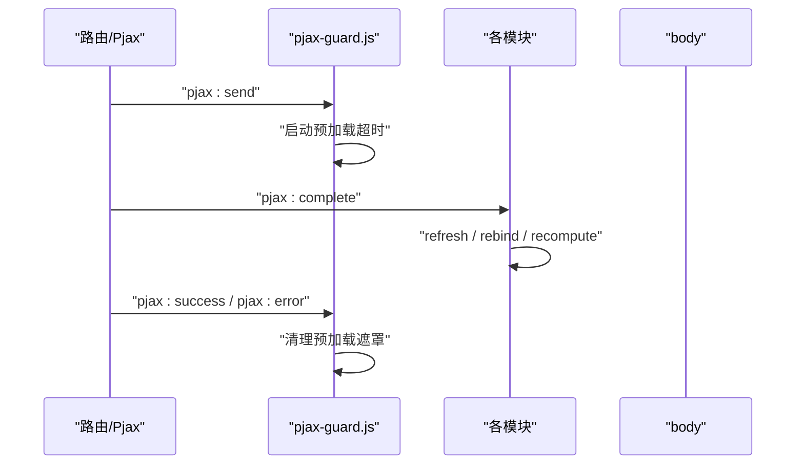
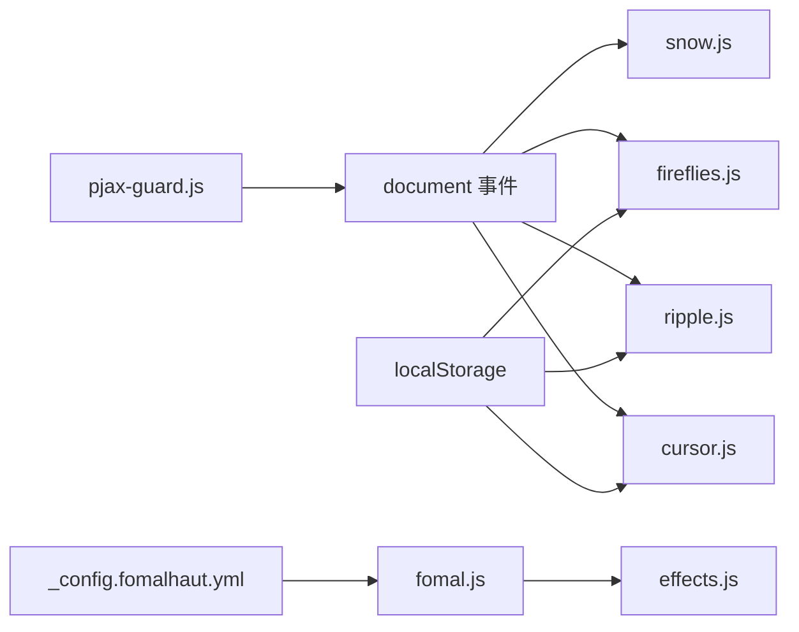

# 事件系统与通信

<cite>
**本文引用的文件**   
- [effects.js](file://source/js/modules/effects.js)
- [ripple.js](file://source/js/modules/ripple.js)
- [snow.js](file://source/js/modules/snow.js)
- [fireflies.js](file://source/js/modules/fireflies.js)
- [cursor.js](file://source/js/modules/cursor.js)
- [fomal.js](file://source/js/fomal.js)
- [pjax-guard.js](file://source/js/pjax-guard.js)
- [_config.fomalhaut.yml](file://_config.fomalhaut.yml)
</cite>

## 目录
1. [引言](#引言)
2. [项目结构](#项目结构)
3. [核心组件](#核心组件)
4. [架构总览](#架构总览)
5. [详细组件分析](#详细组件分析)
6. [依赖关系分析](#依赖关系分析)
7. [性能考量](#性能考量)
8. [故障排查指南](#故障排查指南)
9. [结论](#结论)
10. [附录：扩展与调试](#附录扩展与调试)

## 引言
本仓库没有实现一个显式的“自定义事件总线”对象，而是采用浏览器原生事件作为跨模块通信的骨干：以 `document` 上的标准事件（如 `pjax:complete`、`visibilitychange`、`resize`、`scroll`）和全局状态（如 `localStorage`、全局变量、全局函数）完成模块间的松耦合协作。视觉效果模块通过监听这些事件来启动、暂停或刷新自身；交互模块则通过 DOM 事件处理点击、右键、鼠标轨迹等用户行为。

这种设计让各模块保持独立，但也意味着“事件契约”主要散落在多个脚本中，需要统一梳理才能理解整体通信机制。

## 项目结构
从事件与通信角度，关键代码集中在以下位置：
- 页面装饰与动画：`source/js/modules/effects.js`、`source/js/modules/snow.js`、`source/js/modules/fireflies.js`
- 鼠标与交互：`source/js/modules/cursor.js`、`source/js/modules/ripple.js`
- 主题入口与加载说明：`source/js/fomal.js`、`_config.fomalhaut.yml`
- Pjax 生命周期保护：`source/js/pjax-guard.js`

**图表来源**
- [_config.fomalhaut.yml:1279-1342](file://_config.fomalhaut.yml#L1279-L1342)
- [fomal.js:18-35](file://source/js/fomal.js#L18-L35)

**章节来源**
- [_config.fomalhaut.yml:1279-1342](file://_config.fomalhaut.yml#L1279-L1342)
- [fomal.js:18-35](file://source/js/fomal.js#L18-L35)

## 核心组件
本节从“事件系统”视角归纳仓库中的关键参与者：

| 组件 | 职责 | 主要事件 / 通信方式 |
|---|---|---|
| 装饰特效模块 | 星空背景、表情放大 | 监听 `pjax:complete`、`DOMContentLoaded`；使用 MutationObserver 观察主题属性变化 |
| 雪花模块 | Canvas 雪花飘落与底部积雪 | 监听 `pjax:complete`、`visibilitychange`、`resize`、`load`、`transitionend`、`animationend`、`storage`、`pagehide/pageshow` |
| 萤火虫模块 | CSS 动画微光，与雪花互斥 | 监听 `pjax:complete`、`visibilitychange`、`resize`、`storage`、`prefers-reduced-motion` |
| 涟漪模块 | 点击处水波纹 | 监听 `pointerdown`、`pjax:complete`、`storage`、`prefers-reduced-motion` |
| 鼠标模块 | 右键菜单、小猫咪、自定义指针 | 监听 `contextmenu`、`mousemove`、`click`、`pjax:complete`、`visibilitychange`、`MutationObserver` |
| Pjax 保护 | 预加载遮罩、构造器守卫 | 监听 `pjax:send`、`pjax:success`、`pjax:error`、`pjax:complete` |

**章节来源**
- [effects.js:27-124](file://source/js/modules/effects.js#L27-L124)
- [effects.js:130-189](file://source/js/modules/effects.js#L130-L189)
- [snow.js:150-178](file://source/js/modules/snow.js#L150-L178)
- [fireflies.js:69-88](file://source/js/modules/fireflies.js#L69-L88)
- [ripple.js:106-122](file://source/js/modules/ripple.js#L106-L122)
- [cursor.js:231-467](file://source/js/modules/cursor.js#L231-L467)
- [cursor.js:728-785](file://source/js/modules/cursor.js#L728-L785)
- [pjax-guard.js:118-142](file://source/js/pjax-guard.js#L118-L142)

## 架构总览
仓库的事件通信可以理解为“基于文档事件的发布订阅模型”：

- **发布者**：浏览器（DOM 事件）、Pjax（自定义文档事件）、存储 API（`storage` 事件）、媒体查询（`prefers-reduced-motion`）。
- **订阅者**：各个效果模块和交互模块。
- **共享状态**：`localStorage` 中的开关键（如 `snow`、`fireflies`、`rippleOn`、`mouse`、`nekoOn`、`cursorOn`），以及少数全局变量（如 `mouseMode`、`CURSOR`）。

**图表来源**
- [snow.js:162-178](file://source/js/modules/snow.js#L162-L178)
- [fireflies.js:72-88](file://source/js/modules/fireflies.js#L72-L88)
- [ripple.js:111-122](file://source/js/modules/ripple.js#L111-L122)
- [cursor.js:728-785](file://source/js/modules/cursor.js#L728-L785)

## 详细组件分析

### 装饰特效：星空与表情放大
- 星空背景在暗色主题下渲染 Canvas，并通过可见性判断和帧率限制降低重绘压力。
- 表情放大功能监听评论区域 DOM 变化，对 Emoji 图片提供悬停放大预览。

**图表来源**
- [effects.js:27-124](file://source/js/modules/effects.js#L27-L124)
- [effects.js:130-189](file://source/js/modules/effects.js#L130-L189)

**章节来源**
- [effects.js:27-124](file://source/js/modules/effects.js#L27-L124)
- [effects.js:130-189](file://source/js/modules/effects.js#L130-L189)

### 自然落雪：雪花模块
雪花模块是一个完整的 Canvas 动画子系统，具备以下特性：
- 时间驱动动画，避免无意义重绘。
- 根据视口、像素比、设备类型、主题、可见性、减少动态效果偏好决定是否运行。
- 缓存雪片精灵图，减少每帧几何计算。
- 底部积雪使用深度数组插值绘制。
- 通过 MutationObserver 观察主题属性变化，触发重新测量。

**图表来源**
- [snow.js:1-178](file://source/js/modules/snow.js#L1-L178)

**章节来源**
- [snow.js:1-178](file://source/js/modules/snow.js#L1-L178)

### 萤火虫微光：CSS 动画与雪花互斥
萤火虫模块不依赖 Canvas 或 rAF 循环，而是通过少量 DOM 节点配合 CSS 动画实现微光效果。它还与雪花模块存在互斥逻辑：开启萤火虫时自动关闭雪花，反之亦然。

**图表来源**
- [fireflies.js:39-88](file://source/js/modules/fireflies.js#L39-L88)

**章节来源**
- [fireflies.js:1-90](file://source/js/modules/fireflies.js#L1-L90)

### 点击涟漪：事件委托与内存回收
涟漪模块遵循“按需创建、限时销毁”的原则：
- 只在真正按下左键且非减少动效偏好时创建 DOM。
- 同屏最多保留固定数量的涟漪，超出则回收最老的一个。
- 使用 `setTimeout` 兜底清理，避免元素泄漏。
- 通过 `FOMAL_RIPPLE` 暴露 `setEnabled`、`refresh`、`syncControls`，供外部控制。

**图表来源**
- [ripple.js:52-122](file://source/js/modules/ripple.js#L52-L122)

**章节来源**
- [ripple.js:1-123](file://source/js/modules/ripple.js#L1-L123)

### 鼠标交互：右键菜单、小猫咪、自定义指针
鼠标模块包含三个相对独立的功能：

1. **右键菜单**
   - 拦截 `contextmenu`，根据目标元素类型显示不同菜单项。
   - 支持复制链接、打开新标签、复制选中文字、粘贴、回到顶部、全屏等。
   - 通过遮罩层防止点击穿透，并在窗口缩放时隐藏菜单。

2. **小猫咪滚动条**
   - 跟随滚动进度显示右侧滚动条与小猫。
   - 使用 `requestAnimationFrame` 合并高频更新。
   - 监听 `mousemove`、`scroll`、`resize`、`visibilitychange`。

3. **自定义指针**
   - 使用类 `Cursor` 管理指针位置、hover 状态、active 状态。
   - 使用 `WeakMap` 缓存命中结果，减少重复样式查询。
   - 使用 `MutationObserver` 精确失效策略，避免无关变更导致全量重建。

**图表来源**
- [cursor.js:574-838](file://source/js/modules/cursor.js#L574-L838)
- [cursor.js:231-467](file://source/js/modules/cursor.js#L231-L467)
- [cursor.js:31-224](file://source/js/modules/cursor.js#L31-L224)

**章节来源**
- [cursor.js:231-467](file://source/js/modules/cursor.js#L231-L467)
- [cursor.js:31-224](file://source/js/modules/cursor.js#L31-L224)
- [cursor.js:574-838](file://source/js/modules/cursor.js#L574-L838)

### Pjax 生命周期与全局事件协调
Pjax 是全站异步换页的核心，仓库中大量模块通过监听 `pjax:complete`、`pjax:success`、`pjax:error`、`pjax:send` 来恢复状态、清理定时器、重新初始化 UI。

**图表来源**
- [pjax-guard.js:118-142](file://source/js/pjax-guard.js#L118-L142)
- [snow.js:165-166](file://source/js/modules/snow.js#L165-L166)
- [fireflies.js:72-73](file://source/js/modules/fireflies.js#L72-L73)
- [ripple.js:111-111](file://source/js/modules/ripple.js#L111-L111)
- [cursor.js:770-770](file://source/js/modules/cursor.js#L770-L770)

**章节来源**
- [pjax-guard.js:118-142](file://source/js/pjax-guard.js#L118-L142)

## 依赖关系分析
从事件与模块耦合角度看：

- **低耦合**：大多数效果模块只依赖 `document` 事件和 `localStorage`，不直接调用其他模块函数。
- **隐式耦合**：萤火虫与雪花通过 `localStorage` 键和 UI 控件互相影响，属于“状态级耦合”。
- **全局入口耦合**：`fomal.js` 注释指出模板中存在大量内联 `onclick` 和全局函数调用，因此部分模块必须暴露全局函数或变量。
- **Pjax 耦合**：所有需要随页面内容更新的模块都依赖 `pjax:complete`，这是事实上的“全局事件总线”。

**图表来源**
- [pjax-guard.js:118-142](file://source/js/pjax-guard.js#L118-L142)
- [snow.js:162-178](file://source/js/modules/snow.js#L162-L178)
- [fireflies.js:72-88](file://source/js/modules/fireflies.js#L72-L88)
- [ripple.js:111-122](file://source/js/modules/ripple.js#L111-L122)
- [cursor.js:728-785](file://source/js/modules/cursor.js#L728-L785)
- [fomal.js:18-35](file://source/js/fomal.js#L18-L35)

**章节来源**
- [fomal.js:18-35](file://source/js/fomal.js#L18-L35)

## 性能考量
仓库在事件与动画方面已经做了多项优化，值得总结为通用实践：

| 优化点 | 实现方式 | 适用场景 |
|---|---|---|
| 事件委托 | 在 `document` 上监听 `pointerdown`、`mousemove`、`contextmenu` 等，避免为每个子元素绑定监听器 | 高频事件、动态 DOM |
| 帧调度合并 | 使用 `requestAnimationFrame` 合并高频输入，避免每毫秒多次布局 | 鼠标移动、滚动、动画 |
| 可见性判断 | 星空、雪花、萤火虫在不可见或减少动效偏好下停止或暂停 | Canvas/CSS 动画 |
| 节流与上限 | 星空按固定间隔重绘；涟漪同屏数量上限；涟漪使用 `setTimeout` 兜底回收 | 动画循环、临时 DOM |
| 缓存与弱引用 | 自定义指针使用 `WeakMap` 缓存命中结果；样式值缓存避免重复比较 | 命中测试、样式计算 |
| 精确失效 | 雪花、星空、自定义指针使用 MutationObserver 的细粒度判断，避免无关变更触发全量重建 | 主题切换、DOM 更新 |
| 被动监听 | 滚动、鼠标事件使用 `{ passive: true }`，减少阻塞滚动 | 高频滚动与鼠标事件 |
| 存储事件同步 | 通过 `window.addEventListener('storage', ...)` 同步多标签页设置 | 设置开关、主题偏好 |

**章节来源**
- [effects.js:71-124](file://source/js/modules/effects.js#L71-L124)
- [snow.js:30-43](file://source/js/modules/snow.js#L30-L43)
- [snow.js:124-149](file://source/js/modules/snow.js#L124-L149)
- [ripple.js:17-24](file://source/js/modules/ripple.js#L17-L24)
- [ripple.js:52-70](file://source/js/modules/ripple.js#L52-L70)
- [cursor.js:574-655](file://source/js/modules/cursor.js#L574-L655)
- [cursor.js:728-785](file://source/js/modules/cursor.js#L728-L785)

## 故障排查指南
常见问题与定位建议：

| 问题 | 可能原因 | 排查步骤 |
|---|---|---|
| 雪花不出现 | 主题不是暗色、Canvas 被隐藏、移动端或减少动效偏好 | 检查 `data-theme`、Canvas 的 `display`、`prefers-reduced-motion`、`localStorage.snow` |
| 萤火虫与雪花同时出现 | 设置未同步或手动修改了存储键 | 检查 `localStorage.fireflies`、`localStorage.snow`，确认互斥逻辑 |
| 涟漪一直不出现 | 开关未开启、系统偏好减少动效、非左键或非主指针 | 检查 `localStorage.rippleOn`、`prefers-reduced-motion`、事件按钮值 |
| 右键菜单不显示 | 鼠标模式被关闭、移动端未启用、菜单元素不存在 | 检查 `localStorage.mouse`、`mouseMode`、`#rightMenu` |
| 自定义指针卡住 | 频繁样式读取、MutationObserver 误判、rAF 未取消 | 检查 `__raf`、`pointerCache`、`MutationObserver` 记录 |
| Pjax 后效果异常 | 模块未监听 `pjax:complete` 或未正确 refresh | 搜索模块中的 `pjax:complete` 监听，确认 `refresh()` 逻辑 |
| 内存泄漏 | 定时器未清理、DOM 未移除、监听器未解绑 | 检查 `setTimeout`、`clearTimeout`、`removeEventListener`、`disconnect` |

**章节来源**
- [snow.js:30-43](file://source/js/modules/snow.js#L30-L43)
- [fireflies.js:39-88](file://source/js/modules/fireflies.js#L39-L88)
- [ripple.js:19-24](file://source/js/modules/ripple.js#L19-L24)
- [ripple.js:106-122](file://source/js/modules/ripple.js#L106-L122)
- [cursor.js:502-536](file://source/js/modules/cursor.js#L502-L536)
- [cursor.js:788-838](file://source/js/modules/cursor.js#L788-L838)
- [pjax-guard.js:118-142](file://source/js/pjax-guard.js#L118-L142)

## 结论
该仓库的事件系统以浏览器原生事件为核心，辅以 `localStorage` 和少量全局变量，形成一套轻量、可维护的跨模块通信机制。其优点是实现简单、模块边界清晰；缺点是事件契约分散、调试时需要全局搜索。对于新增功能，推荐优先复用现有事件模式，而不是引入新的全局消息通道。

## 附录：扩展与调试

### 新事件类型定义建议
虽然仓库没有自定义事件总线，但可以在 `document` 上继续使用标准事件或命名空间事件进行扩展：
- 使用语义化事件名，例如 `theme:changed`、`effect:toggled`、`ui:ready`。
- 在模块初始化时注册监听，在销毁或 Pjax 切换时解绑。
- 将事件数据放在 `detail` 字段中，避免污染事件对象。
- 对高频事件增加防抖或节流，避免阻塞主线程。

### 最佳实践
- 优先使用 `addEventListener` 而非内联 `onclick`，便于集中管理。
- 对高频事件使用被动监听和帧合并。
- 对临时 DOM 使用明确的生命周期：创建、使用、销毁。
- 对动画使用可见性与减少动效偏好检测。
- 对设置项使用 `localStorage` 并监听 `storage` 事件同步多标签页。

### 调试技巧
- 在控制台打印模块状态，例如雪花模块的 `inspect()`。
- 使用浏览器性能面板观察 rAF 循环、样式读取、布局抖动。
- 使用 MutationObserver 日志定位 DOM 变更来源。
- 使用 Pjax 事件日志确认页面切换后的初始化顺序。
- 对鼠标相关功能，重点检查 `mousemove`、`mouseover`、`mouseout`、`mouseenter`、`mouseleave` 的顺序与目标元素。

**章节来源**
- [snow.js:158-161](file://source/js/modules/snow.js#L158-L161)
- [cursor.js:728-785](file://source/js/modules/cursor.js#L728-L785)
- [pjax-guard.js:118-142](file://source/js/pjax-guard.js#L118-L142)