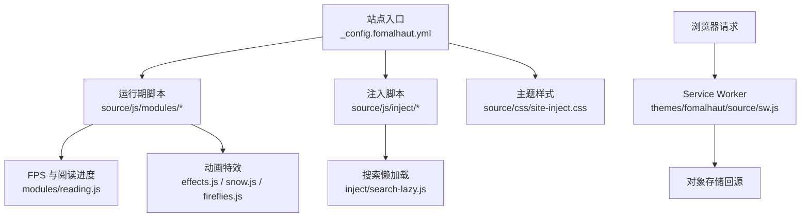
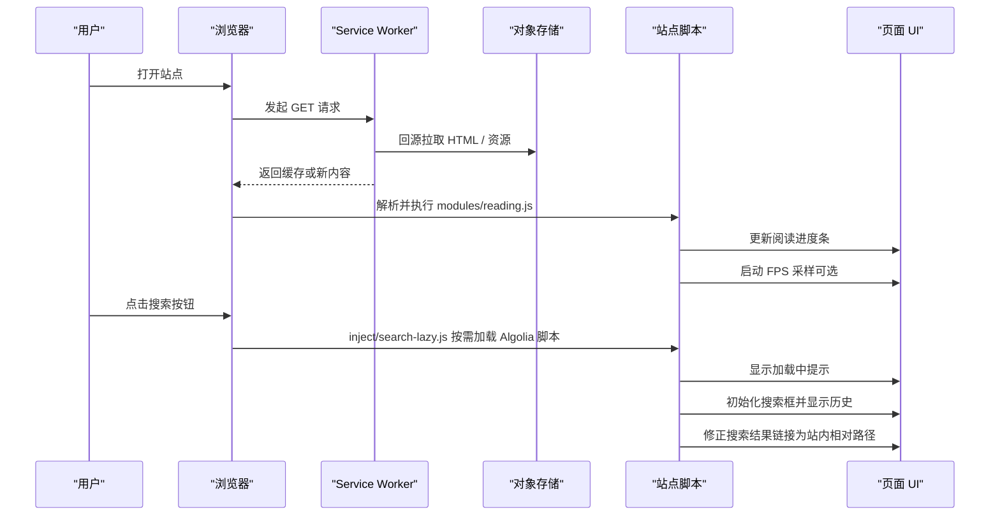
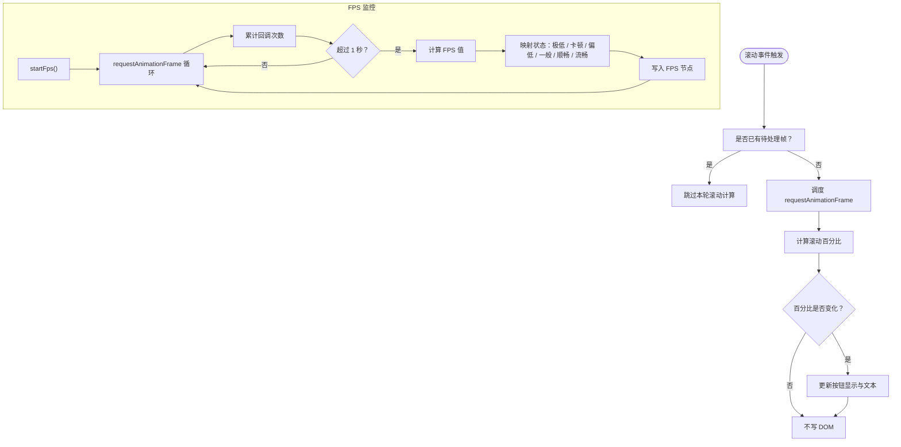
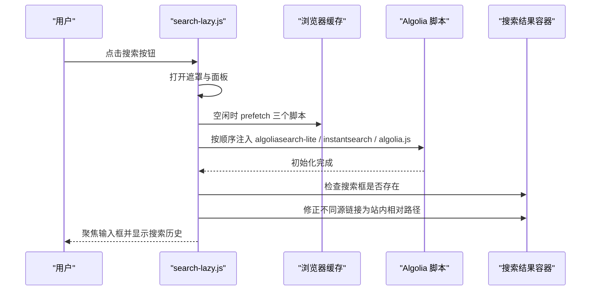
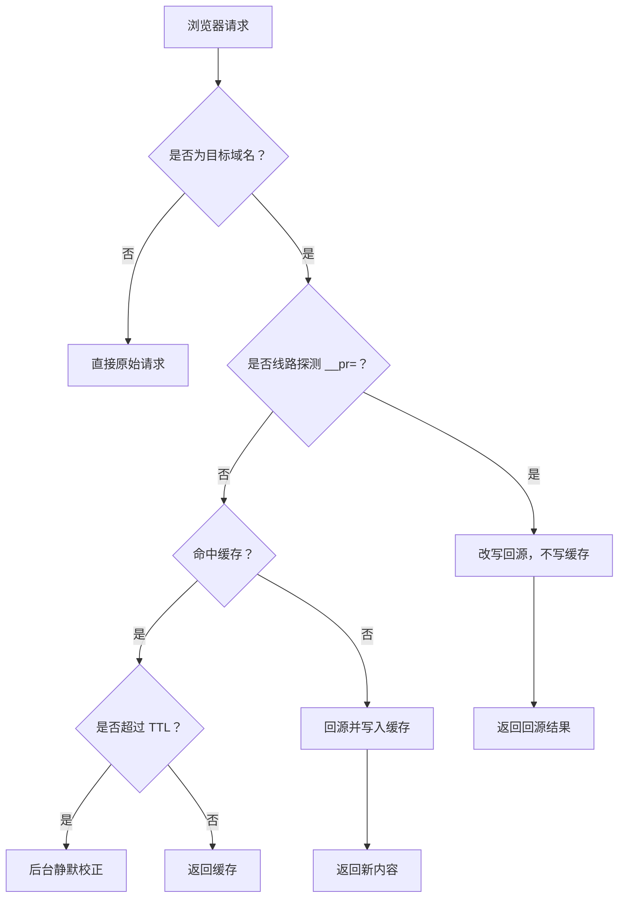
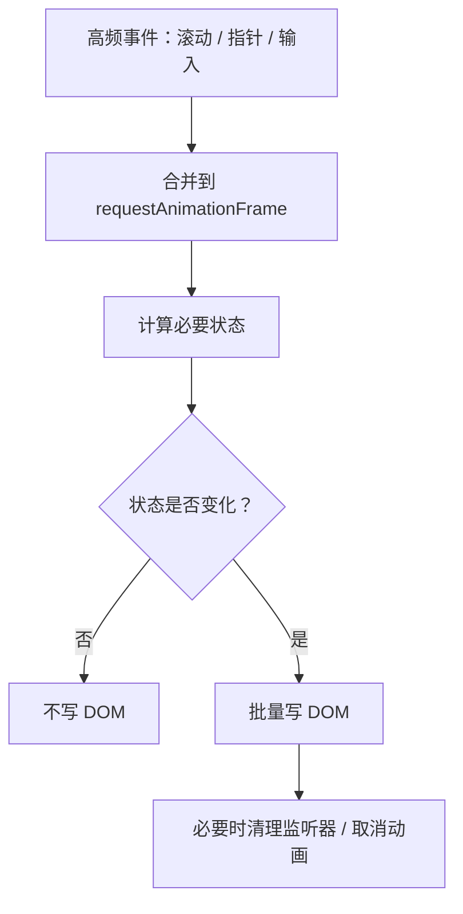
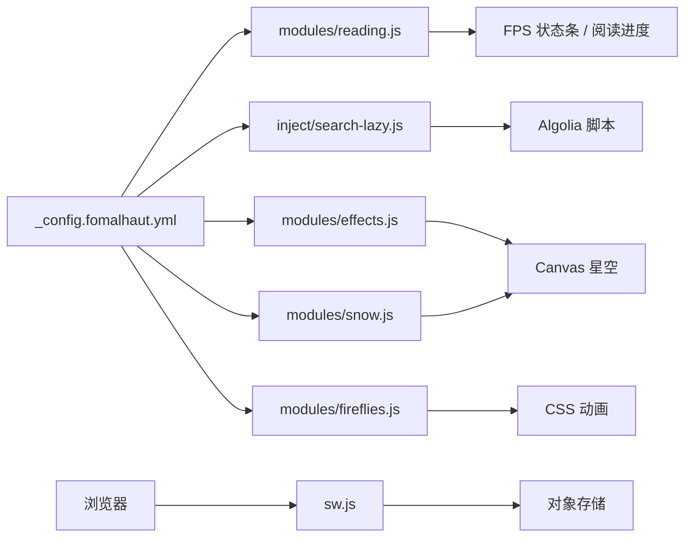

# 性能优化策略

<cite>
**本文引用的文件**   
- [README.md](file://README.md)
- [_config.fomalhaut.yml](file://_config.fomalhaut.yml)
- [source/js/modules/reading.js](file://source/js/modules/reading.js)
- [source/js/inject/search-lazy.js](file://source/js/inject/search-lazy.js)
- [themes/fomalhaut/source/sw.js](file://themes/fomalhaut/source/sw.js)
- [source/js/modules/effects.js](file://source/js/modules/effects.js)
- [source/js/modules/fireflies.js](file://source/js/modules/fireflies.js)
- [source/js/modules/snow.js](file://source/js/modules/snow.js)
- [source/js/ai-chat.js](file://source/js/ai-chat.js)
- [source/css/site-inject.css](file://source/css/site-inject.css)
</cite>

## 目录
1. [引言](#引言)
2. [项目结构中的性能相关位置](#项目结构中的性能相关位置)
3. [核心性能模块总览](#核心性能模块总览)
4. [架构与数据流概览](#架构与数据流概览)
5. [详细组件分析](#详细组件分析)
6. [依赖关系分析](#依赖关系分析)
7. [性能优化策略总结](#性能优化策略总结)
8. [故障排查指南](#故障排查指南)
9. [结论](#结论)

## 引言
本文围绕该 Hexo 主题站点的前端性能优化展开，重点说明以下方面：
- JavaScript 模块的懒加载机制：搜索模块按需加载、资源预取、Service Worker 缓存。
- 内存管理与 DOM 操作优化：事件监听器生命周期、动画循环启停、DOM 写入合并。
- FPS 监控与阅读进度跟踪的实现原理。
- 动画性能优化：requestAnimationFrame 使用、Canvas 绘制节流、GPU 加速与渲染降级。
- 搜索功能性能优化：索引脚本延迟加载、结果链接修正、历史记录与交互体验。
- 性能监控工具与方法：浏览器开发者工具、FPS 状态条、卡顿定位思路。

本仓库是一个基于 Butterfly 二次开发的卡片式博客主题，包含站点配置、主题模板、站点级脚本与样式，以及构建期插件和回归测试。其性能优化贯穿首屏加载、运行时动画、网络缓存与用户交互反馈。

**章节来源**
- [README.md:240-340](file://README.md#L240-L340)

## 项目结构中的性能相关位置
从整体结构看，性能相关代码主要分布在以下区域：
- 站点级脚本：`source/js/modules/` 与 `source/js/inject/`，负责运行期行为、动画、FPS、搜索懒加载等。
- 主题 Service Worker：`themes/fomalhaut/source/sw.js`，负责 CDN 分流、TTL 缓存、版本失效。
- 站点注入样式：`source/css/site-inject.css`，包含 FPS 状态条等轻量 UI。
- 构建期注入：`_config.fomalhaut.yml` 的 `inject.head` / `inject.bottom` 控制脚本引入顺序与时机。



**图表来源**
- [_config.fomalhaut.yml:1352](file://_config.fomalhaut.yml#L1352)
- [source/js/modules/reading.js:1-18](file://source/js/modules/reading.js#L1-L18)
- [source/js/inject/search-lazy.js:1-77](file://source/js/inject/search-lazy.js#L1-L77)
- [themes/fomalhaut/source/sw.js:1-34](file://themes/fomalhaut/source/sw.js#L1-L34)
- [source/css/site-inject.css:630](file://source/css/site-inject.css#L630)

**章节来源**
- [README.md:472-604](file://README.md#L472-L604)
- [_config.fomalhaut.yml:1352](file://_config.fomalhaut.yml#L1352)

## 核心性能模块总览
本项目中直接体现性能优化的关键模块包括：
- 阅读进度与 FPS 检测：`source/js/modules/reading.js`
- Algolia 搜索懒加载：`source/js/inject/search-lazy.js`
- Service Worker 缓存与 TTL：`themes/fomalhaut/source/sw.js`
- 星空特效 Canvas 节流与可见性判断：`source/js/modules/effects.js`
- 雪花 Canvas 动画：`source/js/modules/snow.js`
- 萤火虫 CSS 动画（无 rAF）：`source/js/modules/fireflies.js`
- AI 助手流式渲染优化：`source/js/ai-chat.js`
- FPS 状态条样式：`source/css/site-inject.css`

这些模块共同构成“首屏减负、运行期降频、网络缓存、交互反馈”的性能闭环。

**章节来源**
- [source/js/modules/reading.js:1-18](file://source/js/modules/reading.js#L1-L18)
- [source/js/inject/search-lazy.js:1-77](file://source/js/inject/search-lazy.js#L1-L77)
- [themes/fomalhaut/source/sw.js:1-34](file://themes/fomalhaut/source/sw.js#L1-L34)
- [source/js/modules/effects.js:1-19](file://source/js/modules/effects.js#L1-L19)
- [source/js/modules/snow.js:1-10](file://source/js/modules/snow.js#L1-L10)
- [source/js/modules/fireflies.js:1-10](file://source/js/modules/fireflies.js#L1-L10)
- [README.md:160-170](file://README.md#L160-L170)

## 架构与数据流概览
下图展示一次典型页面访问中，性能优化相关的请求与执行路径：



**图表来源**
- [themes/fomalhaut/source/sw.js:154-220](file://themes/fomalhaut/source/sw.js#L154-L220)
- [source/js/modules/reading.js:23-81](file://source/js/modules/reading.js#L23-L81)
- [source/js/modules/reading.js:87-181](file://source/js/modules/reading.js#L87-L181)
- [source/js/inject/search-lazy.js:78-177](file://source/js/inject/search-lazy.js#L78-L177)
- [source/js/inject/search-lazy.js:238-262](file://source/js/inject/search-lazy.js#L238-L262)

## 详细组件分析

### 阅读进度与 FPS 监控
阅读进度模块将滚动事件合流到 requestAnimationFrame，避免一帧内多次强制布局；同时只在百分比变化时写 DOM。FPS 模块通过闭包管理采样循环，支持启动、停止、后台挂起与 generation 防竞态。



**图表来源**
- [source/js/modules/reading.js:23-81](file://source/js/modules/reading.js#L23-L81)
- [source/js/modules/reading.js:87-181](file://source/js/modules/reading.js#L87-L181)

实现要点：
- 滚动回调使用 `__pctTick` 与 `requestAnimationFrame` 合并，避免触控板滑动时一帧内重复计算。
- 百分比变化才更新 DOM，减少 innerHTML 与 style 写入。
- FPS 采样封装在闭包中，使用 `generation` 防止旧回调覆盖新循环。
- 页面隐藏时暂停采样，恢复后重新调度。
- FPS 状态条由样式文件统一着色，避免内联颜色带来的维护成本。

**章节来源**
- [source/js/modules/reading.js:23-81](file://source/js/modules/reading.js#L23-L81)
- [source/js/modules/reading.js:87-181](file://source/js/modules/reading.js#L87-L181)
- [source/css/site-inject.css:630](file://source/css/site-inject.css#L630)

### 搜索懒加载与结果优化
Algolia 搜索原本会在每页阻塞加载多个脚本，现在改为点击后才加载，并在空闲时预取脚本资源。加载失败会给出明确提示，结果链接会被改写为当前站点的相对路径，避免本地预览或镜像域名下跳出正式站。



**图表来源**
- [source/js/inject/search-lazy.js:78-177](file://source/js/inject/search-lazy.js#L78-L177)
- [source/js/inject/search-lazy.js:179-199](file://source/js/inject/search-lazy.js#L179-L199)
- [source/js/inject/search-lazy.js:238-262](file://source/js/inject/search-lazy.js#L238-L262)
- [source/js/inject/search-lazy.js:470-506](file://source/js/inject/search-lazy.js#L470-L506)

实现要点：
- 使用 `<link rel="prefetch">` 在空闲时预取脚本，不执行、不阻塞主线程。
- 动态注入脚本时关闭 `async`，保证顺序执行。
- 页面已 load 时临时接管 `addEventListener('load')`，让主题脚本立即初始化。
- 加载失败 reject 错误，避免面板一直显示“正在加载”。
- 用 MutationObserver 监听结果容器，把不同源链接改写为根路径形式。
- 搜索历史存储在 `localStorage`，最多 8 条，去重并按最新在前。

**章节来源**
- [source/js/inject/search-lazy.js:1-77](file://source/js/inject/search-lazy.js#L1-L77)
- [source/js/inject/search-lazy.js:78-177](file://source/js/inject/search-lazy.js#L78-L177)
- [source/js/inject/search-lazy.js:179-199](file://source/js/inject/search-lazy.js#L179-L199)
- [source/js/inject/search-lazy.js:238-262](file://source/js/inject/search-lazy.js#L238-L262)
- [source/js/inject/search-lazy.js:305-468](file://source/js/inject/search-lazy.js#L305-L468)
- [source/js/inject/search-lazy.js:470-506](file://source/js/inject/search-lazy.js#L470-L506)

### Service Worker 缓存与 TTL 策略
Service Worker 作为 CDN 分流器，只对目标域名介入，其他请求直接放行。HTML 优先回源保证内容最新，其他资源缓存优先并后台静默校正。文本资源 TTL 缩短到 10 分钟，图片、字体、音视频仍为 24 小时，避免只改 JS/CSS 却忘记改缓存戳导致的长期旧代码问题。



**图表来源**
- [themes/fomalhaut/source/sw.js:154-220](file://themes/fomalhaut/source/sw.js#L154-L220)
- [themes/fomalhaut/source/sw.js:77-96](file://themes/fomalhaut/source/sw.js#L77-L96)
- [themes/fomalhaut/source/sw.js:132-151](file://themes/fomalhaut/source/sw.js#L132-L151)

实现要点：
- 白名单域名控制，非目标域名不介入，避免误伤第三方资源。
- 查询串原样带到对象存储，修复图片处理参数丢失问题。
- HTML 始终回源，并用 index.html 内容哈希决定站点版本，版本变化清空资源缓存。
- 文本资源短 TTL，媒体资源长 TTL，平衡新鲜度与省流。
- 探测请求 `?__pr=` 不写入缓存，避免无限膨胀。

**章节来源**
- [themes/fomalhaut/source/sw.js:1-34](file://themes/fomalhaut/source/sw.js#L1-L34)
- [themes/fomalhaut/source/sw.js:77-96](file://themes/fomalhaut/source/sw.js#L77-L96)
- [themes/fomalhaut/source/sw.js:132-151](file://themes/fomalhaut/source/sw.js#L132-L151)
- [themes/fomalhaut/source/sw.js:154-220](file://themes/fomalhaut/source/sw.js#L154-L220)

### 动画性能优化：星空、雪花、萤火虫
星空特效使用 Canvas，但增加了可见性判断与绘制间隔限制，不可见时退出 rAF 循环；雪花特效同样在不可见、移动端、减少动态偏好或深色主题下暂停；萤火虫特效完全走 CSS 动画，不使用 Canvas、rAF 或定时器轮询。

```mermaid
classDiagram
class StarEffect {
+dark()
+starVisible()
+starLoop(ts)
-STAR_DRAW_INTERVAL
}
class SnowEffect {
+refresh()
+visible()
+frame(time)
+schedule()
-maxDepth
-flakes
}
class FireflyEffect {
+setEnabled(on)
+refresh()
+paint()
-wanted
-layer
}
StarEffect --> "Canvas 绘制"
SnowEffect --> "Canvas 绘制"
FireflyEffect --> "CSS 动画"
```

**图表来源**
- [source/js/modules/effects.js:27-124](file://source/js/modules/effects.js#L27-L124)
- [source/js/modules/snow.js:30-156](file://source/js/modules/snow.js#L30-L156)
- [source/js/modules/fireflies.js:39-71](file://source/js/modules/fireflies.js#L39-L71)

实现要点：
- 星空：检测 `data-theme` 与元素可见性，条件不满足时退出 rAF；绘制间隔限制到约 30fps，降低 Canvas 重绘压力。
- 雪花：根据设备、主题、可见性、减少动态偏好决定是否运行；时间驱动 dt 上限 50ms；底部积雪高度有界。
- 萤火虫：纯 CSS 呼吸与慢漂，数量分档，与雪花互斥，后台或减少动态时暂停。
- 三者都关注 pjax 换页后的生命周期，避免动画残留或重复启动。

**章节来源**
- [source/js/modules/effects.js:71-124](file://source/js/modules/effects.js#L71-L124)
- [source/js/modules/snow.js:30-156](file://source/js/modules/snow.js#L30-L156)
- [source/js/modules/fireflies.js:39-71](file://source/js/modules/fireflies.js#L39-L71)

### 内存管理与 DOM 操作优化
项目中多处体现了内存与 DOM 操作的最佳实践：
- 滚动事件合并到一帧，避免强制布局抖动。
- FPS 采样使用闭包与 generation 标记，防止旧回调污染新循环。
- 搜索懒加载在加载失败时重置状态，允许重试。
- 动画模块在页面隐藏、resize、pjax 换页时清理或重启循环。
- 萤火虫与雪花互斥，避免同时运行两套视觉动画。
- AI 助手流式输出合并 DOM 提交，减少频繁插入造成的布局抖动。



**图表来源**
- [source/js/modules/reading.js:31-49](file://source/js/modules/reading.js#L31-L49)
- [source/js/modules/reading.js:125-181](file://source/js/modules/reading.js#L125-L181)
- [source/js/modules/fireflies.js:72-88](file://source/js/modules/fireflies.js#L72-L88)
- [source/js/modules/snow.js:162-178](file://source/js/modules/snow.js#L162-L178)
- [README.md:164-170](file://README.md#L164-L170)

**章节来源**
- [source/js/modules/reading.js:31-49](file://source/js/modules/reading.js#L31-L49)
- [source/js/modules/reading.js:125-181](file://source/js/modules/reading.js#L125-L181)
- [source/js/modules/fireflies.js:72-88](file://source/js/modules/fireflies.js#L72-L88)
- [source/js/modules/snow.js:162-178](file://source/js/modules/snow.js#L162-L178)
- [README.md:164-170](file://README.md#L164-L170)

### 搜索功能的性能优化
搜索优化不仅体现在懒加载，还包括：
- 索引脚本延迟加载，避免首屏阻塞。
- 结果链接修正，提升本地预览与镜像站体验。
- 搜索历史持久化，减少重复输入。
- 加载失败可感知，避免面板卡死。
- 与主题脚本解耦，劫持加载时机但不破坏原有初始化流程。

**章节来源**
- [source/js/inject/search-lazy.js:1-77](file://source/js/inject/search-lazy.js#L1-L77)
- [source/js/inject/search-lazy.js:78-177](file://source/js/inject/search-lazy.js#L78-L177)
- [source/js/inject/search-lazy.js:238-262](file://source/js/inject/search-lazy.js#L238-L262)
- [source/js/inject/search-lazy.js:305-468](file://source/js/inject/search-lazy.js#L305-L468)

## 依赖关系分析
各性能模块之间的依赖关系如下：



**图表来源**
- [_config.fomalhaut.yml:1352](file://_config.fomalhaut.yml#L1352)
- [source/js/modules/reading.js:1-18](file://source/js/modules/reading.js#L1-L18)
- [source/js/inject/search-lazy.js:1-77](file://source/js/inject/search-lazy.js#L1-L77)
- [themes/fomalhaut/source/sw.js:154-220](file://themes/fomalhaut/source/sw.js#L154-L220)
- [source/js/modules/effects.js:27-124](file://source/js/modules/effects.js#L27-L124)
- [source/js/modules/snow.js:30-156](file://source/js/modules/snow.js#L30-L156)
- [source/js/modules/fireflies.js:39-71](file://source/js/modules/fireflies.js#L39-L71)

**章节来源**
- [_config.fomalhaut.yml:1352](file://_config.fomalhaut.yml#L1352)
- [source/js/modules/reading.js:1-18](file://source/js/modules/reading.js#L1-L18)
- [source/js/inject/search-lazy.js:1-77](file://source/js/inject/search-lazy.js#L1-L77)
- [themes/fomalhaut/source/sw.js:154-220](file://themes/fomalhaut/source/sw.js#L154-L220)

## 性能优化策略总结
结合代码实现，可以归纳出以下性能优化策略：

| 优化方向 | 具体策略 | 对应实现 |
|---|---|---|
| 懒加载 | 搜索脚本按需加载，空闲预取 | `inject/search-lazy.js` |
| 缓存策略 | Service Worker 分流、TTL 分层、版本失效 | `sw.js` |
| 滚动优化 | 滚动事件合并到 rAF，避免强制布局 | `modules/reading.js` |
| FPS 监控 | rAF 回调采样，状态条可视化 | `modules/reading.js`、`site-inject.css` |
| 动画优化 | Canvas 绘制节流、可见性判断、CSS 动画替代 | `effects.js`、`snow.js`、`fireflies.js` |
| 内存管理 | 动画循环启停、监听器清理、generation 防竞态 | 各动画模块与 FPS 模块 |
| DOM 优化 | 状态变化才写 DOM，批量更新 | `reading.js`、`ai-chat.js` |
| 搜索优化 | 懒加载、结果链接修正、历史持久化 | `inject/search-lazy.js` |

**章节来源**
- [source/js/inject/search-lazy.js:1-77](file://source/js/inject/search-lazy.js#L1-L77)
- [themes/fomalhaut/source/sw.js:154-220](file://themes/fomalhaut/source/sw.js#L154-L220)
- [source/js/modules/reading.js:31-81](file://source/js/modules/reading.js#L31-L81)
- [source/js/modules/effects.js:71-124](file://source/js/modules/effects.js#L71-L124)
- [source/js/modules/snow.js:30-156](file://source/js/modules/snow.js#L30-L156)
- [source/js/modules/fireflies.js:39-71](file://source/js/modules/fireflies.js#L39-L71)
- [README.md:164-170](file://README.md#L164-L170)

## 故障排查指南
当出现性能问题时，可按以下思路排查：

- FPS 数字异常或长时间不更新：
  - 检查 FPS 模块是否被手动停止。
  - 检查页面是否处于隐藏状态。
  - 查看 FPS 状态条样式是否正常渲染。

- 搜索面板一直显示“正在加载”：
  - 检查 Algolia 脚本是否加载成功。
  - 检查主题 Algolia 配置是否有效。
  - 查看加载失败提示是否正确显示。

- 搜索结果跳转到正式站：
  - 检查结果链接修正逻辑是否生效。
  - 确认 MutationObserver 是否监听到结果容器。

- 动画卡顿或 CPU 占用高：
  - 检查星空、雪花是否因可见性判断失效而持续绘制。
  - 检查萤火虫是否与雪花同时开启。
  - 检查是否在移动端或减少动态偏好下仍运行 Canvas 动画。

- Service Worker 缓存未更新：
  - 检查 index.html 哈希是否变化。
  - 检查文本资源 TTL 是否过短或过长。
  - 检查探测请求是否误写入缓存。

**章节来源**
- [source/js/modules/reading.js:125-181](file://source/js/modules/reading.js#L125-L181)
- [source/js/inject/search-lazy.js:138-177](file://source/js/inject/search-lazy.js#L138-L177)
- [source/js/inject/search-lazy.js:238-262](file://source/js/inject/search-lazy.js#L238-L262)
- [source/js/modules/effects.js:71-124](file://source/js/modules/effects.js#L71-L124)
- [source/js/modules/snow.js:30-156](file://source/js/modules/snow.js#L30-L156)
- [source/js/modules/fireflies.js:39-71](file://source/js/modules/fireflies.js#L39-L71)
- [themes/fomalhaut/source/sw.js:186-210](file://themes/fomalhaut/source/sw.js#L186-L210)

## 结论
该项目的性能优化以“懒加载、缓存分层、动画节流、DOM 合并、生命周期管理”为核心，覆盖了从首屏加载到运行期交互的全链路。FPS 监控与阅读进度提供直观反馈，Service Worker 保障缓存新鲜度与省流，搜索懒加载避免首屏阻塞，动画模块则在不同设备上合理降级。通过这些策略，项目在保持丰富视觉效果的同时，显著降低了主线程压力与网络开销。