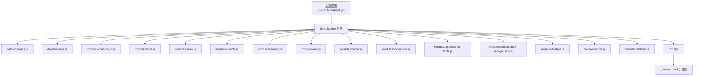
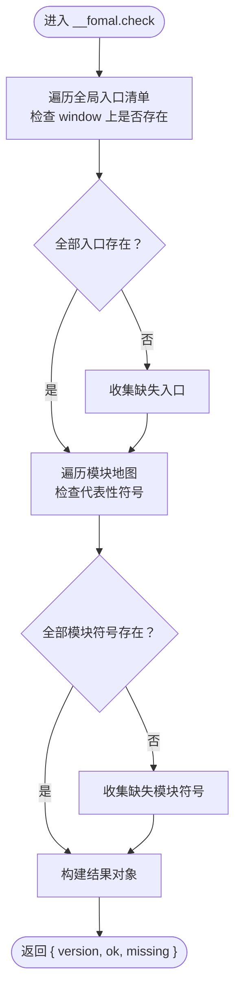
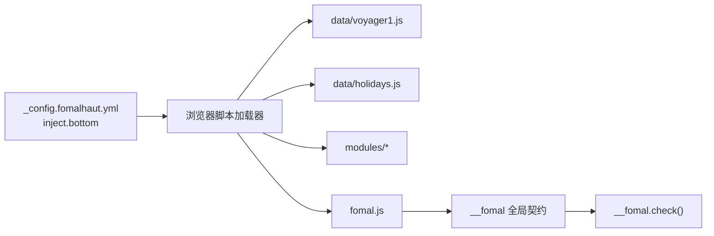
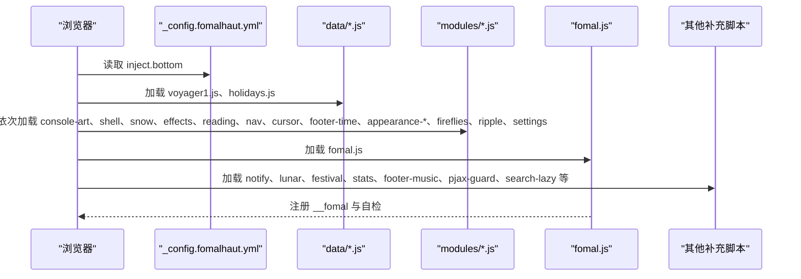
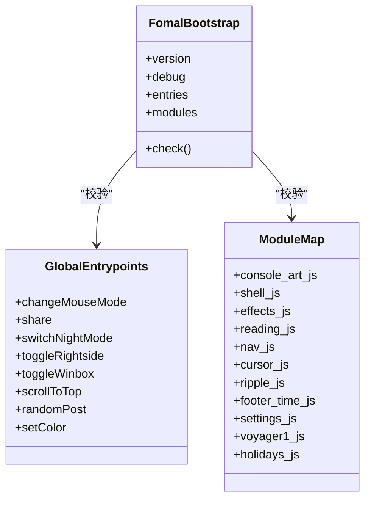
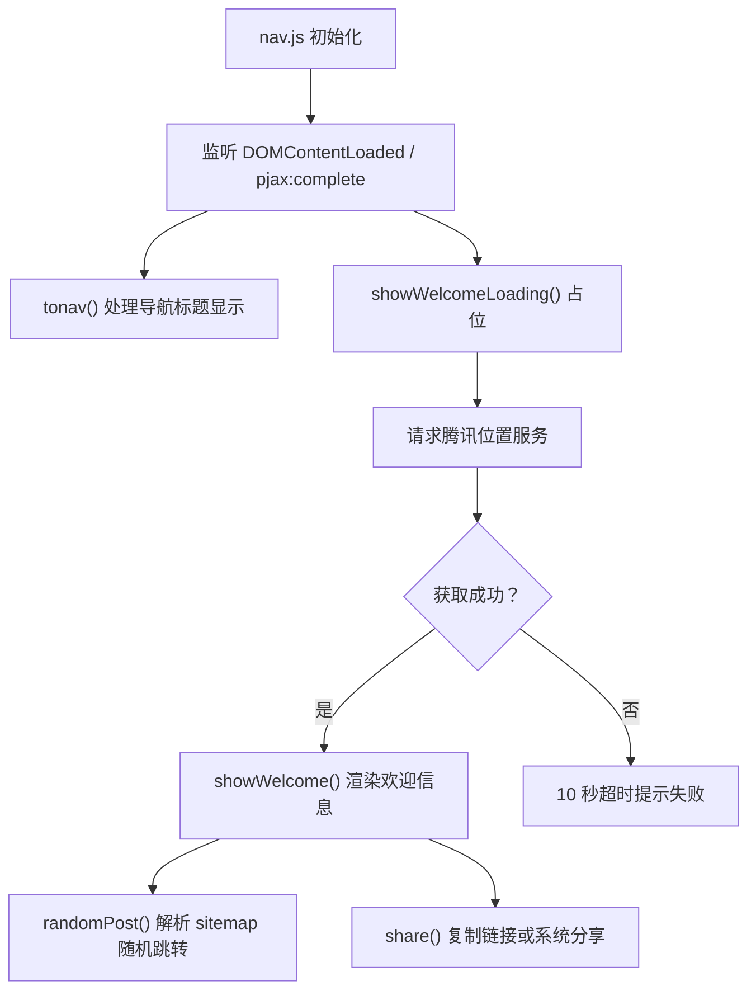
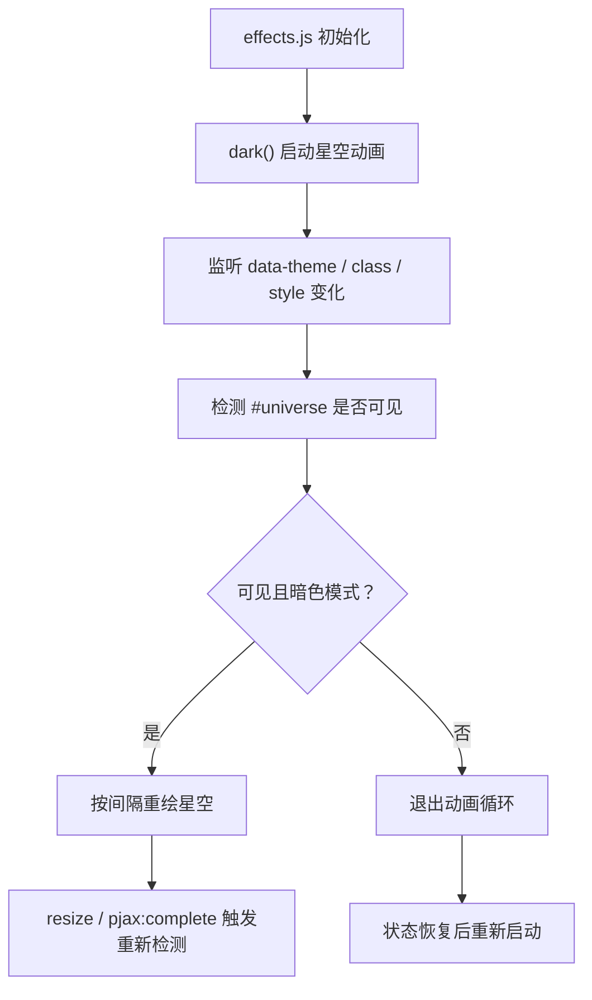
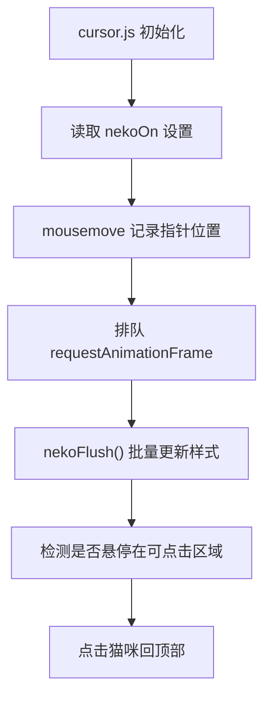
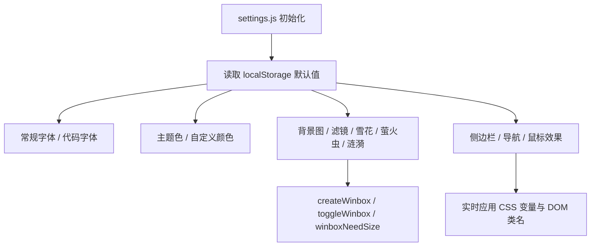
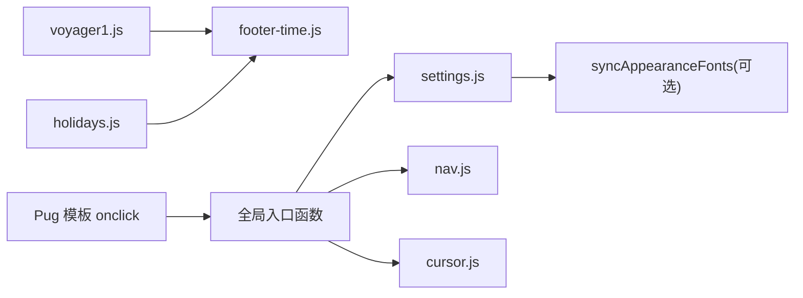

# 模块架构设计

<cite>
**本文引用的文件**   
- [source/js/fomal.js](file://source/js/fomal.js)
- [_config.fomalhaut.yml](file://_config.fomalhaut.yml)
- [source/js/modules/nav.js](file://source/js/modules/nav.js)
- [source/js/modules/effects.js](file://source/js/modules/effects.js)
- [source/js/modules/cursor.js](file://source/js/modules/cursor.js)
- [source/js/modules/settings.js](file://source/js/modules/settings.js)
</cite>

## 目录
1. [引言](#引言)
2. [项目结构](#项目结构)
3. [核心组件](#核心组件)
4. [架构总览](#架构总览)
5. [详细组件分析](#详细组件分析)
6. [依赖关系分析](#依赖关系分析)
7. [性能与加载特性](#性能与加载特性)
8. [故障排查指南](#故障排查指南)
9. [结论](#结论)
10. [附录：模块开发规范](#附录模块开发规范)

## 引言
本仓库的 JavaScript 子系统采用“引导文件 + 模块地图 + 全局入口”的传统浏览器脚本组织方式。站点主引导文件 `fomal.js` 不再承担具体业务逻辑，而是集中维护：
- 模块地图：声明各模块应暴露的全局名；
- 全局小工具：例如 `Math.lerp`；
- 控制台策略：在调试模式下保留日志、正常模式下静音 `console.log`；
- 运行时自检：通过 `__fomal.check()` 校验模板和配置依赖的全局函数是否缺失。

所有功能模块位于 `source/js/modules/` 与 `source/js/data/`，由主题配置文件 `_config.fomalhaut.yml` 中的 `inject.bottom` 按顺序注入页面。该设计兼顾了历史兼容性（Pug 模板内联 `onclick`）与现代可维护性（拆分职责、明确加载顺序）。

## 项目结构
JavaScript 相关代码主要分布在以下位置：
- `source/js/fomal.js`：站点主引导，负责模块地图、全局入口清单、自检与调试策略；
- `source/js/modules/*.js`：按功能拆分的模块，如导航、特效、鼠标、设置面板等；
- `source/js/data/*.js`：纯数据模型，如旅行者 1 号距离模型、法定休息日判断；
- `source/js/inject/*.js`：按需或辅助注入脚本，如搜索懒加载、滚动锚点补偿等；
- `_config.fomalhaut.yml`：主题配置，其中 `inject.bottom` 决定最终脚本加载顺序。

**图表来源**
- [_config.fomalhaut.yml:1340-1374](file://_config.fomalhaut.yml#L1340-L1374)
- [source/js/fomal.js:64-106](file://source/js/fomal.js#L64-L106)

**章节来源**
- [_config.fomalhaut.yml:1340-1374](file://_config.fomalhaut.yml#L1340-L1374)
- [source/js/fomal.js:1-43](file://source/js/fomal.js#L1-L43)

## 核心组件
### 站点主引导 fomal.js
`fomal.js` 的职责非常克制：
- 提供全局小工具，例如线性插值 `Math.lerp`；
- 根据 URL 参数与主机名决定是否启用调试模式；
- 定义 `window.__fomal`，包含版本、调试标志、全局入口清单、模块代表符号清单以及自检方法；
- 在页面 `load` 后于调试模式执行一次自检，输出通过或缺失报告。

它不直接实现交互逻辑，而是作为“契约中心”，让模板、配置和其他脚本可以稳定调用全局函数。

**章节来源**
- [source/js/fomal.js:45-62](file://source/js/fomal.js#L45-L62)
- [source/js/fomal.js:64-106](file://source/js/fomal.js#L64-L106)

### 模块地图与全局入口
模块地图是 `__fomal.modules`，键为文件名，值为该模块应在全局暴露的代表性变量或函数。全局入口清单 `__fomal.entries` 则是 Pug 模板、第三方脚本或配置字符串中直接调用的函数名。

自检会检查：
- 所有全局入口是否在 `window` 上存在；
- 每个模块的代表符号是否在 `window` 上存在。

如果任一缺失，自检会返回 `ok: false` 并列出缺失项，便于快速定位“文件未加载”或“函数被改名”。

**章节来源**
- [source/js/fomal.js:68-94](file://source/js/fomal.js#L68-L94)

### 运行时自检 __fomal.check()
自检流程如下：

**图表来源**
- [source/js/fomal.js:88-94](file://source/js/fomal.js#L88-L94)

**章节来源**
- [source/js/fomal.js:88-106](file://source/js/fomal.js#L88-L106)

## 架构总览
整体架构可以理解为三层：
1. **配置层**：`_config.fomalhaut.yml` 的 `inject.bottom` 决定脚本加载顺序；
2. **引导层**：`fomal.js` 提供全局契约、调试策略和自检能力；
3. **模块层**：`modules/` 与 `data/` 各自实现功能，并通过全局作用域暴露接口。

**图表来源**
- [_config.fomalhaut.yml:1340-1374](file://_config.fomalhaut.yml#L1340-L1374)
- [source/js/fomal.js:64-106](file://source/js/fomal.js#L64-L106)

## 详细组件分析

### 模块加载顺序与 inject.bottom
`_config.fomalhaut.yml` 的 `inject.bottom` 是站点 JS 的最终加载清单。注释明确指出：
- 先加载 `data/` 下的纯数据模型；
- 再加载 `modules/` 下各自独立的模块；
- 最后加载 `fomal.js` 主引导；
- 之后还有通知、农历、节日、统计、页脚音乐、pjax 修复、搜索懒加载等补充脚本。

这意味着加载顺序本身就是依赖顺序：例如页脚计时器依赖 `voyager1.js` 和 `holidays.js`，因此它们必须排在前面。

**图表来源**
- [_config.fomalhaut.yml:1340-1374](file://_config.fomalhaut.yml#L1340-L1374)
- [source/js/fomal.js:64-106](file://source/js/fomal.js#L64-L106)

**章节来源**
- [_config.fomalhaut.yml:1340-1374](file://_config.fomalhaut.yml#L1340-L1374)

### 全局作用域设计与 Pug 兼容性
模块文件中普遍不使用立即执行函数表达式（IIFE），原因是：
- 主题 Pug 模板中存在大量内联 `onclick="xxx()"`；
- 其他脚本也会直接调用全局函数；
- 因此模块必须把函数和变量留在顶层作用域，即挂在 `window` 上。

`fomal.js` 明确列出了不能改名或删除的全局入口，包括：
- `changeMouseMode`
- `share`
- `switchNightMode`
- `toggleRightside`
- `toggleWinbox`
- `scrollToTop`
- `randomPost`
- `setColor`

这些名称由右侧栏、导航栏、右键菜单、分享模块、统计脚本以及配置字符串引用。

**图表来源**
- [source/js/fomal.js:68-94](file://source/js/fomal.js#L68-L94)

**章节来源**
- [source/js/fomal.js:23-43](file://source/js/fomal.js#L23-L43)
- [source/js/fomal.js:68-94](file://source/js/fomal.js#L68-L94)

### 模块 nav.js：导航、欢迎语、随便逛逛、分享
`nav.js` 负责：
- 导航栏标题随滚动切换；
- 首屏欢迎信息，基于腾讯位置服务 IP 定位；
- “随便逛逛”随机跳转文章；
- 分享按钮复制链接或调用系统分享。

它同样保持全局作用域，并通过事件监听适配普通 DOM 加载与 pjax 换页。

**图表来源**
- [source/js/modules/nav.js:32-65](file://source/js/modules/nav.js#L32-L65)
- [source/js/modules/nav.js:77-168](file://source/js/modules/nav.js#L77-L168)
- [source/js/modules/nav.js:178-194](file://source/js/modules/nav.js#L178-L194)

**章节来源**
- [source/js/modules/nav.js:1-26](file://source/js/modules/nav.js#L1-L26)
- [source/js/modules/nav.js:32-65](file://source/js/modules/nav.js#L32-L65)
- [source/js/modules/nav.js:77-168](file://source/js/modules/nav.js#L77-L168)
- [source/js/modules/nav.js:178-194](file://source/js/modules/nav.js#L178-L194)

### 模块 effects.js：星空与表情放大
`effects.js` 提供视觉装饰：
- 星空 Canvas 动画；
- 评论区表情放大效果。

其中星空动画经过多次性能优化：
- 当画布不可见时跳过绘制；
- 进一步在条件不满足时退出循环，避免无意义的 `requestAnimationFrame`；
- 将重绘频率限制到约 30fps；
- 使用 MutationObserver 监听主题、类名、样式变化，状态失效后重新启动循环。

**图表来源**
- [source/js/modules/effects.js:27-124](file://source/js/modules/effects.js#L27-L124)

**章节来源**
- [source/js/modules/effects.js:1-19](file://source/js/modules/effects.js#L1-L19)
- [source/js/modules/effects.js:27-124](file://source/js/modules/effects.js#L27-L124)
- [source/js/modules/effects.js:130-191](file://source/js/modules/effects.js#L130-L191)

### 模块 cursor.js：右键菜单、小猫咪、自定义光标
`cursor.js` 围绕指针交互展开：
- 小猫咪跟随鼠标，整点报时气泡；
- 自定义右键菜单；
- 带缓动拖尾的自定义光标。

该模块对高频事件做了节流与队列化处理，使用 `requestAnimationFrame` 合并几何计算与样式写入，减少强制布局。

**图表来源**
- [source/js/modules/cursor.js:32-54](file://source/js/modules/cursor.js#L32-L54)
- [source/js/modules/cursor.js:56-164](file://source/js/modules/cursor.js#L56-L164)
- [source/js/modules/cursor.js:166-180](file://source/js/modules/cursor.js#L166-L180)

**章节来源**
- [source/js/modules/cursor.js:1-29](file://source/js/modules/cursor.js#L1-L29)
- [source/js/modules/cursor.js:32-54](file://source/js/modules/cursor.js#L32-L54)
- [source/js/modules/cursor.js:56-164](file://source/js/modules/cursor.js#L56-L164)
- [source/js/modules/cursor.js:166-180](file://source/js/modules/cursor.js#L166-L180)

### 模块 settings.js：美化设置面板
`settings.js` 是体积最大的模块之一，负责：
- 字体选择与代码块字体；
- 主题色、背景图、滤镜；
- 侧边栏开关、导航开关、鼠标效果开关；
- Winbox 窗口管理；
- 设置面板的创建、尺寸计算、响应式调整。

它通过 `localStorage` 持久化用户偏好，并在首次升级时重置旧标记以兼容新字段。

**图表来源**
- [source/js/modules/settings.js:83-137](file://source/js/modules/settings.js#L83-L137)
- [source/js/modules/settings.js:147-175](file://source/js/modules/settings.js#L147-L175)
- [source/js/modules/settings.js:179-200](file://source/js/modules/settings.js#L179-L200)

**章节来源**
- [source/js/modules/settings.js:1-77](file://source/js/modules/settings.js#L1-L77)
- [source/js/modules/settings.js:83-137](file://source/js/modules/settings.js#L83-L137)
- [source/js/modules/settings.js:147-200](file://source/js/modules/settings.js#L147-L200)

## 依赖关系分析
模块之间的依赖主要通过两个层面体现：
1. **加载顺序依赖**：由 `_config.fomalhaut.yml` 的 `inject.bottom` 控制；
2. **全局符号依赖**：由 `fomal.js` 的模块地图和全局入口清单约束。

典型依赖链：
- `footer-time.js` 依赖 `voyager1.js` 与 `holidays.js`；
- `nav.js` 依赖主题自带的 `btf.scrollToDest`；
- `settings.js` 可能调用 `syncAppearanceFonts`，若不存在则降级；
- 模板通过 `onclick` 直接调用 `toggleWinbox`、`switchNightMode`、`randomPost` 等全局函数。

**图表来源**
- [_config.fomalhaut.yml:1346-1360](file://_config.fomalhaut.yml#L1346-L1360)
- [source/js/fomal.js:68-94](file://source/js/fomal.js#L68-L94)
- [source/js/modules/settings.js:185-186](file://source/js/modules/settings.js#L185-L186)

**章节来源**
- [_config.fomalhaut.yml:1346-1360](file://_config.fomalhaut.yml#L1346-L1360)
- [source/js/fomal.js:68-94](file://source/js/fomal.js#L68-L94)

## 性能与加载特性
- 所有站点脚本大多使用 `<script defer>`，保证 DOM 解析后再执行，同时避免阻塞渲染；
- `fomal.js` 在非调试环境下静音 `console.log`，但保留 `error` 与 `warn`，防止异常静默；
- 星空动画在不可见时停止循环，降低空转开销；
- 小猫咪与自定义光标使用 `requestAnimationFrame` 合并高频更新；
- 模块之间尽量解耦，通过全局契约而非强耦合调用。

这些特性共同构成一个“可观察、可自检、可降级”的前端运行环境。

[本节为通用性能讨论，不直接分析具体文件]

## 故障排查指南
### 常见问题与定位方法
1. **控制台报错找不到全局函数**  
   优先确认 `_config.fomalhaut.yml` 的 `inject.bottom` 是否包含对应模块，以及模块是否仍暴露 `fomal.js` 中声明的全局名。

2. **自检失败**  
   在调试模式下访问页面，控制台会输出自检结果。若 `ok` 为 `false`，查看 `missing` 列表，定位缺失文件或改名函数。

3. **模板点击无效**  
   检查 Pug 模板中 `onclick` 调用的函数名是否与 `__fomal.entries` 一致，并确保模块已加载。

4. **夜间模式或设置面板异常**  
   检查 `settings.js` 是否正确初始化 `localStorage`，以及是否覆盖了必要的 CSS 变量。

5. **pjax 换页后功能丢失**  
   检查模块是否监听 `DOMContentLoaded` 与 `pjax:complete`，确保动态插入的 DOM 能重新初始化。

**章节来源**
- [source/js/fomal.js:51-62](file://source/js/fomal.js#L51-L62)
- [source/js/fomal.js:68-106](file://source/js/fomal.js#L68-L106)
- [source/js/modules/nav.js:32-34](file://source/js/modules/nav.js#L32-L34)
- [source/js/modules/effects.js:130-135](file://source/js/modules/effects.js#L130-L135)

## 结论
该项目的 JavaScript 模块架构以 `fomal.js` 为契约中心，以 `_config.fomalhaut.yml` 的 `inject.bottom` 为加载控制器，以全局作用域为历史兼容桥梁。虽然这不是现代 ES Module 体系，但在 Pug 模板内联事件、多脚本互相调用、Hexo 主题构建环境的约束下，它是一种务实且可维护的选择。

关键价值在于：
- 模块职责清晰，拆分自原近 3000 行的单体文件；
- 加载顺序即依赖顺序，避免隐式依赖；
- 全局入口受 `__fomal` 统一管理，便于自检；
- 性能敏感模块有明确的优化策略；
- 调试模式提供可控的日志与自检反馈。

[本节为总结性内容，不直接分析具体文件]

## 附录：模块开发规范
### 命名约定
- 模块文件放在 `source/js/modules/` 或 `source/js/data/`；
- 需要被模板或配置直接调用的函数必须使用稳定名称，不得随意改名；
- 新增模块应在 `fomal.js` 的 `__fomal.modules` 中添加代表性符号；
- 新增全局入口应在 `__fomal.entries` 中登记。

### 代码组织
- 模块文件顶部注释说明职责、拆分来源、加载方式和顶层函数目录；
- 避免使用 IIFE，除非确实需要局部作用域且不暴露全局；
- 对高频事件进行节流、防抖或帧合并；
- 对动态 DOM 同时支持初始加载与 pjax 换页。

### 调试技巧
- 在 URL 添加 `?debug=1` 开启调试模式；
- 在控制台执行 `__fomal.check()` 查看自检结果；
- 关注控制台错误与警告，不要关闭 `console.error` 与 `console.warn`；
- 修改配置后重建站点，仅 `hexo clean` 通常不够。

**章节来源**
- [source/js/fomal.js:38-43](file://source/js/fomal.js#L38-L43)
- [source/js/fomal.js:51-62](file://source/js/fomal.js#L51-L62)
- [source/js/fomal.js:68-106](file://source/js/fomal.js#L68-L106)