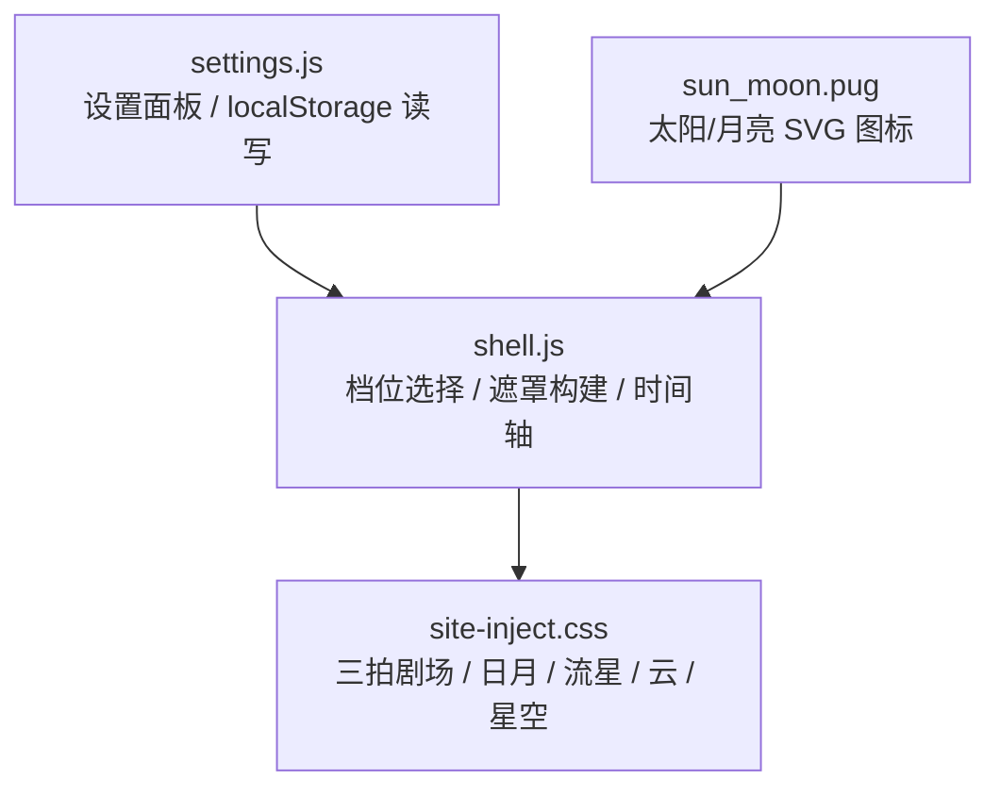
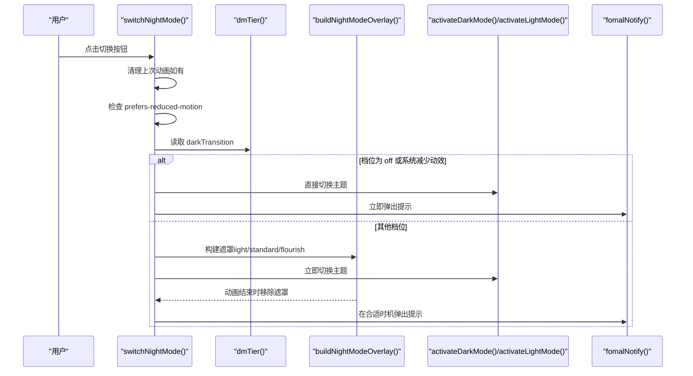
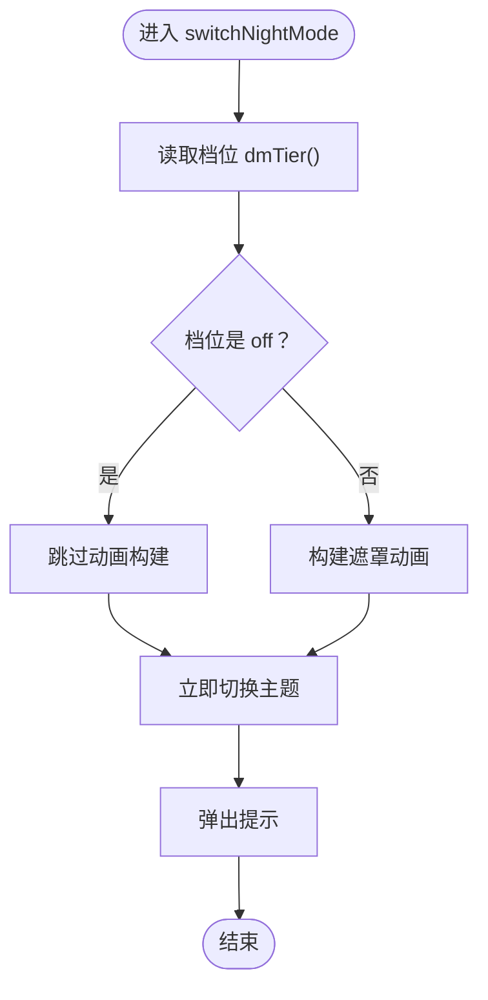
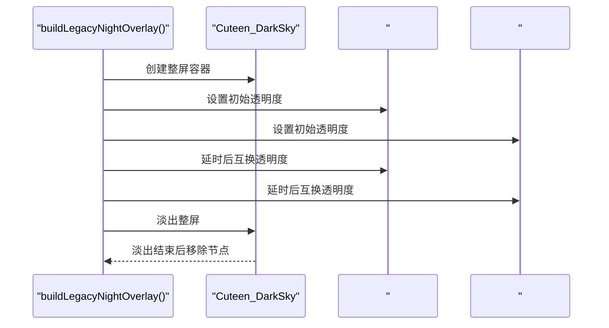
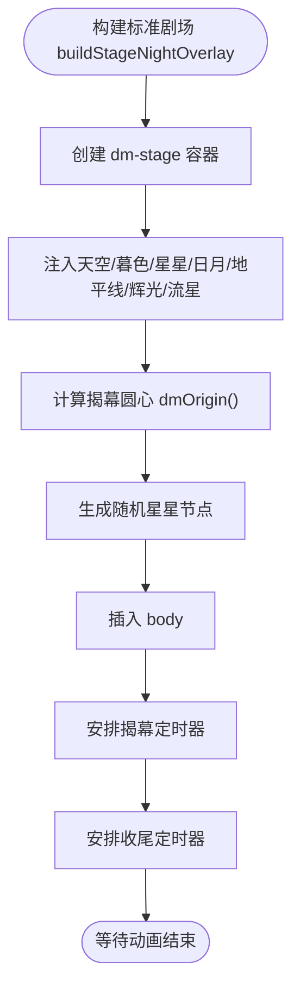
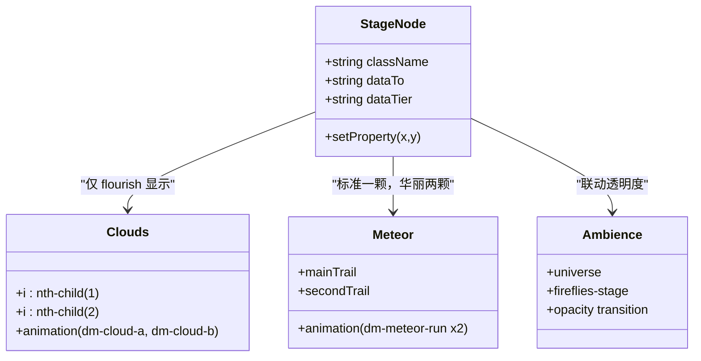
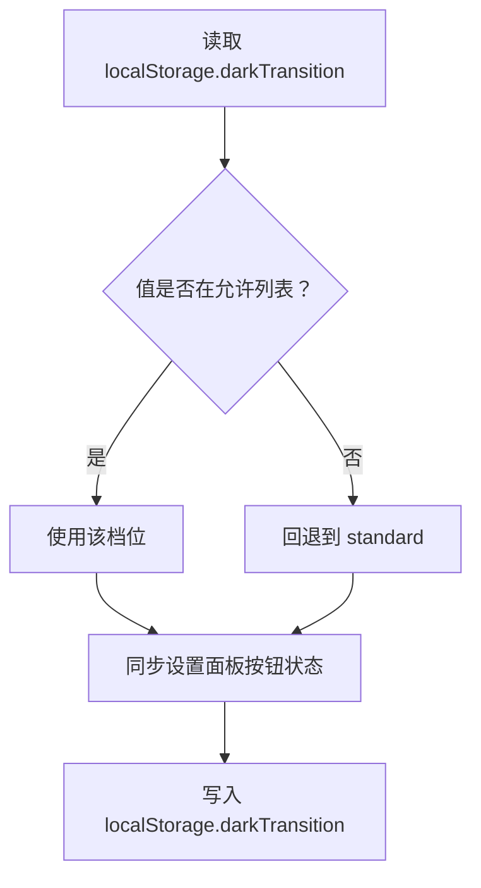
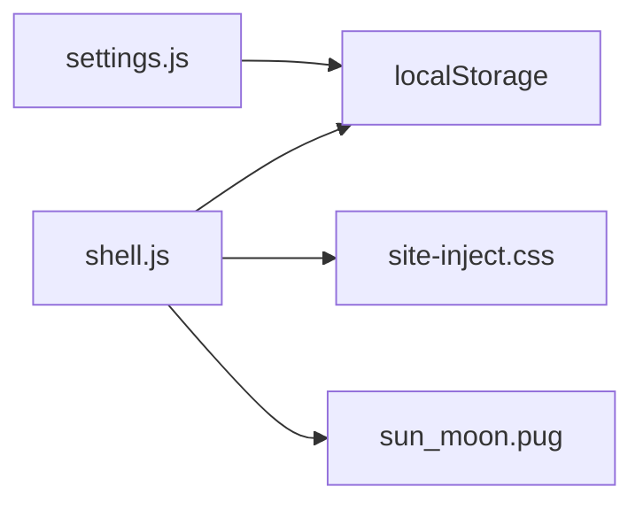

# 动画档位系统

<cite>
**本文引用的文件**   
- [shell.js](file://source/js/modules/shell.js)
- [settings.js](file://source/js/modules/settings.js)
- [site-inject.css](file://source/css/site-inject.css)
- [sun_moon.pug](file://themes/fomalhaut/layout/includes/custom/sun_moon.pug)
</cite>

## 目录
1. [引言](#引言)
2. [项目结构](#项目结构)
3. [核心组件](#核心组件)
4. [架构总览](#架构总览)
5. [详细组件分析](#详细组件分析)
6. [依赖关系分析](#依赖关系分析)
7. [性能与兼容性](#性能与兼容性)
8. [故障排查](#故障排查)
9. [结论](#结论)
10. [附录：配置与扩展](#附录配置与扩展)

## 引言
本文件聚焦主题「昼夜切换动画档位系统」，围绕四种档位展开：off、light、standard、flourish。文档从整体架构出发，逐步深入到 DOM 节点管理、时间轴控制、CSS 动画配合、localStorage 配置读取与兼容处理，并给出可视化流程图和可操作的扩展建议。目标是让即使不熟悉源码的读者也能理解“点击切换按钮后，页面到底发生了什么”。

## 项目结构
动画档位系统由三部分协作完成：
- JavaScript 逻辑层：负责档位选择、遮罩构建、时间轴调度、联动效果控制。
- CSS 动画层：负责三拍小剧场、日月轨迹、流星、云朵、星空闪烁等视觉表现。
- 模板资源层：提供太阳/月亮图标，供切换按钮使用。

**图表来源**
- [shell.js:100-189](file://source/js/modules/shell.js#L100-L189)
- [site-inject.css:921-1019](file://source/css/site-inject.css#L921-L1019)
- [settings.js:337-363](file://source/js/modules/settings.js#L337-L363)
- [sun_moon.pug:1-9](file://themes/fomalhaut/layout/includes/custom/sun_moon.pug#L1-L9)

**章节来源**
- [shell.js:1-29](file://source/js/modules/shell.js#L1-L29)
- [site-inject.css:921-1019](file://source/css/site-inject.css#L921-L1019)
- [settings.js:337-363](file://source/js/modules/settings.js#L337-L363)
- [sun_moon.pug:1-9](file://themes/fomalhaut/layout/includes/custom/sun_moon.pug#L1-L9)

## 核心组件
- 档位读取器：从 localStorage 中读取 `darkTransition`，未知值回退到 `standard`。
- 遮罩构建器：根据档位选择“老转盘”或“三拍小剧场”，并在华丽档联动星空与萤火虫。
- 时间轴控制器：用 setTimeout 编排日落/日出、暮色、星夜、揭幕、收尾等阶段。
- 设置面板同步器：把用户选择的档位同步到界面按钮状态，并写入 localStorage。
- 样式舞台：通过 CSS 变量驱动遮罩半径、速度系数、星星位置与延迟等。

**章节来源**
- [shell.js:137-189](file://source/js/modules/shell.js#L137-L189)
- [shell.js:246-287](file://source/js/modules/shell.js#L246-L287)
- [settings.js:337-363](file://source/js/modules/settings.js#L337-L363)
- [site-inject.css:921-927](file://source/css/site-inject.css#L921-L927)

## 架构总览
昼夜切换入口是全局函数，内部先判断是否已有动画在播放、是否开启系统“减少动态效果”、以及当前档位是否为 off。若允许动画，则按档位构建遮罩；随后立即执行主题切换逻辑，并根据档位决定提示弹窗时机。

**图表来源**
- [shell.js:315-382](file://source/js/modules/shell.js#L315-L382)
- [shell.js:137-189](file://source/js/modules/shell.js#L137-L189)

## 详细组件分析

### off 档位：瞬时切换与遮罩跳过
off 档位的核心策略是“不建遮罩、不做动画、直接切主题”。实现路径如下：
- 档位读取时，如果 localStorage 中的值是 `off`，则 `dmTier()` 返回 `off`。
- `switchNightMode()` 中，当检测到 `tier === 'off'`，会关闭动画开关。
- 没有遮罩构建，直接进入主题切换与提示逻辑。

**图表来源**
- [shell.js:137-145](file://source/js/modules/shell.js#L137-L145)
- [shell.js:315-333](file://source/js/modules/shell.js#L315-L333)

关键点：
- 遮罩跳过：off 档位不调用 `buildNightModeOverlay`。
- 直接主题切换：无论是否动画，主题类名与本地存储都会更新。
- 兼容处理：即使 `localStorage` 不可用，也会走 try/catch 回退到默认档位。

**章节来源**
- [shell.js:137-145](file://source/js/modules/shell.js#L137-L145)
- [shell.js:315-333](file://source/js/modules/shell.js#L315-L333)

### light 档位：传统转盘动画
light 档位保留旧版“大转盘”体验，主要流程：
- 创建整屏容器，注入太阳与月亮元素。
- 先设置太阳/月亮的初始透明度，再在固定延时后互换透明度。
- 最后让整屏淡出，完成后移除节点。

**图表来源**
- [shell.js:192-217](file://source/js/modules/shell.js#L192-L217)

要点：
- 太阳/月亮互换：通过透明度切换模拟“转盘掠过”的效果。
- 整屏淡出：容器最终淡出并被移除，避免残留节点。
- 时长常量：NIGHT_SKY_FADE_MS、NIGHT_PLANET_MS、NIGHT_ICON_MS 控制节奏。

**章节来源**
- [shell.js:111-114](file://source/js/modules/shell.js#L111-L114)
- [shell.js:192-217](file://source/js/modules/shell.js#L192-L217)

### standard 档位：三拍小剧场架构
standard 档位采用“三拍 + 揭幕”的结构，时间轴与 DOM 分工明确：
- 第一拍：日落或日出（太阳落下、月亮升起）。
- 第二拍：暮色出现，第一批星星亮起。
- 第三拍：星夜铺满，圆形揭幕从点击处扩散，最后整屏遮罩消失。

**图表来源**
- [shell.js:246-287](file://source/js/modules/shell.js#L246-L287)
- [site-inject.css:921-987](file://source/css/site-inject.css#L921-L987)

关键机制：
- 时间轴控制：DM_BEAT1_MS、DM_BEAT2_MS、DM_BEAT3_MS、DM_REVEAL_AT_MS、DM_REVEAL_MS。
- DOM 节点管理：使用 DocumentFragment 批量插入星星，减少重排。
- CSS 动画配合：通过 `.is-reveal` 触发遮罩半径变化，实现圆形揭幕。
- 移动端优化：星星数量减半，云隐藏，地平线高度调整。

**章节来源**
- [shell.js:115-127](file://source/js/modules/shell.js#L115-L127)
- [shell.js:246-287](file://source/js/modules/shell.js#L246-L287)
- [site-inject.css:921-987](file://source/css/site-inject.css#L921-L987)

### flourish 档位：华丽效果与联动
flourish 档位是在 standard 基础上增加“流云 + 第二颗流星 + 星空/萤火虫联动”：
- 云朵元素：两个伪元素 i 分别从左、右飘过，短暂遮挡日月后再让开。
- 第二颗流星：通过 `::after` 追加第二条流星轨迹，延迟稍晚。
- 联动星空与萤火虫：检测已显示的 `universe` 与 `fireflies-stage`，临时降低透明度，待遮罩揭开后再恢复。

**图表来源**
- [shell.js:246-287](file://source/js/modules/shell.js#L246-L287)
- [shell.js:219-242](file://source/js/modules/shell.js#L219-L242)
- [site-inject.css:969-998](file://source/css/site-inject.css#L969-L998)

重点：
- 云朵只在 flourish 档显示，standard 档隐藏。
- 第二颗流星通过伪元素追加，转昼时不播放，避免天亮掉流星。
- 联动层仅在当前可见时才接管透明度，收尾一律还原空字符串，不留脏样式。

**章节来源**
- [shell.js:219-242](file://source/js/modules/shell.js#L219-L242)
- [shell.js:246-287](file://source/js/modules/shell.js#L246-L287)
- [site-inject.css:969-998](file://source/css/site-inject.css#L969-L998)

### 档位选择逻辑与配置
档位选择由两部分组成：
- 运行时读取：`dmTier()` 从 localStorage 的 `darkTransition` 取值，未知值回退到 `standard`。
- 设置面板同步：`syncDarkTransition()` 将用户选择同步到按钮高亮与说明文字，并写入 localStorage。

**图表来源**
- [shell.js:137-145](file://source/js/modules/shell.js#L137-L145)
- [settings.js:337-363](file://source/js/modules/settings.js#L337-L363)

兼容考虑：
- 所有 localStorage 访问都包裹 try/catch，防止第三方脚本或隐私模式导致异常。
- 系统“减少动态效果”会强制瞬时切换，即使用户选择了 light/standard/flourish。
- 连点第二次会立刻收尾上一次动画，避免重复播放。

**章节来源**
- [shell.js:137-145](file://source/js/modules/shell.js#L137-L145)
- [shell.js:315-333](file://source/js/modules/shell.js#L315-L333)
- [settings.js:337-363](file://source/js/modules/settings.js#L337-L363)

## 依赖关系分析
- shell.js 依赖 settings.js 提供的设置面板交互与 localStorage 写入。
- site-inject.css 提供全部视觉表现，shell.js 只负责节点与时间轴。
- sun_moon.pug 提供图标资源，被切换按钮引用。

**图表来源**
- [settings.js:337-363](file://source/js/modules/settings.js#L337-L363)
- [shell.js:137-189](file://source/js/modules/shell.js#L137-L189)
- [site-inject.css:921-1019](file://source/css/site-inject.css#L921-L1019)
- [sun_moon.pug:1-9](file://themes/fomalhaut/layout/includes/custom/sun_moon.pug#L1-L9)

**章节来源**
- [settings.js:337-363](file://source/js/modules/settings.js#L337-L363)
- [shell.js:137-189](file://source/js/modules/shell.js#L137-L189)
- [site-inject.css:921-1019](file://source/css/site-inject.css#L921-L1019)
- [sun_moon.pug:1-9](file://themes/fomalhaut/layout/includes/custom/sun_moon.pug#L1-L9)

## 性能与兼容性
- 性能优化：
  - 遮罩只操作 opacity、transform、mask，不新建 canvas，不跑 requestAnimationFrame。
  - 星星批量生成，减少重排。
  - 夜间壁纸预热，避免切换时背景加载卡顿。
- 兼容性：
  - 支持 prefers-reduced-motion，自动降级为瞬时切换。
  - 移动端屏幕 ≤600px 星星减半、云隐藏、日月缩小。
  - localStorage 不可用时回退到默认档位。

**章节来源**
- [shell.js:108-110](file://source/js/modules/shell.js#L108-L110)
- [shell.js:290-313](file://source/js/modules/shell.js#L290-L313)
- [site-inject.css:1011-1019](file://source/css/site-inject.css#L1011-L1019)

## 故障排查
常见问题与定位方法：
- 切换无动画：
  - 检查是否选择了 off 档位。
  - 检查系统是否开启“减少动态效果”。
  - 查看是否有未结束的遮罩节点残留。
- 提示弹窗时机不对：
  - light 档按老节奏延时；standard/flourish 档在整屏遮挡快结束时弹出。
- 星空/萤火虫闪烁异常：
  - 检查联动层是否被其他脚本修改了 display 或 opacity。
  - 确认收尾时是否调用了 dmResetFollowers。

**章节来源**
- [shell.js:158-174](file://source/js/modules/shell.js#L158-L174)
- [shell.js:335-340](file://source/js/modules/shell.js#L335-L340)
- [shell.js:176-184](file://source/js/modules/shell.js#L176-L184)

## 结论
动画档位系统以 shell.js 为核心，结合 site-inject.css 的视觉表现与 settings.js 的配置管理，实现了从瞬时切换到华丽联动的完整体验。off 档位保证性能与简洁，light 档位保留经典转盘，standard 档位提供结构化三拍剧场，flourish 档位则在标准之上叠加云朵、第二颗流星与星空萤火虫联动。档位选择逻辑健壮，兼容系统偏好与移动端特性，适合进一步扩展自定义档位与视觉效果。

## 附录：配置与扩展

### 档位配置示例
- 默认档位：standard。
- 关闭动画：off。
- 轻动画：light。
- 华丽效果：flourish。

配置键：`darkTransition`，存储在 localStorage。

**章节来源**
- [shell.js:123-124](file://source/js/modules/shell.js#L123-L124)
- [settings.js:337-363](file://source/js/modules/settings.js#L337-L363)

### 自定义扩展方法
- 新增档位：
  - 在 DM_TIERS 数组中添加新档位名称。
  - 在 syncDarkTransition 的描述对象中添加对应文案。
  - 在 buildNightModeOverlay 中分支处理新档位的遮罩构建逻辑。
  - 在 CSS 中为新档位添加对应的样式与动画规则。
- 扩展联动效果：
  - 在 dmFollowAmbience 中追加需要联动的元素 ID。
  - 确保收尾时调用 dmResetFollowers 清理 inline 样式。
- 调整时间轴：
  - 修改 DM_BEAT1_MS、DM_BEAT2_MS、DM_BEAT3_MS、DM_REVEAL_AT_MS、DM_REVEAL_MS。
  - 同步调整 CSS 中对应的动画时长与延迟。

**章节来源**
- [shell.js:123-127](file://source/js/modules/shell.js#L123-L127)
- [shell.js:186-189](file://source/js/modules/shell.js#L186-L189)
- [shell.js:219-242](file://source/js/modules/shell.js#L219-L242)
- [settings.js:337-363](file://source/js/modules/settings.js#L337-L363)
- [site-inject.css:921-998](file://source/css/site-inject.css#L921-L998)