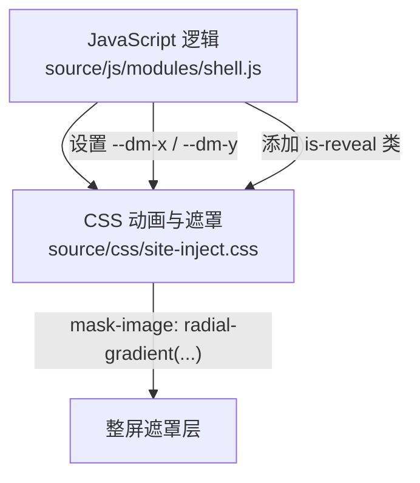
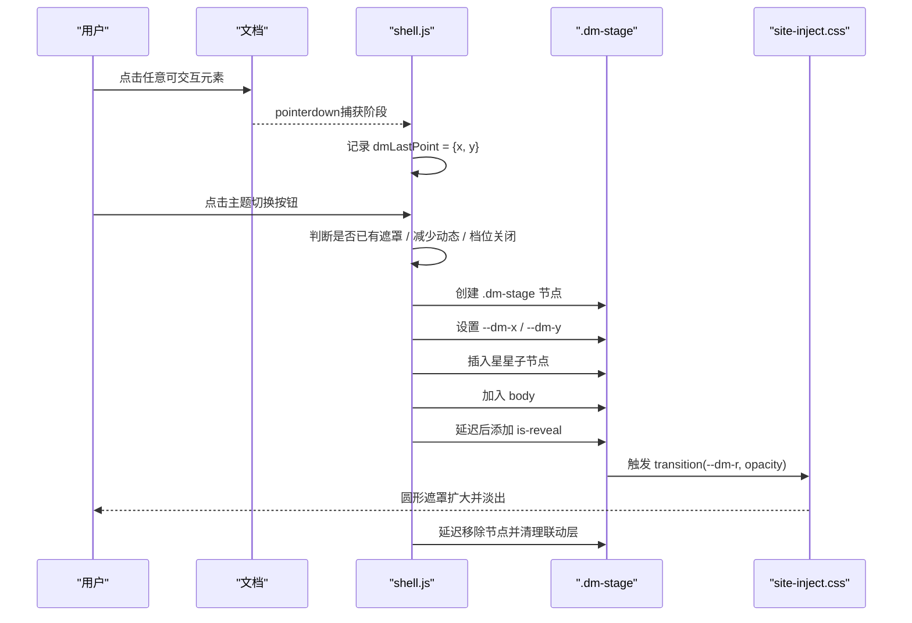
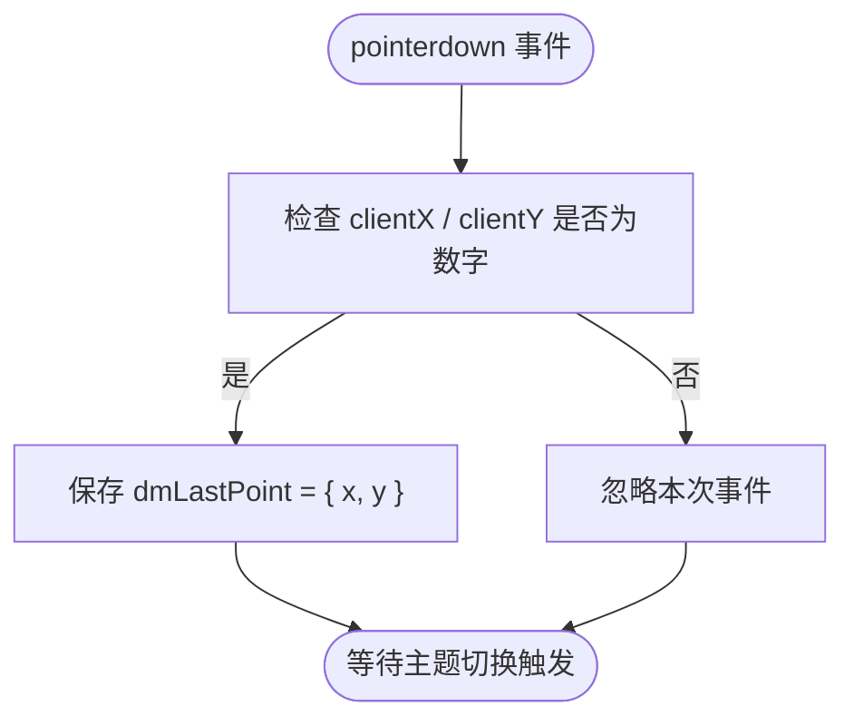
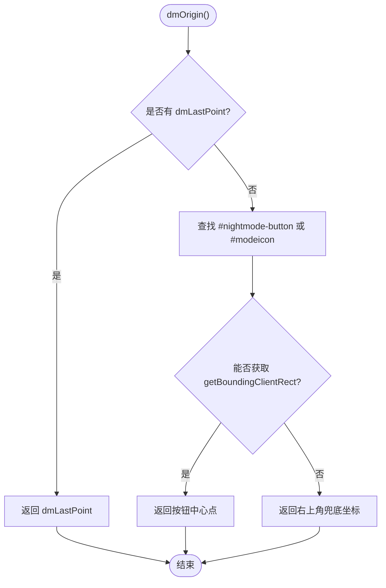
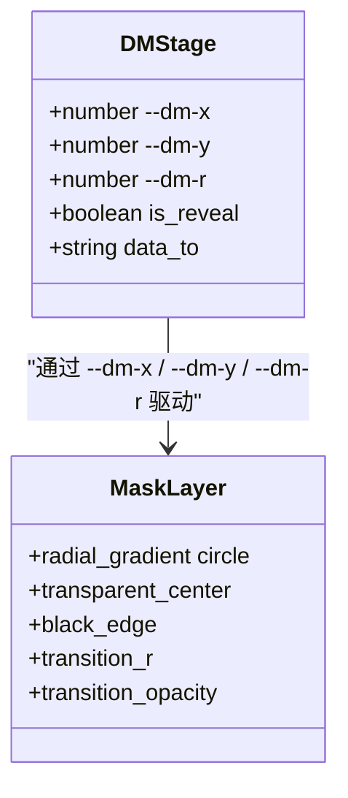
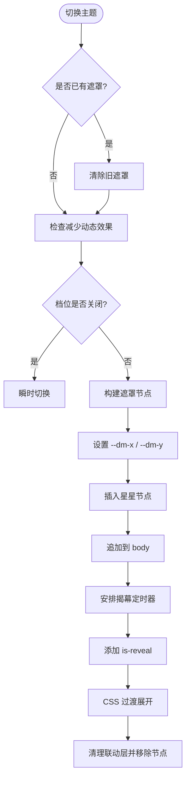
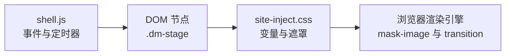

# 圆形揭幕效果

<cite>
**本文引用的文件**   
- [shell.js](file://source/js/modules/shell.js)
- [site-inject.css](file://source/css/site-inject.css)
</cite>

## 目录
1. [简介](#简介)
2. [项目结构中的位置](#项目结构中的位置)
3. [核心组件](#核心组件)
4. [架构总览](#架构总览)
5. [详细实现分析](#详细实现分析)
6. [依赖关系分析](#依赖关系分析)
7. [性能与体验特性](#性能与体验特性)
8. [定制指南](#定制指南)
9. [调试技巧](#调试技巧)
10. [常见问题排查](#常见问题排查)
11. [总结](#总结)

## 简介
本说明聚焦站点“昼夜切换”中的圆形揭幕效果：当用户点击主题切换入口时，页面会先播放一段“黄昏落幕”三拍动画，随后从点击位置向外扩散一个圆形遮罩，把整屏暗色幕布揭开。该效果由 JavaScript 负责事件捕获、圆心计算、动画时机控制，由 CSS 负责变量传递、径向渐变遮罩与过渡动画。

## 项目结构中的位置
圆形揭幕效果横跨两个关键文件：
- JavaScript 逻辑集中在站点外壳模块中，负责记住点击位置、选择动画档位、构建遮罩节点、安排定时器并触发 CSS 类名变化。
- CSS 样式集中在站点注入样式中，定义 `--dm-x`、`--dm-y`、`--dm-r` 等自定义属性，以及 `.dm-stage` 的径向渐变遮罩和 `.is-reveal` 触发的展开过渡。

**图表来源** 
- [shell.js:129-156](file://source/js/modules/shell.js#L129-L156)
- [shell.js:246-287](file://source/js/modules/shell.js#L246-L287)
- [site-inject.css:919-927](file://source/css/site-inject.css#L919-L927)

**章节来源**
- [shell.js:1-29](file://source/js/modules/shell.js#L1-L29)
- [site-inject.css:913-927](file://source/css/site-inject.css#L913-L927)

## 核心组件
- 点击位置追踪器：在捕获阶段监听全局指针按下事件，保存最后一次点击坐标。
- 圆心计算器：优先使用最近一次点击坐标；若不可用则回退到夜间模式按钮中心；再不可用则使用右上角兜底坐标。
- 遮罩构建器：根据当前档位创建 `.dm-stage` 节点，写入 `--dm-x`、`--dm-y`，生成星星元素，并安排揭幕与收尾定时器。
- CSS 遮罩层：通过 `radial-gradient` 与 `--dm-r` 变量形成圆形透明孔洞，配合 `transition` 完成半径增长与透明度淡出。

**章节来源**
- [shell.js:129-156](file://source/js/modules/shell.js#L129-L156)
- [shell.js:246-287](file://source/js/modules/shell.js#L246-L287)
- [site-inject.css:919-927](file://source/css/site-inject.css#L919-L927)

## 架构总览
圆形揭幕效果的执行流程如下：

**图表来源** 
- [shell.js:129-156](file://source/js/modules/shell.js#L129-L156)
- [shell.js:315-333](file://source/js/modules/shell.js#L315-L333)
- [shell.js:246-287](file://source/js/modules/shell.js#L246-L287)
- [site-inject.css:919-927](file://source/css/site-inject.css#L919-L927)

## 详细实现分析

### 点击位置追踪机制
- 事件类型：使用 `pointerdown`，兼容鼠标、触控、手写笔等指针输入。
- 捕获阶段：以捕获阶段注册监听，确保无论点击目标是谁，都能统一记录最后按下位置。
- 坐标存储：将 `clientX`、`clientY` 存入全局变量 `dmLastPoint`，供后续圆心计算使用。
- 边界处理：代码未对坐标做显式裁剪；圆心计算函数会在无有效点击坐标时回退到按钮中心或右上角，间接避免极端坐标导致的问题。

**图表来源** 
- [shell.js:129-135](file://source/js/modules/shell.js#L129-L135)

**章节来源**
- [shell.js:129-135](file://source/js/modules/shell.js#L129-L135)

### 圆心计算算法
圆心计算遵循三层策略：
1. 点击位置优先：如果存在 `dmLastPoint`，直接返回该坐标。
2. 按钮中心回退：尝试查找夜间模式按钮元素，读取其布局矩形，取中心点作为圆心。
3. 右上角兜底：若按钮不存在或无法获取尺寸，则返回一个靠近右上角的固定坐标。

**图表来源** 
- [shell.js:147-156](file://source/js/modules/shell.js#L147-L156)

**章节来源**
- [shell.js:147-156](file://source/js/modules/shell.js#L147-L156)

### CSS mask 动画实现
圆形揭幕的核心是 CSS 自定义属性与径向渐变遮罩：
- 变量传递：JavaScript 通过 `setProperty('--dm-x', ...)` 和 `setProperty('--dm-y', ...)` 将圆心坐标写入遮罩层。
- 遮罩形状：`.dm-stage` 使用 `mask-image: radial-gradient(circle var(--dm-r) at var(--dm-x) var(--dm-y), transparent 99%, #000 100%)`，其中 `--dm-r` 初始为 `0px`，展开后变为 `160vmax`。
- 过渡效果：`.dm-stage` 对 `--dm-r` 和 `opacity` 设置 `transition`，并在添加 `.is-reveal` 类后触发半径增长与透明度下降。
- 转昼优化：转白天时通过 `[data-to="light"]` 设置 `--dm-k: .8`，让整体动画时长缩短。

**图表来源** 
- [site-inject.css:919-927](file://source/css/site-inject.css#L919-L927)

**章节来源**
- [site-inject.css:919-927](file://source/css/site-inject.css#L919-L927)

### 揭幕时机控制
揭幕时机由 JavaScript 定时器与 CSS 动画共同控制：
- 延迟计算：标准档与华丽档使用三拍时间轴，揭幕开始时间为第一拍加第二拍再加揭幕延迟。
- 动画阶段配合：在揭幕开始时给 `.dm-stage` 添加 `.is-reveal`，使 `--dm-r` 从 `0px` 增长到 `160vmax`，同时 `opacity` 淡出。
- 用户体验考虑：
  - 连点第二次会立即清除上一次遮罩，避免重复播放。
  - 系统开启“减少动态效果”时不播放动画。
  - 档位设置为关闭时不播放动画。
  - 提醒弹窗放在整屏遮挡即将结束时，避免过早打断视觉体验。

**图表来源** 
- [shell.js:315-333](file://source/js/modules/shell.js#L315-L333)
- [shell.js:246-287](file://source/js/modules/shell.js#L246-L287)

**章节来源**
- [shell.js:315-333](file://source/js/modules/shell.js#L315-L333)
- [shell.js:246-287](file://source/js/modules/shell.js#L246-L287)

## 依赖关系分析
- shell.js 依赖 DOM API：`document.addEventListener`、`document.getElementById`、`getBoundingClientRect`、`document.createElement`、`querySelector`、`setProperty`、`setTimeout`。
- site-inject.css 依赖 CSS 特性：`@property` 自定义属性、`mask-image`、`radial-gradient`、`transition`、`animation`、媒体查询。
- 两者通过 CSS 自定义属性与类名耦合：JS 写变量、加类；CSS 读变量、响应类名变化。

**图表来源** 
- [shell.js:246-287](file://source/js/modules/shell.js#L246-L287)
- [site-inject.css:919-927](file://source/css/site-inject.css#L919-L927)

**章节来源**
- [shell.js:246-287](file://source/js/modules/shell.js#L246-L287)
- [site-inject.css:919-927](file://source/css/site-inject.css#L919-L927)

## 性能与体验特性
- 只动合成友好属性：遮罩层主要操作 `opacity`、`transform`、`mask`，避免重排重绘热点。
- 无 Canvas、无 requestAnimationFrame：遮罩动画完全由 CSS 驱动，降低 JS 帧循环压力。
- 移动端优化：手机宽度较小时减少星星数量，隐藏云层，缩小日月尺寸。
- 减少动态效果支持：系统偏好减少动态时，JS 不插遮罩，CSS 也隐藏遮罩层。
- 联动层清理：星空 canvas 与萤火虫层在动画期间临时调整透明度，结束后恢复空字符串样式，避免污染页面。

**章节来源**
- [shell.js:158-184](file://source/js/modules/shell.js#L158-L184)
- [shell.js:219-242](file://source/js/modules/shell.js#L219-L242)
- [shell.js:259-273](file://source/js/modules/shell.js#L259-L273)
- [site-inject.css:1011-1019](file://source/css/site-inject.css#L1011-L1019)

## 定制指南

### 调整揭幕半径
- 修改目标：CSS 中 `.dm-stage.is-reveal` 的 `--dm-r` 值。
- 当前行为：展开到 `160vmax`，足以覆盖任意视口。
- 建议：如需更小范围揭幕，可将 `160vmax` 改为更小的倍数，例如 `100vmax`；但需测试不同屏幕比例下的覆盖情况。

**章节来源**
- [site-inject.css:927](file://source/css/site-inject.css#L927)

### 控制揭幕速度
- 修改目标：`.dm-stage` 的 `transition` 中 `--dm-r` 的时长。
- 当前行为：`350ms cubic-bezier(.22,.61,.36,1)`。
- 建议：增大数值可让揭幕更柔和；减小数值可让揭幕更干脆。注意与整体动画节奏协调。

**章节来源**
- [site-inject.css:925](file://source/css/site-inject.css#L925)

### 修改颜色与遮罩形状
- 修改目标：`.dm-stage` 的 `mask-image` 径向渐变参数。
- 当前行为：中心透明、边缘黑色，形成圆形孔洞。
- 建议：
  - 改变 `transparent` 与 `#000` 的比例可调整边缘硬度。
  - 更换 `#000` 为其他颜色可改变遮罩可见区域的颜色倾向，但通常保持黑色以获得最佳兼容性。
  - 如需非圆形揭幕，可改用椭圆或其他渐变形状，但需同步调整半径变量语义。

**章节来源**
- [site-inject.css:923-924](file://source/css/site-inject.css#L923-L924)

### 调整圆心位置
- 修改目标：shell.js 中的 `dmOrigin()` 函数。
- 当前行为：点击优先 → 按钮中心 → 右上角兜底。
- 建议：
  - 若希望始终从按钮中心出发，可直接返回按钮中心逻辑。
  - 若希望固定从屏幕中心出发，可返回 `{ x: window.innerWidth / 2, y: window.innerHeight / 2 }`。
  - 若需要限制点击坐标在可视区域内，可在保存前增加边界校验。

**章节来源**
- [shell.js:147-156](file://source/js/modules/shell.js#L147-L156)

### 调整揭幕延迟与阶段
- 修改目标：shell.js 中的 `DM_REVEAL_LAG_MS`、`DM_REVEAL_AT_MS`、`DM_REVEAL_MS`。
- 当前行为：第三拍开始后延迟一段时间再揭幕，揭幕时长包含在总时长内。
- 建议：
  - 增大延迟可让星星先铺满，再揭幕，增强层次感。
  - 减小延迟可让揭幕更早出现，提升即时反馈。
  - 调整时需同步更新注释与 CSS 对应常量说明，保持 JS 与 CSS 一致性。

**章节来源**
- [shell.js:115-121](file://source/js/modules/shell.js#L115-L121)
- [site-inject.css:913-916](file://source/css/site-inject.css#L913-L916)

## 调试技巧

### 查看圆心坐标
- 打开浏览器开发者工具。
- 在控制台输出 `dmLastPoint`，确认最后一次点击坐标是否正确记录。
- 若为空，检查 `pointerdown` 监听是否成功绑定，以及事件对象是否包含 `clientX`、`clientY`。

**章节来源**
- [shell.js:129-135](file://source/js/modules/shell.js#L129-L135)

### 查看遮罩节点与变量
- 在 Elements 面板中找到 `.dm-stage` 节点。
- 检查其内联样式中的 `--dm-x`、`--dm-y`、`--dm-r`。
- 确认是否添加了 `.is-reveal` 类。
- 在 Computed 面板查看 `mask-image` 的实际渲染结果。

**章节来源**
- [shell.js:256-258](file://source/js/modules/shell.js#L256-L258)
- [shell.js:278-281](file://source/js/modules/shell.js#L278-L281)
- [site-inject.css:921-927](file://source/css/site-inject.css#L921-L927)

### 验证减少动态效果
- 在设备模拟或系统设置中启用“减少动态效果”。
- 切换主题，确认没有遮罩层出现。
- 若仍有动画，检查 JS 中的 `nightModeReducedMotion()` 返回值与 CSS 中的 `prefers-reduced-motion` 规则。

**章节来源**
- [shell.js:158-164](file://source/js/modules/shell.js#L158-L164)
- [site-inject.css:1019](file://source/css/site-inject.css#L1019)

### 定位连点问题
- 快速连续点击主题切换按钮。
- 观察是否出现遮罩残留或动画中断。
- 检查 `clearNightModeOverlay()` 是否清除了定时器、联动层与 DOM 节点。

**章节来源**
- [shell.js:166-184](file://source/js/modules/shell.js#L166-L184)
- [shell.js:319-324](file://source/js/modules/shell.js#L319-L324)

## 常见问题排查

### 揭幕圆心不在点击位置
- 可能原因：
  - 点击的不是可触发 `pointerdown` 的元素。
  - 点击发生在脚本加载前。
  - 按钮中心或右上角兜底被命中。
- 排查步骤：
  - 在控制台打印 `dmLastPoint`。
  - 检查 `dmOrigin()` 的回退逻辑。
  - 确认夜间模式按钮是否存在且可获取尺寸。

**章节来源**
- [shell.js:129-156](file://source/js/modules/shell.js#L129-L156)

### 遮罩没有展开
- 可能原因：
  - `.is-reveal` 类未添加。
  - `--dm-r` 未正确过渡。
  - 系统启用了减少动态效果。
  - 档位设置为关闭。
- 排查步骤：
  - 检查 `.dm-stage` 是否包含 `.is-reveal`。
  - 检查 `transition` 是否生效。
  - 检查 `prefers-reduced-motion`。
  - 检查 localStorage 中的档位配置。

**章节来源**
- [shell.js:278-286](file://source/js/modules/shell.js#L278-L286)
- [site-inject.css:925-927](file://source/css/site-inject.css#L925-L927)
- [site-inject.css:1019](file://source/css/site-inject.css#L1019)

### 动画卡顿或掉帧
- 可能原因：
  - 大量星星节点同时动画。
  - 联动层频繁读写样式。
  - 非合成属性动画。
- 排查步骤：
  - 检查星星数量与动画延迟分布。
  - 检查联动层是否在动画结束后恢复样式。
  - 确认遮罩层只操作 `opacity`、`transform`、`mask`。

**章节来源**
- [shell.js:259-273](file://source/js/modules/shell.js#L259-L273)
- [shell.js:176-184](file://source/js/modules/shell.js#L176-L184)
- [site-inject.css:917-918](file://source/css/site-inject.css#L917-L918)

## 总结
圆形揭幕效果通过“JS 记录点击 → JS 计算圆心 → JS 构建遮罩 → CSS 变量驱动遮罩展开”的协作方式实现。其设计强调：
- 点击位置优先，保证揭幕方向符合用户直觉。
- 多层回退策略，保证在无点击或无按钮时仍可稳定展示。
- CSS 主导动画，减少 JS 运行时开销。
- 多档位与减少动态效果支持，兼顾表现力与可访问性。
- 联动层清理与移动端适配，保证长期运行稳定性。

在实际定制时，建议优先调整半径、速度与圆心策略，其次再考虑颜色与形状变更；所有改动都应结合调试面板验证变量、类名与遮罩渲染结果，并确保与整体昼夜切换节奏保持一致。