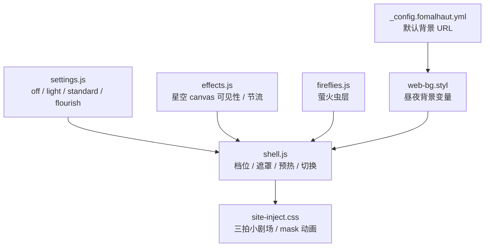
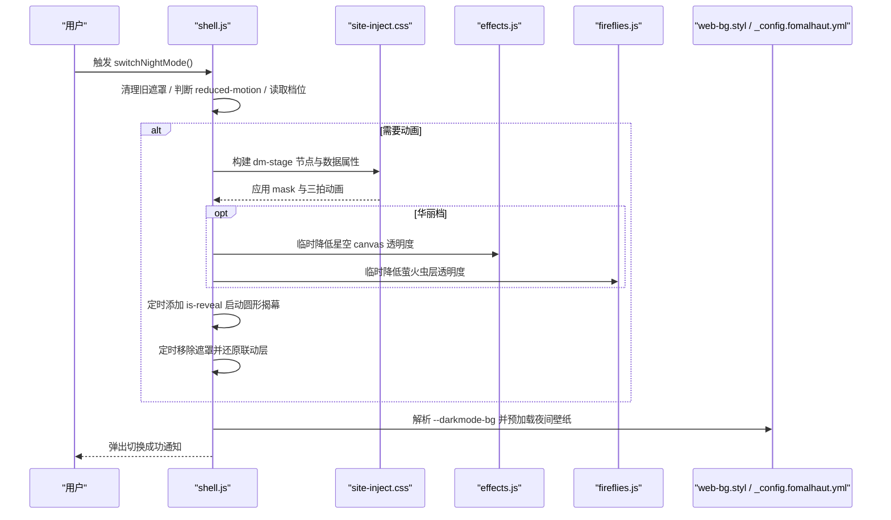
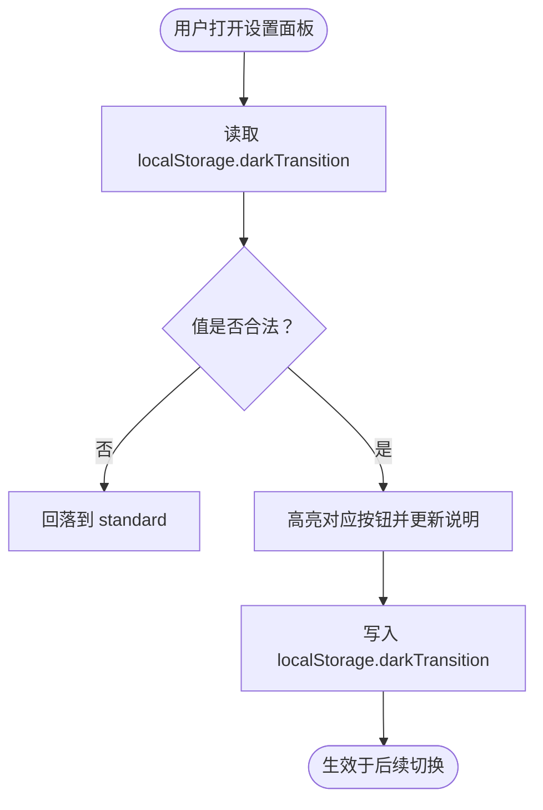
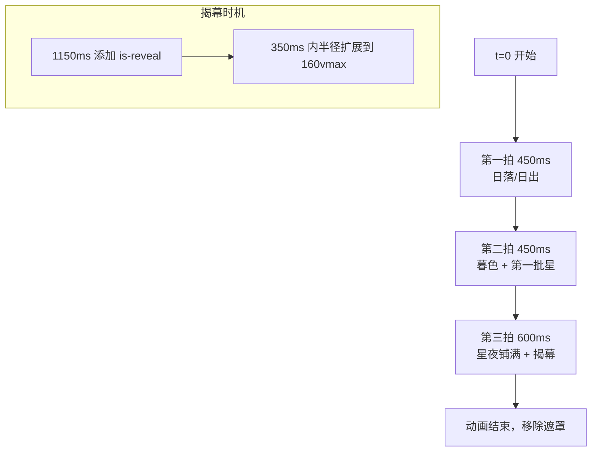
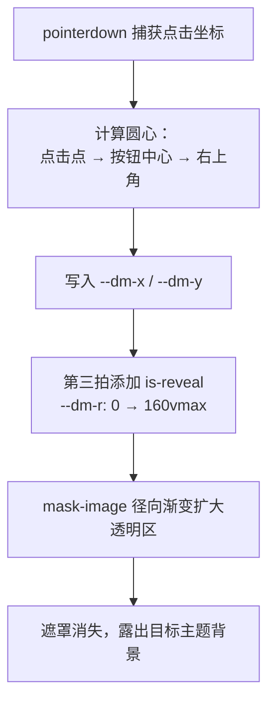
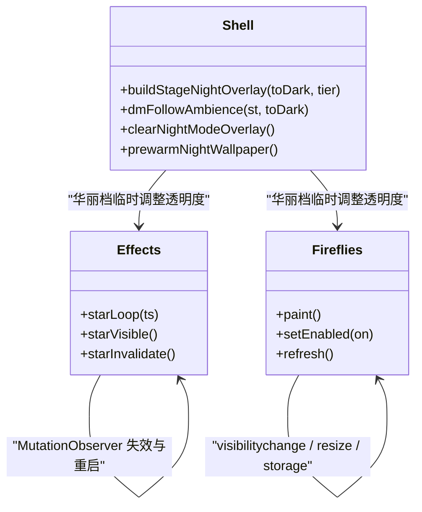
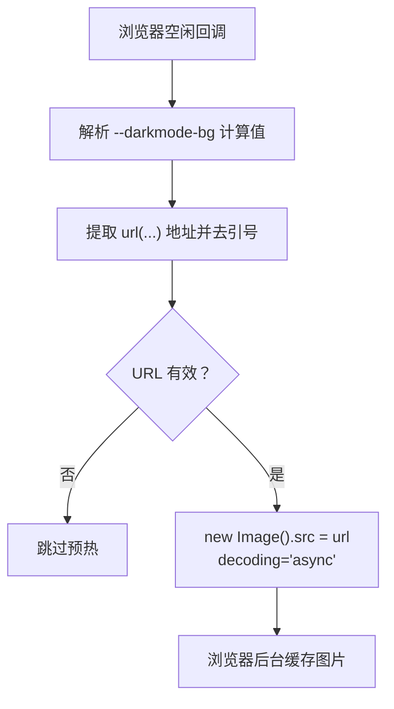
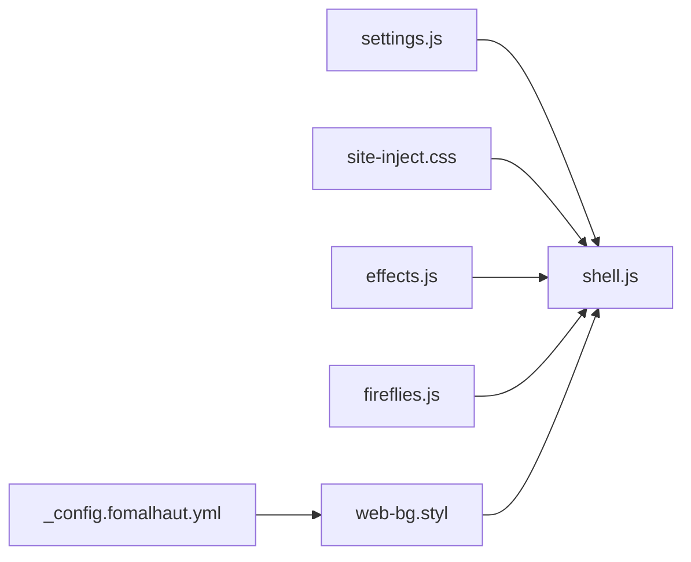

# 夜间模式切换动画

<cite>
**本文引用的文件**   
- [shell.js](file://source/js/modules/shell.js)
- [site-inject.css](file://source/css/site-inject.css)
- [settings.js](file://source/js/modules/settings.js)
- [effects.js](file://source/js/modules/effects.js)
- [fireflies.js](file://source/js/modules/fireflies.js)
- [web-bg.styl](file://themes/fomalhaut/source/css/_layout/web-bg.styl)
- [_config.fomalhaut.yml](file://_config.fomalhaut.yml)
</cite>

## 目录
1. [引言](#引言)
2. [项目结构](#项目结构)
3. [核心组件](#核心组件)
4. [架构总览](#架构总览)
5. [详细组件分析](#详细组件分析)
6. [依赖关系分析](#依赖关系分析)
7. [性能考量](#性能考量)
8. [故障排查指南](#故障排查指南)
9. [结论](#结论)
10. [附录：动画档位配置指南](#附录动画档位配置指南)

## 引言
本文面向主题使用者与维护者，系统梳理“夜间模式切换动画”的完整实现。内容覆盖四种动画档位、三拍小剧场时间轴、圆形揭幕原理、星空与萤火虫联动机制、夜间壁纸预热策略，以及基于 localStorage 的用户偏好与系统减少动态效果适配。目标是让读者既能理解整体流程，也能定位到具体源码位置进行二次开发或问题排查。

## 项目结构
夜间模式切换动画由“行为脚本 + 样式层 + 设置面板 + 背景资源”共同组成：
- 行为控制：`source/js/modules/shell.js` 负责档位读取、遮罩构建、点击位置追踪、联动层协调、夜间壁纸预热与切换入口。
- 视觉表现：`source/css/site-inject.css` 定义三拍小剧场、日月星云、流星、远山辉光、圆形 mask 动画与移动端降级。
- 用户设置：`source/js/modules/settings.js` 提供 off/light/standard/flourish 四个档位的 UI 与持久化。
- 星空与萤火虫：`source/js/modules/effects.js` 管理星空 canvas 可见性与绘制节流；`source/js/modules/fireflies.js` 管理萤火虫 DOM 层。
- 背景资源：`themes/fomalhaut/source/css/_layout/web-bg.styl` 与 `_config.fomalhaut.yml` 提供昼夜背景图变量与默认值。

**图表来源**
- [shell.js:97-127](file://source/js/modules/shell.js#L97-L127)
- [site-inject.css:913-1019](file://source/css/site-inject.css#L913-L1019)
- [settings.js:337-363](file://source/js/modules/settings.js#L337-L363)
- [effects.js:71-124](file://source/js/modules/effects.js#L71-L124)
- [fireflies.js:1-90](file://source/js/modules/fireflies.js#L1-L90)
- [web-bg.styl:1-24](file://themes/fomalhaut/source/css/_layout/web-bg.styl#L1-L24)
- [_config.fomalhaut.yml:1209-1213](file://_config.fomalhaut.yml#L1209-L1213)

**章节来源**
- [shell.js:97-127](file://source/js/modules/shell.js#L97-L127)
- [site-inject.css:913-1019](file://source/css/site-inject.css#L913-L1019)
- [settings.js:337-363](file://source/js/modules/settings.js#L337-L363)
- [effects.js:71-124](file://source/js/modules/effects.js#L71-L124)
- [fireflies.js:1-90](file://source/js/modules/fireflies.js#L1-L90)
- [web-bg.styl:1-24](file://themes/fomalhaut/source/css/_layout/web-bg.styl#L1-L24)
- [_config.fomalhaut.yml:1209-1213](file://_config.fomalhaut.yml#L1209-L1213)

## 核心组件
- 档位控制器：从 `localStorage.darkTransition` 读取当前档位，默认标准档，支持 off/light/standard/flourish。
- 遮罩构建器：根据档位选择“轻档老转盘”或“标准/华丽档三拍小剧场”。
- 三拍小剧场：日落/日出（第一拍）、暮色星现（第二拍）、星夜铺满并圆形揭幕（第三拍）。
- 圆形揭幕：通过 CSS `mask-image` 径向渐变，配合 JS 注入的 `--dm-x/--dm-y/--dm-r` 变量展开。
- 联动层：在华丽档下同步星空 canvas 与萤火虫层的透明度，避免切暗后突然亮起。
- 壁纸预热：空闲时解析 `--darkmode-bg` 并异步加载夜间壁纸，减少切换时的空白等待。
- 设置面板：提供四档按钮、说明文案、系统减少动态效果提示，并将选择写入 `localStorage`。

**章节来源**
- [shell.js:111-127](file://source/js/modules/shell.js#L111-L127)
- [shell.js:186-287](file://source/js/modules/shell.js#L186-L287)
- [shell.js:290-313](file://source/js/modules/shell.js#L290-L313)
- [settings.js:337-363](file://source/js/modules/settings.js#L337-L363)
- [site-inject.css:919-927](file://source/css/site-inject.css#L919-L927)

## 架构总览
夜间模式切换的整体流程如下：
1. 用户触发切换（如点击夜间模式按钮），进入 `switchNightMode()`。
2. 若已有遮罩未播完，先清理旧遮罩，本次瞬时切换。
3. 检查系统“减少动态效果”与档位是否为 off，任一满足则跳过动画。
4. 根据当前主题方向（转暗/转亮）与档位构建遮罩。
5. 华丽档联动星空与萤火虫层透明度，使其随幕布渐隐渐显。
6. 在整屏遮挡结束前弹出通知，随后更新 body class、图标与本地存储。
7. 空闲时预热夜间壁纸，提升下次切换体验。

**图表来源**
- [shell.js:315-382](file://source/js/modules/shell.js#L315-L382)
- [shell.js:186-287](file://source/js/modules/shell.js#L186-L287)
- [site-inject.css:919-927](file://source/css/site-inject.css#L919-L927)
- [effects.js:71-124](file://source/js/modules/effects.js#L71-L124)
- [fireflies.js:1-90](file://source/js/modules/fireflies.js#L1-L90)
- [web-bg.styl:1-24](file://themes/fomalhaut/source/css/_layout/web-bg.styl#L1-L24)
- [_config.fomalhaut.yml:1209-1213](file://_config.fomalhaut.yml#L1209-L1213)

## 详细组件分析

### 四种动画档位
- off（关闭）：不创建遮罩，颜色瞬间到位，适合对动效零容忍的场景。
- light（轻）：沿用老式转盘逻辑，太阳月亮互换后整屏淡出，时长约 1.5 秒。
- standard（标准）：默认档，采用三拍小剧场 + 圆形揭幕，时长约 1.5 秒。
- flourish（华丽）：在标准基础上增加流云与第二颗流星，并在华丽档联动星空与萤火虫层，时长约 1.6 秒。

档位描述与面板按钮由设置模块维护，实际档位读取由 shell.js 的 `dmTier()` 完成。

**图表来源**
- [settings.js:337-363](file://source/js/modules/settings.js#L337-L363)
- [shell.js:137-145](file://source/js/modules/shell.js#L137-L145)

**章节来源**
- [settings.js:337-363](file://source/js/modules/settings.js#L337-L363)
- [shell.js:111-127](file://source/js/modules/shell.js#L111-L127)
- [shell.js:186-287](file://source/js/modules/shell.js#L186-L287)

### 三拍小剧场时间轴
三拍小剧场将昼夜切换拆成三段节奏：
- 第一拍（日落/日出）：天空底色过渡，太阳落下或升起，月亮升起或落下。
- 第二拍（暮色星现）：暮色层短暂点亮，第一批星星冒头。
- 第三拍（星夜铺满 + 揭幕）：剩余星星铺满，随后从点击位置圆形揭开，露出目标主题背景。

关键常量与时间对齐：
- DM_BEAT1_MS = 450ms
- DM_BEAT2_MS = 450ms
- DM_BEAT3_MS = 600ms
- DM_TOTAL_MS = 1500ms
- DM_REVEAL_AT_MS = 1150ms（开始揭幕）
- DM_REVEAL_MS = 350ms（揭幕时长）
- 转昼整体乘以 DM_LIGHT_K = 0.8，使白天切换更快。

**图表来源**
- [shell.js:115-122](file://source/js/modules/shell.js#L115-L122)
- [shell.js:277-286](file://source/js/modules/shell.js#L277-L286)
- [site-inject.css:919-927](file://source/css/site-inject.css#L919-L927)

**章节来源**
- [shell.js:115-122](file://source/js/modules/shell.js#L115-L122)
- [shell.js:246-287](file://source/js/modules/shell.js#L246-L287)
- [site-inject.css:929-987](file://source/css/site-inject.css#L929-L987)

### 圆形揭幕效果实现原理
圆形揭幕的核心是 CSS `mask-image` 径向渐变：
- JS 计算圆心 `--dm-x/--dm-y`：优先使用最后一次 pointerdown 的坐标，否则回退到夜间模式按钮中心，再回退到右上角。
- JS 在第三拍开始时给 `.dm-stage` 添加 `is-reveal`，触发 `--dm-r` 从 0 增长到 160vmax。
- CSS 中 `mask-image` 以透明圆向外扩散，最终完全揭示底层内容。

**图表来源**
- [shell.js:129-156](file://source/js/modules/shell.js#L129-L156)
- [shell.js:256-258](file://source/js/modules/shell.js#L256-L258)
- [shell.js:277-281](file://source/js/modules/shell.js#L277-L281)
- [site-inject.css:919-927](file://source/css/site-inject.css#L919-L927)

**章节来源**
- [shell.js:129-156](file://source/js/modules/shell.js#L129-L156)
- [shell.js:246-287](file://source/js/modules/shell.js#L246-L287)
- [site-inject.css:919-927](file://source/css/site-inject.css#L919-L927)

### 星空联动机制
在华丽档下，为避免夜间模式切换后星空 canvas 与萤火虫层突兀出现，shell.js 会临时调整它们的透明度：
- 查找 `#universe`（星空 canvas）与 `#fireflies-stage`（萤火虫层）。
- 仅当元素存在且未被隐藏时才接管，记录到 `followers` 数组。
- 转暗时在第二拍末尾将透明度降至 0，待遮罩揭幕后再恢复为 1；转亮时相反。
- 动画结束后统一清空 inline opacity 与 transition，不留脏样式。

星空 canvas 自身的可见性与绘制频率由 effects.js 管理：
- 仅在暗色主题且 canvas 可见时运行绘制循环。
- 使用 MutationObserver 监听 data-theme/class/style 变化，不可见时彻底退出 rAF 循环。
- 绘制帧率限制到约 30fps，降低高刷屏幕下的重绘压力。

萤火虫层由 fireflies.js 管理：
- 使用纯 CSS 动画，无 canvas、无 rAF、无定时器循环。
- 根据视口宽度决定粒子数量（桌面 14，手机 8）。
- 与雪花互斥，开启萤火虫会自动关闭雪花，反之亦然。
- 受系统“减少动态效果”影响，暂停动画但不销毁层。

**图表来源**
- [shell.js:219-242](file://source/js/modules/shell.js#L219-L242)
- [shell.js:246-287](file://source/js/modules/shell.js#L246-L287)
- [effects.js:71-124](file://source/js/modules/effects.js#L71-L124)
- [fireflies.js:1-90](file://source/js/modules/fireflies.js#L1-L90)

**章节来源**
- [shell.js:219-242](file://source/js/modules/shell.js#L219-L242)
- [shell.js:246-287](file://source/js/modules/shell.js#L246-L287)
- [effects.js:71-124](file://source/js/modules/effects.js#L71-L124)
- [fireflies.js:1-90](file://source/js/modules/fireflies.js#L1-L90)

### 夜间壁纸预热功能
夜间壁纸预热用于解决“切到夜间才下载背景图”导致的闪烁或空白：
- 解析根元素的 `--darkmode-bg` 计算值，提取 `url(...)` 中的地址。
- 去除引号并校验非空，构造 `Image` 对象并设置 `decoding='async'`。
- 优先使用 `requestIdleCallback` 在空闲时执行，否则回退到延时加载。
- 该 URL 来自主题配置与运行时覆盖，确保与最终背景一致，避免重复下载。

**图表来源**
- [shell.js:290-313](file://source/js/modules/shell.js#L290-L313)
- [_config.fomalhaut.yml:1209-1213](file://_config.fomalhaut.yml#L1209-L1213)
- [web-bg.styl:1-24](file://themes/fomalhaut/source/css/_layout/web-bg.styl#L1-L24)

**章节来源**
- [shell.js:290-313](file://source/js/modules/shell.js#L290-L313)
- [_config.fomalhaut.yml:1209-1213](file://_config.fomalhaut.yml#L1209-L1213)
- [web-bg.styl:1-24](file://themes/fomalhaut/source/css/_layout/web-bg.styl#L1-L24)

## 依赖关系分析
- shell.js 是夜间切换中枢，依赖 settings.js 提供的档位 UI 与持久化，依赖 site-inject.css 的视觉表现，依赖 effects.js 与 fireflies.js 的环境氛围。
- site-inject.css 与 shell.js 的时间常量必须保持一致，否则动画节奏错乱。
- web-bg.styl 与 _config.fomalhaut.yml 提供背景变量，shell.js 的预热逻辑依赖这些变量的最终计算值。

**图表来源**
- [shell.js:111-127](file://source/js/modules/shell.js#L111-L127)
- [shell.js:186-287](file://source/js/modules/shell.js#L186-L287)
- [settings.js:337-363](file://source/js/modules/settings.js#L337-L363)
- [site-inject.css:913-1019](file://source/css/site-inject.css#L913-L1019)
- [effects.js:71-124](file://source/js/modules/effects.js#L71-L124)
- [fireflies.js:1-90](file://source/js/modules/fireflies.js#L1-L90)
- [web-bg.styl:1-24](file://themes/fomalhaut/source/css/_layout/web-bg.styl#L1-L24)
- [_config.fomalhaut.yml:1209-1213](file://_config.fomalhaut.yml#L1209-L1213)

**章节来源**
- [shell.js:111-127](file://source/js/modules/shell.js#L111-L127)
- [shell.js:186-287](file://source/js/modules/shell.js#L186-L287)
- [settings.js:337-363](file://source/js/modules/settings.js#L337-L363)
- [site-inject.css:913-1019](file://source/css/site-inject.css#L913-L1019)
- [effects.js:71-124](file://source/js/modules/effects.js#L71-L124)
- [fireflies.js:1-90](file://source/js/modules/fireflies.js#L1-L90)
- [web-bg.styl:1-24](file://themes/fomalhaut/source/css/_layout/web-bg.styl#L1-L24)
- [_config.fomalhaut.yml:1209-1213](file://_config.fomalhaut.yml#L1209-L1213)

## 性能考量
- 遮罩动画只操作 opacity、transform、mask，不新建 canvas，不跑 rAF，避免主线程阻塞。
- 星空 canvas 在不可见时彻底退出 rAF 循环，绘制帧率限制到约 30fps，降低高刷设备负载。
- 萤火虫层使用纯 CSS 动画，无 JS 循环，按视口宽度自适应粒子数。
- 夜间壁纸预热使用 `requestIdleCallback`，不抢占首帧渲染。
- 系统“减少动态效果”时，遮罩直接隐藏，所有相关动画与过渡被禁用。

[本节为通用性能建议，不直接分析具体文件]

## 故障排查指南
- 切换后星空或萤火虫突然亮起：检查华丽档联动逻辑是否正确执行，确认 `dmFollowAmbience` 是否在 floursh 档调用，并确保遮罩结束时 `dmResetFollowers` 已清空 inline 样式。
- 圆形揭幕圆心异常：确认 pointerdown 事件是否被拦截，或夜间模式按钮是否存在；若不存在，会回退到右上角。
- 动画卡顿或掉帧：检查是否同时开启星空、萤火虫、雪花等特效；在低配设备上可考虑切换到 light 或 off 档。
- 夜间背景闪烁：确认 `--darkmode-bg` 是否与配置文件一致，预热是否成功；必要时手动刷新页面或清除缓存。
- 系统“减少动态效果”无效：检查 CSS 中 `@media (prefers-reduced-motion: reduce)` 是否生效，以及 shell.js 的 `nightModeReducedMotion()` 判断逻辑。

**章节来源**
- [shell.js:158-184](file://source/js/modules/shell.js#L158-L184)
- [shell.js:219-242](file://source/js/modules/shell.js#L219-L242)
- [shell.js:290-313](file://source/js/modules/shell.js#L290-L313)
- [site-inject.css:907-912](file://source/css/site-inject.css#L907-L912)
- [site-inject.css:1011-1019](file://source/css/site-inject.css#L1011-L1019)
- [effects.js:71-124](file://source/js/modules/effects.js#L71-L124)
- [fireflies.js:1-90](file://source/js/modules/fireflies.js#L1-L90)

## 结论
夜间模式切换动画通过“档位控制 + 三拍小剧场 + 圆形揭幕 + 环境联动 + 壁纸预热”的组合，兼顾了视觉表现与性能体验。标准档提供完整的日落/暮色/星夜叙事，华丽档进一步丰富细节并与星空、萤火虫协同；light 档保留兼容体验，off 档满足极致简洁需求。设置面板与系统减少动态效果适配确保不同用户都能获得合适的体验。

[本节为总结性内容，不直接分析具体文件]

## 附录：动画档位配置指南
- 存储键：`localStorage.darkTransition`
- 可选值：`off`、`light`、`standard`、`flourish`
- 默认值：`standard`
- 设置入口：设置面板“氛围特效 › 昼夜切换”，四个胶囊按钮分别对应四档。
- 用户偏好：选择后立即写入 `localStorage`，下次打开面板自动高亮。
- 系统减少动态效果：若系统开启 `prefers-reduced-motion: reduce`，遮罩会被隐藏，切换变为瞬时；设置面板说明文案也会提示。
- 最佳实践：
  - 普通用户推荐 standard 档，平衡视觉效果与性能。
  - 低配设备或敏感用户可选择 off 或 light 档。
  - 希望沉浸体验的用户可选择 flourish 档，但注意可能同时启用星空与萤火虫。
  - 若发现切换后仍有明显卡顿，优先关闭星空或萤火虫，再评估档位。

**章节来源**
- [settings.js:337-363](file://source/js/modules/settings.js#L337-L363)
- [shell.js:111-127](file://source/js/modules/shell.js#L111-L127)
- [shell.js:137-145](file://source/js/modules/shell.js#L137-L145)
- [site-inject.css:1000-1019](file://source/css/site-inject.css#L1000-L1019)