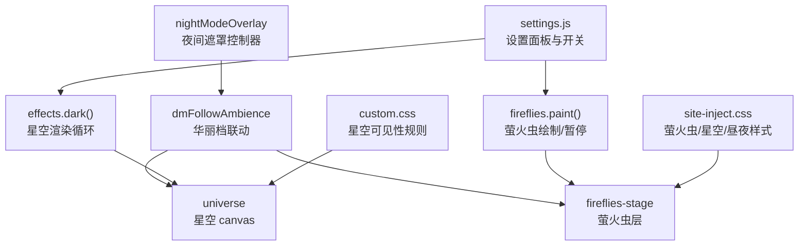
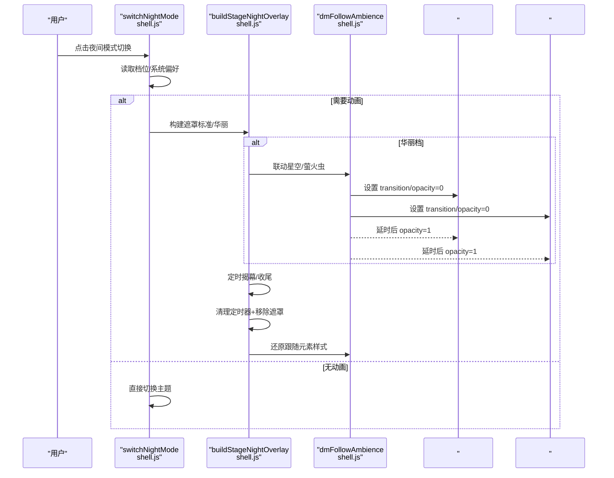
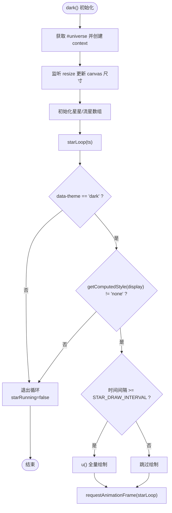
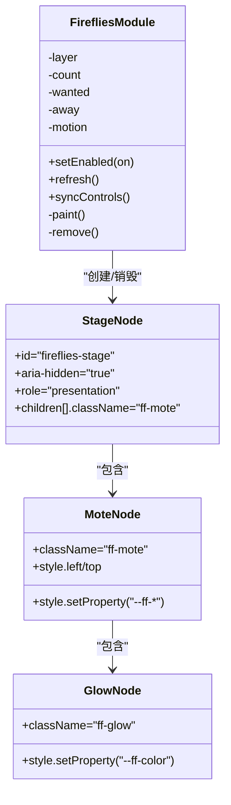
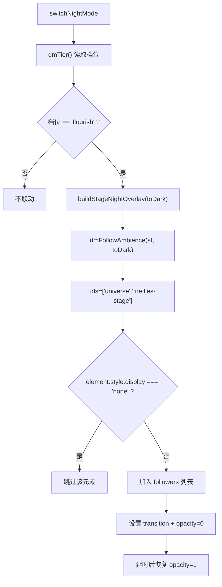
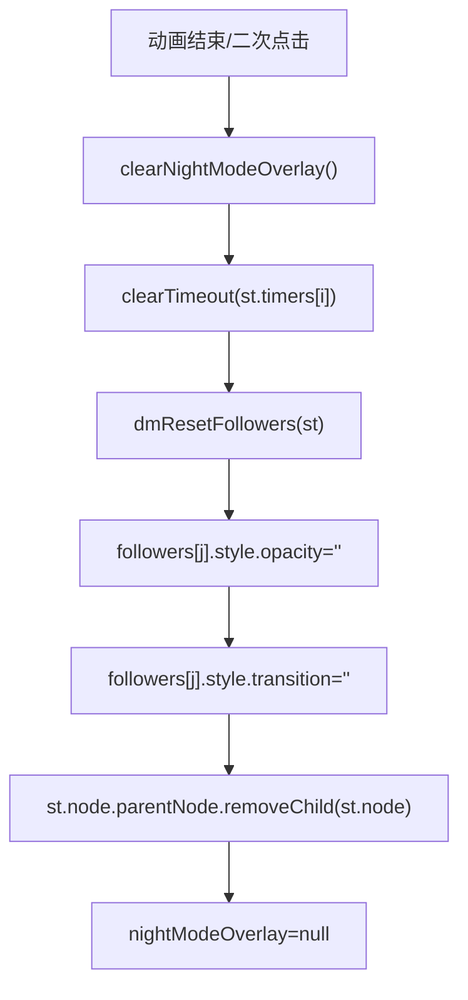
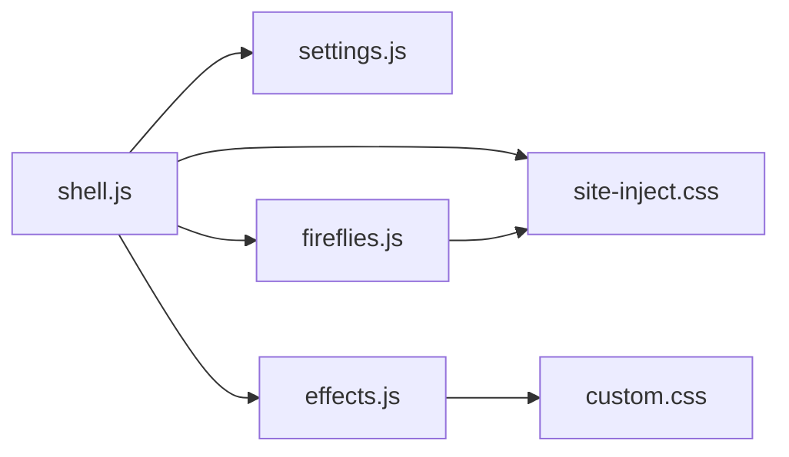

# 环境效果联动

<cite>
**本文引用的文件**   
- [effects.js](file://source/js/modules/effects.js)
- [fireflies.js](file://source/js/modules/fireflies.js)
- [shell.js](file://source/js/modules/shell.js)
- [site-inject.css](file://source/css/site-inject.css)
- [custom.css](file://themes/fomalhaut/source/css/_custom/custom.css)
- [settings.js](file://source/js/modules/settings.js)
</cite>

## 目录
1. [引言](#引言)
2. [项目结构](#项目结构)
3. [核心组件](#核心组件)
4. [架构总览](#架构总览)
5. [详细组件分析](#详细组件分析)
6. [依赖关系分析](#依赖关系分析)
7. [性能考量](#性能考量)
8. [故障排查指南](#故障排查指南)
9. [结论](#结论)
10. [附录：联动扩展指南](#附录联动扩展指南)

## 引言
本文聚焦“环境效果联动机制”，即站点在切换夜间模式时，如何让星空 canvas、萤火虫层与昼夜切换动画协同工作。文档覆盖以下目标：
- 星空 canvas 同步逻辑：元素查找、透明度控制、状态恢复。
- 萤火虫层协调原理：DOM 操作、样式注入、生命周期管理。
- 联动触发条件：华丽档位检测、显示状态判断、性能优化。
- 资源清理机制：定时器取消、DOM 节点移除、内存泄漏防护。
- 联动效果扩展指南：新元素类型支持、自定义同步逻辑、调试方法。
- 性能监控和优化建议。

## 项目结构
环境效果联动涉及三类代码：
- 特效运行时：星空 canvas 渲染循环、萤火虫 DOM 微光层。
- 外壳行为：夜间模式切换、档位选择、遮罩动画。
- 样式层：星空隐藏规则、萤火虫 CSS 动画、昼夜切换舞台动画。

**图表来源**
- [shell.js:166-287](file://source/js/modules/shell.js#L166-L287)
- [effects.js:27-124](file://source/js/modules/effects.js#L27-L124)
- [fireflies.js:39-88](file://source/js/modules/fireflies.js#L39-L88)
- [site-inject.css:824-863](file://source/css/site-inject.css#L824-L863)
- [custom.css:2569-2595](file://themes/fomalhaut/source/css/_custom/custom.css#L2569-L2595)
- [settings.js:366-400](file://source/js/modules/settings.js#L366-L400)

**章节来源**
- [shell.js:100-127](file://source/js/modules/shell.js#L100-L127)
- [effects.js:24-125](file://source/js/modules/effects.js#L24-L125)
- [fireflies.js:1-90](file://source/js/modules/fireflies.js#L1-L90)
- [site-inject.css:824-863](file://source/css/site-inject.css#L824-L863)
- [custom.css:2569-2595](file://themes/fomalhaut/source/css/_custom/custom.css#L2569-L2595)
- [settings.js:366-400](file://source/js/modules/settings.js#L366-L400)

## 核心组件
- 星空模块（effects.js）：负责 #universe 的 Canvas 初始化、星星/流星生成、rAF 渲染循环，以及基于主题和可见性的性能保护。
- 萤火虫模块（fireflies.js）：通过 DOM + CSS 动画实现低开销微光效果，提供 setEnabled/refresh/syncControls API，并与雪花互斥。
- 外壳联动（shell.js）：夜间模式切换时根据档位构建遮罩；华丽档下联动星空与萤火虫，统一淡入淡出并在收尾还原。
- 样式层（site-inject.css、custom.css）：定义萤火虫动画、减少动态效果兜底、星空显示规则、昼夜切换舞台动画。
- 设置面板（settings.js）：暴露星空开关、萤火虫开关，并驱动 localStorage 持久化。

**章节来源**
- [effects.js:27-124](file://source/js/modules/effects.js#L27-L124)
- [fireflies.js:1-90](file://source/js/modules/fireflies.js#L1-L90)
- [shell.js:166-287](file://source/js/modules/shell.js#L166-L287)
- [site-inject.css:824-863](file://source/css/site-inject.css#L824-L863)
- [custom.css:2569-2595](file://themes/fomalhaut/source/css/_custom/custom.css#L2569-L2595)
- [settings.js:366-400](file://source/js/modules/settings.js#L366-L400)

## 架构总览
夜间模式切换由 shell.js 驱动。当用户点击切换按钮时：
1. 读取当前主题与档位。
2. 若系统偏好或档位关闭动画，则瞬时切换。
3. 否则构建遮罩（轻档转盘或标准/华丽档三拍舞台）。
4. 华丽档下调用 dmFollowAmbience，对已显示的 #universe 与 #fireflies-stage 做透明度过渡。
5. 动画结束时清除遮罩、取消定时器、还原跟随元素的 inline 样式。

**图表来源**
- [shell.js:315-382](file://source/js/modules/shell.js#L315-L382)
- [shell.js:246-287](file://source/js/modules/shell.js#L246-L287)
- [shell.js:221-242](file://source/js/modules/shell.js#L221-L242)

**章节来源**
- [shell.js:315-382](file://source/js/modules/shell.js#L315-L382)

## 详细组件分析

### 星空 Canvas 同步逻辑
星空由 effects.js 的 dark() 初始化，核心职责：
- 获取 #universe 元素并创建 2D 上下文。
- 根据视口尺寸调整 canvas 宽高。
- 生成星星与流星对象，每帧执行 move/fade/draw。
- 使用 rAF 循环，但加入可见性与主题双重判断，避免浅色主题下的空转。
- 引入 STAR_DRAW_INTERVAL 将重绘限制到约 30fps，降低 CPU/GPU 压力。
- 使用 MutationObserver 监听 data-theme/class/style 变化，必要时重启循环。

**图表来源**
- [effects.js:27-124](file://source/js/modules/effects.js#L27-L124)

关键点：
- 元素查找：document.getElementById("universe")。
- 透明度控制：联动由 shell.js 的 dmFollowAmbience 接管，effects.js 自身不修改透明度。
- 状态恢复：shell.js 在动画结束后调用 dmResetFollowers，清空 inline style.opacity 与 style.transition。

**章节来源**
- [effects.js:27-124](file://source/js/modules/effects.js#L27-L124)
- [shell.js:176-184](file://source/js/modules/shell.js#L176-L184)

### 萤火虫层协调原理
萤火虫模块以 DOM + CSS 动画实现，避免 Canvas 与 rAF：
- 首次启用时创建 #fireflies-stage，内部包含若干 .ff-mote/.ff-glow 子节点。
- 每个粒子通过 CSS 变量控制漂移时长、延迟、呼吸时长、尺寸与颜色。
- 根据页面宽度决定粒子数量（移动端更少）。
- 根据 visibilitychange、pjax:complete、resize、storage 等事件刷新。
- 支持 prefers-reduced-motion：隐藏 stage 并暂停动画。
- 与雪花互斥：开启萤火虫会禁用雪花，反之亦然。

**图表来源**
- [fireflies.js:39-74](file://source/js/modules/fireflies.js#L39-L74)

生命周期要点：
- 创建：paint() 中按需重建 layer，append 到 body。
- 暂停：layer.hidden 与 data-paused 属性控制 CSS 动画暂停。
- 销毁：remove() 从父节点移除并置空引用，防止内存泄漏。
- 同步：syncControls() 同步 firefliesSet/snowSet 勾选状态与提示文案。

**章节来源**
- [fireflies.js:1-90](file://source/js/modules/fireflies.js#L1-L90)
- [site-inject.css:824-863](file://source/css/site-inject.css#L824-L863)

### 联动触发条件
联动仅在以下条件同时满足时生效：
- 档位为华丽（flourish）。
- 目标元素存在且未显式隐藏（display !== 'none'）。
- 夜间遮罩正在播放（nightModeOverlay 非空）。

具体流程：
1. switchNightMode 读取档位 dmTier()。
2. 若为标准/华丽档，进入 buildStageNightOverlay。
3. 若为华丽档，调用 dmFollowAmbience。
4. dmFollowAmbience 遍历 ids=['universe','fireflies-stage']，仅收集 display !== 'none' 的元素。
5. 为这些元素设置 transition 与初始 opacity，再按节拍恢复目标 opacity。

**图表来源**
- [shell.js:138-145](file://source/js/modules/shell.js#L138-L145)
- [shell.js:246-287](file://source/js/modules/shell.js#L246-L287)
- [shell.js:221-242](file://source/js/modules/shell.js#L221-L242)

**章节来源**
- [shell.js:138-145](file://source/js/modules/shell.js#L138-L145)
- [shell.js:221-242](file://source/js/modules/shell.js#L221-L242)
- [shell.js:246-287](file://source/js/modules/shell.js#L246-L287)

### 资源清理机制
为避免内存泄漏与残留样式，联动与遮罩动画均做了严格清理：
- 定时器清理：clearNightModeOverlay 中遍历 st.timers 并 clearTimeout。
- DOM 清理：遮罩节点被移除；萤火虫层 remove() 时从父节点删除并置空引用。
- 样式恢复：dmResetFollowers 清空 followers 的 inline style.opacity 与 style.transition。
- 事件监听：fireflies 模块在 pagehide/pageshow/storage/motion change 等事件中刷新或暂停，确保状态一致。

**图表来源**
- [shell.js:166-184](file://source/js/modules/shell.js#L166-L184)
- [shell.js:186-190](file://source/js/modules/shell.js#L186-L190)
- [fireflies.js:17-20](file://source/js/modules/fireflies.js#L17-L20)

**章节来源**
- [shell.js:166-184](file://source/js/modules/shell.js#L166-L184)
- [fireflies.js:17-20](file://source/js/modules/fireflies.js#L17-L20)

## 依赖关系分析
- shell.js 依赖：
  - settings.js：读取 darkTransition 档位。
  - site-inject.css：使用 .dm-stage 相关类名与 CSS 变量。
  - effects.js：通过 id 选择器间接影响 #universe 的显示。
  - fireflies.js：通过 id 选择器间接影响 #fireflies-stage 的显示。
- effects.js 依赖：
  - custom.css：#universe 的可见性规则（移动端/浅色主题隐藏）。
  - MutationObserver：监听主题与样式变化。
- fireflies.js 依赖：
  - site-inject.css：萤火虫动画与减少动态效果兜底。
  - localStorage：持久化 fireflies/snow 开关。

**图表来源**
- [shell.js:138-145](file://source/js/modules/shell.js#L138-L145)
- [effects.js:92-121](file://source/js/modules/effects.js#L92-L121)
- [fireflies.js:77-88](file://source/js/modules/fireflies.js#L77-L88)
- [custom.css:2569-2595](file://themes/fomalhaut/source/css/_custom/custom.css#L2569-L2595)
- [site-inject.css:824-863](file://source/css/site-inject.css#L824-L863)

**章节来源**
- [shell.js:138-145](file://source/js/modules/shell.js#L138-L145)
- [effects.js:92-121](file://source/js/modules/effects.js#L92-L121)
- [fireflies.js:77-88](file://source/js/modules/fireflies.js#L77-L88)
- [custom.css:2569-2595](file://themes/fomalhaut/source/css/_custom/custom.css#L2569-L2595)
- [site-inject.css:824-863](file://source/css/site-inject.css#L824-L863)

## 性能考量
- 星空渲染节流：STAR_DRAW_INTERVAL 将绘制频率限制到约 30fps，避免高刷屏下的过度绘制。
- 不可见即退出：当主题不是暗色或 #universe 被隐藏时，starLoop 直接 return 并不再排下一帧，彻底停止循环。
- 变更失效机制：MutationObserver 监听 data-theme/class/style 与 canvas 的 style 属性，变化时重置 starOn 缓存并重新启动循环。
- 萤火虫零 rAF：纯 CSS 动画，配合 prefers-reduced-motion 自动隐藏与暂停，移动端粒子数减半。
- 遮罩动画无 JS 循环：昼夜切换舞台动画完全由 CSS 驱动，JS 只负责节点与定时器。

优化建议：
- 可配置 STAR_DRAW_INTERVAL 以平衡流畅度与性能。
- 在长列表或复杂页面中，优先使用萤火虫而非星空以降低 GPU 压力。
- 使用浏览器性能面板观察 rAF 占用与合成层数量，确认遮罩动画未引发重排。

**章节来源**
- [effects.js:92-121](file://source/js/modules/effects.js#L92-L121)
- [fireflies.js:42-67](file://source/js/modules/fireflies.js#L42-L67)
- [site-inject.css:859-863](file://source/css/site-inject.css#L859-L863)

## 故障排查指南
常见问题与定位方法：
- 星空不显示：
  - 检查 custom.css 中 [data-theme="light"] #universe 是否被强制隐藏。
  - 检查 settings.js 中 universe 的 localStorage 值是否为 none。
  - 确认 effects.js 的 starLoop 未被提前退出（主题非暗色或 display 为 none）。
- 萤火虫不出现：
  - 检查 fireflies.js 的 wanted 状态与 paint() 是否重建了 #fireflies-stage。
  - 检查 site-inject.css 中 prefers-reduced-motion 是否隐藏了 stage。
  - 确认 snow 与 fireflies 互斥逻辑未意外关闭萤火虫。
- 联动无效：
  - 确认档位为 flourish（dmTier()）。
  - 检查 dmFollowAmbience 是否收集到 followers（display !== 'none'）。
  - 查看 nightModeOverlay 是否在动画结束后被清理。
- 内存泄漏：
  - 检查 clearNightModeOverlay 是否清除了所有 timers。
  - 检查 dmResetFollowers 是否清空了 inline 样式。
  - 检查 fireflies.remove() 是否正确移除 layer 并置空引用。

**章节来源**
- [custom.css:2592-2595](file://themes/fomalhaut/source/css/_custom/custom.css#L2592-L2595)
- [settings.js:366-400](file://source/js/modules/settings.js#L366-L400)
- [effects.js:92-121](file://source/js/modules/effects.js#L92-L121)
- [fireflies.js:39-74](file://source/js/modules/fireflies.js#L39-L74)
- [site-inject.css:859-863](file://source/css/site-inject.css#L859-L863)
- [shell.js:166-184](file://source/js/modules/shell.js#L166-L184)

## 结论
环境效果联动通过 shell.js 的档位控制与遮罩动画，将星空 canvas 与萤火虫层纳入统一的视觉节奏。星空模块通过可见性与节流保证性能，萤火虫模块通过 DOM/CSS 实现低开销微光。两者均在华丽档下参与联动，并在动画结束后完成严格的资源清理，避免样式污染与内存泄漏。整体设计兼顾体验与性能，具备良好的可扩展性。

## 附录：联动扩展指南
新增元素类型的步骤：
1. 在 shell.js 的 dmFollowAmbience 中添加新的元素 id 到 ids 数组。
2. 确保该元素在联动期间可被透明度过渡（具备 style.transition 与 style.opacity）。
3. 在 dmResetFollowers 中确保 inline 样式被清空。
4. 如需在暗黑/亮色模式下有不同的可见性，参考 custom.css 中 #universe 的规则进行适配。

自定义同步逻辑的建议：
- 若需更复杂的同步（如缩放、位移），可在 dmFollowAmbience 中追加 transform 过渡，并确保在 dmResetFollowers 中恢复默认值。
- 对于 Canvas 类元素，避免在联动过程中频繁重建 context，优先复用已有实例。

调试方法：
- 在控制台打印 nightModeOverlay.followers 与 element.style.display，确认联动目标是否被收集。
- 使用浏览器性能面板观察 rAF 与合成层，确认遮罩动画未造成额外负担。
- 临时在 dmFollowAmbience 中增加日志，跟踪透明度变化时序。

**章节来源**
- [shell.js:221-242](file://source/js/modules/shell.js#L221-L242)
- [shell.js:176-184](file://source/js/modules/shell.js#L176-L184)
- [custom.css:2569-2595](file://themes/fomalhaut/source/css/_custom/custom.css#L2569-L2595)