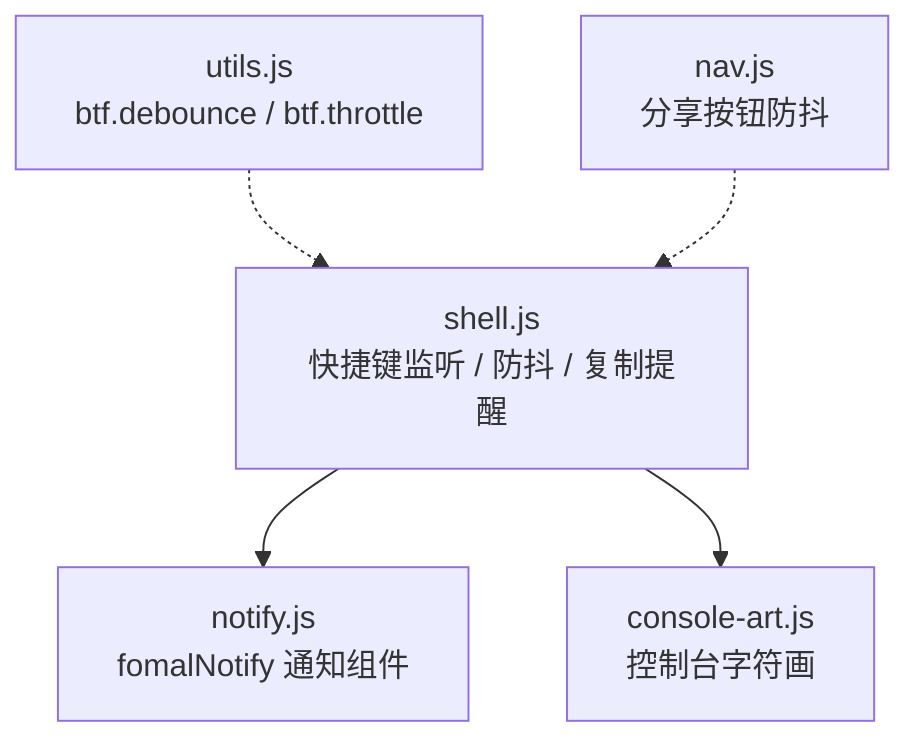
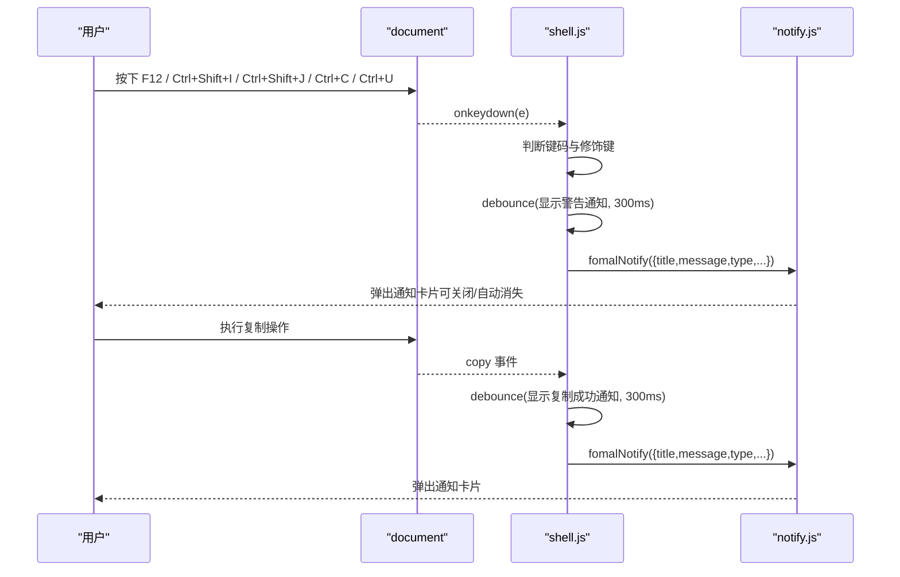
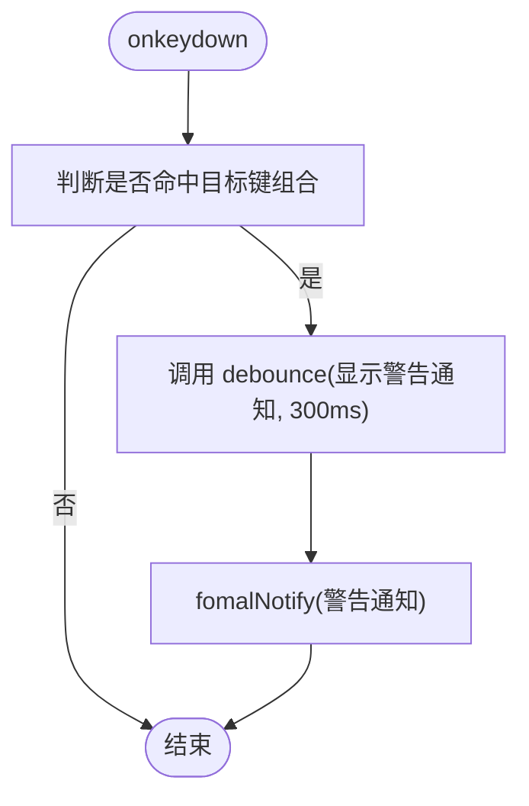
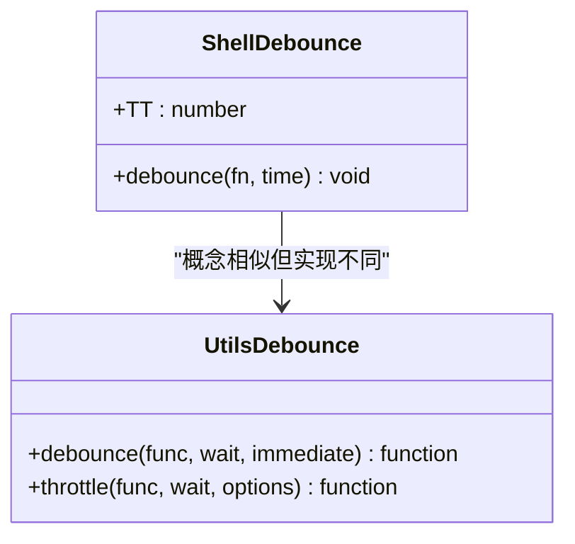
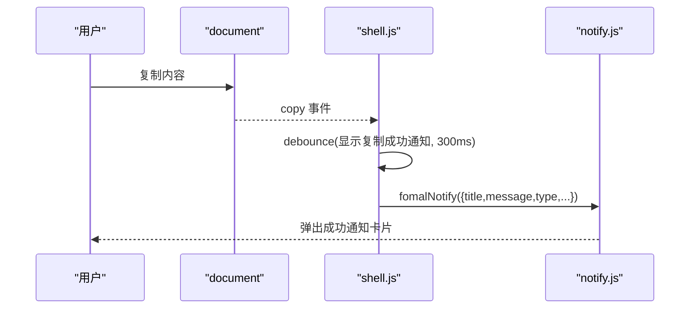
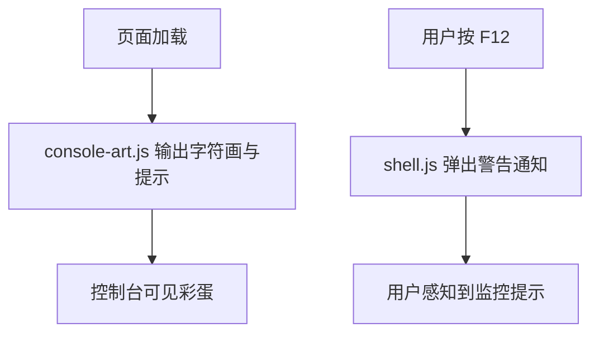
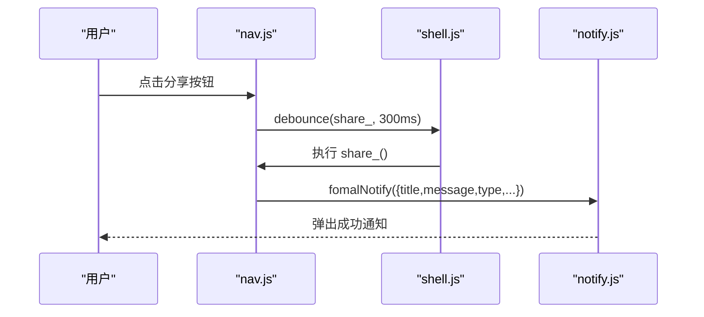
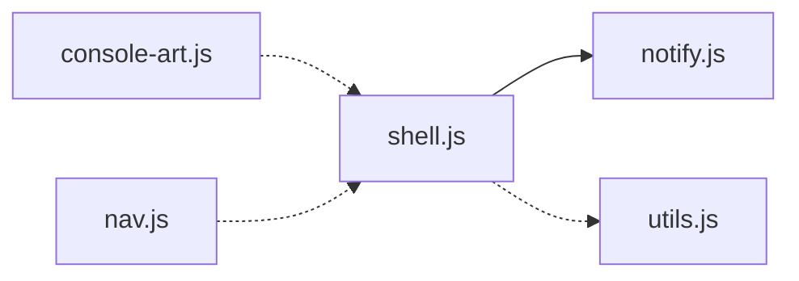

# 快捷键处理系统

<cite>
**本文引用的文件**   
- [shell.js](file://source/js/modules/shell.js)
- [console-art.js](file://source/js/modules/console-art.js)
- [notify.js](file://source/js/notify.js)
- [utils.js](file://themes/fomalhaut/source/js/utils.js)
- [nav.js](file://source/js/modules/nav.js)
</cite>

## 目录
1. [简介](#简介)
2. [项目结构](#项目结构)
3. [核心组件](#核心组件)
4. [架构总览](#架构总览)
5. [详细组件分析](#详细组件分析)
6. [依赖关系分析](#依赖关系分析)
7. [性能与体验考量](#性能与体验考量)
8. [故障排查指南](#故障排查指南)
9. [结论](#结论)
10. [附录：快捷键扩展指南](#附录快捷键扩展指南)

## 简介
本文件系统性说明站点“快捷键处理系统”的实现机制，重点覆盖以下方面：
- 开发者工具快捷键拦截逻辑：F12、Ctrl+Shift+I、Ctrl+Shift+J、Ctrl+C、Ctrl+U 等按键监听。
- 防抖函数实现原理：全局计时器管理、重复事件过滤、性能优化策略。
- 复制提醒功能：copy 事件监听、debounce 防抖应用、通知消息展示。
- 快捷键冲突解决机制：事件冒泡控制、默认行为阻止、用户体验考虑。
- 快捷键扩展指南：新快捷键添加方法、事件处理器编写、调试技巧。

该系统的核心目标是：在不破坏浏览器原生能力的前提下，通过轻量提示与防抖策略，提升用户交互一致性，同时降低误操作和重复触发带来的性能损耗。

## 项目结构
快捷键相关代码主要分布在以下模块：
- shell.js：站点外壳行为，包含快捷键监听、防抖函数、夜间模式切换、标题恶搞、搜索框修复、手机端滚动条等。
- console-art.js：控制台字符画与欢迎信息，用于打开 F12 后的控制台输出。
- notify.js：轻量通知组件，替代大型 UI 库，提供 fomalNotify 接口。
- utils.js：主题通用工具，包含更完善的 debounce/throttle 实现。
- nav.js：导航模块，演示如何复用 shell.js 中的 debounce 进行按钮防抖。

**图表来源**
- [shell.js:31-95](file://source/js/modules/shell.js#L31-L95)
- [console-art.js:1-105](file://source/js/modules/console-art.js#L1-L105)
- [notify.js:1-140](file://source/js/notify.js#L1-L140)
- [utils.js:1-45](file://themes/fomalhaut/source/js/utils.js#L1-L45)
- [nav.js:197-229](file://source/js/modules/nav.js#L197-L229)

**章节来源**
- [shell.js:1-30](file://source/js/modules/shell.js#L1-L30)
- [console-art.js:1-18](file://source/js/modules/console-art.js#L1-L18)
- [notify.js:1-11](file://source/js/notify.js#L1-L11)
- [utils.js:1-16](file://themes/fomalhaut/source/js/utils.js#L1-L16)
- [nav.js:197-229](file://source/js/modules/nav.js#L197-L229)

## 核心组件
- 快捷键监听与提醒：在 document 上注册 onkeydown，检测特定键组合后调用防抖包装的通知函数。
- 复制提醒：在 document 上注册 copy 事件，使用防抖避免频繁弹出通知。
- 防抖函数：shell.js 中提供简易版 debounce，配合全局计时器 TT；主题 utils.js 提供更完善的 btf.debounce。
- 通知组件：notify.js 暴露 fomalNotify，支持多种类型、位置、自动关闭与悬停暂停。
- 控制台彩蛋：console-art.js 在控制台输出 ASCII 艺术字与提示信息。

**章节来源**
- [shell.js:31-95](file://source/js/modules/shell.js#L31-L95)
- [shell.js:42-55](file://source/js/modules/shell.js#L42-L55)
- [shell.js:80-94](file://source/js/modules/shell.js#L80-L94)
- [notify.js:81-135](file://source/js/notify.js#L81-L135)
- [console-art.js:20-105](file://source/js/modules/console-art.js#L20-L105)

## 架构总览
快捷键处理系统采用“事件监听 + 防抖 + 通知”的三段式架构：
- 事件层：document.onkeydown 与 document.addEventListener("copy") 捕获用户输入。
- 处理层：debounce(fn, time) 对回调进行节流，避免重复触发。
- 表现层：fomalNotify(...) 渲染通知卡片，支持多位置、类型、自动关闭与交互。

**图表来源**
- [shell.js:42-55](file://source/js/modules/shell.js#L42-L55)
- [shell.js:80-94](file://source/js/modules/shell.js#L80-L94)
- [notify.js:81-135](file://source/js/notify.js#L81-L135)

## 详细组件分析

### 快捷键监听与开发者工具拦截
- 监听入口：document.onkeydown。
- 检测条件：
  - F12：e.keyCode === 123。
  - Ctrl+Shift+I：e.ctrlKey && e.shiftKey && e.keyCode === 73。
  - Ctrl+Shift+J：e.ctrlKey && e.shiftKey && e.keyCode === 74。
  - Ctrl+C：e.ctrlKey && e.shiftKey && e.keyCode === 67（注意：此处为 Ctrl+Shift+C，非纯 Ctrl+C）。
  - Ctrl+U：e.ctrlKey && e.keyCode === 85。
- 行为：不阻止默认行为，仅通过防抖包装的 fomalNotify 弹出警告提示。

**图表来源**
- [shell.js:80-94](file://source/js/modules/shell.js#L80-L94)

**章节来源**
- [shell.js:80-94](file://source/js/modules/shell.js#L80-L94)

### 防抖函数实现原理
- shell.js 中的 debounce：
  - 使用全局变量 TT 保存定时器句柄。
  - 每次调用先 clearTimeout(TT)，再 setTimeout(fn, time)。
  - 特点：简单、全局共享计时器，适合低频场景。
- 主题 utils.js 中的 btf.debounce：
  - 返回闭包函数，支持 immediate 参数。
  - 内部维护 timeout，clearTimeout 后再设置新的 setTimeout。
  - 支持立即执行与延迟执行两种模式，更适合通用工具库。

**图表来源**
- [shell.js:34-40](file://source/js/modules/shell.js#L34-L40)
- [utils.js:1-16](file://themes/fomalhaut/source/js/utils.js#L1-L16)

**章节来源**
- [shell.js:34-40](file://source/js/modules/shell.js#L34-L40)
- [utils.js:1-16](file://themes/fomalhaut/source/js/utils.js#L1-L16)

### 复制提醒功能
- 监听：document.addEventListener("copy", ...)。
- 防抖：使用 shell.js 的 debounce(fn, 300) 包裹通知逻辑。
- 通知：fomalNotify({ title:"哎嘿！复制成功🍬", message:"若要转载最好保留原文链接哦，给你一个大大的赞！", position:'top-left', offset:50, showClose:true, type:"success", duration:5000 })。

**图表来源**
- [shell.js:42-55](file://source/js/modules/shell.js#L42-L55)
- [notify.js:81-135](file://source/js/notify.js#L81-L135)

**章节来源**
- [shell.js:42-55](file://source/js/modules/shell.js#L42-L55)
- [notify.js:81-135](file://source/js/notify.js#L81-L135)

### 控制台字符画与 F12 提示
- console-art.js 在页面加载后输出 ASCII 艺术字与彩色提示。
- 使用 console.log 与 console.warn 输出，避免被某些策略静音。
- 与 shell.js 的快捷键监听配合：当用户按 F12 打开控制台时，既会触发 shell.js 的警告通知，也会看到 console-art.js 的控制台彩蛋。

**图表来源**
- [console-art.js:20-105](file://source/js/modules/console-art.js#L20-L105)
- [shell.js:80-94](file://source/js/modules/shell.js#L80-L94)

**章节来源**
- [console-art.js:20-105](file://source/js/modules/console-art.js#L20-L105)
- [shell.js:80-94](file://source/js/modules/shell.js#L80-L94)

### 快捷键冲突解决机制
- 当前实现未调用 preventDefault 或 stopPropagation，因此不会阻止浏览器默认行为（如打开开发者工具、查看源码、复制等）。
- 优点：不破坏浏览器原生能力，用户体验友好。
- 风险：无法真正“禁用”快捷键，仅做提醒。
- 建议：如需严格限制，可在关键业务场景中谨慎使用 preventDefault，并明确告知用户。

**章节来源**
- [shell.js:80-94](file://source/js/modules/shell.js#L80-L94)

### 其他模块中的防抖复用
- nav.js 中的分享按钮使用 shell.js 的 debounce 进行防抖，避免重复点击导致多次复制与通知。

**图表来源**
- [nav.js:197-229](file://source/js/modules/nav.js#L197-L229)
- [shell.js:34-40](file://source/js/modules/shell.js#L34-L40)
- [notify.js:81-135](file://source/js/notify.js#L81-L135)

**章节来源**
- [nav.js:197-229](file://source/js/modules/nav.js#L197-L229)

## 依赖关系分析
- shell.js 依赖 notify.js 提供的 fomalNotify。
- shell.js 与 utils.js 都实现了 debounce，但用途不同：shell.js 用于站内行为，utils.js 作为主题通用工具。
- console-art.js 独立运行，不直接依赖 shell.js，但在行为上与 shell.js 的快捷键监听形成互补。
- nav.js 复用 shell.js 的 debounce，体现模块间协作。

**图表来源**
- [shell.js:31-95](file://source/js/modules/shell.js#L31-L95)
- [notify.js:1-140](file://source/js/notify.js#L1-L140)
- [utils.js:1-45](file://themes/fomalhaut/source/js/utils.js#L1-L45)
- [console-art.js:1-105](file://source/js/modules/console-art.js#L1-L105)
- [nav.js:197-229](file://source/js/modules/nav.js#L197-L229)

**章节来源**
- [shell.js:31-95](file://source/js/modules/shell.js#L31-L95)
- [notify.js:1-140](file://source/js/notify.js#L1-L140)
- [utils.js:1-45](file://themes/fomalhaut/source/js/utils.js#L1-L45)
- [console-art.js:1-105](file://source/js/modules/console-art.js#L1-L105)
- [nav.js:197-229](file://source/js/modules/nav.js#L197-L229)

## 性能与体验考量
- 防抖策略：
  - shell.js 的 debounce 使用全局计时器，简单高效，适合低频事件。
  - utils.js 的 btf.debounce 支持 immediate 模式，适用于需要立即响应的场景。
- 通知组件：
  - 轻量实现，避免加载大型 UI 库。
  - 支持自动关闭与悬停暂停，减少用户干扰。
- 快捷键拦截：
  - 不阻止默认行为，保证浏览器原生能力可用。
  - 通过提示引导用户，提升体验而非强制限制。

[本节为通用指导，不涉及具体文件分析]

## 故障排查指南
- 通知不显示：
  - 检查 fomalNotify 是否正确引入。
  - 确认 notify.js 已加载且样式注入正常。
- 防抖无效：
  - 检查 debounce 调用方式与时间参数。
  - 确认全局 TT 未被意外覆盖。
- 快捷键无响应：
  - 检查 onkeydown 是否被其他脚本覆盖。
  - 确认键码与修饰键判断逻辑是否符合预期。

**章节来源**
- [notify.js:81-135](file://source/js/notify.js#L81-L135)
- [shell.js:34-40](file://source/js/modules/shell.js#L34-L40)
- [shell.js:80-94](file://source/js/modules/shell.js#L80-L94)

## 结论
本快捷键处理系统以轻量、非侵入的方式实现开发者工具快捷键提醒与复制通知，结合防抖策略提升性能与用户体验。虽然未阻止浏览器默认行为，但通过提示与视觉反馈有效引导用户。未来可根据业务需求扩展更多快捷键与交互逻辑。

[本节为总结性内容，不涉及具体文件分析]

## 附录：快捷键扩展指南

### 新增快捷键步骤
1. 在 shell.js 的 onkeydown 中添加新的键码与修饰键判断。
2. 使用 debounce 包裹业务逻辑，避免重复触发。
3. 如需通知，调用 fomalNotify 展示结果。

示例路径参考：
- [shell.js:80-94](file://source/js/modules/shell.js#L80-L94)

### 事件处理器编写建议
- 优先使用 addEventListener 而非内联 onclick，便于解耦与维护。
- 对于高频事件（如 scroll、resize），建议使用防抖或节流。
- 如需阻止默认行为，请谨慎使用 preventDefault，并明确告知用户。

### 调试技巧
- 在控制台输出关键状态，便于定位问题。
- 使用浏览器开发者工具的“事件监听器”面板检查绑定情况。
- 利用 console-art.js 的控制台彩蛋辅助调试。

**章节来源**
- [shell.js:80-94](file://source/js/modules/shell.js#L80-L94)
- [console-art.js:20-105](file://source/js/modules/console-art.js#L20-L105)