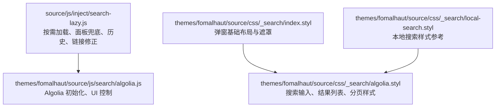
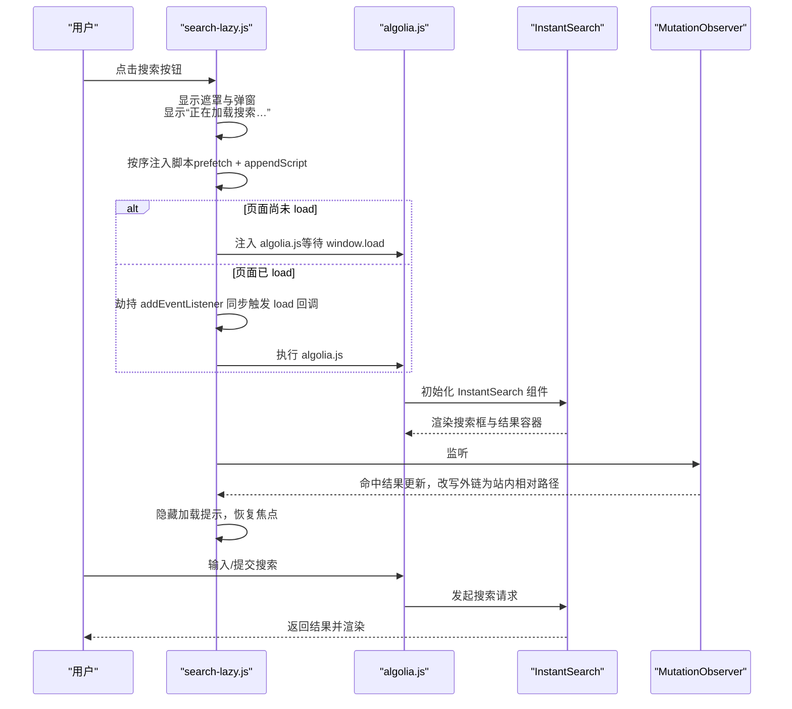
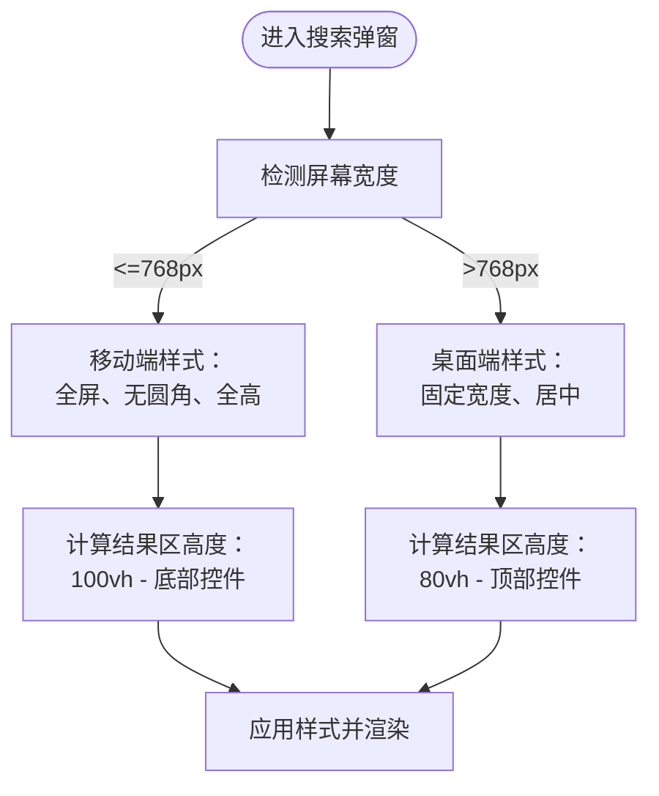
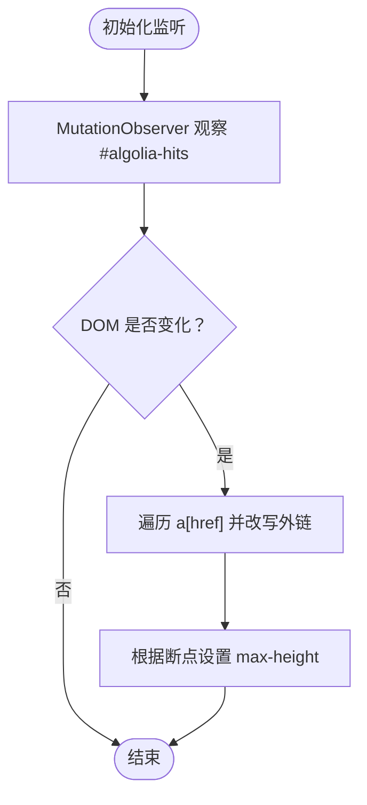
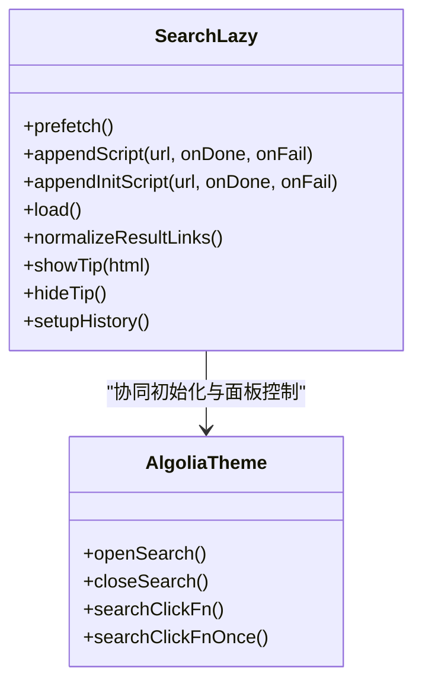
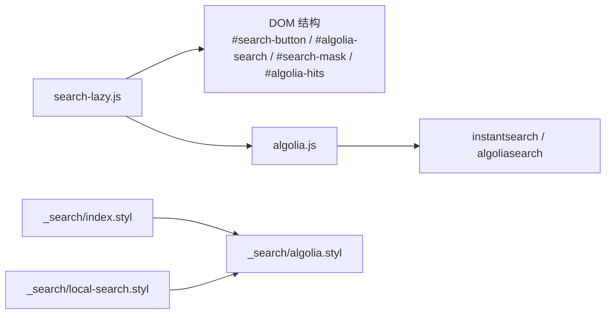

# 搜索框交互增强

<cite>
**本文引用的文件**   
- [source/js/inject/search-lazy.js](file://source/js/inject/search-lazy.js)
- [themes/fomalhaut/source/js/search/algolia.js](file://themes/fomalhaut/source/js/search/algolia.js)
- [themes/fomalhaut/source/css/_search/index.styl](file://themes/fomalhaut/source/css/_search/index.styl)
- [themes/fomalhaut/source/css/_search/algolia.styl](file://themes/fomalhaut/source/css/_search/algolia.styl)
- [themes/fomalhaut/source/css/_search/local-search.styl](file://themes/fomalhaut/source/css/_search/local-search.styl)
</cite>

## 目录
1. [简介](#简介)
2. [项目结构](#项目结构)
3. [核心组件](#核心组件)
4. [架构总览](#架构总览)
5. [详细组件分析](#详细组件分析)
6. [依赖关系分析](#依赖关系分析)
7. [性能考量](#性能考量)
8. [故障排查指南](#故障排查指南)
9. [结论](#结论)
10. [附录：搜索框定制指南](#附录搜索框定制指南)

## 简介
本文围绕“搜索框交互增强”的实现机制进行系统化说明，重点覆盖以下方面：
- 移动端自适应逻辑：屏幕宽度检测、高度计算与动态样式应用。
- DOM 插入监听：基于 MutationObserver 的结果容器监听、最大高度设置与结果链接改写。
- 响应式适配策略：断点判断、样式覆盖与兼容性处理。
- 性能优化措施：事件委托、脚本按需加载、空闲预取、DOM 操作优化与内存管理。
- 搜索框定制指南：样式修改、行为调整与扩展开发建议。

该能力由两部分协作完成：
- 主题侧的 Algolia 初始化与 UI 控制逻辑（themes/fomalhaut/source/js/search/algolia.js）。
- 注入层的按需加载、面板兜底、历史与链接修正等增强逻辑（source/js/inject/search-lazy.js）。

## 项目结构
与搜索框交互增强直接相关的代码与样式分布如下：
- 交互增强脚本：source/js/inject/search-lazy.js
- 主题 Algolia 初始化脚本：themes/fomalhaut/source/js/search/algolia.js
- 搜索弹窗基础样式：themes/fomalhaut/source/css/_search/index.styl
- Algolia 搜索结果样式：themes/fomalhaut/source/css/_search/algolia.styl
- 本地搜索样式（参考）：themes/fomalhaut/source/css/_search/local-search.styl

**图示来源**
- [source/js/inject/search-lazy.js:1-508](file://source/js/inject/search-lazy.js#L1-L508)
- [themes/fomalhaut/source/js/search/algolia.js:1-165](file://themes/fomalhaut/source/js/search/algolia.js#L1-L165)
- [themes/fomalhaut/source/css/_search/index.styl:1-49](file://themes/fomalhaut/source/css/_search/index.styl#L1-L49)
- [themes/fomalhaut/source/css/_search/algolia.styl:1-157](file://themes/fomalhaut/source/css/_search/algolia.styl#L1-L157)
- [themes/fomalhaut/source/css/_search/local-search.styl:1-67](file://themes/fomalhaut/source/css/_search/local-search.styl#L1-L67)

**章节来源**
- [source/js/inject/search-lazy.js:1-77](file://source/js/inject/search-lazy.js#L1-L77)
- [themes/fomalhaut/source/js/search/algolia.js:1-35](file://themes/fomalhaut/source/js/search/algolia.js#L1-L35)
- [themes/fomalhaut/source/css/_search/index.styl:1-49](file://themes/fomalhaut/source/css/_search/index.styl#L1-L49)
- [themes/fomalhaut/source/css/_search/algolia.styl:1-157](file://themes/fomalhaut/source/css/_search/algolia.styl#L1-L157)
- [themes/fomalhaut/source/css/_search/local-search.styl:1-67](file://themes/fomalhaut/source/css/_search/local-search.styl#L1-L67)

## 核心组件
- 按需加载与面板兜底：在用户点击搜索按钮时先展示面板与加载提示，再按序注入 Algolia 相关脚本；若页面已 load，则劫持 addEventListener 以同步执行主题的 load 回调，确保库就绪后自动聚焦输入框。
- 搜索历史：使用 localStorage 存储最近 8 条查询，支持单条删除与清空，打开面板时显示，输入时根据内容显隐。
- 结果链接修正：通过 MutationObserver 监听 #algolia-hits，将非本站源的链接改写为相对路径，避免预览或镜像站跳转问题。
- 主题侧初始化：配置 InstantSearch 组件、绑定搜索框与结果容器、处理 ESC 关闭与 pjax 刷新。

**章节来源**
- [source/js/inject/search-lazy.js:78-177](file://source/js/inject/search-lazy.js#L78-L177)
- [source/js/inject/search-lazy.js:227-262](file://source/js/inject/search-lazy.js#L227-L262)
- [source/js/inject/search-lazy.js:305-468](file://source/js/inject/search-lazy.js#L305-L468)
- [themes/fomalhaut/source/js/search/algolia.js:1-35](file://themes/fomalhaut/source/js/search/algolia.js#L1-L35)
- [themes/fomalhaut/source/js/search/algolia.js:63-151](file://themes/fomalhaut/source/js/search/algolia.js#L63-L151)

## 架构总览
整体流程分为两条路径：
- 正常路径：页面加载完成后空闲预取脚本资源；用户点击搜索按钮时，优先展示面板与加载提示，随后按序注入脚本并初始化搜索。
- 兜底路径：若脚本加载失败或主题未正确初始化，提供错误提示与重试入口；同时保证面板可关闭。

**图示来源**
- [source/js/inject/search-lazy.js:95-177](file://source/js/inject/search-lazy.js#L95-L177)
- [source/js/inject/search-lazy.js:179-199](file://source/js/inject/search-lazy.js#L179-L199)
- [source/js/inject/search-lazy.js:227-262](file://source/js/inject/search-lazy.js#L227-L262)
- [themes/fomalhaut/source/js/search/algolia.js:1-35](file://themes/fomalhaut/source/js/search/algolia.js#L1-L35)
- [themes/fomalhaut/source/js/search/algolia.js:63-151](file://themes/fomalhaut/source/js/search/algolia.js#L63-L151)

## 详细组件分析

### 移动端自适应逻辑
- 断点判断：使用 Stylus 的混合宏 @maxWidth768() 与 @minWidth768() 实现 768px 断点切换。
- 弹窗尺寸：桌面端固定宽度 600px 居中；移动端全屏铺满，去除圆角与边距。
- 结果区域高度：桌面端 max-height 基于视口减去顶部导航与工具栏高度；移动端采用 100vh 减去底部控件高度，保证滚动区域合理。
- 动态样式应用：通过 CSS 媒体查询与类名组合（如 .apple 下的特殊处理）对特定设备或浏览器进行微调。

**图示来源**
- [themes/fomalhaut/source/css/_search/index.styl:1-49](file://themes/fomalhaut/source/css/_search/index.styl#L1-L49)
- [themes/fomalhaut/source/css/_search/algolia.styl:121-157](file://themes/fomalhaut/source/css/_search/algolia.styl#L121-L157)

**章节来源**
- [themes/fomalhaut/source/css/_search/index.styl:1-49](file://themes/fomalhaut/source/css/_search/index.styl#L1-L49)
- [themes/fomalhaut/source/css/_search/algolia.styl:121-157](file://themes/fomalhaut/source/css/_search/algolia.styl#L121-L157)

### DOM 插入监听与结果容器检测
- 监听目标：#algolia-hits 容器，用于捕获 InstantSearch 渲染后的结果节点变化。
- 最大高度设置：根据断点分别设置 max-height，确保结果区域可滚动且不遮挡其他 UI。
- 链接改写：遍历所有 a[href]，解析 URL，若非当前站点源，则改写为 pathname+search+hash 的相对形式，避免跨域跳转。

**图示来源**
- [source/js/inject/search-lazy.js:227-262](file://source/js/inject/search-lazy.js#L227-L262)
- [themes/fomalhaut/source/css/_search/algolia.styl:121-157](file://themes/fomalhaut/source/css/_search/algolia.styl#L121-L157)

**章节来源**
- [source/js/inject/search-lazy.js:227-262](file://source/js/inject/search-lazy.js#L227-L262)
- [themes/fomalhaut/source/css/_search/algolia.styl:121-157](file://themes/fomalhaut/source/css/_search/algolia.styl#L121-L157)

### 响应式适配策略
- 断点判断：统一使用 768px 作为移动与桌面分界。
- 样式覆盖：针对 Algolia 搜索输入框、提交按钮、结果列表、分页器等进行独立样式覆盖，保持主题一致性。
- 兼容性处理：对不支持 requestIdleCallback 的环境回退到 setTimeout；对 MutationObserver 与 URL API 做存在性检查，避免旧环境报错。

**图示来源**
- [source/js/inject/search-lazy.js:95-177](file://source/js/inject/search-lazy.js#L95-L177)
- [themes/fomalhaut/source/js/search/algolia.js:1-35](file://themes/fomalhaut/source/js/search/algolia.js#L1-L35)

**章节来源**
- [source/js/inject/search-lazy.js:179-199](file://source/js/inject/search-lazy.js#L179-L199)
- [source/js/inject/search-lazy.js:227-262](file://source/js/inject/search-lazy.js#L227-L262)
- [themes/fomalhaut/source/css/_search/algolia.styl:1-157](file://themes/fomalhaut/source/css/_search/algolia.styl#L1-L157)

### 性能优化措施
- 事件节流与委托：使用 document 捕获阶段的事件委托拦截搜索按钮点击，减少重复绑定；历史记录与输入事件也采用捕获阶段监听，避免被第三方库覆盖。
- 脚本按需加载：仅在用户点击搜索时注入 Algolia 相关脚本，避免首屏阻塞；空闲时使用 link rel=prefetch 预取资源。
- DOM 操作优化：复用提示节点与历史节点，避免频繁创建销毁；使用 innerHTML 批量渲染历史条目，减少多次写入。
- 内存管理：在库就绪后清理临时状态；在面板关闭时恢复 body 样式；在脚本加载失败时重置状态并提供重试入口。

**章节来源**
- [source/js/inject/search-lazy.js:470-506](file://source/js/inject/search-lazy.js#L470-L506)
- [source/js/inject/search-lazy.js:179-199](file://source/js/inject/search-lazy.js#L179-L199)
- [source/js/inject/search-lazy.js:305-468](file://source/js/inject/search-lazy.js#L305-L468)

## 依赖关系分析
- search-lazy.js 依赖主题提供的 DOM 结构（#search-button、#algolia-search、#search-mask、#algolia-hits 等），并在必要时劫持 window.addEventListener 以兼容主题 algolia.js 的 load 初始化。
- algolia.js 依赖全局对象 GLOBAL_CONFIG 与 instantsearch、algoliasearch 库，负责实例化搜索组件与绑定 UI 事件。
- 样式层依赖 Stylus 混合宏与 CSS 变量，确保在不同主题色与模式下保持一致外观。

**图示来源**
- [source/js/inject/search-lazy.js:1-77](file://source/js/inject/search-lazy.js#L1-L77)
- [themes/fomalhaut/source/js/search/algolia.js:63-151](file://themes/fomalhaut/source/js/search/algolia.js#L63-L151)
- [themes/fomalhaut/source/css/_search/index.styl:1-49](file://themes/fomalhaut/source/css/_search/index.styl#L1-L49)
- [themes/fomalhaut/source/css/_search/algolia.styl:1-157](file://themes/fomalhaut/source/css/_search/algolia.styl#L1-L157)
- [themes/fomalhaut/source/css/_search/local-search.styl:1-67](file://themes/fomalhaut/source/css/_search/local-search.styl#L1-L67)

**章节来源**
- [source/js/inject/search-lazy.js:1-77](file://source/js/inject/search-lazy.js#L1-L77)
- [themes/fomalhaut/source/js/search/algolia.js:63-151](file://themes/fomalhaut/source/js/search/algolia.js#L63-L151)
- [themes/fomalhaut/source/css/_search/index.styl:1-49](file://themes/fomalhaut/source/css/_search/index.styl#L1-L49)
- [themes/fomalhaut/source/css/_search/algolia.styl:1-157](file://themes/fomalhaut/source/css/_search/algolia.styl#L1-L157)
- [themes/fomalhaut/source/css/_search/local-search.styl:1-67](file://themes/fomalhaut/source/css/_search/local-search.styl#L1-L67)

## 性能考量
- 首屏优化：通过空闲预取与点击兜底，避免主线程阻塞，提升首屏渲染速度。
- 渲染优化：使用 MutationObserver 仅在实际 DOM 变化时执行链接改写，降低不必要的计算开销。
- 交互优化：捕获阶段事件委托减少事件监听器数量，提高事件处理效率。
- 内存优化：复用节点与缓存状态，避免频繁创建销毁导致的内存抖动。

[本节为通用性能指导，不直接分析具体文件]

## 故障排查指南
- 面板一直显示“正在加载搜索…”：
  - 检查脚本是否成功加载（onerror 分支会给出控制台警告）。
  - 确认主题 algolia.js 的配置校验通过（appId/apiKey/indexName 缺失会 console.error）。
  - 查看 .ais-SearchBox-input 是否存在，不存在则说明初始化未完成。
- 搜索结果链接跳转到正式站：
  - 确认 MutationObserver 已正常工作，且链接已被改写为相对路径。
- 面板无法关闭：
  - 检查遮罩与关闭按钮的点击事件是否被拦截；在库就绪前，search-lazy.js 提供兜底关闭逻辑。

**章节来源**
- [source/js/inject/search-lazy.js:95-177](file://source/js/inject/search-lazy.js#L95-L177)
- [source/js/inject/search-lazy.js:227-262](file://source/js/inject/search-lazy.js#L227-L262)
- [themes/fomalhaut/source/js/search/algolia.js:63-67](file://themes/fomalhaut/source/js/search/algolia.js#L63-L67)

## 结论
搜索框交互增强通过“按需加载 + 面板兜底 + 结果监听 + 历史管理”的组合策略，显著提升了用户体验与性能表现。移动端自适应与响应式样式确保了不同设备的可用性，而事件委托与 DOM 操作优化保证了流畅的交互体验。未来可在历史数据导出、搜索统计与更细粒度的断点适配上继续演进。

[本节为总结性内容，不直接分析具体文件]

## 附录：搜索框定制指南
- 样式修改
  - 调整弹窗尺寸与位置：编辑 themes/fomalhaut/source/css/_search/index.styl 中的 .search-dialog 与 #search-mask。
  - 自定义搜索输入框与提交按钮：编辑 themes/fomalhaut/source/css/_search/algolia.styl 中 .ais-SearchBox-form 及其子元素。
  - 调整结果列表滚动与高度：编辑 themes/fomalhaut/source/css/_search/algolia.styl 中 #algolia-hits > div 的 max-height 与 overflow-y。
- 行为调整
  - 修改每页结果数：在 themes/fomalhaut/source/js/search/algolia.js 中调整 configure 的 hitsPerPage。
  - 禁用实时搜索：保持 searchAsYouType: false，并通过提交按钮或回车触发搜索。
  - 自定义空结果文案：编辑 themes/fomalhaut/source/js/search/algolia.js 中 empty 模板使用的语言字符串。
- 扩展开发
  - 增加搜索历史字段：在 source/js/inject/search-lazy.js 的 historyNode 渲染逻辑中添加新字段。
  - 集成更多第三方库：遵循 appendScript 的顺序注入模式，确保依赖顺序正确。
  - 适配新断点：在 Stylus 文件中新增混合宏调用，覆盖移动端与桌面端的差异样式。

**章节来源**
- [themes/fomalhaut/source/css/_search/index.styl:1-49](file://themes/fomalhaut/source/css/_search/index.styl#L1-L49)
- [themes/fomalhaut/source/css/_search/algolia.styl:1-157](file://themes/fomalhaut/source/css/_search/algolia.styl#L1-L157)
- [themes/fomalhaut/source/js/search/algolia.js:69-151](file://themes/fomalhaut/source/js/search/algolia.js#L69-L151)
- [source/js/inject/search-lazy.js:305-468](file://source/js/inject/search-lazy.js#L305-L468)