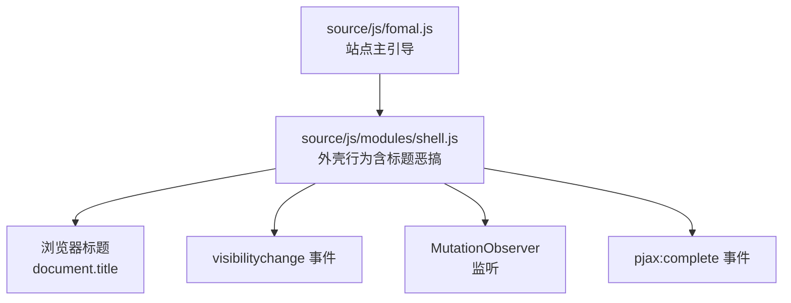
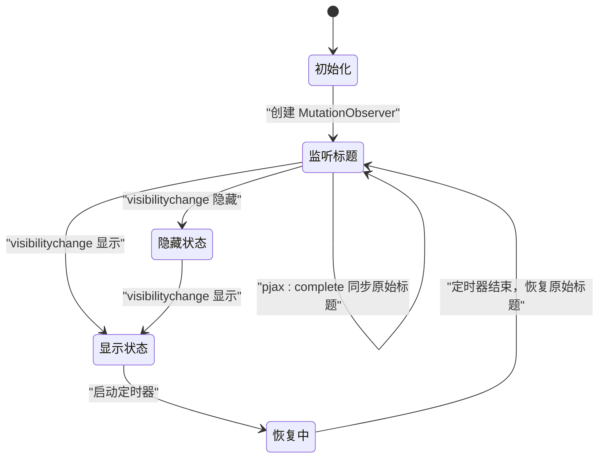
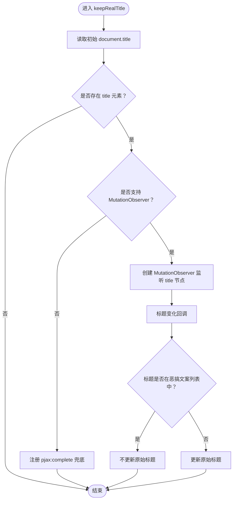
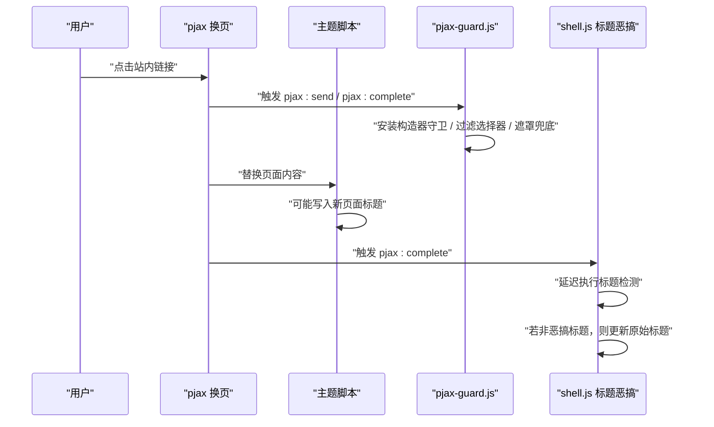
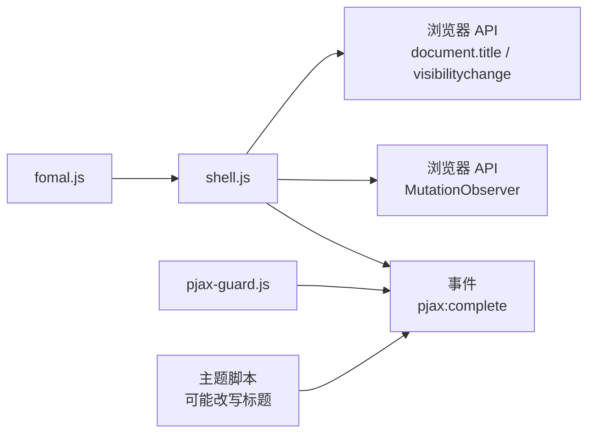

# 标题恶搞功能

<cite>
**本文引用的文件**   
- [source/js/fomal.js](file://source/js/fomal.js)
- [source/js/modules/shell.js](file://source/js/modules/shell.js)
- [source/js/pjax-guard.js](file://source/js/pjax-guard.js)
- [themes/fomalhaut/source/js/main.js](file://themes/fomalhaut/source/js/main.js)
</cite>

## 目录
1. [简介](#简介)
2. [项目结构定位](#项目结构定位)
3. [核心组件总览](#核心组件总览)
4. [架构总览](#架构总览)
5. [详细实现分析](#详细实现分析)
6. [依赖关系分析](#依赖关系分析)
7. [性能与稳定性考量](#性能与稳定性考量)
8. [故障排查指南](#故障排查指南)
9. [定制指南](#定制指南)
10. [结论](#结论)

## 简介
本文件专门说明“标题恶搞”功能的实现机制。该功能的目标是：当用户离开当前标签页时，把浏览器标签标题改成趣味文案；当用户回到页面时，先显示另一条提示文案，再在固定时长后恢复为原始标题。它需要同时处理三类场景：
- 普通页面加载时的标题监听与保存。
- pjax 无刷新换页后的标题同步。
- 标签页隐藏/显示状态切换时的文案展示与恢复。

## 项目结构定位
标题恶搞逻辑位于站点主引导脚本的模块地图中，实际实现集中在“外壳行为”模块里。主引导脚本负责声明模块入口和全局自检，而具体行为由 `shell.js` 提供。



**图表来源**
- [source/js/fomal.js:9-20](file://source/js/fomal.js#L9-L20)
- [source/js/modules/shell.js:1-29](file://source/js/modules/shell.js#L1-L29)
- [source/js/modules/shell.js:386-422](file://source/js/modules/shell.js#L386-L422)

**章节来源**
- [source/js/fomal.js:1-43](file://source/js/fomal.js#L1-L43)
- [source/js/modules/shell.js:1-29](file://source/js/modules/shell.js#L1-L29)

## 核心组件总览
标题恶搞功能由以下关键部分组成：
- **原始标题保存器**：通过变量记录初始标题，并通过 `MutationObserver` 监听 `<title>` 节点变化，确保 pjax 换页后仍能记住“真实标题”。
- **标签页可见性监听器**：监听 `visibilitychange`，在页面隐藏时设置恶搞标题，在页面显示时设置恢复提示标题并启动定时器。
- **定时器管理器**：使用 `setTimeout` 延迟恢复原始标题，并在每次切换时清理旧定时器，避免重复恢复。
- **pjax 兼容层**：在 `pjax:complete` 回调中重新执行一次标题检测，保证换页后“原始标题”与新页面标题一致。

**章节来源**
- [source/js/modules/shell.js:386-422](file://source/js/modules/shell.js#L386-L422)

## 架构总览
从运行时角度看，标题恶搞是一个“事件驱动 + 状态缓存”的小系统：
- 输入事件包括：页面加载、`<title>` 内容变化、pjax 换页完成、标签页隐藏/显示。
- 内部状态包括：原始标题、恶搞文案列表、恢复定时器。
- 输出行为包括：修改 `document.title`、注册/取消定时器、重新同步原始标题。



**图表来源**
- [source/js/modules/shell.js:395-421](file://source/js/modules/shell.js#L395-L421)

## 详细实现分析

### 原始标题保存逻辑
原始标题保存逻辑的核心目标是：**无论页面如何被主题或第三方脚本修改标题，只要不是恶搞文案，就把它当作“真实标题”保存起来**。

实现要点如下：
1. 页面加载时立即读取一次 `document.title`，作为初始原始标题。
2. 如果存在 `<title>` 元素且浏览器支持 `MutationObserver`，则对该元素建立观察者，监听子节点、字符数据和子树变化。
3. 每当标题变化时，判断新标题是否属于恶搞文案集合；如果不是，则更新原始标题。
4. 如果 `MutationObserver` 没有兜住变化，或者 pjax 直接替换了标题，则在 `pjax:complete` 后再次执行一次标题检测。



**图表来源**
- [source/js/modules/shell.js:395-406](file://source/js/modules/shell.js#L395-L406)

**章节来源**
- [source/js/modules/shell.js:395-406](file://source/js/modules/shell.js#L395-L406)

### 标签页切换监听与状态管理
标签页切换监听基于浏览器的 `visibilitychange` 事件，分为两个分支：

- **隐藏分支**：用户切换到其他标签页或最小化窗口时，将标题改为第一条恶搞文案，并清除可能存在的恢复定时器。
- **显示分支**：用户回到当前标签页时，先将标题改为第二条恶搞文案，然后启动一个固定时长的定时器；定时器结束后，把标题恢复为之前保存的原始标题。

```mermaid
sequenceDiagram
participant Browser as "浏览器"
participant Shell as "shell.js 标题恶搞"
participant Title as "document.title"
participant Timer as "恢复定时器"
Browser->>Shell : "visibilitychange 触发"
alt "页面隐藏"
Shell->>Title : "设置为隐藏恶搞文案"
Shell->>Timer : "清除已有定时器"
else "页面显示"
Shell->>Title : "设置为显示恶搞文案"
Shell->>Timer : "启动定时器"
Timer-->>Shell : "定时器到期"
Shell->>Title : "恢复为原始标题"
end
```

**图表来源**
- [source/js/modules/shell.js:407-421](file://source/js/modules/shell.js#L407-L421)

**章节来源**
- [source/js/modules/shell.js:407-421](file://source/js/modules/shell.js#L407-L421)

### 恶搞文案管理与定时器管理
恶搞文案管理包含三个层面：
1. **文案集合**：维护一个固定的恶搞文案数组，用于判断“当前标题是否为恶搞标题”，也用于隐藏/显示时设置标题。
2. **随机选择策略现状**：当前实现没有真正的随机选择，而是直接使用固定文案；判断逻辑只关心“是不是恶搞文案”，而不是“从哪个索引取出”。
3. **定时器生命周期**：每次隐藏时清除旧定时器，避免多次切换后出现多个恢复任务；显示时新建定时器，结束后清空引用并恢复标题。

需要注意：虽然注释和常量名使用了“随机文案”这类语义，但当前代码中的文案数组只是判断集合，并没有按索引随机取值。因此，如果要实现“每次隐藏时随机选一条文案”，需要额外引入随机选择逻辑。

**章节来源**
- [source/js/modules/shell.js:392-421](file://source/js/modules/shell.js#L392-L421)

### pjax 兼容性处理
pjax 兼容性处理是标题恶搞能否稳定工作的关键。该项目使用 pjax 进行无刷新页面切换，这意味着：
- 页面主体会被替换，但部分 DOM 和脚本上下文可能复用。
- 主题侧可能在 pjax 完成后重新写入 `<title>`。
- 如果只在首屏保存一次原始标题，后续换页后可能继续保留上一个页面的标题。

当前实现的兼容策略是：
1. 在 `pjax:complete` 事件中延迟执行一次标题检测。
2. 标题检测会判断当前标题是否为恶搞文案；如果不是，就把它当成新页面的真实标题保存。
3. 这样即使主题或其他脚本在 pjax 完成后修改标题，也能在下一轮标签页切换时正确恢复。

此外，项目中还有更完整的 pjax 防护脚本，负责拦截 pjax 构造函数、过滤选择器、处理遮罩超时等。虽然它不直接修改标题，但它保证了 pjax 生命周期事件的可信性，间接提升了标题恶搞的稳定性。



**图表来源**
- [source/js/modules/shell.js:404-405](file://source/js/modules/shell.js#L404-L405)
- [source/js/pjax-guard.js:118-126](file://source/js/pjax-guard.js#L118-L126)
- [source/js/pjax-guard.js:128-142](file://source/js/pjax-guard.js#L128-L142)

**章节来源**
- [source/js/modules/shell.js:404-406](file://source/js/modules/shell.js#L404-L406)
- [source/js/pjax-guard.js:118-142](file://source/js/pjax-guard.js#L118-L142)

## 依赖关系分析
标题恶搞功能对外部依赖较少，主要依赖浏览器原生能力：
- `document.title`：标题读写。
- `document.addEventListener('visibilitychange', ...)`：标签页可见性变化。
- `window.MutationObserver`：监听 `<title>` 节点变化。
- `document.addEventListener('pjax:complete', ...)`：pjax 换页完成事件。
- `setTimeout` / `clearTimeout`：定时器管理。

它与项目内其他模块的关系如下：
- 由 `fomal.js` 的模块地图声明加载。
- 与 `pjax-guard.js` 共同保障 pjax 生命周期下的行为一致性。
- 与主题侧 pjax 行为配合：主题可能在 pjax 完成后重写标题，因此 shell 需要在 pjax 完成后重新同步原始标题。



**图表来源**
- [source/js/fomal.js:9-20](file://source/js/fomal.js#L9-L20)
- [source/js/modules/shell.js:392-421](file://source/js/modules/shell.js#L392-L421)
- [source/js/pjax-guard.js:118-142](file://source/js/pjax-guard.js#L118-L142)

**章节来源**
- [source/js/fomal.js:9-20](file://source/js/fomal.js#L9-L20)
- [source/js/modules/shell.js:392-421](file://source/js/modules/shell.js#L392-L421)
- [source/js/pjax-guard.js:118-142](file://source/js/pjax-guard.js#L118-L142)

## 性能与稳定性考量
标题恶搞本身非常轻量，不会造成明显性能压力。但仍有一些值得注意的点：

1. **MutationObserver 开销可控**：只监听 `<title>` 节点，且只在标题变化时执行简单字符串判断，不会频繁操作 DOM。
2. **定时器数量恒定**：最多只有一个恢复定时器；每次隐藏都会清除旧定时器，避免累积。
3. **pjax 回调延迟执行**：使用 `setTimeout(..., 0)` 让标题检测排在 pjax 渲染之后，减少与主题脚本竞争。
4. **文案判断使用数组查找**：当前文案数量很少，`indexOf` 足够；如果未来文案很多，可考虑改用 `Set` 提升查找性能。
5. **潜在风险点**：如果主题在 pjax 完成后立即写入标题，而 shell 的 `pjax:complete` 回调尚未执行，可能出现短暂恢复错误。当前实现已经通过延迟检测缓解，但如果主题行为异常，仍可能偶发标题不一致。

[本节为通用性能讨论，不直接分析具体代码行]

## 故障排查指南
如果遇到标题恶搞异常，可按以下顺序排查：

| 现象 | 可能原因 | 排查建议 |
|---|---|---|
| 切走标签页后标题没变 | `visibilitychange` 未触发或被其他脚本覆盖 | 检查是否有其他脚本监听同一事件并阻止默认行为 |
| 回到页面后标题一直不恢复 | 定时器被意外清除或原始标题未更新 | 检查 `pjax:complete` 是否成功执行，确认原始标题是否被更新 |
| pjax 换页后恢复的是上一个页面标题 | 原始标题没有随新页面更新 | 检查主题是否在 pjax 完成后重写标题，确认 shell 的 `pjax:complete` 回调是否运行 |
| 老浏览器下标题不监听 | 不支持 `MutationObserver` | 当前实现有 pjax 兜底，但若主题完全绕过 pjax 事件，可能需要额外兼容 |
| 文案总是同一条 | 当前实现没有真正随机选择 | 如需随机，需扩展文案选择逻辑 |

**章节来源**
- [source/js/modules/shell.js:395-421](file://source/js/modules/shell.js#L395-L421)
- [source/js/pjax-guard.js:118-142](file://source/js/pjax-guard.js#L118-L142)

## 定制指南

### 修改恶搞文案
当前恶搞文案定义在一个固定数组中，并且隐藏和显示时分别使用固定文案。若希望：
- 修改隐藏时的文案：调整对应位置文案。
- 修改显示时的文案：调整对应位置文案。
- 增加更多文案：扩展文案数组，并补充随机选择逻辑。

参考位置：
- [source/js/modules/shell.js:392-421](file://source/js/modules/shell.js#L392-L421)

### 调整恢复时长
恢复时长由定时器延时决定，当前为固定值。若希望：
- 缩短恢复时间：减小定时器延时。
- 延长恢复时间：增大定时器延时。
- 根据配置动态调整：可从配置对象或本地存储读取时长。

参考位置：
- [source/js/modules/shell.js:416-419](file://source/js/modules/shell.js#L416-L419)

### 禁用标题恶搞
如果不需要标题恶搞，可以选择以下方法之一：
1. **移除模块加载**：从站点注入脚本列表中移除 `shell.js` 或其中相关部分。
2. **屏蔽事件监听**：在页面加载前阻止 `visibilitychange` 监听器注册。
3. **覆盖原始逻辑**：在 shell 加载前定义同名变量或函数，使其不生效。
4. **仅关闭随机文案**：如果只想保留基础隐藏/显示效果，可以保留现有逻辑，只去掉随机选择扩展。

由于当前实现是全局作用域函数和变量，最稳妥的方式是从构建或注入配置中移除相关脚本，或在更早阶段覆盖行为。

**章节来源**
- [source/js/modules/shell.js:386-422](file://source/js/modules/shell.js#L386-L422)
- [source/js/fomal.js:9-20](file://source/js/fomal.js#L9-L20)

## 结论
标题恶搞功能是一个小而清晰的交互增强：通过监听标签页可见性变化，在用户离开和返回时展示趣味文案，并在固定时长后恢复原始标题。其稳定性依赖于三点：
- 使用 `MutationObserver` 和 `pjax:complete` 双重机制保存原始标题。
- 使用定时器统一管理恢复逻辑。
- 与 pjax 生命周期保持同步，确保换页后标题状态一致。

当前实现简洁可靠，适合博客类站点使用。如果需要更强的个性化体验，可以在不破坏现有兼容性的基础上扩展随机文案、配置化时长和开关控制。