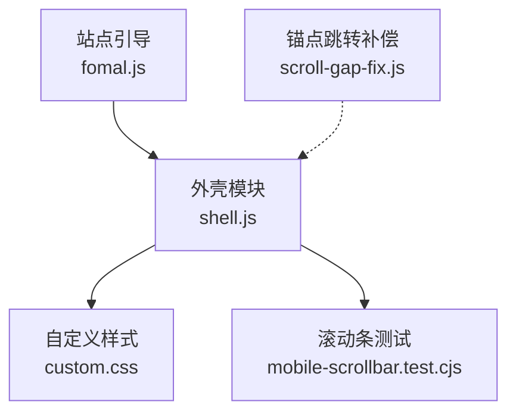
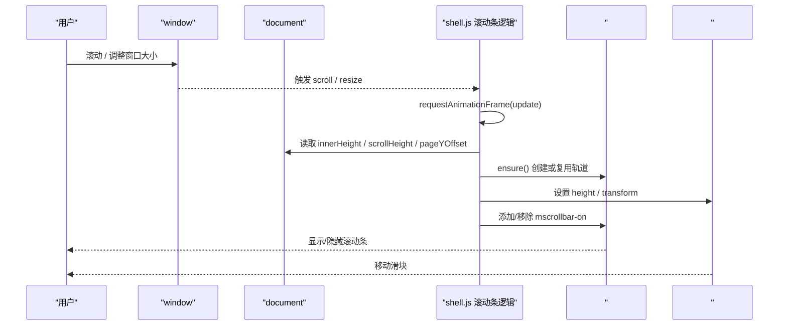
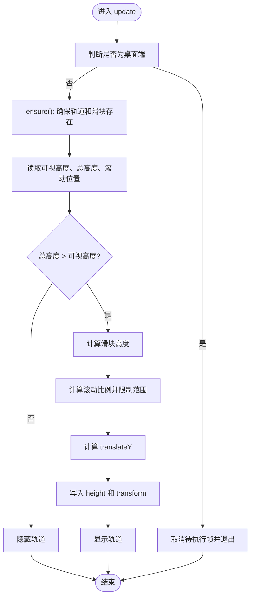
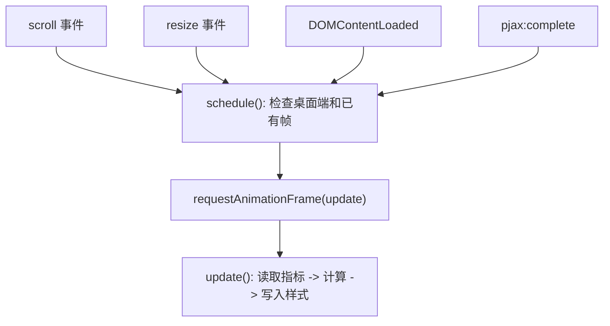
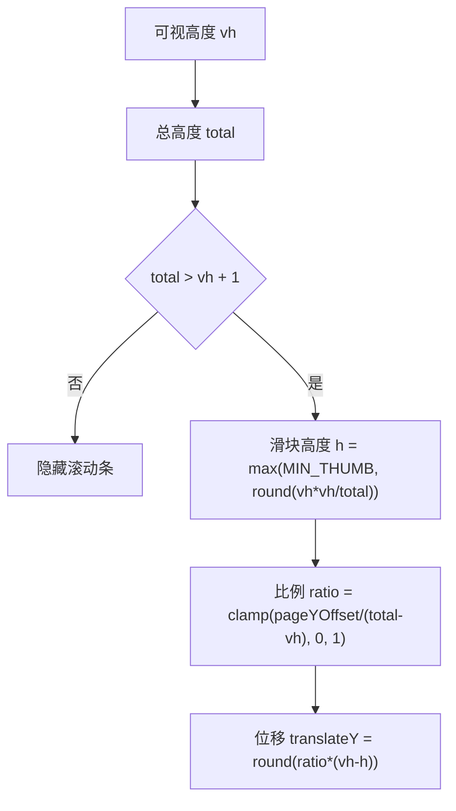
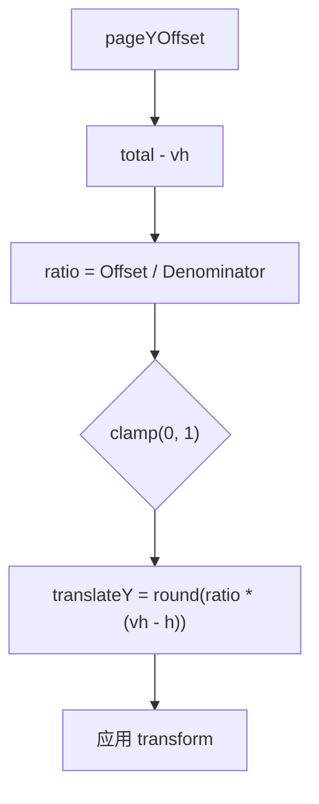
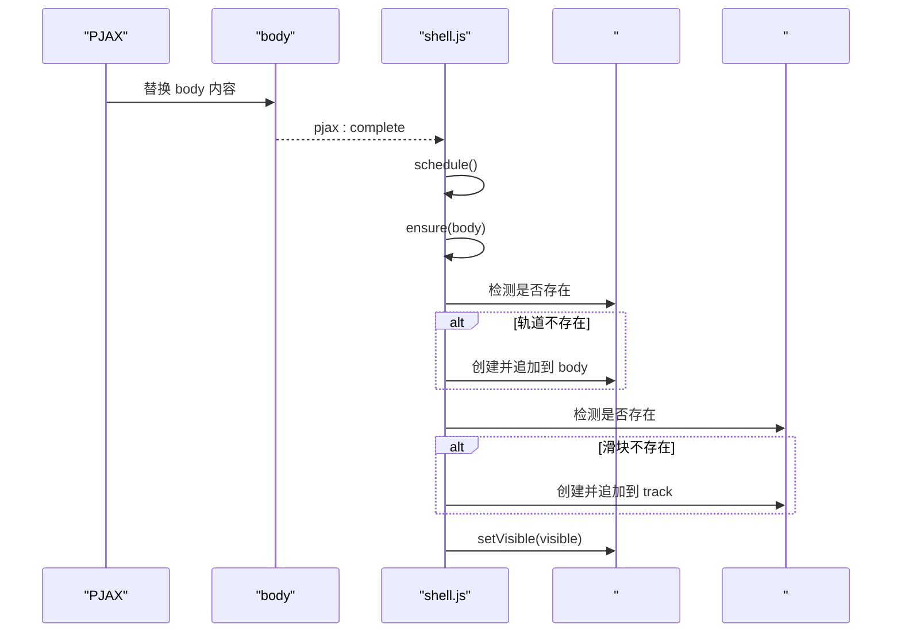
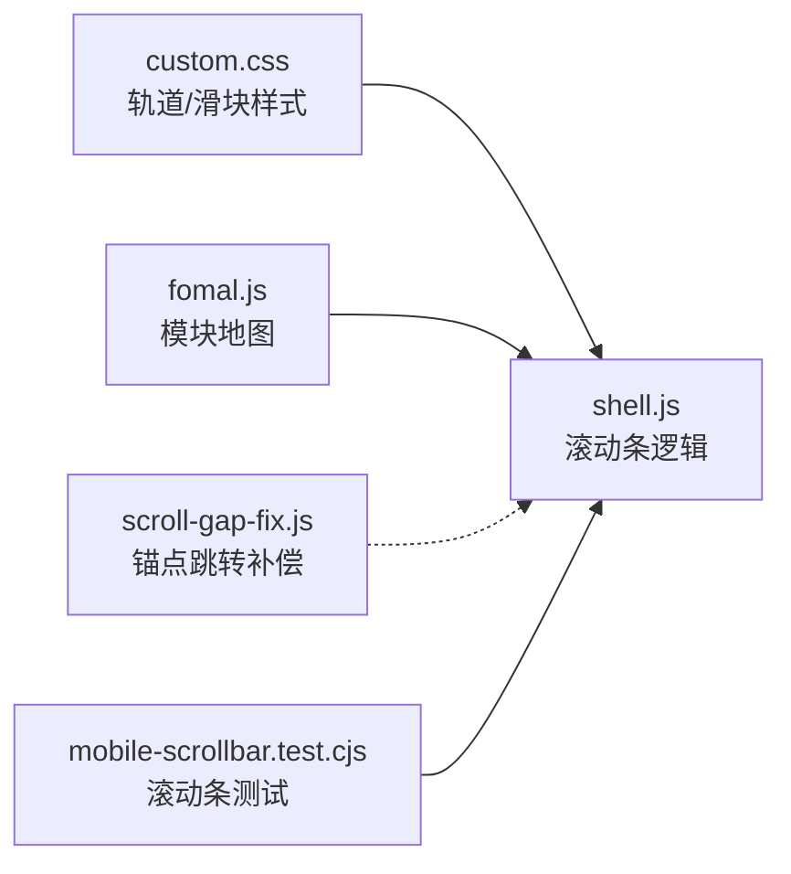

# 移动端滚动条修复

<cite>
**本文引用的文件**   
- [shell.js](file://source/js/modules/shell.js)
- [custom.css](file://themes/fomalhaut/source/css/_custom/custom.css)
- [fomal.js](file://source/js/fomal.js)
- [scroll-gap-fix.js](file://source/js/inject/scroll-gap-fix.js)
- [mobile-scrollbar.test.cjs](file://tools/tests/mobile-scrollbar.test.cjs)
</cite>

## 目录
1. [引言](#引言)
2. [项目结构定位](#项目结构定位)
3. [核心组件总览](#核心组件总览)
4. [架构总览](#架构总览)
5. [详细实现分析](#详细实现分析)
6. [依赖关系分析](#依赖关系分析)
7. [性能与优化](#性能与优化)
8. [PJAX 兼容性](#pjax-兼容性)
9. [故障排查指南](#故障排查指南)
10. [滚动条定制指南](#滚动条定制指南)
11. [结论](#结论)

## 引言
本项目在移动端需要一条“自绘滚动条”，原因是手机浏览器（包括 Chromium 的 overlay 滚动条模式）会忽略 `::-webkit-scrollbar`，导致桌面端主题色斜条纹滚动条在手机宽度下不显示。为此，项目在样式层准备轨道和滑块元素，在脚本层根据滚动进度动态更新滑块高度、位置和可见性，并通过 `requestAnimationFrame` 合并高频滚动事件，保证视觉流畅且避免频繁布局读取。

该功能由模块 `shell.js` 中的“手机端自绘滚动条”逻辑驱动，样式定义在 `custom.css`，并在测试用例 `mobile-scrollbar.test.cjs` 中覆盖关键行为：桌面端跳过、滚动帧合并、PJAX 重建兼容、最小滑块、边界处理等。

## 项目结构定位
移动端滚动条修复涉及三类文件：
- 行为脚本：`source/js/modules/shell.js`
- 样式定义：`themes/fomalhaut/source/css/_custom/custom.css`
- 站点引导入口：`source/js/fomal.js`
- 锚点跳转补偿脚本：`source/js/inject/scroll-gap-fix.js`
- 单元测试：`tools/tests/mobile-scrollbar.test.cjs`

**图表来源**
- [fomal.js:9-21](file://source/js/fomal.js#L9-L21)
- [shell.js:1-29](file://source/js/modules/shell.js#L1-L29)
- [custom.css:212-240](file://themes/fomalhaut/source/css/_custom/custom.css#L212-L240)
- [scroll-gap-fix.js:1-20](file://source/js/inject/scroll-gap-fix.js#L1-L20)
- [mobile-scrollbar.test.cjs:1-16](file://tools/tests/mobile-scrollbar.test.cjs#L1-L16)

**章节来源**
- [fomal.js:9-21](file://source/js/fomal.js#L9-L21)
- [shell.js:1-29](file://source/js/modules/shell.js#L1-L29)

## 核心组件总览
- **轨道与滑块 DOM**：通过 `mscrollbar` 作为轨道容器，`mscrollbar-thumb` 作为滑块，默认隐藏，仅在可滚动时显示。
- **尺寸计算**：根据可视高度、文档总高度计算滑块高度和位置比例。
- **滚动监听**：监听 `scroll`、`resize`、`DOMContentLoaded`、`pjax:complete`，使用 `requestAnimationFrame` 合并更新。
- **可见性控制**：当页面不可滚动时隐藏轨道；可滚动时显示轨道并同步滑块。
- **PJAX 兼容**：检测轨道或滑块被替换后重新绑定节点，避免重复创建和旧节点写入。

**章节来源**
- [shell.js:441-538](file://source/js/modules/shell.js#L441-L538)
- [custom.css:212-240](file://themes/fomalhaut/source/css/_custom/custom.css#L212-L240)

## 架构总览
移动端滚动条修复采用“样式准备 + 脚本驱动”的两层架构：
- 样式层负责轨道、滑块的固定定位、圆角、透明度过渡和主题色背景。
- 脚本层负责：
  - 在移动端创建或复用轨道、滑块 DOM。
  - 在滚动、窗口大小变化、页面加载完成、PJAX 完成后调度一次渲染帧。
  - 在帧内先读布局值，再写样式，避免读写交错。
  - 根据滚动进度映射到滑块 `transform`，并限制边界。
  - 根据是否可滚动切换轨道可见类名。

**图表来源**
- [shell.js:448-538](file://source/js/modules/shell.js#L448-L538)
- [custom.css:212-240](file://themes/fomalhaut/source/css/_custom/custom.css#L212-L240)

## 详细实现分析

### 自绘滚动条原理：轨道创建、滑块生成、位置计算
- **轨道创建**：如果 `#mscrollbar` 不存在或不在当前 `body` 中，则创建并追加到 `body`。
- **滑块生成**：如果 `#mscrollbar-thumb` 不存在或不在轨道内，则创建并追加到轨道。
- **位置计算**：
  - 可视高度取 `window.innerHeight` 或 `documentElement.clientHeight`。
  - 总高度取 `body.scrollHeight`、`documentElement.scrollHeight`、`body.offsetHeight`、`documentElement.offsetHeight` 的最大值。
  - 若总高度大于可视高度，则认为页面可滚动。
  - 滑块高度按 `vh * vh / total` 计算，并设置最小值。
  - 滚动比例按 `pageYOffset / (total - vh)` 计算，限制在 `[0, 1]`。
  - 滑块位移为 `translateY(ratio * (vh - h))`。

**图表来源**
- [shell.js:454-526](file://source/js/modules/shell.js#L454-L526)

**章节来源**
- [shell.js:448-538](file://source/js/modules/shell.js#L448-L538)

### 滚动监听机制：scroll 事件处理、requestAnimationFrame 优化、性能考虑
- **事件绑定**：
  - `window.scroll`：使用 `{ passive: true }` 提升滚动性能。
  - `window.resize`：窗口大小变化时重新计算。
  - `document.DOMContentLoaded`：页面初始加载后初始化。
  - `document.pjax:complete`：PJAX 换页后重新初始化。
- **帧合并**：每次调度只保留一个 `requestAnimationFrame` 任务，避免多次滚动产生多次布局读取。
- **性能策略**：
  - 桌面端直接跳过所有滚动相关逻辑，避免无意义开销。
  - 在 `update` 中先集中读取布局值，再统一写入样式，避免读写交错。
  - 对 `height` 和 `transform` 做缓存比较，相同像素值不重复写入。
  - 对轨道可见性做状态缓存，避免重复添加或移除类名。

**图表来源**
- [shell.js:494-538](file://source/js/modules/shell.js#L494-L538)

**章节来源**
- [shell.js:494-538](file://source/js/modules/shell.js#L494-L538)
- [mobile-scrollbar.test.cjs:139-162](file://tools/tests/mobile-scrollbar.test.cjs#L139-L162)

### 尺寸计算逻辑：可视高度获取、总高度计算、滑块比例确定
- **可视高度**：优先使用 `window.innerHeight`，回退到 `documentElement.clientHeight`。
- **总高度**：取 `body.scrollHeight`、`documentElement.scrollHeight`、`body.offsetHeight`、`documentElement.offsetHeight` 的最大值，保证懒加载图片、异步内容后仍能正确计算。
- **滑块高度**：按 `Math.max(MIN_THUMB, Math.round(vh * vh / total))` 计算，防止滑块过小。
- **滚动比例**：按 `(pageYOffset || scrollTop || 0) / (total - vh)` 计算，并限制在 `[0, 1]`。
- **滑块位移**：按 `translateY(Math.round(ratio * (vh - h)))` 计算，保证滑块顶部始终在轨道范围内。

**图表来源**
- [shell.js:501-512](file://source/js/modules/shell.js#L501-L512)

**章节来源**
- [shell.js:501-512](file://source/js/modules/shell.js#L501-L512)

### 位置同步算法：滚动进度映射、transform 变换、边界处理
- **滚动进度映射**：将当前滚动位置映射到 `[0, 1]` 的比例区间。
- **transform 变换**：使用 `translateY` 将滑块移动到对应位置，避免触发重排。
- **边界处理**：
  - 比例小于 0 时设为 0，大于 1 时设为 1。
  - 滑块高度至少为最小值，避免极端情况下滑块消失。
  - 当页面不可滚动时，隐藏轨道，不写入滑块样式。
  - 当 PJAX 替换节点后，重新校验节点归属，避免向已分离节点写入。

**图表来源**
- [shell.js:507-512](file://source/js/modules/shell.js#L507-L512)

**章节来源**
- [shell.js:507-512](file://source/js/modules/shell.js#L507-L512)

### PJAX 兼容性：DOM 重建检测、事件重新绑定、状态保持
- **DOM 重建检测**：`ensure()` 检查轨道和滑块是否存在于当前 `body` 中，若被 PJAX 替换则重新创建。
- **事件重新绑定**：监听 `pjax:complete`，在 PJAX 完成后重新调度一次更新。
- **状态保持**：
  - 新节点以当前样式值为基准，避免继承旧 DOM 的 inline 样式缓存。
  - 对轨道可见类名和滑块样式做缓存比较，避免冗余写入。
  - 测试用例验证了 PJAX 多次替换后不会累积监听器和待执行帧。

**图表来源**
- [shell.js:454-473](file://source/js/modules/shell.js#L454-L473)
- [shell.js:533-537](file://source/js/modules/shell.js#L533-L537)
- [mobile-scrollbar.test.cjs:195-209](file://tools/tests/mobile-scrollbar.test.cjs#L195-L209)

**章节来源**
- [shell.js:454-473](file://source/js/modules/shell.js#L454-L473)
- [shell.js:533-537](file://source/js/modules/shell.js#L533-L537)
- [mobile-scrollbar.test.cjs:195-209](file://tools/tests/mobile-scrollbar.test.cjs#L195-L209)

## 依赖关系分析
- `shell.js` 是滚动条行为的核心实现，依赖：
  - `window`：提供 `innerHeight`、`pageYOffset`、`addEventListener`、`requestAnimationFrame`。
  - `document`：提供 `body`、`getElementById`、`createElement`、事件。
  - `custom.css`：提供轨道和滑块的样式基础。
- `fomal.js` 作为站点引导，声明模块地图，说明 `shell.js` 是其中之一。
- `scroll-gap-fix.js` 与滚动条修复无直接耦合，但同属滚动体验增强：前者修复锚点跳转偏移，后者提供滚动可视化。
- `mobile-scrollbar.test.cjs` 通过 VM 模拟 DOM 和事件，验证滚动条逻辑的正确性。

**图表来源**
- [fomal.js:9-21](file://source/js/fomal.js#L9-L21)
- [shell.js:441-538](file://source/js/modules/shell.js#L441-L538)
- [custom.css:212-240](file://themes/fomalhaut/source/css/_custom/custom.css#L212-L240)
- [scroll-gap-fix.js:1-20](file://source/js/inject/scroll-gap-fix.js#L1-L20)
- [mobile-scrollbar.test.cjs:1-16](file://tools/tests/mobile-scrollbar.test.cjs#L1-L16)

**章节来源**
- [fomal.js:9-21](file://source/js/fomal.js#L9-L21)
- [shell.js:441-538](file://source/js/modules/shell.js#L441-L538)

## 性能与优化
- **桌面端跳过**：当 `window.innerWidth > 768` 时直接取消待执行帧并退出，避免无意义滚动监听。
- **被动滚动监听**：`scroll` 事件使用 `{ passive: true }`，减少主线程阻塞。
- **帧合并**：同一帧内多次滚动只触发一次 `update`，避免频繁布局读取。
- **读写分离**：在 `update` 中先读取所有布局值，再统一写入样式，避免强制同步布局。
- **样式缓存**：对 `height`、`transform`、轨道可见性做缓存比较，避免重复写入。
- **最小滑块**：滑块高度不低于最小值，防止极端比例下滑块不可见。
- **边界收敛**：滚动比例限制在 `[0, 1]`，位移不超过轨道范围。

**章节来源**
- [shell.js:481-526](file://source/js/modules/shell.js#L481-L526)
- [mobile-scrollbar.test.cjs:139-181](file://tools/tests/mobile-scrollbar.test.cjs#L139-L181)

## PJAX 兼容性
- **DOM 重建检测**：`ensure()` 检查轨道和滑块是否在当前 `body` 中，若被 PJAX 替换则重新创建。
- **事件重新绑定**：监听 `pjax:complete`，在 PJAX 完成后重新调度更新。
- **状态保持**：新节点以当前样式值为基准，避免继承旧 DOM 的 inline 样式缓存。
- **测试覆盖**：测试用例验证了 PJAX 多次替换后不会累积监听器、待执行帧，并能恢复轨道可见性和滑块样式。

**章节来源**
- [shell.js:454-473](file://source/js/modules/shell.js#L454-L473)
- [shell.js:533-537](file://source/js/modules/shell.js#L533-L537)
- [mobile-scrollbar.test.cjs:195-209](file://tools/tests/mobile-scrollbar.test.cjs#L195-L209)

## 故障排查指南
- **滚动条不显示**：
  - 检查是否在桌面端（宽度大于 768），桌面端会主动隐藏滚动条。
  - 检查页面是否可滚动（总高度是否大于可视高度）。
  - 检查 `#mscrollbar` 和 `#mscrollbar-thumb` 是否存在于 `body` 中。
- **滑块位置异常**：
  - 检查 `total` 是否正确，特别是懒加载图片后总高度是否变化。
  - 检查 `pageYOffset` 是否为负数或被其他脚本修改。
  - 检查 `vh - h` 是否为正数，避免滑块位移超出轨道。
- **PJAX 后滚动条错乱**：
  - 检查 PJAX 是否替换了 `body` 或轨道、滑块节点。
  - 检查 `pjax:complete` 是否触发，确保重新调度更新。
  - 检查是否有多个滚动条实例同时存在。
- **性能问题**：
  - 检查是否频繁触发 `scroll` 事件但未合并帧。
  - 检查是否重复写入 `height`、`transform`、类名。
  - 检查是否在桌面端仍执行滚动条逻辑。

**章节来源**
- [shell.js:481-526](file://source/js/modules/shell.js#L481-L526)
- [mobile-scrollbar.test.cjs:139-271](file://tools/tests/mobile-scrollbar.test.cjs#L139-L271)

## 滚动条定制指南
- **样式修改**：
  - 轨道背景色、圆角、宽度、透明度过渡可在 `custom.css` 的 `#mscrollbar` 中调整。
  - 滑块样式可在 `custom.css` 的 `#mscrollbar-thumb` 中调整。
  - 主题色可通过 CSS 变量或自定义颜色覆盖。
- **行为调整**：
  - 最小滑块高度可在 `shell.js` 的 `MIN_THUMB` 常量中调整。
  - 桌面端阈值可在 `shell.js` 的 `skipDesktop()` 中调整。
  - 滚动比例计算和位移公式可在 `shell.js` 的 `update()` 中调整。
- **性能优化**：
  - 确保 `scroll` 事件使用 `{ passive: true }`。
  - 避免在 `update()` 中进行大量 DOM 查询。
  - 使用样式缓存避免重复写入。
  - 在 PJAX 后及时清理旧节点引用，避免内存泄漏。

**章节来源**
- [custom.css:212-240](file://themes/fomalhaut/source/css/_custom/custom.css#L212-L240)
- [shell.js:448-538](file://source/js/modules/shell.js#L448-L538)

## 结论
移动端滚动条修复通过“样式准备 + 脚本驱动”的方式，解决了手机浏览器忽略 `::-webkit-scrollbar` 的问题。其核心在于：
- 在移动端创建轨道和滑块 DOM。
- 根据滚动进度计算滑块高度和位置。
- 使用 `requestAnimationFrame` 合并高频滚动事件。
- 支持 PJAX 重建后的节点检测和状态恢复。
- 提供完善的测试覆盖，确保行为稳定。

该实现兼顾了视觉一致性、性能和兼容性，可作为移动端滚动条定制的参考方案。