# 站点外壳行为

<cite>
**本文引用的文件**   
- [shell.js](file://source/js/modules/shell.js)
- [daynight-boot.js](file://source/js/inject/daynight-boot.js)
- [search-lazy.js](file://source/js/inject/search-lazy.js)
- [mobile-drawer.css](file://source/css/mobile-drawer.css)
- [algolia.js](file://themes/fomalhaut/source/js/search/algolia.js)
- [_config.fomalhaut.yml](file://_config.fomalhaut.yml)
- [README.md](file://README.md)
</cite>

## 目录

1. [引言](#引言)
2. [项目结构定位](#项目结构定位)
3. [核心组件总览](#核心组件总览)
4. [架构概览](#架构概览)
5. [快捷键处理系统](#快捷键处理系统)
6. [夜间模式切换逻辑](#夜间模式切换逻辑)
7. [搜索框交互增强](#搜索框交互增强)
8. [移动端滚动条修复](#移动端滚动条修复)
9. [标题恶搞功能](#标题恶搞功能)
10. [依赖关系分析](#依赖关系分析)
11. [性能与可访问性](#性能与可访问性)
12. [扩展指南](#扩展指南)
13. [故障排查](#故障排查)
14. [结论](#结论)

## 引言

“站点外壳行为”不是某个具体页面组件，而是整个站点的运行时策略层：它负责用户在全站范围内触发的通用行为，包括键盘事件拦截、深浅色主题切换动画、标签页标题恶搞、Algolia 搜索体验增强，以及手机端滚动条的视觉补全。

这些能力集中在 `source/js/modules/shell.js` 中，并通过 `_config.fomalhaut.yml` 的注入机制加载；同时，首屏昼夜自动判定由 `source/js/inject/daynight-boot.js` 承担，Algolia 搜索按需加载和结果增强由 `source/js/inject/search-lazy.js` 承担，移动端抽屉菜单样式则由 `source/css/mobile-drawer.css` 提供。

## 项目结构定位

从仓库结构看，外壳行为主要分布在以下位置：

| 层次 | 路径 | 职责 |
|---|---|---|
| 外壳主逻辑 | `source/js/modules/shell.js` | 快捷键防抖、夜间动画、标题恶搞、搜索尺寸修复、手机滚动条 |
| 首屏昼夜预置 | `source/js/inject/daynight-boot.js` | 按日出日落设置 `<html data-theme>` 与 `body.DarkMode` |
| 搜索按需加载 | `source/js/inject/search-lazy.js` | 懒加载 Algolia、错误提示、搜索历史、结果链接改写 |
| 移动端抽屉样式 | `source/css/mobile-drawer.css` | 抽屉面板、图标底衬、二级菜单动效、深色变量 |
| 主题搜索入口 | `themes/fomalhaut/source/js/search/algolia.js` | 打开/关闭搜索弹窗、ESC 关闭、输入聚焦 |
| 站点配置 | `_config.fomalhaut.yml` | 注入脚本、日夜旋钮、CDN 地址等 |
| 项目说明 | `README.md` | 夜间切换时长、遮罩优化等高层说明 |

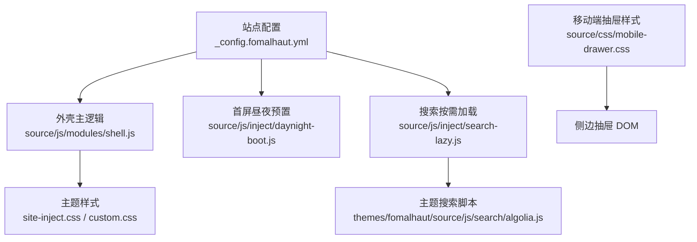

**图表来源**
- [_config.fomalhaut.yml:1279-1290](file://_config.fomalhaut.yml#L1279-L1290)
- [shell.js:1-29](file://source/js/modules/shell.js#L1-L29)
- [daynight-boot.js:1-47](file://source/js/inject/daynight-boot.js#L1-L47)
- [search-lazy.js:1-77](file://source/js/inject/search-lazy.js#L1-L77)
- [mobile-drawer.css:1-33](file://source/css/mobile-drawer.css#L1-L33)

**章节来源**
- [shell.js:1-29](file://source/js/modules/shell.js#L1-L29)
- [_config.fomalhaut.yml:1279-1290](file://_config.fomalhaut.yml#L1279-L1290)

## 核心组件总览

外壳行为可以拆成五个子系统：

| 子系统 | 主要文件 | 关键行为 |
|---|---|---|
| 快捷键与按键防抖 | `shell.js` | 监听 F12、Ctrl+Shift+I/C/J/C/U 等组合，弹出提醒；提供全局 `debounce` |
| 夜间模式切换 | `shell.js` + `daynight-boot.js` | 三拍遮罩动画、点击位置揭幕、档位控制、首屏自动昼夜 |
| 标题恶搞 | `shell.js` | 切走标签页改标题，切回后两秒恢复原始标题 |
| 搜索框增强 | `shell.js` + `search-lazy.js` + `algolia.js` | 移动端最大高度、懒加载、错误提示、搜索历史、结果链接改写 |
| 移动端滚动条 | `shell.js` | 在右边缘绘制轨道和滑块，跟随滚动进度 |

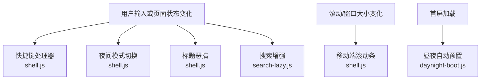

**图表来源**
- [shell.js:31-95](file://source/js/modules/shell.js#L31-L95)
- [shell.js:97-384](file://source/js/modules/shell.js#L97-L384)
- [shell.js:386-439](file://source/js/modules/shell.js#L386-L439)
- [shell.js:441-539](file://source/js/modules/shell.js#L441-L539)
- [daynight-boot.js:49-245](file://source/js/inject/daynight-boot.js#L49-L245)
- [search-lazy.js:78-507](file://source/js/inject/search-lazy.js#L78-L507)

**章节来源**
- [shell.js:1-29](file://source/js/modules/shell.js#L1-L29)
- [README.md:111-114](file://README.md#L111-L114)

## 架构概览

外壳行为的整体调用链可以分为三类：

1. **用户直接触发**：键盘事件、点击夜间按钮、点击搜索按钮、滚动页面、切换标签页。
2. **首屏自动触发**：根据地理位置和当前时间决定深浅色。
3. **异步资源触发**：Algolia 脚本加载完成、pjax 换页完成、DOM 就绪。

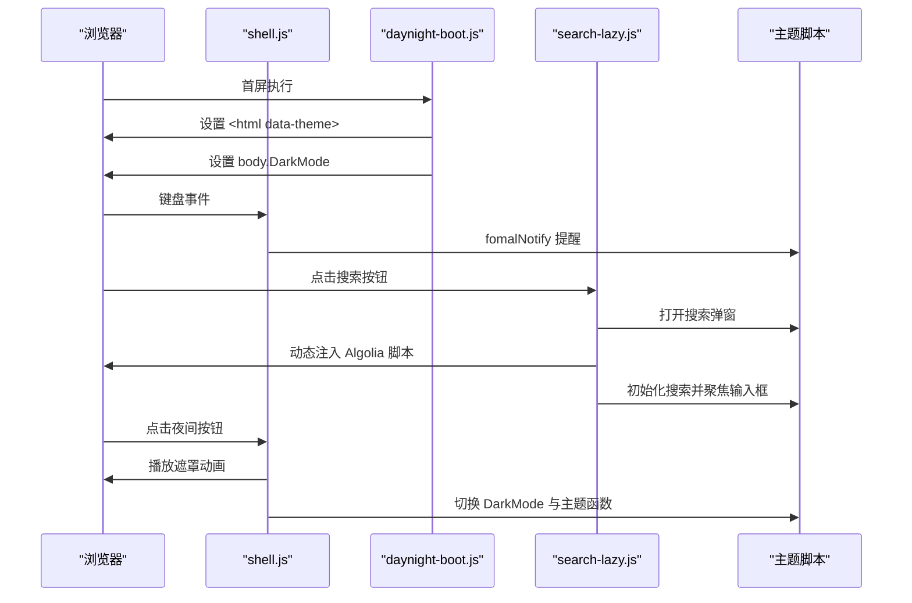

**图表来源**
- [daynight-boot.js:235-244](file://source/js/inject/daynight-boot.js#L235-L244)
- [shell.js:80-94](file://source/js/modules/shell.js#L80-L94)
- [search-lazy.js:472-506](file://source/js/inject/search-lazy.js#L472-L506)
- [shell.js:315-382](file://source/js/modules/shell.js#L315-L382)

## 快捷键处理系统

### 键盘事件监听

外壳没有实现完整的“快捷键映射表”，而是采用“黑名单式”拦截：当用户按下可能用于打开开发者工具的组合键时，不阻止默认行为，而是通过 `fomalNotify` 弹出一条警告提示。

被监听的键位包括：

| 触发条件 | 含义 |
|---|---|
| `keyCode === 123` | F12 |
| `Ctrl + Shift + I` | 开发者工具 |
| `Ctrl + Shift + J` | 控制台 |
| `Ctrl + Shift + C` | 元素检查 |
| `Ctrl + U` | 查看网页源代码 |

这些判断发生在 `document.onkeydown` 回调中，并使用全局 `debounce` 包裹通知逻辑，避免短时间内重复弹出。

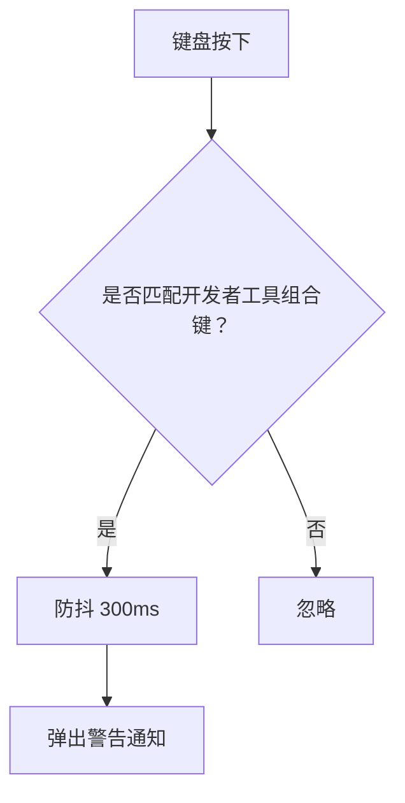

**图表来源**
- [shell.js:31-95](file://source/js/modules/shell.js#L31-L95)

### 冲突解决

当前实现的关键点是：**不阻止默认行为**。也就是说，F12 或 Ctrl+U 仍然可能打开开发者工具或源码页面，但会先触发一次提醒。这样做的好处是：

- 不会破坏调试流程；
- 不会因浏览器差异导致兼容问题；
- 把“禁止开发”降级为“友好提醒”。

如果未来需要真正的快捷键映射，建议新增一个独立的快捷键管理器，而不是继续往 `onkeydown` 里堆条件判断。

**章节来源**
- [shell.js:31-95](file://source/js/modules/shell.js#L31-L95)

## 夜间模式切换逻辑

夜间模式分为两个层面：

1. **首屏自动昼夜**：由 `daynight-boot.js` 在 `<head>` 同步执行，决定第一帧的颜色。
2. **运行时切换动画**：由 `shell.js` 中的 `switchNightMode` 驱动，负责遮罩、揭幕、联动星空和萤火虫。

### 主题状态管理

主题状态由两处共同维护：

| 状态载体 | 作用 |
|---|---|
| `<html data-theme="dark" | "light">` | 主题 CSS 选择器依据 |
| `body.DarkMode` | shell.js 内部约定：有该类表示当前是夜间模式 |
| `localStorage.theme` | 访客手动选择的深浅色（带过期时间） |
| `localStorage.darkTransition` | 夜间切换动画档位 |
| `window.fomalDayNight` | 首屏昼夜算法 API |

`daynight-boot.js` 的职责是：如果访客没有手动选择过主题，就根据经纬度计算日出日落，再设置 `data-theme` 和 `DarkMode`。如果极昼极夜算不出来，则返回 `null`，交给主题默认逻辑。

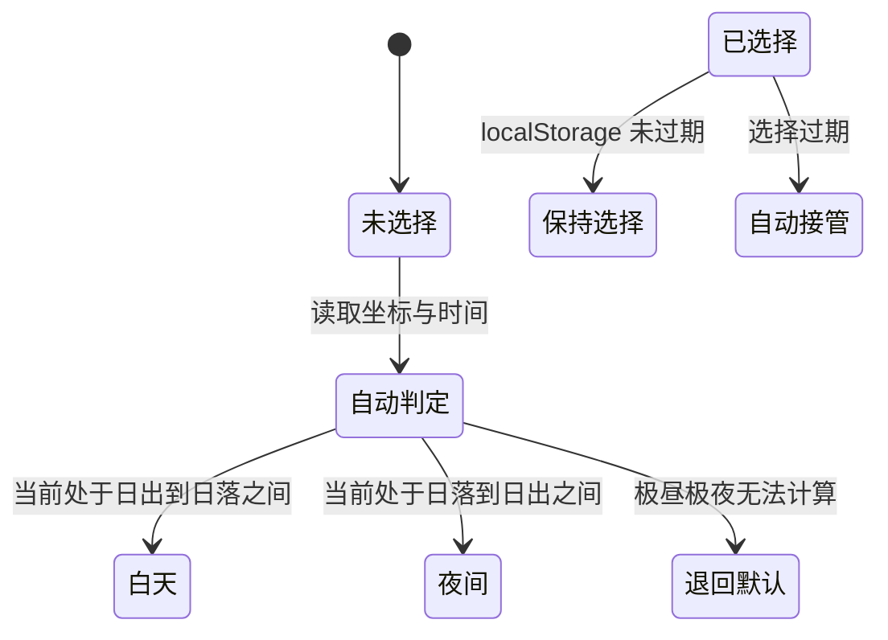

**图表来源**
- [daynight-boot.js:142-194](file://source/js/inject/daynight-boot.js#L142-L194)
- [daynight-boot.js:196-216](file://source/js/inject/daynight-boot.js#L196-L216)

### CSS 类名切换

`shell.js` 的 `switchNightMode` 会在切换时：

1. 记录 `lastTime`；
2. 如果上次动画还没结束，立刻清理遮罩并改为瞬时切换；
3. 检测系统“减少动态效果”偏好；
4. 根据当前 `data-theme` 决定转向暗还是亮；
5. 构建遮罩动画；
6. 预热夜间壁纸；
7. 切换 `body.DarkMode`、`localStorage.isDark` 和模式图标；
8. 调用主题的 `activateDarkMode` / `activateLightMode`；
9. 刷新评论组件。

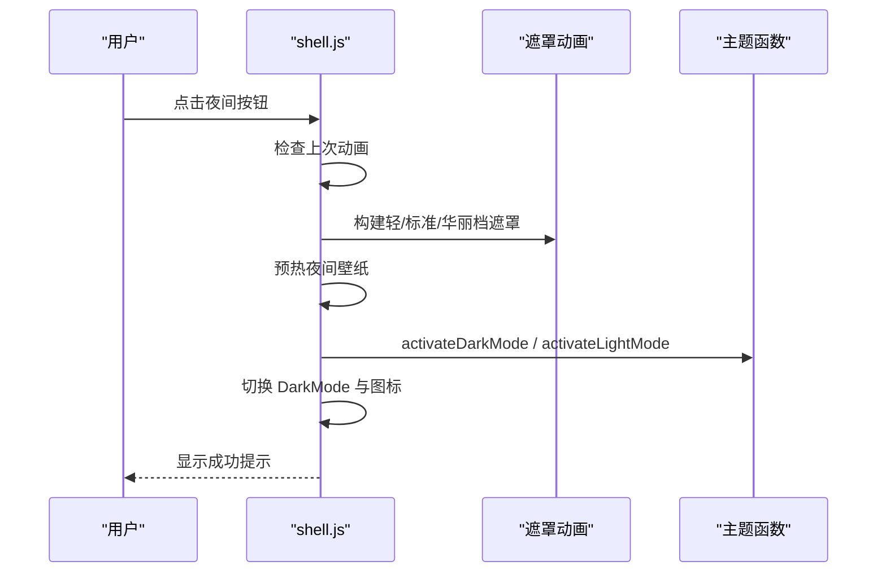

**图表来源**
- [shell.js:315-382](file://source/js/modules/shell.js#L315-L382)

### 动画过渡效果

夜间切换支持四档：

| 档位 | 行为 |
|---|---|
| `off` | 无遮罩，瞬时切换 |
| `light` | 老版太阳月亮互换 + 整屏淡出 |
| `standard` | 三拍小剧场：日落/日出 → 暮色与第一批星 → 星夜铺满 + 圆形揭幕 |
| `flourish` | 标准档基础上增加云、第二颗流星，并联动星空 canvas 与萤火虫层 |

三拍总时长约 1500ms，揭幕从第 1150ms 开始，持续 350ms。转昼整体乘以 0.8，缩短到约 1200ms。

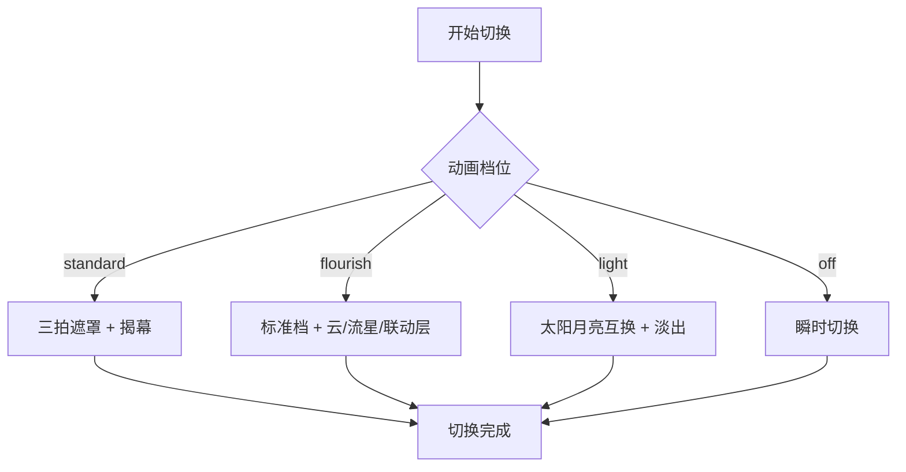

**图表来源**
- [shell.js:97-127](file://source/js/modules/shell.js#L97-L127)
- [shell.js:186-287](file://source/js/modules/shell.js#L186-L287)
- [shell.js:315-382](file://source/js/modules/shell.js#L315-L382)

**章节来源**
- [shell.js:97-384](file://source/js/modules/shell.js#L97-L384)
- [daynight-boot.js:1-47](file://source/js/inject/daynight-boot.js#L1-L47)
- [daynight-boot.js:88-245](file://source/js/inject/daynight-boot.js#L88-L245)
- [README.md:111-114](file://README.md#L111-L114)

## 搜索框交互增强

搜索增强涉及三个文件：

- `search-lazy.js`：懒加载、错误提示、搜索历史、结果链接改写、点击拦截。
- `shell.js`：移动端搜索结果容器最大高度适配。
- `algolia.js`：主题自带的搜索弹窗开关、ESC 关闭、输入聚焦。

### 焦点管理

主题 `algolia.js` 在打开搜索弹窗后，延迟 100ms 聚焦 `.ais-SearchBox-input`。`search-lazy.js` 在库就绪后也会尝试聚焦输入框，确保懒加载场景下用户体验一致。

此外，`search-lazy.js` 在库尚未就绪时自己负责打开和关闭弹窗，避免用户看到空白面板。

### 输入验证与提交

搜索历史记录时机包括：

- 回车；
- 表单提交；
- 点击搜索按钮；
- 点击历史条目。

历史记录最多保留 8 条，去重，最新在前，存储在 `localStorage['search-history-v1']`。

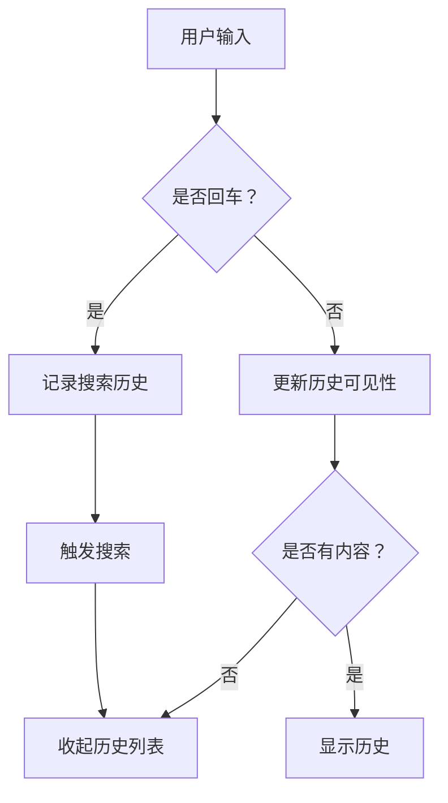

**图表来源**
- [search-lazy.js:305-468](file://source/js/inject/search-lazy.js#L305-L468)

### 结果展示

`search-lazy.js` 做了三项增强：

1. **加载失败提示**：不再吞掉 `onerror`，而是显示“加载失败”，允许重试。
2. **未渲染输入框提示**：脚本加载成功但主题 algolia.js 未初始化时，提示配置无效。
3. **结果链接改写**：使用 MutationObserver 监控搜索结果容器，把与当前站点不同源的链接改写为根路径，使本地预览和镜像域名下也能留在本站。

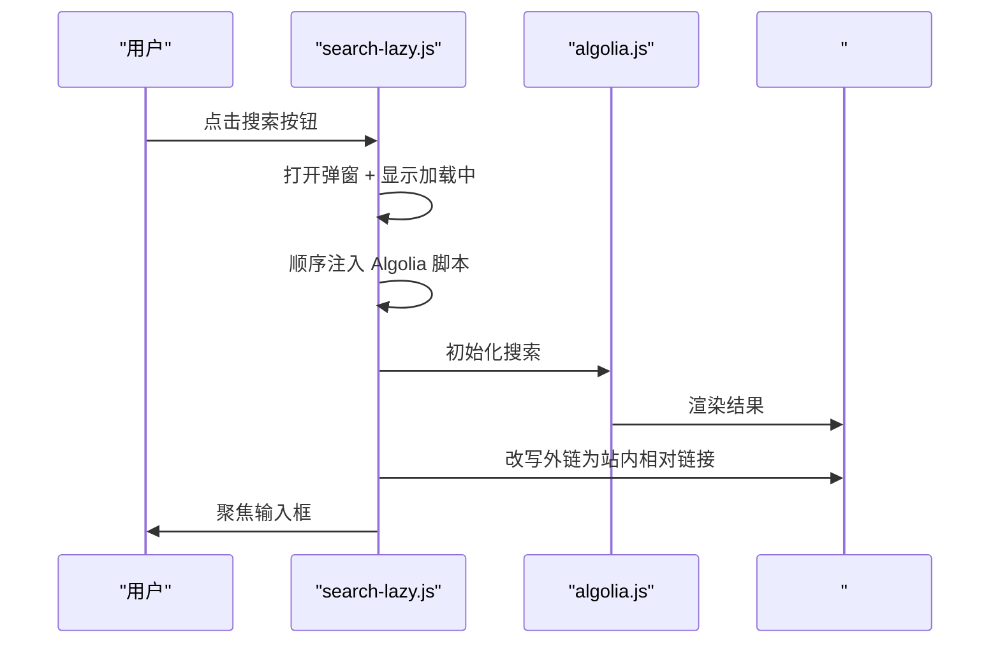

**图表来源**
- [search-lazy.js:93-177](file://source/js/inject/search-lazy.js#L93-L177)
- [search-lazy.js:227-262](file://source/js/inject/search-lazy.js#L227-L262)
- [search-lazy.js:472-506](file://source/js/inject/search-lazy.js#L472-L506)

**章节来源**
- [search-lazy.js:1-77](file://source/js/inject/search-lazy.js#L1-L77)
- [search-lazy.js:78-507](file://source/js/inject/search-lazy.js#L78-L507)
- [shell.js:424-439](file://source/js/modules/shell.js#L424-L439)
- [algolia.js:1-37](file://themes/fomalhaut/source/js/search/algolia.js#L1-L37)

## 移动端滚动条修复

### 为什么需要自绘滚动条

手机浏览器通常使用系统 overlay 滚动条，会完全忽略 `::-webkit-scrollbar`。因此桌面端那条主题色斜条纹在手机宽度下不会出现。`shell.js` 的做法是在页面右侧绘制一条固定轨道和一个随滚动位置移动的滑块。

### CSS 滚动条定制

移动端抽屉菜单本身使用了 `scrollbar-width`、`scrollbar-color` 和 `::-webkit-scrollbar-thumb` 来自定义滚动条外观，但这些只影响抽屉内部滚动，不影响页面主滚动条。

`mobile-drawer.css` 主要负责抽屉面板的视觉增强，包括：

- 抽屉宽度自适应视口；
- 头像、统计胶囊、分隔线、菜单项样式；
- 二级菜单手风琴展开；
- 深色模式变量覆盖；
- 无障碍模式下禁用动画。

### 触摸事件与性能优化

滚动条更新逻辑使用 `requestAnimationFrame` 调度，并在 `scroll` 事件中注册 passive 监听，避免阻塞滚动。每次更新前会跳过桌面端，防止在宽屏上创建无用节点。

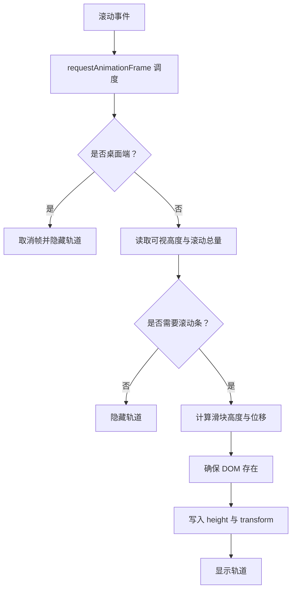

**图表来源**
- [shell.js:441-539](file://source/js/modules/shell.js#L441-L539)

**章节来源**
- [shell.js:441-539](file://source/js/modules/shell.js#L441-L539)
- [mobile-drawer.css:1-33](file://source/css/mobile-drawer.css#L1-L33)
- [mobile-drawer.css:35-112](file://source/css/mobile-drawer.css#L35-L112)
- [mobile-drawer.css:407-491](file://source/css/mobile-drawer.css#L407-L491)

## 标题恶搞功能

标题恶搞的核心逻辑很轻量：

1. 保存原始标题 `OriginTitile`；
2. 使用 `MutationObserver` 监听 `<title>` 变化，避免 pjax 换页后原始标题失效；
3. 监听 `visibilitychange`；
4. 离开页面时把标题改成“跑哪里去了~”；
5. 回到页面时改成“抓到你啦～”；
6. 两秒后恢复原始标题。

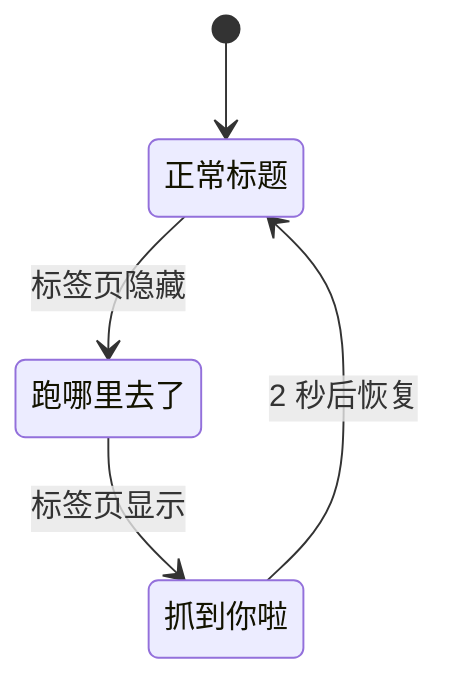

**图表来源**
- [shell.js:386-422](file://source/js/modules/shell.js#L386-L422)

### 状态同步

代码注释明确指出：因为站点使用 pjax 换页，不能只在加载时抓取一次原始标题。否则切走标签页再切回来，可能会把标题恢复成上一个页面的标题。为此，脚本既监听 `title` 元素的变化，也监听 `pjax:complete` 事件，在换页完成后再次校准原始标题。

**章节来源**
- [shell.js:386-422](file://source/js/modules/shell.js#L386-L422)

## 依赖关系分析

外壳行为对外部模块和主题状态的依赖如下：

| 依赖 | 来源 | 用途 |
|---|---|---|
| `fomalNotify` | 主题全局通知函数 | 快捷键提醒、夜间切换成功提示 |
| `activateDarkMode` / `activateLightMode` | 主题全局函数 | 切换主题相关副作用 |
| `saveToLocal` | 主题存储工具 | 持久化主题选择 |
| `btf.animateIn` / `btf.animateOut` | 主题动画工具 | 搜索弹窗动画 |
| `window.__SEARCH_LAZY__` | 主题注入 | 提供 Algolia 脚本 CDN 地址 |
| `window.fomalNightConfig` | 站点 YAML 注入 | 控制首屏昼夜开关、坐标、localStorage 键名 |
| `window.fomalDayNight` | daynight-boot.js 暴露 | 外部查询当前是否白天、设置配置 |

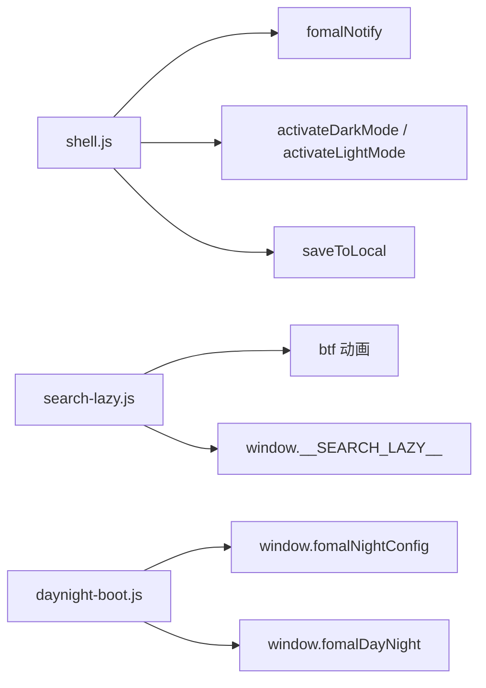

**图表来源**
- [shell.js:80-94](file://source/js/modules/shell.js#L80-L94)
- [shell.js:342-381](file://source/js/modules/shell.js#L342-L381)
- [search-lazy.js:81-82](file://source/js/inject/search-lazy.js#L81-L82)
- [search-lazy.js:274-279](file://source/js/inject/search-lazy.js#L274-L279)
- [daynight-boot.js:58-79](file://source/js/inject/daynight-boot.js#L58-L79)
- [daynight-boot.js:218-233](file://source/js/inject/daynight-boot.js#L218-L233)

**章节来源**
- [shell.js:315-382](file://source/js/modules/shell.js#L315-L382)
- [search-lazy.js:78-177](file://source/js/inject/search-lazy.js#L78-L177)
- [daynight-boot.js:49-233](file://source/js/inject/daynight-boot.js#L49-L233)

## 性能与可访问性

### 性能特点

- 夜间壁纸预热使用 `requestIdleCallback`，避免阻塞首帧。
- 移动端滚动条使用 `requestAnimationFrame` 和 passive scroll 监听。
- 搜索模块默认不加载，仅在用户点击后懒加载，减少每页的 JS 体积。
- 搜索脚本注入时关闭 `async`，保证顺序执行。
- 夜间遮罩只操作 `opacity`、`transform` 和 `mask`，不新建 canvas，也不运行 rAF。

### 可访问性考虑

- 夜间切换尊重 `prefers-reduced-motion`，系统开启减少动态效果时瞬时切换。
- 移动端抽屉样式在 `prefers-reduced-motion` 下禁用动画，并为头像补充常亮光晕。
- 搜索弹窗支持 ESC 关闭。
- 标题恶搞只在标签页切换时短暂改变标题，两秒内恢复。

**章节来源**
- [shell.js:158-164](file://source/js/modules/shell.js#L158-L164)
- [shell.js:290-313](file://source/js/modules/shell.js#L290-L313)
- [shell.js:528-537](file://source/js/modules/shell.js#L528-L537)
- [mobile-drawer.css:470-491](file://source/css/mobile-drawer.css#L470-L491)
- [algolia.js:10-16](file://themes/fomalhaut/source/js/search/algolia.js#L10-L16)

## 扩展指南

### 添加新快捷键

当前快捷键逻辑是“黑名单”形式，不建议继续往 `onkeydown` 里加更多硬编码分支。推荐做法：

1. 在 `shell.js` 中新增一个快捷键映射对象，例如 `{ key, modifiers, handler }`。
2. 在键盘事件回调中统一匹配。
3. 对冲突键做优先级排序，例如编辑类快捷键优先于导航类快捷键。
4. 对敏感操作增加二次确认。

### 使用事件钩子

现有可扩展点包括：

| 钩子 | 位置 | 用途 |
|---|---|---|
| `fomalNotify` | `shell.js` | 显示全站通知 |
| `activateDarkMode` / `activateLightMode` | 主题全局 | 主题切换副作用 |
| `window.fomalDayNight.setConfig` | `daynight-boot.js` | 运行期修改昼夜配置 |
| `window.fomalDayNight.isDayNow` | `daynight-boot.js` | 查询当前是否白天 |
| `window.fomalDayNight.hasChoice` | `daynight-boot.js` | 查询访客是否手动选过主题 |

### 调试方法

| 问题 | 调试建议 |
|---|---|
| 夜间按钮没反应 | 检查 `body.DarkMode` 是否存在，确认 `modeicon` 节点存在 |
| 首屏总是白天 | 检查 `window.fomalNightConfig.enabled` 和 `localStorage.theme` |
| 搜索一直显示加载中 | 检查网络请求、Algolia 配置、`.ais-SearchBox-input` 是否渲染 |
| 搜索结果跳到正式站 | 检查 `search-lazy.js` 的链接改写逻辑和当前域名 |
| 手机端没有滚动条 | 检查视口宽度、`#mscrollbar` 是否插入、是否被 pjax 替换 |

**章节来源**
- [shell.js:80-94](file://source/js/modules/shell.js#L80-L94)
- [shell.js:315-382](file://source/js/modules/shell.js#L315-L382)
- [daynight-boot.js:205-233](file://source/js/inject/daynight-boot.js#L205-L233)
- [search-lazy.js:153-176](file://source/js/inject/search-lazy.js#L153-L176)
- [search-lazy.js:238-262](file://source/js/inject/search-lazy.js#L238-L262)

## 故障排查

### 夜间模式常见问题

| 现象 | 可能原因 | 处理方向 |
|---|---|---|
| 切换到文章页变回白天 | 非首页缺少日历卡片，`aside-calendar.js` 未执行 | 使用 `daynight-boot.js` 首屏预置 |
| 点击夜间按钮没动画 | 档位设为 `off` 或系统开启减少动态效果 | 检查 `localStorage.darkTransition` 和 `prefers-reduced-motion` |
| 连点夜间按钮残留遮罩 | 旧实现取第一个 `.Cuteen_DarkSky` | 当前实现由本次切换持有遮罩节点引用 |
| 夜间壁纸闪烁 | 夜间图未提前下载 | 使用 `prewarmNightWallpaper` 空闲预热 |

### 搜索框常见问题

| 现象 | 可能原因 | 处理方向 |
|---|---|---|
| 搜索面板打不开 | 主题 `algolia.js` 未绑定按钮或配置无效 | 检查 `window.__SEARCH_LAZY__` 和 Algolia 配置 |
| 面板一直显示加载中 | 脚本加载失败或 hits 未渲染 | 检查 `search-lazy.js` 的错误提示分支 |
| 搜索结果跳出本站 | 索引 url 是构建时的正式域 | 使用 `normalizeResultLinks` 改写为相对链接 |
| 移动端搜索结果被截断 | 容器最大高度不足 | 使用 `shell.js` 的 `searchSize` 适配 |

### 移动端滚动条问题

| 现象 | 可能原因 | 处理方向 |
|---|---|---|
| 手机端看不到滚动条 | 系统滚动条忽略 `::-webkit-scrollbar` | 使用 shell.js 自绘轨道 |
| 滚动条不跟随滚动 | `requestAnimationFrame` 未触发或被取消 | 检查 scroll 监听和桌面端跳过逻辑 |
| pjax 换页后滚动条消失 | 轨道或滑块被替换 | `ensure` 函数会重新挂载 |

**章节来源**
- [shell.js:315-382](file://source/js/modules/shell.js#L315-L382)
- [shell.js:424-539](file://source/js/modules/shell.js#L424-L539)
- [search-lazy.js:153-176](file://source/js/inject/search-lazy.js#L153-L176)
- [search-lazy.js:238-262](file://source/js/inject/search-lazy.js#L238-L262)
- [daynight-boot.js:142-216](file://source/js/inject/daynight-boot.js#L142-L216)

## 结论

站点外壳行为是一个围绕“全站通用体验”的薄封装层：它不替代主题，也不替代业务页面，而是在主题之上补齐用户交互细节。其设计优点在于：

- 职责清晰：快捷键、夜间模式、标题恶搞、搜索增强、滚动条各自独立；
- 与主题解耦：通过全局函数和 DOM 约定协作；
- 渐进增强：懒加载、空闲预热、减少动态效果都体现性能与可访问性意识；
- 可回滚：多处逻辑都有明确回滚说明，便于站点维护。

未来若需要进一步扩展，建议优先采用“配置对象 + 事件钩子”的方式，而不是继续增加全局函数和硬编码分支。这样既能保持外壳简洁，又能让主题和其他插件稳定接入。