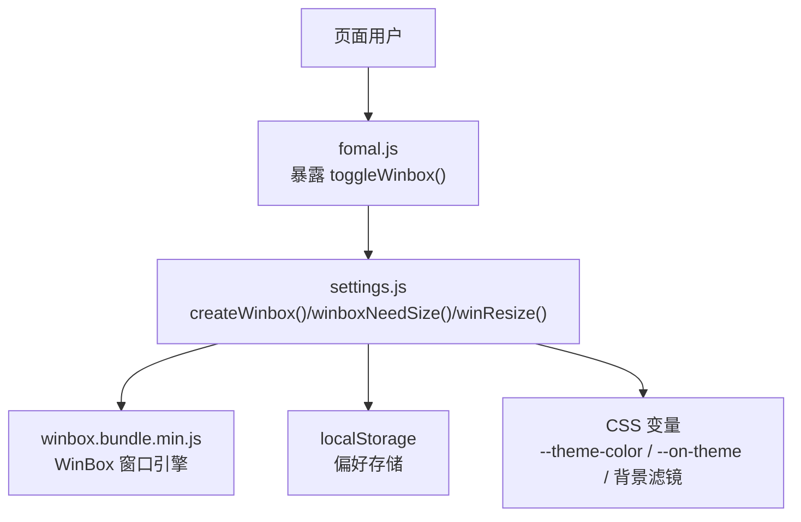
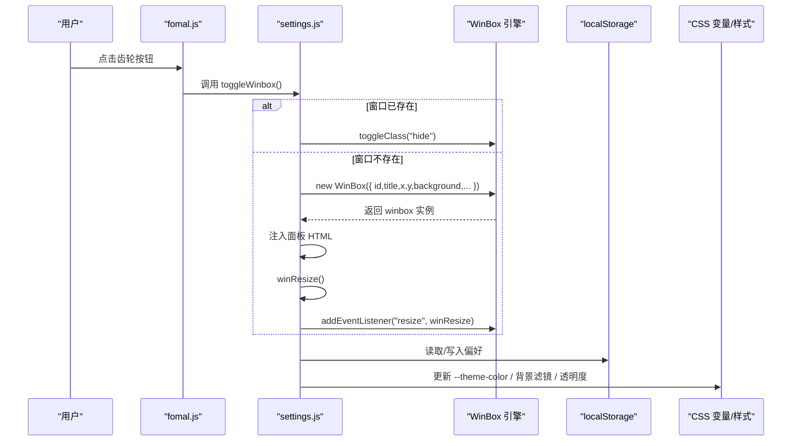
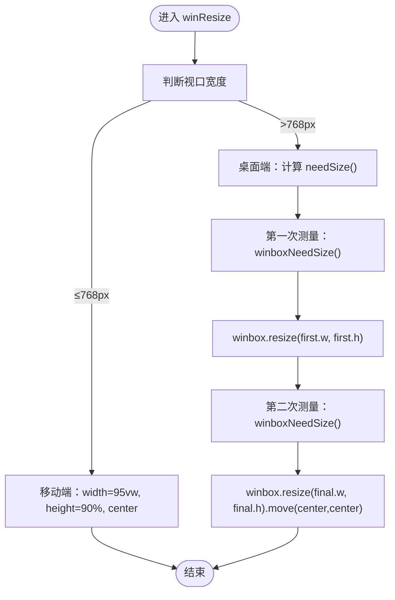
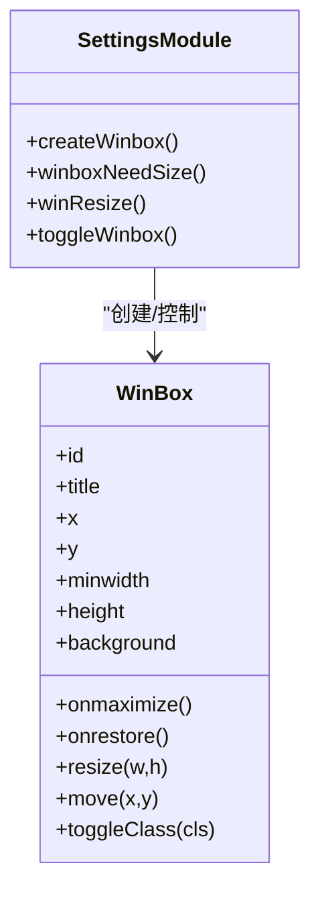
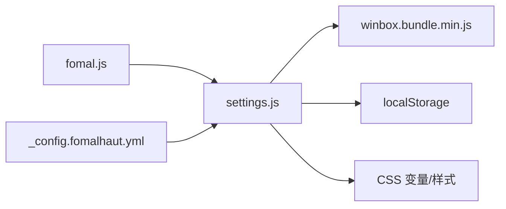

# Winbox 窗口管理

<cite>
**本文引用的文件**   
- [settings.js](file://source/js/modules/settings.js)
- [winbox.bundle.min.js](file://source/js/winbox.bundle.min.js)
- [fomal.js](file://source/js/fomal.js)
- [_config.fomalhaut.yml](file://_config.fomalhaut.yml)
</cite>

## 目录
1. [简介](#简介)
2. [项目结构](#项目结构)
3. [核心组件](#核心组件)
4. [架构总览](#架构总览)
5. [详细组件分析](#详细组件分析)
6. [依赖关系分析](#依赖关系分析)
7. [性能与可维护性](#性能与可维护性)
8. [故障排查指南](#故障排查指南)
9. [结论](#结论)
10. [附录：扩展与集成清单](#附录扩展与集成清单)

## 简介
本文件系统化文档化站点中基于 WinBox 的“美化设置”窗口实现。重点覆盖以下目标：
- 窗口创建流程：`createWinbox()` 初始化、面板 HTML 注入、主题色背景、最大化/还原钩子。
- 尺寸计算机制：`winboxNeedSize()` 如何根据内容区域和响应式布局计算宽高。
- 响应式调整：`winResize()` 在桌面端与移动端的不同策略，以及窗口打开后监听 `window.resize`。
- 事件绑定：拖拽、点击、键盘导航支持，包括原生滑条增强、全局指针事件、窗口最小化/最大化/全屏等。
- 状态管理：打开/隐藏、位置记忆（由 WinBox 内部处理）、尺寸持久化（通过 CSS 变量与 localStorage）。
- 主题系统集成：样式覆盖、主题色适配、暗色模式联动。
- 扩展指南：新增功能面板、注册事件监听器、性能优化策略。

## 项目结构
Winbox 窗口相关代码主要分布在两个层面：
- 业务层：`source/js/modules/settings.js`，负责设置面板 UI、交互逻辑、localStorage 读写、主题与背景联动。
- 库层：`source/js/winbox.bundle.min.js`，提供窗口实例、拖拽、缩放、最小化/最大化/全屏、焦点栈等能力。
- 入口与挂载：`source/js/fomal.js` 将 `toggleWinbox` 暴露为全局函数；`_config.fomalhaut.yml` 通过注入脚本加载模块。

**图表来源**
- [fomal.js:71-84](file://source/js/fomal.js#L71-L84)
- [settings.js:939-1099](file://source/js/modules/settings.js#L939-L1099)
- [settings.js:1171-1229](file://source/js/modules/settings.js#L1171-L1229)
- [winbox.bundle.min.js:12-34](file://source/js/winbox.bundle.min.js#L12-L34)

**章节来源**
- [fomal.js:71-84](file://source/js/fomal.js#L71-L84)
- [_config.fomalhaut.yml:1500-1587](file://_config.fomalhaut.yml#L1500-L1587)

## 核心组件
- **WinBox 窗口引擎**：提供窗口 DOM 结构、拖拽、缩放、最小化/最大化/全屏、焦点栈、事件回调。
- **settings.js 美化模块**：封装设置面板 HTML、开关逻辑、主题色、字体、背景、滤镜、透明度、右侧部件、侧栏等。
- **fomal.js 全局入口**：把 `toggleWinbox` 等函数挂到全局，供 pug 模板内联 onclick 调用。
- **配置注入**：通过 `_config.fomalhaut.yml` 的 inject.bottom 列表引入 settings.js，确保 defer 加载。

关键职责划分：
- `createWinbox()`：创建 WinBox 实例、注入面板 HTML、绑定 resize 监听、初始化控件状态。
- `winboxNeedSize()`：计算面板最佳宽高，考虑内容高度与视口比例。
- `winResize()`：按屏幕宽度走不同分支，桌面端稳定阅读宽度 + 自适应高度，移动端按比例居中。
- `toggleWinbox()`：切换显示/隐藏，或首次创建并计算尺寸。

**章节来源**
- [settings.js:939-1099](file://source/js/modules/settings.js#L939-L1099)
- [settings.js:1171-1229](file://source/js/modules/settings.js#L1171-L1229)
- [winbox.bundle.min.js:12-34](file://source/js/winbox.bundle.min.js#L12-L34)
- [fomal.js:71-84](file://source/js/fomal.js#L71-L84)

## 架构总览
下图展示从用户操作到窗口渲染、事件处理的完整链路。

**图表来源**
- [fomal.js:71-84](file://source/js/fomal.js#L71-L84)
- [settings.js:939-1099](file://source/js/modules/settings.js#L939-L1099)
- [settings.js:1204-1229](file://source/js/modules/settings.js#L1204-L1229)
- [winbox.bundle.min.js:12-34](file://source/js/winbox.bundle.min.js#L12-L34)

## 详细组件分析

### createWinbox() 初始化逻辑
- 创建临时 div 并插入 body，作为 WinBox 容器。
- 调用 `WinBox({...})` 传入 ID、层级、标题、初始位置、最小宽度、高度、主题色背景、最大化/还原钩子。
- 立即执行 `winResize()` 以适配当前视口，并注册 `window.resize` 监听。
- 向 `winbox.body.innerHTML` 注入完整的设置面板 HTML，包含：
  - 恢复默认设置按钮
  - 卡片不透明度滑块
  - 背景滤镜控制
  - 氛围特效开关（星空、霓虹灯、雪花、萤火虫、昼夜切换）
  - 互动挂件开关（猫咪、鼠标、帧率监测、涟漪）
  - 布局与部件开关（右侧部件、顶栏常驻、侧栏显隐、侧栏位置）
  - 主题色选择区（预设 + 自定义）
  - 字体设置区
  - 背景设置区
- 初始化滑条增强、控件同步、主题色、背景滤镜、各开关状态。

关键点：
- 窗口背景使用 CSS 变量 `var(--theme-color)`，随主题色实时变化。
- 最大化时注入样式隐藏滚动条并强制宽度 100%；还原时清空注入样式。
- 所有开关最终都落盘到 localStorage，保证刷新后一致。

**章节来源**
- [settings.js:939-1099](file://source/js/modules/settings.js#L939-L1099)

### winboxNeedSize() 尺寸计算机制
- 优先尝试从 DOM 获取 `#meihuaBox` 及其内部 `#article-container`。
- 若节点缺失，直接返回 fallback `{w:780, h:540}`。
- 计算面板边框与 body 内边距占用的宽度差，用于修正内容宽度。
- 宽度策略：
  - 基础阅读宽度取 fallback.w，但限制在视口宽度的 95% 以内，且不低于 620px。
  - 不再依赖旧版“测量前五个字体按钮宽度”的方式，改为响应式网格。
- 高度策略：
  - 以第一节“显示偏好”最后一行开关（侧栏位置）为基准，计算其所在行高，加上底部 padding 与少量余量。
  - 高度限制在视口高度的 92% 以内，且不低于 420px。
- 返回值 `{w, h}` 供 `winResize()` 调用 `winbox.resize()`。

复杂度：
- 时间复杂度 O(1)，仅做有限次 DOM 查询与几何计算。
- 空间复杂度 O(1)。

**章节来源**
- [settings.js:1171-1201](file://source/js/modules/settings.js#L1171-L1201)

### winResize() 响应式调整
- 当视口宽度 ≤ 768px：
  - 宽度设为视口宽度的 95%，高度 90%，位置居中。
- 桌面端：
  - 先调用 `winboxNeedSize()` 得到首版宽高，应用一次 resize。
  - 再次调用 `winboxNeedSize()`，因为宽度固定后行是否折行会影响最终高度，再应用最终宽高并居中。
- 异常保护：
  - 整个函数包裹 try/catch，避免 Pjax 或其他异步场景导致报错。

**图表来源**
- [settings.js:1204-1219](file://source/js/modules/settings.js#L1204-L1219)

**章节来源**
- [settings.js:1204-1219](file://source/js/modules/settings.js#L1204-L1219)

### 窗口事件绑定与交互
- 拖拽与缩放：
  - 由 WinBox 引擎内部处理，包括拖动标题栏、边缘缩放、四角缩放、触摸事件兼容。
  - 支持最小化、最大化、全屏、关闭等控制按钮。
- 点击事件：
  - 面板内大量使用 pug 模板内联 `onclick="xxx()"`，如开关切换、颜色选择、恢复默认等。
  - 滑条增强：通过 `initRangeJump()` 绑定全局 pointer/mouse/touch 事件，允许点击轨道任意位置跳转。
- 键盘导航：
  - 原生 `<input>` 与 `<button>` 自带键盘行为（Enter 失焦、Tab 聚焦）。
  - 滑条输入框增加 `onkeydown="if(event.key==='Enter')this.blur()"`，提升键盘可用性。
- 窗口焦点与层级：
  - WinBox 维护焦点栈，点击窗口提升 z-index，最小化时自动切换到上一个非最小化窗口。

**图表来源**
- [winbox.bundle.min.js:12-34](file://source/js/winbox.bundle.min.js#L12-L34)
- [settings.js:939-1099](file://source/js/modules/settings.js#L939-L1099)
- [settings.js:1204-1229](file://source/js/modules/settings.js#L1204-L1229)

**章节来源**
- [winbox.bundle.min.js:12-34](file://source/js/winbox.bundle.min.js#L12-L34)
- [settings.js:939-1099](file://source/js/modules/settings.js#L939-L1099)
- [settings.js:1204-1229](file://source/js/modules/settings.js#L1204-L1229)

### 窗口状态管理
- 打开/关闭状态：
  - 通过 `toggleWinbox()` 切换：若窗口已存在则 `winbox.toggleClass("hide")`，否则创建并计算尺寸。
  - WinBox 内部提供 `show/hide/minimize/maximize/fullscreen/close` 等方法。
- 位置记忆：
  - WinBox 内部维护 x/y/width/height 等属性，并在 move/resize 时更新。
  - 当前实现未显式持久化位置到 localStorage，位置由用户每次交互决定。
- 尺寸持久化：
  - 面板尺寸本身不持久化，但通过 CSS 变量与 localStorage 持久化主题色、背景、滤镜、透明度等视觉状态。
  - 主题色、背景滤镜、透明度等会实时更新 CSS 变量，影响窗口外观。

**章节来源**
- [settings.js:1221-1229](file://source/js/modules/settings.js#L1221-L1229)
- [winbox.bundle.min.js:26-34](file://source/js/winbox.bundle.min.js#L26-L34)

### 与主题系统的集成
- 样式覆盖：
  - 窗口背景使用 `var(--theme-color)`，随主题色变化。
  - 最大化时注入样式隐藏滚动条并强制宽度 100%。
- 主题色适配：
  - `setColor()` 根据预设或自定义值生成 RGB，并计算前景色 `--on-theme`，确保对比度。
  - 主题色控制项同步 radio 选中状态与自定义输入框值。
- 暗色模式支持：
  - 背景滤镜、透明度、昼夜切换动画档位等与暗色模式联动。
  - 夜间模式开关、雪花/萤火虫互斥、昼夜切换动画档位均通过 localStorage 持久化。

**章节来源**
- [settings.js:238-294](file://source/js/modules/settings.js#L238-L294)
- [settings.js:939-1099](file://source/js/modules/settings.js#L939-L1099)
- [settings.js:1105-1166](file://source/js/modules/settings.js#L1105-L1166)

## 依赖关系分析
- `fomal.js` 暴露 `toggleWinbox` 给 pug 模板内联 onclick 调用。
- `settings.js` 依赖 `WinBox` 全局对象，由 `winbox.bundle.min.js` 提供。
- `settings.js` 通过 localStorage 读写偏好，并通过 CSS 变量影响全局样式。
- `_config.fomalhaut.yml` 通过 inject.bottom 注入 settings.js，确保 defer 加载。

**图表来源**
- [fomal.js:71-84](file://source/js/fomal.js#L71-L84)
- [settings.js:939-1099](file://source/js/modules/settings.js#L939-L1099)
- [_config.fomalhaut.yml:1500-1587](file://_config.fomalhaut.yml#L1500-L1587)

**章节来源**
- [fomal.js:71-84](file://source/js/fomal.js#L71-L84)
- [_config.fomalhaut.yml:1500-1587](file://_config.fomalhaut.yml#L1500-L1587)

## 性能与可维护性
- 性能优化：
  - `winResize()` 使用 try/catch 防止 Pjax 等异步场景报错。
  - 滑条增强使用全局一次性监听，避免重复绑定。
  - 透明度、背景滤镜使用 requestAnimationFrame 批量更新，减少重排。
- 可维护性：
  - 面板 HTML 集中在 `createWinbox()`，便于统一修改。
  - 主题色、字体、背景等逻辑模块化，便于测试与替换。
  - 通过 CSS 变量与 localStorage 解耦样式与状态，便于扩展。

[本节为通用指导，不直接分析具体文件]

## 故障排查指南
- 窗口无法打开：
  - 检查 `toggleWinbox()` 是否被正确调用，确认 `#meihuaBox` 是否存在。
  - 检查 `WinBox` 全局对象是否加载成功。
- 尺寸异常：
  - 检查 `winboxNeedSize()` 是否能获取到 `#article-container`。
  - 检查 CSS 是否覆盖了面板宽度或高度。
- 主题色不生效：
  - 检查 `--theme-color` 是否正确设置。
  - 检查 `setColor()` 是否被调用，localStorage 中的 themeColor 是否有效。
- 背景滤镜无效：
  - 检查 `bgFilterOn` 是否为 '0'。
  - 检查 `bgFilterVal` 格式是否符合 blur/saturate/contrast。

**章节来源**
- [settings.js:1171-1229](file://source/js/modules/settings.js#L1171-L1229)
- [settings.js:822-911](file://source/js/modules/settings.js#L822-L911)

## 结论
Winbox 窗口在本项目中作为“美化设置”面板的核心载体，结合 settings.js 的业务逻辑与 WinBox 引擎的交互能力，实现了丰富的可视化配置体验。通过 CSS 变量与 localStorage 的解耦设计，主题色、背景、滤镜等状态可灵活扩展。未来可在保持现有架构的基础上，继续添加新功能面板、优化性能、增强无障碍访问。

[本节为总结性内容，不直接分析具体文件]

## 附录：扩展与集成清单
- 新增功能面板：
  - 在 `createWinbox()` 的面板 HTML 中添加新的 section 与控件。
  - 在 settings.js 中实现对应的开关逻辑与 localStorage 读写。
  - 如需与主题系统联动，更新 CSS 变量或调用 `setColor()`。
- 注册事件监听器：
  - 使用 pug 模板内联 onclick 或 JS 动态绑定事件。
  - 注意全局指针事件（pointer/mouse/touch）的唯一性与防抖。
- 性能优化策略：
  - 使用 requestAnimationFrame 批量更新样式。
  - 避免频繁 DOM 查询，缓存常用节点。
  - 合理使用 try/catch 防止异步场景报错。

[本节为通用指导，不直接分析具体文件]