# 实时预览系统

<cite>
**本文引用的文件**   
- [source/js/modules/settings.js](file://source/js/modules/settings.js)
- [source/js/modules/appearance-fonts.js](file://source/js/modules/appearance-fonts.js)
- [source/js/modules/appearance-backgrounds.js](file://source/js/modules/appearance-backgrounds.js)
- [themes/fomalhaut/source/css/_custom/custom.css](file://themes/fomalhaut/source/css/_custom/custom.css)
- [themes/fomalhaut/source/css/var.styl](file://themes/fomalhaut/source/css/var.styl)
- [source/css/site-inject.css](file://source/css/site-inject.css)
- [source/js/modules/reading.js](file://source/js/modules/reading.js)
- [README.md](file://README.md)
</cite>

## 目录
1. [引言](#引言)
2. [项目结构](#项目结构)
3. [核心组件](#核心组件)
4. [架构总览](#架构总览)
5. [详细组件分析](#详细组件分析)
6. [依赖关系分析](#依赖关系分析)
7. [性能与优化](#性能与优化)
8. [故障排查](#故障排查)
9. [结论](#结论)

## 引言
本文件面向“美化设置面板”背后的实时预览系统，目标是把样式动态更新、效果即时反馈、设置项实时生效、多效果冲突处理以及性能优化策略讲清楚。该系统以 `settings.js` 为中枢，配合字体模块 `appearance-fonts.js` 和背景模块 `appearance-backgrounds.js`，通过 CSS 变量、DOM 属性修改和内联样式表注入实现“所见即所得”的预览体验；同时使用防抖、`requestAnimationFrame`、状态令牌、回滚策略等手段保证高频交互下的流畅性与一致性。

## 项目结构
实时预览相关代码主要分布在以下位置：
- 设置面板与全局样式开关：`source/js/modules/settings.js`
- 字体选择与加载：`source/js/modules/appearance-fonts.js`
- 背景图墙、API 壁纸、自定义图片预览与校验：`source/js/modules/appearance-backgrounds.js`
- 主题覆盖样式、CSS 变量消费端、字体引入等：`themes/fomalhaut/source/css/_custom/custom.css`
- 主题编译期变量（Stylus）：`themes/fomalhaut/source/css/var.styl`
- 站点注入样式（含透明度、导航显示、右侧栏显示等运行时变量）：`source/css/site-inject.css`
- FPS 采样与生命周期：`source/js/modules/reading.js`
- 项目级说明与性能记录：`README.md`

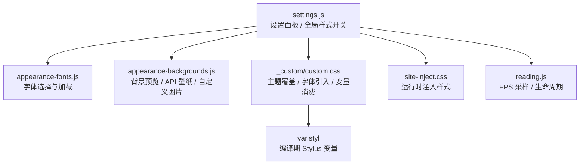

**图表来源**
- [source/js/modules/settings.js:104-175](file://source/js/modules/settings.js#L104-L175)
- [source/js/modules/appearance-fonts.js:1-24](file://source/js/modules/appearance-fonts.js#L1-L24)
- [source/js/modules/appearance-backgrounds.js:5-11](file://source/js/modules/appearance-backgrounds.js#L5-L11)
- [themes/fomalhaut/source/css/_custom/custom.css:146-171](file://themes/fomalhaut/source/css/_custom/custom.css#L146-L171)
- [themes/fomalhaut/source/css/var.styl:1-10](file://themes/fomalhaut/source/css/var.styl#L1-L10)
- [source/css/site-inject.css:1-10](file://source/css/site-inject.css#L1-L10)
- [source/js/modules/reading.js:102-136](file://source/js/modules/reading.js#L102-L136)

**章节来源**
- [source/js/modules/settings.js:1-1232](file://source/js/modules/settings.js#L1-L1232)
- [source/js/modules/appearance-fonts.js:1-121](file://source/js/modules/appearance-fonts.js#L1-L121)
- [source/js/modules/appearance-backgrounds.js:1-681](file://source/js/modules/appearance-backgrounds.js#L1-L681)
- [themes/fomalhaut/source/css/_custom/custom.css:1-145](file://themes/fomalhaut/source/css/_custom/custom.css#L1-L145)
- [themes/fomalhaut/source/css/var.styl:1-185](file://themes/fomalhaut/source/css/var.styl#L1-L185)
- [source/css/site-inject.css:1-51](file://source/css/site-inject.css#L1-L51)
- [source/js/modules/reading.js:102-172](file://source/js/modules/reading.js#L102-L172)
- [README.md:164-202](file://README.md#L164-L202)

## 核心组件
实时预览系统由三个层次组成：
1. **设置入口层**：`settings.js` 负责初始化默认值、渲染 Winbox 面板、监听用户操作、调用各模块 setter。
2. **效果模块层**：`appearance-fonts.js` 管理字体切换与加载；`appearance-backgrounds.js` 管理背景图、渐变、纯色、动态 API 壁纸及自定义图片预览。
3. **样式消费层**：`_custom/custom.css`、`site-inject.css`、`var.styl` 提供 CSS 变量、字体引入、主题色派生和布局变量，被 JS 实时写入。

关键职责划分如下：
- `setFont()` / `setCodeFont()`：更新正文与代码块字体，写 CSS 变量并同步面板高亮。
- `setColor()` / `setCustomColor()`：更新主题色、前景色、按钮 hover 色、光标颜色等。
- `changeBg()` / `setBg()` / `resetBg_()`：统一背景切换入口，委托给背景模块。
- `setTrans()`：卡片不透明度滑块，批量更新 CSS 变量。
- `previewCustomBackground()` / `applyCustomBackground()`：自定义图片链接预览与全站应用。
- `restoreAppearanceBackground()` / `appearanceBackgroundCommit()`：恢复、提交背景，处理回滚。

**章节来源**
- [source/js/modules/settings.js:147-175](file://source/js/modules/settings.js#L147-L175)
- [source/js/modules/settings.js:238-289](file://source/js/modules/settings.js#L238-L289)
- [source/js/modules/settings.js:748-787](file://source/js/modules/settings.js#L748-L787)
- [source/js/modules/settings.js:542-568](file://source/js/modules/settings.js#L542-L568)
- [source/js/modules/appearance-backgrounds.js:578-599](file://source/js/modules/appearance-backgrounds.js#L578-L599)
- [source/js/modules/appearance-backgrounds.js:601-631](file://source/js/modules/appearance-backgrounds.js#L601-L631)

## 架构总览
实时预览的核心流程是：**用户操作 → 设置函数 → 持久化偏好 → 更新 CSS 变量或 DOM → 样式消费层立即生效**。

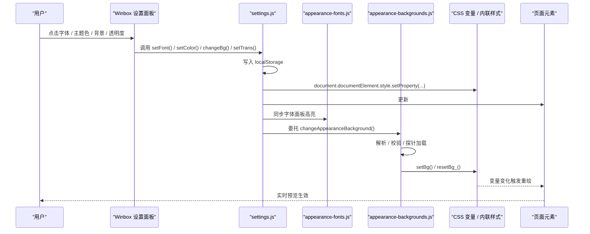

**图表来源**
- [source/js/modules/settings.js:147-175](file://source/js/modules/settings.js#L147-L175)
- [source/js/modules/settings.js:238-289](file://source/js/modules/settings.js#L238-L289)
- [source/js/modules/settings.js:748-787](file://source/js/modules/settings.js#L748-L787)
- [source/js/modules/settings.js:542-568](file://source/js/modules/settings.js#L542-L568)
- [source/js/modules/appearance-backgrounds.js:578-599](file://source/js/modules/appearance-backgrounds.js#L578-L599)

## 详细组件分析

### 样式动态更新机制
实时预览主要通过三种方式影响最终样式：
1. **CSS 变量实时更新**：通过 `document.documentElement.style.setProperty()` 写入 `--global-font`、`--code-font`、`--theme-color`、`--on-theme`、`--trans-light`、`--trans-dark`、`--bg-filter` 等变量。
2. **DOM 属性修改**：例如直接设置 `body.style.fontFamily`、切换 `.nav_fixed` / `.nav_visible`、控制雪花/星空/霓虹灯元素的 `display`。
3. **样式表注入**：通过 `<style id="...">` 的内联文本替换，如 `#themeColor`、`#defineBg`、`#transPercent`、`#bgFilterParam`、`#nav-display`、`#rightSide`、`#aside-show`、`#aside-pos`、`#menu_shadow`。

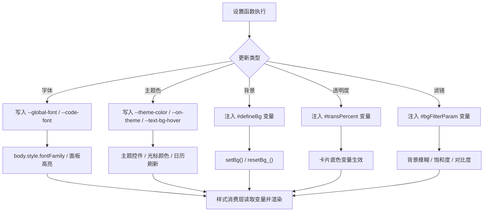

**图表来源**
- [source/js/modules/settings.js:147-175](file://source/js/modules/settings.js#L147-L175)
- [source/js/modules/settings.js:238-289](file://source/js/modules/settings.js#L238-L289)
- [source/js/modules/settings.js:748-787](file://source/js/modules/settings.js#L748-L787)
- [source/js/modules/settings.js:542-568](file://source/js/modules/settings.js#L542-L568)
- [source/js/modules/settings.js:845-900](file://source/js/modules/settings.js#L845-L900)

**章节来源**
- [source/js/modules/settings.js:147-175](file://source/js/modules/settings.js#L147-L175)
- [source/js/modules/settings.js:238-289](file://source/js/modules/settings.js#L238-L289)
- [source/js/modules/settings.js:748-787](file://source/js/modules/settings.js#L748-L787)
- [source/js/modules/settings.js:542-568](file://source/js/modules/settings.js#L542-L568)
- [source/js/modules/settings.js:845-900](file://source/js/modules/settings.js#L845-L900)
- [themes/fomalhaut/source/css/_custom/custom.css:146-171](file://themes/fomalhaut/source/css/_custom/custom.css#L146-L171)
- [themes/fomalhaut/source/css/_custom/custom.css:284-343](file://themes/fomalhaut/source/css/_custom/custom.css#L284-L343)
- [source/css/site-inject.css:1-51](file://source/css/site-inject.css#L1-L51)

### 效果即时反馈系统
系统在高频输入场景下采用以下策略：
- **防抖与帧合并**：透明度滑块、背景滤镜滑块在拖动时走 `requestAnimationFrame`，松手或失焦时再保存并取消 pending frame。
- **状态令牌**：背景预览与全站应用使用 token 防止旧请求覆盖新结果。
- **可取消探针**：图片加载使用 `Image` + `setTimeout`，支持 `cancel()` 避免内存泄漏。
- **生命周期感知**：FPS 采样在页面隐藏时暂停，面板关闭时停止循环。

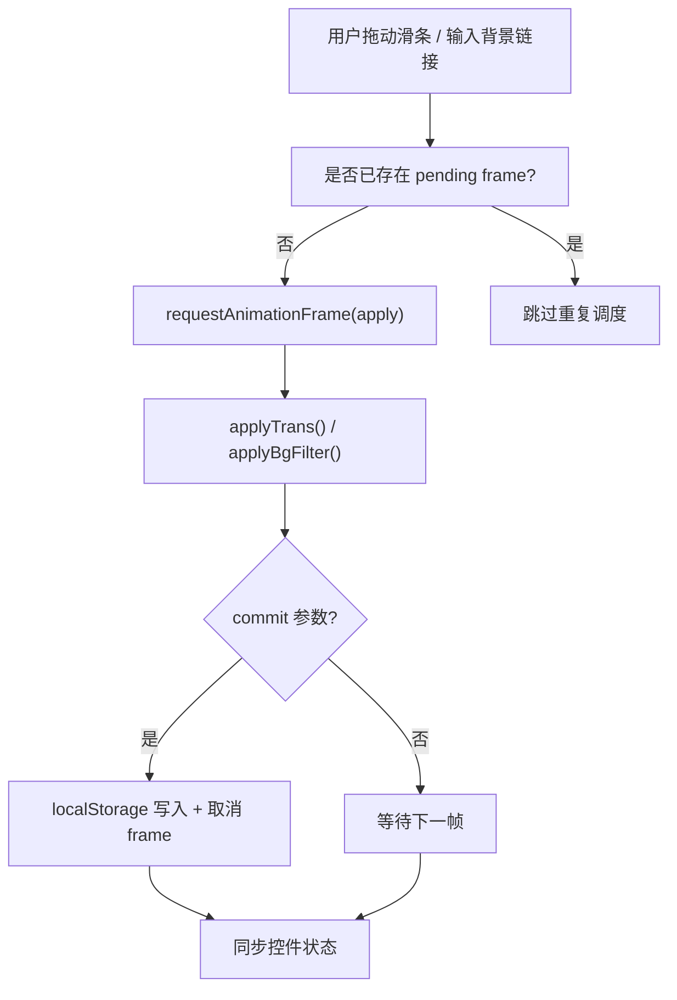

**图表来源**
- [source/js/modules/settings.js:542-568](file://source/js/modules/settings.js#L542-L568)
- [source/js/modules/settings.js:866-890](file://source/js/modules/settings.js#L866-L890)
- [source/js/modules/appearance-backgrounds.js:561-577](file://source/js/modules/appearance-backgrounds.js#L561-L577)
- [source/js/modules/reading.js:102-136](file://source/js/modules/reading.js#L102-L136)

**章节来源**
- [source/js/modules/settings.js:542-568](file://source/js/modules/settings.js#L542-L568)
- [source/js/modules/settings.js:866-890](file://source/js/modules/settings.js#L866-L890)
- [source/js/modules/appearance-backgrounds.js:561-577](file://source/js/modules/appearance-backgrounds.js#L561-L577)
- [source/js/modules/reading.js:102-136](file://source/js/modules/reading.js#L102-L136)
- [README.md:164-170](file://README.md#L164-L170)

### 设置项实时生效逻辑

#### 字体切换 `setFont()`
- 将字体 key 写入 `localStorage.font`。
- 若为 `default`，则设置完整系统字体栈到 `--global-font` 和 `body.style.fontFamily`。
- 否则设置 `--global-font` 为字体 family，并让正文 fallback 到系统栈。
- 同步字体面板高亮边框。

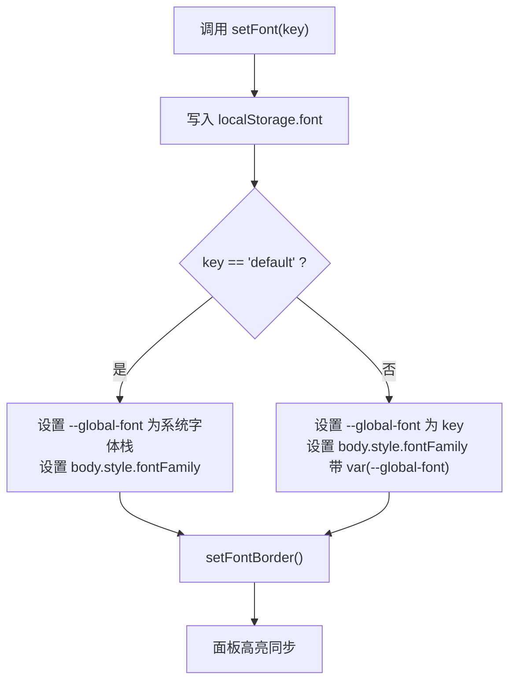

**图表来源**
- [source/js/modules/settings.js:147-164](file://source/js/modules/settings.js#L147-L164)
- [source/js/modules/settings.js:179-204](file://source/js/modules/settings.js#L179-L204)

**章节来源**
- [source/js/modules/settings.js:147-164](file://source/js/modules/settings.js#L147-L164)
- [source/js/modules/settings.js:179-204](file://source/js/modules/settings.js#L179-L204)
- [source/js/modules/appearance-fonts.js:29-42](file://source/js/modules/appearance-fonts.js#L29-L42)

#### 主题色变更 `setColor()`
- 规范化预设键，兼容自定义色。
- 向 `#themeColor` 注入 `:root{--theme-color:...}`。
- 根据主题色相对亮度计算前景色 `--on-theme`。
- 更新 hover 色、高透色、低透色。
- 联动 Git Calendar、鼠标光标、控制面板状态。

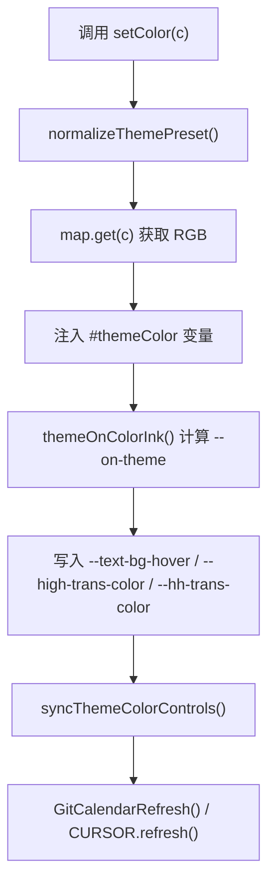

**图表来源**
- [source/js/modules/settings.js:238-263](file://source/js/modules/settings.js#L238-L263)
- [source/js/modules/settings.js:264-289](file://source/js/modules/settings.js#L264-L289)

**章节来源**
- [source/js/modules/settings.js:238-289](file://source/js/modules/settings.js#L238-L289)

#### 背景图更换 `changeBg()`
- `changeBg(s)` 委托给 `changeAppearanceBackground(s)`。
- 背景模块解析 value，区分 default、纯色、渐变、图片。
- 图片会进行 HTTPS 安全校验与网络探针。
- 成功后调用 `setBg(parsed.css)` 或 `resetBg_()`。
- 失败时保留当前背景并提供重试。

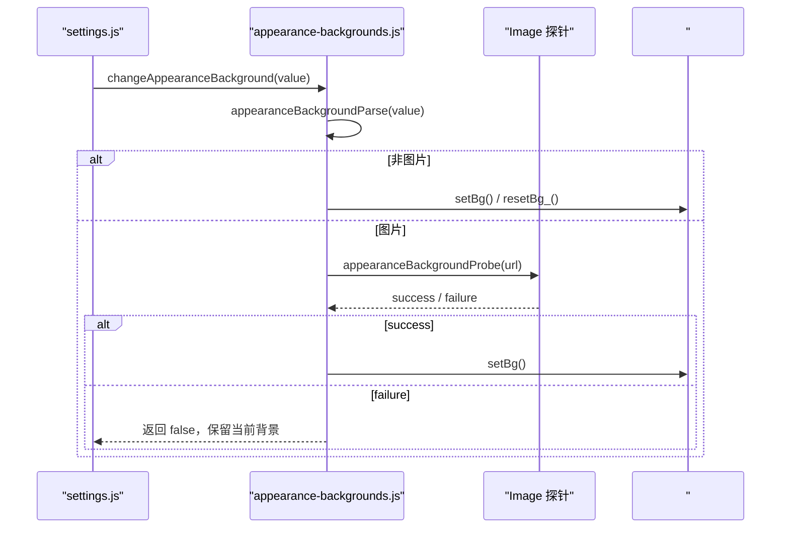

**图表来源**
- [source/js/modules/settings.js:748-787](file://source/js/modules/settings.js#L748-L787)
- [source/js/modules/appearance-backgrounds.js:407-416](file://source/js/modules/appearance-backgrounds.js#L407-L416)
- [source/js/modules/appearance-backgrounds.js:561-599](file://source/js/modules/appearance-backgrounds.js#L561-L599)

**章节来源**
- [source/js/modules/settings.js:748-787](file://source/js/modules/settings.js#L748-L787)
- [source/js/modules/appearance-backgrounds.js:407-416](file://source/js/modules/appearance-backgrounds.js#L407-L416)
- [source/js/modules/appearance-backgrounds.js:561-599](file://source/js/modules/appearance-backgrounds.js#L561-L599)

#### 透明度调节 `setTrans()`
- 支持数字框与滑条双向同步。
- 拖动时走 `requestAnimationFrame` 批量更新 `--trans-light` / `--trans-dark`。
- 失焦或 commit 时写入 `localStorage.transNum` 并同步控件。
- 重置时恢复默认 98%。

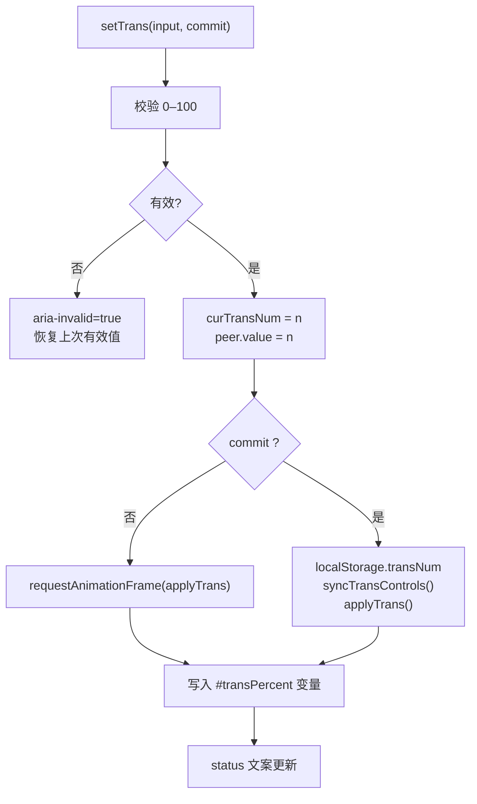

**图表来源**
- [source/js/modules/settings.js:542-568](file://source/js/modules/settings.js#L542-L568)

**章节来源**
- [source/js/modules/settings.js:542-568](file://source/js/modules/settings.js#L542-L568)

### 预览冲突处理
系统对多个效果同时作用时的冲突处理遵循以下原则：
1. **优先级**：
   - 内联样式表注入（如 `#themeColor`、`#defineBg`、`#transPercent`）具有最高优先级，因为它们是运行时最后写入的 `:root` 规则。
   - CSS 变量优先于硬编码颜色，但会被后续内联样式覆盖。
   - 主题色前景色 `--on-theme` 由 JS 计算后写入，覆盖 CSS 兜底。
2. **状态同步机制**：
   - 所有设置先写 `localStorage`，再同步 UI 控件状态。
   - 字体面板通过 `syncAppearanceFonts()` 同步选中态。
   - 背景面板通过 `syncAppearanceBackground()` 同步当前背景元数据、缩略图、按钮选中态。
3. **回滚策略**：
   - 背景图片加载失败时保留当前背景，不抹掉本地存储。
   - 恢复默认背景时先写默认值，再后台探针校验；失败则临时退回默认但不删除偏好。
   - 字体加载失败或超时时保留当前字体，提示可重试。

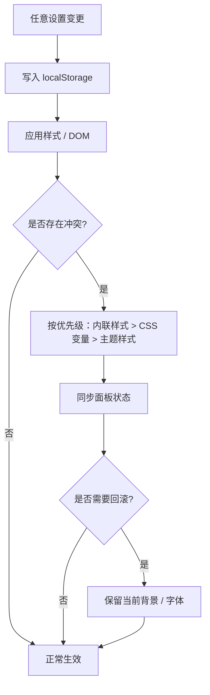

**图表来源**
- [source/js/modules/appearance-backgrounds.js:578-599](file://source/js/modules/appearance-backgrounds.js#L578-L599)
- [source/js/modules/appearance-backgrounds.js:601-631](file://source/js/modules/appearance-backgrounds.js#L601-L631)
- [source/js/modules/appearance-fonts.js:74-95](file://source/js/modules/appearance-fonts.js#L74-L95)

**章节来源**
- [source/js/modules/appearance-backgrounds.js:578-599](file://source/js/modules/appearance-backgrounds.js#L578-L599)
- [source/js/modules/appearance-backgrounds.js:601-631](file://source/js/modules/appearance-backgrounds.js#L601-L631)
- [source/js/modules/appearance-fonts.js:74-95](file://source/js/modules/appearance-fonts.js#L74-L95)

### 预览优化指南
针对实时预览的性能优化，建议从以下维度入手：
1. **批量更新**：
   - 透明度、背景滤镜使用 `requestAnimationFrame` 合并多次输入。
   - 背景面板在 tab 切换、分类切换时只重建一次 DOM。
2. **增量渲染**：
   - 背景预览容器使用 `replaceChildren()` 避免整段 innerHTML 重建。
   - 字体预览只更新 `fontFamily`，不重建整个预览区。
3. **性能监控**：
   - FPS 采样仅在面板开启时运行，页面隐藏时暂停。
   - 使用 `data-state` 区分良好、警告、极低帧率状态。
4. **内存管理**：
   - 背景探针支持 `cancel()`，避免 Image 对象泄漏。
   - 字体加载支持 `cancelAppearanceFont()`，中断超时任务。
   - 设置面板恢复默认时调用 `cancelAppearanceFonts()` 和 `cancelAppearanceBackground()`。

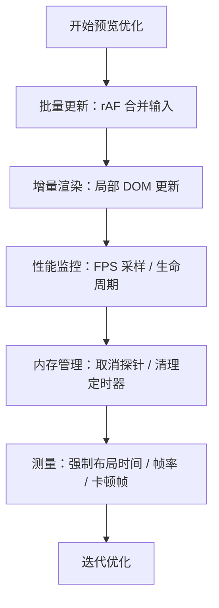

**图表来源**
- [source/js/modules/settings.js:542-568](file://source/js/modules/settings.js#L542-L568)
- [source/js/modules/settings.js:866-890](file://source/js/modules/settings.js#L866-L890)
- [source/js/modules/appearance-backgrounds.js:472-483](file://source/js/modules/appearance-backgrounds.js#L472-L483)
- [source/js/modules/appearance-fonts.js:74-95](file://source/js/modules/appearance-fonts.js#L74-L95)
- [source/js/modules/reading.js:102-136](file://source/js/modules/reading.js#L102-L136)

**章节来源**
- [source/js/modules/settings.js:542-568](file://source/js/modules/settings.js#L542-L568)
- [source/js/modules/settings.js:866-890](file://source/js/modules/settings.js#L866-L890)
- [source/js/modules/appearance-backgrounds.js:472-483](file://source/js/modules/appearance-backgrounds.js#L472-L483)
- [source/js/modules/appearance-fonts.js:74-95](file://source/js/modules/appearance-fonts.js#L74-L95)
- [source/js/modules/reading.js:102-136](file://source/js/modules/reading.js#L102-L136)
- [README.md:164-170](file://README.md#L164-L170)

## 依赖关系分析
实时预览系统的依赖关系如下：
- `settings.js` 依赖 `appearance-fonts.js` 和 `appearance-backgrounds.js` 的全局函数。
- `appearance-fonts.js` 依赖 `settings.js` 中的 `setFont()` / `setCodeFont()`。
- `appearance-backgrounds.js` 依赖 `settings.js` 中的 `setBg()` / `resetBg_()` 以及动态 API URL。
- CSS 层依赖 `var.styl` 编译期变量，运行时依赖 `settings.js` 注入的 CSS 变量。
- FPS 模块独立运行，但受设置面板开关控制。

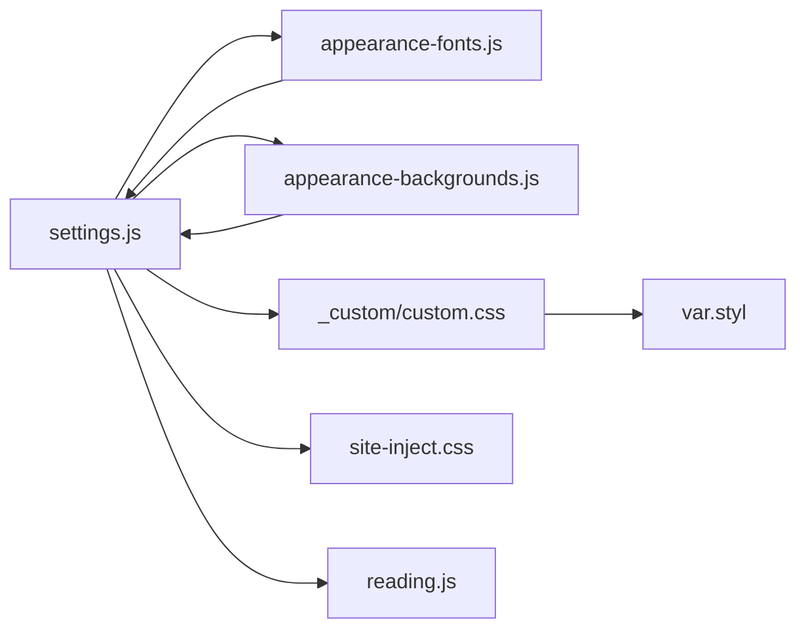

**图表来源**
- [source/js/modules/settings.js:104-175](file://source/js/modules/settings.js#L104-L175)
- [source/js/modules/appearance-fonts.js:62-65](file://source/js/modules/appearance-fonts.js#L62-L65)
- [source/js/modules/appearance-backgrounds.js:578-583](file://source/js/modules/appearance-backgrounds.js#L578-L583)
- [themes/fomalhaut/source/css/_custom/custom.css:146-171](file://themes/fomalhaut/source/css/_custom/custom.css#L146-L171)
- [themes/fomalhaut/source/css/var.styl:1-10](file://themes/fomalhaut/source/css/var.styl#L1-L10)
- [source/js/modules/reading.js:102-136](file://source/js/modules/reading.js#L102-L136)

**章节来源**
- [source/js/modules/settings.js:104-175](file://source/js/modules/settings.js#L104-L175)
- [source/js/modules/appearance-fonts.js:62-65](file://source/js/modules/appearance-fonts.js#L62-L65)
- [source/js/modules/appearance-backgrounds.js:578-583](file://source/js/modules/appearance-backgrounds.js#L578-L583)
- [themes/fomalhaut/source/css/_custom/custom.css:146-171](file://themes/fomalhaut/source/css/_custom/custom.css#L146-L171)
- [themes/fomalhaut/source/css/var.styl:1-10](file://themes/fomalhaut/source/css/var.styl#L1-L10)
- [source/js/modules/reading.js:102-136](file://source/js/modules/reading.js#L102-L136)

## 性能与优化
实时预览系统的性能优化主要体现在以下几个方面：
1. **减少强制布局**：
   - 透明度、背景滤镜使用 `requestAnimationFrame` 合并 DOM 写入。
   - 背景预览使用 `replaceChildren()` 避免整段 innerHTML 重建。
2. **避免无效重绘**：
   - 主题色只在真正变化时触发 Git Calendar 重绘。
   - 光标颜色只在 `__cursorColor` 变化时刷新。
3. **生命周期管理**：
   - FPS 采样在页面隐藏时暂停，面板关闭时停止循环。
   - 背景探针支持 cancel，字体加载支持 cancel。
4. **内存优化**：
   - 图片探针在 settle 后移除 src，避免内存泄漏。
   - 设置面板恢复默认时清理所有 pending 任务。

**章节来源**
- [source/js/modules/settings.js:542-568](file://source/js/modules/settings.js#L542-L568)
- [source/js/modules/settings.js:866-890](file://source/js/modules/settings.js#L866-L890)
- [source/js/modules/appearance-backgrounds.js:472-483](file://source/js/modules/appearance-backgrounds.js#L472-L483)
- [source/js/modules/appearance-backgrounds.js:561-577](file://source/js/modules/appearance-backgrounds.js#L561-L577)
- [source/js/modules/reading.js:102-136](file://source/js/modules/reading.js#L102-L136)
- [README.md:164-170](file://README.md#L164-L170)

## 故障排查
常见问题及排查建议：
1. **字体未生效**：
   - 检查浏览器是否支持 `document.fonts.load()`。
   - 查看字体加载状态提示，确认是否超时或失败。
   - 尝试切换到系统默认字体验证问题范围。
2. **背景图片不显示**：
   - 检查链接是否为 HTTPS，是否包含账号密码。
   - 查看探针是否成功，是否超时或 404。
   - 使用“重试加载”功能重新探测。
3. **主题色异常**：
   - 检查 `#themeColor` 内联样式是否正确注入。
   - 确认 `--on-theme` 前景色计算是否符合预期。
   - 检查 Git Calendar 和光标颜色是否联动更新。
4. **透明度滑块卡顿**：
   - 确认是否正确使用 `requestAnimationFrame`。
   - 检查是否有其他脚本频繁读写 DOM 导致强制布局。
   - 使用 FPS 监测工具观察帧率变化。

**章节来源**
- [source/js/modules/appearance-fonts.js:74-95](file://source/js/modules/appearance-fonts.js#L74-L95)
- [source/js/modules/appearance-backgrounds.js:561-599](file://source/js/modules/appearance-backgrounds.js#L561-L599)
- [source/js/modules/settings.js:238-289](file://source/js/modules/settings.js#L238-L289)
- [source/js/modules/settings.js:542-568](file://source/js/modules/settings.js#L542-L568)

## 结论
实时预览系统通过设置面板作为中枢，结合字体模块和背景模块，实现了 CSS 变量实时更新、DOM 属性修改和样式表注入的统一机制。系统采用防抖、`requestAnimationFrame`、状态令牌、回滚策略等手段保证高频交互下的流畅性与一致性。在多效果同时作用时，系统通过优先级、状态同步和回滚策略确保预览结果正确可靠。性能优化方面，系统注重批量更新、增量渲染、生命周期管理和内存管理，为用户提供稳定高效的实时预览体验。