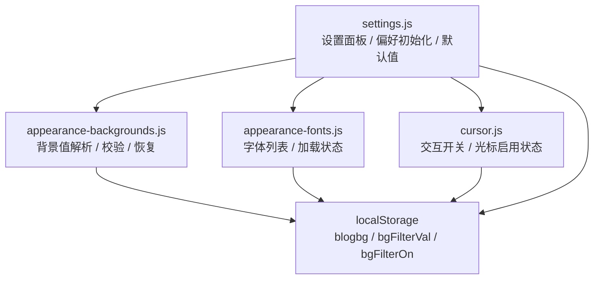
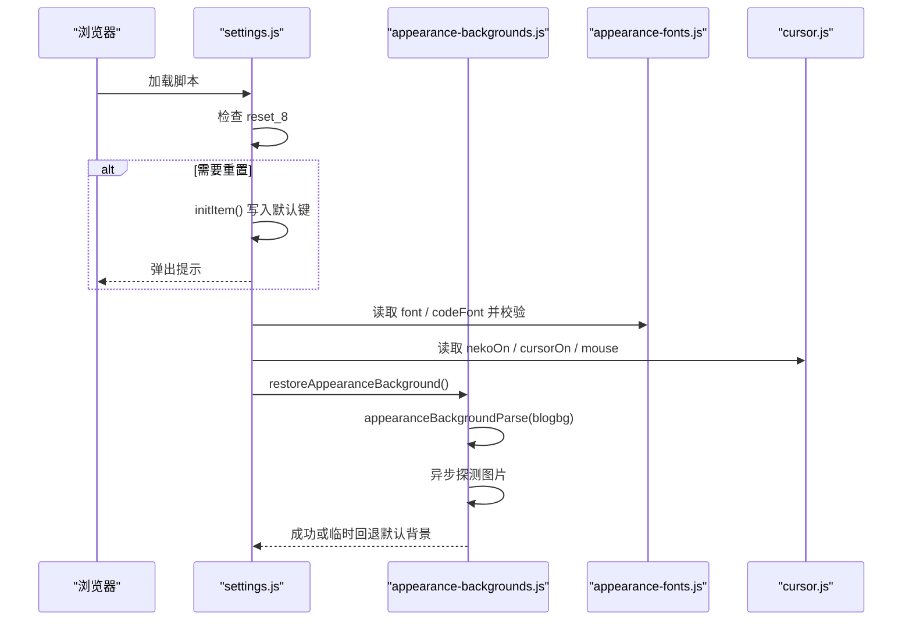
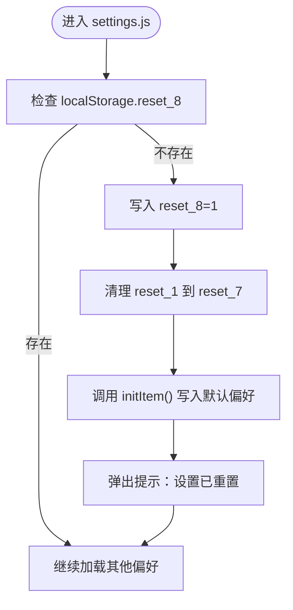
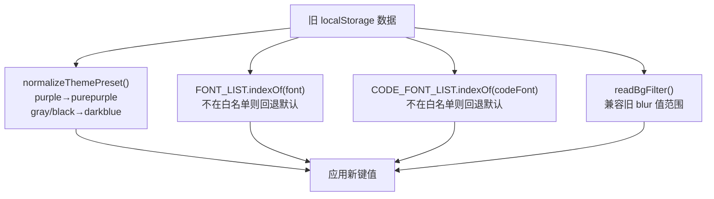
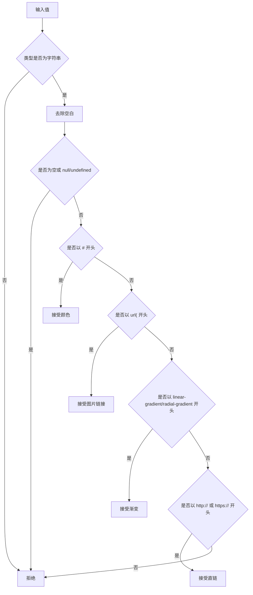
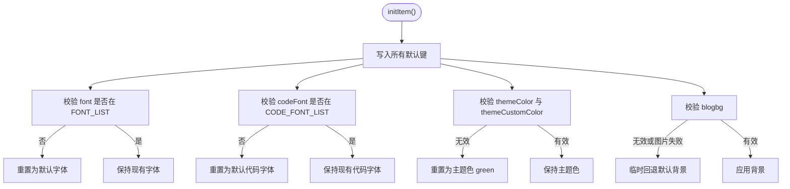
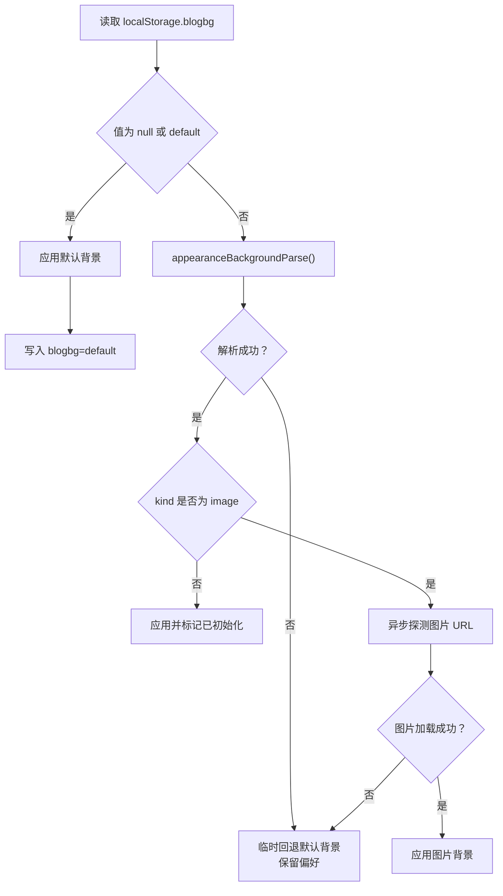
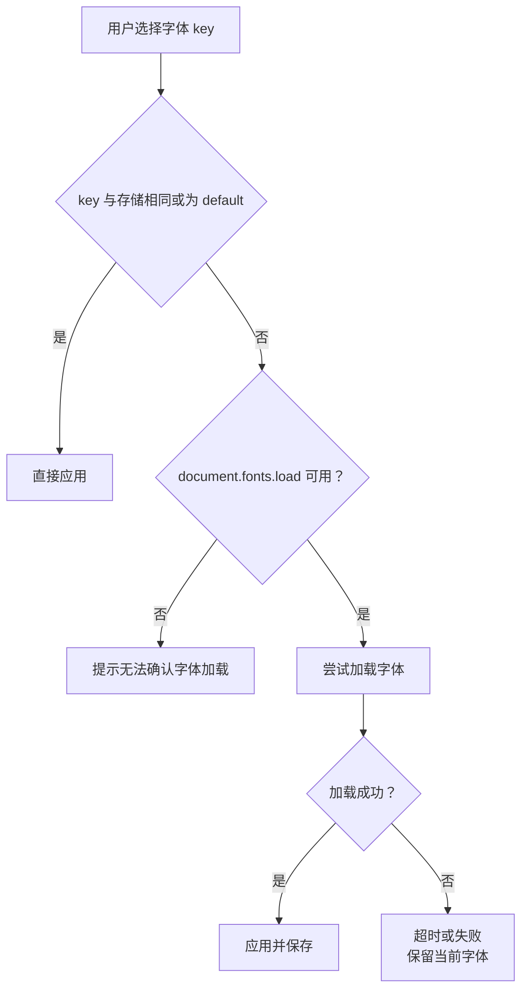
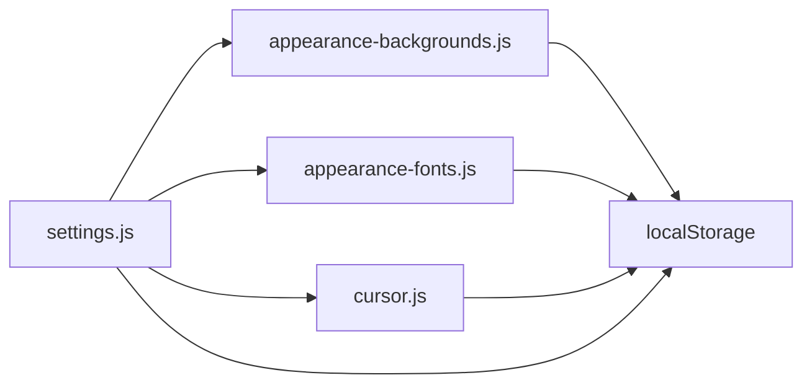

# 用户偏好存储系统

<cite>
**本文引用的文件**   
- [settings.js](file://source/js/modules/settings.js)
- [appearance-backgrounds.js](file://source/js/modules/appearance-backgrounds.js)
- [appearance-fonts.js](file://source/js/modules/appearance-fonts.js)
- [cursor.js](file://source/js/modules/cursor.js)
</cite>

## 目录
1. [引言](#引言)
2. [项目结构](#项目结构)
3. [核心组件](#核心组件)
4. [架构总览](#架构总览)
5. [详细组件分析](#详细组件分析)
6. [依赖关系分析](#依赖关系分析)
7. [性能与可靠性](#性能与可靠性)
8. [故障排查指南](#故障排查指南)
9. [结论](#结论)
10. [附录：扩展指南](#附录扩展指南)

## 引言
本文件系统性文档化站点“用户偏好存储机制”，聚焦浏览器端 `localStorage` 的数据结构设计、初始化流程、数据迁移与重置策略、数据验证规则，以及后续扩展建议。该机制由多个前端模块共同维护，主要涉及美化设置面板、背景系统、字体系统和鼠标/交互子系统。

## 项目结构
用户偏好相关代码集中在主题的前端脚本中，采用“按功能拆分模块”的组织方式：
- 设置面板与多数偏好读写入口：`source/js/modules/settings.js`
- 背景选择器与背景值解析、校验、恢复：`source/js/modules/appearance-backgrounds.js`
- 字体选择器与字体加载状态：`source/js/modules/appearance-fonts.js`
- 右键菜单、小猫咪、自定义光标等交互偏好：`source/js/modules/cursor.js`

**图表来源**
- [settings.js:114-137](file://source/js/modules/settings.js#L114-L137)
- [appearance-backgrounds.js:407-416](file://source/js/modules/appearance-backgrounds.js#L407-L416)
- [appearance-fonts.js:20-24](file://source/js/modules/appearance-fonts.js#L20-L24)
- [cursor.js:33-34](file://source/js/modules/cursor.js#L33-L34)

**章节来源**
- [settings.js:1-15](file://source/js/modules/settings.js#L1-L15)
- [appearance-backgrounds.js:1-4](file://source/js/modules/appearance-backgrounds.js#L1-L4)
- [appearance-fonts.js:1-18](file://source/js/modules/appearance-fonts.js#L1-L18)
- [cursor.js:1-29](file://source/js/modules/cursor.js#L1-L29)

## 核心组件
- **设置初始化与默认值写入**：`initItem()` 负责在首次升级或全量重置时写入一组默认键值。
- **版本迁移与重置标记**：通过 `reset_8` 判断是否需要执行一次全量默认恢复，并清理历史 `reset_1` 到 `reset_7` 标记。
- **白名单校验**：字体、主题色预设、背景值均使用白名单或格式校验，避免脏数据污染界面。
- **背景值解析器**：`appearanceBackgroundParse()` 将字符串解析为“默认 / 纯色 / 渐变 / 图片 URL”四类结构。
- **字体加载状态管理**：`appearance-fonts.js` 负责字体选项同步、加载超时与取消逻辑。
- **交互偏好读取**：`cursor.js` 根据 `nekoOn`、`cursorOn`、`mouse` 等键控制小猫咪、自定义光标和右键菜单行为。

**章节来源**
- [settings.js:83-102](file://source/js/modules/settings.js#L83-L102)
- [settings.js:114-137](file://source/js/modules/settings.js#L114-L137)
- [settings.js:140-175](file://source/js/modules/settings.js#L140-L175)
- [appearance-backgrounds.js:407-416](file://source/js/modules/appearance-backgrounds.js#L407-L416)
- [appearance-fonts.js:55-96](file://source/js/modules/appearance-fonts.js#L55-L96)
- [cursor.js:33-34](file://source/js/modules/cursor.js#L33-L34)

## 架构总览
用户偏好存储的整体流程如下：
1. 页面加载后，`settings.js` 检查 `reset_8` 标记；若不存在则写入默认值并提示用户已重置。
2. 各模块分别读取自身偏好键，并进行白名单或格式校验。
3. 背景模块先同步应用本地保存的背景值，再异步探测图片是否可加载；失败时保留偏好但临时回退显示。
4. 字体模块按需加载字体，失败或超时时保留当前字体并允许重试。
5. 交互模块根据开关键启用或禁用对应效果。

**图表来源**
- [settings.js:83-102](file://source/js/modules/settings.js#L83-L102)
- [settings.js:114-137](file://source/js/modules/settings.js#L114-L137)
- [appearance-backgrounds.js:601-631](file://source/js/modules/appearance-backgrounds.js#L601-L631)
- [appearance-fonts.js:55-96](file://source/js/modules/appearance-fonts.js#L55-L96)
- [cursor.js:33-34](file://source/js/modules/cursor.js#L33-L34)

## 详细组件分析

### 1. 初始化流程与默认值定义
`initItem()` 是偏好系统的“默认值中心”。它会在版本升级触发重置时写入以下键：

| 配置键 | 数据类型 | 默认值 | 说明 |
|---|---|---|---|
| `blogbg` | 字符串 | `"default"` | 背景值；支持 `default`、颜色、渐变、`url(...)` |
| `universe` | 字符串 | `"block"` | 星空背景显示状态 |
| `fpson` | 字符串 | `"1"` | 帧率监测开关 |
| `transNum` | 字符串（数值） | `"98"` | 卡片不透明度百分比 |
| `font` | 字符串 | `"LXGW"` | 正文字体 family 名 |
| `codeFont` | 字符串 | `"JetBrainsMono"` | 代码块字体 family 名 |
| `themeColor` | 字符串 | `"green"` | 主题色预设键 |
| `themeCustomColor` | 字符串 | `"#c74bd0"` | 自定义主题色十六进制值 |
| `rs` | 字符串 | `"block"` | 右侧部件显示状态 |
| `mouse` | 字符串 | `"on"` | 右键菜单开关 |
| `nekoOn` | 字符串 | `"1"` | 小猫咪挂件开关 |
| `cursorOn` | 字符串 | `"1"` | 自定义光标开关 |
| `rippleOn` | 字符串 | `"0"` | 点击涟漪开关 |
| `light` | 字符串 | `"true"` | 霓虹灯开关 |
| `snow` | 字符串 | `"none"` | 雪花特效开关 |
| `fireflies` | 字符串 | `"0"` | 萤火虫微光开关 |
| `aside` | 字符串 | `"1"` | 侧栏显隐 |
| `asidePos` | 字符串 | `"1"` | 侧栏位置 |
| `nav` | 字符串 | `"1"` | 导航栏常驻 |
| `bgFilterOn` | 字符串 | `"1"` | 背景滤镜开关 |
| `bgFilterVal` | 字符串 | `"blur(0px) saturate(108%) contrast(105%)"` | 背景滤镜参数 |

此外，`reset()` 会调用 `initItem()` 并进一步恢复 UI 状态，包括字体、主题色、布局、滤镜、透明度、昼夜切换动画档位等。

**图表来源**
- [settings.js:83-102](file://source/js/modules/settings.js#L83-L102)
- [settings.js:114-137](file://source/js/modules/settings.js#L114-L137)
- [settings.js:1105-1166](file://source/js/modules/settings.js#L1105-L1166)

**章节来源**
- [settings.js:83-102](file://source/js/modules/settings.js#L83-L102)
- [settings.js:114-137](file://source/js/modules/settings.js#L114-L137)
- [settings.js:1105-1166](file://source/js/modules/settings.js#L1105-L1166)

### 2. 数据迁移与旧数据兼容
- **版本重置标记**：当 `reset_8` 不存在时，系统认为需要执行一次“第 8 版”的全量重置，并清理历史 `reset_1` 到 `reset_7`。
- **主题色旧键兼容**：`normalizeThemePreset()` 将旧预设键 `purple`、`gray`、`black` 映射到新键 `purepurple`、`darkblue`，保证老访客的存储值仍能生效。
- **背景滤镜旧值兼容**：背景模糊字段在读取时兼容较大的旧值范围，并在恢复默认后回到常用上限。
- **字体旧值兼容**：字体选择使用白名单校验，不在列表中的旧字体值会被替换为默认值。

**图表来源**
- [settings.js:83-102](file://source/js/modules/settings.js#L83-L102)
- [settings.js:140-175](file://source/js/modules/settings.js#L140-L175)
- [cursor.js:569-573](file://source/js/modules/cursor.js#L569-L573)
- [settings.js:830-839](file://source/js/modules/settings.js#L830-L839)

**章节来源**
- [settings.js:83-102](file://source/js/modules/settings.js#L83-L102)
- [settings.js:140-175](file://source/js/modules/settings.js#L140-L175)
- [cursor.js:569-573](file://source/js/modules/cursor.js#L569-L573)
- [settings.js:830-839](file://source/js/modules/settings.js#L830-L839)

### 3. 数据验证规则
#### 3.1 字体白名单
- 正文字体白名单：`FONT_LIST`
- 代码字体白名单：`CODE_FONT_LIST`
- 若 `localStorage.font` 或 `localStorage.codeFont` 不在对应白名单，则写回默认值。

#### 3.2 主题色校验
- 预设主题色由 `themeColorPresets` 定义。
- 自定义主题色必须匹配 `^#[0-9a-f]{6}$`。
- 若主题色不是有效预设且自定义色无效，则回退到 `"green"`。

#### 3.3 背景值校验
- `isValidBgVal()` 接受：`default`、`#颜色`、`url(...)`、`linear-gradient(...)`、`radial-gradient(...)`、`http(s)://链接`。
- `appearanceBackgroundParse()` 将值解析为结构化对象，包含 `kind`、`css`、`url`。
- 图片类背景会进行网络探测，失败时保留偏好但临时回退默认背景。

**图表来源**
- [settings.js:140-175](file://source/js/modules/settings.js#L140-L175)
- [settings.js:219-269](file://source/js/modules/settings.js#L219-L269)
- [settings.js:729-747](file://source/js/modules/settings.js#L729-L747)
- [appearance-backgrounds.js:407-416](file://source/js/modules/appearance-backgrounds.js#L407-L416)

**章节来源**
- [settings.js:140-175](file://source/js/modules/settings.js#L140-L175)
- [settings.js:219-269](file://source/js/modules/settings.js#L219-L269)
- [settings.js:729-747](file://source/js/modules/settings.js#L729-L747)
- [appearance-backgrounds.js:407-416](file://source/js/modules/appearance-backgrounds.js#L407-L416)

### 4. 初始化流程 initItem()
`initItem()` 的职责不仅是写入默认值，还承担以下职责：
- **默认值设置**：为所有偏好键写入初始值。
- **数据完整性检查**：配合各模块的白名单和格式校验，确保脏数据不会破坏界面。
- **错误恢复机制**：
  - 字体不在白名单时回退默认。
  - 主题色无效时回退预设。
  - 背景值无效或图片加载失败时临时回退默认背景，但保留偏好以便下次重试。
  - 背景滤镜参数非法时恢复默认参数。

**图表来源**
- [settings.js:114-137](file://source/js/modules/settings.js#L114-L137)
- [settings.js:140-175](file://source/js/modules/settings.js#L140-L175)
- [settings.js:219-269](file://source/js/modules/settings.js#L219-L269)
- [appearance-backgrounds.js:601-631](file://source/js/modules/appearance-backgrounds.js#L601-L631)

**章节来源**
- [settings.js:114-137](file://source/js/modules/settings.js#L114-L137)
- [settings.js:140-175](file://source/js/modules/settings.js#L140-L175)
- [settings.js:219-269](file://source/js/modules/settings.js#L219-L269)
- [appearance-backgrounds.js:601-631](file://source/js/modules/appearance-backgrounds.js#L601-L631)

### 5. 背景系统数据模型
背景值通过 `appearanceBackgroundParse()` 解析为统一结构：

| kind | css | url | 含义 |
|---|---|---|---|
| `default` | `"default"` | `""` | 默认背景，随深浅模式和屏幕尺寸切换 |
| `solid` | 十六进制颜色 | `""` | 自定义纯色 |
| `gradient` | CSS 渐变表达式 | `""` | 预设或自定义渐变 |
| `image` | `url("...")` | 合法 HTTPS/HTTP 图片地址 | 图片背景 |

背景恢复流程：
1. 读取 `blogbg`。
2. 若为空或 `"default"`，直接应用默认背景并写入默认值。
3. 若解析失败，临时回退默认背景，但保留原偏好。
4. 若为图片，异步探测 URL；失败时临时回退默认背景，并提供重试能力。

**图表来源**
- [appearance-backgrounds.js:407-416](file://source/js/modules/appearance-backgrounds.js#L407-L416)
- [appearance-backgrounds.js:601-631](file://source/js/modules/appearance-backgrounds.js#L601-L631)

**章节来源**
- [appearance-backgrounds.js:407-416](file://source/js/modules/appearance-backgrounds.js#L407-L416)
- [appearance-backgrounds.js:601-631](file://source/js/modules/appearance-backgrounds.js#L601-L631)

### 6. 字体系统数据模型
字体偏好键：
- `font`：正文字体
- `codeFont`：代码字体

字体列表：
- 正文字体：`APPEARANCE_TEXT_FONTS`
- 代码字体：`APPEARANCE_CODE_FONTS`

字体加载流程：
1. 若选择的 key 与当前存储一致或是 `default`，直接应用。
2. 若浏览器不支持 `document.fonts.load`，提示无法确认加载结果。
3. 否则尝试加载字体，超时或失败时保留当前字体并允许重试。

**图表来源**
- [appearance-fonts.js:55-96](file://source/js/modules/appearance-fonts.js#L55-L96)

**章节来源**
- [appearance-fonts.js:55-96](file://source/js/modules/appearance-fonts.js#L55-L96)

### 7. 交互偏好数据模型
交互相关键：
- `nekoOn`：小猫咪挂件开关
- `cursorOn`：自定义光标开关
- `rippleOn`：点击涟漪开关
- `mouse`：右键菜单开关

行为规则：
- `nekoOn !== '0'` 表示开启。
- `cursorOn !== '0'` 表示开启。
- `rippleOn === '1'` 才表示开启。
- `mouse` 为 `"on"` 或 `"off"`。

**章节来源**
- [settings.js:298-335](file://source/js/modules/settings.js#L298-L335)
- [cursor.js:33-34](file://source/js/modules/cursor.js#L33-L34)
- [cursor.js:502-536](file://source/js/modules/cursor.js#L502-L536)

## 依赖关系分析
- `settings.js` 是偏好系统的核心协调者，负责默认值、重置、UI 同步。
- `appearance-backgrounds.js` 提供背景值的解析、校验、恢复和预览能力。
- `appearance-fonts.js` 提供字体列表、加载状态和 UI 同步。
- `cursor.js` 提供交互效果的启用/禁用逻辑，并依赖主题色映射。

**图表来源**
- [settings.js:114-137](file://source/js/modules/settings.js#L114-L137)
- [appearance-backgrounds.js:407-416](file://source/js/modules/appearance-backgrounds.js#L407-L416)
- [appearance-fonts.js:20-24](file://source/js/modules/appearance-fonts.js#L20-L24)
- [cursor.js:33-34](file://source/js/modules/cursor.js#L33-L34)

**章节来源**
- [settings.js:114-137](file://source/js/modules/settings.js#L114-L137)
- [appearance-backgrounds.js:407-416](file://source/js/modules/appearance-backgrounds.js#L407-L416)
- [appearance-fonts.js:20-24](file://source/js/modules/appearance-fonts.js#L20-L24)
- [cursor.js:33-34](file://source/js/modules/cursor.js#L33-L34)

## 性能与可靠性
- **背景图片异步探测**：避免阻塞首屏渲染，失败时保留当前背景，减少闪烁。
- **字体加载超时保护**：防止字体加载卡死界面，提供重试入口。
- **背景滤镜实时预览**：使用 `requestAnimationFrame` 合并更新，避免频繁 DOM 写入。
- **透明度滑块防抖**：拖动过程中只更新视觉，提交时才持久化。
- **交互效果按需启用**：关闭 FPS 监测、小猫咪、自定义光标时可停止相应循环或监听。

[本节为通用性能讨论，不直接分析具体文件]

## 故障排查指南
常见问题及定位建议：
- **背景刷新闪默认图**：检查 `restoreAppearanceBackground()` 是否先同步应用本地值，再异步探测图片。
- **字体未生效**：检查 `chooseAppearanceFont()` 是否超时或浏览器不支持 `document.fonts.load`。
- **主题色异常**：检查 `setColor()` 是否进入预设分支，或自定义色是否通过 `validThemeHex()`。
- **右键菜单失效**：检查 `mouse` 是否为 `"off"`，以及 `changeMouseMode()` 是否正确写入。
- **小猫咪不出现**：检查 `nekoOn` 是否为 `'0'`，以及 `setNekoEnabled()` 是否被调用。

**章节来源**
- [appearance-backgrounds.js:601-631](file://source/js/modules/appearance-backgrounds.js#L601-L631)
- [appearance-fonts.js:55-96](file://source/js/modules/appearance-fonts.js#L55-L96)
- [settings.js:219-269](file://source/js/modules/settings.js#L219-L269)
- [cursor.js:502-536](file://source/js/modules/cursor.js#L502-L536)
- [cursor.js:33-34](file://source/js/modules/cursor.js#L33-L34)

## 结论
用户偏好存储系统以 `settings.js` 为核心，结合背景、字体、交互模块，形成一套可迁移、可验证、可恢复的前端偏好管理机制。其设计重点在于：
- 明确的默认值与重置策略
- 严格的白名单与格式校验
- 异步容错与用户体验优先
- 可扩展的键值结构与模块边界

[本节为总结性内容，不直接分析具体文件]

## 附录扩展指南

### A. 新增配置项步骤
1. 在 `initItem()` 中添加默认值。
2. 在对应模块中读取并校验该键。
3. 在设置面板中增加 UI 控件，并绑定保存逻辑。
4. 如需迁移旧数据，添加兼容性处理逻辑。
5. 如影响 UI，确保 `createWinbox()` 中同步控件状态。

**章节来源**
- [settings.js:114-137](file://source/js/modules/settings.js#L114-L137)
- [settings.js:939-1099](file://source/js/modules/settings.js#L939-L1099)

### B. 数据备份与恢复
- 备份：导出 `localStorage` 中所有键值，尤其是 `blogbg`、`font`、`codeFont`、`themeColor`、`themeCustomColor`、`bgFilterVal`、`bgFilterOn`。
- 恢复：在目标环境写入这些键，然后刷新页面或重新打开设置面板以同步 UI。
- 注意：背景图片 URL 需可访问，否则恢复后可能临时回退默认背景。

**章节来源**
- [appearance-backgrounds.js:601-631](file://source/js/modules/appearance-backgrounds.js#L601-L631)
- [settings.js:114-137](file://source/js/modules/settings.js#L114-L137)

### C. 跨设备同步方案
- 推荐方案：将偏好序列化为 JSON 后上传至云存储或账号系统，登录时拉取并写入 `localStorage`。
- 冲突处理：以服务器时间戳或版本号决定最终值。
- 安全考虑：避免同步敏感信息；仅同步外观与体验偏好。
- 降级策略：若云端不可用，继续使用本地 `localStorage`。

[本节为概念性指导，不直接分析具体文件]