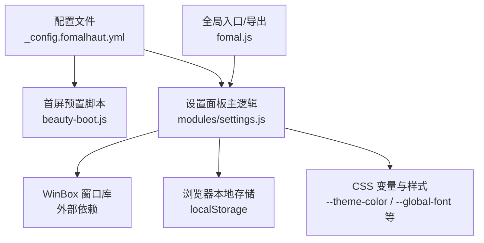
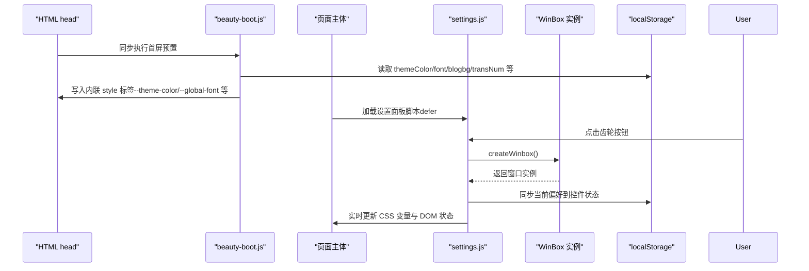
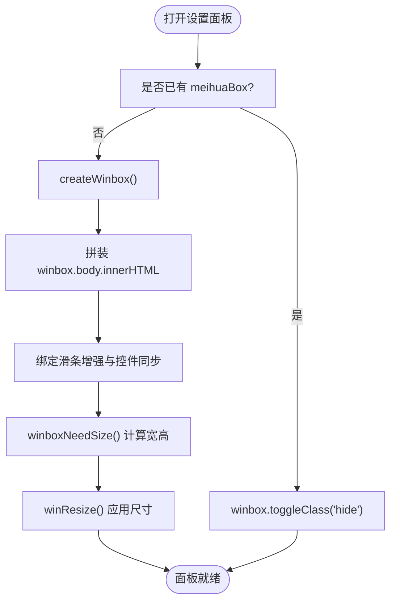
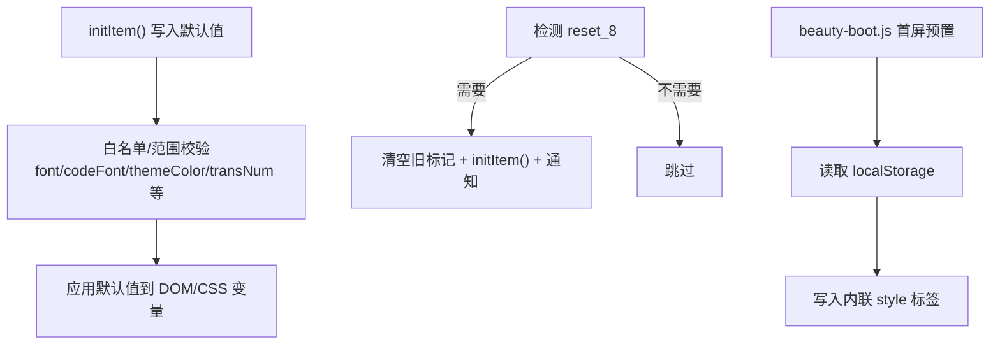
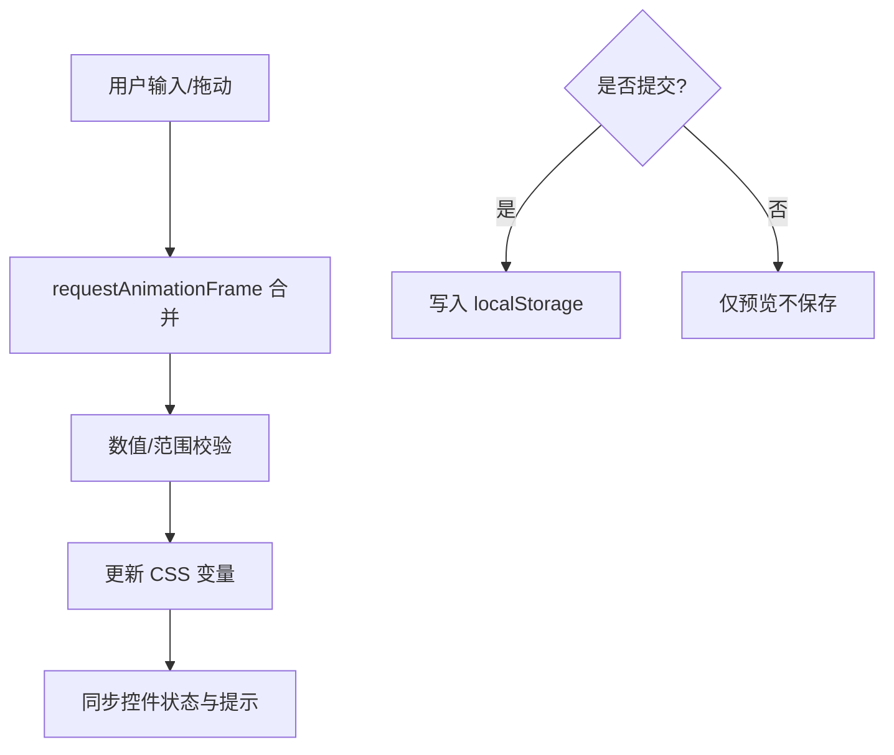
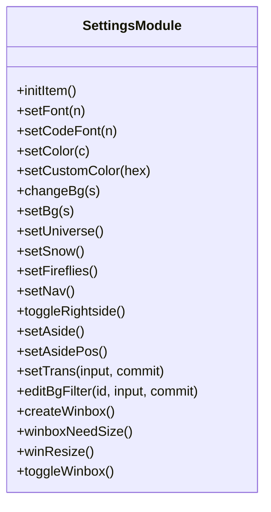
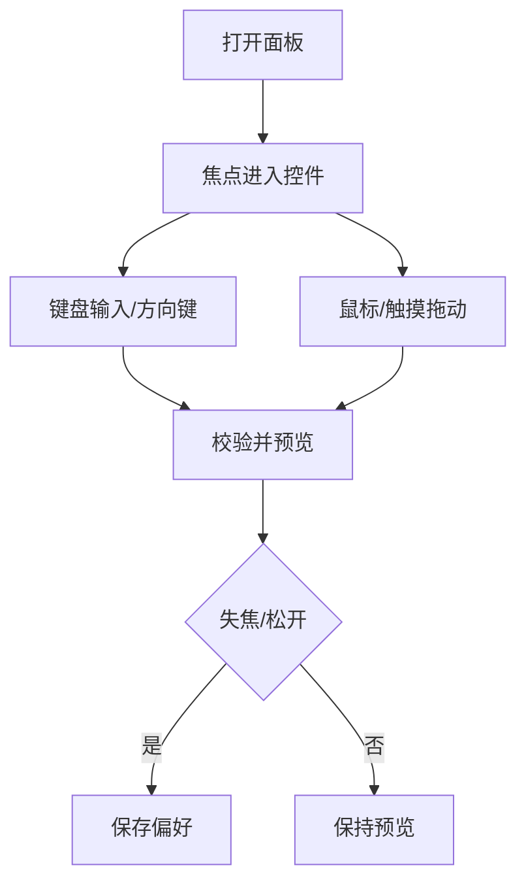
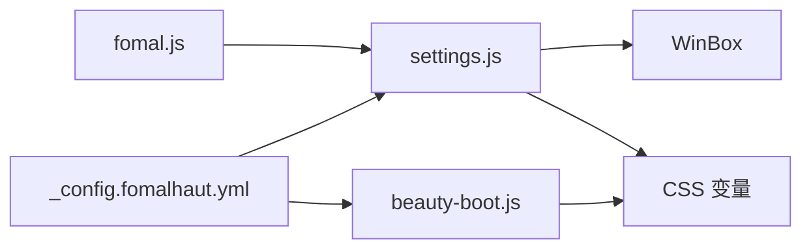

# 美化设置面板

<cite>
**本文引用的文件**   
- [source/js/modules/settings.js](file://source/js/modules/settings.js)
- [source/js/inject/beauty-boot.js](file://source/js/inject/beauty-boot.js)
- [_config.fomalhaut.yml](file://_config.fomalhaut.yml)
- [source/js/fomal.js](file://source/js/fomal.js)
</cite>

## 目录
1. [引言](#引言)
2. [项目结构](#项目结构)
3. [核心组件](#核心组件)
4. [架构总览](#架构总览)
5. [详细组件分析](#详细组件分析)
6. [依赖关系分析](#依赖关系分析)
7. [性能与实时预览](#性能与实时预览)
8. [故障排查](#故障排查)
9. [扩展指南](#扩展指南)
10. [结论](#结论)

## 引言
本文件全面文档化“美化设置面板”的实现，覆盖 Winbox 窗口集成、用户偏好存储、实时预览系统、各设置项功能、UI 交互逻辑以及扩展方法。该面板是站点最大的外观配置入口，负责背景图、字体、主题色、侧栏、导航、特效等大量视觉开关，并通过 `localStorage` 持久化用户选择。

## 项目结构
美化设置相关代码主要分布在以下位置：
- 设置面板主逻辑与 Winbox 窗口封装：`source/js/modules/settings.js`
- 首屏预置脚本（消除闪烁）：`source/js/inject/beauty-boot.js`
- 主题注入配置（加载顺序与 defer 行为）：`_config.fomalhaut.yml`
- 全局导出与模块入口引用：`source/js/fomal.js`

**图表来源**
- [_config.fomalhaut.yml:754-800](file://_config.fomalhaut.yml#L754-L800)
- [source/js/inject/beauty-boot.js:1-80](file://source/js/inject/beauty-boot.js#L1-L80)
- [source/js/modules/settings.js:1-15](file://source/js/modules/settings.js#L1-L15)
- [source/js/fomal.js:72-84](file://source/js/fomal.js#L72-L84)

**章节来源**
- [_config.fomalhaut.yml:754-800](file://_config.fomalhaut.yml#L754-L800)
- [source/js/inject/beauty-boot.js:1-80](file://source/js/inject/beauty-boot.js#L1-L80)
- [source/js/modules/settings.js:1-15](file://source/js/modules/settings.js#L1-L15)
- [source/js/fomal.js:72-84](file://source/js/fomal.js#L72-L84)

## 核心组件
- **Winbox 窗口容器**：通过 `createWinbox` 创建可拖拽、可最大化的小窗，承载所有设置项 UI。
- **偏好初始化与迁移**：通过 `initItem` 和版本标记 `reset_8` 完成默认值写入与旧数据清理。
- **实时预览引擎**：透明度、背景滤镜、主题色、字体等选项在输入时即时更新 CSS 变量。
- **设置项控制器**：每个开关都有对应的 setter 函数，同时写 `localStorage` 并刷新 UI。
- **响应式尺寸计算**：`winboxNeedSize` 与 `winResize` 根据内容高度与屏幕宽度自适应窗口大小。

**章节来源**
- [source/js/modules/settings.js:113-137](file://source/js/modules/settings.js#L113-L137)
- [source/js/modules/settings.js:939-1049](file://source/js/modules/settings.js#L939-L1049)
- [source/js/modules/settings.js:1171-1228](file://source/js/modules/settings.js#L1171-L1228)

## 架构总览
美化设置面板采用“首屏预置 + 延迟面板 + 实时变量驱动”的三层架构：
1. 页面 `<head>` 中同步执行 `beauty-boot.js`，提前把 `localStorage` 中的关键偏好写入内联 style 标签，避免刷新时的默认闪屏。
2. 页面底部以 `defer` 加载 `settings.js`，构建 Winbox 小窗，并在用户点击时打开。
3. 所有视觉变更都通过修改 CSS 变量或 DOM 类名实现，保证切换无刷新且可逆。

**图表来源**
- [source/js/inject/beauty-boot.js:13-79](file://source/js/inject/beauty-boot.js#L13-L79)
- [source/js/modules/settings.js:939-1049](file://source/js/modules/settings.js#L939-L1049)
- [source/js/modules/settings.js:1222-1228](file://source/js/modules/settings.js#L1222-L1228)

## 详细组件分析

### Winbox 窗口集成与自定义
- **窗口创建**：`createWinbox` 动态创建容器节点，调用 `WinBox` 构造器，设置标题、初始位置、最小宽度、高度、主题色背景，并注册最大化/还原回调。
- **事件绑定**：窗口创建后绑定 `resize` 事件，使用 `winResize` 统一处理移动端与桌面端布局。
- **内容注入**：`winbox.body.innerHTML` 拼装设置面板 HTML，包含显示偏好、氛围特效、互动挂件、布局部件、主题色、字体、背景等区块。
- **尺寸计算**：`winboxNeedSize` 基于内容区域测量最终宽高；`winResize` 在窄屏使用百分比宽度，在宽屏使用稳定阅读宽度并二次量高。
- **显示控制**：`toggleWinbox` 判断是否已有窗口，已存在则切换隐藏类名，不存在则创建并重新计算尺寸。

**图表来源**
- [source/js/modules/settings.js:939-1049](file://source/js/modules/settings.js#L939-L1049)
- [source/js/modules/settings.js:1171-1228](file://source/js/modules/settings.js#L1171-L1228)
- [source/js/modules/settings.js:1222-1228](file://source/js/modules/settings.js#L1222-L1228)

**章节来源**
- [source/js/modules/settings.js:939-1049](file://source/js/modules/settings.js#L939-L1049)
- [source/js/modules/settings.js:1171-1228](file://source/js/modules/settings.js#L1171-L1228)
- [source/js/modules/settings.js:1222-1228](file://source/js/modules/settings.js#L1222-L1228)

### 用户偏好存储机制
- **数据结构**：所有偏好以键值对形式保存在 `localStorage`，键名包括 `blogbg`、`universe`、`fpson`、`transNum`、`font`、`codeFont`、`themeColor`、`themeCustomColor`、`rs`、`mouse`、`nekoOn`、`cursorOn`、`rippleOn`、`light`、`snow`、`fireflies`、`aside`、`asidePos`、`nav`、`bgFilterOn`、`bgFilterVal`、`darkTransition` 等。
- **默认值处理**：`initItem` 集中写入默认值；首次加载时若键缺失，会按白名单或范围校验回落到默认值。
- **数据迁移策略**：通过 `reset_8` 标记检测是否需要重置全部设置；当检测到新版本时清空旧版 `reset_1` 到 `reset_7` 标记并调用 `initItem`，同时弹出提示告知用户已恢复默认。
- **首屏预置**：`beauty-boot.js` 在 `<head>` 中同步读取 `localStorage`，将主题色、字体、背景、透明度、侧栏、导航等关键变量直接写入内联 style，避免首帧闪烁。

**图表来源**
- [source/js/modules/settings.js:84-137](file://source/js/modules/settings.js#L84-L137)
- [source/js/modules/settings.js:143-175](file://source/js/modules/settings.js#L143-L175)
- [source/js/inject/beauty-boot.js:13-79](file://source/js/inject/beauty-boot.js#L13-L79)

**章节来源**
- [source/js/modules/settings.js:84-137](file://source/js/modules/settings.js#L84-L137)
- [source/js/modules/settings.js:143-175](file://source/js/modules/settings.js#L143-L175)
- [source/js/inject/beauty-boot.js:13-79](file://source/js/inject/beauty-boot.js#L13-L79)

### 实时预览系统
- **透明度滑块**：`setTrans` 支持数字输入与 range 拖动，使用 `requestAnimationFrame` 合并渲染，结束时保存并更新 CSS 变量 `--trans-light` 与 `--trans-dark`。
- **背景滤镜**：`editBgFilter` 支持模糊、饱和度、对比度三个参数，开启时实时预览，关闭时禁用控件；保存为 `bgFilterVal` 字符串，通过 `--bg-filter` 变量生效。
- **主题色**：`setColor` 与 `setCustomColor` 校验预设键与十六进制颜色，计算前景色对比度，更新 `--theme-color`、`--on-theme`、`--on-theme-away` 等变量，并联动右侧工具条与鼠标指针。
- **字体**：`setFont` 与 `setCodeFont` 分别更新 `--global-font` 与 `--code-font`，并对“系统默认”使用完整系统字体栈。
- **性能优化**：频繁输入使用 `requestAnimationFrame` 节流；滑条点击轨道跳转通过全局指针监听一次性绑定，避免重复事件。

**图表来源**
- [source/js/modules/settings.js:525-569](file://source/js/modules/settings.js#L525-L569)
- [source/js/modules/settings.js:822-911](file://source/js/modules/settings.js#L822-L911)
- [source/js/modules/settings.js:238-295](file://source/js/modules/settings.js#L238-L295)
- [source/js/modules/settings.js:147-175](file://source/js/modules/settings.js#L147-L175)

**章节来源**
- [source/js/modules/settings.js:525-569](file://source/js/modules/settings.js#L525-L569)
- [source/js/modules/settings.js:822-911](file://source/js/modules/settings.js#L822-L911)
- [source/js/modules/settings.js:238-295](file://source/js/modules/settings.js#L238-L295)
- [source/js/modules/settings.js:147-175](file://source/js/modules/settings.js#L147-L175)

### 设置项功能实现
- **主题切换**：昼夜模式由站点整体日夜间逻辑控制，设置面板提供“昼夜切换动画档位”选择，影响过场动画强度。
- **字体选择**：常规字体与代码块字体两组，支持“系统默认”，并通过 CSS 变量即时生效。
- **背景配置**：支持纯色、图片链接、渐变、必应每日壁纸、随机美图等；提供链接有效性探测与防抖预览。
- **特效开关**：星空、霓虹灯、雪花、萤火虫、点击涟漪、猫咪挂件、听话鼠标、帧率监测等独立开关，部分特效互斥（如雪花与萤火虫）。
- **布局与部件**：右侧部件、顶栏常驻、侧栏显隐、侧栏位置均可实时切换，通过 CSS 变量与类名控制。

**图表来源**
- [source/js/modules/settings.js:113-137](file://source/js/modules/settings.js#L113-L137)
- [source/js/modules/settings.js:147-175](file://source/js/modules/settings.js#L147-L175)
- [source/js/modules/settings.js:238-295](file://source/js/modules/settings.js#L238-L295)
- [source/js/modules/settings.js:762-787](file://source/js/modules/settings.js#L762-L787)
- [source/js/modules/settings.js:365-432](file://source/js/modules/settings.js#L365-L432)
- [source/js/modules/settings.js:466-522](file://source/js/modules/settings.js#L466-L522)
- [source/js/modules/settings.js:525-569](file://source/js/modules/settings.js#L525-L569)
- [source/js/modules/settings.js:822-911](file://source/js/modules/settings.js#L822-L911)
- [source/js/modules/settings.js:939-1049](file://source/js/modules/settings.js#L939-L1049)
- [source/js/modules/settings.js:1171-1228](file://source/js/modules/settings.js#L1171-L1228)

**章节来源**
- [source/js/modules/settings.js:365-432](file://source/js/modules/settings.js#L365-L432)
- [source/js/modules/settings.js:466-522](file://source/js/modules/settings.js#L466-L522)
- [source/js/modules/settings.js:762-787](file://source/js/modules/settings.js#L762-L787)
- [source/js/modules/settings.js:939-1049](file://source/js/modules/settings.js#L939-L1049)

### UI 交互逻辑
- **拖拽调整**：Winbox 原生支持拖拽移动与缩放；面板内部滑条支持点击轨道任意位置跳转，拖动跟随。
- **键盘导航**：数字输入框支持 Enter 失焦触发保存；range 控件原生支持方向键调节。
- **响应式适配**：窄屏下窗口宽度为屏幕 95%、高度 90%；宽屏下使用稳定阅读宽度并二次量高，确保第一节内容完整可见。
- **无障碍支持**：控件使用 `aria-label`、`aria-describedby`、`role="group"`、`role="radio"` 等语义属性，提升可访问性。

**图表来源**
- [source/js/modules/settings.js:572-659](file://source/js/modules/settings.js#L572-L659)
- [source/js/modules/settings.js:1204-1218](file://source/js/modules/settings.js#L1204-L1218)
- [source/js/modules/settings.js:967-1049](file://source/js/modules/settings.js#L967-L1049)

**章节来源**
- [source/js/modules/settings.js:572-659](file://source/js/modules/settings.js#L572-L659)
- [source/js/modules/settings.js:1204-1218](file://source/js/modules/settings.js#L1204-L1218)
- [source/js/modules/settings.js:967-1049](file://source/js/modules/settings.js#L967-L1049)

## 依赖关系分析
- **外部依赖**：Winbox 窗口库（通过 `WinBox` 全局对象调用）。
- **主题配置**：`_config.fomalhaut.yml` 中 `inject.head` 与 `inject.bottom` 控制首屏预置脚本与设置面板脚本的加载时机。
- **全局导出**：`fomal.js` 导出 `createWinbox`、`winboxNeedSize` 等函数供模板或其他脚本调用。
- **样式依赖**：CSS 变量 `--theme-color`、`--global-font`、`--trans-light`、`--trans-dark`、`--bg-filter` 等由 JS 动态写入，样式表消费这些变量。

**图表来源**
- [source/js/fomal.js:72-84](file://source/js/fomal.js#L72-L84)
- [_config.fomalhaut.yml:754-800](file://_config.fomalhaut.yml#L754-L800)
- [source/js/modules/settings.js:939-1049](file://source/js/modules/settings.js#L939-L1049)
- [source/js/inject/beauty-boot.js:13-79](file://source/js/inject/beauty-boot.js#L13-L79)

**章节来源**
- [source/js/fomal.js:72-84](file://source/js/fomal.js#L72-L84)
- [_config.fomalhaut.yml:754-800](file://_config.fomalhaut.yml#L754-L800)
- [source/js/modules/settings.js:939-1049](file://source/js/modules/settings.js#L939-L1049)
- [source/js/inject/beauty-boot.js:13-79](file://source/js/inject/beauty-boot.js#L13-L79)

## 性能与实时预览
- **渲染合并**：透明度与背景滤镜使用 `requestAnimationFrame` 合并多次输入，减少重排重绘。
- **事件去重**：滑条轨道点击/拖动全局只注册一次监听，避免反复开关小窗导致重复绑定。
- **首屏优化**：`beauty-boot.js` 在 `<head>` 中同步执行，提前写入关键 CSS 变量，避免刷新时默认值闪烁。
- **资源探测**：背景图片链接通过探测接口验证可用性，失败时给出错误提示而不破坏页面。

[本节为通用性能建议，不直接分析具体文件]

## 故障排查
- **面板无法打开**：检查 `toggleWinbox` 是否被其他脚本覆盖；确认 `WinBox` 全局对象可用。
- **设置未保存**：检查 `localStorage` 是否被浏览器限制；查看 `initItem` 与对应 setter 是否被调用。
- **主题色异常**：确认 `themeColor` 是否为合法预设键或十六进制值；检查 `beauty-boot.js` 中首屏预置是否正确写入 `--theme-color`。
- **字体错乱**：确认 `font` 是否在 `FONT_LIST` 白名单内；“系统默认”需使用完整系统字体栈。
- **背景无效**：检查 `isValidBgVal` 是否放行；图片链接需为 HTTPS 且可访问。

**章节来源**
- [source/js/modules/settings.js:84-137](file://source/js/modules/settings.js#L84-L137)
- [source/js/modules/settings.js:238-295](file://source/js/modules/settings.js#L238-L295)
- [source/js/modules/settings.js:730-747](file://source/js/modules/settings.js#L730-L747)
- [source/js/inject/beauty-boot.js:36-65](file://source/js/inject/beauty-boot.js#L36-L65)

## 扩展指南
- **新增设置项**：
  - 在 `initItem` 中添加默认键值。
  - 在 `createWinbox` 的 HTML 中插入对应控件。
  - 编写 setter 函数，写入 `localStorage` 并更新 CSS 变量或 DOM。
  - 在 `sync*Controls` 中同步控件状态。
- **验证规则**：
  - 使用白名单（如字体列表）或正则（如主题色十六进制）校验输入。
  - 对数值型输入进行范围校验，并提供友好提示。
- **国际化支持**：
  - 文案建议使用语言文件键值，而非硬编码中文；在 `createWinbox` 中通过 i18n 函数替换文本。
  - 无障碍属性（`aria-label`、`aria-describedby`）也应国际化。
- **首屏预置**：
  - 若新设置影响首屏视觉，需在 `beauty-boot.js` 中增加读取与写入逻辑，避免闪烁。

[本节为通用扩展建议，不直接分析具体文件]

## 结论
美化设置面板通过 Winbox 窗口、`localStorage` 偏好存储与 CSS 变量驱动的实时预览，实现了高度可定制的外观体验。其架构清晰、职责分离，具备良好的可扩展性与可维护性。未来可在国际化、测试覆盖与性能监控方面进一步增强。

[本节为总结性内容，不直接分析具体文件]