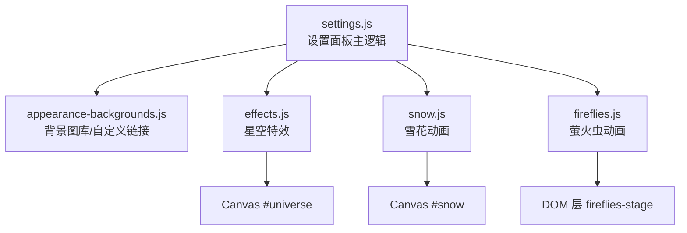
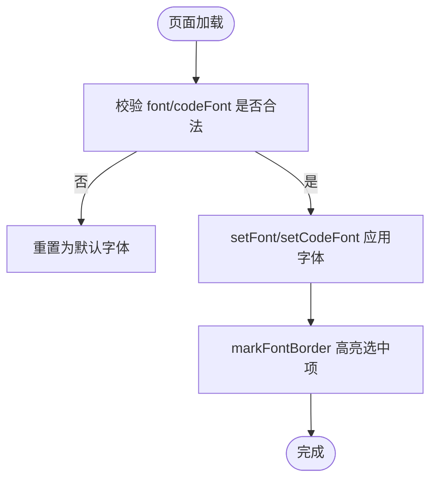
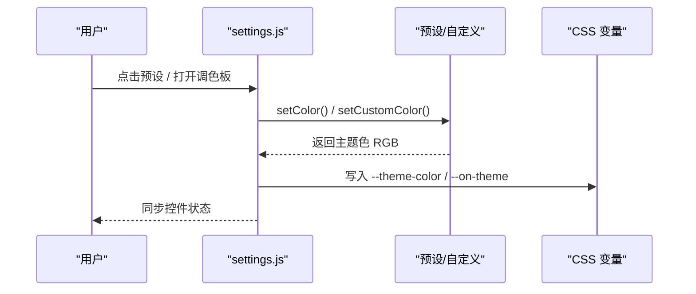
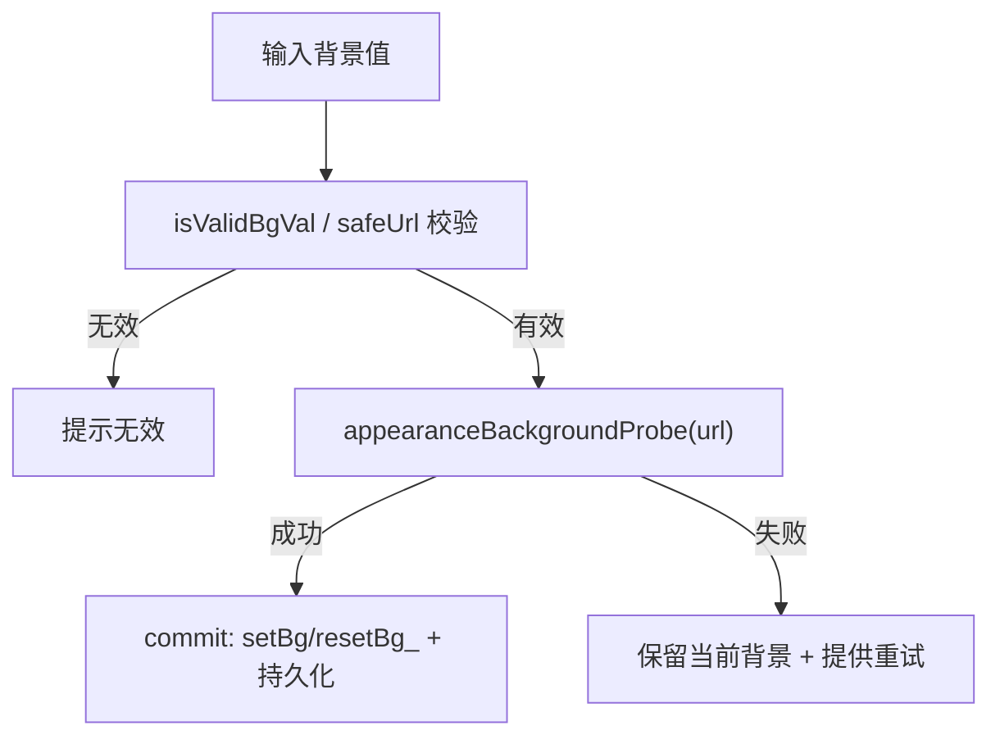
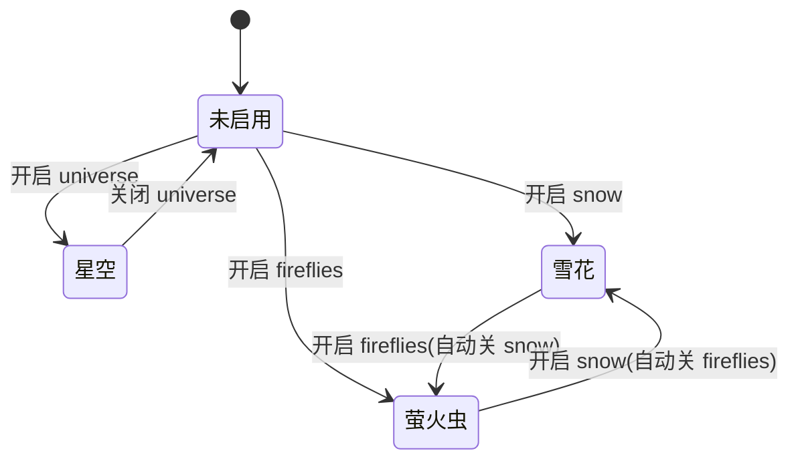
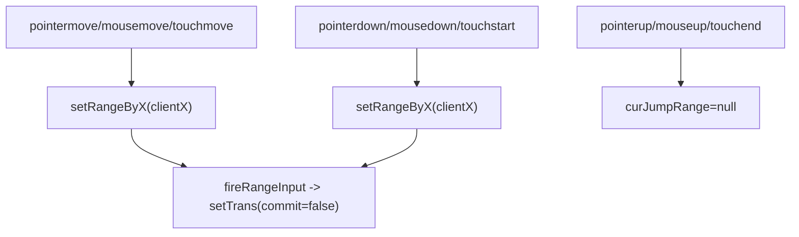
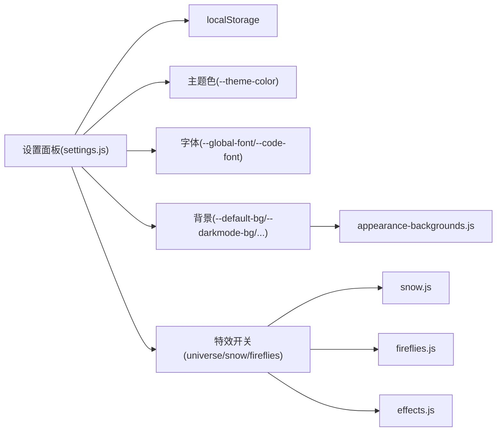
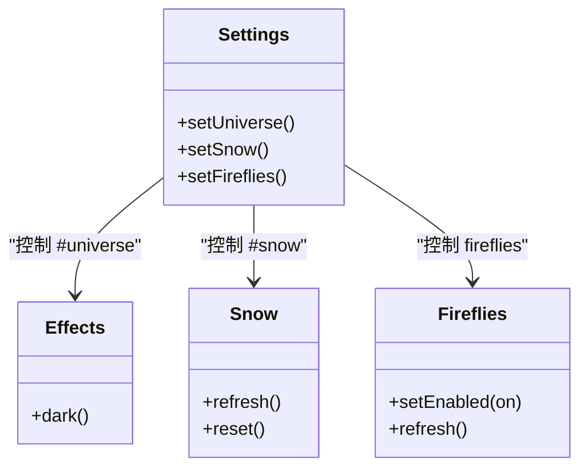
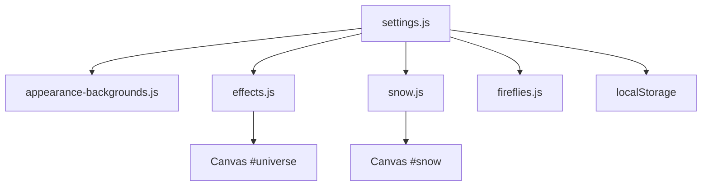

# 设置控件实现

<cite>
**本文引用的文件**   
- [settings.js](file://source/js/modules/settings.js)
- [appearance-backgrounds.js](file://source/js/modules/appearance-backgrounds.js)
- [effects.js](file://source/js/modules/effects.js)
- [snow.js](file://source/js/modules/snow.js)
- [fireflies.js](file://source/js/modules/fireflies.js)
</cite>

## 目录
1. [引言](#引言)
2. [项目结构](#项目结构)
3. [核心组件](#核心组件)
4. [架构总览](#架构总览)
5. [详细组件分析](#详细组件分析)
6. [依赖关系分析](#依赖关系分析)
7. [性能与可访问性](#性能与可访问性)
8. [故障排查指南](#故障排查指南)
9. [结论](#结论)
10. [附录：控件扩展指南](#附录控件扩展指南)

## 引言
本文聚焦站点“美化设置面板”中各类设置控件的实现细节，包括字体选择、主题色选择器、背景图控制面板、特效开关（雪花/萤火虫/星空）以及滑块增强。目标是帮助开发者快速理解各控件的数据流、校验逻辑、事件绑定方式，并给出扩展新控件类型的实践建议。

## 项目结构
设置相关的前端逻辑主要分布在以下模块：
- `source/js/modules/settings.js`：主设置面板、字体、主题色、背景切换、滑块增强、部分特效开关。
- `source/js/modules/appearance-backgrounds.js`：背景图库、分类、动态 API、自定义图片预览与应用。
- `source/js/modules/effects.js`：星空特效与表情放大。
- `source/js/modules/snow.js`：自然落雪 Canvas 动画。
- `source/js/modules/fireflies.js`：萤火虫微光 CSS 动画。

**图表来源**
- [settings.js:104-204](file://source/js/modules/settings.js#L104-L204)
- [appearance-backgrounds.js:375-471](file://source/js/modules/appearance-backgrounds.js#L375-L471)
- [effects.js:27-124](file://source/js/modules/effects.js#L27-L124)
- [snow.js:1-179](file://source/js/modules/snow.js#L1-L179)
- [fireflies.js:1-89](file://source/js/modules/fireflies.js#L1-L89)

**章节来源**
- [settings.js:1-77](file://source/js/modules/settings.js#L1-L77)
- [appearance-backgrounds.js:1-4](file://source/js/modules/appearance-backgrounds.js#L1-L4)

## 核心组件
本节按功能划分，逐一说明关键数据结构和处理流程。

### 字体选择控件
- 配置项
  - 常规字体白名单：`FONT_LIST`
  - 代码字体白名单：`CODE_FONT_LIST`
  - 默认值：`FONT_DEFAULT`、`CODE_FONT_DEFAULT`
- 初始化与校验
  - 启动时检查 localStorage 中的 `font` / `codeFont` 是否在白名单内；不在则回退到默认值。
  - 调用 `setFont()` / `setCodeFont()` 写入 CSS 变量并更新 UI。
- 边框高亮
  - `markFontBorder(prefix, curKey)` 根据前缀 `swf_` / `swfc_` 定位按钮，清除同组其他项样式，为选中项添加主题色边框、淡色背景和柔光阴影。
  - 若外部已接管字体同步（存在全局函数 `syncAppearanceFonts`），则直接委托其刷新。

**图表来源**
- [settings.js:108-111](file://source/js/modules/settings.js#L108-L111)
- [settings.js:143-175](file://source/js/modules/settings.js#L143-L175)
- [settings.js:179-204](file://source/js/modules/settings.js#L179-L204)

**章节来源**
- [settings.js:104-111](file://source/js/modules/settings.js#L104-L111)
- [settings.js:143-175](file://source/js/modules/settings.js#L143-L175)
- [settings.js:179-204](file://source/js/modules/settings.js#L179-L204)

### 主题色选择器
- 预设颜色
  - `themeColorPresets`：包含 11 个预设键与中文名称。
- 自定义颜色
  - 通过 `<input type="color">` 输入六进制色值，由 `validThemeHex` 校验，`setCustomColor` 持久化并触发 `setColor('custom')`。
- 对比度计算
  - `themeOnColorInk(rgb)`：将 RGB 转为相对亮度，阈值 0.19 决定前景色使用近黑或纯白，保证实底上的可读性。
- 应用逻辑
  - `setColor(c)`：规范化预设键，解析自定义色，生成根级 CSS 变量 `--theme-color`，同时计算 `--on-theme` / `--on-theme-away` 等衍生变量，并同步控件状态。

**图表来源**
- [settings.js:208-295](file://source/js/modules/settings.js#L208-L295)

**章节来源**
- [settings.js:208-295](file://source/js/modules/settings.js#L208-L295)

### 背景图控制面板
- 图片源配置
  - 内置图库：`AP_BACKGROUND_CATALOG`，含二次元、风景、萌宠、手机、纯色、渐变等分类。
  - 动态 API：`AP_BACKGROUND_APIS`，如必应每日/随机、二次元随机、Picsum 等。
  - settings.js 维护若干 URL 常量（如 `bingDayBg`、`EEEDog`、`unsplash` 等），供 background 模块读取。
- 链接验证
  - `isValidBgVal(s)`：允许 default、#颜色、url(...)、线性/径向渐变、http(s) 链接。
  - `bgValToUrl(s)`：从背景值中提取直链，仅返回 http(s) 地址。
  - appearance-backgrounds.js 提供更强校验：`appearanceBackgroundSafeUrl` 限制协议、长度、字符集，拒绝带用户名/密码的 URL。
- 预览机制
  - `previewCustomBackground()`：对自定义链接进行安全校验后发起图片探针（`appearanceBackgroundProbe`），成功则在“自定义预览”区域渲染缩略图，失败提示重试。
  - `getPicture()` / `getPicture_()`：对外暴露的预览入口，内部委托 `previewCustomBackground()`。
- 应用与恢复
  - `changeAppearanceBackground(value)`：异步请求 + 探针，成功后写入 CSS 变量并持久化 `blogbg`。
  - `restoreAppearanceBackground()`：优先同步显示本地保存的背景，再后台校验；失败则退回默认但不丢失偏好。

**图表来源**
- [settings.js:729-787](file://source/js/modules/settings.js#L729-L787)
- [appearance-backgrounds.js:396-416](file://source/js/modules/appearance-backgrounds.js#L396-L416)
- [appearance-backgrounds.js:561-598](file://source/js/modules/appearance-backgrounds.js#L561-L598)
- [appearance-backgrounds.js:601-631](file://source/js/modules/appearance-backgrounds.js#L601-L631)

**章节来源**
- [settings.js:707-787](file://source/js/modules/settings.js#L707-L787)
- [appearance-backgrounds.js:369-471](file://source/js/modules/appearance-backgrounds.js#L369-L471)
- [appearance-backgrounds.js:561-631](file://source/js/modules/appearance-backgrounds.js#L561-L631)

### 特效开关控件
- 星空（universe）
  - 开关在 `setUniverse()` 中控制 `#universe` 的 display，并持久化 `universe`。
  - 实际绘制在 `effects.js` 的 `dark()` 中，基于 Canvas 绘制星星与流星，并做了可见性与帧率优化。
- 雪花（snow）
  - 开关在 `setSnow()` 中控制 `#snow` 的 display，持久化 `snow`，并联动萤火虫互斥。
  - 动画由 `snow.js` 管理，支持时间驱动、底部积雪、低性能降级。
- 萤火虫（fireflies）
  - 开关在 `setFireflies()` 中委托 `FOMAL_FIREFLIES.setEnabled()`。
  - 动画由 `fireflies.js` 以轻量 DOM + CSS 动画实现，与雪花互斥，尊重系统“减少动态效果”偏好。

**图表来源**
- [settings.js:365-401](file://source/js/modules/settings.js#L365-L401)
- [effects.js:27-124](file://source/js/modules/effects.js#L27-L124)
- [snow.js:1-179](file://source/js/modules/snow.js#L1-L179)
- [fireflies.js:1-89](file://source/js/modules/fireflies.js#L1-L89)

**章节来源**
- [settings.js:365-401](file://source/js/modules/settings.js#L365-L401)
- [effects.js:27-124](file://source/js/modules/effects.js#L27-L124)
- [snow.js:1-179](file://source/js/modules/snow.js#L1-L179)
- [fireflies.js:1-89](file://source/js/modules/fireflies.js#L1-L89)

### 滑块控件增强
- 坐标计算
  - `rangeValueFromX(rangeEl, clientX)`：根据鼠标横坐标换算滑条值，考虑滑块宽度、min/max/step，并进行边界钳制与步长取整。
- 拖动事件处理
  - `bindRangeJump(rangeEl)`：监听 pointer/mouse/touch 按下，立即跳到点击位置；全局移动/松开事件统一处理拖动跟随。
  - `initRangeJump()`：一次性注册全局 move/up/cancel 监听，避免重复绑定。
- 数值验证
  - `setTrans(input, commit)`：校验 0–100 范围，同步滑块与数字输入框，防抖应用透明度，并在提交时持久化。

**图表来源**
- [settings.js:572-659](file://source/js/modules/settings.js#L572-L659)

**章节来源**
- [settings.js:525-569](file://source/js/modules/settings.js#L525-L569)
- [settings.js:572-659](file://source/js/modules/settings.js#L572-L659)

## 架构总览
设置面板作为站点外观的中枢，负责：
- 读写 localStorage 中的用户偏好。
- 将偏好映射为 CSS 变量或 DOM 样式。
- 协调各视觉模块（星空、雪花、萤火虫）的启停。
- 提供背景图选择、预览、校验与应用能力。

**图表来源**
- [settings.js:104-295](file://source/js/modules/settings.js#L104-L295)
- [appearance-backgrounds.js:375-471](file://source/js/modules/appearance-backgrounds.js#L375-L471)
- [effects.js:27-124](file://source/js/modules/effects.js#L27-L124)
- [snow.js:1-179](file://source/js/modules/snow.js#L1-L179)
- [fireflies.js:1-89](file://source/js/modules/fireflies.js#L1-L89)

## 详细组件分析

### 字体选择控件
- 数据结构
  - `FONT_LIST` / `CODE_FONT_LIST`：白名单数组。
  - `FONT_DEFAULT` / `CODE_FONT_DEFAULT`：默认值。
- 关键函数
  - `setFont(n)`：写入 `--global-font` 与 body 字体栈；兼容系统默认字体栈。
  - `setCodeFont(n)`：写入 `--code-font`。
  - `markFontBorder(prefix, curKey)`：高亮选中项，支持外部接管。
- 复杂度
  - 白名单查找 O(n)，n 很小（≤4/3）。
  - DOM 遍历同组按钮 O(k)，k 为同类按钮数量。

**章节来源**
- [settings.js:108-111](file://source/js/modules/settings.js#L108-L111)
- [settings.js:143-175](file://source/js/modules/settings.js#L143-L175)
- [settings.js:179-204](file://source/js/modules/settings.js#L179-L204)

### 主题色选择器
- 数据结构
  - `themeColorPresets`：预设键与中文名。
  - `map`：键到 RGB 的映射（由外部注入或内部构建）。
- 关键函数
  - `themeOnColorInk(rgb)`：计算前景色。
  - `setColor(c)`：应用主题色、前景色、衍生变量，同步控件。
  - `setCustomColor(hex)`：校验并保存自定义色。
  - `syncThemeColorControls()`：同步单选框与自定义输入框状态。
- 复杂度
  - 预设匹配 O(p)，p=11。
  - 正则校验 O(1)。

**章节来源**
- [settings.js:208-295](file://source/js/modules/settings.js#L208-L295)

### 背景图控制面板
- 数据结构
  - `AP_BACKGROUND_CATALOG`：内置壁纸/纯色/渐变条目。
  - `AP_BACKGROUND_CATEGORIES`：分类元信息。
  - `AP_BACKGROUND_APIS`：动态壁纸 API 列表。
  - `apBackgroundState`：运行态（token/pending/status/message/retry/draft/customStatus...）。
- 关键函数
  - `appearanceBackgroundParse(value)`：解析 value 为 kind/css/url。
  - `appearanceBackgroundSafeUrl(value, httpsOnly)`：严格 URL 校验。
  - `appearanceBackgroundProbe(url)`：可取消的图片探测 Promise。
  - `changeAppearanceBackground(value)`：请求-探测-提交流水线。
  - `previewCustomBackground()`：自定义链接预览。
  - `restoreAppearanceBackground()`：恢复本地偏好并后台校验。
- 复杂度
  - 解析与匹配 O(m)，m 为 catalog/API 条目数。
  - 图片探测 O(1) 网络 I/O，超时 12s。

**章节来源**
- [appearance-backgrounds.js:5-374](file://source/js/modules/appearance-backgrounds.js#L5-L374)
- [appearance-backgrounds.js:396-416](file://source/js/modules/appearance-backgrounds.js#L396-L416)
- [appearance-backgrounds.js:561-631](file://source/js/modules/appearance-backgrounds.js#L561-L631)
- [settings.js:707-787](file://source/js/modules/settings.js#L707-L787)

### 特效开关控件
- 星空（effects.js）
  - 基于 Canvas 的星星与流星动画，暗色模式且可见时才绘制，帧率限制至约 30fps。
  - 通过 MutationObserver 监听主题/类名/style 变化，不可见时退出循环，避免空转。
- 雪花（snow.js）
  - 时间驱动 Canvas 动画，支持底部积雪、移动端/低性能降级、减少动态效果偏好。
  - 生命周期：bind/measure/createSprites/seed/frame/schedule。
- 萤火虫（fireflies.js）
  - 轻量 DOM + CSS 动画，无 RAF/定时器循环，数量随屏幕宽度调整。
  - 与雪花互斥，尊重系统减少动态效果偏好。

**图表来源**
- [settings.js:365-401](file://source/js/modules/settings.js#L365-L401)
- [effects.js:27-124](file://source/js/modules/effects.js#L27-L124)
- [snow.js:1-179](file://source/js/modules/snow.js#L1-L179)
- [fireflies.js:1-89](file://source/js/modules/fireflies.js#L1-L89)

**章节来源**
- [effects.js:27-124](file://source/js/modules/effects.js#L27-L124)
- [snow.js:1-179](file://source/js/modules/snow.js#L1-L179)
- [fireflies.js:1-89](file://source/js/modules/fireflies.js#L1-L89)

### 滑块控件增强
- 关键函数
  - `rangeValueFromX(rangeEl, clientX)`：坐标→数值转换。
  - `fireRangeInput(rangeEl)`：手动触发 input 事件，复用现有 setTrans。
  - `setRangeByX(rangeEl, clientX)`：按坐标更新值并派发事件。
  - `bindRangeJump(rangeEl)`：绑定按下/拖动/松开。
  - `initRangeJump()`：全局事件注册。
- 交互路径
  - 按下即跳转，拖动跟随，松开结束；兼容 Pointer/Mouse/Touch。

**章节来源**
- [settings.js:572-659](file://source/js/modules/settings.js#L572-L659)

## 依赖关系分析
- settings.js 依赖：
  - appearance-backgrounds.js：背景库、API、预览与应用。
  - effects.js：星空特效。
  - snow.js：雪花特效。
  - fireflies.js：萤火虫特效。
- 外部依赖：
  - localStorage：持久化用户偏好。
  - Canvas：星空与雪花渲染。
  - CSS 变量：主题色、字体、背景等运行时样式。

**图表来源**
- [settings.js:104-401](file://source/js/modules/settings.js#L104-L401)
- [appearance-backgrounds.js:375-471](file://source/js/modules/appearance-backgrounds.js#L375-L471)
- [effects.js:27-124](file://source/js/modules/effects.js#L27-L124)
- [snow.js:1-179](file://source/js/modules/snow.js#L1-L179)
- [fireflies.js:1-89](file://source/js/modules/fireflies.js#L1-L89)

**章节来源**
- [settings.js:104-401](file://source/js/modules/settings.js#L104-L401)
- [appearance-backgrounds.js:375-471](file://source/js/modules/appearance-backgrounds.js#L375-L471)

## 性能与可访问性
- 性能
  - 星空：暗色且可见才绘制，帧率限制至约 30fps；不可见时退出 rAF 循环。
  - 雪花：时间驱动、缓存精灵图、移动端/低性能降级、减少动态效果偏好下暂停。
  - 萤火虫：无 RAF/定时器，DOM 节点数量随屏幕尺寸调整。
  - 背景预览：图片探测 12s 超时，可取消，避免竞态。
- 可访问性
  - 主题色选择器使用 radio 分组与 aria-label。
  - 背景面板使用 role="status"、aria-live 播报状态。
  - 滑块增强保持原生 range 语义，ARIA invalid 反馈输入合法性。

[本节为通用指导，不直接分析具体文件]

## 故障排查指南
- 字体未高亮
  - 检查 `markFontBorder` 是否能找到对应 id（`swf_*` / `swfc_*`）。
  - 确认面板尚未打开时的容错逻辑。
- 主题色未生效
  - 检查 `setColor` 是否正确写入 `--theme-color` 与 `--on-theme`。
  - 确认 `syncThemeColorControls` 同步了单选框与自定义输入框。
- 背景链接无效
  - 使用 `isValidBgVal` 与 `appearanceBackgroundSafeUrl` 双重校验。
  - 查看 `apBackgroundState.status` 与 `ap-bg-status` 的状态消息。
- 特效卡顿
  - 检查系统“减少动态效果”偏好是否被启用。
  - 确认星空/雪花画布是否被隐藏但仍被绘制。

**章节来源**
- [settings.js:179-204](file://source/js/modules/settings.js#L179-L204)
- [settings.js:238-295](file://source/js/modules/settings.js#L238-L295)
- [appearance-backgrounds.js:561-631](file://source/js/modules/appearance-backgrounds.js#L561-L631)
- [effects.js:76-124](file://source/js/modules/effects.js#L76-L124)
- [snow.js:30-43](file://source/js/modules/snow.js#L30-L43)

## 结论
设置控件围绕“偏好存储 → 样式映射 → 模块联动”展开：字体与主题色通过 CSS 变量实时生效；背景图通过强校验与异步探针保障稳定性；特效模块各自管理渲染生命周期并与设置面板解耦。整体设计兼顾用户体验与性能，适合在此基础上扩展更多外观控件。

[本节为总结性内容，不直接分析具体文件]

## 附录：控件扩展指南
- 新增控件类型步骤
  1. 定义配置项：在 settings.js 中添加白名单/默认值（参考 FONT_LIST）。
  2. 初始化与校验：在 initItem 或启动阶段校验 localStorage 值，回退默认。
  3. 应用逻辑：编写 setter 函数，写入 CSS 变量或 DOM 属性，并持久化。
  4. UI 同步：编写 sync 函数，同步控件选中态与提示文案。
  5. 事件绑定：在模板中使用 onclick/oninput/onchange 调用 setter。
- 事件绑定模式
  - 单选/开关：onclick 调用 setter，内部写 localStorage 并同步 UI。
  - 输入型：oninput 做即时预览，onchange 提交并持久化。
  - 滑块增强：使用 bindRangeJump 绑定拖动，setTrans 风格做数值校验与防抖。
- 样式定制方法
  - 使用 CSS 变量（如 `--theme-color`、`--global-font`）集中管理主题与字体。
  - 高亮选中项：参考 markFontBorder，使用主题色边框+淡色背景+柔光阴影。
- 注意事项
  - 所有用户输入需先校验（正则/URL 安全/范围）。
  - 异步操作（如图片探测）需支持取消与竞态保护（token/pending）。
  - 尊重系统“减少动态效果”偏好，必要时禁用动画。

[本节为通用指导，不直接分析具体文件]