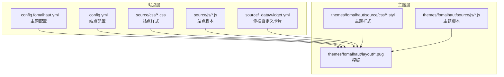
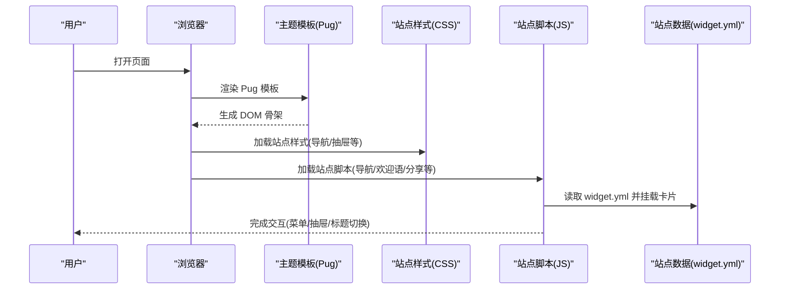
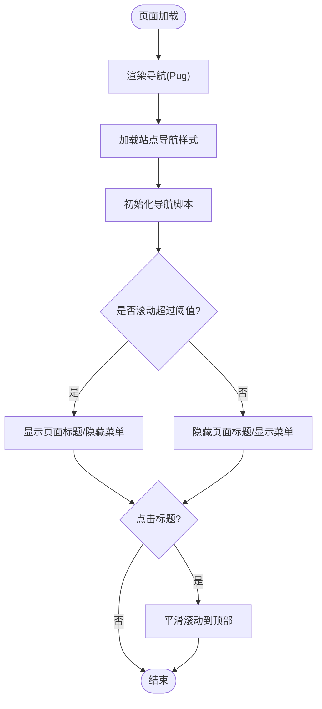
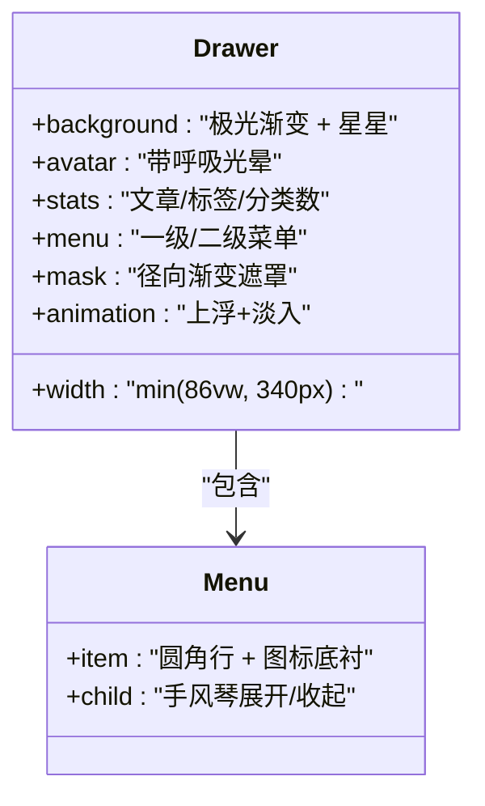
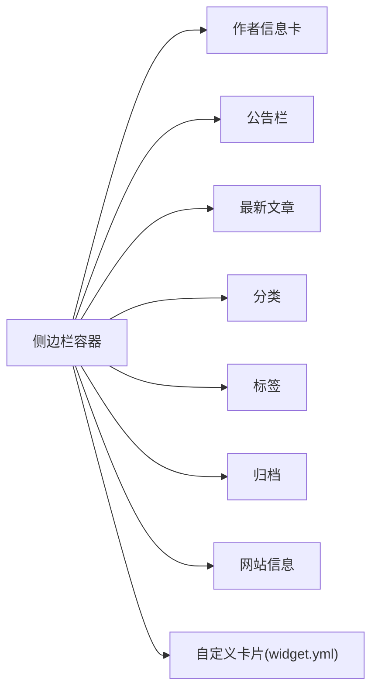
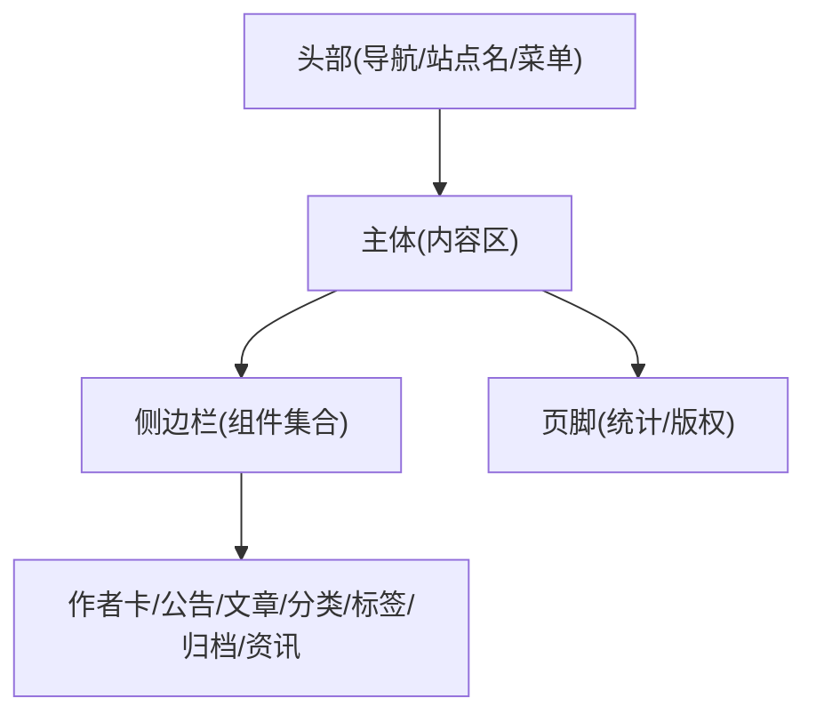
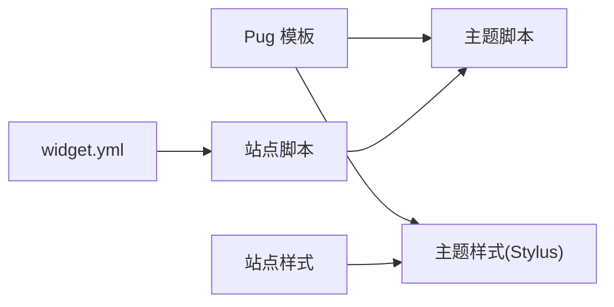

# UI 组件与布局系统

<cite>
**本文引用的文件**   
- [README.md](file://README.md)
- [_config.yml](file://_config.yml)
- [_config.fomalhaut.yml](file://_config.fomalhaut.yml)
- [navigation.css](file://source/css/navigation.css)
- [mobile-drawer.css](file://source/css/mobile-drawer.css)
- [nav.pug](file://themes/fomalhaut/layout/includes/header/nav.pug)
- [sidebar.pug](file://themes/fomalhaut/layout/includes/sidebar.pug)
- [widget/index.pug](file://themes/fomalhaut/layout/includes/widget/index.pug)
- [card_author.pug](file://themes/fomalhaut/layout/includes/widget/card_author.pug)
- [card_announcement.pug](file://themes/fomalhaut/layout/includes/widget/card_announcement.pug)
- [card_recent_post.pug](file://themes/fomalhaut/layout/includes/widget/card_recent_post.pug)
- [card_categories.pug](file://themes/fomalhaut/layout/includes/widget/card_categories.pug)
- [card_tags.pug](file://themes/fomalhaut/layout/includes/widget/card_tags.pug)
- [widget.yml](file://source/_data/widget.yml)
- [head.styl](file://themes/fomalhaut/source/css/_layout/head.styl)
- [nav.js](file://source/js/modules/nav.js)
</cite>

## 目录
1. [引言](#引言)
2. [项目结构](#项目结构)
3. [核心组件](#核心组件)
4. [架构总览](#架构总览)
5. [详细组件分析](#详细组件分析)
6. [依赖关系分析](#依赖关系分析)
7. [性能与可访问性](#性能与可访问性)
8. [故障排查指南](#故障排查指南)
9. [结论](#结论)
10. [附录：定制与扩展示例](#附录定制与扩展示例)

## 引言
本文件系统性地文档化该 Hexo 卡片式博客主题的 UI 组件系统与布局架构，重点覆盖：
- 卡片式设计与响应式网格、断点策略
- 导航组件（多级菜单、移动端抽屉、导航高亮与标题切换）
- 侧边栏组件系统（作者信息卡、公告栏、最新文章、分类标签等）
- 页面布局层次（头部、主体、侧边栏、页脚）的组织与交互
- 组件定制与扩展的具体路径与最佳实践

该项目基于 Butterfly 主题二次开发，站点配置与主题代码分离，通过 `inject.head` / `inject.bottom` 注入样式与脚本，避免直接修改主题源码。

**章节来源**
- [README.md:240-340](file://README.md#L240-L340)

## 项目结构
UI 相关的关键位置如下：
- 主题模板：`themes/fomalhaut/layout/`（Pug 模板）
- 主题样式：`themes/fomalhaut/source/css/`（Stylus）
- 站点级样式：`source/css/`（如导航、移动端抽屉）
- 站点级脚本：`source/js/`（模块与注入脚本）
- 站点数据：`source/_data/`（侧栏自定义卡片数据）
- 主题配置：根 `_config.fomalhaut.yml`（生效的主题配置）
- 站点配置：根 `_config.yml`（站点元信息与构建参数）



**图表来源**
- [_config.fomalhaut.yml:1-24](file://_config.fomalhaut.yml#L1-L24)
- [_config.yml:131-138](file://_config.yml#L131-L138)
- [README.md:472-504](file://README.md#L472-L504)

**章节来源**
- [README.md:472-643](file://README.md#L472-L643)
- [_config.yml:131-138](file://_config.yml#L131-L138)

## 核心组件
- 导航组件
  - 顶栏导航：站点名、菜单、搜索、美化设置、夜间模式、汉堡菜单
  - 多级菜单：通过 Pug 模板渲染，CSS 控制下拉与动画
  - 移动端抽屉：独立样式表增强，包含头像、统计胶囊、分隔线、菜单与遮罩
- 侧边栏组件
  - 作者信息卡、公告栏、最新文章、分类、标签、归档、网站信息等
  - 自定义卡片：通过 `source/_data/widget.yml` 注入 HTML、样式与脚本
- 页面布局
  - 头部（含导航）、主体内容区、右侧工具栏、页脚
  - 文章页与非文章页的侧边栏差异

**章节来源**
- [nav.pug:1-36](file://themes/fomalhaut/layout/includes/header/nav.pug#L1-L36)
- [sidebar.pug:1-19](file://themes/fomalhaut/layout/includes/sidebar.pug#L1-L19)
- [widget/index.pug:1-37](file://themes/fomalhaut/layout/includes/widget/index.pug#L1-L37)

## 架构总览
整体 UI 架构由“主题模板 + 站点样式/脚本 + 站点数据”三层组成：
- 主题模板负责骨架与默认行为
- 站点样式/脚本在不改主题源码的前提下增强体验
- 站点数据提供可配置的侧栏卡片内容



**图表来源**
- [nav.pug:1-36](file://themes/fomalhaut/layout/includes/header/nav.pug#L1-L36)
- [widget/index.pug:1-37](file://themes/fomalhaut/layout/includes/widget/index.pug#L1-L37)
- [widget.yml:1-50](file://source/_data/widget.yml#L1-L50)
- [nav.js:1-26](file://source/js/modules/nav.js#L1-L26)

## 详细组件分析

### 导航组件
- 顶栏结构
  - 站点名容器、菜单容器、右侧工具区（搜索、美化设置、夜间模式、汉堡菜单）
  - 滚动后中间显示当前页面标题，隐藏原始菜单项
- 多级菜单
  - 一级菜单项悬停展开二级菜单，带旋转箭头与阴影卡片
- 移动端抽屉
  - 从右侧滑出，包含头像、统计胶囊、分隔线、菜单与遮罩
  - 支持手风琴式二级菜单展开/收起动效
- 导航高亮与标题切换
  - 滚动到正文后，顶部中间淡入页面标题；回到顶部时恢复原状
  - 点击标题可平滑回到顶部



**图表来源**
- [nav.pug:1-36](file://themes/fomalhaut/layout/includes/header/nav.pug#L1-L36)
- [navigation.css:1-278](file://source/css/navigation.css#L1-L278)
- [nav.js:28-65](file://source/js/modules/nav.js#L28-L65)

**章节来源**
- [nav.pug:1-36](file://themes/fomalhaut/layout/includes/header/nav.pug#L1-L36)
- [head.styl:272-322](file://themes/fomalhaut/source/css/_layout/head.styl#L272-L322)
- [navigation.css:1-278](file://source/css/navigation.css#L1-L278)
- [nav.js:28-65](file://source/js/modules/nav.js#L28-L65)

### 移动端抽屉菜单
- 面板宽度按视口自适应，最大 340px
- 头像带呼吸光晕，统计胶囊展示文章/标签/分类数量
- 分隔线改为两端渐隐发丝线，图标居中带主题色辉光
- 菜单项采用圆角行设计，图标底衬与 hover 状态统一
- 二级菜单使用手风琴动效（max-height + opacity），由主题 JS 控制 `.hide` 类
- 遮罩为径向渐变深色背景，提升聚焦感
- 入场动效为上浮+淡入，尊重减少动态偏好



**图表来源**
- [mobile-drawer.css:35-70](file://source/css/mobile-drawer.css#L35-L70)
- [mobile-drawer.css:141-207](file://source/css/mobile-drawer.css#L141-L207)
- [mobile-drawer.css:239-376](file://source/css/mobile-drawer.css#L239-L376)
- [mobile-drawer.css:378-405](file://source/css/mobile-drawer.css#L378-L405)

**章节来源**
- [mobile-drawer.css:1-492](file://source/css/mobile-drawer.css#L1-L492)

### 侧边栏组件系统
- 组件列表
  - 作者信息卡：头像、状态胶囊、简介、统计数据、关注按钮、社交图标
  - 公告栏：支持 HTML 内容，内置欢迎信息占位
  - 最新文章：支持封面、标题、日期，可按更新时间或创建时间排序
  - 分类：调用助手函数渲染分类列表
  - 标签：支持云标签或彩色标签
  - 归档、网站信息等
- 自定义卡片
  - 通过 `source/_data/widget.yml` 定义 top/bottom 分组
  - 每个卡片可指定 class、id、名称、图标与 HTML 内容
  - 支持内联引入 CSS/JS，便于独立功能卡片



**图表来源**
- [widget/index.pug:1-37](file://themes/fomalhaut/layout/includes/widget/index.pug#L1-L37)
- [card_author.pug:1-37](file://themes/fomalhaut/layout/includes/widget/card_author.pug#L1-L37)
- [card_announcement.pug:1-14](file://themes/fomalhaut/layout/includes/widget/card_announcement.pug#L1-L14)
- [card_recent_post.pug:1-26](file://themes/fomalhaut/layout/includes/widget/card_recent_post.pug#L1-L26)
- [card_categories.pug:1-5](file://themes/fomalhaut/layout/includes/widget/card_categories.pug#L1-L5)
- [card_tags.pug:1-13](file://themes/fomalhaut/layout/includes/widget/card_tags.pug#L1-L13)
- [widget.yml:1-50](file://source/_data/widget.yml#L1-L50)

**章节来源**
- [widget/index.pug:1-37](file://themes/fomalhaut/layout/includes/widget/index.pug#L1-L37)
- [card_author.pug:1-37](file://themes/fomalhaut/layout/includes/widget/card_author.pug#L1-L37)
- [card_announcement.pug:1-14](file://themes/fomalhaut/layout/includes/widget/card_announcement.pug#L1-L14)
- [card_recent_post.pug:1-26](file://themes/fomalhaut/layout/includes/widget/card_recent_post.pug#L1-L26)
- [card_categories.pug:1-5](file://themes/fomalhaut/layout/includes/widget/card_categories.pug#L1-L5)
- [card_tags.pug:1-13](file://themes/fomalhaut/layout/includes/widget/card_tags.pug#L1-L13)
- [widget.yml:1-50](file://source/_data/widget.yml#L1-L50)

### 页面布局层次
- 头部（Header）
  - 包含导航、站点名、菜单、右侧工具区
  - 滚动后根据主题类名切换固定态与磨砂背景
- 主体（Main）
  - 文章列表、文章内容、分页等
- 侧边栏（Aside）
  - 非文章页显示完整组件集，文章页优先显示目录或作者卡
- 页脚（Footer）
  - 运行天数、版权信息等



**图表来源**
- [nav.pug:1-36](file://themes/fomalhaut/layout/includes/header/nav.pug#L1-L36)
- [widget/index.pug:1-37](file://themes/fomalhaut/layout/includes/widget/index.pug#L1-L37)

**章节来源**
- [nav.pug:1-36](file://themes/fomalhaut/layout/includes/header/nav.pug#L1-L36)
- [widget/index.pug:1-37](file://themes/fomalhaut/layout/includes/widget/index.pug#L1-L37)

## 依赖关系分析
- 主题模板依赖 Pug 语法与主题配置
- 站点样式依赖主题 CSS 变量（如 `--theme-color`）
- 站点脚本依赖全局对象（如 `window.fomalDayNight`、`btf.scrollToDest`）
- 侧栏组件依赖主题助手函数（如 `aside_categories`、`cloudTags`）



**图表来源**
- [_config.fomalhaut.yml:1-24](file://_config.fomalhaut.yml#L1-L24)
- [nav.js:1-26](file://source/js/modules/nav.js#L1-L26)
- [widget.yml:1-50](file://source/_data/widget.yml#L1-L50)

**章节来源**
- [_config.fomalhaut.yml:1-24](file://_config.fomalhaut.yml#L1-L24)
- [nav.js:1-26](file://source/js/modules/nav.js#L1-L26)
- [widget.yml:1-50](file://source/_data/widget.yml#L1-L50)

## 性能与可访问性
- 导航磨砂效果按能力降级：仅在支持 `backdrop-filter` 且满足条件时启用
- 减少动态偏好：所有动画与过渡在 `prefers-reduced-motion` 下禁用
- 触控区域：导航按钮统一 44×44px，符合移动端触控标准
- 字体与背景预览：预加载机制避免闪烁，失败不写偏好
- 服务工作者缓存：文本资源 TTL 缩短至 10 分钟，媒体资源保持 24 小时

**章节来源**
- [navigation.css:167-184](file://source/css/navigation.css#L167-L184)
- [navigation.css:265-277](file://source/css/navigation.css#L265-L277)
- [README.md:172-177](file://README.md#L172-L177)

## 故障排查指南
- 导航标题不显示
  - 检查 `name-container` 与 `page-name` 元素是否存在
  - 确认滚动监听是否正确绑定与解绑
- 移动端抽屉无响应
  - 检查 `#toggle-menu` 是否被正确触发
  - 确认 `#sidebar-menus` 的 `right` 值与宽度一致
- 侧栏卡片顺序错乱
  - 检查 `widget.yml` 中 `top`/`bottom` 分组是否正确
  - 确认 `layoutCards()` 是否在解析期与 pjax 完成后调用
- 欢迎信息加载失败
  - 检查腾讯地图 API Key 是否配置正确
  - 确认 JSONP 请求未被拦截

**章节来源**
- [nav.js:35-59](file://source/js/modules/nav.js#L35-L59)
- [mobile-drawer.css:37-42](file://source/css/mobile-drawer.css#L37-L42)
- [widget.yml:11-20](file://source/_data/widget.yml#L11-L20)
- [nav.js:77-90](file://source/js/modules/nav.js#L77-L90)

## 结论
该 UI 组件与布局系统以主题模板为基础，通过站点级样式与脚本实现高度可定制的卡片式设计。导航组件支持多级菜单与移动端抽屉，侧边栏组件系统提供丰富的信息展示与自定义能力。整体架构清晰，易于扩展与维护。

## 附录：定制与扩展示例
- 添加新导航项
  - 在 `_config.fomalhaut.yml` 的 `menu` 中添加键值对
  - 示例：`新页面: /new-page/ || icon-new || faa-tada`
- 自定义侧栏卡片
  - 在 `source/_data/widget.yml` 的 `top` 或 `bottom` 中添加卡片
  - 示例：
    ```yaml
    top:
      - class_name: card-custom
        id_name: custom-card
        name: 自定义卡片
        icon: icon-custom
        html: |
          <div>我的自定义内容</div>
    ```
- 调整导航样式
  - 在 `source/css/navigation.css` 中覆盖样式
  - 示例：修改按钮颜色或间距
- 修改移动端抽屉外观
  - 在 `source/css/mobile-drawer.css` 中调整变量与规则
  - 示例：更改面板宽度或背景渐变

**章节来源**
- [_config.fomalhaut.yml:5-24](file://_config.fomalhaut.yml#L5-L24)
- [widget.yml:21-50](file://source/_data/widget.yml#L21-L50)
- [navigation.css:1-278](file://source/css/navigation.css#L1-L278)
- [mobile-drawer.css:35-70](file://source/css/mobile-drawer.css#L35-L70)