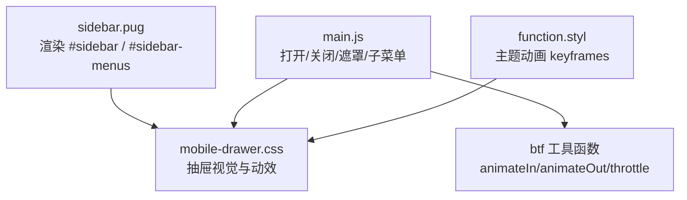
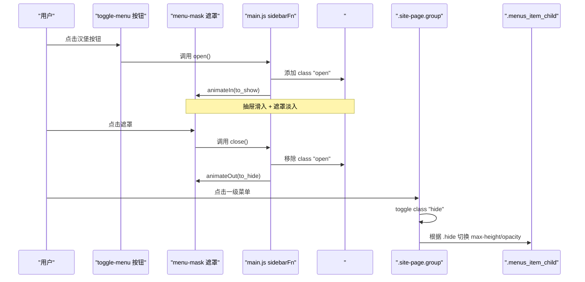
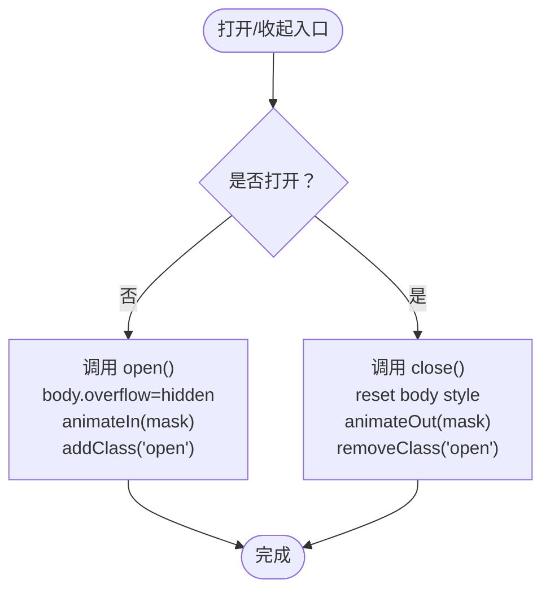
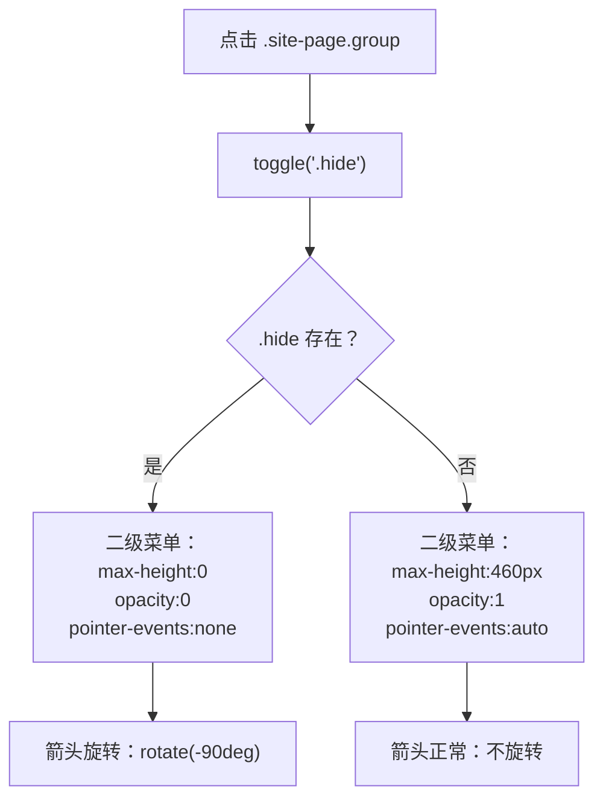
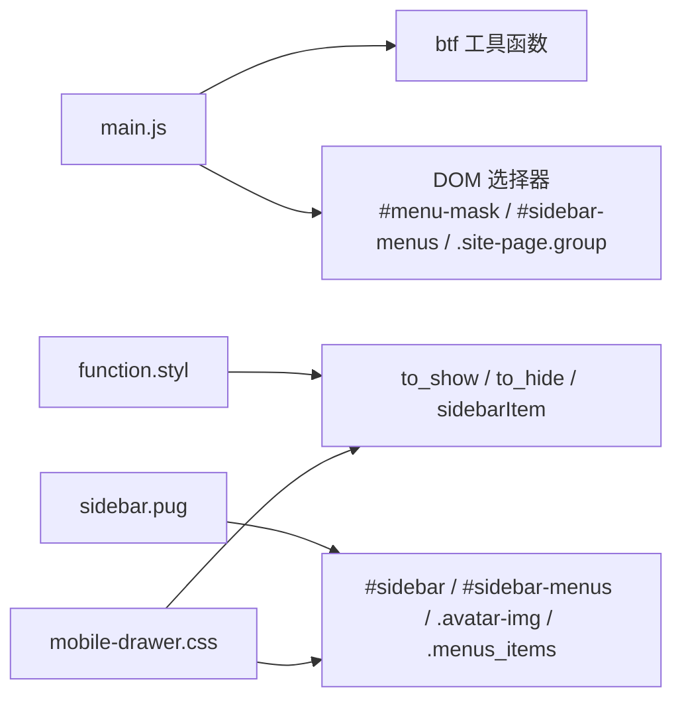

# 侧边栏交互行为

<cite>
**本文引用的文件**   
- [themes/fomalhaut/source/js/main.js](file://themes/fomalhaut/source/js/main.js)
- [source/css/mobile-drawer.css](file://source/css/mobile-drawer.css)
- [themes/fomalhaut/layout/includes/sidebar.pug](file://themes/fomalhaut/layout/includes/sidebar.pug)
- [themes/fomalhaut/source/css/_global/function.styl](file://themes/fomalhaut/source/css/_global/function.styl)
</cite>

## 目录
1. [引言](#引言)
2. [项目结构定位](#项目结构定位)
3. [核心组件总览](#核心组件总览)
4. [架构与数据流](#架构与数据流)
5. [详细交互逻辑分析](#详细交互逻辑分析)
6. [移动端抽屉菜单实现原理](#移动端抽屉菜单实现原理)
7. [依赖关系分析](#依赖关系分析)
8. [性能与可访问性](#性能与可访问性)
9. [故障排查指南](#故障排查指南)
10. [扩展与自定义开发指南](#扩展与自定义开发指南)
11. [结论](#结论)

## 引言
本文聚焦站点中“侧边栏/移动端抽屉菜单”的完整交互链路：从 DOM 结构、样式层，到 JavaScript 的事件绑定、状态切换、遮罩关闭、二级菜单展开收起，以及与页面滚动、主题模式等外部组件的协作方式。文档同时给出优化建议、常见问题排查方法和二次开发指引，帮助开发者在不破坏主题默认结构的前提下，安全地扩展侧边栏功能。

## 项目结构定位
侧边栏相关代码分布在三个层次：
- 模板层：主题渲染出侧边栏容器和菜单项。
- 样式层：主题提供基础布局，站点新增独立 CSS 对抽屉进行视觉增强。
- 脚本层：主题 JS 负责打开/关闭、遮罩点击、二级菜单切换等交互。



**图表来源**
- [themes/fomalhaut/layout/includes/sidebar.pug:1-19](file://themes/fomalhaut/layout/includes/sidebar.pug#L1-L19)
- [source/css/mobile-drawer.css:1-492](file://source/css/mobile-drawer.css#L1-L492)
- [themes/fomalhaut/source/js/main.js:34-51](file://themes/fomalhaut/source/js/main.js#L34-L51)
- [themes/fomalhaut/source/css/_global/function.styl:128-133](file://themes/fomalhaut/source/css/_global/function.styl#L128-L133)

**章节来源**
- [themes/fomalhaut/layout/includes/sidebar.pug:1-19](file://themes/fomalhaut/layout/includes/sidebar.pug#L1-L19)
- [source/css/mobile-drawer.css:1-492](file://source/css/mobile-drawer.css#L1-L492)
- [themes/fomalhaut/source/js/main.js:34-51](file://themes/fomalhaut/source/js/main.js#L34-L51)

## 核心组件总览
- 模板容器
  - `#sidebar`：侧边栏根节点。
  - `#menu-mask`：遮罩层，点击可关闭抽屉。
  - `#sidebar-menus`：抽屉面板，包含头像、站点统计、分隔线、菜单列表。
- 样式模块
  - 主题基础布局由 `_layout/sidebar.styl` 提供（本仓库未直接展示）。
  - 站点通过 `mobile-drawer.css` 覆盖抽屉宽度、背景、图标底衬、手风琴二级菜单、深色模式变量等。
- 交互脚本
  - `main.js` 中的 `sidebarFn.open/close` 控制抽屉开关。
  - 遮罩点击事件触发关闭。
  - 一级菜单 `.site-page.group` 点击切换 `.hide` 类，驱动二级菜单展开收起。
  - 窗口 resize 时若汉堡按钮隐藏且抽屉仍打开，则自动关闭。

**章节来源**
- [themes/fomalhaut/layout/includes/sidebar.pug:1-19](file://themes/fomalhaut/layout/includes/sidebar.pug#L1-L19)
- [source/css/mobile-drawer.css:35-104](file://source/css/mobile-drawer.css#L35-L104)
- [themes/fomalhaut/source/js/main.js:34-51](file://themes/fomalhaut/source/js/main.js#L34-L51)
- [themes/fomalhaut/source/js/main.js:552-558](file://themes/fomalhaut/source/js/main.js#L552-L558)
- [themes/fomalhaut/source/js/main.js:743-754](file://themes/fomalhaut/source/js/main.js#L743-L754)

## 架构与数据流
侧边栏交互的核心流程如下：



**图表来源**
- [themes/fomalhaut/source/js/main.js:34-51](file://themes/fomalhaut/source/js/main.js#L34-L51)
- [themes/fomalhaut/source/js/main.js:552-558](file://themes/fomalhaut/source/js/main.js#L552-L558)
- [themes/fomalhaut/source/js/main.js:749-784](file://themes/fomalhaut/source/js/main.js#L749-L784)
- [source/css/mobile-drawer.css:314-340](file://source/css/mobile-drawer.css#L314-L340)

## 详细交互逻辑分析

### 1. 打开与收起动画
- 打开
  - 调用 `btf.sidebarPaddingR()` 处理右侧滚动条占位。
  - 设置 `document.body.style.overflow = 'hidden'` 禁止背景滚动。
  - 使用 `btf.animateIn('#menu-mask', 'to_show 0.5s')` 显示遮罩。
  - 给 `#sidebar-menus` 添加 `open` 类，触发 CSS 入场动画。
- 收起
  - 恢复 body 的 overflow 与 paddingRight。
  - 使用 `btf.animateOut('#menu-mask', 'to_hide 0.5s')` 隐藏遮罩。
  - 移除 `#sidebar-menus` 的 `open` 类。



**图表来源**
- [themes/fomalhaut/source/js/main.js:34-51](file://themes/fomalhaut/source/js/main.js#L34-L51)

**章节来源**
- [themes/fomalhaut/source/js/main.js:34-51](file://themes/fomalhaut/source/js/main.js#L34-L51)

### 2. 点击遮罩关闭
- 在 `unRefreshFn` 中为 `#menu-mask` 绑定 click 事件，统一调用 `sidebarFn.close()`。
- 该逻辑保证无论从哪里打开抽屉，点击遮罩都能可靠关闭。

**章节来源**
- [themes/fomalhaut/source/js/main.js:749-749](file://themes/fomalhaut/source/js/main.js#L749-L749)

### 3. 二级菜单展开收起
- 主题 JS 为所有 `.site-page.group` 绑定点击事件，切换自身 `.hide` 类。
- 站点 CSS 基于 `.hide` 与相邻兄弟选择器，将二级菜单从 `max-height:0; opacity:0` 过渡到 `max-height:460px; opacity:1`，形成手风琴效果。
- 箭头方向由 CSS 控制：默认朝右，`.hide` 状态下旋转至朝左，符合直觉。



**图表来源**
- [themes/fomalhaut/source/js/main.js:552-558](file://themes/fomalhaut/source/js/main.js#L552-L558)
- [source/css/mobile-drawer.css:309-340](file://source/css/mobile-drawer.css#L309-L340)

**章节来源**
- [themes/fomalhaut/source/js/main.js:552-558](file://themes/fomalhaut/source/js/main.js#L552-L558)
- [source/css/mobile-drawer.css:309-340](file://source/css/mobile-drawer.css#L309-L340)

### 4. 滚动监听与侧边栏的关系
- 主滚动监听主要用于头部导航显隐、右侧工具栏显隐、文章目录高亮与自动滚动。
- 侧边栏本身不直接参与滚动监听；但以下情况与之相关：
  - 当页面内容高度小于可视区域时，右侧工具栏会固定显示。
  - 目录卡片在移动端有独立的打开/关闭逻辑，与侧边栏并列存在。
- 因此，侧边栏与滚动监听的耦合点在于“页面整体滚动体验”，而非直接控制抽屉开闭。

**章节来源**
- [themes/fomalhaut/source/js/main.js:256-322](file://themes/fomalhaut/source/js/main.js#L256-L322)
- [themes/fomalhaut/source/js/main.js:327-454](file://themes/fomalhaut/source/js/main.js#L327-L454)

### 5. 响应式与窗口尺寸变化
- 窗口 resize 时，若汉堡按钮被隐藏且当前抽屉仍处于打开状态，则自动关闭抽屉，避免布局错乱。
- 这是通过 `unRefreshFn` 中监听 `resize` 并判断 `btf.isHidden(document.getElementById('toggle-menu')) && mobileSidebarOpen` 实现的。

**章节来源**
- [themes/fomalhaut/source/js/main.js:743-747](file://themes/fomalhaut/source/js/main.js#L743-L747)

## 移动端抽屉菜单实现原理
- DOM 结构固定
  - 主题渲染顺序为：头像 → 站点统计 → hr → 菜单项。站点样式不能改变该结构，只能基于现有类名做覆盖。
- 宽度与定位
  - 抽屉宽度采用 CSS 变量，按视口比例计算，最大不超过 340px。
  - 初始位置通过 `right: calc(-1 * var(--md-w))` 配合 `translate3d(-100%)` 滑入，确保滑完后不留缝隙。
- 背景与视觉
  - 使用多层渐变模拟极光、星星、高光边缘，滚动容器上背景固定，使背景静止而内容滚动。
  - 头像、统计胶囊、分隔线、菜单项均增加圆角、阴影、图标底衬与 hover 洗色。
- 二级菜单手风琴
  - 主题用 `display:none/block` 硬切，站点改为 `max-height + opacity` 过渡，提升动效质感。
- 深色模式
  - 仅覆盖 CSS 变量，规则本体复用；同时重写背景图层以压过主题的深色底色。
- 无障碍
  - 针对 `prefers-reduced-motion` 禁用动画与过渡，并为头像保留常亮光晕，保持可读性。

```mermaid
classDiagram
class SidebarDrawer {
"+width : CSS变量(视口比例)"
"+position : right负值+translate3d"
"+background : 多层渐变"
"+scrollbar : 细滚动条"
}
class MenuItems {
"+一级项 : 图标底衬+文字"
"+hover : 洗色"
"+group : 带箭头"
}
class SubMenu {
"+max-height : 0→460px"
"+opacity : 0→1"
"+transition : cubic-bezier"
}
class ThemeMode {
"+light/dark : 变量覆盖"
"+reduced-motion : 禁用动画"
}
SidebarDrawer --> MenuItems : "包含"
MenuItems --> SubMenu : "展开/收起"
SidebarDrawer --> ThemeMode : "适配"
```

**图表来源**
- [source/css/mobile-drawer.css:35-104](file://source/css/mobile-drawer.css#L35-L104)
- [source/css/mobile-drawer.css:239-376](file://source/css/mobile-drawer.css#L239-L376)
- [source/css/mobile-drawer.css:407-491](file://source/css/mobile-drawer.css#L407-L491)

**章节来源**
- [source/css/mobile-drawer.css:1-492](file://source/css/mobile-drawer.css#L1-L492)

## 依赖关系分析
- main.js 依赖 btf 工具函数
  - `btf.sidebarPaddingR()`：处理滚动条占位。
  - `btf.animateIn/animateOut`：遮罩淡入淡出。
  - `btf.throttle`：滚动节流。
  - `btf.isHidden`：判断元素是否隐藏。
- function.styl 提供主题动画 keyframes
  - `to_show/to_hide`：遮罩显示/隐藏动画。
  - `sidebarItem`：抽屉子元素入场动画（站点已替换为更柔和的 `md-rise`）。
- sidebar.pug 提供稳定 DOM 结构
  - 站点样式严格遵循主题生成的类名与顺序。



**图表来源**
- [themes/fomalhaut/source/js/main.js:34-51](file://themes/fomalhaut/source/js/main.js#L34-L51)
- [themes/fomalhaut/source/css/_global/function.styl:128-133](file://themes/fomalhaut/source/css/_global/function.styl#L128-L133)
- [themes/fomalhaut/layout/includes/sidebar.pug:1-19](file://themes/fomalhaut/layout/includes/sidebar.pug#L1-L19)
- [source/css/mobile-drawer.css:383-405](file://source/css/mobile-drawer.css#L383-L405)

**章节来源**
- [themes/fomalhaut/source/js/main.js:34-51](file://themes/fomalhaut/source/js/main.js#L34-L51)
- [themes/fomalhaut/source/css/_global/function.styl:128-133](file://themes/fomalhaut/source/css/_global/function.styl#L128-L133)
- [themes/fomalhaut/layout/includes/sidebar.pug:1-19](file://themes/fomalhaut/layout/includes/sidebar.pug#L1-L19)
- [source/css/mobile-drawer.css:383-405](file://source/css/mobile-drawer.css#L383-L405)

## 性能与可访问性
- 性能
  - 滚动监听使用节流，避免频繁重排。
  - 二级菜单使用 `max-height` 与 `opacity` 过渡，减少 layout thrashing。
  - 背景使用 `background-attachment: scroll` 语义下的固定背景，避免内容滚动时的重绘压力。
- 可访问性
  - 支持 `prefers-reduced-motion`，禁用动画与过渡。
  - 头像在减少动效模式下保留光晕，保证视觉提示。
  - 遮罩点击关闭提供明确的退出路径。

**章节来源**
- [themes/fomalhaut/source/js/main.js:287-319](file://themes/fomalhaut/source/js/main.js#L287-L319)
- [source/css/mobile-drawer.css:470-491](file://source/css/mobile-drawer.css#L470-L491)

## 故障排查指南
- 抽屉滑完右边留缝
  - 原因：抽屉宽度与 `right` 初始偏移不一致。
  - 解决：确保 CSS 变量 `--md-w` 与 `right: calc(-1 * var(--md-w))` 同步。
- 二级菜单无动效或闪烁
  - 原因：主题 JS 切换 `.hide` 类，但 CSS 未正确匹配相邻兄弟选择器。
  - 解决：检查 `.site-page.group.hide + .menus_item_child` 与 `.site-page.group:not(.hide) + .menus_item_child` 的选择器与 `max-height` 过渡。
- 遮罩点击无效
  - 原因：事件未绑定或被其他元素拦截。
  - 解决：确认 `#menu-mask` 存在且未被覆盖 `pointer-events`，检查 `unRefreshFn` 中是否执行了绑定。
- 深色模式背景异常
  - 原因：主题深色底色优先级更高。
  - 解决：站点 CSS 使用 `!important` 覆盖背景色，并确保变量重写完整。
- 头像呼吸灯消失
  - 原因：主题 `:nth-child(1)` 动画权重高于呼吸灯动画。
  - 解决：站点为头像并行写入入场动画与呼吸灯动画，避免冲突。

**章节来源**
- [source/css/mobile-drawer.css:37-41](file://source/css/mobile-drawer.css#L37-L41)
- [source/css/mobile-drawer.css:314-340](file://source/css/mobile-drawer.css#L314-L340)
- [themes/fomalhaut/source/js/main.js:749-749](file://themes/fomalhaut/source/js/main.js#L749-L749)
- [source/css/mobile-drawer.css:437-450](file://source/css/mobile-drawer.css#L437-L450)
- [source/css/mobile-drawer.css:383-405](file://source/css/mobile-drawer.css#L383-L405)

## 扩展与自定义开发指南

### 1. 自定义交互行为
- 在抽屉打开后执行额外逻辑
  - 在 `sidebarFn.open` 末尾追加你的回调，例如埋点、初始化第三方组件。
- 在抽屉关闭后清理资源
  - 在 `sidebarFn.close` 末尾释放定时器、解绑事件、重置表单状态。

参考路径：
- [themes/fomalhaut/source/js/main.js:34-51](file://themes/fomalhaut/source/js/main.js#L34-L51)

### 2. 添加新功能
- 新增一级菜单项
  - 在主题菜单配置中添加条目，确保生成 `.site-page.group` 结构以便二级菜单生效。
- 新增二级菜单
  - 保持 `.menus_item_child` 结构，站点 CSS 会自动为其提供手风琴动效。
- 新增抽屉内卡片
  - 在 `#sidebar-menus` 下插入新节点，注意不要打乱主题固定顺序；如需顶部标题或底部签名，可通过伪元素或新增节点实现。

参考路径：
- [themes/fomalhaut/layout/includes/sidebar.pug:1-19](file://themes/fomalhaut/layout/includes/sidebar.pug#L1-L19)
- [source/css/mobile-drawer.css:239-376](file://source/css/mobile-drawer.css#L239-L376)

### 3. 优化用户体验
- 动效节奏
  - 使用缓动曲线 `cubic-bezier(0.22, 1, 0.36, 1)` 让展开更顺滑。
- 视觉层次
  - 图标底衬与 hover 洗色区分主次，避免过度装饰。
- 深色模式一致性
  - 优先覆盖 CSS 变量，保持规则复用，减少维护成本。
- 无障碍
  - 尊重 `prefers-reduced-motion`，为关键控件提供非动画替代方案。

参考路径：
- [source/css/mobile-drawer.css:323-340](file://source/css/mobile-drawer.css#L323-L340)
- [source/css/mobile-drawer.css:407-491](file://source/css/mobile-drawer.css#L407-L491)

### 4. 与页面其他组件通信
- 状态同步
  - 通过 `mobileSidebarOpen` 标志位与 `open/close` 方法同步抽屉状态。
- 事件处理
  - 汉堡按钮点击触发 `open`，遮罩点击触发 `close`，一级菜单点击切换 `.hide`。
- 数据更新
  - 站点统计数字由主题模板注入，样式层仅负责展示；如需动态更新，可在数据变更后重新渲染对应节点。

参考路径：
- [themes/fomalhaut/source/js/main.js:34-51](file://themes/fomalhaut/source/js/main.js#L34-L51)
- [themes/fomalhaut/source/js/main.js:552-558](file://themes/fomalhaut/source/js/main.js#L552-L558)
- [themes/fomalhaut/layout/includes/sidebar.pug:6-15](file://themes/fomalhaut/layout/includes/sidebar.pug#L6-L15)

## 结论
侧边栏交互由主题模板、站点样式与主题脚本共同构成：模板提供稳定结构，样式负责视觉与动效，脚本负责状态切换与事件绑定。站点通过独立 CSS 文件在不修改主题源码的前提下，显著提升了抽屉的视觉质量与交互体验。开发者可在此基础上安全扩展菜单结构、定制动效、接入业务逻辑，并通过节流、变量覆盖、无障碍支持等手段保障性能与可用性。