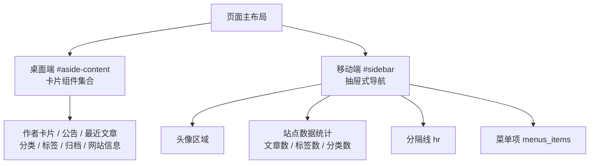
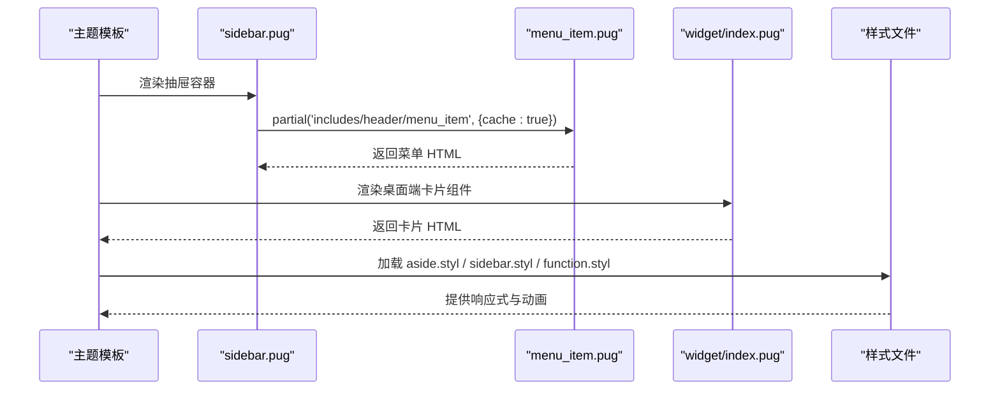
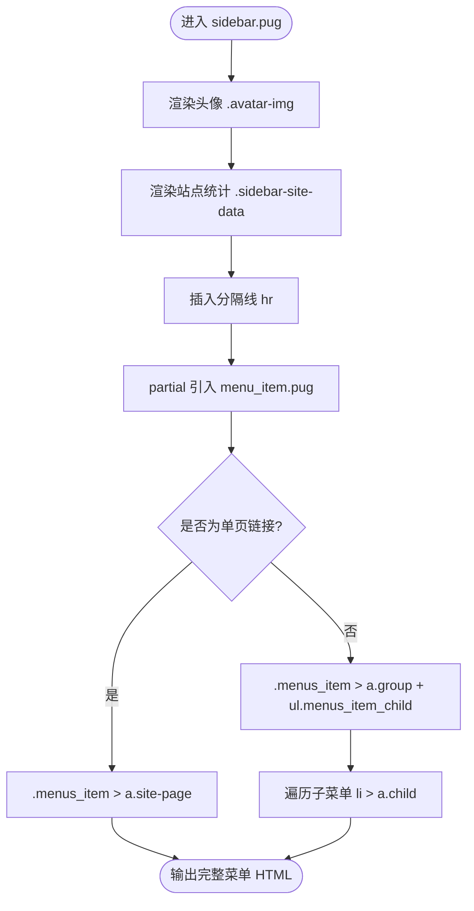
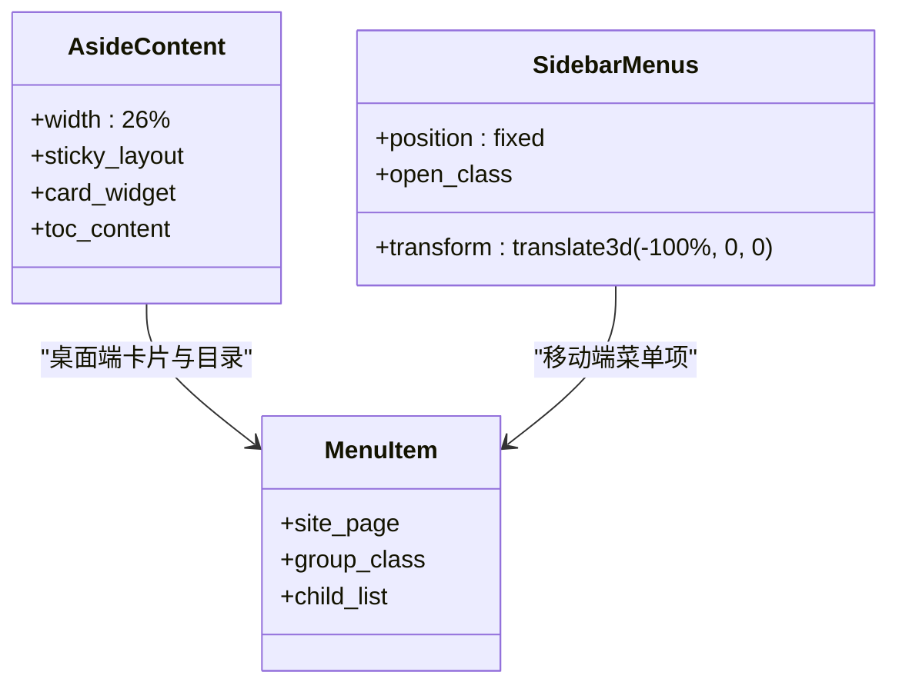
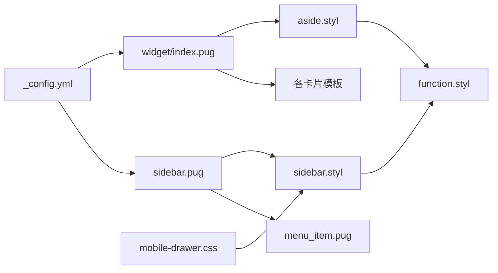

# 侧边栏布局结构

<cite>
**本文引用的文件**   
- [sidebar.pug](file://themes/fomalhaut/layout/includes/sidebar.pug)
- [menu_item.pug](file://themes/fomalhaut/layout/includes/header/menu_item.pug)
- [widget/index.pug](file://themes/fomalhaut/layout/includes/widget/index.pug)
- [aside.styl](file://themes/fomalhaut/source/css/_layout/aside.styl)
- [sidebar.styl](file://themes/fomalhaut/source/css/_layout/sidebar.styl)
- [function.styl](file://themes/fomalhaut/source/css/_global/function.styl)
- [mobile-drawer.css](file://source/css/mobile-drawer.css)
- [_config.yml](file://themes/fomalhaut/_config.yml)
</cite>

## 目录
1. [引言](#引言)
2. [项目结构与定位](#项目结构与定位)
3. [核心组件总览](#核心组件总览)
4. [架构与渲染流程](#架构与渲染流程)
5. [HTML 结构设计详解](#html-结构设计详解)
6. [Pug 模板渲染机制](#pug-模板渲染机制)
7. [CSS 样式架构](#css-样式架构)
8. [依赖关系分析](#依赖关系分析)
9. [性能与缓存策略](#性能与缓存策略)
10. [自定义侧边栏布局指南](#自定义侧边栏布局指南)
11. [常见问题排查](#常见问题排查)
12. [结论](#结论)

## 引言
本文围绕 Fomalhaut 主题的侧边栏展开，重点说明：
- 移动端抽屉式侧边栏的整体布局结构。
- 头像区域、站点数据统计（文章数、标签数、分类数）、分隔线与菜单项的组织方式。
- Pug 模板的 partial 引用机制与缓存策略。
- CSS 样式架构中的响应式布局、动画效果与主题适配。
- 如何在不破坏主题默认结构的前提下，安全地自定义侧边栏布局。

## 项目结构与定位
侧边栏在主题中分为两个主要部分：
- 桌面端右侧内容区：由 `#aside-content` 承载各类卡片组件，如作者信息、公告、最近文章、分类、标签、归档等。
- 移动端抽屉式导航：由 `#sidebar` 容器承载头像、站点统计、分隔线以及菜单项，通过 JS 控制滑出与收起。

**图示来源**
- [sidebar.pug:1-19](file://themes/fomalhaut/layout/includes/sidebar.pug#L1-L19)
- [widget/index.pug:1-37](file://themes/fomalhaut/layout/includes/widget/index.pug#L1-L37)

**章节来源**
- [sidebar.pug:1-19](file://themes/fomalhaut/layout/includes/sidebar.pug#L1-L19)
- [widget/index.pug:1-37](file://themes/fomalhaut/layout/includes/widget/index.pug#L1-L37)

## 核心组件总览
- 抽屉容器：`#sidebar`
- 遮罩层：`#menu-mask`
- 抽屉面板：`#sidebar-menus`
- 头像区域：`.avatar-img`
- 站点数据：`.sidebar-site-data.site-data`
- 分隔线：`hr`
- 菜单容器：`.menus_items`
- 菜单项：`.site-page`，支持分组与子菜单 `.menus_item_child`

这些元素共同构成移动端可滑出的导航面板；桌面端则使用 `#aside-content` 展示更多卡片型内容。

**章节来源**
- [sidebar.pug:1-19](file://themes/fomalhaut/layout/includes/sidebar.pug#L1-L19)
- [menu_item.pug:32-77](file://themes/fomalhaut/layout/includes/header/menu_item.pug#L32-L77)

## 架构与渲染流程
侧边栏的渲染由多个 Pug 模板协作完成：
- 抽屉入口模板负责输出固定 DOM 结构。
- 菜单项模板根据配置动态生成单页链接或分组菜单。
- 桌面端卡片组件由 widget 索引模板统一调度。

**图示来源**
- [sidebar.pug:17-18](file://themes/fomalhaut/layout/includes/sidebar.pug#L17-L18)
- [menu_item.pug:32-77](file://themes/fomalhaut/layout/includes/header/menu_item.pug#L32-L77)
- [widget/index.pug:1-37](file://themes/fomalhaut/layout/includes/widget/index.pug#L1-L37)
- [aside.styl:1-411](file://themes/fomalhaut/source/css/_layout/aside.styl#L1-L411)
- [sidebar.styl:1-68](file://themes/fomalhaut/source/css/_layout/sidebar.styl#L1-L68)

## HTML 结构设计详解
### 抽屉容器与遮罩
- `#sidebar` 作为根容器，内部包含遮罩层 `#menu-mask` 和抽屉面板 `#sidebar-menus`。
- 遮罩层用于点击关闭抽屉，面板通过 CSS transform 实现滑入滑出。

### 头像区域
- `.avatar-img.is-center` 包裹头像图片，支持错误回退图。
- 头像尺寸、圆角、悬停旋转等由 CSS 控制。

### 站点数据统计
- `.sidebar-site-data.site-data` 以表格布局展示三个统计项：
  - 文章数：链接到归档目录。
  - 标签数：链接到标签目录。
  - 分类数：链接到分类目录。
- 标题与数字分别位于 `.headline` 与 `.length-num`。

### 分隔线
- `hr` 用于视觉分隔头像统计与菜单项。

### 菜单项组织
- 菜单由 `menu_item.pug` 渲染，支持：
  - 单页链接：带图标与动画类。
  - 分组菜单：带下拉箭头与子菜单列表。
  - 子菜单项：支持图标与动画类。
- 菜单项文本通过 `span.menu_word` 包裹，便于统一字号与排版。

**图示来源**
- [sidebar.pug:4-18](file://themes/fomalhaut/layout/includes/sidebar.pug#L4-L18)
- [menu_item.pug:32-77](file://themes/fomalhaut/layout/includes/header/menu_item.pug#L32-L77)

**章节来源**
- [sidebar.pug:1-19](file://themes/fomalhaut/layout/includes/sidebar.pug#L1-L19)
- [menu_item.pug:32-77](file://themes/fomalhaut/layout/includes/header/menu_item.pug#L32-L77)

## Pug 模板渲染机制
### partial 引用机制
- 在 `sidebar.pug` 中通过 `!=partial('includes/header/menu_item', {}, {cache: true})` 引入菜单模板。
- `!=` 表示输出未转义的 HTML，适合直接注入菜单结构。
- `{cache: true}` 启用模板缓存，避免重复解析菜单结构，提升渲染性能。

### 条件渲染与配置驱动
- 菜单是否渲染取决于 `theme.menu` 是否存在。
- 菜单项支持两种形态：
  - 字符串形式：单页链接，含路径、图标与动画类。
  - 对象形式：分组菜单，含分组标题、图标、动画类与子菜单数组。

### 桌面端卡片组件调度
- `widget/index.pug` 根据页面类型（文章页或非文章页）决定渲染哪些卡片组件。
- 常用卡片包括：作者信息、公告、置顶卡片、目录、友链、微博、最近文章、广告、最新评论、分类、标签、归档、网站信息、底部自定义卡片。

**章节来源**
- [sidebar.pug:17-18](file://themes/fomalhaut/layout/includes/sidebar.pug#L17-L18)
- [menu_item.pug:32-77](file://themes/fomalhaut/layout/includes/header/menu_item.pug#L32-L77)
- [widget/index.pug:1-37](file://themes/fomalhaut/layout/includes/widget/index.pug#L1-L37)

## CSS 样式架构
### 桌面端侧边内容区
- `#aside-content` 宽度为 26%，在大屏上根据 `aside.position` 调整左右内边距。
- 小屏时宽度变为 100%。
- 卡片组件 `.card-widget` 统一圆角、阴影、悬停效果。
- 目录卡片 `#card-toc` 在小屏下以固定定位弹出，并支持展开收起动画。

### 移动端抽屉样式
- `#sidebar` 内的 `#sidebar-menus` 固定在右侧，初始隐藏，通过 `.open` 类触发滑入。
- 遮罩层 `#menu-mask` 覆盖全屏，半透明背景。
- 菜单项 `.site-page` 支持悬停高亮与分组下拉。
- 分组菜单的子菜单通过 `.hide` 类控制显示与隐藏。

### 动画与交互
- 头像悬停旋转、菜单项悬停位移、更多按钮移动动画。
- 目录打开与收起缩放动画。
- 全局函数文件中定义了抽屉项依次出现的入场动画。

### 主题适配
- 大量样式使用 CSS 变量，如 `--font-color`、`--text-bg-hover`、`--sidebar-bg` 等，便于深色模式与主题色切换。
- 站点级样式文件可覆盖主题默认样式，例如 `mobile-drawer.css` 对抽屉进行增强。

**图示来源**
- [aside.styl:1-411](file://themes/fomalhaut/source/css/_layout/aside.styl#L1-L411)
- [sidebar.styl:1-68](file://themes/fomalhaut/source/css/_layout/sidebar.styl#L1-L68)
- [function.styl:128-140](file://themes/fomalhaut/source/css/_global/function.styl#L128-L140)

**章节来源**
- [aside.styl:1-411](file://themes/fomalhaut/source/css/_layout/aside.styl#L1-L411)
- [sidebar.styl:1-68](file://themes/fomalhaut/source/css/_layout/sidebar.styl#L1-L68)
- [function.styl:128-140](file://themes/fomalhaut/source/css/_global/function.styl#L128-L140)

## 依赖关系分析
- 模板依赖：
  - `sidebar.pug` 依赖 `menu_item.pug` 生成菜单。
  - `widget/index.pug` 依赖各卡片模板生成桌面端内容。
- 样式依赖：
  - `aside.styl` 定义桌面端卡片与目录样式。
  - `sidebar.styl` 定义移动端抽屉基础样式。
  - `function.styl` 提供通用动画与工具类。
  - `mobile-drawer.css` 增强抽屉交互与视觉表现。
- 配置依赖：
  - `_config.yml` 中的 `aside` 与 `menu` 控制侧边栏开关、位置、卡片显隐与菜单结构。

**图示来源**
- [_config.yml:622-672](file://themes/fomalhaut/_config.yml#L622-L672)
- [sidebar.pug:1-19](file://themes/fomalhaut/layout/includes/sidebar.pug#L1-L19)
- [widget/index.pug:1-37](file://themes/fomalhaut/layout/includes/widget/index.pug#L1-L37)
- [aside.styl:1-411](file://themes/fomalhaut/source/css/_layout/aside.styl#L1-L411)
- [sidebar.styl:1-68](file://themes/fomalhaut/source/css/_layout/sidebar.styl#L1-L68)
- [function.styl:128-140](file://themes/fomalhaut/source/css/_global/function.styl#L128-L140)
- [mobile-drawer.css:1-335](file://source/css/mobile-drawer.css#L1-L335)

**章节来源**
- [_config.yml:622-672](file://themes/fomalhaut/_config.yml#L622-L672)
- [sidebar.pug:1-19](file://themes/fomalhaut/layout/includes/sidebar.pug#L1-L19)
- [widget/index.pug:1-37](file://themes/fomalhaut/layout/includes/widget/index.pug#L1-L37)

## 性能与缓存策略
- 模板缓存：
  - `partial(..., {cache: true})` 缓存菜单模板，减少重复解析开销。
  - 卡片模板同样启用缓存，避免每次渲染都重新计算。
- 样式优化：
  - 使用 CSS 变量与复用类名，减少重复规则。
  - 动画使用 transform 与 opacity，利于 GPU 加速。
- 交互优化：
  - 抽屉滑入使用 `translate3d`，避免重排。
  - 遮罩层与面板分离，降低事件处理复杂度。

**章节来源**
- [sidebar.pug:17-18](file://themes/fomalhaut/layout/includes/sidebar.pug#L17-L18)
- [widget/index.pug:10-36](file://themes/fomalhaut/layout/includes/widget/index.pug#L10-L36)
- [sidebar.styl:10-24](file://themes/fomalhaut/source/css/_layout/sidebar.styl#L10-L24)

## 自定义侧边栏布局指南
### 目标与约束
- 不修改主题源码，优先通过站点样式与配置扩展。
- 保持抽屉 DOM 顺序不变：头像 → 站点统计 → 分隔线 → 菜单项。
- 如需新增区块，建议在菜单项之后追加，或通过卡片组件在桌面端扩展。

### 步骤一：配置菜单
- 在 `_config.yml` 的 `menu` 中添加条目：
  - 单页链接：`路径 || 图标 || 动画类`
  - 分组菜单：键名为分组标题，值为子菜单数组。
- 示例结构请参考现有注释与模板逻辑。

**章节来源**
- [_config.yml:5-14](file://themes/fomalhaut/_config.yml#L5-L14)
- [menu_item.pug:32-77](file://themes/fomalhaut/layout/includes/header/menu_item.pug#L32-L77)

### 步骤二：增强抽屉样式
- 在 `source/css/mobile-drawer.css` 中覆盖或扩展：
  - 菜单项间距、图标尺寸、分组缩进。
  - 子菜单手风琴动画与过渡曲线。
  - 主题色变量派生，确保深浅色一致。
- 注意选择器优先级，必要时提高权重或使用更具体的父级限定。

**章节来源**
- [mobile-drawer.css:1-335](file://source/css/mobile-drawer.css#L1-L335)

### 步骤三：扩展桌面端卡片
- 在 `widget/index.pug` 中按需添加卡片 partial：
  - 例如新增“网站统计”、“社交链接”等卡片。
- 在 `aside.styl` 中为新卡片定义样式，遵循 `.card-widget` 规范。

**章节来源**
- [widget/index.pug:1-37](file://themes/fomalhaut/layout/includes/widget/index.pug#L1-L37)
- [aside.styl:19-25](file://themes/fomalhaut/source/css/_layout/aside.styl#L19-L25)

### 步骤四：调试与验证
- 检查菜单是否正确渲染，分组与子菜单是否正常展开收起。
- 验证深浅色模式下文字对比度与图标可见性。
- 在小屏设备上测试抽屉滑入滑出流畅性与遮罩层行为。

## 常见问题排查
- 菜单不显示：
  - 检查 `_config.yml` 中 `menu` 是否配置正确。
  - 确认 `menu_item.pug` 未被禁用或覆盖。
- 抽屉无法滑出：
  - 检查 JS 是否给 `#sidebar-menus` 添加了 `.open` 类。
  - 确认 `sidebar.styl` 中 `.open` 样式未被覆盖。
- 头像不显示或样式异常：
  - 检查头像 URL 与错误回退图配置。
  - 确认 `.avatar-img` 尺寸与圆角未被站点样式覆盖。
- 站点统计数据不正确：
  - 确认 Hexo 已正确生成归档、标签、分类目录。
  - 检查 `site.posts.length`、`site.tags.length`、`site.categories.length` 是否可用。

**章节来源**
- [sidebar.pug:4-15](file://themes/fomalhaut/layout/includes/sidebar.pug#L4-L15)
- [sidebar.styl:10-24](file://themes/fomalhaut/source/css/_layout/sidebar.styl#L10-L24)
- [aside.styl:310-349](file://themes/fomalhaut/source/css/_layout/aside.styl#L310-L349)

## 结论
Fomalhaut 主题的侧边栏采用清晰的模板分层与样式模块化设计：
- 抽屉式导航聚焦移动端体验，结构固定、易于扩展。
- 桌面端卡片组件灵活组合，支持丰富内容与交互。
- 通过配置驱动与模板缓存，兼顾可定制性与性能。
- 推荐通过站点样式与配置进行二次开发，避免侵入主题源码，保证升级兼容。