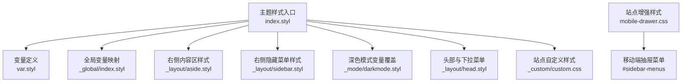
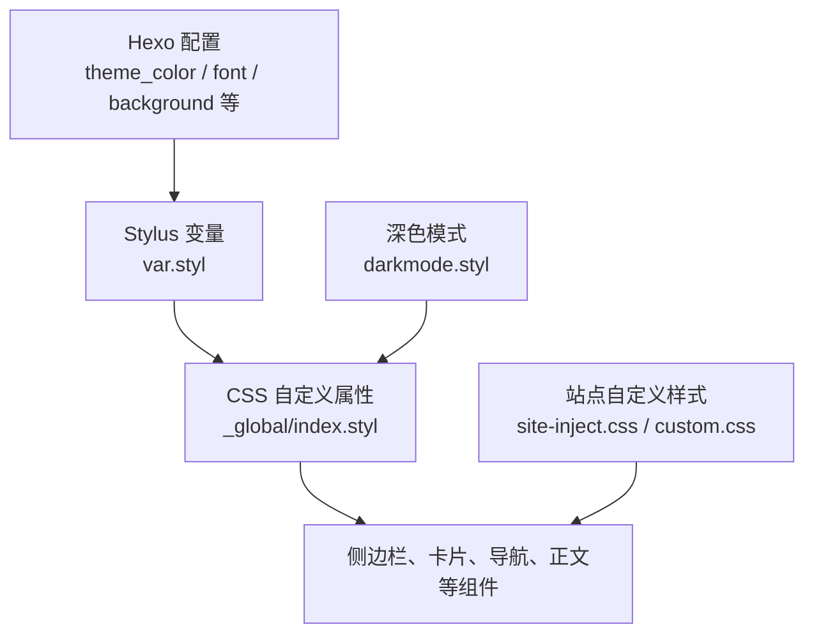
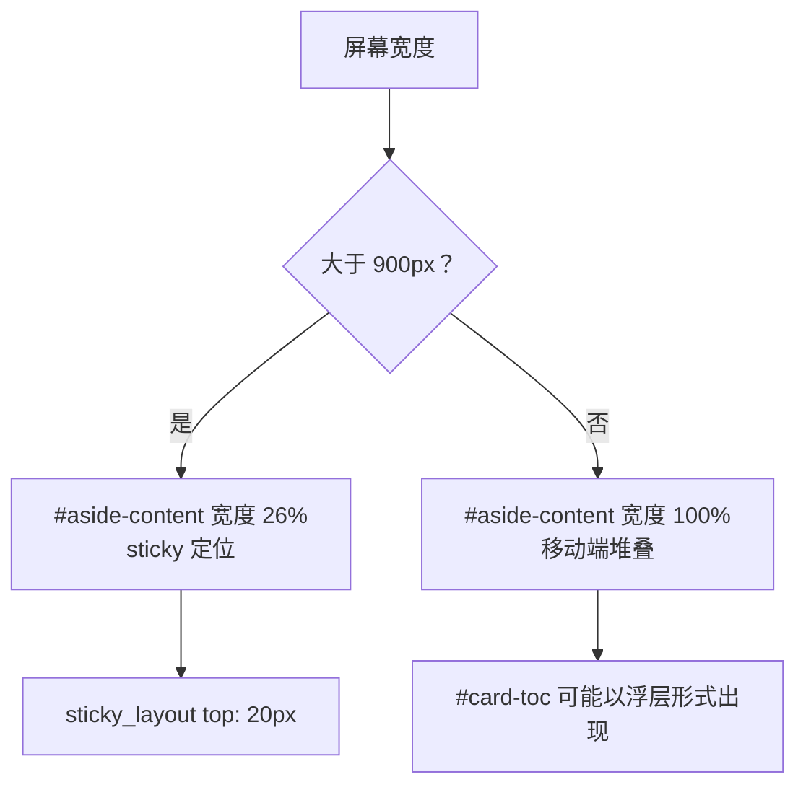
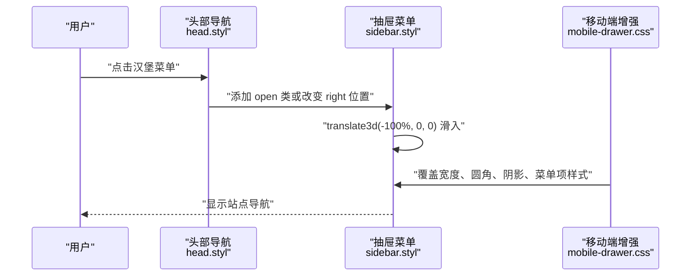
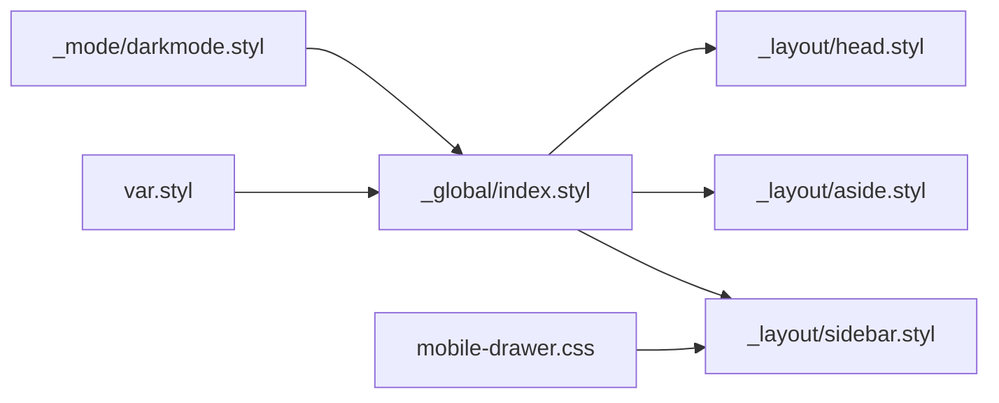

# 侧边栏样式与主题

<cite>
**本文引用的文件**   
- [themes/fomalhaut/source/css/var.styl](file://themes/fomalhaut/source/css/var.styl)
- [themes/fomalhaut/source/css/_global/index.styl](file://themes/fomalhaut/source/css/_global/index.styl)
- [themes/fomalhaut/source/css/_layout/aside.styl](file://themes/fomalhaut/source/css/_layout/aside.styl)
- [themes/fomalhaut/source/css/_layout/sidebar.styl](file://themes/fomalhaut/source/css/_layout/sidebar.styl)
- [themes/fomalhaut/source/css/_mode/darkmode.styl](file://themes/fomalhaut/source/css/_mode/darkmode.styl)
- [themes/fomalhaut/source/css/_layout/head.styl](file://themes/fomalhaut/source/css/_layout/head.styl)
- [themes/fomalhaut/source/css/index.styl](file://themes/fomalhaut/source/css/index.styl)
- [source/css/mobile-drawer.css](file://source/css/mobile-drawer.css)
- [source/js/modules/settings.js](file://source/js/modules/settings.js)
</cite>

## 目录

1. [引言](#引言)
2. [项目结构与侧边栏定位](#项目结构与侧边栏定位)
3. [Stylus 变量系统总览](#stylus-变量系统总览)
4. [颜色、间距与字体变量的定义与应用](#颜色间距与字体变量的定义与应用)
5. [桌面端与移动端的响应式实现](#桌面端与移动端的响应式实现)
6. [明暗模式切换机制与样式覆盖方法](#明暗模式切换机制与样式覆盖方法)
7. [自定义侧边栏样式指南](#自定义侧边栏样式指南)
8. [修改主题配色指南](#修改主题配色指南)
9. [添加新视觉效果的技术路径](#添加新视觉效果的技术路径)
10. [依赖关系分析](#依赖关系分析)
11. [常见问题排查](#常见问题排查)
12. [结论](#结论)

## 引言

本文聚焦博客主题的侧边栏样式系统与主题机制，目标是帮助读者理解以下问题：

- 侧边栏的布局结构由哪些 Stylus 和 CSS 文件负责。
- 颜色、间距、字体等设计变量如何从配置注入到全局样式。
- 桌面端固定侧栏与移动端抽屉菜单两套体系如何协作。
- 明暗模式如何通过 CSS 自定义属性切换。
- 如何在不动核心主题源码的前提下，安全地定制侧边栏外观、主题色和视觉动效。

本说明以代码仓库中的主题样式文件为依据，重点围绕 `var.styl`、全局变量映射、侧边栏布局、深色模式以及站点级移动端抽屉增强样式展开。

## 项目结构与侧边栏定位

在 Fomalhaut 主题中，侧边栏相关样式主要分布在以下位置：

| 文件 | 职责 |
|---|---|
| `themes/fomalhaut/source/css/var.styl` | 定义主题基础变量，包括主题色、字体、侧边栏宽度、卡片背景、搜索、按钮、滚动条等 |
| `themes/fomalhaut/source/css/_global/index.styl` | 将 Stylus 变量映射为 CSS 自定义属性，供页面组件使用 |
| `themes/fomalhaut/source/css/_layout/sidebar.styl` | 定义右侧隐藏式侧边栏菜单容器、遮罩、菜单项、分组箭头等 |
| `themes/fomalhaut/source/css/_layout/aside.styl` | 定义文章页右侧内容区（作者信息、归档、分类、标签、目录等） |
| `themes/fomalhaut/source/css/_mode/darkmode.styl` | 在深色模式下覆盖 CSS 自定义属性，并处理部分第三方组件适配 |
| `themes/fomalhaut/source/css/_layout/head.styl` | 顶部导航、下拉菜单、头部标题等，其中下拉菜单复用侧边栏背景变量 |
| `source/css/mobile-drawer.css` | 站点级对移动端抽屉菜单的增强样式，不改动主题源码 |
| `source/js/modules/settings.js` | 设置面板尺寸与窗口大小适配逻辑，间接影响用户交互体验 |
| `themes/fomalhaut/source/css/index.styl` | 主题样式入口，按顺序引入变量、全局、布局、标签、模式、自定义样式 |



**图表来源**  
- [themes/fomalhaut/source/css/index.styl:1-26](file://themes/fomalhaut/source/css/index.styl#L1-L26)
- [themes/fomalhaut/source/css/var.styl:1-185](file://themes/fomalhaut/source/css/var.styl#L1-L185)
- [themes/fomalhaut/source/css/_global/index.styl:1-36](file://themes/fomalhaut/source/css/_global/index.styl#L1-L36)
- [themes/fomalhaut/source/css/_layout/sidebar.styl:1-68](file://themes/fomalhaut/source/css/_layout/sidebar.styl#L1-L68)
- [themes/fomalhaut/source/css/_layout/aside.styl:1-411](file://themes/fomalhaut/source/css/_layout/aside.styl#L1-L411)
- [themes/fomalhaut/source/css/_mode/darkmode.styl:1-150](file://themes/fomalhaut/source/css/_mode/darkmode.styl#L1-L150)
- [themes/fomalhaut/source/css/_layout/head.styl:236-370](file://themes/fomalhaut/source/css/_layout/head.styl#L236-L370)
- [source/css/mobile-drawer.css:1-44](file://source/css/mobile-drawer.css#L1-L44)

**章节来源**  
- [themes/fomalhaut/source/css/index.styl:1-26](file://themes/fomalhaut/source/css/index.styl#L1-L26)
- [themes/fomalhaut/source/css/_layout/sidebar.styl:1-68](file://themes/fomalhaut/source/css/_layout/sidebar.styl#L1-L68)
- [themes/fomalhaut/source/css/_layout/aside.styl:1-411](file://themes/fomalhaut/source/css/_layout/aside.styl#L1-L411)

## Stylus 变量系统总览

Stylus 变量系统是主题样式的基础。它分为两个阶段：

1. **编译期变量**：由 `var.styl` 定义，可读取 Hexo 配置，例如主题色、字体、背景、预加载器颜色、侧边栏宽度等。
2. **运行时变量**：通过 `_global/index.styl` 把 Stylus 变量映射为 CSS 自定义属性，例如 `--font-color`、`--sidebar-bg`、`--text-bg-hover`。

这种分层的好处是：

- 主题可以在构建时根据配置生成统一的设计值。
- 页面组件只依赖 CSS 自定义属性，便于明暗模式、主题色切换和站点级覆盖。
- 深色模式只需覆盖 CSS 自定义属性，而不必复制大量规则。



**图表来源**  
- [themes/fomalhaut/source/css/var.styl:1-185](file://themes/fomalhaut/source/css/var.styl#L1-L185)
- [themes/fomalhaut/source/css/_global/index.styl:1-36](file://themes/fomalhaut/source/css/_global/index.styl#L1-L36)
- [themes/fomalhaut/source/css/_mode/darkmode.styl:1-40](file://themes/fomalhaut/source/css/_mode/darkmode.styl#L1-L40)

**章节来源**  
- [themes/fomalhaut/source/css/var.styl:1-185](file://themes/fomalhaut/source/css/var.styl#L1-L185)
- [themes/fomalhaut/source/css/_global/index.styl:1-36](file://themes/fomalhaut/source/css/_global/index.styl#L1-L36)

## 颜色、间距与字体变量的定义与应用

### 颜色变量

`var.styl` 中定义了主题主色、链接色、分割线色、代码高亮前景与背景、目录高亮色、按钮悬停色、滚动条色、表格表头色、搜索高亮色等。这些变量通常以 `$` 开头，属于 Stylus 编译期变量。

关键颜色变量包括：

| 变量名 | 用途 | 说明 |
|---|---|---|
| `$theme-color` | 主题主色 | 可从 `theme_color.main` 覆盖，否则回退到默认蓝色 |
| `$theme-link-color` | 链接色 | 可从 `theme_color.link_color` 覆盖 |
| `$theme-hr-color` | 分割线色 | 常用于水平分割线和强调元素 |
| `$code-foreground` | 行内代码前景色 | 可从 `theme_color.code_foreground` 覆盖 |
| `$code-background` | 行内代码背景色 | 可从 `theme_color.code_background` 覆盖 |
| `$theme-toc-color` | 目录激活背景色 | 常用于目录当前项高亮 |
| `$button-hover-color` | 按钮悬停色 | 可从 `theme_color.button_hover` 覆盖 |
| `$scrollbar-color` | 滚动条颜色 | 可从 `theme_color.scrollbar_color` 覆盖 |
| `$table-thead-bg` | 表格表头背景色 | 用于表格头部区域 |
| `$search-keyword-highlight` | 搜索结果关键词高亮色 | 用于本地或 Algolia 搜索高亮 |

这些颜色变量会进一步被映射到 CSS 自定义属性，例如：

- `--btn-hover-color`
- `--scrollbar-color`
- `--card-bg`
- `--text-highlight-color`
- `--blockquote-bg`

**章节来源**  
- [themes/fomalhaut/source/css/var.styl:1-105](file://themes/fomalhaut/source/css/var.styl#L1-L105)
- [themes/fomalhaut/source/css/_global/index.styl:1-36](file://themes/fomalhaut/source/css/_global/index.styl#L1-L36)

### 间距与布局变量

侧边栏相关的间距和布局变量主要集中在 `var.styl` 和布局文件中：

| 变量或值 | 作用 |
|---|---|
| `$sidebar-width` | 侧边栏宽度，默认为 `300px` |
| `$sidebar-background` | 侧边栏背景色，默认浅灰白 |
| `$toc-mobile-width` | 移动端目录宽度 |
| `$toc-mobile-maxWidth` | 移动端目录最大宽度 |
| `#aside-content width: 26%` | 桌面端右侧内容区宽度 |
| `+maxWidth900()` | 小于等于 900px 时右侧内容区变为全宽 |

侧边栏菜单容器的宽度直接引用 `$sidebar-width`，并通过 `right: -($sidebar-width)` 控制初始隐藏位置；打开菜单时使用 `translate3d(-100%, 0, 0)` 滑入。

**章节来源**  
- [themes/fomalhaut/source/css/var.styl:61-67](file://themes/fomalhaut/source/css/var.styl#L61-L67)
- [themes/fomalhaut/source/css/_layout/sidebar.styl:10-23](file://themes/fomalhaut/source/css/_layout/sidebar.styl#L10-L23)
- [themes/fomalhaut/source/css/_layout/aside.styl:1-17](file://themes/fomalhaut/source/css/_layout/aside.styl#L1-L17)

### 字体变量

字体变量同样由 `var.styl` 定义，并支持从 Hexo 配置覆盖：

| 变量名 | 用途 |
|---|---|
| `$dafault-font-family` | 默认正文字体栈 |
| `$dafault-code-font` | 默认代码字体栈 |
| `$font-family` | 实际使用的正文字体，优先取 `font.font-family` |
| `$code-font-family` | 实际使用的代码字体，优先取 `font.code-font-family` |
| `$site-name-font` | 站点名称、副标题、作者信息等标题类元素的字体 |
| `$font-size` | 全局字号 |
| `$code-font-size` | 代码字号 |

这些字体变量会被应用到 `body`、标题、作者信息、站点名称等位置，从而保证全站字体风格一致。

**章节来源**  
- [themes/fomalhaut/source/css/var.styl:15-31](file://themes/fomalhaut/source/css/var.styl#L15-L31)
- [themes/fomalhaut/source/css/_global/index.styl:1-44](file://themes/fomalhaut/source/css/_global/index.styl#L1-L44)

## 桌面端与移动端的响应式实现

### 桌面端右侧内容区

桌面端（大于 900px）的右侧内容区 `#aside-content` 宽度为 `26%`，并根据 `aside.position` 配置决定左右内边距。同时，`.sticky_layout` 在桌面端使用 `position: sticky`，使侧边内容在滚动时保持可见。



**图表来源**  
- [themes/fomalhaut/source/css/_layout/aside.styl:1-17](file://themes/fomalhaut/source/css/_layout/aside.styl#L1-L17)
- [themes/fomalhaut/source/css/_layout/aside.styl:78-84](file://themes/fomalhaut/source/css/_layout/aside.styl#L78-L84)
- [themes/fomalhaut/source/css/_layout/aside.styl:217-232](file://themes/fomalhaut/source/css/_layout/aside.styl#L217-L232)

**章节来源**  
- [themes/fomalhaut/source/css/_layout/aside.styl:1-17](file://themes/fomalhaut/source/css/_layout/aside.styl#L1-L17)
- [themes/fomalhaut/source/css/_layout/aside.styl:78-84](file://themes/fomalhaut/source/css/_layout/aside.styl#L78-L84)

### 移动端目录与抽屉菜单

移动端有两个“侧边”概念：

1. **文章目录**：`#card-toc` 在小屏下可能以固定浮层形式出现，宽度为 `calc(100% - 80px)`，最大宽度为 `$toc-mobile-maxWidth`。
2. **站点导航抽屉**：`#sidebar-menus` 是右上角汉堡菜单打开后出现的右侧抽屉。

目录在移动端的行为包括：

- 小屏下固定定位。
- 初始隐藏或半透明。
- 通过动画或状态切换显示。
- 目录内容区域限制最大高度，避免超出视口。

抽屉菜单在主题原始实现中是一个固定宽度 `300px` 的右侧面板；站点级 `mobile-drawer.css` 将其改为按视口宽度计算，最多 `340px`，并增强了头像、统计胶囊、分隔线、菜单项、图标底衬等视觉细节。



**图表来源**  
- [themes/fomalhaut/source/css/_layout/sidebar.styl:10-23](file://themes/fomalhaut/source/css/_layout/sidebar.styl#L10-L23)
- [source/css/mobile-drawer.css:35-41](file://source/css/mobile-drawer.css#L35-L41)
- [source/css/mobile-drawer.css:239-307](file://source/css/mobile-drawer.css#L239-L307)

**章节来源**  
- [themes/fomalhaut/source/css/_layout/aside.styl:217-232](file://themes/fomalhaut/source/css/_layout/aside.styl#L217-L232)
- [themes/fomalhaut/source/css/_layout/sidebar.styl:10-23](file://themes/fomalhaut/source/css/_layout/sidebar.styl#L10-L23)
- [source/css/mobile-drawer.css:35-41](file://source/css/mobile-drawer.css#L35-L41)
- [source/css/mobile-drawer.css:239-307](file://source/css/mobile-drawer.css#L239-L307)

## 明暗模式切换机制与样式覆盖方法

### 深色模式触发条件

深色模式样式由 `darkmode.styl` 提供，其顶层条件为：

- 开启 `darkmode.enable`，或
- `display_mode` 为 `dark`

当满足条件时，所有 `[data-theme='dark']` 下的 CSS 自定义属性会被重新赋值，从而让页面整体进入深色模式。

### 深色模式覆盖的关键变量

深色模式覆盖的变量包括：

| CSS 变量 | 深色模式行为 |
|---|---|
| `--global-bg` | 深灰背景 |
| `--font-color` | 白色系文本 |
| `--hr-border` | 浅色分割线 |
| `--search-bg` | 深色搜索背景 |
| `--card-bg` | 深色卡片背景 |
| `--sidebar-bg` | 深色侧边栏背景 |
| `--btn-hover-color` | 深色按钮悬停背景 |
| `--text-bg-hover` | 深色悬停背景 |
| `--light-grey` / `--dark-grey` / `--white` | 不同层次的浅色 |
| `--toc-link-color` | 目录链接颜色 |
| `--hl-bg` / `--hlnumber-bg` | 代码块背景与行号背景 |

### 侧边栏在深色模式中的表现

侧边栏背景通过 `--sidebar-bg` 控制。浅色模式下，该变量来自 `$sidebar-background`；深色模式下，`darkmode.styl` 将其设置为深灰色背景。因此，只要组件使用 `var(--sidebar-bg)`，就能自动适配明暗模式。

```mermaid
stateDiagram-v2
[*] --> Light
Light --> Dark : "data-theme=dark"
Dark --> Light : "data-theme=light"
state Light {
L1["--sidebar-bg = $sidebar-background"]
L2["--font-color = $font-black"]
L3["--text-bg-hover = rgba($text-bg-hover, .7)"]
}
state Dark {
D1["--sidebar-bg = #121212"]
D2["--font-color = alpha(#FFFFFF, .8)"]
D3["--text-bg-hover = lighten(#121212, 15)"]
}
```

**图表来源**  
- [themes/fomalhaut/source/css/_global/index.styl:1-36](file://themes/fomalhaut/source/css/_global/index.styl#L1-L36)
- [themes/fomalhaut/source/css/_mode/darkmode.styl:1-40](file://themes/fomalhaut/source/css/_mode/darkmode.styl#L1-L40)

**章节来源**  
- [themes/fomalhaut/source/css/_mode/darkmode.styl:1-40](file://themes/fomalhaut/source/css/_mode/darkmode.styl#L1-L40)
- [themes/fomalhaut/source/css/_global/index.styl:1-36](file://themes/fomalhaut/source/css/_global/index.styl#L1-L36)

## 自定义侧边栏样式指南

### 推荐方式：站点级样式覆盖

主题提供了站点级自定义样式入口，例如 `_custom/custom.css` 或通过 `inject.head` 引入额外 CSS。对于侧边栏，建议优先使用站点级样式覆盖，而不是直接修改主题源码。

需要覆盖的典型目标包括：

| 目标 | 说明 |
|---|---|
| `#sidebar #sidebar-menus` | 抽屉面板背景、宽度、阴影、圆角 |
| `.menus_items > .menus_item > a.site-page` | 菜单项背景、悬停态、圆角、图标底衬 |
| `.sidebar-site-data` | 统计胶囊背景、边框、阴影 |
| `#sidebar #sidebar-menus hr` | 分隔线样式 |
| `#aside-content .card-widget` | 右侧内容区卡片样式 |
| `#card-toc` | 目录浮层样式 |

### 最小改动原则

如果只需要调整颜色或间距，优先覆盖 CSS 自定义属性：

- 修改 `--sidebar-bg`
- 修改 `--font-color`
- 修改 `--text-bg-hover`
- 修改 `--card-bg`

如果需要调整布局，再针对具体选择器覆盖：

- `#sidebar #sidebar-menus`
- `.menus_items`
- `.sidebar-site-data`
- `#aside-content`

### 移动端抽屉增强参考

`mobile-drawer.css` 展示了在不改动主题源码的情况下，如何增强抽屉菜单：

- 将固定宽度改为按视口计算。
- 增加头像阴影、统计胶囊卡片、发丝分隔线。
- 给菜单项增加圆角、图标底衬、悬停反馈。
- 使用站点级 CSS 变量派生主题色。

这种方式适合希望保留主题升级兼容性的用户。

**章节来源**  
- [themes/fomalhaut/source/css/_layout/sidebar.styl:10-68](file://themes/fomalhaut/source/css/_layout/sidebar.styl#L10-L68)
- [source/css/mobile-drawer.css:35-44](file://source/css/mobile-drawer.css#L35-L44)
- [source/css/mobile-drawer.css:161-237](file://source/css/mobile-drawer.css#L161-L237)
- [source/css/mobile-drawer.css:239-307](file://source/css/mobile-drawer.css#L239-L307)

## 修改主题配色指南

### 通过 Hexo 配置修改主题色

主题允许通过 `theme_color` 配置覆盖多个颜色变量，例如：

- `theme_color.main`
- `theme_color.paginator`
- `theme_color.text_selection`
- `theme_color.link_color`
- `theme_color.hr_color`
- `theme_color.code_foreground`
- `theme_color.code_background`
- `theme_color.toc_color`
- `theme_color.blockquote_padding_color`
- `theme_color.blockquote_background_color`
- `theme_color.meta_color`
- `theme_color.button_hover`
- `theme_color.scrollbar_color`

这些配置在 `var.styl` 中被读取，并作为 Stylus 变量参与后续样式计算。

### 通过 CSS 自定义属性覆盖

如果不想修改 Hexo 配置，也可以在站点级样式中直接覆盖 CSS 自定义属性。例如：

- 修改 `--theme-color`（如果站点脚本已注入）。
- 修改 `--sidebar-bg`。
- 修改 `--font-color`。
- 修改 `--text-bg-hover`。
- 修改 `--scrollbar-color`。

这种方式更适合运行时动态切换主题色，例如通过 JavaScript 写入 `:root` 变量。

### 深色模式下的配色注意事项

深色模式会覆盖大部分 CSS 自定义属性，因此：

- 如果只改浅色模式颜色，注意深色模式可能再次覆盖。
- 如果要同时适配明暗模式，优先覆盖 CSS 自定义属性，而不是硬编码颜色。
- 如果第三方组件没有使用 CSS 自定义属性，可能需要单独适配深色模式。

**章节来源**  
- [themes/fomalhaut/source/css/var.styl:1-15](file://themes/fomalhaut/source/css/var.styl#L1-L15)
- [themes/fomalhaut/source/css/var.styl:51-75](file://themes/fomalhaut/source/css/var.styl#L51-L75)
- [themes/fomalhaut/source/css/_mode/darkmode.styl:1-40](file://themes/fomalhaut/source/css/_mode/darkmode.styl#L1-L40)

## 添加新视觉效果的技术路径

### 在侧边栏菜单中添加新效果

如果想在菜单项上添加悬停光晕、渐变背景、微动效等，可以：

1. 在站点级样式中新增选择器，例如 `.menus_items > .menus_item > a.site-page`。
2. 使用 `background`、`box-shadow`、`transition`、`transform` 等属性。
3. 如需跟随主题色，优先使用 `var(--theme-color)` 或站点级派生变量。
4. 如需适配深色模式，确保不硬编码浅色或深色背景。

### 在右侧内容区添加新效果

右侧内容区的卡片、列表、目录等由 `aside.styl` 管理。常见扩展点包括：

- `.card-widget`：通用卡片容器。
- `.aside-list-item`：最近文章或评论列表项。
- `.card-categories`：分类卡片。
- `.card-archives`：归档卡片。
- `#card-toc`：目录卡片。

### 在深色模式中适配新效果

如果新增效果使用了固定颜色，应检查 `darkmode.styl` 是否会影响该区域。必要时在深色模式选择器下补充适配规则，或使用 CSS 自定义属性替代硬编码颜色。

**章节来源**  
- [themes/fomalhaut/source/css/_layout/aside.styl:19-30](file://themes/fomalhaut/source/css/_layout/aside.styl#L19-L30)
- [themes/fomalhaut/source/css/_layout/aside.styl:93-147](file://themes/fomalhaut/source/css/_layout/aside.styl#L93-L147)
- [themes/fomalhaut/source/css/_layout/aside.styl:217-293](file://themes/fomalhaut/source/css/_layout/aside.styl#L217-L293)
- [themes/fomalhaut/source/css/_mode/darkmode.styl:1-150](file://themes/fomalhaut/source/css/_mode/darkmode.styl#L1-L150)

## 依赖关系分析

### 样式加载顺序

主题样式入口 `index.styl` 按以下顺序引入样式：

1. 第三方重置样式。
2. 变量定义。
3. 全局样式。
4. 代码高亮样式。
5. 页面样式。
6. 布局样式。
7. 标签插件样式。
8. 模式样式。
9. 站点自定义样式。

这意味着站点自定义样式具有最高优先级，适合覆盖主题默认行为。

### 侧边栏相关依赖链



**图表来源**  
- [themes/fomalhaut/source/css/index.styl:1-26](file://themes/fomalhaut/source/css/index.styl#L1-L26)
- [themes/fomalhaut/source/css/var.styl:1-185](file://themes/fomalhaut/source/css/var.styl#L1-L185)
- [themes/fomalhaut/source/css/_global/index.styl:1-36](file://themes/fomalhaut/source/css/_global/index.styl#L1-L36)
- [themes/fomalhaut/source/css/_layout/sidebar.styl:1-68](file://themes/fomalhaut/source/css/_layout/sidebar.styl#L1-L68)
- [themes/fomalhaut/source/css/_layout/aside.styl:1-411](file://themes/fomalhaut/source/css/_layout/aside.styl#L1-L411)
- [themes/fomalhaut/source/css/_layout/head.styl:236-370](file://themes/fomalhaut/source/css/_layout/head.styl#L236-L370)
- [source/css/mobile-drawer.css:1-44](file://source/css/mobile-drawer.css#L1-L44)

### 交互与样式的关系

侧边栏菜单的显示隐藏通常由 JavaScript 控制 DOM 状态，而样式负责：

- 初始隐藏位置。
- 滑入滑出动画。
- 遮罩层。
- 菜单项悬停效果。
- 深色模式下的背景与文字对比度。

设置面板的窗口尺寸适配逻辑位于 `settings.js`，虽然不直接控制侧边栏菜单，但体现了主题在移动端和桌面端对交互面板的统一适配思路。

**章节来源**  
- [themes/fomalhaut/source/css/index.styl:1-26](file://themes/fomalhaut/source/css/index.styl#L1-L26)
- [source/js/modules/settings.js:1181-1212](file://source/js/modules/settings.js#L1181-L1212)

## 常见问题排查

### 侧边栏背景色未生效

可能原因：

- 使用了硬编码颜色，而非 `var(--sidebar-bg)`。
- 深色模式覆盖了 CSS 自定义属性。
- 站点级样式选择器权重不够。

解决方法：

- 优先覆盖 `--sidebar-bg`。
- 检查深色模式是否覆盖了该变量。
- 提高选择器权重或使用更具体的选择器。

### 移动端抽屉菜单宽度异常

可能原因：

- 主题使用 `right: -($sidebar-width)` 控制隐藏位置，而站点级样式只改了宽度。
- 抽屉滑入动画依赖 `translate3d(-100%, 0, 0)`，宽度变化需配合 `right` 值。

解决方法：

- 参考 `mobile-drawer.css` 中对 `--md-w` 的处理。
- 确保抽屉宽度与隐藏偏移一致。
- 避免同时修改多个冲突的宽度属性。

### 目录在小屏下遮挡内容

可能原因：

- 目录浮层定位未考虑底部工具栏或视口高度。
- 目录最大高度未正确限制。

解决方法：

- 检查 `#card-toc` 的 `max-height`。
- 检查移动端固定定位的 `bottom` 和 `z-index`。
- 确认目录展开逻辑是否与样式状态匹配。

### 深色模式下侧边栏文字看不清

可能原因：

- 文本颜色未使用 `var(--font-color)`。
- 背景色未使用 `var(--sidebar-bg)`。
- 新增效果使用了浅色背景或浅色文字。

解决方法：

- 使用 CSS 自定义属性。
- 在深色模式选择器下补充适配。
- 避免硬编码颜色。

**章节来源**  
- [themes/fomalhaut/source/css/_layout/sidebar.styl:10-23](file://themes/fomalhaut/source/css/_layout/sidebar.styl#L10-L23)
- [themes/fomalhaut/source/css/_layout/aside.styl:217-232](file://themes/fomalhaut/source/css/_layout/aside.styl#L217-L232)
- [themes/fomalhaut/source/css/_mode/darkmode.styl:1-40](file://themes/fomalhaut/source/css/_mode/darkmode.styl#L1-L40)
- [source/css/mobile-drawer.css:35-41](file://source/css/mobile-drawer.css#L35-L41)

## 结论

Fomalhaut 主题的侧边栏样式系统以 Stylus 变量为基础，通过全局 CSS 自定义属性暴露给页面组件，从而实现主题色、明暗模式和站点级样式的解耦。

核心要点如下：

- `var.styl` 是主题设计变量的集中定义处，支持从 Hexo 配置注入。
- `_global/index.styl` 将 Stylus 变量映射为 CSS 自定义属性，供侧边栏、卡片、导航等组件使用。
- 桌面端右侧内容区使用百分比宽度和粘性定位，移动端则堆叠布局。
- 侧边栏菜单在主题中是固定宽度隐藏面板，站点级 `mobile-drawer.css` 对其进行了移动端增强。
- 深色模式通过覆盖 CSS 自定义属性实现，无需复制大量规则。
- 自定义侧边栏样式时，优先覆盖 CSS 自定义属性和站点级样式，以保持主题升级兼容性。

按照本文的结构进行扩展，可以在不破坏主题架构的前提下，安全地定制侧边栏外观、主题配色和视觉效果。