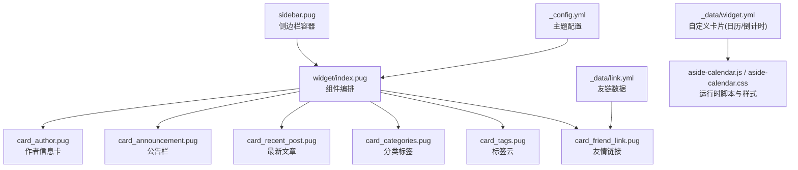
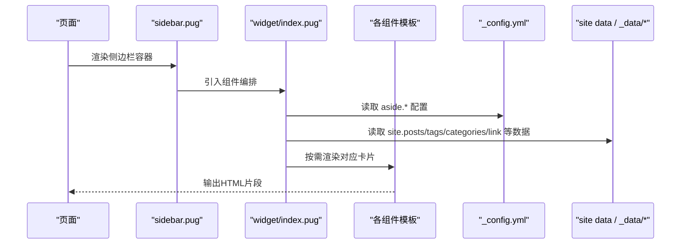
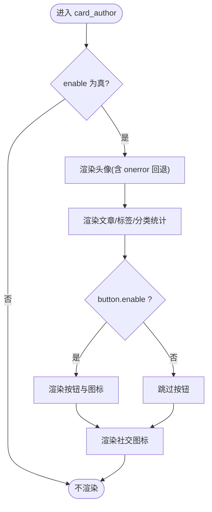
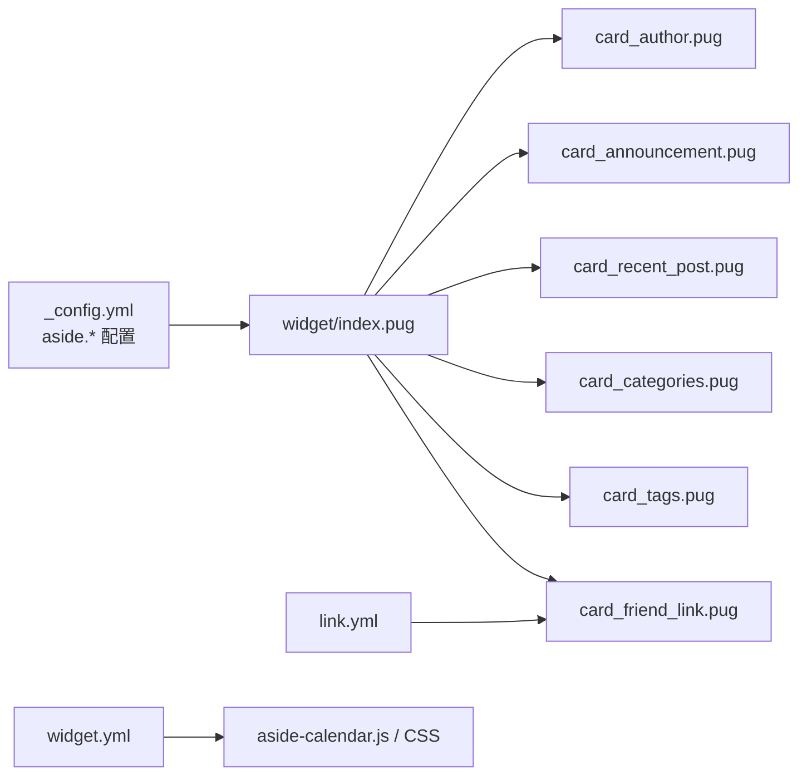
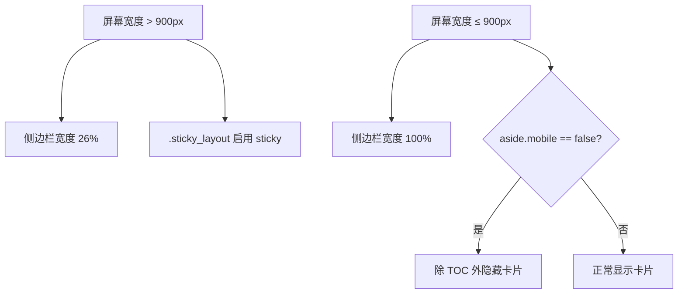

# 侧边栏组件系统

<cite>
**本文引用的文件**   
- [themes/fomalhaut/layout/includes/sidebar.pug](file://themes/fomalhaut/layout/includes/sidebar.pug)
- [themes/fomalhaut/layout/includes/widget/index.pug](file://themes/fomalhaut/layout/includes/widget/index.pug)
- [themes/fomalhaut/layout/includes/widget/card_author.pug](file://themes/fomalhaut/layout/includes/widget/card_author.pug)
- [themes/fomalhaut/layout/includes/widget/card_announcement.pug](file://themes/fomalhaut/layout/includes/widget/card_announcement.pug)
- [themes/fomalhaut/layout/includes/widget/card_recent_post.pug](file://themes/fomalhaut/layout/includes/widget/card_recent_post.pug)
- [themes/fomalhaut/layout/includes/widget/card_categories.pug](file://themes/fomalhaut/layout/includes/widget/card_categories.pug)
- [themes/fomalhaut/layout/includes/widget/card_tags.pug](file://themes/fomalhaut/layout/includes/widget/card_tags.pug)
- [themes/fomalhaut/layout/includes/widget/card_friend_link.pug](file://themes/fomalhaut/layout/includes/widget/card_friend_link.pug)
- [source/_data/widget.yml](file://source/_data/widget.yml)
- [source/_data/link.yml](file://source/_data/link.yml)
- [themes/fomalhaut/source/css/_layout/aside.styl](file://themes/fomalhaut/source/css/_layout/aside.styl)
- [themes/fomalhaut/_config.yml](file://themes/fomalhaut/_config.yml)
- [source/css/aside-calendar.css](file://source/css/aside-calendar.css)
</cite>

## 目录
1. [简介](#简介)
2. [项目结构](#项目结构)
3. [核心组件](#核心组件)
4. [架构总览](#架构总览)
5. [详细组件分析](#详细组件分析)
6. [依赖关系分析](#依赖关系分析)
7. [性能与动态加载](#性能与动态加载)
8. [响应式与移动端适配](#响应式与移动端适配)
9. [自定义指南](#自定义指南)
10. [故障排查](#故障排查)
11. [结论](#结论)

## 简介
本文系统化文档化博客主题的侧边栏组件体系，覆盖整体布局、组件职责、数据来源、渲染逻辑、配置项、动态加载机制、性能优化策略以及桌面端与移动端的响应式方案。读者可据此快速理解现有实现，并安全地扩展或定制侧边栏卡片。

## 项目结构
侧边栏由“容器骨架 + 组件模板 + 样式 + 数据源 + 主题配置”共同构成：
- 容器骨架：负责挂载菜单、站点统计等基础信息。
- 组件模板：按页面类型（文章页/非文章页）组织不同卡片。
- 样式：统一控制卡片外观、粘性布局、分类展开、排序等。
- 数据源：友链、日历/倒计时等运行时数据。
- 主题配置：开关、数量限制、排序、颜色等。

图表来源
- [themes/fomalhaut/layout/includes/sidebar.pug:1-19](file://themes/fomalhaut/layout/includes/sidebar.pug#L1-L19)
- [themes/fomalhaut/layout/includes/widget/index.pug:1-37](file://themes/fomalhaut/layout/includes/widget/index.pug#L1-L37)
- [themes/fomalhaut/_config.yml:625-672](file://themes/fomalhaut/_config.yml#L625-L672)
- [source/_data/link.yml:1-35](file://source/_data/link.yml#L1-L35)
- [source/_data/widget.yml:1-50](file://source/_data/widget.yml#L1-L50)

章节来源
- [themes/fomalhaut/layout/includes/sidebar.pug:1-19](file://themes/fomalhaut/layout/includes/sidebar.pug#L1-L19)
- [themes/fomalhaut/layout/includes/widget/index.pug:1-37](file://themes/fomalhaut/layout/includes/widget/index.pug#L1-L37)
- [themes/fomalhaut/_config.yml:625-672](file://themes/fomalhaut/_config.yml#L625-L672)
- [source/_data/link.yml:1-35](file://source/_data/link.yml#L1-L35)
- [source/_data/widget.yml:1-50](file://source/_data/widget.yml#L1-L50)

## 核心组件
- 作者信息卡：展示头像、名称、描述、站点统计、按钮与社交图标。
- 公告栏：展示站点公告内容。
- 最新文章：根据配置显示最近文章列表，支持封面、时间显示模式。
- 分类：树形分类列表，支持折叠/展开与数量限制。
- 标签云：标签聚合视图，支持彩色/灰度与字体大小范围。
- 友情链接：分组展示在线/离线友链，自动计算在线数。
- 自定义卡片（日历/倒计时）：通过 widget.yml 注入 HTML/CSS/JS，运行时统一排序。

章节来源
- [themes/fomalhaut/layout/includes/widget/card_author.pug:1-37](file://themes/fomalhaut/layout/includes/widget/card_author.pug#L1-L37)
- [themes/fomalhaut/layout/includes/widget/card_announcement.pug:1-14](file://themes/fomalhaut/layout/includes/widget/card_announcement.pug#L1-L14)
- [themes/fomalhaut/layout/includes/widget/card_recent_post.pug:1-26](file://themes/fomalhaut/layout/includes/widget/card_recent_post.pug#L1-L26)
- [themes/fomalhaut/layout/includes/widget/card_categories.pug:1-5](file://themes/fomalhaut/layout/includes/widget/card_categories.pug#L1-L5)
- [themes/fomalhaut/layout/includes/widget/card_tags.pug:1-13](file://themes/fomalhaut/layout/includes/widget/card_tags.pug#L1-L13)
- [themes/fomalhaut/layout/includes/widget/card_friend_link.pug:1-40](file://themes/fomalhaut/layout/includes/widget/card_friend_link.pug#L1-L40)
- [source/_data/widget.yml:1-50](file://source/_data/widget.yml#L1-L50)

## 架构总览
侧边栏渲染流程从容器开始，按页面类型选择组件集合，再结合主题配置决定是否启用、如何排序与展示。

图表来源
- [themes/fomalhaut/layout/includes/sidebar.pug:1-19](file://themes/fomalhaut/layout/includes/sidebar.pug#L1-L19)
- [themes/fomalhaut/layout/includes/widget/index.pug:1-37](file://themes/fomalhaut/layout/includes/widget/index.pug#L1-L37)
- [themes/fomalhaut/_config.yml:625-672](file://themes/fomalhaut/_config.yml#L625-L672)

## 详细组件分析

### 作者信息卡 card_author
- 数据来源
  - 站点配置：作者名、描述、社交图标、错误图占位。
  - 站点元数据：文章/标签/分类总数。
- 渲染逻辑
  - 条件渲染：仅在 theme.aside.card_author.enable 为真时显示。
  - 头像失败回退到主题配置的 error_img.flink。
  - 可选按钮与社交图标区域。
- 关键配置
  - enable、description、button.enable/text/link/icon。
- 样式要点
  - 头像圆角、悬停旋转；站点数据统计三列对齐；按钮背景与悬停色。

图表来源
- [themes/fomalhaut/layout/includes/widget/card_author.pug:1-37](file://themes/fomalhaut/layout/includes/widget/card_author.pug#L1-L37)
- [themes/fomalhaut/_config.yml:128-131](file://themes/fomalhaut/_config.yml#L128-L131)

章节来源
- [themes/fomalhaut/layout/includes/widget/card_author.pug:1-37](file://themes/fomalhaut/layout/includes/widget/card_author.pug#L1-L37)
- [themes/fomalhaut/_config.yml:128-131](file://themes/fomalhaut/_config.yml#L128-L131)

### 公告栏 card_announcement
- 数据来源
  - 主题配置 theme.aside.card_announcement.content。
- 渲染逻辑
  - 条件渲染：theme.aside.card_announcement.enable。
  - 标题使用国际化键，内容直接插入。
- 样式要点
  - 标题图标与文字加粗；公告区留白。

章节来源
- [themes/fomalhaut/layout/includes/widget/card_announcement.pug:1-14](file://themes/fomalhaut/layout/includes/widget/card_announcement.pug#L1-L14)
- [themes/fomalhaut/_config.yml:643-645](file://themes/fomalhaut/_config.yml#L643-L645)

### 最新文章 card_recent_post
- 数据来源
  - site.posts 列表。
- 渲染逻辑
  - 条件渲染：theme.aside.card_recent_post.enable。
  - limit=0 表示显示全部；否则取配置值或默认 5。
  - sort=date 或 updated，分别显示创建日或更新时间。
  - 封面显示受 theme.cover.aside_enable 与文章 cover 字段控制。
- 样式要点
  - 缩略图固定宽高；无封面时最小高度保证行高一致。

章节来源
- [themes/fomalhaut/layout/includes/widget/card_recent_post.pug:1-26](file://themes/fomalhaut/layout/includes/widget/card_recent_post.pug#L1-L26)
- [themes/fomalhaut/_config.yml:116-124](file://themes/fomalhaut/_config.yml#L116-L124)
- [themes/fomalhaut/_config.yml:646-650](file://themes/fomalhaut/_config.yml#L646-L650)

### 分类 card_categories
- 数据来源
  - site.categories。
- 渲染逻辑
  - 条件渲染：theme.aside.card_categories.enable 且存在分类。
  - limit=0 表示显示全部；expand 控制子分类初始展开状态。
- 样式要点
  - 父级箭头指示展开状态；expand=false 时隐藏子分类。

章节来源
- [themes/fomalhaut/layout/includes/widget/card_categories.pug:1-5](file://themes/fomalhaut/layout/includes/widget/card_categories.pug#L1-L5)
- [themes/fomalhaut/source/css/_layout/aside.styl:175-203](file://themes/fomalhaut/source/css/_layout/aside.styl#L175-L203)
- [themes/fomalhaut/_config.yml:651-655](file://themes/fomalhaut/_config.yml#L651-L655)

### 标签云 card_tags
- 数据来源
  - site.tags。
- 渲染逻辑
  - 条件渲染：theme.aside.card_tags.enable 且存在标签。
  - limit=0 表示显示全部；color=true 启用彩色标签云，否则灰度渐变。
- 样式要点
  - 标签间距与悬停高亮。

章节来源
- [themes/fomalhaut/layout/includes/widget/card_tags.pug:1-13](file://themes/fomalhaut/layout/includes/widget/card_tags.pug#L1-L13)
- [themes/fomalhaut/_config.yml:656-660](file://themes/fomalhaut/_config.yml#L656-L660)

### 友情链接 card_friend_link
- 数据来源
  - site.data.link（由 source/_data/link.yml 提供）。
- 渲染逻辑
  - 条件渲染：theme.aside.card_friend_link.enable。
  - 按 class_name 分组，summary 显示分组名与在线数量。
  - link_list 中 offline=true 的条目以离线样式渲染。
  - 运行期脚本统计每个分组的在线链接数量。
- 样式要点
  - 在线/离线链接区分样式；头像失败回退到 error_img.flink。

章节来源
- [themes/fomalhaut/layout/includes/widget/card_friend_link.pug:1-40](file://themes/fomalhaut/layout/includes/widget/card_friend_link.pug#L1-L40)
- [source/_data/link.yml:1-35](file://source/_data/link.yml#L1-L35)
- [themes/fomalhaut/_config.yml:128-131](file://themes/fomalhaut/_config.yml#L128-L131)

### 自定义卡片：日历与倒计时
- 数据来源
  - source/_data/widget.yml 定义两张卡片的 class_name、id_name、name、icon 与 html（内嵌 CSS/JS 引用）。
- 渲染逻辑
  - 模板顺序在 widget/index.pug 中位于自定义卡片之前，但运行期通过 JS 将「日历」和「倒计时」上移到公告栏上方，并保持固定顺序。
  - layoutCards() 幂等执行，兼容解析期、DOMContentLoaded、pjax:complete 多次调用。
- 样式与交互
  - 样式文件 source/css/aside-calendar.css 仅作用于 #aside-calendar 与 #aside-countdown，跟随主题色变量。
  - 日历卡片包含今日高亮、迷你月历、节气/日出日落提示；倒计时卡片包含年/月/周进度条。

章节来源
- [source/_data/widget.yml:1-50](file://source/_data/widget.yml#L1-L50)
- [source/css/aside-calendar.css:1-283](file://source/css/aside-calendar.css#L1-L283)

## 依赖关系分析
- 组件编排依赖主题配置 with hexo-config('aside.*') 判断是否启用、限制数量、排序位置。
- 部分组件依赖站点数据：site.posts、site.tags、site.categories、site.data.link。
- 自定义卡片依赖外部 CSS/JS 资源，并通过全局函数进行 DOM 操作与排序。

图表来源
- [themes/fomalhaut/_config.yml:625-672](file://themes/fomalhaut/_config.yml#L625-L672)
- [themes/fomalhaut/layout/includes/widget/index.pug:1-37](file://themes/fomalhaut/layout/includes/widget/index.pug#L1-L37)
- [source/_data/link.yml:1-35](file://source/_data/link.yml#L1-L35)
- [source/_data/widget.yml:1-50](file://source/_data/widget.yml#L1-L50)

章节来源
- [themes/fomalhaut/_config.yml:625-672](file://themes/fomalhaut/_config.yml#L625-L672)
- [themes/fomalhaut/layout/includes/widget/index.pug:1-37](file://themes/fomalhaut/layout/includes/widget/index.pug#L1-L37)
- [source/_data/link.yml:1-35](file://source/_data/link.yml#L1-L35)
- [source/_data/widget.yml:1-50](file://source/_data/widget.yml#L1-L50)

## 性能与动态加载
- 条件渲染：所有卡片均通过 theme.aside.*.enable 控制是否渲染，避免无用 DOM。
- 缓存优化：组件 partial 调用传入 cache:true，减少重复渲染开销。
- 懒加载与按需加载
  - 评论系统与第三方服务通常具备 lazyload 开关（与本侧边栏无直接耦合），可在需要时开启。
  - 自定义卡片（日历/倒计时）通过外链 CSS/JS 按需引入，并在 DOM 就绪后执行布局调整。
- 排序与重排
  - 自定义卡片通过统一的 layoutCards() 确保顺序稳定，避免 pjax 换页导致的抖动。
- 图片容错
  - 头像与友链头像均设置 onerror 回退至占位图，降低因资源缺失导致的布局异常。

章节来源
- [themes/fomalhaut/layout/includes/widget/index.pug:1-37](file://themes/fomalhaut/layout/includes/widget/index.pug#L1-L37)
- [source/_data/widget.yml:1-50](file://source/_data/widget.yml#L1-L50)
- [themes/fomalhaut/layout/includes/widget/card_author.pug:1-37](file://themes/fomalhaut/layout/includes/widget/card_author.pug#L1-L37)
- [themes/fomalhaut/layout/includes/widget/card_friend_link.pug:1-40](file://themes/fomalhaut/layout/includes/widget/card_friend_link.pug#L1-L40)

## 响应式与移动端适配
- 侧边栏宽度
  - 桌面端：默认宽度约 26%，左右边距根据 position 配置调整。
  - 移动端：宽度 100%。
- 卡片显隐
  - 当 aside.mobile=false 时，移动端除 TOC 外隐藏所有卡片。
- 粘性布局
  - .sticky_layout 在桌面端 sticky 定位，顶部偏移 20px，滚动时保持可见。
- 分类展开
  - expand=false 时隐藏子分类，减少移动端信息密度。
- 排序控制
  - 通过 aside.card_*_sort_order 控制卡片在粘性区域的排列顺序。

图表来源
- [themes/fomalhaut/source/css/_layout/aside.styl:1-411](file://themes/fomalhaut/source/css/_layout/aside.styl#L1-L411)
- [themes/fomalhaut/_config.yml:625-672](file://themes/fomalhaut/_config.yml#L625-L672)

章节来源
- [themes/fomalhaut/source/css/_layout/aside.styl:1-411](file://themes/fomalhaut/source/css/_layout/aside.styl#L1-L411)
- [themes/fomalhaut/_config.yml:625-672](file://themes/fomalhaut/_config.yml#L625-L672)

## 自定义指南

### 添加新卡片
- 步骤
  1. 在 themes/fomalhaut/layout/includes/widget 下新建 pug 模板，例如 card_my_card.pug，遵循条件渲染与 partial 缓存模式。
  2. 在 themes/fomalhaut/layout/includes/widget/index.pug 中引入该模板，并根据页面类型决定放置位置（非文章页/文章页）。
  3. 在 themes/fomalhaut/_config.yml 的 aside 节点下新增 card_my_card.enable 等开关与参数。
  4. 如需额外样式，在 themes/fomalhaut/source/css/_layout/aside.styl 或独立样式文件中追加规则。
- 参考路径
  - 模板示例：[card_author.pug](file://themes/fomalhaut/layout/includes/widget/card_author.pug)
  - 组件编排：[widget/index.pug](file://themes/fomalhaut/layout/includes/widget/index.pug)
  - 配置入口：[_config.yml](file://themes/fomalhaut/_config.yml)

### 修改现有组件样式
- 通用卡片样式位于 aside.styl，可按需调整：
  - 卡片间距、内边距、阴影与悬停效果。
  - 列表项排版、缩略图尺寸、文本截断。
  - 分类展开箭头、标签云悬停高亮。
- 参考路径
  - [aside.styl](file://themes/fomalhaut/source/css/_layout/aside.styl)

### 调整组件顺序
- 静态顺序：在 widget/index.pug 中调整 partial 引入顺序。
- 粘性区域顺序：通过 aside.card_*_sort_order 配置控制。
- 自定义卡片顺序：通过 JS 的 layoutCards() 统一处理（日历/倒计时）。
- 参考路径
  - [widget/index.pug](file://themes/fomalhaut/layout/includes/widget/index.pug)
  - [aside.styl](file://themes/fomalhaut/source/css/_layout/aside.styl)
  - [widget.yml](file://source/_data/widget.yml)

### 更新友链数据
- 编辑 source/_data/link.yml，按分组添加 link_list 条目，支持 offline 标记。
- 参考路径
  - [link.yml](file://source/_data/link.yml)

### 自定义日历/倒计时
- 在 source/_data/widget.yml 中维护两张卡的 HTML/CSS/JS 引入，并确保 layoutCards() 被正确调用。
- 样式与交互由 source/css/aside-calendar.css 控制。
- 参考路径
  - [widget.yml](file://source/_data/widget.yml)
  - [aside-calendar.css](file://source/css/aside-calendar.css)

## 故障排查
- 卡片不显示
  - 检查 theme.aside.*.enable 是否为 true。
  - 确认 widget/index.pug 已引入对应 partial。
- 图片无法显示
  - 检查头像/友链头像 onerror 回退路径是否正确指向 error_img.flink。
- 自定义卡片顺序错乱
  - 确认 layoutCards() 在解析期、DOMContentLoaded、pjax:complete 均被调用。
- 移动端卡片过多
  - 若 aside.mobile=false，移动端会隐藏除 TOC 外的卡片；如需保留特定卡片，请调整样式或逻辑。

章节来源
- [themes/fomalhaut/layout/includes/widget/index.pug:1-37](file://themes/fomalhaut/layout/includes/widget/index.pug#L1-L37)
- [themes/fomalhaut/layout/includes/widget/card_author.pug:1-37](file://themes/fomalhaut/layout/includes/widget/card_author.pug#L1-L37)
- [themes/fomalhaut/layout/includes/widget/card_friend_link.pug:1-40](file://themes/fomalhaut/layout/includes/widget/card_friend_link.pug#L1-L40)
- [source/_data/widget.yml:1-50](file://source/_data/widget.yml#L1-L50)

## 结论
本侧边栏组件系统以清晰的模板分层、完善的主题配置与灵活的运行时机制为基础，既保证了多页面的统一体验，又提供了丰富的自定义能力。通过条件渲染、缓存、懒加载与响应式策略，系统在性能与可用性之间取得平衡。开发者可依据本文档快速扩展新的卡片、调整样式与顺序，并保障在不同设备上的良好表现。