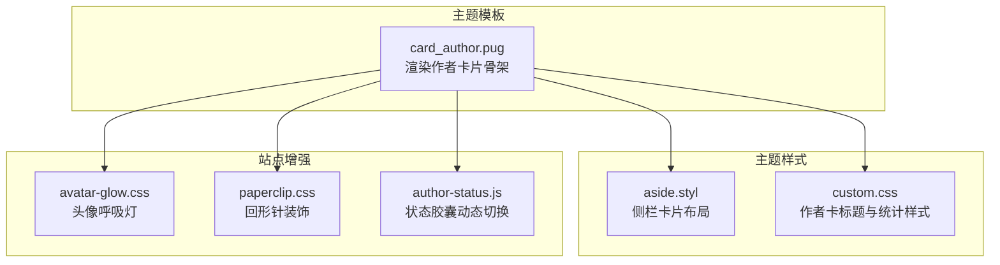
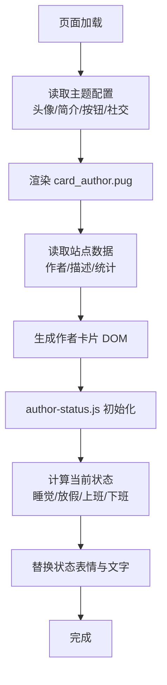
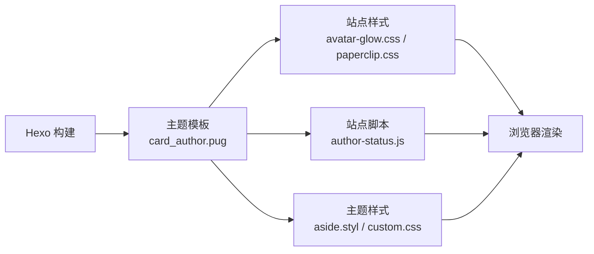
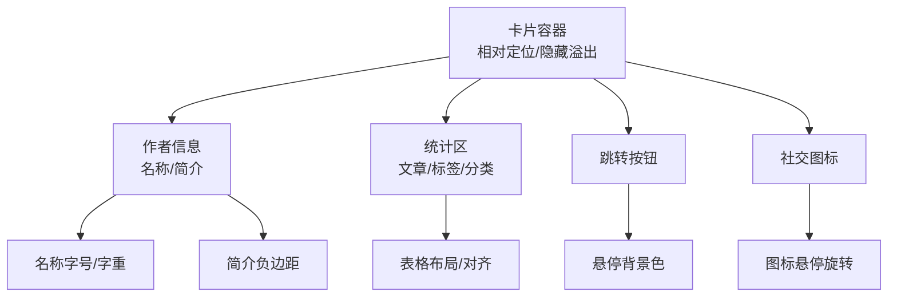
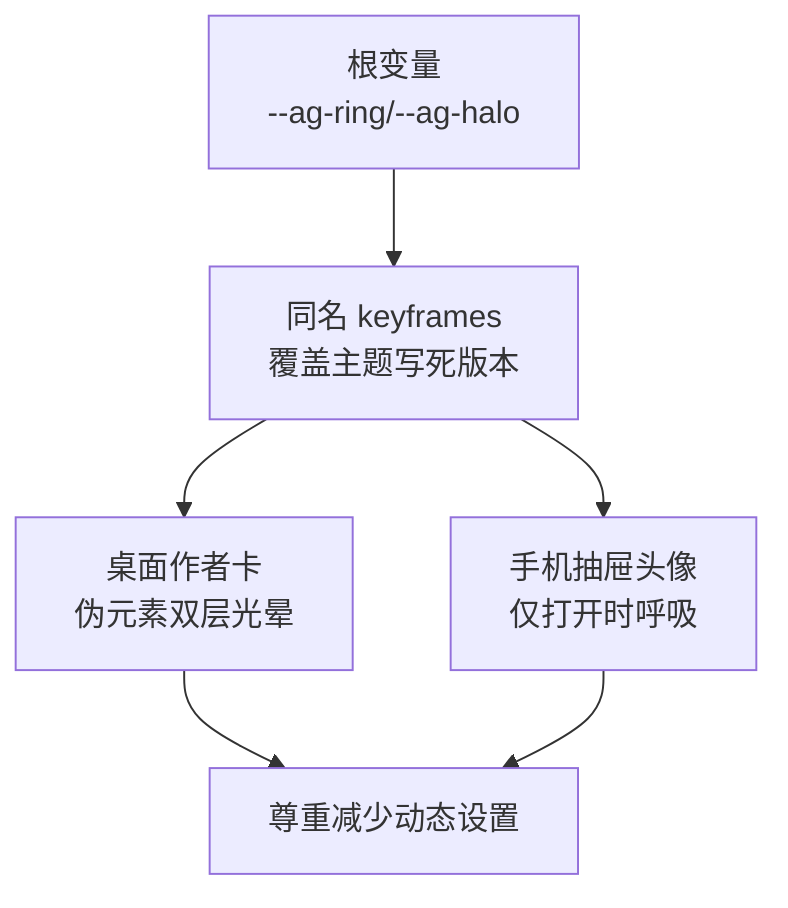
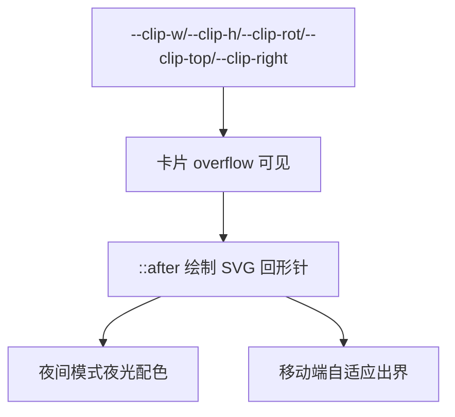
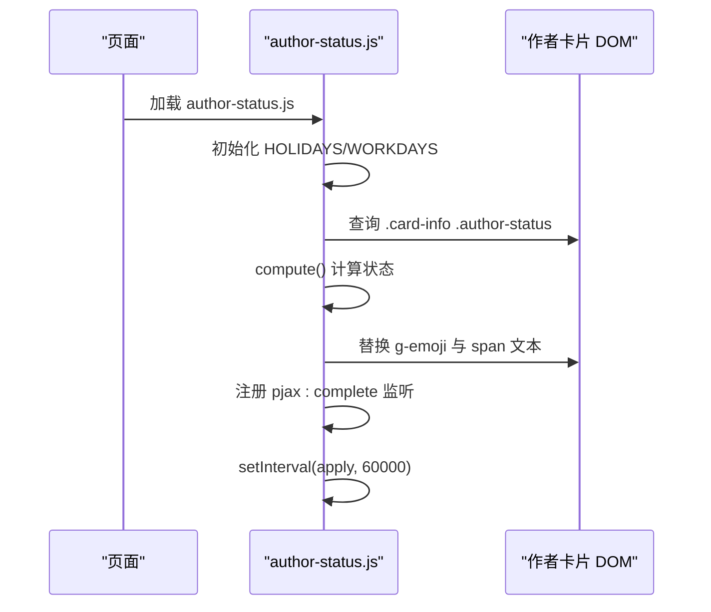
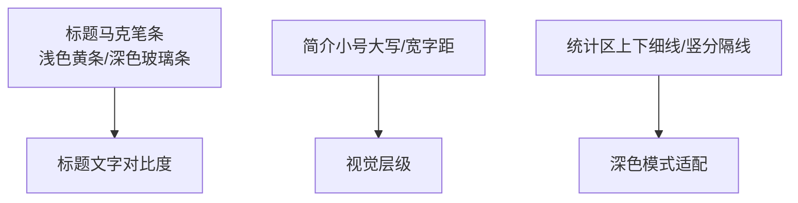
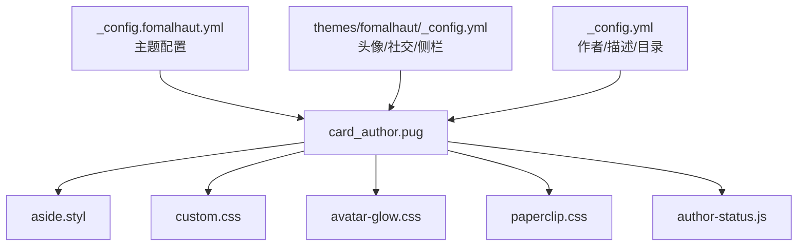
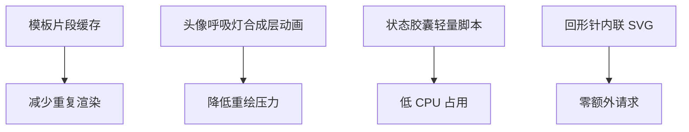

# 作者信息卡片

<cite>
**本文引用的文件**   
- [themes/fomalhaut/layout/includes/widget/card_author.pug](file://themes/fomalhaut/layout/includes/widget/card_author.pug)
- [themes/fomalhaut/source/css/_layout/aside.styl](file://themes/fomalhaut/source/css/_layout/aside.styl)
- [themes/fomalhaut/source/css/_custom/custom.css](file://themes/fomalhaut/source/css/_custom/custom.css)
- [source/css/avatar-glow.css](file://source/css/avatar-glow.css)
- [source/js/author-status.js](file://source/js/author-status.js)
- [source/css/paperclip.css](file://source/css/paperclip.css)
- [_config.fomalhaut.yml](file://_config.fomalhaut.yml)
- [themes/fomalhaut/_config.yml](file://themes/fomalhaut/_config.yml)
- [_config.yml](file://_config.yml)
</cite>

## 目录
1. [简介](#简介)
2. [项目结构中的作者卡片位置](#项目结构中的作者卡片位置)
3. [核心组件与数据流](#核心组件与数据流)
4. [架构总览](#架构总览)
5. [详细组件分析](#详细组件分析)
6. [依赖关系分析](#依赖关系分析)
7. [性能与缓存特性](#性能与缓存特性)
8. [样式定制指南](#样式定制指南)
9. [常见配置示例](#常见配置示例)
10. [故障排除](#故障排除)
11. [结论](#结论)

## 简介
作者信息卡片是站点侧栏的个人信息展示模块，负责呈现头像、昵称、个人简介、文章/标签/分类统计、社交链接以及一个可动态切换的状态胶囊。它由主题模板渲染基础结构，站点级样式和脚本负责增强外观与行为：头像呼吸灯、右上角回形针装饰、状态胶囊自动切换等。

该文档面向希望理解并定制作者卡片的维护者，覆盖以下方面：
- 展示结构与数据来源
- 开关与配置项
- 头像、昵称、简介、社交链接的实现方式
- 状态胶囊的动态更新逻辑
- 样式定制、主题适配与响应式注意事项
- 常见问题排查

## 项目结构中的作者卡片位置
作者卡片的核心实现分布在三个层面：
- 主题模板层：负责渲染卡片骨架、头像、昵称、简介、统计、按钮和社交图标。
- 主题样式层：定义侧边栏卡片通用布局、头像尺寸、统计区排版和按钮样式。
- 站点增强层：提供头像呼吸灯、夜间模式适配、回形针装饰和状态胶囊脚本。



**图表来源**
- [themes/fomalhaut/layout/includes/widget/card_author.pug:1-37](file://themes/fomalhaut/layout/includes/widget/card_author.pug#L1-L37)
- [themes/fomalhaut/source/css/_layout/aside.styl:31-69](file://themes/fomalhaut/source/css/_layout/aside.styl#L31-L69)
- [themes/fomalhaut/source/css/_custom/custom.css:3733-3872](file://themes/fomalhaut/source/css/_custom/custom.css#L3733-L3872)
- [source/css/avatar-glow.css:1-183](file://source/css/avatar-glow.css#L1-L183)
- [source/css/paperclip.css:1-69](file://source/css/paperclip.css#L1-L69)
- [source/js/author-status.js:1-87](file://source/js/author-status.js#L1-L87)

**章节来源**
- [themes/fomalhaut/layout/includes/widget/card_author.pug:1-37](file://themes/fomalhaut/layout/includes/widget/card_author.pug#L1-L37)
- [themes/fomalhaut/source/css/_layout/aside.styl:31-69](file://themes/fomalhaut/source/css/_layout/aside.styl#L31-L69)
- [themes/fomalhaut/source/css/_custom/custom.css:3733-3872](file://themes/fomalhaut/source/css/_custom/custom.css#L3733-L3872)
- [source/css/avatar-glow.css:1-183](file://source/css/avatar-glow.css#L1-L183)
- [source/css/paperclip.css:1-69](file://source/css/paperclip.css#L1-L69)
- [source/js/author-status.js:1-87](file://source/js/author-status.js#L1-L87)

## 核心组件与数据流
作者卡片的数据来源分为三类：
- 站点全局信息：作者名、站点描述、归档目录、标签目录、分类目录、文章总数、标签总数、分类总数。
- 主题配置信息：头像图片、错误图、侧栏作者卡开关、简介文案、按钮开关、按钮文本与链接、社交图标集合。
- 运行时客户端信息：当前时间、节假日与补班日，用于状态胶囊显示。



**图表来源**
- [themes/fomalhaut/layout/includes/widget/card_author.pug:1-37](file://themes/fomalhaut/layout/includes/widget/card_author.pug#L1-L37)
- [source/js/author-status.js:57-86](file://source/js/author-status.js#L57-L86)

**章节来源**
- [themes/fomalhaut/layout/includes/widget/card_author.pug:1-37](file://themes/fomalhaut/layout/includes/widget/card_author.pug#L1-L37)
- [source/js/author-status.js:1-87](file://source/js/author-status.js#L1-L87)

## 架构总览
作者卡片采用“主题模板 + 主题样式 + 站点增强”的分层架构：
- 主题模板负责最小可用结构，确保即使没有站点增强也能显示头像、昵称、简介、统计和社交图标。
- 主题样式提供基础布局，包括侧栏宽度、卡片圆角、头像尺寸、统计区表格布局和按钮样式。
- 站点增强在不修改主题源码的前提下，通过注入 CSS 和 JS 提升体验：头像呼吸灯、回形针装饰、状态胶囊自动切换。



**图表来源**
- [themes/fomalhaut/layout/includes/widget/card_author.pug:1-37](file://themes/fomalhaut/layout/includes/widget/card_author.pug#L1-L37)
- [themes/fomalhaut/source/css/_layout/aside.styl:31-69](file://themes/fomalhaut/source/css/_layout/aside.styl#L31-L69)
- [themes/fomalhaut/source/css/_custom/custom.css:3733-3872](file://themes/fomalhaut/source/css/_custom/custom.css#L3733-L3872)
- [source/css/avatar-glow.css:1-183](file://source/css/avatar-glow.css#L1-L183)
- [source/css/paperclip.css:1-69](file://source/css/paperclip.css#L1-L69)
- [source/js/author-status.js:1-87](file://source/js/author-status.js#L1-L87)

## 详细组件分析

### 模板结构：作者卡片骨架
作者卡片模板根据主题开关决定是否渲染整个卡片，并在内部组织以下区域：
- 顶部区域：头像容器、状态胶囊、昵称、简介。
- 统计区域：文章数、标签数、分类数。
- 操作区域：可选的跳转按钮。
- 社交区域：社交图标集合。

关键行为：
- 头像图片失败时自动切换到主题配置的失败图。
- 简介优先使用主题侧栏作者卡配置；若未配置则回退到站点描述。
- 统计数字直接来自站点元数据。
- 社交图标通过主题内置的社交 partial 渲染。

```mermaid
classDiagram
class CardAuthor {
"+头像容器"
"+状态胶囊"
"+昵称"
"+简介"
"+文章统计"
"+标签统计"
"+分类统计"
"+跳转按钮"
"+社交图标"
}
class Avatar {
"+图片地址"
"+失败回退图"
}
class Stats {
"+文章数量"
"+标签数量"
"+分类数量"
}
class SocialIcons {
"+社交链接列表"
}
CardAuthor --> Avatar : "包含"
CardAuthor --> Stats : "包含"
CardAuthor --> SocialIcons : "包含"
```

**图表来源**
- [themes/fomalhaut/layout/includes/widget/card_author.pug:1-37](file://themes/fomalhaut/layout/includes/widget/card_author.pug#L1-L37)

**章节来源**
- [themes/fomalhaut/layout/includes/widget/card_author.pug:1-37](file://themes/fomalhaut/layout/includes/widget/card_author.pug#L1-L37)

### 样式结构：侧栏与作者卡
主题样式定义了侧栏卡片的基础外观：
- 卡片容器相对定位、隐藏溢出、上边距和内边距。
- 作者卡名称字号、简介负边距、统计区边距。
- 社交图标间距、颜色、悬停旋转动画。
- 跳转按钮背景色、悬停背景色、内边距和行高。
- 头像容器尺寸、圆角、图片缩放和悬停旋转。
- 统计区表格布局、标题与数字颜色。

响应式要点：
- 小屏幕下侧栏宽度变为全宽。
- 头像在 hover 时有 360° 旋转效果。
- 统计区使用表格布局保证三列对齐。



**图表来源**
- [themes/fomalhaut/source/css/_layout/aside.styl:19-69](file://themes/fomalhaut/source/css/_layout/aside.styl#L19-L69)
- [themes/fomalhaut/source/css/_layout/aside.styl:310-349](file://themes/fomalhaut/source/css/_layout/aside.styl#L310-L349)

**章节来源**
- [themes/fomalhaut/source/css/_layout/aside.styl:19-69](file://themes/fomalhaut/source/css/_layout/aside.styl#L19-L69)
- [themes/fomalhaut/source/css/_layout/aside.styl:310-349](file://themes/fomalhaut/source/css/_layout/aside.styl#L310-L349)

### 视觉增强：头像呼吸灯
头像呼吸灯通过站点样式文件覆盖主题默认实现，主要改进包括：
- 使用 CSS 变量从主题色派生光晕颜色，避免写死颜色。
- 将动画从 box-shadow 改为合成层 opacity 交叉淡入淡出，减少重绘。
- 桌面端作者卡使用伪元素创建两层光晕，手机抽屉头像仅在打开时呼吸。
- 尊重系统“减少动态效果”设置，关闭动画但保留常亮光晕。



**图表来源**
- [source/css/avatar-glow.css:44-83](file://source/css/avatar-glow.css#L44-L83)
- [source/css/avatar-glow.css:114-183](file://source/css/avatar-glow.css#L114-L183)

**章节来源**
- [source/css/avatar-glow.css:1-183](file://source/css/avatar-glow.css#L1-L183)

### 视觉增强：回形针装饰
回形针装饰通过站点样式文件为作者卡片右上角添加一枚内联 SVG 回形针，特点包括：
- 使用 CSS 变量控制大小、倾角和出界位置。
- 桌面端允许卡片 overflow 可见，使回形针探出边缘。
- 夜间模式切换为冰蓝夜光配色，带轻微呼吸动画。
- 移动端自适应出界距离，避免横向滚动。



**图表来源**
- [source/css/paperclip.css:10-43](file://source/css/paperclip.css#L10-L43)
- [source/css/paperclip.css:45-69](file://source/css/paperclip.css#L45-L69)

**章节来源**
- [source/css/paperclip.css:1-69](file://source/css/paperclip.css#L1-L69)

### 行为增强：状态胶囊动态切换
状态胶囊由站点脚本驱动，根据时间与节假日自动切换表情和文字：
- 四种状态：睡觉中、放假摸鱼中、上班摸鱼中、下班玩耍中。
- 节假日表与补班日表决定周末是否放假。
- 首次加载应用状态，pjax 换页后重新应用，每 60 秒校准一次。
- 暴露 compute、apply、isHoliday 等方法供调试或扩展。



**图表来源**
- [source/js/author-status.js:20-45](file://source/js/author-status.js#L20-L45)
- [source/js/author-status.js:57-86](file://source/js/author-status.js#L57-L86)

**章节来源**
- [source/js/author-status.js:1-87](file://source/js/author-status.js#L1-L87)

### 标题与统计样式增强
主题自定义样式对作者卡标题和统计区做了杂志风格增强：
- 标题增加马克笔条背景，深色模式切换为玻璃条描边。
- 简介使用小号大写与宽字距。
- 统计区上下细线加竖分隔线，深色模式调整边框与文字颜色。



**图表来源**
- [themes/fomalhaut/source/css/_custom/custom.css:3733-3872](file://themes/fomalhaut/source/css/_custom/custom.css#L3733-L3872)

**章节来源**
- [themes/fomalhaut/source/css/_custom/custom.css:3733-3872](file://themes/fomalhaut/source/css/_custom/custom.css#L3733-L3872)

## 依赖关系分析
作者卡片依赖以下配置与资源：
- 主题配置：头像、错误图、侧栏作者卡开关、简介、按钮开关、按钮文本与链接、社交图标。
- 站点配置：作者名、站点描述、归档/标签/分类目录。
- 主题样式：侧栏布局、头像样式、统计样式、按钮样式。
- 站点样式：头像呼吸灯、回形针装饰。
- 站点脚本：状态胶囊动态切换。



**图表来源**
- [_config.fomalhaut.yml:1280-1374](file://_config.fomalhaut.yml#L1280-L1374)
- [themes/fomalhaut/_config.yml:34-84](file://themes/fomalhaut/_config.yml#L34-L84)
- [_config.yml:6-11](file://_config.yml#L6-L11)
- [themes/fomalhaut/layout/includes/widget/card_author.pug:1-37](file://themes/fomalhaut/layout/includes/widget/card_author.pug#L1-L37)

**章节来源**
- [_config.fomalhaut.yml:1280-1374](file://_config.fomalhaut.yml#L1280-L1374)
- [themes/fomalhaut/_config.yml:34-84](file://themes/fomalhaut/_config.yml#L34-L84)
- [_config.yml:6-11](file://_config.yml#L6-L11)
- [themes/fomalhaut/layout/includes/widget/card_author.pug:1-37](file://themes/fomalhaut/layout/includes/widget/card_author.pug#L1-L37)

## 性能与缓存特性
作者卡片相关性能优化点：
- 模板片段缓存：主题索引模板在引入作者卡片时使用缓存参数，减少重复渲染开销。
- 头像呼吸灯优化：将动画从 box-shadow 改为合成层 opacity，避免持续重绘。
- 状态胶囊脚本轻量：无第三方依赖，仅操作 DOM 文本内容，定期刷新间隔为 60 秒。
- 回形针装饰使用内联 SVG，无额外网络请求。



**图表来源**
- [themes/fomalhaut/layout/includes/widget/index.pug:10-21](file://themes/fomalhaut/layout/includes/widget/index.pug#L10-L21)
- [source/css/avatar-glow.css:85-112](file://source/css/avatar-glow.css#L85-L112)
- [source/js/author-status.js:79-86](file://source/js/author-status.js#L79-L86)
- [source/css/paperclip.css:28-43](file://source/css/paperclip.css#L28-L43)

**章节来源**
- [themes/fomalhaut/layout/includes/widget/index.pug:10-21](file://themes/fomalhaut/layout/includes/widget/index.pug#L10-L21)
- [source/css/avatar-glow.css:85-112](file://source/css/avatar-glow.css#L85-L112)
- [source/js/author-status.js:79-86](file://source/js/author-status.js#L79-L86)
- [source/css/paperclip.css:28-43](file://source/css/paperclip.css#L28-L43)

## 样式定制指南

### 布局调整
- 侧栏宽度与位置：通过主题 aside 配置控制左右位置与移动端显示。
- 卡片间距：修改卡片容器的 margin-top 与 padding 可调整卡片间距离。
- 头像尺寸：头像容器固定 110px 宽高，如需调整需同步修改圆角与呼吸灯伪元素 inset。
- 统计区布局：统计区使用表格布局，三列等宽；如需增减列需同时修改模板与样式。

参考路径：
- [themes/fomalhaut/source/css/_layout/aside.styl:1-18](file://themes/fomalhaut/source/css/_layout/aside.styl#L1-L18)
- [themes/fomalhaut/source/css/_layout/aside.styl:310-349](file://themes/fomalhaut/source/css/_layout/aside.styl#L310-L349)

### 颜色主题适配
- 主题色变量：头像呼吸灯与部分样式从 --theme-color 派生，更换主题色后可自动适配。
- 深色模式：作者卡标题、简介、统计区均有深色模式样式覆盖。
- 自定义颜色：可在站点 custom.css 中覆盖作者卡相关选择器，注意保持选择器特异性。

参考路径：
- [source/css/avatar-glow.css:44-56](file://source/css/avatar-glow.css#L44-L56)
- [themes/fomalhaut/source/css/_custom/custom.css:3844-3872](file://themes/fomalhaut/source/css/_custom/custom.css#L3844-L3872)

### 响应式设计
- 小屏幕侧栏：侧栏在小屏幕下占满宽度，作者卡片随之变宽。
- 头像悬停：头像 hover 旋转效果在所有尺寸生效。
- 回形针移动端适配：通过 CSS 变量计算右侧出界距离，避免横向滚动。

参考路径：
- [themes/fomalhaut/source/css/_layout/aside.styl:10-17](file://themes/fomalhaut/source/css/_layout/aside.styl#L10-L17)
- [source/css/paperclip.css:15-20](file://source/css/paperclip.css#L15-L20)

### 社交链接定制
- 社交图标集合由主题 social 配置控制，支持图标类名、链接与描述。
- 作者卡片底部渲染社交图标区域，样式由主题 aside.styl 定义。

参考路径：
- [themes/fomalhaut/_config.yml:34-40](file://themes/fomalhaut/_config.yml#L34-L40)
- [themes/fomalhaut/source/css/_layout/aside.styl:43-56](file://themes/fomalhaut/source/css/_layout/aside.styl#L43-L56)

## 常见配置示例

### 启用或关闭作者卡片
在主题配置中控制侧栏作者卡片开关：
- 开启：`theme.aside.card_author.enable = true`
- 关闭：`theme.aside.card_author.enable = false`

参考路径：
- [themes/fomalhaut/_config.yml:635-642](file://themes/fomalhaut/_config.yml#L635-L642)
- [themes/fomalhaut/layout/includes/widget/card_author.pug:1](file://themes/fomalhaut/layout/includes/widget/card_author.pug#L1)

### 配置头像与失败图
- 头像图片：`theme.avatar.img`
- 失败图：`theme.error_img.flink`

参考路径：
- [themes/fomalhaut/_config.yml:81-84](file://themes/fomalhaut/_config.yml#L81-L84)
- [themes/fomalhaut/layout/includes/widget/card_author.pug:6](file://themes/fomalhaut/layout/includes/widget/card_author.pug#L6)

### 配置简介
- 优先使用主题侧栏作者卡简介：`theme.aside.card_author.description`
- 回退到站点描述：`config.description`

参考路径：
- [themes/fomalhaut/_config.yml:635-642](file://themes/fomalhaut/_config.yml#L635-L642)
- [_config.yml:6-11](file://_config.yml#L6-L11)
- [themes/fomalhaut/layout/includes/widget/card_author.pug:13](file://themes/fomalhaut/layout/includes/widget/card_author.pug#L13)

### 配置跳转按钮
- 按钮开关：`theme.aside.card_author.button.enable`
- 按钮文本：`theme.aside.card_author.button.text`
- 按钮链接：`theme.aside.card_author.button.link`

参考路径：
- [themes/fomalhaut/_config.yml:635-642](file://themes/fomalhaut/_config.yml#L635-L642)
- [themes/fomalhaut/layout/includes/widget/card_author.pug:26-33](file://themes/fomalhaut/layout/includes/widget/card_author.pug#L26-L33)

### 配置社交链接
- 社交图标：`theme.social`
- 作者卡片社交区域：`card-info-social-icons`

参考路径：
- [themes/fomalhaut/_config.yml:34-40](file://themes/fomalhaut/_config.yml#L34-L40)
- [themes/fomalhaut/layout/includes/widget/card_author.pug:34-37](file://themes/fomalhaut/layout/includes/widget/card_author.pug#L34-L37)

## 故障排除

### 作者卡片不显示
- 检查主题配置中 `theme.aside.card_author.enable` 是否为 true。
- 确认主题索引模板是否正确引入作者卡片 partial。

参考路径：
- [themes/fomalhaut/_config.yml:635-642](file://themes/fomalhaut/_config.yml#L635-L642)
- [themes/fomalhaut/layout/includes/widget/index.pug:10-21](file://themes/fomalhaut/layout/includes/widget/index.pug#L10-L21)

### 头像不显示或显示失败图
- 检查 `theme.avatar.img` 是否有效。
- 检查 `theme.error_img.flink` 是否存在。
- 确认图片 URL 可访问且格式正确。

参考路径：
- [themes/fomalhaut/_config.yml:81-84](file://themes/fomalhaut/_config.yml#L81-L84)
- [themes/fomalhaut/layout/includes/widget/card_author.pug:6](file://themes/fomalhaut/layout/includes/widget/card_author.pug#L6)

### 简介为空
- 检查 `theme.aside.card_author.description` 是否配置。
- 若未配置，会回退到 `config.description`。

参考路径：
- [themes/fomalhaut/_config.yml:635-642](file://themes/fomalhaut/_config.yml#L635-L642)
- [_config.yml:6-11](file://_config.yml#L6-L11)
- [themes/fomalhaut/layout/includes/widget/card_author.pug:13](file://themes/fomalhaut/layout/includes/widget/card_author.pug#L13)

### 状态胶囊不切换
- 确认 `author-status.js` 已加载。
- 检查控制台是否有 JavaScript 错误。
- 验证节假日表与补班日表是否配置正确。

参考路径：
- [_config.fomalhaut.yml:1364](file://_config.fomalhaut.yml#L1364)
- [source/js/author-status.js:20-45](file://source/js/author-status.js#L20-L45)

### 头像呼吸灯异常
- 检查 `avatar-glow.css` 是否被正确注入。
- 确认主题色变量 `--theme-color` 是否定义。
- 检查系统“减少动态效果”设置是否影响动画。

参考路径：
- [_config.fomalhaut.yml:1280-1299](file://_config.fomalhaut.yml#L1280-L1299)
- [source/css/avatar-glow.css:44-56](file://source/css/avatar-glow.css#L44-L56)
- [source/css/avatar-glow.css:166-183](file://source/css/avatar-glow.css#L166-L183)

### 回形针被裁剪或移动端横向滚动
- 检查 `paperclip.css` 是否注入。
- 确认作者卡片 `overflow` 设置为 visible。
- 检查移动端出界计算是否正确。

参考路径：
- [_config.fomalhaut.yml:1291-1299](file://_config.fomalhaut.yml#L1291-L1299)
- [source/css/paperclip.css:10-23](file://source/css/paperclip.css#L10-L23)
- [source/css/paperclip.css:15-20](file://source/css/paperclip.css#L15-L20)

## 结论
作者信息卡片是一个由主题模板、主题样式与站点增强共同构成的模块化组件。它提供了头像、昵称、简介、统计、社交链接和状态胶囊等常用功能，并通过主题配置与站点样式实现高度可定制性。维护者可以通过调整配置文件、样式文件和脚本文件来改变作者卡的展示结构、外观和行为，同时无需修改主题源码即可实现大多数定制需求。