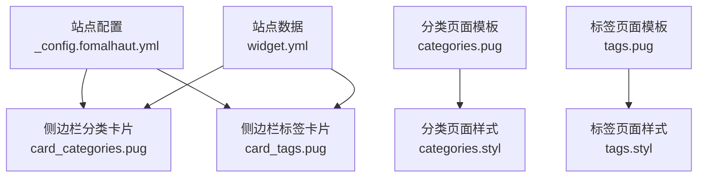
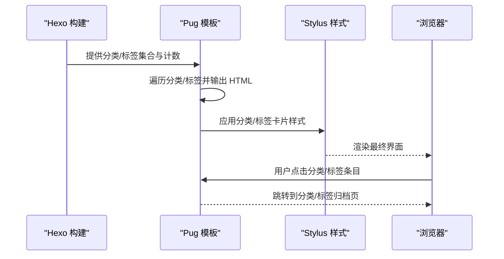
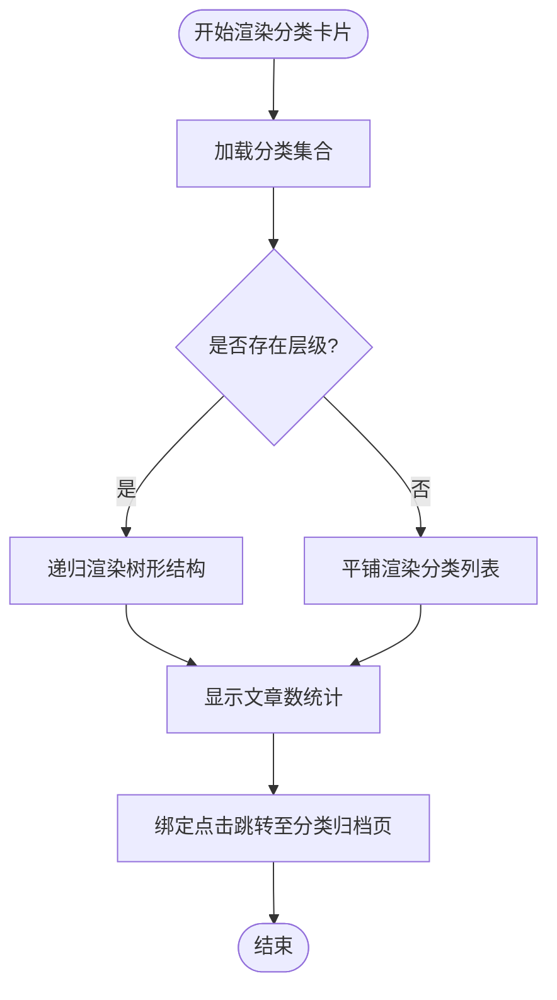
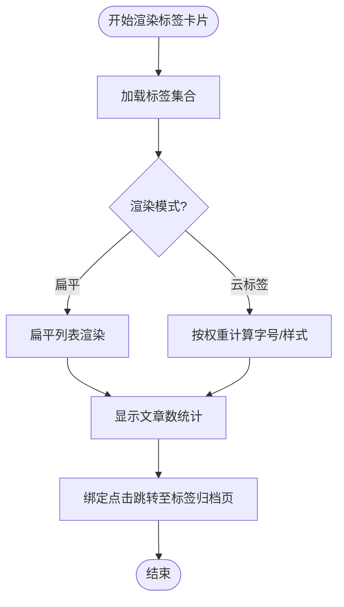
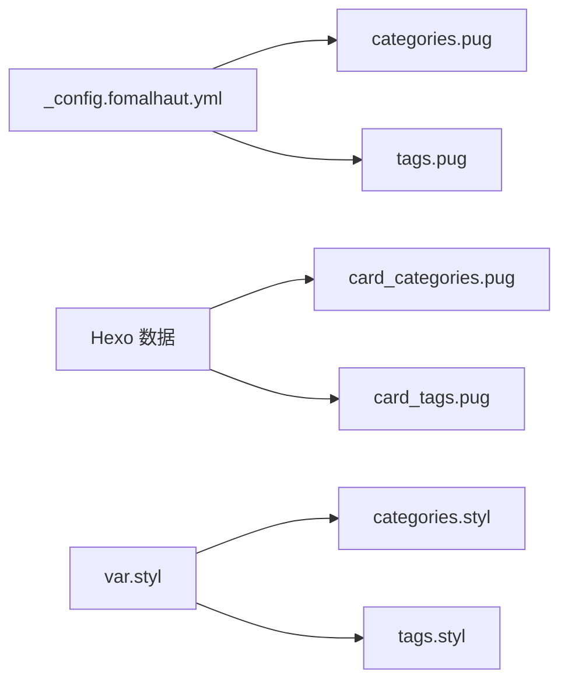

# 分类与标签卡片

<cite>
**本文引用的文件**   
- [主题配置 _config.fomalhaut.yml](file://_config.fomalhaut.yml)
- [侧边栏分类卡片模板 card_categories.pug](file://themes/fomalhaut/layout/includes/widget/card_categories.pug)
- [侧边栏标签卡片模板 card_tags.pug](file://themes/fomalhaut/layout/includes/widget/card_tags.pug)
- [分类页面模板 categories.pug](file://themes/fomalhaut/layout/includes/page/categories.pug)
- [标签页面模板 tags.pug](file://themes/fomalhaut/layout/includes/page/tags.pug)
- [分类页面样式 categories.styl](file://themes/fomalhaut/source/css/_page/categories.styl)
- [标签页面样式 tags.styl](file://themes/fomalhaut/source/css/_page/tags.styl)
- [全局变量 var.styl](file://themes/fomalhaut/source/css/var.styl)
- [站点数据 widget.yml](file://source/_data/widget.yml)
</cite>

## 目录
1. [简介](#简介)
2. [项目结构](#项目结构)
3. [核心组件](#核心组件)
4. [架构总览](#架构总览)
5. [详细组件分析](#详细组件分析)
6. [依赖关系分析](#依赖关系分析)
7. [性能考虑](#性能考虑)
8. [故障排查指南](#故障排查指南)
9. [结论](#结论)
10. [附录](#附录)

## 简介
本文面向使用 Butterfly 主题（本仓库为 Fomalhaut 主题分支）的站点，系统性说明“分类卡片”和“标签卡片”的实现原理与使用方法。内容覆盖：
- 分类与标签数据的来源、组织与渲染流程
- 卡片统计信息展示逻辑
- 点击交互与导航跳转机制
- 自定义展示样式的完整指南（树形结构、扁平列表、云标签等）
- SEO 优化与用户体验改进建议

## 项目结构
与分类/标签卡片直接相关的代码主要分布在以下位置：
- 主题配置：控制分类/标签页 UI 风格、封面图、菜单入口等
- 侧边栏卡片模板：负责在侧边栏渲染分类与标签卡片
- 分类/标签页面模板：负责分类/标签归档页面的整体布局
- 样式文件：定义分类/标签卡片及页面的视觉表现
- 站点数据：可注入侧边栏小部件的数据源

图表来源
- [_config.fomalhaut.yml:786-790](file://_config.fomalhaut.yml#L786-L790)
- [card_categories.pug](file://themes/fomalhaut/layout/includes/widget/card_categories.pug)
- [card_tags.pug](file://themes/fomalhaut/layout/includes/widget/card_tags.pug)
- [categories.pug](file://themes/fomalhaut/layout/includes/page/categories.pug)
- [tags.pug](file://themes/fomalhaut/layout/includes/page/tags.pug)
- [categories.styl](file://themes/fomalhaut/source/css/_page/categories.styl)
- [tags.styl](file://themes/fomalhaut/source/css/_page/tags.styl)
- [widget.yml](file://source/_data/widget.yml)

章节来源
- [_config.fomalhaut.yml:786-790](file://_config.fomalhaut.yml#L786-L790)

## 核心组件
- 分类卡片：在侧边栏以树形或扁平方式展示分类及其文章数量，支持点击跳转到对应分类归档页。
- 标签卡片：在侧边栏以扁平或云标签方式展示标签及其文章数量，支持点击跳转到对应标签归档页。
- 分类/标签页面：提供分类/标签的聚合视图，通常用于全站概览。

章节来源
- [card_categories.pug](file://themes/fomalhaut/layout/includes/widget/card_categories.pug)
- [card_tags.pug](file://themes/fomalhaut/layout/includes/widget/card_tags.pug)
- [categories.pug](file://themes/fomalhaut/layout/includes/page/categories.pug)
- [tags.pug](file://themes/fomalhaut/layout/includes/page/tags.pug)

## 架构总览
分类与标签卡片的渲染链路如下：
- 构建期：Hexo 生成分类与标签集合，并计算每类/每标签的文章数
- 模板层：Pug 模板读取 Hexo 提供的分类/标签对象，遍历渲染为 HTML
- 样式层：Stylus 样式文件定义卡片容器、条目、统计数字、悬停动效等
- 交互层：通过 a 标签链接到分类/标签归档页；如需前端增强，可在 JS 中扩展

图表来源
- [card_categories.pug](file://themes/fomalhaut/layout/includes/widget/card_categories.pug)
- [card_tags.pug](file://themes/fomalhaut/layout/includes/widget/card_tags.pug)
- [categories.styl](file://themes/fomalhaut/source/css/_page/categories.styl)
- [tags.styl](file://themes/fomalhaut/source/css/_page/tags.styl)

## 详细组件分析

### 分类卡片（card_categories.pug）
- 数据来源：由 Hexo 提供的分类集合，包含分类名、路径、文章数等字段
- 数据结构：通常为数组，每项代表一个分类
- 渲染逻辑：
  - 若存在层级关系，按层级递归渲染形成树形结构
  - 若无层级或选择扁平模式，则平铺展示
  - 每个条目显示分类名称与文章数统计
- 交互行为：
  - 点击条目进入该分类的归档页
  - 可通过样式实现悬停高亮、缩放等效果
- 统计信息：
  - 文章数来源于 Hexo 对分类下文章的计数
- 可定制点：
  - 是否显示统计数字
  - 树形/扁平切换
  - 图标、颜色、间距等视觉参数

图表来源
- [card_categories.pug](file://themes/fomalhaut/layout/includes/widget/card_categories.pug)

章节来源
- [card_categories.pug](file://themes/fomalhaut/layout/includes/widget/card_categories.pug)

### 标签卡片（card_tags.pug）
- 数据来源：由 Hexo 提供的标签集合，包含标签名、路径、文章数等字段
- 数据结构：通常为数组，每项代表一个标签
- 渲染逻辑：
  - 默认扁平列表
  - 可选云标签模式（根据文章数动态调整字号/权重）
- 交互行为：
  - 点击条目进入该标签的归档页
- 统计信息：
  - 文章数来源于 Hexo 对标签下文章的计数
- 可定制点：
  - 云标签密度、字号范围、颜色方案
  - 是否显示统计数字
  - 排序规则（按名称、按文章数等）

图表来源
- [card_tags.pug](file://themes/fomalhaut/layout/includes/widget/card_tags.pug)

章节来源
- [card_tags.pug](file://themes/fomalhaut/layout/includes/widget/card_tags.pug)

### 分类页面（categories.pug）
- 作用：展示所有分类的聚合视图，常用于“分类”独立页面
- 内容：分类列表、统计摘要、可能的封面图
- 样式：由 categories.styl 控制布局、卡片样式、响应式适配

章节来源
- [categories.pug](file://themes/fomalhaut/layout/includes/page/categories.pug)
- [categories.styl](file://themes/fomalhaut/source/css/_page/categories.styl)

### 标签页面（tags.pug）
- 作用：展示所有标签的聚合视图，常用于“标签”独立页面
- 内容：标签列表、统计摘要、可能的封面图
- 样式：由 tags.styl 控制布局、卡片样式、响应式适配

章节来源
- [tags.pug](file://themes/fomalhaut/layout/includes/page/tags.pug)
- [tags.styl](file://themes/fomalhaut/source/css/_page/tags.styl)

### 配置项与开关（_config.fomalhaut.yml）
- 分类/标签页面 UI 风格：
  - category_ui：设置分类页面的 UI 风格（如与首页一致或默认归档风格）
  - tag_ui：设置标签页面的 UI 风格
- 其他相关：
  - 菜单入口：可将“归档”“文章统计”等加入主导航
  - 封面图：可为分类/标签子页面设置单独封面图

章节来源
- [_config.fomalhaut.yml:786-790](file://_config.fomalhaut.yml#L786-L790)

### 样式系统（var.styl / categories.styl / tags.styl）
- 全局变量：统一的颜色、字体、间距等变量，便于主题一致性
- 分类/标签页面样式：
  - 卡片容器、条目、统计数字、悬停态、移动端适配
  - 云标签模式下字号与密度的控制

章节来源
- [var.styl](file://themes/fomalhaut/source/css/var.styl)
- [categories.styl](file://themes/fomalhaut/source/css/_page/categories.styl)
- [tags.styl](file://themes/fomalhaut/source/css/_page/tags.styl)

### 站点数据注入（widget.yml）
- 用途：向侧边栏注入额外的小部件数据
- 与卡片的关系：可与分类/标签卡片配合，展示更多站点信息或辅助导航

章节来源
- [widget.yml](file://source/_data/widget.yml)

## 依赖关系分析
- 模板依赖：
  - card_categories.pug 依赖 Hexo 的分类数据对象
  - card_tags.pug 依赖 Hexo 的标签数据对象
- 样式依赖：
  - categories.styl 与 tags.styl 分别服务于分类/标签页面
  - var.styl 提供全局变量供各样式文件引用
- 配置依赖：
  - _config.fomalhaut.yml 中的 category_ui/tag_ui 影响页面级 UI 表现

图表来源
- [_config.fomalhaut.yml:786-790](file://_config.fomalhaut.yml#L786-L790)
- [categories.pug](file://themes/fomalhaut/layout/includes/page/categories.pug)
- [tags.pug](file://themes/fomalhaut/layout/includes/page/tags.pug)
- [card_categories.pug](file://themes/fomalhaut/layout/includes/widget/card_categories.pug)
- [card_tags.pug](file://themes/fomalhaut/layout/includes/widget/card_tags.pug)
- [categories.styl](file://themes/fomalhaut/source/css/_page/categories.styl)
- [tags.styl](file://themes/fomalhaut/source/css/_page/tags.styl)
- [var.styl](file://themes/fomalhaut/source/css/var.styl)

章节来源
- [_config.fomalhaut.yml:786-790](file://_config.fomalhaut.yml#L786-L790)

## 性能考虑
- 避免过度嵌套：分类层级过深会增加 DOM 节点与渲染开销，建议在分类设计时保持合理深度
- 懒加载与分页：当分类/标签数量很大时，考虑分页或按需加载，减少首屏压力
- 样式复用：尽量复用全局变量与公共样式，减少重复 CSS 体积
- 图片与封面：分类/标签子页面的封面图应压缩与缓存，避免阻塞渲染

## 故障排查指南
- 分类/标签不显示：
  - 检查 Hexo 是否正确生成了分类/标签页面
  - 确认侧边栏是否启用了分类/标签卡片
- 统计数字异常：
  - 检查文章 front-matter 是否正确设置了分类/标签
  - 清理缓存后重新构建站点
- 样式错乱：
  - 检查是否覆盖了 categories.styl 或 tags.styl 的关键样式
  - 确认全局变量 var.styl 未被误改
- 点击无效：
  - 检查分类/标签归档页 URL 是否正确
  - 确认路由未与其他插件冲突

## 结论
分类与标签卡片通过 Hexo 数据驱动、Pug 模板渲染、Stylus 样式控制，提供了灵活且可扩展的分类与标签展示能力。通过合理的配置与样式定制，可以实现树形结构、扁平列表、云标签等多种展示模式，并结合 SEO 与用户体验优化策略，提升站点的可发现性与可读性。

## 附录

### 自定义展示样式指南
- 树形结构（分类）：
  - 在模板中判断层级并按需递归渲染
  - 使用缩进与折叠展开逻辑增强层次感知
- 扁平列表（分类/标签）：
  - 直接遍历集合渲染条目
  - 可使用网格布局提升空间利用率
- 云标签（标签）：
  - 根据文章数计算权重，映射到字号/颜色/透明度
  - 控制最大/最小字号与密度，避免拥挤

### SEO 优化建议
- 语义化标签：使用合适的标题与段落结构，确保分类/标签名称作为有意义的文本出现
- 结构化数据：为分类/标签页面添加适当的元信息与描述，利于搜索引擎抓取
- 内链建设：在正文中合理使用分类/标签链接，提升站内关联度
- 封面与描述：为分类/标签子页面设置清晰的封面与描述，提高点击率

### 用户体验改进建议
- 交互反馈：为分类/标签条目添加悬停高亮、点击涟漪等微交互
- 统计可见性：清晰展示文章数，帮助用户快速评估内容规模
- 响应式适配：在小屏设备上保证卡片布局的可读性与可操作性
- 无障碍访问：确保键盘可达、对比度足够、ARIA 属性完善