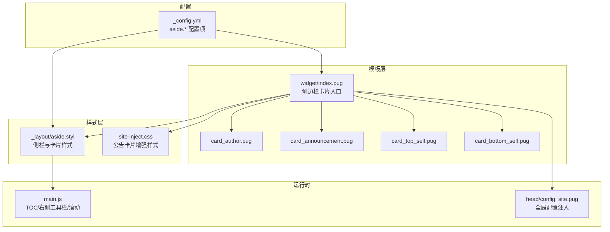
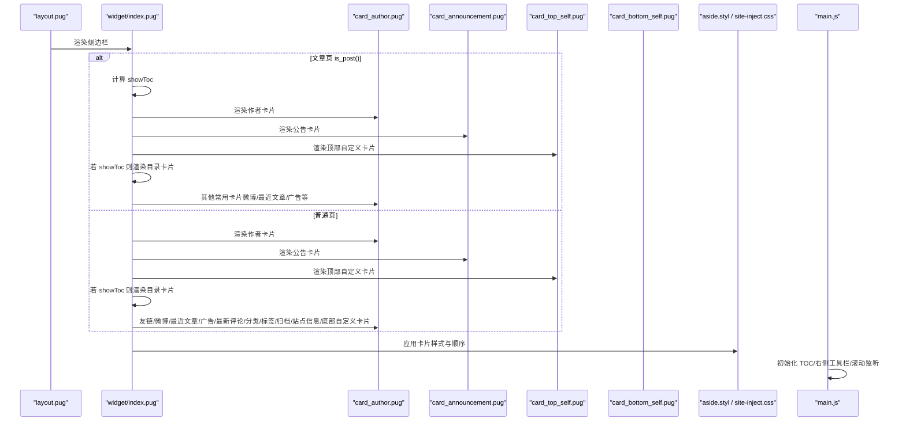
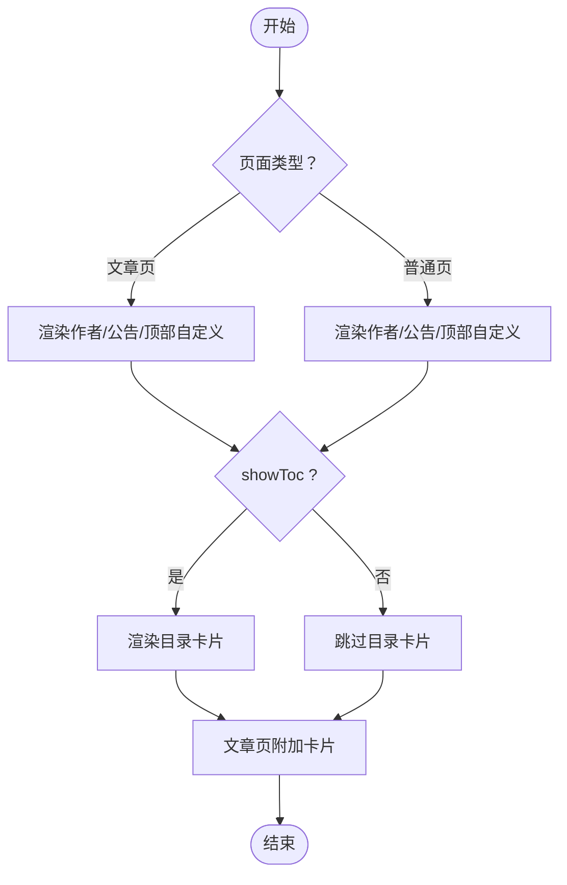
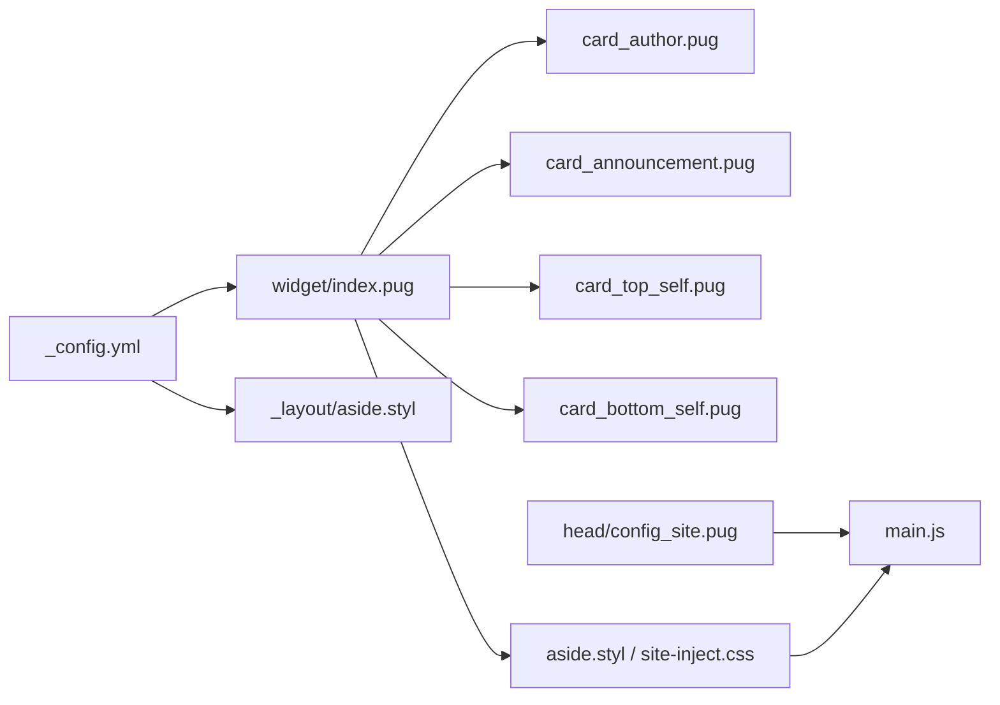

# 卡片组件架构设计

<cite>
**本文引用的文件**   
- [themes/fomalhaut/layout/includes/widget/index.pug](file://themes/fomalhaut/layout/includes/widget/index.pug)
- [themes/fomalhaut/layout/includes/widget/card_author.pug](file://themes/fomalhaut/layout/includes/widget/card_author.pug)
- [themes/fomalhaut/layout/includes/widget/card_announcement.pug](file://themes/fomalhaut/layout/includes/widget/card_announcement.pug)
- [themes/fomalhaut/layout/includes/widget/card_top_self.pug](file://themes/fomalhaut/layout/includes/widget/card_top_self.pug)
- [themes/fomalhaut/layout/includes/widget/card_bottom_self.pug](file://themes/fomalhaut/layout/includes/widget/card_bottom_self.pug)
- [themes/fomalhaut/layout/includes/sidebar.pug](file://themes/fomalhaut/layout/includes/sidebar.pug)
- [themes/fomalhaut/source/css/_layout/aside.styl](file://themes/fomalhaut/source/css/_layout/aside.styl)
- [source/css/site-inject.css](file://source/css/site-inject.css)
- [themes/fomalhaut/source/js/main.js](file://themes/fomalhaut/source/js/main.js)
- [themes/fomalhaut/layout/includes/head/config_site.pug](file://themes/fomalhaut/layout/includes/head/config_site.pug)
- [themes/fomalhaut/layout/includes/layout.pug](file://themes/fomalhaut/layout/includes/layout.pug)
- [themes/fomalhaut/_config.yml](file://themes/fomalhaut/_config.yml)
</cite>

## 目录
1. [引言](#引言)
2. [项目结构](#项目结构)
3. [核心组件](#核心组件)
4. [架构总览](#架构总览)
5. [详细组件分析](#详细组件分析)
6. [依赖关系分析](#依赖关系分析)
7. [性能与优化](#性能与优化)
8. [故障排查](#故障排查)
9. [结论](#结论)
10. [附录：开发最佳实践](#附录开发最佳实践)

## 引言
本文面向侧边栏卡片组件系统，系统性说明其整体架构、统一接口规范、数据传递机制、配置选项结构、渲染流程、生命周期管理、条件显示逻辑、不同页面类型下的加载策略与动态切换机制，以及性能优化策略和开发最佳实践。目标是帮助读者在不深入源码细节的情况下，也能理解并扩展该卡片体系。

## 项目结构
侧边栏卡片系统由“模板层（Pug）+ 样式层（Stylus/CSS）+ 运行时脚本（JS）+ 主题配置（YAML）”四部分组成：
- 模板层负责按页面类型与配置决定哪些卡片参与渲染，并以统一的 DOM 类名输出卡片节点。
- 样式层定义卡片容器、间距、顺序、移动端行为等视觉与布局规则。
- 运行时脚本处理 TOC、右侧工具栏、滚动交互等与卡片相关的交互。
- 主题配置提供开关、排序、限制数量等控制项。

图表来源
- [themes/fomalhaut/layout/includes/widget/index.pug:1-37](file://themes/fomalhaut/layout/includes/widget/index.pug#L1-L37)
- [themes/fomalhaut/source/css/_layout/aside.styl:1-410](file://themes/fomalhaut/source/css/_layout/aside.styl#L1-L410)
- [source/css/site-inject.css:36-122](file://source/css/site-inject.css#L36-L122)
- [themes/fomalhaut/source/js/main.js:324-455](file://themes/fomalhaut/source/js/main.js#L324-L455)
- [themes/fomalhaut/layout/includes/head/config_site.pug:9-28](file://themes/fomalhaut/layout/includes/head/config_site.pug#L9-L28)
- [themes/fomalhaut/_config.yml:622-694](file://themes/fomalhaut/_config.yml#L622-L694)

章节来源
- [themes/fomalhaut/layout/includes/widget/index.pug:1-37](file://themes/fomalhaut/layout/includes/widget/index.pug#L1-L37)
- [themes/fomalhaut/source/css/_layout/aside.styl:1-410](file://themes/fomalhaut/source/css/_layout/aside.styl#L1-L410)
- [themes/fomalhaut/source/js/main.js:324-455](file://themes/fomalhaut/source/js/main.js#L324-L455)
- [themes/fomalhaut/layout/includes/head/config_site.pug:9-28](file://themes/fomalhaut/layout/includes/head/config_site.pug#L9-L28)
- [themes/fomalhaut/_config.yml:622-694](file://themes/fomalhaut/_config.yml#L622-L694)

## 核心组件
- 卡片入口控制器：widget/index.pug 根据 is_post() 判断文章页与普通页，分别渲染不同的卡片集合；同时受 showToc 控制是否渲染目录卡片。
- 基础卡片模板：
  - card_author.pug：作者信息、站点统计、社交图标、按钮。
  - card_announcement.pug：公告信息板，内容来自 theme.aside.card_announcement.content。
  - card_top_self.pug / card_bottom_self.pug：自定义顶部/底部卡片，数据来源于 site.data.widget.top/bottom。
- 样式与布局：_layout/aside.styl 定义 .card-widget 容器、间距、移动端隐藏、sticky_layout 顺序控制；site-inject.css 对公告卡片进行增强样式。
- 运行时脚本：main.js 处理 TOC 滚动高亮、进度百分比、移动端展开收起，以及右侧工具栏的“隐藏侧栏”等交互。
- 配置中心：_config.yml 中 aside.* 控制各卡片的 enable、limit、sort_order 等。

章节来源
- [themes/fomalhaut/layout/includes/widget/index.pug:1-37](file://themes/fomalhaut/layout/includes/widget/index.pug#L1-L37)
- [themes/fomalhaut/layout/includes/widget/card_author.pug:1-37](file://themes/fomalhaut/layout/includes/widget/card_author.pug#L1-L37)
- [themes/fomalhaut/layout/includes/widget/card_announcement.pug:1-14](file://themes/fomalhaut/layout/includes/widget/card_announcement.pug#L1-L14)
- [themes/fomalhaut/layout/includes/widget/card_top_self.pug:1-8](file://themes/fomalhaut/layout/includes/widget/card_top_self.pug#L1-L8)
- [themes/fomalhaut/layout/includes/widget/card_bottom_self.pug:1-10](file://themes/fomalhaut/layout/includes/widget/card_bottom_self.pug#L1-L10)
- [themes/fomalhaut/source/css/_layout/aside.styl:1-410](file://themes/fomalhaut/source/css/_layout/aside.styl#L1-L410)
- [source/css/site-inject.css:36-122](file://source/css/site-inject.css#L36-L122)
- [themes/fomalhaut/source/js/main.js:324-455](file://themes/fomalhaut/source/js/main.js#L324-L455)
- [themes/fomalhaut/_config.yml:622-694](file://themes/fomalhaut/_config.yml#L622-L694)

## 架构总览
侧边栏卡片系统的渲染与控制流如下：

图表来源
- [themes/fomalhaut/layout/includes/layout.pug:1-108](file://themes/fomalhaut/layout/includes/layout.pug#L1-L108)
- [themes/fomalhaut/layout/includes/widget/index.pug:1-37](file://themes/fomalhaut/layout/includes/widget/index.pug#L1-L37)
- [themes/fomalhaut/source/js/main.js:324-455](file://themes/fomalhaut/source/js/main.js#L324-L455)

## 详细组件分析

### 统一接口规范
- 容器类名：所有卡片统一使用 .card-widget 作为根容器，便于样式层统一控制间距、圆角、悬浮效果等。
- 语义化区块：每个卡片内部包含 .item-headline（标题区）与 .item-content（内容区），用于统一头部与内容的排版。
- 可定制属性：自定义卡片支持 class_name、id_name、icon、name、html、order 等字段，通过 site.data.widget 注入。
- 缓存策略：模板 partial 调用时普遍使用 {cache: true}，减少重复渲染开销。

章节来源
- [themes/fomalhaut/layout/includes/widget/card_top_self.pug:1-8](file://themes/fomalhaut/layout/includes/widget/card_top_self.pug#L1-L8)
- [themes/fomalhaut/layout/includes/widget/card_bottom_self.pug:1-10](file://themes/fomalhaut/layout/includes/widget/card_bottom_self.pug#L1-L10)
- [themes/fomalhaut/layout/includes/widget/index.pug:10-35](file://themes/fomalhaut/layout/includes/widget/index.pug#L10-L35)

### 数据传递机制
- 主题配置：theme.aside.* 控制各卡片的启用、展示内容与行为（如 card_author.description、card_announcement.content）。
- 站点数据：site.posts/tags/categories 等用于统计展示；site.data.widget.top/bottom 用于自定义卡片。
- 页面上下文：is_post()/is_home() 等辅助函数决定渲染分支；page.toc_style_simple 影响目录样式。
- 全局配置：config_site.pug 将 showToc、isPost、isToc 等注入到前端 GLOBAL_CONFIG_SITE，供 main.js 使用。

章节来源
- [themes/fomalhaut/layout/includes/widget/card_author.pug:1-37](file://themes/fomalhaut/layout/includes/widget/card_author.pug#L1-L37)
- [themes/fomalhaut/layout/includes/widget/card_announcement.pug:1-14](file://themes/fomalhaut/layout/includes/widget/card_announcement.pug#L1-L14)
- [themes/fomalhaut/layout/includes/widget/card_top_self.pug:1-8](file://themes/fomalhaut/layout/includes/widget/card_top_self.pug#L1-L8)
- [themes/fomalhaut/layout/includes/widget/card_bottom_self.pug:1-10](file://themes/fomalhaut/layout/includes/widget/card_bottom_self.pug#L1-L10)
- [themes/fomalhaut/layout/includes/head/config_site.pug:9-28](file://themes/fomalhaut/layout/includes/head/config_site.pug#L9-L28)

### 渲染流程
- 入口判定：widget/index.pug 首先判断 is_post()，再根据 showToc 决定是否渲染目录卡片。
- 文章页：优先渲染作者、公告、顶部自定义卡片，随后在 sticky_layout 内渲染目录（可选）、微博、最近文章、广告等。
- 普通页：渲染作者、公告、顶部自定义卡片后，在 sticky_layout 内渲染友链、微博、最近文章、广告、最新评论、分类、标签、归档、站点信息、底部自定义卡片。
- 样式顺序：aside.styl 通过 hexo-config('aside.*.sort_order') 为多个卡片设置 flex order，实现可视化排序。

图表来源
- [themes/fomalhaut/layout/includes/widget/index.pug:1-37](file://themes/fomalhaut/layout/includes/widget/index.pug#L1-L37)
- [themes/fomalhaut/source/css/_layout/aside.styl:383-410](file://themes/fomalhaut/source/css/_layout/aside.styl#L383-L410)

章节来源
- [themes/fomalhaut/layout/includes/widget/index.pug:1-37](file://themes/fomalhaut/layout/includes/widget/index.pug#L1-L37)
- [themes/fomalhaut/source/css/_layout/aside.styl:383-410](file://themes/fomalhaut/source/css/_layout/aside.styl#L383-L410)

### 生命周期管理
- 服务端渲染阶段：Pug 模板根据 is_post()/showToc/theme.aside.* 生成 HTML。
- 客户端初始化阶段：main.js 在 DOMContentLoaded 后执行 refreshFn()，注册滚动监听、TOC 高亮、右侧工具栏事件等。
- PJAX 场景：refreshFn() 会在 PJAX 换页后重新执行，确保 TOC、相对时间、相册等模块正确初始化。
- 状态持久化：main.js 通过 saveToLocal.set('aside-status', ...) 记录用户隐藏/显示侧栏的状态。

章节来源
- [themes/fomalhaut/source/js/main.js:743-789](file://themes/fomalhaut/source/js/main.js#L743-L789)
- [themes/fomalhaut/source/js/main.js:494-519](file://themes/fomalhaut/source/js/main.js#L494-L519)

### 条件显示逻辑
- 侧栏总开关：theme.aside.enable 控制是否显示侧栏；page.aside === false 可针对单页关闭。
- 目录显示：showToc 由 page.toc_style_simple 与 theme.toc.style_simple 共同决定；仅当存在目录或加密文章时才显示。
- 卡片开关：各卡片通过 theme.aside.card_* 的 enable 控制是否渲染。
- 移动端行为：aside.styl 中 if hexo-config('aside.mobile') == false 时，在非 #card-toc 的卡片于移动端隐藏。

章节来源
- [themes/fomalhaut/layout/includes/layout.pug:1-108](file://themes/fomalhaut/layout/includes/layout.pug#L1-L108)
- [themes/fomalhaut/layout/includes/head/config_site.pug:9-28](file://themes/fomalhaut/layout/includes/head/config_site.pug#L9-L28)
- [themes/fomalhaut/source/css/_layout/aside.styl:26-30](file://themes/fomalhaut/source/css/_layout/aside.styl#L26-L30)

### 不同页面类型的加载策略与动态切换
- 文章页：侧重作者、公告、目录、最近文章、广告等；目录卡片可能以简单样式呈现。
- 普通页：增加友链、最新评论、分类、标签、归档、站点信息等卡片；适合展示站点导航与聚合信息。
- 动态切换：main.js 中的 rightSideFn.hideAsideBtn() 允许用户隐藏/显示侧栏，并通过 saveToLocal 持久化状态；TOC 在移动端可通过右侧工具栏按钮展开/收起。

章节来源
- [themes/fomalhaut/layout/includes/widget/index.pug:1-37](file://themes/fomalhaut/layout/includes/widget/index.pug#L1-L37)
- [themes/fomalhaut/source/js/main.js:494-519](file://themes/fomalhaut/source/js/main.js#L494-L519)
- [themes/fomalhaut/source/js/main.js:516-519](file://themes/fomalhaut/source/js/main.js#L516-L519)

## 依赖关系分析
- widget/index.pug 依赖 is_post()/showToc 与 theme.aside.* 配置，决定渲染分支。
- aside.styl 依赖 hexo-config('aside.*.sort_order') 控制卡片顺序，依赖 aside.mobile 控制移动端可见性。
- main.js 依赖 GLOBAL_CONFIG_SITE.isPost/isToc 等全局变量，处理 TOC 与右侧工具栏交互。
- config_site.pug 将 showToc 与页面类型注入到前端，供 main.js 使用。
- _config.yml 提供 aside.* 的配置项，贯穿模板与样式层。

图表来源
- [themes/fomalhaut/_config.yml:622-694](file://themes/fomalhaut/_config.yml#L622-L694)
- [themes/fomalhaut/layout/includes/widget/index.pug:1-37](file://themes/fomalhaut/layout/includes/widget/index.pug#L1-L37)
- [themes/fomalhaut/source/css/_layout/aside.styl:1-410](file://themes/fomalhaut/source/css/_layout/aside.styl#L1-L410)
- [themes/fomalhaut/layout/includes/head/config_site.pug:9-28](file://themes/fomalhaut/layout/includes/head/config_site.pug#L9-L28)
- [themes/fomalhaut/source/js/main.js:324-455](file://themes/fomalhaut/source/js/main.js#L324-L455)

章节来源
- [themes/fomalhaut/_config.yml:622-694](file://themes/fomalhaut/_config.yml#L622-L694)
- [themes/fomalhaut/layout/includes/widget/index.pug:1-37](file://themes/fomalhaut/layout/includes/widget/index.pug#L1-L37)
- [themes/fomalhaut/source/css/_layout/aside.styl:1-410](file://themes/fomalhaut/source/css/_layout/aside.styl#L1-L410)
- [themes/fomalhaut/layout/includes/head/config_site.pug:9-28](file://themes/fomalhaut/layout/includes/head/config_site.pug#L9-L28)
- [themes/fomalhaut/source/js/main.js:324-455](file://themes/fomalhaut/source/js/main.js#L324-L455)

## 性能与优化
- 模板缓存：widget/index.pug 中对 partial 调用使用 {cache: true}，避免重复渲染。
- 样式层优化：aside.styl 使用 flex order 控制卡片顺序，避免重排重绘；移动端按需隐藏非目录卡片。
- 运行时节流：main.js 使用 btf.throttle 对滚动事件进行节流，降低频繁计算带来的性能损耗。
- 懒加载：main.js 集成 LazyLoad，延迟加载图片，减少首屏压力。
- 条件初始化：TOC 与锚点仅在 isToc/isAnchor 为真时初始化，避免不必要的 DOM 操作。

章节来源
- [themes/fomalhaut/layout/includes/widget/index.pug:10-35](file://themes/fomalhaut/layout/includes/widget/index.pug#L10-L35)
- [themes/fomalhaut/source/css/_layout/aside.styl:26-30](file://themes/fomalhaut/source/css/_layout/aside.styl#L26-L30)
- [themes/fomalhaut/source/js/main.js:287-321](file://themes/fomalhaut/source/js/main.js#L287-L321)
- [themes/fomalhaut/source/js/main.js:726-732](file://themes/fomalhaut/source/js/main.js#L726-L732)
- [themes/fomalhaut/source/js/main.js:324-355](file://themes/fomalhaut/source/js/main.js#L324-L355)

## 故障排查
- 侧栏不显示：检查 theme.aside.enable 与 page.aside 是否为 false；确认 layout.pug 中 hide-aside 类未误加。
- 目录不出现：确认 showToc 计算逻辑（page.toc_style_simple 与 theme.toc.style_simple），并确保文章内容存在目录或为加密文章。
- 卡片顺序异常：检查 aside.styl 中 hexo-config('aside.*.sort_order') 配置是否正确。
- 移动端卡片被隐藏：若 aside.mobile 为 false，除 #card-toc 外的卡片会被隐藏，需调整配置或样式。
- 公告卡片样式错乱：检查 site-inject.css 中 .card-announcement 相关样式是否与 content 结构匹配。

章节来源
- [themes/fomalhaut/layout/includes/layout.pug:1-108](file://themes/fomalhaut/layout/includes/layout.pug#L1-L108)
- [themes/fomalhaut/layout/includes/head/config_site.pug:9-28](file://themes/fomalhaut/layout/includes/head/config_site.pug#L9-L28)
- [themes/fomalhaut/source/css/_layout/aside.styl:383-410](file://themes/fomalhaut/source/css/_layout/aside.styl#L383-L410)
- [source/css/site-inject.css:36-122](file://source/css/site-inject.css#L36-L122)

## 结论
侧边栏卡片组件系统以 Pug 模板为核心，结合 Stylus/CSS 样式与 JavaScript 运行时，形成清晰的“配置驱动 + 条件渲染 + 统一接口”的架构。通过 widget/index.pug 的页面类型分支与 showToc 控制，实现了文章页与普通页的差异化渲染；通过 aside.styl 的 flex order 与移动端策略，保证了良好的布局与性能；通过 main.js 的 TOC 与右侧工具栏交互，提升了用户体验。开发者可基于统一接口规范与 site.data.widget 机制，快速扩展新的卡片类型。

## 附录：开发最佳实践
- 遵循统一接口：新卡片使用 .card-widget 容器，包含 .item-headline 与 .item-content，便于样式统一。
- 使用配置开关：通过 theme.aside.card_xxx.enable 控制卡片显隐，避免硬编码。
- 利用 site.data.widget：自定义卡片通过 top/bottom 数组注入，支持 class_name、id_name、icon、name、html、order。
- 合理使用缓存：partial 调用时添加 {cache: true}，减少重复渲染。
- 关注性能：避免在滚动事件中执行昂贵计算；使用节流与懒加载；仅在必要时初始化模块。
- 维护顺序可控：通过 aside.styl 的 sort_order 配置调整卡片顺序，保持布局一致性。
- 兼容移动端：注意 aside.mobile 与 #card-toc 的特殊处理，确保移动端体验。

章节来源
- [themes/fomalhaut/layout/includes/widget/card_top_self.pug:1-8](file://themes/fomalhaut/layout/includes/widget/card_top_self.pug#L1-L8)
- [themes/fomalhaut/layout/includes/widget/card_bottom_self.pug:1-10](file://themes/fomalhaut/layout/includes/widget/card_bottom_self.pug#L1-L10)
- [themes/fomalhaut/layout/includes/widget/index.pug:10-35](file://themes/fomalhaut/layout/includes/widget/index.pug#L10-L35)
- [themes/fomalhaut/source/css/_layout/aside.styl:383-410](file://themes/fomalhaut/source/css/_layout/aside.styl#L383-L410)
- [themes/fomalhaut/source/js/main.js:287-321](file://themes/fomalhaut/source/js/main.js#L287-L321)
- [themes/fomalhaut/source/js/main.js:726-732](file://themes/fomalhaut/source/js/main.js#L726-L732)