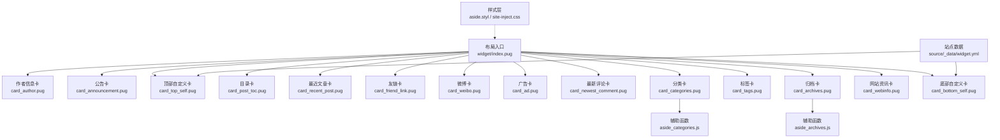
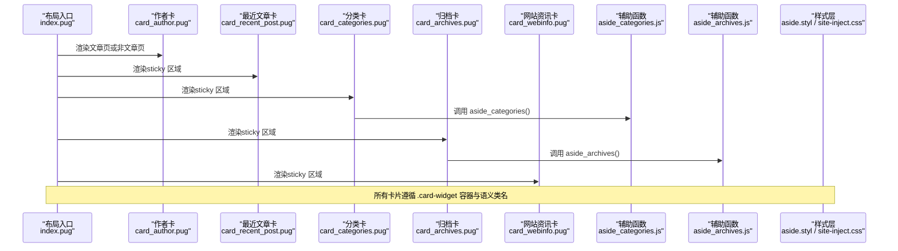
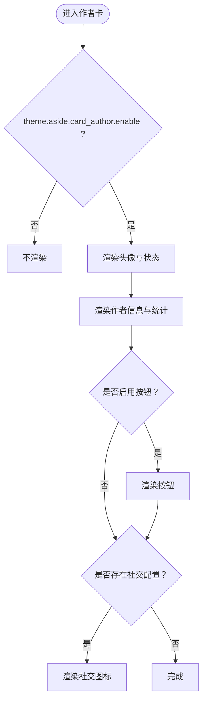
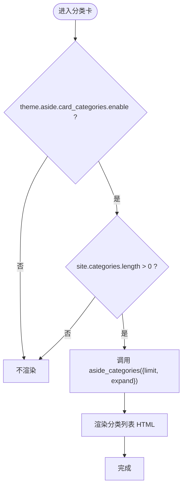
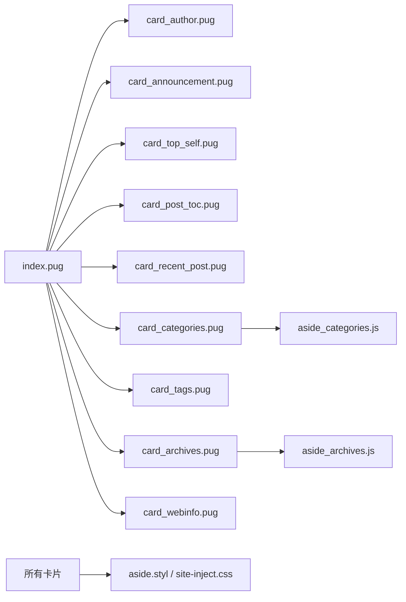

# 卡片组件系统

<cite>
**本文引用的文件**   
- [themes/fomalhaut/layout/includes/widget/index.pug](file://themes/fomalhaut/layout/includes/widget/index.pug)
- [source/_data/widget.yml](file://source/_data/widget.yml)
- [themes/fomalhaut/layout/includes/widget/card_author.pug](file://themes/fomalhaut/layout/includes/widget/card_author.pug)
- [themes/fomalhaut/layout/includes/widget/card_announcement.pug](file://themes/fomalhaut/layout/includes/widget/card_announcement.pug)
- [themes/fomalhaut/layout/includes/widget/card_top_self.pug](file://themes/fomalhaut/layout/includes/widget/card_top_self.pug)
- [themes/fomalhaut/layout/includes/widget/card_bottom_self.pug](file://themes/fomalhaut/layout/includes/widget/card_bottom_self.pug)
- [themes/fomalhaut/layout/includes/widget/card_post_toc.pug](file://themes/fomalhaut/layout/includes/widget/card_post_toc.pug)
- [themes/fomalhaut/layout/includes/widget/card_recent_post.pug](file://themes/fomalhaut/layout/includes/widget/card_recent_post.pug)
- [themes/fomalhaut/layout/includes/widget/card_categories.pug](file://themes/fomalhaut/layout/includes/widget/card_categories.pug)
- [themes/fomalhaut/layout/includes/widget/card_tags.pug](file://themes/fomalhaut/layout/includes/widget/card_tags.pug)
- [themes/fomalhaut/layout/includes/widget/card_archives.pug](file://themes/fomalhaut/layout/includes/widget/card_archives.pug)
- [themes/fomalhaut/layout/includes/widget/card_webinfo.pug](file://themes/fomalhaut/layout/includes/widget/card_webinfo.pug)
- [themes/fomalhaut/scripts/helpers/aside_categories.js](file://themes/fomalhaut/scripts/helpers/aside_categories.js)
- [themes/fomalhaut/scripts/helpers/aside_archives.js](file://themes/fomalhaut/scripts/helpers/aside_archives.js)
- [themes/fomalhaut/source/css/_layout/aside.styl](file://themes/fomalhaut/source/css/_layout/aside.styl)
- [source/css/site-inject.css](file://source/css/site-inject.css)
</cite>

## 目录
1. [简介](#简介)
2. [项目结构](#项目结构)
3. [核心组件](#核心组件)
4. [架构总览](#架构总览)
5. [详细组件分析](#详细组件分析)
6. [依赖关系分析](#依赖关系分析)
7. [性能与优化](#性能与优化)
8. [故障排查](#故障排查)
9. [结论](#结论)
10. [附录：自定义卡片开发指南](#附录自定义卡片开发指南)

## 简介
本文件系统性地文档化侧边栏卡片组件体系，覆盖统一接口规范、内置卡片实现、动态加载机制、条件显示逻辑与性能优化策略，并提供创建自定义卡片的完整指南。该体系基于 Hexo 主题模板（Pug）与站点数据（YAML），通过辅助函数渲染分类、归档等聚合数据，配合样式层实现一致的视觉与交互体验。

## 项目结构
侧边栏卡片由“布局入口 + 配置数据 + 具体卡片模板 + 辅助函数 + 样式”五部分构成：
- 布局入口负责按页面类型（文章页/普通页）选择并组合卡片。
- 站点数据 widget.yml 提供可插拔的顶部/底部自定义卡片。
- 各 card_*.pug 为具体卡片模板，遵循统一的 DOM 结构与类名约定。
- aside_categories.js、aside_archives.js 等辅助函数负责生成结构化 HTML。
- aside.styl、site-inject.css 等样式文件定义卡片容器、排版与响应式行为。

图表来源
- [themes/fomalhaut/layout/includes/widget/index.pug:1-37](file://themes/fomalhaut/layout/includes/widget/index.pug#L1-L37)
- [source/_data/widget.yml:1-50](file://source/_data/widget.yml#L1-L50)
- [themes/fomalhaut/scripts/helpers/aside_categories.js:1-38](file://themes/fomalhaut/scripts/helpers/aside_categories.js#L1-L38)
- [themes/fomalhaut/scripts/helpers/aside_archives.js:1-44](file://themes/fomalhaut/scripts/helpers/aside_archives.js#L1-L44)
- [themes/fomalhaut/source/css/_layout/aside.styl:1-68](file://themes/fomalhaut/source/css/_layout/aside.styl#L1-L68)

章节来源
- [themes/fomalhaut/layout/includes/widget/index.pug:1-37](file://themes/fomalhaut/layout/includes/widget/index.pug#L1-L37)
- [source/_data/widget.yml:1-50](file://source/_data/widget.yml#L1-L50)

## 核心组件
本节梳理卡片体系的统一接口规范与通用约定。

- 统一容器与类名
  - 所有卡片外层使用 .card-widget 包裹，内部包含标题区 .item-headline 与内容区 .item-content。
  - 不同业务卡片附加语义类名，如 .card-info、.card-recent-post、.card-categories、.card-tags、.card-archives、.card-webinfo 等。
  - 样式层通过这些类名控制间距、圆角、阴影与响应式布局。

- 数据传递方式
  - 主题配置：通过 theme.* 读取开关、限制数量、排序规则等（例如 enable、limit、sort）。
  - 站点数据：通过 site.posts、site.tags、site.categories、site.data.widget 获取聚合数据。
  - 页面上下文：page.toc_* 等属性用于控制目录卡行为。
  - 辅助函数：aside_categories、aside_archives 等 helper 返回已渲染的 HTML 片段。

- 条件显示逻辑
  - 每个卡片模板以 if theme.aside.card_xxx.enable 作为开关。
  - 列表型卡片在数据为空时不渲染（如分类、标签）。
  - 文章页与普通页的卡片组合不同，由 index.pug 分支控制。

- 渲染顺序与定位
  - 非 sticky 区域：作者卡、公告卡、顶部自定义卡。
  - sticky 区域：目录卡、友链卡、微博卡、最近文章卡、广告卡、最新评论卡、分类卡、标签卡、归档卡、网站资讯卡、底部自定义卡。
  - 顶部/底部自定义卡支持 class_name、id_name、icon、name、html 字段，并可设置 order 控制排列。

章节来源
- [themes/fomalhaut/layout/includes/widget/index.pug:1-37](file://themes/fomalhaut/layout/includes/widget/index.pug#L1-L37)
- [themes/fomalhaut/layout/includes/widget/card_author.pug:1-37](file://themes/fomalhaut/layout/includes/widget/card_author.pug#L1-L37)
- [themes/fomalhaut/layout/includes/widget/card_categories.pug:1-5](file://themes/fomalhaut/layout/includes/widget/card_categories.pug#L1-L5)
- [themes/fomalhaut/layout/includes/widget/card_tags.pug:1-13](file://themes/fomalhaut/layout/includes/widget/card_tags.pug#L1-L13)
- [themes/fomalhaut/layout/includes/widget/card_archives.pug:1-8](file://themes/fomalhaut/layout/includes/widget/card_archives.pug#L1-L8)
- [themes/fomalhaut/layout/includes/widget/card_webinfo.pug:1-148](file://themes/fomalhaut/layout/includes/widget/card_webinfo.pug#L1-L148)
- [themes/fomalhaut/layout/includes/widget/card_top_self.pug:1-8](file://themes/fomalhaut/layout/includes/widget/card_top_self.pug#L1-L8)
- [themes/fomalhaut/layout/includes/widget/card_bottom_self.pug:1-10](file://themes/fomalhaut/layout/includes/widget/card_bottom_self.pug#L1-L10)
- [themes/fomalhaut/source/css/_layout/aside.styl:1-68](file://themes/fomalhaut/source/css/_layout/aside.styl#L1-L68)

## 架构总览
下图展示从布局入口到具体卡片与辅助函数的调用关系，以及样式层的支撑作用。

图表来源
- [themes/fomalhaut/layout/includes/widget/index.pug:1-37](file://themes/fomalhaut/layout/includes/widget/index.pug#L1-L37)
- [themes/fomalhaut/layout/includes/widget/card_categories.pug:1-5](file://themes/fomalhaut/layout/includes/widget/card_categories.pug#L1-L5)
- [themes/fomalhaut/layout/includes/widget/card_archives.pug:1-8](file://themes/fomalhaut/layout/includes/widget/card_archives.pug#L1-L8)
- [themes/fomalhaut/layout/includes/widget/card_webinfo.pug:1-148](file://themes/fomalhaut/layout/includes/widget/card_webinfo.pug#L1-L148)
- [themes/fomalhaut/scripts/helpers/aside_categories.js:1-38](file://themes/fomalhaut/scripts/helpers/aside_categories.js#L1-L38)
- [themes/fomalhaut/scripts/helpers/aside_archives.js:1-44](file://themes/fomalhaut/scripts/helpers/aside_archives.js#L1-L44)
- [themes/fomalhaut/source/css/_layout/aside.styl:1-68](file://themes/fomalhaut/source/css/_layout/aside.styl#L1-L68)

## 详细组件分析

### 作者信息卡（card_author）
- 功能要点
  - 头像、状态、作者名与描述。
  - 文章数、标签数、分类数统计。
  - 可选按钮与社交图标。
- 配置项
  - theme.aside.card_author.enable：是否启用。
  - theme.aside.card_author.description：描述文案。
  - theme.aside.card_author.button.*：按钮链接、文本与图标。
- 数据来源
  - config.author、config.description。
  - site.posts.length、site.tags.length、site.categories.length。
- 渲染逻辑
  - 根据 theme.aside.card_author.enable 决定是否渲染整张卡片。
  - 社交图标通过 partial('includes/header/social') 注入。

图表来源
- [themes/fomalhaut/layout/includes/widget/card_author.pug:1-37](file://themes/fomalhaut/layout/includes/widget/card_author.pug#L1-L37)

章节来源
- [themes/fomalhaut/layout/includes/widget/card_author.pug:1-37](file://themes/fomalhaut/layout/includes/widget/card_author.pug#L1-L37)

### 公告卡（card_announcement）
- 功能要点
  - 标题与富文本内容。
  - 预留欢迎访客信息容器。
- 配置项
  - theme.aside.card_announcement.enable：是否启用。
  - theme.aside.card_announcement.content：公告内容。

章节来源
- [themes/fomalhaut/layout/includes/widget/card_announcement.pug:1-14](file://themes/fomalhaut/layout/includes/widget/card_announcement.pug#L1-L14)

### 顶部/底部自定义卡（card_top_self / card_bottom_self）
- 功能要点
  - 从 site.data.widget.top/bottom 读取配置，循环渲染自定义卡片。
  - 支持 class_name、id_name、icon、name、html 字段；底部卡支持 order 控制排列。
- 配置项
  - source/_data/widget.yml 中 top/bottom 数组项。
- 渲染逻辑
  - 若存在对应数据则渲染，否则跳过。
  - 标题区使用 icon 与 name，内容区直接输出 html。

章节来源
- [themes/fomalhaut/layout/includes/widget/card_top_self.pug:1-8](file://themes/fomalhaut/layout/includes/widget/card_top_self.pug#L1-L8)
- [themes/fomalhaut/layout/includes/widget/card_bottom_self.pug:1-10](file://themes/fomalhaut/layout/includes/widget/card_bottom_self.pug#L1-L10)
- [source/_data/widget.yml:1-50](file://source/_data/widget.yml#L1-L50)

### 目录卡（card_post_toc）
- 功能要点
  - 根据 page.toc_* 或 theme.toc.* 控制编号与展开状态。
  - 加密文章与非加密文章分别处理内容源。
- 配置项
  - page.toc_number、page.toc_expand。
  - theme.toc.number、theme.toc.expand。
- 渲染逻辑
  - 计算展开类名 is-expand。
  - 加密文章使用 page.origin，否则使用 page.content。

章节来源
- [themes/fomalhaut/layout/includes/widget/card_post_toc.pug:1-17](file://themes/fomalhaut/layout/includes/widget/card_post_toc.pug#L1-L17)

### 最近文章卡（card_recent_post）
- 功能要点
  - 按 limit 与 sort 规则列出最近文章。
  - 可选封面图，失败时回退到默认占位图。
- 配置项
  - theme.aside.card_recent_post.enable、limit、sort。
  - theme.cover.aside_enable 控制封面显示。
- 渲染逻辑
  - 对 site.posts 进行排序与截取。
  - 根据 article.cover 与主题配置决定是否渲染封面。

章节来源
- [themes/fomalhaut/layout/includes/widget/card_recent_post.pug:1-26](file://themes/fomalhaut/layout/includes/widget/card_recent_post.pug#L1-L26)

### 分类卡（card_categories）
- 功能要点
  - 调用 aside_categories 辅助函数渲染层级分类列表。
  - 支持 limit 与 expand 控制显示数量与展开行为。
- 配置项
  - theme.aside.card_categories.enable、limit、expand。
- 辅助函数
  - aside_categories(options)：接收 categories、options，返回 HTML。

图表来源
- [themes/fomalhaut/layout/includes/widget/card_categories.pug:1-5](file://themes/fomalhaut/layout/includes/widget/card_categories.pug#L1-L5)
- [themes/fomalhaut/scripts/helpers/aside_categories.js:1-38](file://themes/fomalhaut/scripts/helpers/aside_categories.js#L1-L38)

章节来源
- [themes/fomalhaut/layout/includes/widget/card_categories.pug:1-5](file://themes/fomalhaut/layout/includes/widget/card_categories.pug#L1-L5)
- [themes/fomalhaut/scripts/helpers/aside_categories.js:1-38](file://themes/fomalhaut/scripts/helpers/aside_categories.js#L1-L38)

### 标签卡（card_tags）
- 功能要点
  - 根据 theme.aside.card_tags.color 选择云标签渲染器。
  - 支持 limit 控制标签数量。
- 配置项
  - theme.aside.card_tags.enable、limit、color。
- 渲染逻辑
  - color 为真时使用 cloudTags，否则使用 tagcloud。

章节来源
- [themes/fomalhaut/layout/includes/widget/card_tags.pug:1-13](file://themes/fomalhaut/layout/includes/widget/card_tags.pug#L1-L13)

### 归档卡（card_archives）
- 功能要点
  - 调用 aside_archives 辅助函数渲染按月/年归档列表。
  - 支持 type、format、order、limit。
- 配置项
  - theme.aside.card_archives.enable、type、format、order、limit。
- 辅助函数
  - aside_archives(options)：接收 options，返回 HTML。

章节来源
- [themes/fomalhaut/layout/includes/widget/card_archives.pug:1-8](file://themes/fomalhaut/layout/includes/widget/card_archives.pug#L1-L8)
- [themes/fomalhaut/scripts/helpers/aside_archives.js:1-44](file://themes/fomalhaut/scripts/helpers/aside_archives.js#L1-L44)

### 网站资讯卡（card_webinfo）
- 功能要点
  - 经典模式：文章数、运行时间、字数统计、UV/PV、最后推送日期等。
  - 新版模式：KPI（总字数/篇均字/友链）、时间条（已运行/距上次发文/更新）、年度产出柱状图、访客位。
- 配置项
  - theme.aside.card_webinfo.enable、classic、post_count、last_push_date。
  - theme.runtimeshow.enable/publish_date。
  - theme.wordcount.enable/total_wordcount。
  - theme.busuanzi.site_uv/site_pv。
- 渲染逻辑
  - classic 为真走经典模式，否则计算新 KPI 与图表数据。
  - 新版本在构建期预计算年份分布、写作日、运行天数等，并在运行时由 JS 校正部署时间。

章节来源
- [themes/fomalhaut/layout/includes/widget/card_webinfo.pug:1-148](file://themes/fomalhaut/layout/includes/widget/card_webinfo.pug#L1-L148)

## 依赖关系分析
- 布局入口依赖
  - 页面类型判断（is_post）决定卡片组合。
  - 通过 partial/include 引入各卡片模板。
- 数据依赖
  - site.posts、site.tags、site.categories、site.data.widget。
  - theme.* 与 config.* 提供全局配置。
- 辅助函数依赖
  - aside_categories、aside_archives 被分类卡与归档卡调用。
- 样式依赖
  - aside.styl 定义 .card-widget 基础样式与各卡片语义类样式。
  - site-inject.css 补充侧栏宽度、容器尺寸与细节样式。

图表来源
- [themes/fomalhaut/layout/includes/widget/index.pug:1-37](file://themes/fomalhaut/layout/includes/widget/index.pug#L1-L37)
- [themes/fomalhaut/layout/includes/widget/card_categories.pug:1-5](file://themes/fomalhaut/layout/includes/widget/card_categories.pug#L1-L5)
- [themes/fomalhaut/layout/includes/widget/card_archives.pug:1-8](file://themes/fomalhaut/layout/includes/widget/card_archives.pug#L1-L8)
- [themes/fomalhaut/source/css/_layout/aside.styl:1-68](file://themes/fomalhaut/source/css/_layout/aside.styl#L1-L68)
- [source/css/site-inject.css:254-264](file://source/css/site-inject.css#L254-L264)

章节来源
- [themes/fomalhaut/layout/includes/widget/index.pug:1-37](file://themes/fomalhaut/layout/includes/widget/index.pug#L1-L37)
- [themes/fomalhaut/source/css/_layout/aside.styl:1-68](file://themes/fomalhaut/source/css/_layout/aside.styl#L1-L68)
- [source/css/site-inject.css:254-264](file://source/css/site-inject.css#L254-L264)

## 性能与优化
- 构建期预计算
  - 网站资讯卡在新版模式下于构建期计算年份分布、写作日、运行天数等，减少运行时开销。
- 条件渲染
  - 所有卡片通过 enable 开关避免不必要的 DOM 生成。
  - 列表型卡片在数据为空时不渲染，降低无用节点。
- 缓存与局部渲染
  - 布局入口中对部分卡片使用 {cache: true} 提升重复渲染效率。
- 资源加载
  - 自定义卡片（日历/倒计时）将 CSS/JS 放在首张卡内，并通过 layoutCards 保证顺序，避免 pjax 换页导致的错位与重排。
- 样式优化
  - aside.styl 与 site-inject.css 通过语义类名与容器查询适配不同屏幕宽度，减少重绘与回流。

[本节为通用指导，不直接分析具体文件]

## 故障排查
- 卡片未显示
  - 检查 theme.aside.card_xxx.enable 是否为真。
  - 检查 site.data.widget.top/bottom 是否存在对应条目。
  - 确认分类/标签/归档是否有数据。
- 顺序错乱（日历/倒计时）
  - 确保使用 layoutCards 而非仅 hoistCard，避免 pjax 换页后顺序颠倒。
  - 确认首张卡内正确引入 CSS/JS，且版本号变更触发缓存刷新。
- 目录卡异常
  - 检查 page.toc_number/page.toc_expand 与 theme.toc.* 配置是否冲突。
  - 加密文章需确保 toc(page.origin) 能正常解析。
- 网站资讯卡数据异常
  - 经典模式：确认 wordcount、busuanzi、runtimeshow 相关配置。
  - 新版模式：确认部署产物 deploy.json 可用，以便 JS 校正更新时间。

章节来源
- [source/_data/widget.yml:1-50](file://source/_data/widget.yml#L1-L50)
- [themes/fomalhaut/layout/includes/widget/card_post_toc.pug:1-17](file://themes/fomalhaut/layout/includes/widget/card_post_toc.pug#L1-L17)
- [themes/fomalhaut/layout/includes/widget/card_webinfo.pug:1-148](file://themes/fomalhaut/layout/includes/widget/card_webinfo.pug#L1-L148)

## 结论
侧边栏卡片系统以“布局入口 + 站点数据 + 卡片模板 + 辅助函数 + 样式层”的清晰分层实现了高内聚、低耦合的可扩展架构。通过统一的容器与类名约定、完善的条件显示与数据传递机制，以及构建期预计算与运行时校正的性能策略，既保证了现有卡片的稳定表现，也为自定义卡片提供了清晰的扩展路径。

[本节为总结性内容，不直接分析具体文件]

## 附录：自定义卡片开发指南

### 开发步骤
- 在 source/_data/widget.yml 中添加 top 或 bottom 条目，包含 class_name、id_name、icon、name、html。
- 如需固定顺序，可在底部条目添加 order 字段。
- 在卡片 html 中按需引入 CSS/JS，并确保在首张卡中保留一份引用。
- 使用 layoutCards 统一调整顺序，避免 pjax 换页导致错位。

### 组件开发规范
- 外层容器使用 .card-widget，标题区 .item-headline，内容区 .item-content。
- 标题区使用 icon 与 name，内容区输出业务 HTML。
- 若需要交互脚本，建议在 html 中以自执行函数封装，并在 DOMContentLoaded 中再次调用以确保时机。

### 样式定制方法
- 通过语义类名（如 .card-calendar、.card-countdown）在站点 CSS 中追加样式。
- 注意侧栏宽度与容器尺寸，参考 site-inject.css 中的媒体查询与容器查询。
- 保持与 aside.styl 中 .card-widget 基础样式一致，避免破坏整体布局。

### 最佳实践
- 将重型资源（CSS/JS）延迟加载，仅在卡片可见时初始化。
- 使用版本参数（?v=）避免浏览器缓存旧资源。
- 在 pjax 场景下，确保初始化函数幂等，避免重复绑定事件。
- 对于列表型数据，合理设置 limit，避免一次性渲染过多节点。

章节来源
- [source/_data/widget.yml:1-50](file://source/_data/widget.yml#L1-L50)
- [themes/fomalhaut/layout/includes/widget/card_top_self.pug:1-8](file://themes/fomalhaut/layout/includes/widget/card_top_self.pug#L1-L8)
- [themes/fomalhaut/layout/includes/widget/card_bottom_self.pug:1-10](file://themes/fomalhaut/layout/includes/widget/card_bottom_self.pug#L1-L10)
- [source/css/site-inject.css:254-264](file://source/css/site-inject.css#L254-L264)