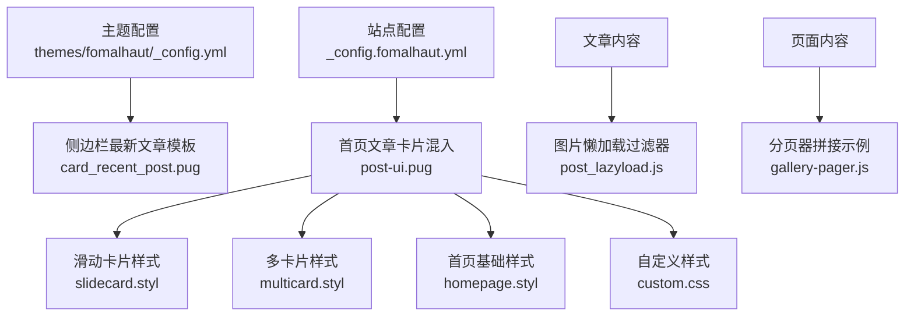
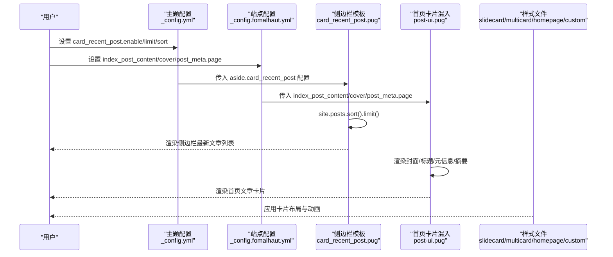
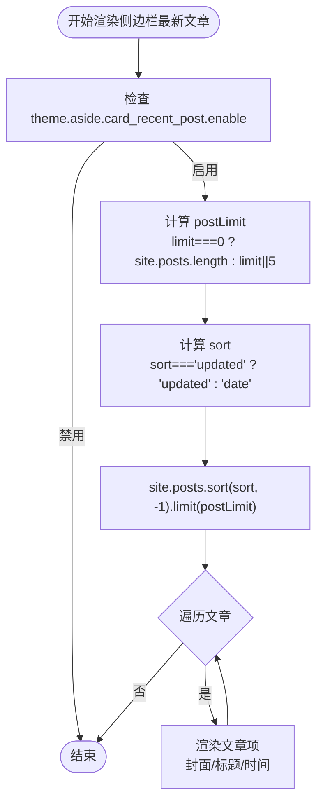
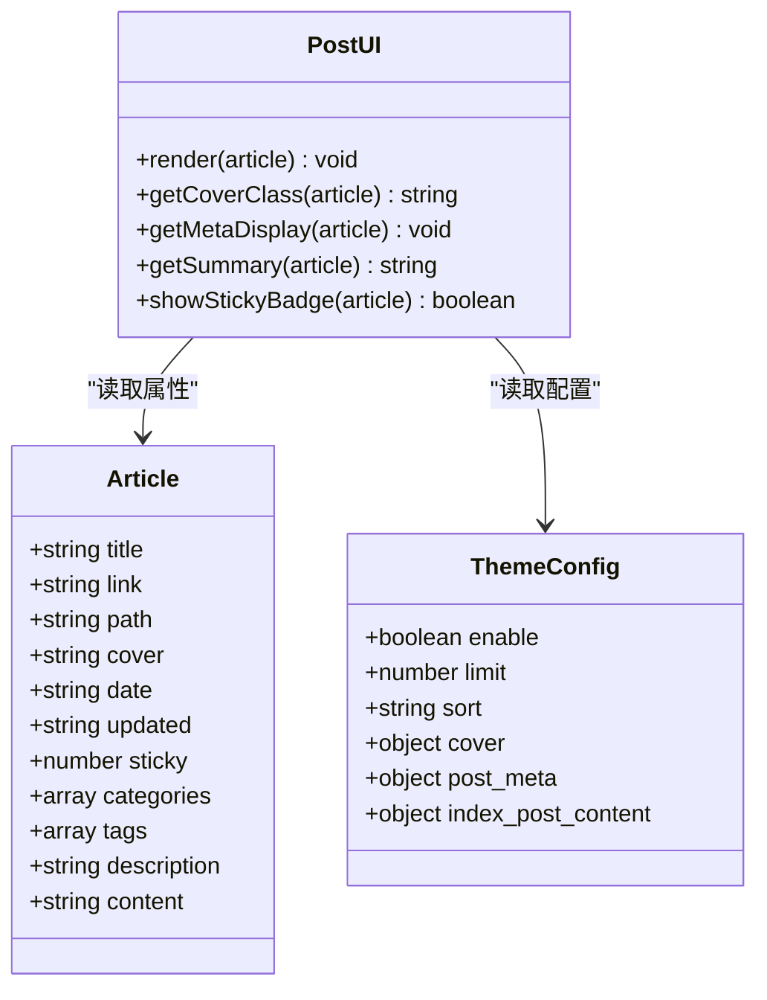
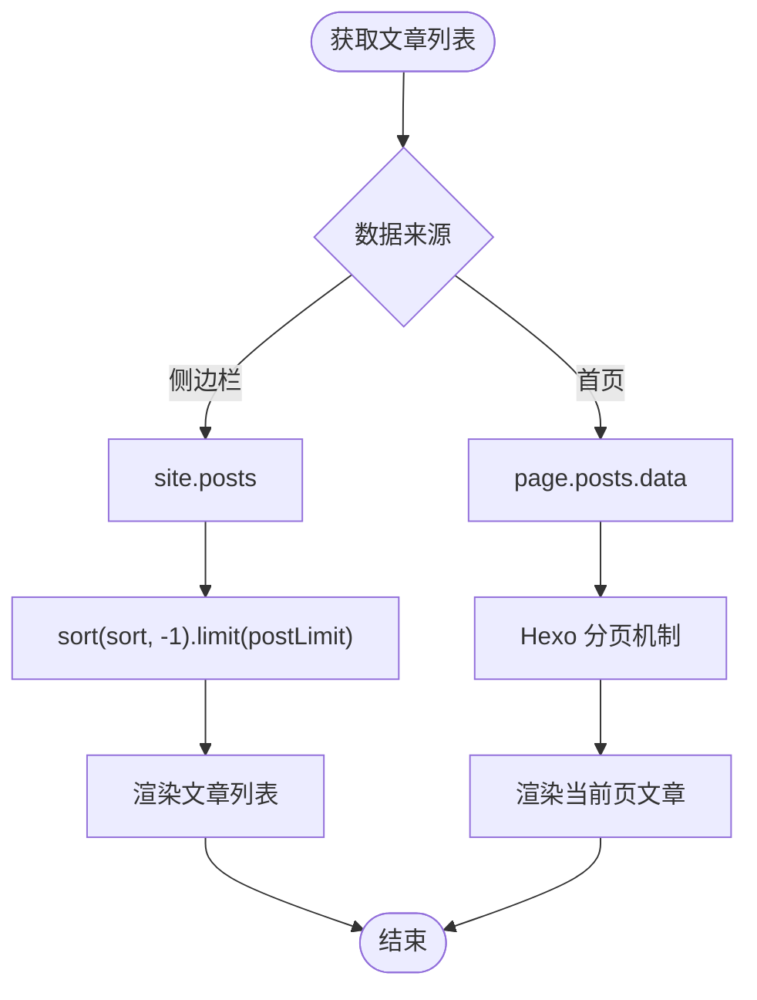
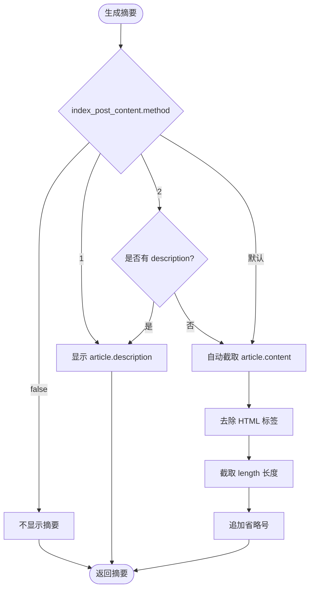
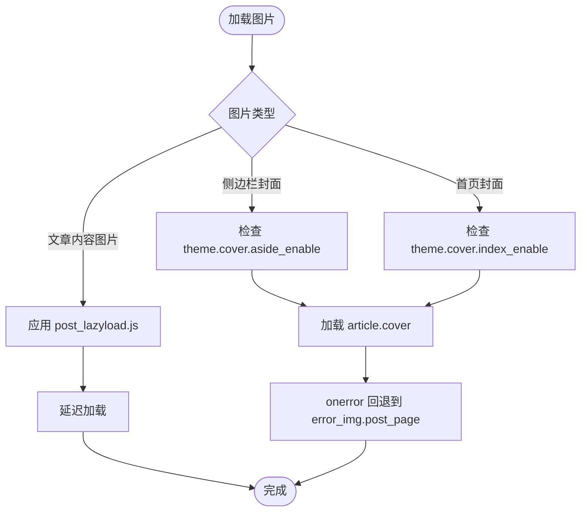
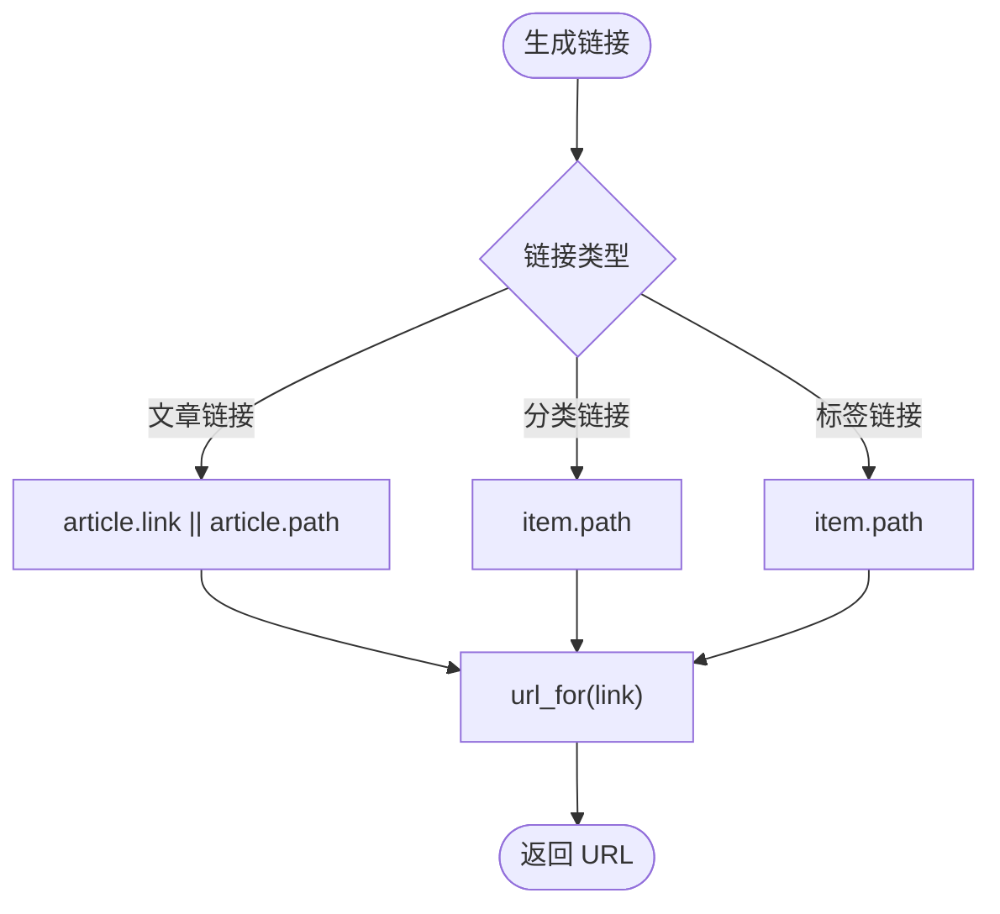
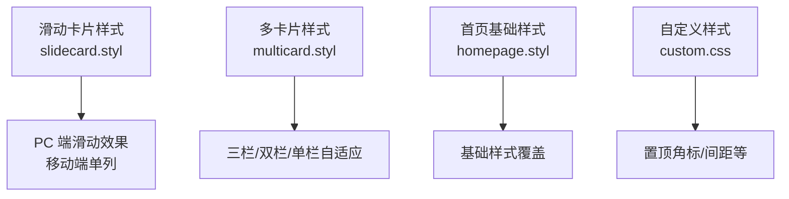

# 最新文章卡片

<cite>
**本文引用的文件**   
- [themes/fomalhaut/layout/includes/widget/card_recent_post.pug](file://themes/fomalhaut/layout/includes/widget/card_recent_post.pug)
- [themes/fomalhaut/_config.yml](file://themes/fomalhaut/_config.yml)
- [_config.fomalhaut.yml](file://_config.fomalhaut.yml)
- [themes/fomalhaut/layout/includes/mixins/post-ui.pug](file://themes/fomalhaut/layout/includes/mixins/post-ui.pug)
- [themes/fomalhaut/source/css/_index_card_style/slidecard.styl](file://themes/fomalhaut/source/css/_index_card_style/slidecard.styl)
- [themes/fomalhaut/source/css/_index_card_style/multicard.styl](file://themes/fomalhaut/source/css/_index_card_style/multicard.styl)
- [themes/fomalhaut/source/css/_page/homepage.styl](file://themes/fomalhaut/source/css/_page/homepage.styl)
- [themes/fomalhaut/source/css/_custom/custom.css](file://themes/fomalhaut/source/css/_custom/custom.css)
- [themes/fomalhaut/scripts/filters/post_lazyload.js](file://themes/fomalhaut/scripts/filters/post_lazyload.js)
- [scripts/gallery-pager.js](file://scripts/gallery-pager.js)
</cite>

## 目录
1. [简介](#简介)
2. [项目结构定位](#项目结构定位)
3. [核心组件总览](#核心组件总览)
4. [架构与数据流](#架构与数据流)
5. [最新文章卡片实现详解](#最新文章卡片实现详解)
6. [文章列表数据获取、排序与分页](#文章列表数据获取排序与分页)
7. [摘要生成机制](#摘要生成机制)
8. [图片缩略图加载策略](#图片缩略图加载策略)
9. [链接跳转逻辑](#链接跳转逻辑)
10. [自定义展示样式指南](#自定义展示样式指南)
11. [性能优化建议](#性能优化建议)
12. [常见问题排查](#常见问题排查)
13. [结论](#结论)

## 简介
“最新文章卡片”在本仓库中由两部分组成：
- 侧边栏的“最新文章”小部件，用于在侧边栏展示最近发布的文章标题和日期。
- 首页的文章卡片列表，用于在首页以卡片形式展示文章封面、标题、元信息（分类、标签、日期）、摘要以及置顶角标等。

本文重点围绕这两个部分的数据来源、排序规则、分页处理、摘要生成、图片加载、链接跳转以及样式定制进行详细说明，并给出性能优化建议和常见问题解决方案。

## 项目结构定位
最新文章卡片相关代码主要分布在以下位置：
- 主题配置：`themes/fomalhaut/_config.yml` 控制侧边栏“最新文章”小部件的开关、数量、排序方式等。
- 站点配置：`_config.fomalhaut.yml` 控制首页文章摘要显示方式、封面开关、元信息展示等。
- 模板渲染：`themes/fomalhaut/layout/includes/widget/card_recent_post.pug` 负责侧边栏最新文章列表渲染。
- 首页文章卡片混入：`themes/fomalhaut/layout/includes/mixins/post-ui.pug` 负责首页文章卡片的完整 UI 渲染，包括封面、标题、元信息、摘要、置顶角标等。
- 样式文件：`slidecard.styl`、`multicard.styl`、`homepage.styl`、`custom.css` 负责不同布局下的卡片样式。
- 懒加载过滤器：`themes/fomalhaut/scripts/filters/post_lazyload.js` 负责文章内容中的图片懒加载。
- 分页脚本：`scripts/gallery-pager.js` 展示了 Hexo 分页器在内容页拼接分页导航的方式，有助于理解分页在站点中的通用模式。

**图表来源**  
- [themes/fomalhaut/_config.yml:646-650](file://themes/fomalhaut/_config.yml#L646-L650)
- [themes/fomalhaut/layout/includes/widget/card_recent_post.pug:1-26](file://themes/fomalhaut/layout/includes/widget/card_recent_post.pug#L1-L26)
- [_config.fomalhaut.yml:440-447](file://_config.fomalhaut.yml#L440-L447)
- [themes/fomalhaut/layout/includes/mixins/post-ui.pug:151-298](file://themes/fomalhaut/layout/includes/mixins/post-ui.pug#L151-L298)
- [themes/fomalhaut/source/css/_index_card_style/slidecard.styl:1-274](file://themes/fomalhaut/source/css/_index_card_style/slidecard.styl#L1-L274)
- [themes/fomalhaut/source/css/_index_card_style/multicard.styl:1-171](file://themes/fomalhaut/source/css/_index_card_style/multicard.styl#L1-L171)
- [themes/fomalhaut/source/css/_page/homepage.styl:1-62](file://themes/fomalhaut/source/css/_page/homepage.styl#L1-L62)
- [themes/fomalhaut/source/css/_custom/custom.css:3588-3607](file://themes/fomalhaut/source/css/_custom/custom.css#L3588-L3607)
- [themes/fomalhaut/scripts/filters/post_lazyload.js](file://themes/fomalhaut/scripts/filters/post_lazyload.js)
- [scripts/gallery-pager.js:104-139](file://scripts/gallery-pager.js#L104-L139)

**章节来源**  
- [themes/fomalhaut/_config.yml:646-650](file://themes/fomalhaut/_config.yml#L646-L650)
- [themes/fomalhaut/layout/includes/widget/card_recent_post.pug:1-26](file://themes/fomalhaut/layout/includes/widget/card_recent_post.pug#L1-L26)
- [_config.fomalhaut.yml:440-447](file://_config.fomalhaut.yml#L440-L447)
- [themes/fomalhaut/layout/includes/mixins/post-ui.pug:151-298](file://themes/fomalhaut/layout/includes/mixins/post-ui.pug#L151-L298)

## 核心组件总览
- 侧边栏最新文章小部件：
  - 通过 `theme.aside.card_recent_post` 控制启用、数量、排序。
  - 使用 `site.posts.sort(sort, -1).limit(postLimit)` 获取文章列表。
  - 根据 `sort` 字段决定显示创建时间或更新时间。
  - 支持文章封面显示与错误回退。
- 首页文章卡片：
  - 通过 `post-ui.pug` 混入渲染，包含封面、标题、元信息、摘要、置顶角标。
  - 摘要生成受 `index_post_content.method` 和 `length` 控制。
  - 封面显示受 `cover.index_enable`、`cover.position`、`default_cover` 控制。
  - 元信息（分类、标签、日期）受 `post_meta.page.*` 控制。
  - 样式由 `slidecard.styl`、`multicard.styl`、`homepage.styl`、`custom.css` 共同决定。

**章节来源**  
- [themes/fomalhaut/layout/includes/widget/card_recent_post.pug:1-26](file://themes/fomalhaut/layout/includes/widget/card_recent_post.pug#L1-L26)
- [themes/fomalhaut/layout/includes/mixins/post-ui.pug:151-298](file://themes/fomalhaut/layout/includes/mixins/post-ui.pug#L151-L298)
- [_config.fomalhaut.yml:440-447](file://_config.fomalhaut.yml#L440-L447)

## 架构与数据流
最新文章卡片的数据流分为两条路径：
1. 侧边栏最新文章：
   - 读取主题配置 `theme.aside.card_recent_post`。
   - 从 `site.posts` 中按配置排序并限制数量。
   - 渲染为列表项，包含标题、可选封面、时间。
2. 首页文章卡片：
   - 读取站点配置 `_config.fomalhaut.yml` 中的 `index_post_content`、`cover`、`post_meta.page`。
   - 通过 `post-ui.pug` 混入渲染每篇文章卡片。
   - 摘要根据 `method` 选择 description 或自动截取 content。
   - 封面根据 `position` 和 `index_enable` 决定左右布局与是否显示。
   - 元信息根据 `post_meta.page` 决定是否显示分类、标签、日期。

**图表来源**  
- [themes/fomalhaut/_config.yml:646-650](file://themes/fomalhaut/_config.yml#L646-L650)
- [_config.fomalhaut.yml:440-447](file://_config.fomalhaut.yml#L440-L447)
- [themes/fomalhaut/layout/includes/widget/card_recent_post.pug:1-26](file://themes/fomalhaut/layout/includes/widget/card_recent_post.pug#L1-L26)
- [themes/fomalhaut/layout/includes/mixins/post-ui.pug:151-298](file://themes/fomalhaut/layout/includes/mixins/post-ui.pug#L151-L298)
- [themes/fomalhaut/source/css/_index_card_style/slidecard.styl:1-274](file://themes/fomalhaut/source/css/_index_card_style/slidecard.styl#L1-L274)
- [themes/fomalhaut/source/css/_index_card_style/multicard.styl:1-171](file://themes/fomalhaut/source/css/_index_card_style/multicard.styl#L1-L171)
- [themes/fomalhaut/source/css/_page/homepage.styl:1-62](file://themes/fomalhaut/source/css/_page/homepage.styl#L1-L62)

## 最新文章卡片实现详解
### 侧边栏最新文章小部件
- 启用控制：`theme.aside.card_recent_post.enable`。
- 数量控制：`theme.aside.card_recent_post.limit`，设置为 0 表示显示全部。
- 排序控制：`theme.aside.card_recent_post.sort`，支持 `date` 或 `updated`。
- 渲染逻辑：
  - 计算 `postLimit`：若 limit 为 0，则取 `site.posts.length`，否则取配置值或默认 5。
  - 计算 `sort`：若 sort 为 `updated`，则按更新时间排序，否则按创建时间排序。
  - 遍历排序后的文章列表，渲染每个文章项。
  - 封面显示：若文章有 cover 且 `theme.cover.aside_enable` 为真，则显示封面；否则标记为 `no-cover`。
  - 链接与标题：使用 `article.link || article.path` 作为链接，`article.title` 作为标题。
  - 时间显示：根据 sort 字段选择 `article.updated` 或 `article.date`，并使用 `full_date` 和 `date_format` 格式化。

**图表来源**  
- [themes/fomalhaut/layout/includes/widget/card_recent_post.pug:1-26](file://themes/fomalhaut/layout/includes/widget/card_recent_post.pug#L1-L26)

**章节来源**  
- [themes/fomalhaut/layout/includes/widget/card_recent_post.pug:1-26](file://themes/fomalhaut/layout/includes/widget/card_recent_post.pug#L1-L26)
- [themes/fomalhaut/_config.yml:646-650](file://themes/fomalhaut/_config.yml#L646-L650)

### 首页文章卡片
- 封面显示：
  - 受 `theme.cover.index_enable` 和 `article.cover === false` 影响。
  - 封面位置由 `theme.cover.position` 决定，支持 `left`、`right`、`both`。
  - 若无封面或禁用封面，则添加 `no-cover` 类。
- 标题与链接：
  - 标题使用 `article.title`，链接使用 `article.link || article.path`。
- 元信息：
  - 日期：受 `theme.post_meta.page.date_type` 控制，支持 `created`、`updated`、`both`。
  - 分类与标签：受 `theme.post_meta.page.categories` 和 `theme.post_meta.page.tags` 控制。
- 摘要：
  - 受 `theme.index_post_content.method` 控制：
    - `false`：不显示摘要。
    - `1`：显示 `article.description`。
    - `2`：优先显示 `article.description`，否则自动截取 `article.content`。
    - 默认：自动截取 `article.content`。
  - 截取长度由 `theme.index_post_content.length` 控制。
- 置顶角标：
  - 当 `article.sticky > 0` 时显示置顶角标，强置顶（`sticky >= 2`）颜色更红。

**图表来源**  
- [themes/fomalhaut/layout/includes/mixins/post-ui.pug:151-298](file://themes/fomalhaut/layout/includes/mixins/post-ui.pug#L151-L298)
- [_config.fomalhaut.yml:440-447](file://_config.fomalhaut.yml#L440-L447)

**章节来源**  
- [themes/fomalhaut/layout/includes/mixins/post-ui.pug:151-298](file://themes/fomalhaut/layout/includes/mixins/post-ui.pug#L151-L298)
- [_config.fomalhaut.yml:440-447](file://_config.fomalhaut.yml#L440-L447)

## 文章列表数据获取、排序与分页
### 数据获取
- 侧边栏最新文章：
  - 直接从 `site.posts` 获取所有文章，再通过 `sort` 和 `limit` 过滤。
- 首页文章卡片：
  - 通过 `page.posts.data` 获取当前页面的文章列表，由 Hexo 的分页机制控制。

### 排序规则
- 侧边栏最新文章：
  - 若 `sort === 'updated'`，则按更新时间降序排序。
  - 否则按创建时间降序排序。
- 首页文章卡片：
  - 排序由 Hexo 默认行为控制，通常按创建时间降序。
  - 可通过 Front-Matter 的 `top` 或 `sticky` 字段实现置顶效果。

### 分页处理
- 侧边栏最新文章：
  - 不支持分页，仅显示固定数量的文章。
- 首页文章卡片：
  - 由 Hexo 分页机制控制，`page.posts.data` 是当前页的文章列表。
  - 分页导航由 Hexo 的 `pagination` 辅助函数生成。
  - `scripts/gallery-pager.js` 展示了如何在内容页拼接分页导航，可作为参考。

**图表来源**  
- [themes/fomalhaut/layout/includes/widget/card_recent_post.pug:9-11](file://themes/fomalhaut/layout/includes/widget/card_recent_post.pug#L9-L11)
- [themes/fomalhaut/layout/includes/mixins/post-ui.pug:151-152](file://themes/fomalhaut/layout/includes/mixins/post-ui.pug#L151-L152)
- [scripts/gallery-pager.js:104-139](file://scripts/gallery-pager.js#L104-L139)

**章节来源**  
- [themes/fomalhaut/layout/includes/widget/card_recent_post.pug:9-11](file://themes/fomalhaut/layout/includes/widget/card_recent_post.pug#L9-L11)
- [themes/fomalhaut/layout/includes/mixins/post-ui.pug:151-152](file://themes/fomalhaut/layout/includes/mixins/post-ui.pug#L151-L152)
- [scripts/gallery-pager.js:104-139](file://scripts/gallery-pager.js#L104-L139)

## 摘要生成机制
首页文章卡片的摘要生成逻辑如下：
- 若 `index_post_content.method === false`，则不显示摘要。
- 若 `index_post_content.method === 1`，则直接显示 `article.description`。
- 若 `index_post_content.method === 2`，则优先显示 `article.description`，否则自动截取 `article.content`。
- 默认情况下，自动截取 `article.content`，截取长度为 `index_post_content.length`。
- 截取的摘要会去除 HTML 标签，并在末尾追加省略号（如果内容过长）。

**图表来源**  
- [themes/fomalhaut/layout/includes/mixins/post-ui.pug:274-293](file://themes/fomalhaut/layout/includes/mixins/post-ui.pug#L274-L293)
- [_config.fomalhaut.yml:440-447](file://_config.fomalhaut.yml#L440-L447)

**章节来源**  
- [themes/fomalhaut/layout/includes/mixins/post-ui.pug:274-293](file://themes/fomalhaut/layout/includes/mixins/post-ui.pug#L274-L293)
- [_config.fomalhaut.yml:440-447](file://_config.fomalhaut.yml#L440-L447)

## 图片缩略图加载策略
### 侧边栏最新文章
- 封面图片：
  - 若文章有 `cover` 且 `theme.cover.aside_enable` 为真，则显示封面。
  - 图片加载失败时，回退到 `theme.error_img.post_page`。
- 懒加载：
  - 侧边栏最新文章未启用懒加载，图片直接加载。

### 首页文章卡片
- 封面图片：
  - 受 `theme.cover.index_enable` 控制。
  - 图片加载失败时，回退到 `theme.error_img.post_page`。
- 文章内容图片：
  - 通过 `post_lazyload.js` 过滤器实现懒加载。
  - 懒加载在 `after_post_render` 钩子中执行，确保文章内容渲染后应用懒加载。

**图表来源**  
- [themes/fomalhaut/layout/includes/widget/card_recent_post.pug:14-19](file://themes/fomalhaut/layout/includes/widget/card_recent_post.pug#L14-L19)
- [themes/fomalhaut/layout/includes/mixins/post-ui.pug:164-166](file://themes/fomalhaut/layout/includes/mixins/post-ui.pug#L164-L166)
- [themes/fomalhaut/scripts/filters/post_lazyload.js](file://themes/fomalhaut/scripts/filters/post_lazyload.js)

**章节来源**  
- [themes/fomalhaut/layout/includes/widget/card_recent_post.pug:14-19](file://themes/fomalhaut/layout/includes/widget/card_recent_post.pug#L14-L19)
- [themes/fomalhaut/layout/includes/mixins/post-ui.pug:164-166](file://themes/fomalhaut/layout/includes/mixins/post-ui.pug#L164-L166)
- [themes/fomalhaut/scripts/filters/post_lazyload.js](file://themes/fomalhaut/scripts/filters/post_lazyload.js)

## 链接跳转逻辑
- 侧边栏最新文章：
  - 链接优先级：`article.link || article.path`。
  - 使用 `url_for(link)` 生成最终 URL。
- 首页文章卡片：
  - 链接优先级：`article.link || article.path`。
  - 使用 `url_for(link)` 生成最终 URL。
- 分类与标签链接：
  - 分类链接：`url_for(item.path)`。
  - 标签链接：`url_for(item.path)`。

**图表来源**  
- [themes/fomalhaut/layout/includes/widget/card_recent_post.pug:12-21](file://themes/fomalhaut/layout/includes/widget/card_recent_post.pug#L12-L21)
- [themes/fomalhaut/layout/includes/mixins/post-ui.pug:154-171](file://themes/fomalhaut/layout/includes/mixins/post-ui.pug#L154-L171)
- [themes/fomalhaut/layout/includes/mixins/post-ui.pug:203-222](file://themes/fomalhaut/layout/includes/mixins/post-ui.pug#L203-L222)

**章节来源**  
- [themes/fomalhaut/layout/includes/widget/card_recent_post.pug:12-21](file://themes/fomalhaut/layout/includes/widget/card_recent_post.pug#L12-L21)
- [themes/fomalhaut/layout/includes/mixins/post-ui.pug:154-171](file://themes/fomalhaut/layout/includes/mixins/post-ui.pug#L154-L171)
- [themes/fomalhaut/layout/includes/mixins/post-ui.pug:203-222](file://themes/fomalhaut/layout/includes/mixins/post-ui.pug#L203-L222)

## 自定义展示样式指南
### 卡片布局
- 滑动卡片样式：
  - 由 `slidecard.styl` 控制，支持 PC 端滑动效果和移动端单列布局。
  - 变量定义：`--recent-post-bgcolor`、`--article-content-bgcolor`、`--recent-post-arrow`、`--recent-post-cover-shadow`、`--recent-post-transition`。
- 多卡片样式：
  - 由 `multicard.styl` 控制，支持三栏、双栏、单栏自适应布局。
  - 卡片容器 `.recent-posts` 使用 Flexbox 布局，支持换行。
- 首页基础样式：
  - 由 `homepage.styl` 提供基础样式，但大部分被覆盖。
- 自定义样式：
  - 由 `custom.css` 提供额外样式，如置顶角标、卡片间距等。

**图表来源**  
- [themes/fomalhaut/source/css/_index_card_style/slidecard.styl:1-274](file://themes/fomalhaut/source/css/_index_card_style/slidecard.styl#L1-L274)
- [themes/fomalhaut/source/css/_index_card_style/multicard.styl:1-171](file://themes/fomalhaut/source/css/_index_card_style/multicard.styl#L1-L171)
- [themes/fomalhaut/source/css/_page/homepage.styl:1-62](file://themes/fomalhaut/source/css/_page/homepage.styl#L1-L62)
- [themes/fomalhaut/source/css/_custom/custom.css:3588-3607](file://themes/fomalhaut/source/css/_custom/custom.css#L3588-L3607)

**章节来源**  
- [themes/fomalhaut/source/css/_index_card_style/slidecard.styl:1-274](file://themes/fomalhaut/source/css/_index_card_style/slidecard.styl#L1-L274)
- [themes/fomalhaut/source/css/_index_card_style/multicard.styl:1-171](file://themes/fomalhaut/source/css/_index_card_style/multicard.styl#L1-L171)
- [themes/fomalhaut/source/css/_page/homepage.styl:1-62](file://themes/fomalhaut/source/css/_page/homepage.styl#L1-L62)
- [themes/fomalhaut/source/css/_custom/custom.css:3588-3607](file://themes/fomalhaut/source/css/_custom/custom.css#L3588-L3607)

### 标题格式
- 标题显示：
  - 使用 `article.title`。
  - 标题链接使用 `url_for(link)`。
- 标题样式：
  - 由 `slidecard.styl` 和 `multicard.styl` 控制字体大小、行高、悬停效果等。
  - 支持多行截断（`-webkit-line-clamp`）。

### 日期显示
- 侧边栏最新文章：
  - 根据 `sort` 字段显示创建时间或更新时间。
  - 使用 `full_date` 和 `date_format` 格式化。
- 首页文章卡片：
  - 受 `post_meta.page.date_type` 控制，支持 `created`、`updated`、`both`。
  - 使用 `date_xml` 和 `full_date` 生成语义化时间标签。

### 标签展示
- 分类与标签：
  - 受 `post_meta.page.categories` 和 `post_meta.page.tags` 控制。
  - 分类和标签链接使用 `url_for(item.path)`。
  - 标签之间用分隔符（如 `•`）分隔。

**章节来源**  
- [themes/fomalhaut/layout/includes/widget/card_recent_post.pug:22-25](file://themes/fomalhaut/layout/includes/widget/card_recent_post.pug#L22-L25)
- [themes/fomalhaut/layout/includes/mixins/post-ui.pug:181-222](file://themes/fomalhaut/layout/includes/mixins/post-ui.pug#L181-L222)
- [themes/fomalhaut/source/css/_index_card_style/slidecard.styl:130-142](file://themes/fomalhaut/source/css/_index_card_style/slidecard.styl#L130-L142)
- [themes/fomalhaut/source/css/_index_card_style/multicard.styl:108-121](file://themes/fomalhaut/source/css/_index_card_style/multicard.styl#L108-L121)

## 性能优化建议
- 减少不必要的图片加载：
  - 侧边栏最新文章未启用懒加载，若文章较多，建议启用懒加载或限制数量。
  - 首页文章内容图片已启用懒加载，避免首屏加载过多图片。
- 优化摘要生成：
  - 若文章较长，建议使用 `description` 字段代替自动截取 `content`，减少字符串处理开销。
- 控制卡片数量：
  - 侧边栏最新文章建议设置合理的 `limit`，避免渲染过多 DOM 节点。
- 使用静态资源缓存：
  - 确保图片、CSS、JS 文件启用浏览器缓存。
- 避免重复渲染：
  - 侧边栏最新文章模板启用了缓存（`cache: true`），避免重复渲染。

**章节来源**  
- [themes/fomalhaut/layout/includes/widget/card_recent_post.pug:1-26](file://themes/fomalhaut/layout/includes/widget/card_recent_post.pug#L1-L26)
- [themes/fomalhaut/layout/includes/mixins/post-ui.pug:274-293](file://themes/fomalhaut/layout/includes/mixins/post-ui.pug#L274-L293)
- [themes/fomalhaut/scripts/filters/post_lazyload.js](file://themes/fomalhaut/scripts/filters/post_lazyload.js)

## 常见问题排查
### 侧边栏最新文章不显示
- 检查 `theme.aside.card_recent_post.enable` 是否为真。
- 检查 `site.posts` 是否有文章。
- 检查 `theme.cover.aside_enable` 是否影响封面显示。

### 首页文章卡片摘要为空
- 检查 `index_post_content.method` 配置。
- 若使用 `method === 1`，确保 `article.description` 不为空。
- 若使用自动截取，确保 `article.content` 存在且长度大于 `index_post_content.length`。

### 图片加载失败
- 检查 `article.cover` 是否正确设置。
- 检查 `theme.error_img.post_page` 是否指向有效的回退图片。
- 对于文章内容图片，检查 `post_lazyload.js` 是否正确注入。

### 链接跳转异常
- 检查 `article.link` 和 `article.path` 是否正确。
- 检查 `url_for` 函数是否正确生成 URL。

**章节来源**  
- [themes/fomalhaut/layout/includes/widget/card_recent_post.pug:1-26](file://themes/fomalhaut/layout/includes/widget/card_recent_post.pug#L1-L26)
- [themes/fomalhaut/layout/includes/mixins/post-ui.pug:154-171](file://themes/fomalhaut/layout/includes/mixins/post-ui.pug#L154-L171)
- [themes/fomalhaut/layout/includes/mixins/post-ui.pug:274-293](file://themes/fomalhaut/layout/includes/mixins/post-ui.pug#L274-L293)

## 结论
最新文章卡片功能由侧边栏小部件和首页文章卡片两部分组成，分别通过不同的模板和配置控制。侧边栏最新文章基于 `site.posts` 排序和限制数量，首页文章卡片基于 `page.posts.data` 和 Hexo 分页机制。摘要生成支持多种模式，图片加载支持懒加载和错误回退，链接跳转逻辑清晰。样式方面提供了丰富的自定义选项，包括布局、标题、日期、标签等。通过合理配置和优化，可以实现高性能、美观的文章展示效果。