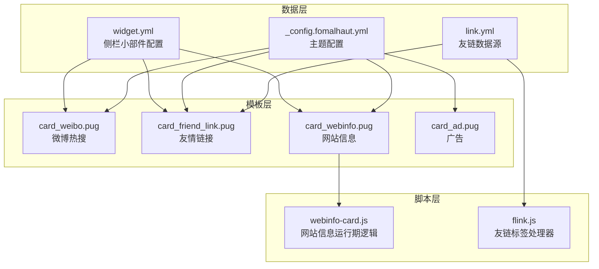
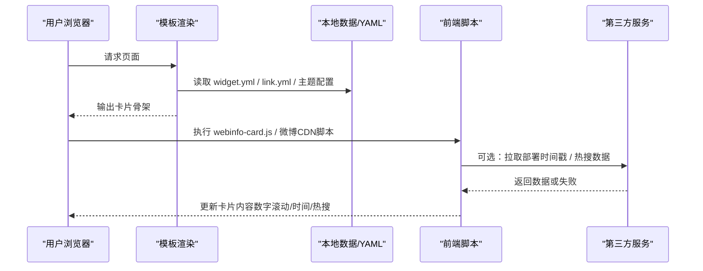
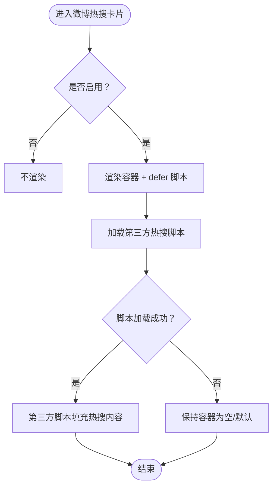
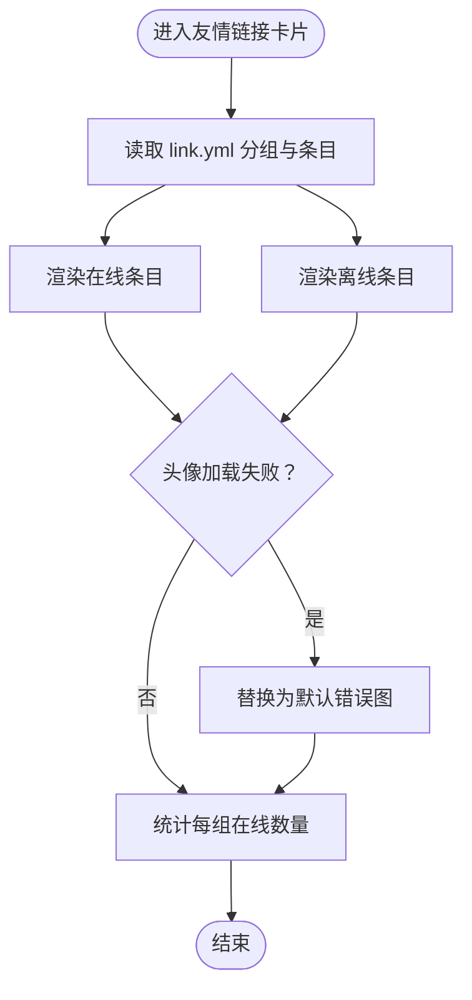
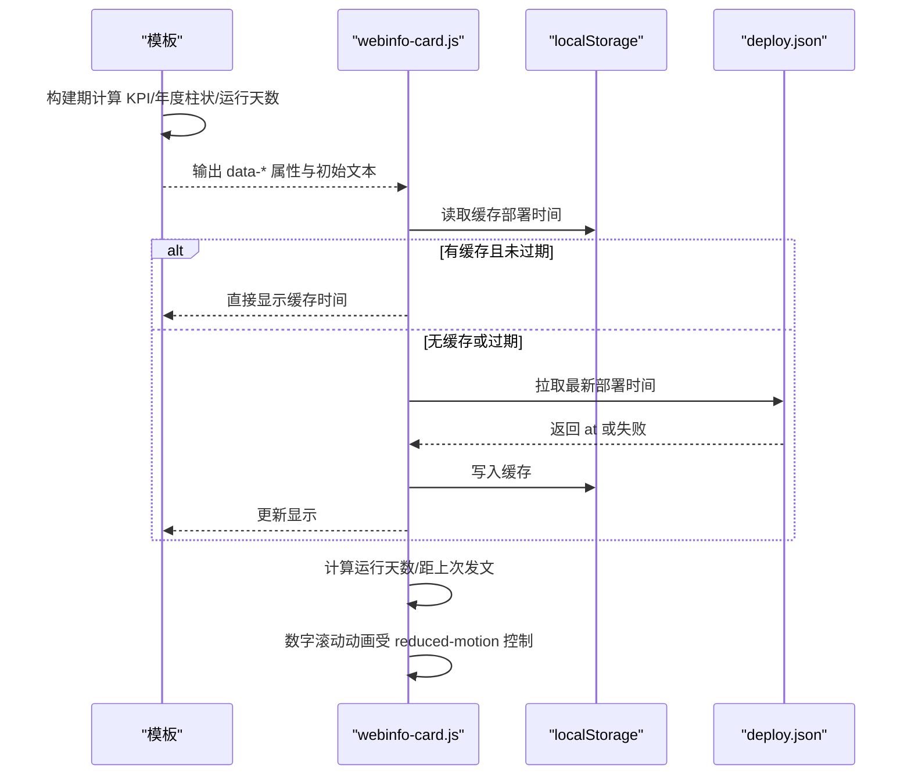
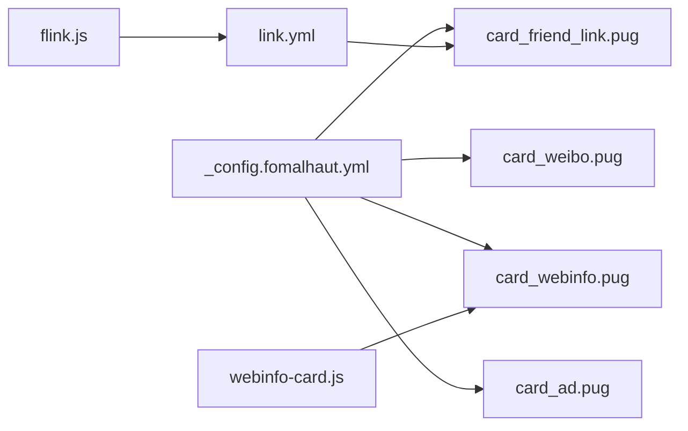

# 特殊用途卡片

<cite>
**本文引用的文件**   
- [微博热搜卡片模板](file://themes/fomalhaut/layout/includes/widget/card_weibo.pug)
- [友情链接卡片模板](file://themes/fomalhaut/layout/includes/widget/card_friend_link.pug)
- [网站信息卡片模板](file://themes/fomalhaut/layout/includes/widget/card_webinfo.pug)
- [广告卡片模板](file://themes/fomalhaut/layout/includes/widget/card_ad.pug)
- [侧栏小部件配置](file://source/_data/widget.yml)
- [友链数据源](file://source/_data/link.yml)
- [友链标签处理器](file://themes/fomalhaut/scripts/tag/flink.js)
- [站点链接页面样式与说明](file://source/social/link/index.md)
- [网站信息卡片前端脚本](file://source/js/inject/webinfo-card.js)
- [主题配置文件](file://_config.fomalhaut.yml)
</cite>

## 目录
1. [引言](#引言)
2. [项目结构](#项目结构)
3. [核心组件](#核心组件)
4. [架构总览](#架构总览)
5. [详细组件分析](#详细组件分析)
6. [依赖关系分析](#依赖关系分析)
7. [性能考虑](#性能考虑)
8. [故障排查指南](#故障排查指南)
9. [结论](#结论)
10. [附录：自定义特殊卡片开发指南](#附录自定义特殊卡片开发指南)

## 引言
本文件聚焦博客中的“特殊用途卡片”，包括微博热搜、友情链接、网站信息和广告四类。文档从实现位置、配置方式、展示逻辑、第三方服务集成、数据同步机制、错误处理策略，到安全与性能优化进行系统化说明，并给出扩展新卡片的开发指引，帮助读者在不深入源码的情况下也能正确配置和定制这些卡片。

## 项目结构
特殊用途卡片由三部分构成：
- 模板层：Pug 模板负责渲染卡片骨架与基础内容。
- 数据层：YAML 或主题配置提供静态数据与开关。
- 脚本层：前端 JS 负责动态更新、统计、时间计算等运行时行为。

图表来源
- [微博热搜卡片模板:1-14](file://themes/fomalhaut/layout/includes/widget/card_weibo.pug#L1-L14)
- [友情链接卡片模板:1-40](file://themes/fomalhaut/layout/includes/widget/card_friend_link.pug#L1-L40)
- [网站信息卡片模板:1-148](file://themes/fomalhaut/layout/includes/widget/card_webinfo.pug#L1-L148)
- [广告卡片模板:1-4](file://themes/fomalhaut/layout/includes/widget/card_ad.pug#L1-L4)
- [侧栏小部件配置:1-50](file://source/_data/widget.yml#L1-L50)
- [友链数据源:1-35](file://source/_data/link.yml#L1-L35)
- [友链标签处理器:1-39](file://themes/fomalhaut/scripts/tag/flink.js#L1-L39)
- [网站信息卡片前端脚本:1-161](file://source/js/inject/webinfo-card.js#L1-L161)
- [主题配置文件:984-1025](file://_config.fomalhaut.yml#L984-L1025)

章节来源
- [侧栏小部件配置:1-50](file://source/_data/widget.yml#L1-L50)
- [主题配置文件:984-1025](file://_config.fomalhaut.yml#L984-L1025)

## 核心组件
- 微博热搜卡片：通过 CDN 加载第三方脚本渲染热搜列表；可独立开关。
- 友情链接卡片：读取本地 YAML 数据，按分组渲染在线/离线友链，并在页内统计在线数量。
- 网站信息卡片：构建期汇总站点字数、篇均字、友链数、年度产出柱状图；运行期计算运行天数、距上次发文、最近部署时间，并提供数字滚动动画。
- 广告卡片：直接注入主题配置中的广告 HTML，便于接入任意广告平台。

章节来源
- [微博热搜卡片模板:1-14](file://themes/fomalhaut/layout/includes/widget/card_weibo.pug#L1-L14)
- [友情链接卡片模板:1-40](file://themes/fomalhaut/layout/includes/widget/card_friend_link.pug#L1-L40)
- [网站信息卡片模板:1-148](file://themes/fomalhaut/layout/includes/widget/card_webinfo.pug#L1-L148)
- [广告卡片模板:1-4](file://themes/fomalhaut/layout/includes/widget/card_ad.pug#L1-L4)

## 架构总览
四类卡片在“模板 → 数据 → 脚本”的层次上协同工作：
- 模板根据主题配置决定是否渲染。
- 数据来自本地 YAML 或主题配置。
- 脚本在浏览器端完成动态更新、网络请求与 UI 增强。

图表来源
- [网站信息卡片模板:1-148](file://themes/fomalhaut/layout/includes/widget/card_webinfo.pug#L1-L148)
- [网站信息卡片前端脚本:1-161](file://source/js/inject/webinfo-card.js#L1-L161)
- [微博热搜卡片模板:1-14](file://themes/fomalhaut/layout/includes/widget/card_weibo.pug#L1-L14)

## 详细组件分析

### 微博热搜卡片
- 功能特性
  - 通过主题配置的 CDN 地址加载第三方热搜脚本。
  - 使用容器占位，等待外部脚本填充内容。
- 配置方法
  - 在主题配置中启用 card_weibo，并设置 CDN 地址。
- 展示逻辑
  - 模板仅输出容器与 defer 脚本标签，具体内容由第三方脚本渲染。
- 第三方集成
  - 依赖外部 CDN 提供的热搜数据与渲染逻辑。
- 错误处理
  - 若 CDN 不可用或脚本失败，容器保持空白或默认状态，不影响其他卡片。
- 性能与安全
  - 使用 defer 避免阻塞解析。
  - 建议将第三方资源放在可信 CDN，并关注跨域与隐私政策。

图表来源
- [微博热搜卡片模板:1-14](file://themes/fomalhaut/layout/includes/widget/card_weibo.pug#L1-L14)
- [主题配置文件:984-1025](file://_config.fomalhaut.yml#L984-L1025)

章节来源
- [微博热搜卡片模板:1-14](file://themes/fomalhaut/layout/includes/widget/card_weibo.pug#L1-L14)
- [主题配置文件:984-1025](file://_config.fomalhaut.yml#L984-L1025)

### 友情链接卡片
- 功能特性
  - 按分组展示友链，支持头像、名称、描述、截图。
  - 区分在线与离线条目，自动统计每组在线数量。
- 配置方法
  - 编辑 source/_data/link.yml，添加或修改分组与条目。
  - 在主题配置中启用 card_friend_link。
- 展示逻辑
  - 模板遍历 site.data.link，先渲染在线条目，再渲染离线条目。
  - 图片加载失败时回退到主题错误图。
  - 页内脚本统计每个分组的在线链接数量并显示。
- 第三方集成
  - 友链本身为本地数据，但头像/截图可能来自第三方图床。
- 错误处理
  - 图片 onerror 替换为默认图，避免空位影响布局。
  - 离线条目仍可点击跳转，但视觉上有区分。
- 性能与安全
  - 外链图片建议使用懒加载与防盗链策略。
  - 对不可信外链应开启 rel="noopener noreferrer"（模板已 target="_blank"）。

图表来源
- [友情链接卡片模板:1-40](file://themes/fomalhaut/layout/includes/widget/card_friend_link.pug#L1-L40)
- [友链数据源:1-35](file://source/_data/link.yml#L1-L35)

章节来源
- [友情链接卡片模板:1-40](file://themes/fomalhaut/layout/includes/widget/card_friend_link.pug#L1-L40)
- [友链数据源:1-35](file://source/_data/link.yml#L1-L35)
- [友链标签处理器:1-39](file://themes/fomalhaut/scripts/tag/flink.js#L1-L39)
- [站点链接页面样式与说明:14-285](file://source/social/link/index.md#L14-L285)

### 网站信息卡片
- 功能特性
  - 构建期汇总：总字数、篇均字、友链数、年度产出柱状图、写作天数。
  - 运行期计算：已运行天数、距上次发文、最近部署时间。
  - KPI 数字滚动动画，兼容减少动效偏好。
  - 支持旧版式（classic）与新式仪表盘。
- 配置方法
  - 在主题配置中启用 card_webinfo，并可切换 classic 模式。
  - 可启用文章数、最后推送日期、运行时间等子项。
- 展示逻辑
  - 模板根据 classic 分支渲染不同结构。
  - 运行期脚本：
    - 计算运行天数与距上次发文天数。
    - 尝试从同源 deploy.json 获取真实部署时间，否则回退到构建时刻。
    - 对 KPI 数字执行滚动动画。
    - 对统计服务（如不蒜子）做兜底处理，超时后显示占位符。
- 第三方集成
  - 可选接入不蒜子 PV/UV 统计。
  - 部署时间来源于站点产物 deploy.json（由 CI/CD 写入）。
- 错误处理
  - fetch 超时与失败时静默跳过，保留构建期兜底值。
  - localStorage 读写异常被捕获，不影响主流程。
  - 统计服务未就绪时显示“—”。
- 性能与安全
  - 使用 AbortController 限制请求时长。
  - 结果缓存至 localStorage，避免频繁请求。
  - 尊重 prefers-reduced-motion，禁用不必要的动画。

图表来源
- [网站信息卡片模板:1-148](file://themes/fomalhaut/layout/includes/widget/card_webinfo.pug#L1-L148)
- [网站信息卡片前端脚本:1-161](file://source/js/inject/webinfo-card.js#L1-L161)

章节来源
- [网站信息卡片模板:1-148](file://themes/fomalhaut/layout/includes/widget/card_webinfo.pug#L1-L148)
- [网站信息卡片前端脚本:1-161](file://source/js/inject/webinfo-card.js#L1-L161)
- [主题配置文件:984-1025](file://_config.fomalhaut.yml#L984-L1025)

### 广告卡片
- 功能特性
  - 直接注入主题配置中的广告 HTML，灵活接入任意广告平台。
- 配置方法
  - 在主题配置中设置 ad.aside 为广告 HTML 片段。
- 展示逻辑
  - 若配置存在则渲染 ads-wrap 包裹层并插入广告内容。
- 第三方集成
  - 完全由广告平台脚本决定渲染与行为。
- 错误处理
  - 广告脚本失败通常不会影响页面主体；建议在广告代码内部做好容错。
- 性能与安全
  - 注意广告脚本可能带来的额外请求与重排；建议按需加载。
  - 避免注入恶意脚本，严格审查广告内容。

章节来源
- [广告卡片模板:1-4](file://themes/fomalhaut/layout/includes/widget/card_ad.pug#L1-L4)
- [主题配置文件:984-1025](file://_config.fomalhaut.yml#L984-L1025)

## 依赖关系分析
- 模板依赖主题配置决定是否渲染。
- 友链卡片依赖本地 YAML 数据与主题错误图。
- 网站信息卡片依赖构建期数据与运行期 deploy.json。
- 微博热搜卡片依赖第三方 CDN 脚本。

图表来源
- [主题配置文件:984-1025](file://_config.fomalhaut.yml#L984-L1025)
- [微博热搜卡片模板:1-14](file://themes/fomalhaut/layout/includes/widget/card_weibo.pug#L1-L14)
- [友情链接卡片模板:1-40](file://themes/fomalhaut/layout/includes/widget/card_friend_link.pug#L1-L40)
- [网站信息卡片模板:1-148](file://themes/fomalhaut/layout/includes/widget/card_webinfo.pug#L1-L148)
- [广告卡片模板:1-4](file://themes/fomalhaut/layout/includes/widget/card_ad.pug#L1-L4)
- [友链数据源:1-35](file://source/_data/link.yml#L1-L35)
- [友链标签处理器:1-39](file://themes/fomalhaut/scripts/tag/flink.js#L1-L39)
- [网站信息卡片前端脚本:1-161](file://source/js/inject/webinfo-card.js#L1-L161)

章节来源
- [主题配置文件:984-1025](file://_config.fomalhaut.yml#L984-L1025)
- [友链数据源:1-35](file://source/_data/link.yml#L1-L35)

## 性能考虑
- 微博热搜卡片
  - 使用 defer 加载第三方脚本，避免阻塞首屏。
  - 若第三方服务慢，可在容器内提供骨架提示。
- 友情链接卡片
  - 头像/截图建议开启懒加载与合适的尺寸压缩。
  - 对大量友链可分页或折叠分组以提升渲染性能。
- 网站信息卡片
  - 数字滚动动画尊重 prefers-reduced-motion。
  - 部署时间请求带超时与缓存，避免重复请求。
  - 统计服务失败时快速降级为占位符。
- 广告卡片
  - 广告脚本可能带来额外开销，建议按需加载与隔离渲染。

[本节为通用指导，不直接分析具体文件]

## 故障排查指南
- 微博热搜卡片不显示
  - 检查主题配置是否启用 card_weibo 与 CDN 地址是否正确。
  - 查看控制台是否有第三方脚本加载失败的错误。
- 友情链接卡片头像不显示
  - 确认 link.yml 中 avatar 链接可达。
  - 检查主题 error_img.flink 是否配置了有效的默认图。
- 网站信息卡片时间不正确
  - 确认 deploy.json 是否存在且包含 at 字段。
  - 检查 localStorage 是否被清理导致缓存失效。
  - 核对 runtimeshow.publish_date 格式是否符合预期。
- 广告卡片未渲染
  - 检查主题配置 ad.aside 是否包含有效 HTML。
  - 查看广告脚本是否被拦截或 CSP 阻止。

章节来源
- [微博热搜卡片模板:1-14](file://themes/fomalhaut/layout/includes/widget/card_weibo.pug#L1-L14)
- [友情链接卡片模板:1-40](file://themes/fomalhaut/layout/includes/widget/card_friend_link.pug#L1-L40)
- [网站信息卡片模板:1-148](file://themes/fomalhaut/layout/includes/widget/card_webinfo.pug#L1-L148)
- [网站信息卡片前端脚本:1-161](file://source/js/inject/webinfo-card.js#L1-L161)
- [广告卡片模板:1-4](file://themes/fomalhaut/layout/includes/widget/card_ad.pug#L1-L4)
- [主题配置文件:984-1025](file://_config.fomalhaut.yml#L984-L1025)

## 结论
四类特殊用途卡片以“模板 + 数据 + 脚本”的方式组合，既保证了可配置性与可扩展性，也兼顾了性能与用户体验。微博热搜依赖第三方脚本，友链基于本地 YAML，网站信息融合构建期与运行期数据，广告卡片则提供灵活的注入点。通过合理的配置、错误处理与性能优化，可以在不同部署环境下稳定展示。

[本节为总结性内容，不直接分析具体文件]

## 附录：自定义特殊卡片开发指南
- 新增卡片步骤
  - 在 themes/fomalhaut/layout/includes/widget 下新建 pug 模板，参考现有卡片结构。
  - 在 _config.fomalhaut.yml 中添加开关与必要参数。
  - 如需本地数据，可在 source/_data 下新增 YAML，并在模板中读取。
  - 如需运行期逻辑，在 source/js 下新增脚本并在模板中引入。
- API 调用建议
  - 优先使用同源接口；跨域需确保服务端允许 CORS。
  - 所有外部请求都应设置超时与失败回退。
  - 敏感 Key 不要写在前端，尽量通过后端代理或环境变量注入。
- 数据格式转换
  - 统一输入校验与类型转换，避免空值与非法格式导致崩溃。
  - 对数字、日期、URL 等字段进行规范化处理。
- 样式定制
  - 复用主题 CSS 变量与卡片基类，保证风格一致。
  - 在小屏与暗色模式下测试可读性与对比度。
- 安全考虑
  - 对用户输入与第三方数据进行转义与白名单校验。
  - 外链目标打开时加上 rel="noopener noreferrer"。
  - 谨慎注入 HTML，必要时使用 DOMPurify 等库过滤。
- 性能优化
  - 延迟加载非关键脚本与图片。
  - 合理使用缓存（内存、localStorage、HTTP 缓存）。
  - 避免在高频回调中进行昂贵计算，必要时节流/防抖。

[本节为通用指导，不直接分析具体文件]