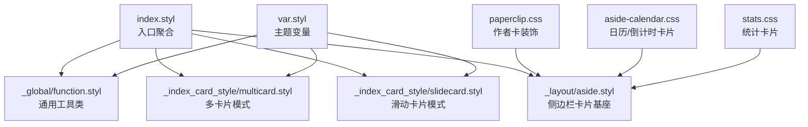
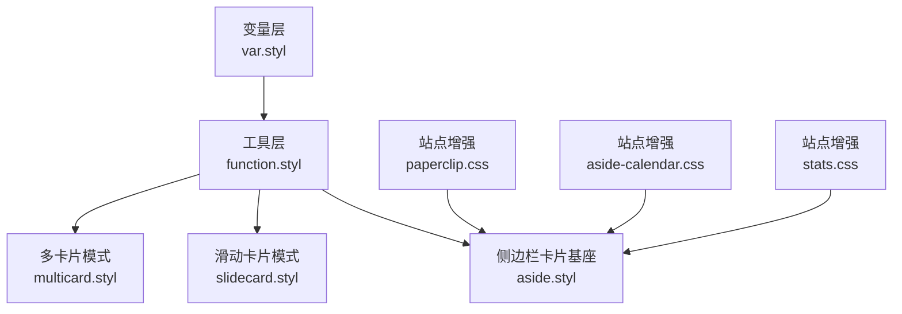
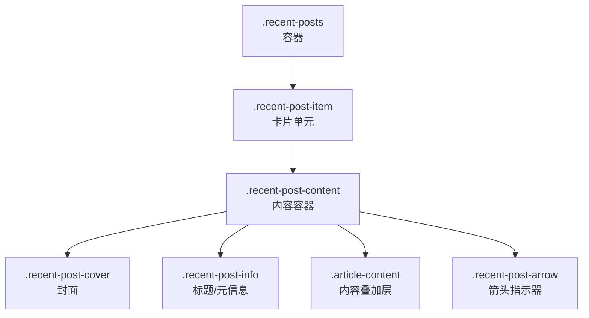
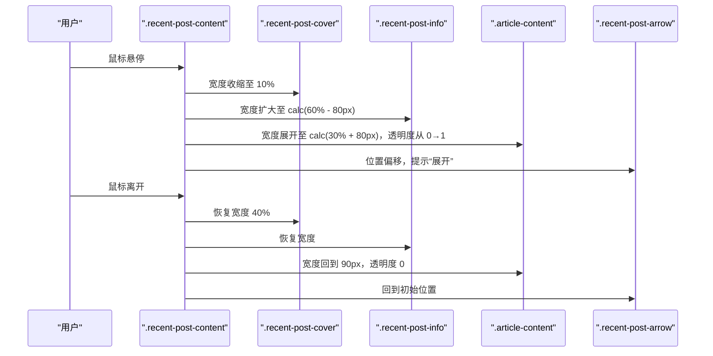
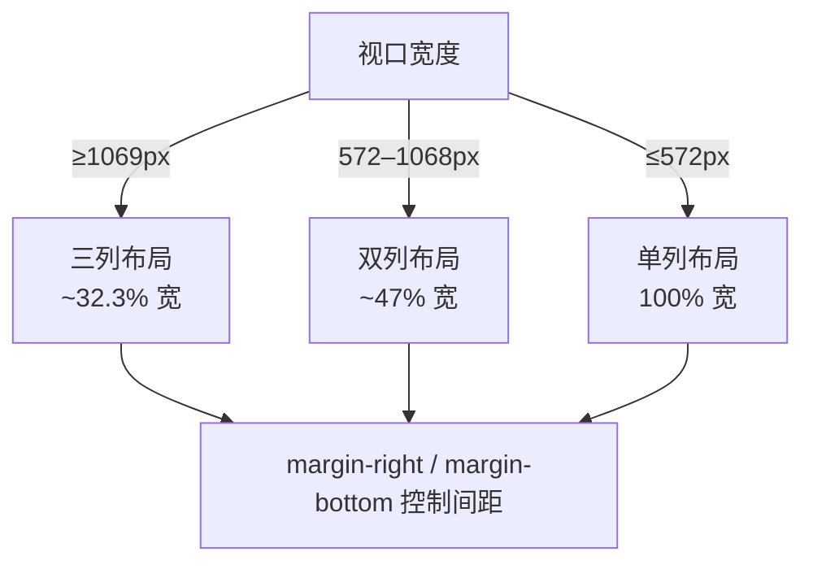
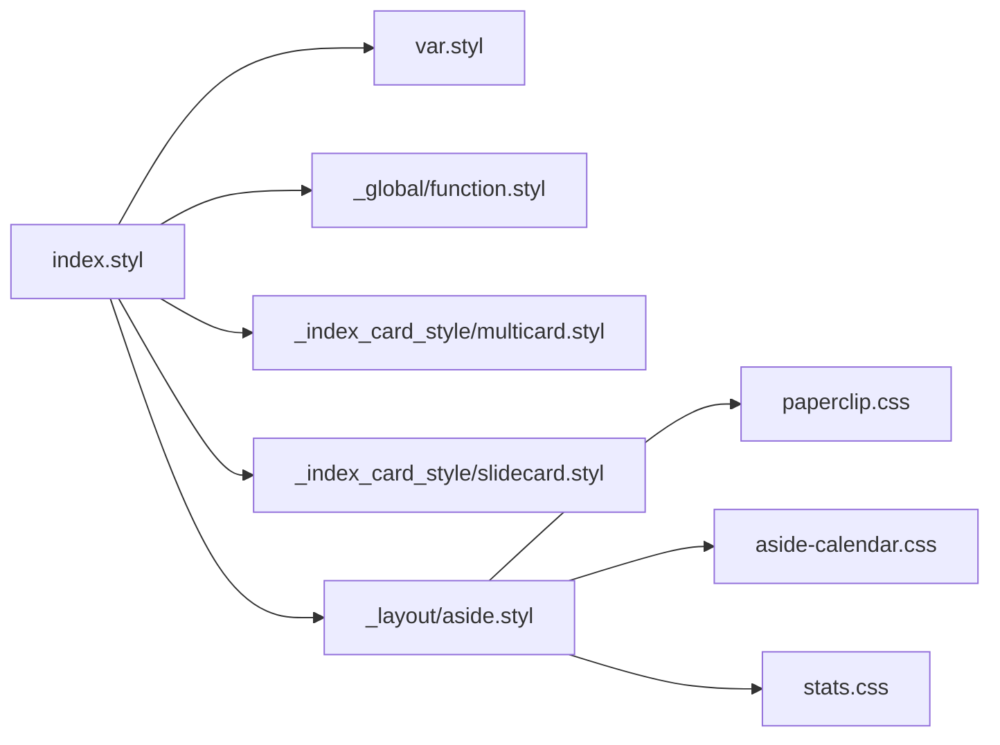

# 卡片布局系统

<cite>
**本文引用的文件**   
- [themes/fomalhaut/source/css/_index_card_style/multicard.styl](file://themes/fomalhaut/source/css/_index_card_style/multicard.styl)
- [themes/fomalhaut/source/css/_index_card_style/slidecard.styl](file://themes/fomalhaut/source/css/_index_card_style/slidecard.styl)
- [themes/fomalhaut/source/css/_global/function.styl](file://themes/fomalhaut/source/css/_global/function.styl)
- [themes/fomalhaut/source/css/_layout/aside.styl](file://themes/fomalhaut/source/css/_layout/aside.styl)
- [themes/fomalhaut/source/css/var.styl](file://themes/fomalhaut/source/css/var.styl)
- [themes/fomalhaut/source/css/index.styl](file://themes/fomalhaut/source/css/index.styl)
- [source/css/paperclip.css](file://source/css/paperclip.css)
- [source/css/aside-calendar.css](file://source/css/aside-calendar.css)
- [source/css/stats.css](file://source/css/stats.css)
</cite>

## 目录
1. [引言](#引言)
2. [项目结构](#项目结构)
3. [核心组件](#核心组件)
4. [架构总览](#架构总览)
5. [详细组件分析](#详细组件分析)
6. [依赖关系分析](#依赖关系分析)
7. [性能与可访问性](#性能与可访问性)
8. [故障排查指南](#故障排查指南)
9. [结论](#结论)
10. [附录：自定义与最佳实践](#附录自定义与最佳实践)

## 引言
本文件系统性地文档化博客主题中的“卡片布局系统”，覆盖以下目标：
- 卡片容器、内容区域、阴影与圆角等基础样式定义
- 多卡片布局与滑动卡片布局两种模式的差异与适用场景
- 响应式网格（列数、间距、对齐）的计算与实现
- 交互效果：悬停动画、点击反馈、加载状态
- 自定义卡片样式、创建新卡片类型、调整布局的实践建议

该体系以主题样式为核心，通过变量集中管理视觉风格，并通过媒体查询与 Flex/Grid 组合实现跨设备适配。

## 项目结构
卡片相关样式主要位于主题的 CSS 目录中，按职责分层组织：
- 全局变量与通用工具类：颜色、字体、卡片悬停、图片缩放等
- 首页卡片样式：多卡片模式与滑动卡片模式两套独立样式
- 侧边栏卡片基座：统一卡片容器、间距、悬停行为
- 站点级增强样式：回形针装饰、日历/倒计时卡片、统计卡片等



图表来源
- [themes/fomalhaut/source/css/index.styl:1-26](file://themes/fomalhaut/source/css/index.styl#L1-L26)
- [themes/fomalhaut/source/css/_global/function.styl:18-49](file://themes/fomalhaut/source/css/_global/function.styl#L18-L49)
- [themes/fomalhaut/source/css/_index_card_style/multicard.styl:1-171](file://themes/fomalhaut/source/css/_index_card_style/multicard.styl#L1-L171)
- [themes/fomalhaut/source/css/_index_card_style/slidecard.styl:1-274](file://themes/fomalhaut/source/css/_index_card_style/slidecard.styl#L1-L274)
- [themes/fomalhaut/source/css/_layout/aside.styl:19-25](file://themes/fomalhaut/source/css/_layout/aside.styl#L19-L25)
- [themes/fomalhaut/source/css/var.styl:47-50](file://themes/fomalhaut/source/css/var.styl#L47-L50)
- [source/css/paperclip.css:21-48](file://source/css/paperclip.css#L21-L48)
- [source/css/aside-calendar.css:51-60](file://source/css/aside-calendar.css#L51-L60)
- [source/css/stats.css:132-169](file://source/css/stats.css#L132-L169)

章节来源
- [themes/fomalhaut/source/css/index.styl:1-26](file://themes/fomalhaut/source/css/index.styl#L1-L26)

## 核心组件
- 卡片容器与基座
  - 侧边栏卡片容器 .card-widget 提供统一的定位、溢出隐藏、外边距和内边距，并继承通用卡片悬停样式。
  - 通用卡片悬停 .cardHover 提供圆角、背景、阴影及悬停阴影过渡。
- 首页卡片容器 .recent-posts
  - 多卡片模式：Flex 换行排列，子项 .recent-post-item 使用百分比宽度与固定下边距形成网格。
  - 滑动卡片模式：PC 端为横向三区块（封面、信息、描述），移动端回退为纵向堆叠。
- 变量与主题色
  - var.styl 集中定义主题色、卡片背景、文本高亮、按钮色等，供各模块引用。
- 站点增强卡片
  - paperclip.css 对作者卡进行装饰（回形针）。
  - aside-calendar.css 对日历/倒计时卡片做紧凑内边距与间距优化。
  - stats.css 对统计卡片增加边框、阴影与右上角柔光。

章节来源
- [themes/fomalhaut/source/css/_layout/aside.styl:19-25](file://themes/fomalhaut/source/css/_layout/aside.styl#L19-L25)
- [themes/fomalhaut/source/css/_global/function.styl:18-27](file://themes/fomalhaut/source/css/_global/function.styl#L18-L27)
- [themes/fomalhaut/source/css/_index_card_style/multicard.styl:84-171](file://themes/fomalhaut/source/css/_index_card_style/multicard.styl#L84-L171)
- [themes/fomalhaut/source/css/_index_card_style/slidecard.styl:14-90](file://themes/fomalhaut/source/css/_index_card_style/slidecard.styl#L14-L90)
- [themes/fomalhaut/source/css/var.styl:47-50](file://themes/fomalhaut/source/css/var.styl#L47-L50)
- [source/css/paperclip.css:21-48](file://source/css/paperclip.css#L21-L48)
- [source/css/aside-calendar.css:51-60](file://source/css/aside-calendar.css#L51-L60)
- [source/css/stats.css:132-169](file://source/css/stats.css#L132-L169)

## 架构总览
卡片系统采用“变量 + 通用工具类 + 模式样式”的分层设计：
- 变量层：统一色彩、字体、阴影等视觉参数
- 工具层：卡片悬停、图片缩放、文本截断等通用能力
- 模式层：多卡片与滑动卡片两套独立样式，互不干扰
- 扩展层：站点级卡片增强样式，按需引入



图表来源
- [themes/fomalhaut/source/css/var.styl:47-50](file://themes/fomalhaut/source/css/var.styl#L47-L50)
- [themes/fomalhaut/source/css/_global/function.styl:18-49](file://themes/fomalhaut/source/css/_global/function.styl#L18-L49)
- [themes/fomalhaut/source/css/_index_card_style/multicard.styl:84-171](file://themes/fomalhaut/source/css/_index_card_style/multicard.styl#L84-L171)
- [themes/fomalhaut/source/css/_index_card_style/slidecard.styl:91-274](file://themes/fomalhaut/source/css/_index_card_style/slidecard.styl#L91-L274)
- [themes/fomalhaut/source/css/_layout/aside.styl:19-25](file://themes/fomalhaut/source/css/_layout/aside.styl#L19-L25)
- [source/css/paperclip.css:21-48](file://source/css/paperclip.css#L21-L48)
- [source/css/aside-calendar.css:51-60](file://source/css/aside-calendar.css#L51-L60)
- [source/css/stats.css:132-169](file://source/css/stats.css#L132-L169)

## 详细组件分析

### 卡片容器与基础样式
- 容器与基座
  - #aside-content 下的 .card-widget 是侧边栏卡片的基础容器，设置相对定位、溢出隐藏、上边距与内边距，并继承 .cardHover。
  - .cardHover 提供圆角、背景、默认阴影与悬停阴影的过渡，保证卡片在悬停时有轻微浮起感。
- 图片与内容
  - .imgHover 为图片提供缩放与滤镜过渡，常用于缩略图或封面图。
  - 文本截断使用 .limit-one-line 与 .limit-more-line，避免长标题或摘要破坏布局。

```mermaid
classDiagram
class CardWidget {
"+position : relative"
"+overflow : hidden"
"+margin-top : 20px"
"+padding : 20px 24px"
}
class CardHover {
"+border-radius : 8px"
"+background : var(--card-bg)"
"+box-shadow : var(--card-box-shadow)"
"+transition : all .3s"
"&hover box-shadow : var(--card-hover-box-shadow)"
}
class ImgHover {
"+width : 100%"
"+height : 100%"
"+object-fit : cover"
"&hover transform : scale(1.1)"
}
CardWidget <.. CardHover : "extend"
CardWidget .. ImgHover : "配合使用"
```

图表来源
- [themes/fomalhaut/source/css/_layout/aside.styl:19-25](file://themes/fomalhaut/source/css/_layout/aside.styl#L19-L25)
- [themes/fomalhaut/source/css/_global/function.styl:18-49](file://themes/fomalhaut/source/css/_global/function.styl#L18-L49)

章节来源
- [themes/fomalhaut/source/css/_layout/aside.styl:19-25](file://themes/fomalhaut/source/css/_layout/aside.styl#L19-L25)
- [themes/fomalhaut/source/css/_global/function.styl:18-49](file://themes/fomalhaut/source/css/_global/function.styl#L18-L49)

### 多卡片布局（Multicard）
- 容器与子项
  - .recent-posts 作为卡片容器，内部 .recent-post-item 为单张卡片。
  - 每个卡片包含 .recent-post-content，其下分为封面与信息区，以及可选的内容叠加层。
- 响应式网格
  - PC（≥1069px）：每行三列，宽度约 32.3%，左右留白与下边距控制间距。
  - 平板（572–1068px）：双列，宽度约 47%。
  - 手机（≤572px）：单列，宽度 100%。
- 视觉细节
  - 卡片圆角 15px，溢出隐藏。
  - 封面与内容区使用 clip-path 裁剪出几何形状，营造层次。
  - 箭头指示器用于引导阅读方向。



图表来源
- [themes/fomalhaut/source/css/_index_card_style/multicard.styl:84-171](file://themes/fomalhaut/source/css/_index_card_style/multicard.styl#L84-L171)

章节来源
- [themes/fomalhaut/source/css/_index_card_style/multicard.styl:84-171](file://themes/fomalhaut/source/css/_index_card_style/multicard.styl#L84-L171)

### 滑动卡片布局（Slidecard）
- 设计目标
  - PC 端强调“封面+信息+描述”的三段式横向布局，鼠标悬停时展开描述区并移动箭头，形成“滑动揭示”的效果。
  - 移动端回退为纵向堆叠，保持可读性与触控友好。
- 关键结构与交互
  - 三个区块：.recent-post-cover（封面）、.recent-post-info（标题/元信息）、.article-content（描述）。
  - 通过 order 控制区块顺序，支持 left/right/both 三种排列变体。
  - 使用 CSS 变量控制配色与过渡曲线，便于深色模式切换。
- 响应式策略
  - ≥1069px：横向三段式，悬停展开描述区。
  - ≤1068px：纵向堆叠，封面在上，信息在中，描述覆盖层居中显示。



图表来源
- [themes/fomalhaut/source/css/_index_card_style/slidecard.styl:91-202](file://themes/fomalhaut/source/css/_index_card_style/slidecard.styl#L91-L202)

章节来源
- [themes/fomalhaut/source/css/_index_card_style/slidecard.styl:1-274](file://themes/fomalhaut/source/css/_index_card_style/slidecard.styl#L1-L274)

### 响应式网格系统
- 列数计算
  - 多卡片模式：三列（≈32.3%）、双列（≈47%）、单列（100%）。
  - 滑动卡片模式：PC 端为三段式横向；移动端为纵向堆叠。
- 间距控制
  - 卡片间通过 margin-bottom 与右侧 margin 控制垂直与水平间距。
  - 容器 padding 控制整体内边距，避免贴边。
- 对齐方式
  - 标题与元信息使用 Flex 居中/两端对齐，确保在不同宽度下保持稳定。
  - 文本截断使用 line-clamp，防止溢出。



图表来源
- [themes/fomalhaut/source/css/_index_card_style/multicard.styl:145-171](file://themes/fomalhaut/source/css/_index_card_style/multicard.styl#L145-L171)

章节来源
- [themes/fomalhaut/source/css/_index_card_style/multicard.styl:145-171](file://themes/fomalhaut/source/css/_index_card_style/multicard.styl#L145-L171)

### 交互效果
- 悬停动画
  - 卡片悬停：阴影加深，轻微浮起（.cardHover）。
  - 图片悬停：放大与滤镜过渡（.imgHover）。
  - 滑动卡片：悬停展开描述区、移动箭头（slidecard）。
- 点击反馈
  - 链接与按钮悬停变色，部分元素有旋转或位移动画（如社交图标）。
- 加载状态
  - 主题预加载器与页面进入动画由全局配置控制，卡片本身无专用加载态，通常通过骨架屏或占位图实现（不在当前样式文件中体现）。

章节来源
- [themes/fomalhaut/source/css/_global/function.styl:18-49](file://themes/fomalhaut/source/css/_global/function.styl#L18-L49)
- [themes/fomalhaut/source/css/_layout/aside.styl:43-67](file://themes/fomalhaut/source/css/_layout/aside.styl#L43-L67)
- [themes/fomalhaut/source/css/_index_card_style/slidecard.styl:91-202](file://themes/fomalhaut/source/css/_index_card_style/slidecard.styl#L91-L202)

### 站点增强卡片
- 作者卡回形针装饰
  - 通过 ::after 伪元素绘制 SVG 回形针，突破卡片 overflow:hidden 的限制，需将特定卡片改为 visible，并使用 inherit 继承圆角。
- 日历/倒计时卡片
  - 缩小内边距与间距，使两张卡片更紧凑；隐藏标题，突出数据展示。
- 统计卡片
  - 增加边框、阴影与右上角柔光，提升视觉层次。

章节来源
- [source/css/paperclip.css:21-48](file://source/css/paperclip.css#L21-L48)
- [source/css/aside-calendar.css:51-60](file://source/css/aside-calendar.css#L51-L60)
- [source/css/stats.css:132-169](file://source/css/stats.css#L132-L169)

## 依赖关系分析
- 样式入口 index.styl 聚合全局、页面、布局、标签、模式与自定义样式。
- var.styl 提供主题变量，被 function.styl 与各模式样式引用。
- multicard.styl 与 slidecard.styl 相互独立，分别对应不同首页卡片模式。
- aside.styl 为侧边栏卡片提供基座，与其他站点增强样式协同工作。



图表来源
- [themes/fomalhaut/source/css/index.styl:1-26](file://themes/fomalhaut/source/css/index.styl#L1-L26)
- [themes/fomalhaut/source/css/var.styl:47-50](file://themes/fomalhaut/source/css/var.styl#L47-L50)
- [themes/fomalhaut/source/css/_global/function.styl:18-49](file://themes/fomalhaut/source/css/_global/function.styl#L18-L49)
- [themes/fomalhaut/source/css/_index_card_style/multicard.styl:84-171](file://themes/fomalhaut/source/css/_index_card_style/multicard.styl#L84-L171)
- [themes/fomalhaut/source/css/_index_card_style/slidecard.styl:91-274](file://themes/fomalhaut/source/css/_index_card_style/slidecard.styl#L91-L274)
- [themes/fomalhaut/source/css/_layout/aside.styl:19-25](file://themes/fomalhaut/source/css/_layout/aside.styl#L19-L25)
- [source/css/paperclip.css:21-48](file://source/css/paperclip.css#L21-L48)
- [source/css/aside-calendar.css:51-60](file://source/css/aside-calendar.css#L51-L60)
- [source/css/stats.css:132-169](file://source/css/stats.css#L132-L169)

章节来源
- [themes/fomalhaut/source/css/index.styl:1-26](file://themes/fomalhaut/source/css/index.styl#L1-L26)

## 性能与可访问性
- 性能
  - 大量使用 CSS 变量与 transition，减少 JS 干预，利于浏览器合成层优化。
  - 图片使用 object-fit 与固定尺寸，避免重排。
  - clip-path 与 transform 在动画中使用，尽量触发 GPU 加速。
- 可访问性
  - 尊重 prefers-reduced-motion，禁用不必要的动画（如回形针呼吸）。
  - 文本截断与行高控制保证可读性。
  - 对比度与主题色通过变量统一管理，便于深色模式适配。

章节来源
- [source/css/paperclip.css:62-68](file://source/css/paperclip.css#L62-L68)
- [themes/fomalhaut/source/css/_global/function.styl:18-49](file://themes/fomalhaut/source/css/_global/function.styl#L18-L49)

## 故障排查指南
- 卡片阴影不生效
  - 检查是否继承 .cardHover，确认 --card-box-shadow 与 --card-hover-box-shadow 变量已定义。
- 图片被裁剪或错位
  - 检查父容器是否设置 overflow:hidden 且未正确设置宽高；确认图片使用 object-fit。
- 滑动卡片在移动端异常
  - 确认媒体查询断点与 order 属性是否正确；必要时回退到纵向堆叠样式。
- 作者卡回形针被裁剪
  - 确认该卡片容器 overflow 设置为 visible，并使用 border-radius: inherit 保持圆角一致。
- 统计卡片柔光不显示
  - 检查伪元素 ::after 是否被其他样式覆盖；确认 z-index 与背景渐变变量有效。

章节来源
- [themes/fomalhaut/source/css/_global/function.styl:18-27](file://themes/fomalhaut/source/css/_global/function.styl#L18-L27)
- [source/css/paperclip.css:21-48](file://source/css/paperclip.css#L21-L48)
- [source/css/stats.css:150-163](file://source/css/stats.css#L150-L163)

## 结论
卡片布局系统通过变量驱动、工具类复用与模式分离，实现了多卡片与滑动卡片两种主流布局，并在侧边栏卡片基座上统一了视觉与交互体验。响应式策略清晰，交互流畅，易于扩展与定制。

## 附录：自定义与最佳实践
- 自定义卡片样式
  - 修改 var.styl 中的主题色、卡片背景与阴影变量，快速切换整体风格。
  - 在 _custom/custom.css 中添加站点级覆盖规则，避免改动主题源码。
- 创建新卡片类型
  - 基于 .card-widget 容器，结合 .cardHover 与 .imgHover，构建新的卡片结构。
  - 如需特殊布局，参考 multicard.styl 或 slidecard.styl 的结构与媒体查询。
- 调整卡片布局
  - 调整 .recent-posts 与 .recent-post-item 的宽度与 margin，改变列数与间距。
  - 在 slidecard 中通过 order 与 clip-path 调整区块顺序与形状。
- 最佳实践
  - 优先使用 CSS 变量与工具类，保持样式一致性。
  - 合理使用 clip-path 与 transform，避免复杂动画导致性能问题。
  - 遵循响应式断点，确保移动端可读性与触控体验。

章节来源
- [themes/fomalhaut/source/css/var.styl:47-50](file://themes/fomalhaut/source/css/var.styl#L47-L50)
- [themes/fomalhaut/source/css/_index_card_style/multicard.styl:84-171](file://themes/fomalhaut/source/css/_index_card_style/multicard.styl#L84-L171)
- [themes/fomalhaut/source/css/_index_card_style/slidecard.styl:91-274](file://themes/fomalhaut/source/css/_index_card_style/slidecard.styl#L91-L274)
- [themes/fomalhaut/source/css/_global/function.styl:18-49](file://themes/fomalhaut/source/css/_global/function.styl#L18-L49)