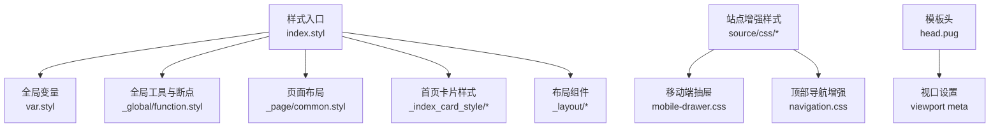
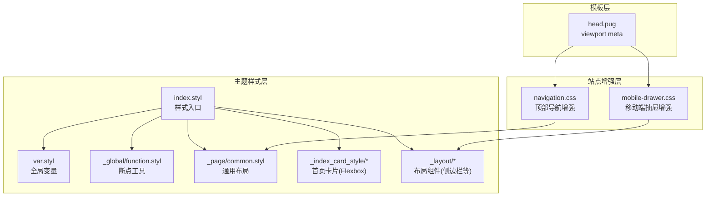
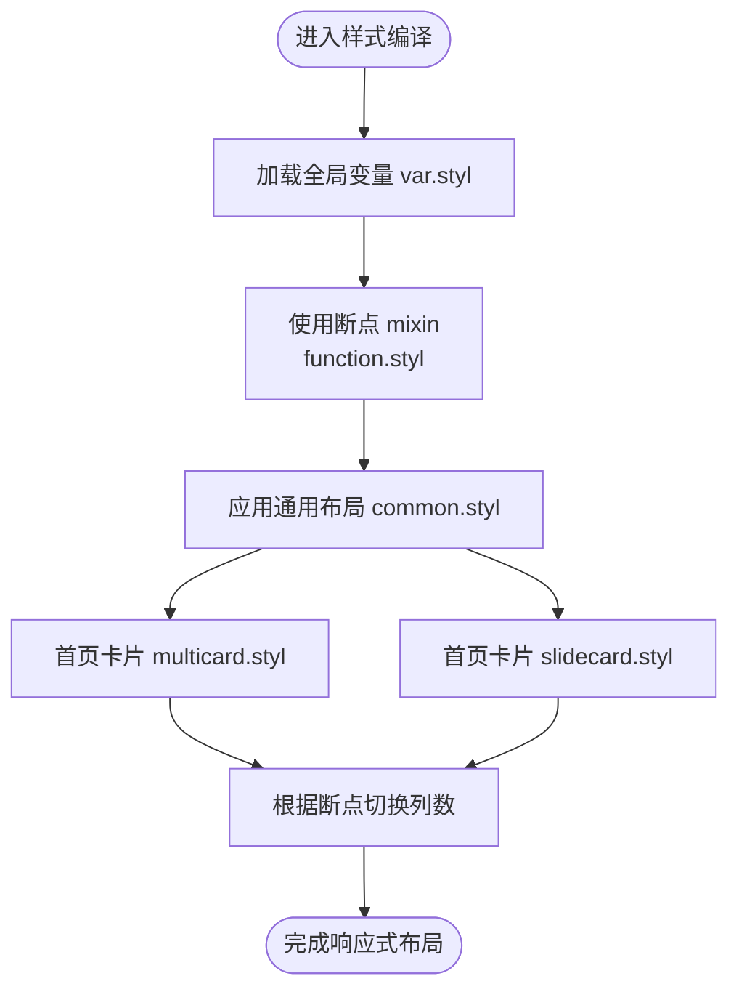
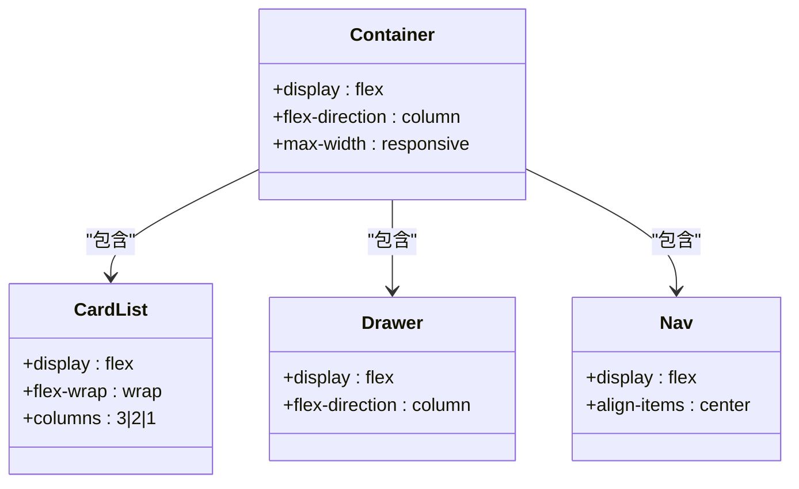
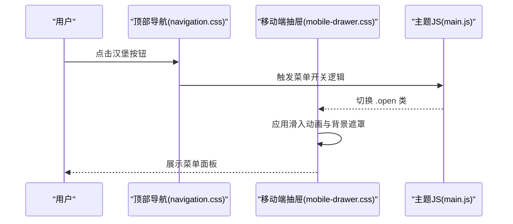
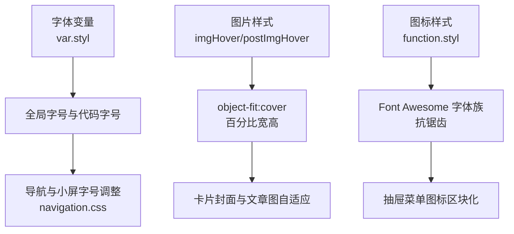
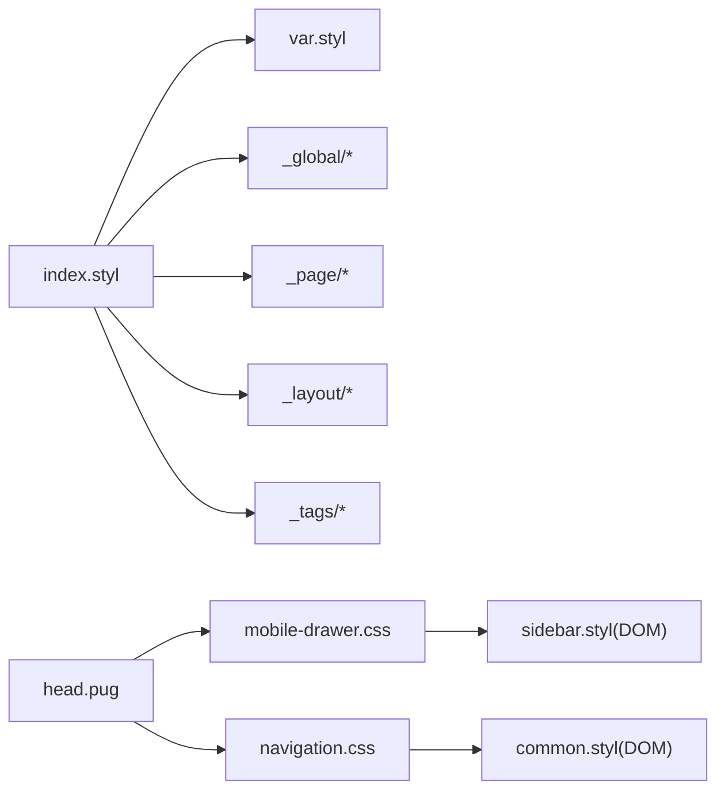

# 响应式设计系统

<cite>
**本文引用的文件**   
- [index.styl](file://themes/fomalhaut/source/css/index.styl)
- [var.styl](file://themes/fomalhaut/source/css/var.styl)
- [function.styl](file://themes/fomalhaut/source/css/_global/function.styl)
- [common.styl](file://themes/fomalhaut/source/css/_page/common.styl)
- [multicard.styl](file://themes/fomalhaut/source/css/_index_card_style/multicard.styl)
- [slidecard.styl](file://themes/fomalhaut/source/css/_index_card_style/slidecard.styl)
- [sidebar.styl](file://themes/fomalhaut/source/css/_layout/sidebar.styl)
- [mobile-drawer.css](file://source/css/mobile-drawer.css)
- [navigation.css](file://source/css/navigation.css)
- [head.pug](file://themes/fomalhaut/layout/includes/head.pug)
</cite>

## 目录
1. [引言](#引言)
2. [项目结构](#项目结构)
3. [核心组件](#核心组件)
4. [架构总览](#架构总览)
5. [详细组件分析](#详细组件分析)
6. [依赖关系分析](#依赖关系分析)
7. [性能考量](#性能考量)
8. [故障排查指南](#故障排查指南)
9. [结论](#结论)
10. [附录：实践示例与优化清单](#附录实践示例与优化清单)

## 引言
本文件系统性地文档化博客主题的响应式设计体系，覆盖断点策略、媒体查询组织、Flexbox 与 CSS Grid 的应用场景、移动端适配方案（触摸交互、手势支持、视口设置）、字体缩放、图片自适应与图标处理策略，并给出自定义断点、新增响应式规则与移动端体验优化的具体示例。

该主题基于 Stylus 构建样式管线，通过入口文件统一引入全局变量、基础样式、页面布局、标签样式与模式切换；站点级样式以独立 CSS 文件注入到主题之后，保证在不修改主题源码的前提下实现增强与定制。

## 项目结构
响应式相关代码主要分布在以下位置：
- 主题样式入口与变量定义：`themes/fomalhaut/source/css/index.styl`、`themes/fomalhaut/source/css/var.styl`
- 全局工具函数与断点 mixin：`themes/fomalhaut/source/css/_global/function.styl`
- 通用布局与容器宽度控制：`themes/fomalhaut/source/css/_page/common.styl`
- 首页卡片布局（Flexbox）：`themes/fomalhaut/source/css/_index_card_style/multicard.styl`、`themes/fomalhaut/source/css/_index_card_style/slidecard.styl`
- 侧边栏抽屉与移动端菜单：`themes/fomalhaut/source/css/_layout/sidebar.styl`、`source/css/mobile-drawer.css`
- 顶部导航与移动端折叠逻辑：`source/css/navigation.css`
- 视口元信息：`themes/fomalhaut/layout/includes/head.pug`

**图示来源**
- [index.styl:1-26](file://themes/fomalhaut/source/css/index.styl#L1-L26)
- [var.styl:1-185](file://themes/fomalhaut/source/css/var.styl#L1-L185)
- [function.styl:1-252](file://themes/fomalhaut/source/css/_global/function.styl#L1-L252)
- [common.styl:1-61](file://themes/fomalhaut/source/css/_page/common.styl#L1-L61)
- [multicard.styl:1-171](file://themes/fomalhaut/source/css/_index_card_style/multicard.styl#L1-L171)
- [slidecard.styl:1-274](file://themes/fomalhaut/source/css/_index_card_style/slidecard.styl#L1-L274)
- [sidebar.styl:1-68](file://themes/fomalhaut/source/css/_layout/sidebar.styl#L1-L68)
- [mobile-drawer.css:1-492](file://source/css/mobile-drawer.css#L1-L492)
- [navigation.css:1-278](file://source/css/navigation.css#L1-L278)
- [head.pug:24-24](file://themes/fomalhaut/layout/includes/head.pug#L24-L24)

**章节来源**
- [index.styl:1-26](file://themes/fomalhaut/source/css/index.styl#L1-L26)
- [var.styl:1-185](file://themes/fomalhaut/source/css/var.styl#L1-L185)

## 核心组件
- 样式入口与模块化引入：入口文件按顺序引入第三方重置、全局变量、全局工具、高亮、页面、布局、标签、模式等模块，并按配置条件引入搜索与灯笼等可选功能。
- 全局变量与主题色：集中管理颜色、字体、按钮、滚动条、注释框、标签插件等变量，便于跨组件一致性与深色模式扩展。
- 断点工具函数：提供 `maxWidth600()`、`maxWidth768()`、`minWidth768()`、`maxWidth1024()`、`maxWidth900()`、`minWidth901()`、`minWidth900()`、`minWidth2000()` 等 mixin，用于在 Stylus 中快速生成媒体查询。
- 通用布局容器：主体容器使用 Flex 列布局，主内容区最大宽度随屏幕变化，在小屏时自动切换为纵向排列。
- 首页卡片布局：采用 Flexbox 实现多列卡片，在不同断点下切换三栏/双栏/单栏。
- 移动端抽屉菜单：在主题默认抽屉基础上进行视觉增强与交互优化，保持 DOM 结构不变。
- 顶部导航增强：对固定导航的毛玻璃效果、触控区域尺寸、标题显示与折叠断点进行精细化控制。
- 视口设置：通过模板头注入 viewport meta，确保移动端缩放与布局正确。

**章节来源**
- [index.styl:1-26](file://themes/fomalhaut/source/css/index.styl#L1-L26)
- [var.styl:1-185](file://themes/fomalhaut/source/css/var.styl#L1-L185)
- [function.styl:74-104](file://themes/fomalhaut/source/css/_global/function.styl#L74-L104)
- [common.styl:1-61](file://themes/fomalhaut/source/css/_page/common.styl#L1-L61)
- [multicard.styl:85-171](file://themes/fomalhaut/source/css/_index_card_style/multicard.styl#L85-L171)
- [slidecard.styl:14-274](file://themes/fomalhaut/source/css/_index_card_style/slidecard.styl#L14-L274)
- [sidebar.styl:1-68](file://themes/fomalhaut/source/css/_layout/sidebar.styl#L1-L68)
- [mobile-drawer.css:35-492](file://source/css/mobile-drawer.css#L35-L492)
- [navigation.css:1-278](file://source/css/navigation.css#L1-L278)
- [head.pug:24-24](file://themes/fomalhaut/layout/includes/head.pug#L24-L24)

## 架构总览
响应式架构由“主题样式层 + 站点增强层 + 模板元信息”组成：
- 主题样式层负责基础样式、变量、布局与组件样式，并通过 Stylus 工具函数组织断点。
- 站点增强层以独立 CSS 文件注入，不改动主题源码，针对移动端抽屉与顶部导航进行体验增强。
- 模板头提供视口设置，确保移动端渲染行为符合预期。

**图示来源**
- [index.styl:1-26](file://themes/fomalhaut/source/css/index.styl#L1-L26)
- [var.styl:1-185](file://themes/fomalhaut/source/css/var.styl#L1-L185)
- [function.styl:74-104](file://themes/fomalhaut/source/css/_global/function.styl#L74-L104)
- [common.styl:1-61](file://themes/fomalhaut/source/css/_page/common.styl#L1-L61)
- [multicard.styl:85-171](file://themes/fomalhaut/source/css/_index_card_style/multicard.styl#L85-L171)
- [slidecard.styl:14-274](file://themes/fomalhaut/source/css/_index_card_style/slidecard.styl#L14-L274)
- [sidebar.styl:1-68](file://themes/fomalhaut/source/css/_layout/sidebar.styl#L1-L68)
- [mobile-drawer.css:35-492](file://source/css/mobile-drawer.css#L35-L492)
- [navigation.css:1-278](file://source/css/navigation.css#L1-L278)
- [head.pug:24-24](file://themes/fomalhaut/layout/includes/head.pug#L24-L24)

## 详细组件分析

### 断点系统与媒体查询组织
- 断点定义集中在 `_global/function.styl`，通过 mixin 封装常用媒体查询，避免重复书写。
- 常见断点包括：
  - 小屏手机：≤600px
  - 平板/小屏桌面：≤768px
  - 中等桌面：≤900px / ≥901px
  - 大屏桌面：≤1024px
  - 超大屏：≥2000px
- 页面布局在 `common.styl` 中使用这些 mixin 调整主内容区方向与内边距，保证在小屏上纵向排列。
- 首页卡片在 `multicard.styl` 与 `slidecard.styl` 中分别定义三栏、双栏、单栏的断点，使用 Flexbox 实现自适应列数。

**图示来源**
- [function.styl:74-104](file://themes/fomalhaut/source/css/_global/function.styl#L74-L104)
- [common.styl:1-61](file://themes/fomalhaut/source/css/_page/common.styl#L1-L61)
- [multicard.styl:146-171](file://themes/fomalhaut/source/css/_index_card_style/multicard.styl#L146-L171)
- [slidecard.styl:203-274](file://themes/fomalhaut/source/css/_index_card_style/slidecard.styl#L203-L274)

**章节来源**
- [function.styl:74-104](file://themes/fomalhaut/source/css/_global/function.styl#L74-L104)
- [common.styl:14-21](file://themes/fomalhaut/source/css/_page/common.styl#L14-L21)
- [multicard.styl:146-171](file://themes/fomalhaut/source/css/_index_card_style/multicard.styl#L146-L171)
- [slidecard.styl:203-274](file://themes/fomalhaut/source/css/_index_card_style/slidecard.styl#L203-L274)

### 弹性布局与网格系统结合
- 本项目广泛使用 Flexbox 作为主要布局手段，未直接使用 CSS Grid。
- Flexbox 应用场景：
  - 主体容器与主内容区：`common.styl` 使用 Flex 列布局，并在 ≤900px 时切换为纵向排列。
  - 首页卡片：`multicard.styl` 与 `slidecard.styl` 使用 Flex 行布局与换行，配合断点实现三栏/双栏/单栏。
  - 移动端抽屉：`mobile-drawer.css` 使用 Flex 对齐头像、统计胶囊与菜单项。
  - 顶部导航：`navigation.css` 使用 Flex 对齐右侧工具按钮。
- 若未来需要更复杂的二维布局，可在现有 Flexbox 基础上引入 CSS Grid，例如将首页卡片容器改为 grid-template-columns 并配合 `auto-fit` 与 `minmax` 实现更灵活的自适应。

**图示来源**
- [common.styl:1-61](file://themes/fomalhaut/source/css/_page/common.styl#L1-L61)
- [multicard.styl:85-171](file://themes/fomalhaut/source/css/_index_card_style/multicard.styl#L85-L171)
- [slidecard.styl:14-274](file://themes/fomalhaut/source/css/_index_card_style/slidecard.styl#L14-L274)
- [mobile-drawer.css:72-104](file://source/css/mobile-drawer.css#L72-L104)
- [navigation.css:87-120](file://source/css/navigation.css#L87-L120)

**章节来源**
- [common.styl:1-61](file://themes/fomalhaut/source/css/_page/common.styl#L1-L61)
- [multicard.styl:85-171](file://themes/fomalhaut/source/css/_index_card_style/multicard.styl#L85-L171)
- [slidecard.styl:14-274](file://themes/fomalhaut/source/css/_index_card_style/slidecard.styl#L14-L274)
- [mobile-drawer.css:72-104](file://source/css/mobile-drawer.css#L72-L104)
- [navigation.css:87-120](file://source/css/navigation.css#L87-L120)

### 移动端适配方案
- 视口设置：模板头注入 `width=device-width, initial-scale=1.0, maximum-scale=1.0, user-scalable=no`，确保移动端初始缩放与禁止用户缩放。
- 触摸交互与手势：
  - 顶部导航按钮与搜索按钮的最小触控尺寸为 44×44px，提升点击可用性。
  - 移动端抽屉菜单通过 JS 切换类名控制展开/收起，CSS 提供平滑过渡与动画。
  - 滚动条在移动端可自绘或原生滚动，抽屉内部使用细滚动条样式。
- 导航折叠断点：导航在 ≤800px 时隐藏标题容器，保留品牌与工具按钮；在 ≤480px 时进一步缩小字号。
- 无障碍与动效降级：对 `prefers-reduced-motion` 提供禁用动画与过渡的规则，保障可访问性。

**图示来源**
- [head.pug:24-24](file://themes/fomalhaut/layout/includes/head.pug#L24-L24)
- [navigation.css:229-248](file://source/css/navigation.css#L229-L248)
- [mobile-drawer.css:378-405](file://source/css/mobile-drawer.css#L378-L405)

**章节来源**
- [head.pug:24-24](file://themes/fomalhaut/layout/includes/head.pug#L24-L24)
- [navigation.css:167-184](file://source/css/navigation.css#L167-L184)
- [navigation.css:229-248](file://source/css/navigation.css#L229-L248)
- [mobile-drawer.css:378-405](file://source/css/mobile-drawer.css#L378-L405)
- [mobile-drawer.css:470-491](file://source/css/mobile-drawer.css#L470-L491)

### 字体缩放、图片自适应与图标处理
- 字体缩放：
  - 全局字体大小可通过变量 `$font-size` 控制，代码块字体大小 `$code-font-size` 可跟随全局或独立设置。
  - 导航在小屏下调整字号，确保可读性。
- 图片自适应：
  - 卡片封面与文章图使用 `object-fit: cover` 与百分比宽高，确保在不同尺寸下填充且不变形。
  - 图片悬停效果使用 transform 与 filter 过渡，避免重排。
- 图标处理：
  - 使用 Font Awesome 图标类，统一字体族与抗锯齿设置。
  - 抽屉菜单中的 SVG 图标通过 padding、圆角与底色增强触控区域与视觉层次。

**图示来源**
- [var.styl:15-31](file://themes/fomalhaut/source/css/var.styl#L15-L31)
- [function.styl:11-17](file://themes/fomalhaut/source/css/_global/function.styl#L11-L17)
- [function.styl:28-49](file://themes/fomalhaut/source/css/_global/function.styl#L28-L49)
- [multicard.styl:100-107](file://themes/fomalhaut/source/css/_index_card_style/multicard.styl#L100-L107)
- [slidecard.styl:121-128](file://themes/fomalhaut/source/css/_index_card_style/slidecard.styl#L121-L128)
- [navigation.css:244-248](file://source/css/navigation.css#L244-L248)
- [mobile-drawer.css:275-290](file://source/css/mobile-drawer.css#L275-L290)

**章节来源**
- [var.styl:15-31](file://themes/fomalhaut/source/css/var.styl#L15-L31)
- [function.styl:11-17](file://themes/fomalhaut/source/css/_global/function.styl#L11-L17)
- [function.styl:28-49](file://themes/fomalhaut/source/css/_global/function.styl#L28-L49)
- [multicard.styl:100-107](file://themes/fomalhaut/source/css/_index_card_style/multicard.styl#L100-L107)
- [slidecard.styl:121-128](file://themes/fomalhaut/source/css/_index_card_style/slidecard.styl#L121-L128)
- [navigation.css:244-248](file://source/css/navigation.css#L244-L248)
- [mobile-drawer.css:275-290](file://source/css/mobile-drawer.css#L275-L290)

## 依赖关系分析
- 样式入口 `index.styl` 依赖 `var.styl` 与 `_global/*`，并条件引入搜索与灯笼样式。
- 布局组件依赖断点工具函数，确保在不同屏幕尺寸下的表现一致。
- 站点增强样式 `mobile-drawer.css` 与 `navigation.css` 依赖主题生成的 DOM 结构与类名，但不修改主题源码。
- 模板头 `head.pug` 提供视口设置，影响所有移动端行为。

**图示来源**
- [index.styl:1-26](file://themes/fomalhaut/source/css/index.styl#L1-L26)
- [var.styl:1-185](file://themes/fomalhaut/source/css/var.styl#L1-L185)
- [sidebar.styl:1-68](file://themes/fomalhaut/source/css/_layout/sidebar.styl#L1-L68)
- [common.styl:1-61](file://themes/fomalhaut/source/css/_page/common.styl#L1-L61)
- [mobile-drawer.css:1-492](file://source/css/mobile-drawer.css#L1-L492)
- [navigation.css:1-278](file://source/css/navigation.css#L1-L278)
- [head.pug:24-24](file://themes/fomalhaut/layout/includes/head.pug#L24-L24)

**章节来源**
- [index.styl:1-26](file://themes/fomalhaut/source/css/index.styl#L1-L26)
- [sidebar.styl:1-68](file://themes/fomalhaut/source/css/_layout/sidebar.styl#L1-L68)
- [common.styl:1-61](file://themes/fomalhaut/source/css/_page/common.styl#L1-L61)
- [mobile-drawer.css:1-492](file://source/css/mobile-drawer.css#L1-L492)
- [navigation.css:1-278](file://source/css/navigation.css#L1-L278)
- [head.pug:24-24](file://themes/fomalhaut/layout/includes/head.pug#L24-L24)

## 性能考量
- 减少重排与重绘：
  - 图片悬停使用 transform 与 filter，避免触发布局计算。
  - 抽屉菜单与导航的过渡动画使用 opacity 与 transform，降低合成压力。
- 媒体查询与特性检测：
  - 导航毛玻璃效果仅在支持 backdrop-filter 的设备启用，避免无效计算。
  - 使用 `prefers-reduced-motion` 禁用动画，提升可访问性与低端设备性能。
- 触控区域优化：
  - 导航按钮最小 44×44px，提升点击命中率，减少误触导致的重绘。
- 滚动性能：
  - 抽屉内部滚动条样式轻量化，避免复杂阴影与渐变。

[本节为通用性能建议，不直接分析具体文件]

## 故障排查指南
- 抽屉菜单错位或留缝：
  - 检查抽屉宽度与 right 值是否一致，避免滑动后出现缝隙。
  - 确认 `.open` 类的 transform 与 width 匹配。
- 导航标题被裁剪：
  - 在极窄屏幕（≤360px）下标题可能被裁剪，必要时调整字号或允许省略号显示。
- 图片变形或溢出：
  - 确认图片容器使用 `object-fit: cover` 与百分比宽高。
- 动画卡顿或不可用：
  - 检查 `prefers-reduced-motion` 规则是否正确禁用动画。
  - 避免在频繁触发的滚动监听中执行复杂计算。

**章节来源**
- [mobile-drawer.css:37-42](file://source/css/mobile-drawer.css#L37-L42)
- [navigation.css:257-263](file://source/css/navigation.css#L257-L263)
- [function.styl:28-49](file://themes/fomalhaut/source/css/_global/function.styl#L28-L49)
- [mobile-drawer.css:470-491](file://source/css/mobile-drawer.css#L470-L491)

## 结论
该响应式设计系统以 Stylus 为基础，通过统一的样式入口、全局变量与断点工具函数，构建了稳定的移动端、平板与桌面适配体系。Flexbox 作为主要布局手段，配合媒体查询实现了首页卡片的多列自适应与通用布局的纵向切换。站点增强样式在不修改主题源码的前提下，提升了移动端抽屉与顶部导航的体验。视口设置与触控区域优化确保了移动端交互的可用性与性能。未来可在适当场景引入 CSS Grid，进一步提升二维布局的灵活性。

[本节为总结性内容，不直接分析具体文件]

## 附录：实践示例与优化清单

### 自定义断点与新增响应式规则
- 在 `_global/function.styl` 中添加新的 mixin，例如 `maxWidth850()`，并在需要的组件中调用。
- 在组件样式文件中，使用新 mixin 包裹样式块，实现特定断点的响应式规则。
- 示例路径参考：
  - 新增 mixin：`themes/fomalhaut/source/css/_global/function.styl`
  - 使用 mixin：`themes/fomalhaut/source/css/_page/common.styl`

**章节来源**
- [function.styl:74-104](file://themes/fomalhaut/source/css/_global/function.styl#L74-L104)
- [common.styl:14-21](file://themes/fomalhaut/source/css/_page/common.styl#L14-L21)

### 优化移动端体验的具体步骤
- 确保视口设置正确：检查 `head.pug` 中的 viewport meta。
- 增大触控区域：导航按钮与菜单项最小 44×44px。
- 简化动画：在低端设备上禁用复杂动画，使用 `prefers-reduced-motion`。
- 优化图片加载：使用 `object-fit: cover` 与懒加载策略（如已有）。
- 抽屉菜单宽度与 right 值保持一致，避免滑动错位。

**章节来源**
- [head.pug:24-24](file://themes/fomalhaut/layout/includes/head.pug#L24-L24)
- [navigation.css:100-120](file://source/css/navigation.css#L100-L120)
- [mobile-drawer.css:37-42](file://source/css/mobile-drawer.css#L37-L42)
- [mobile-drawer.css:470-491](file://source/css/mobile-drawer.css#L470-L491)