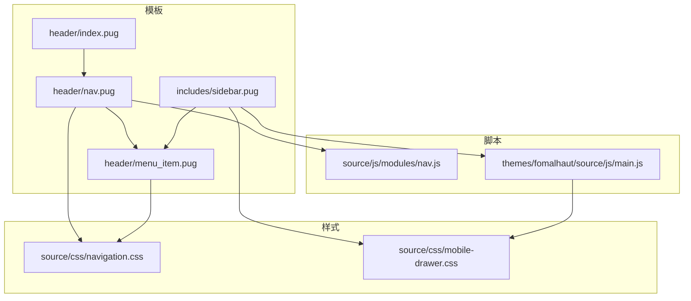
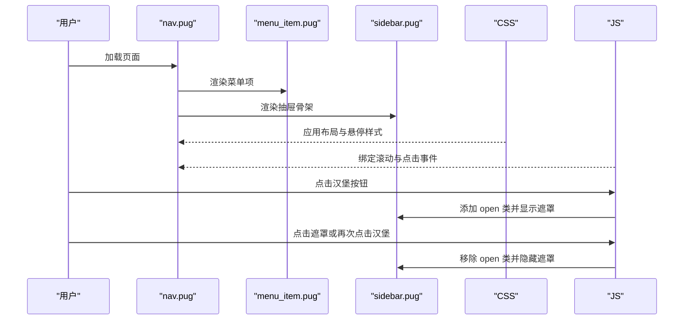
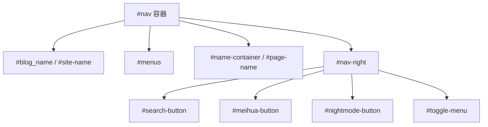
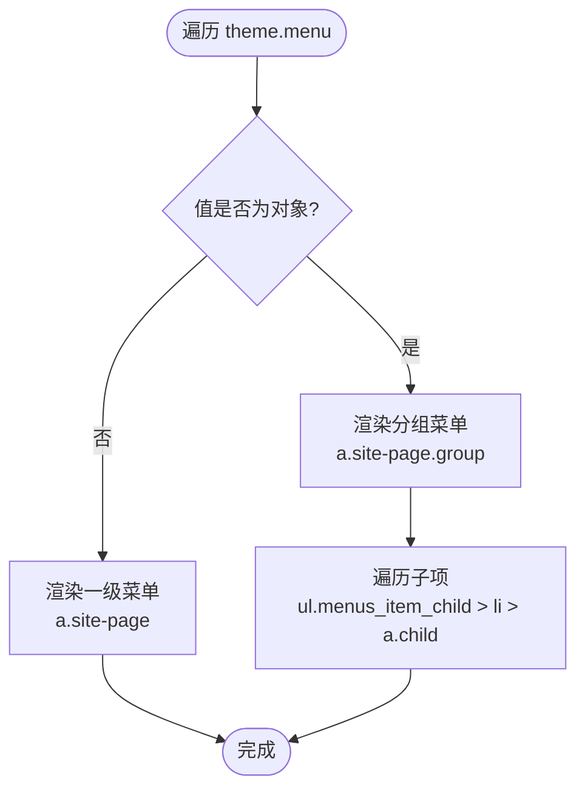
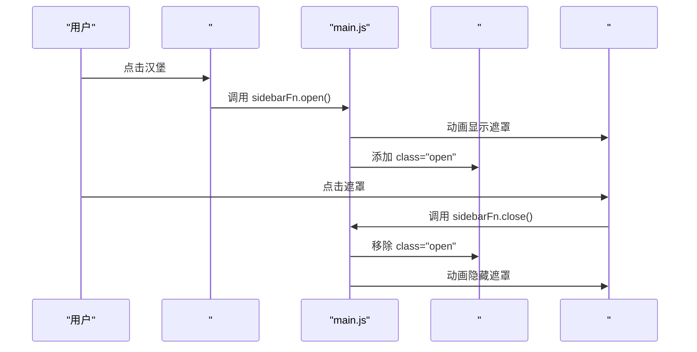
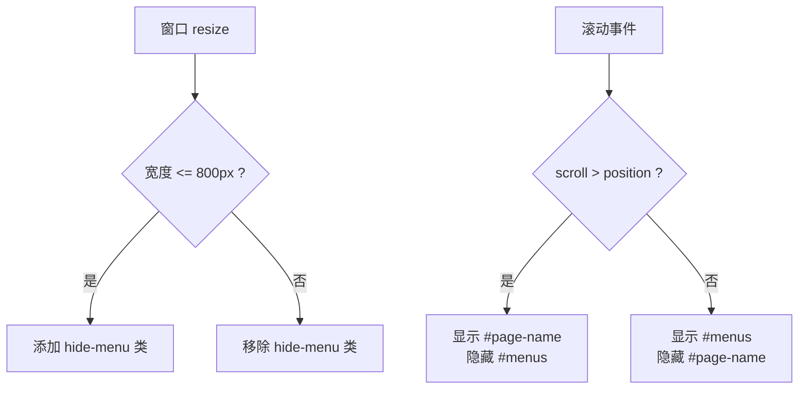
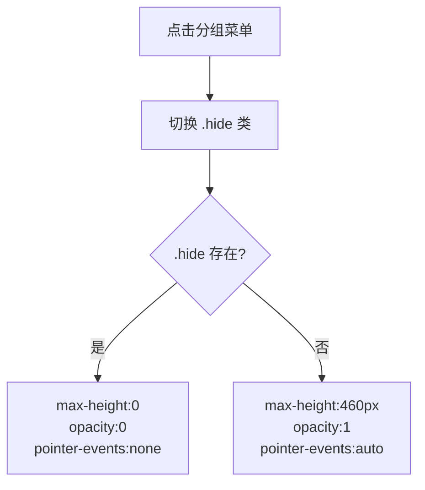
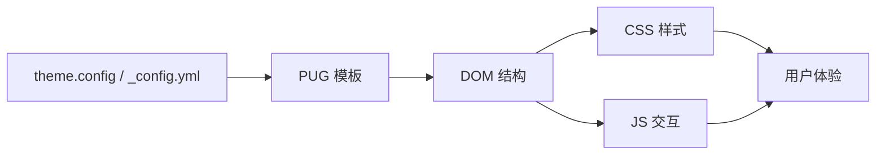

# 导航组件系统

<cite>
**本文引用的文件**   
- [nav.pug](file://themes/fomalhaut/layout/includes/header/nav.pug)
- [menu_item.pug](file://themes/fomalhaut/layout/includes/header/menu_item.pug)
- [index.pug](file://themes/fomalhaut/layout/includes/header/index.pug)
- [sidebar.pug](file://themes/fomalhaut/layout/includes/sidebar.pug)
- [navigation.css](file://source/css/navigation.css)
- [mobile-drawer.css](file://source/css/mobile-drawer.css)
- [nav.js](file://source/js/modules/nav.js)
- [main.js](file://themes/fomalhaut/source/js/main.js)
</cite>

## 目录
1. [引言](#引言)
2. [项目结构](#项目结构)
3. [核心组件](#核心组件)
4. [架构总览](#架构总览)
5. [详细组件分析](#详细组件分析)
6. [依赖关系分析](#依赖关系分析)
7. [性能与可访问性](#性能与可访问性)
8. [故障排查](#故障排查)
9. [结论](#结论)
10. [附录：自定义示例](#附录自定义示例)

## 引言
本文件系统化文档化博客主题的导航组件体系，覆盖桌面端顶栏、多级菜单、移动端抽屉菜单、响应式断点、滚动样式变化以及交互逻辑。目标是帮助开发者在不破坏主题原有行为的前提下，安全扩展导航项、新增按钮、调整样式与动效。

## 项目结构
导航相关代码分布在模板、样式与脚本三个层面：
- 模板层负责渲染导航栏骨架与菜单项
- 样式层定义布局、悬停、固定导航背景、移动端抽屉外观与动画
- 脚本层处理标题切换、菜单折叠、抽屉开关与子菜单展开

**图表来源**
- [index.pug:31-32](file://themes/fomalhaut/layout/includes/header/index.pug#L31-L32)
- [nav.pug:1-36](file://themes/fomalhaut/layout/includes/header/nav.pug#L1-L36)
- [menu_item.pug:32-77](file://themes/fomalhaut/layout/includes/header/menu_item.pug#L32-L77)
- [sidebar.pug:1-19](file://themes/fomalhaut/layout/includes/sidebar.pug#L1-L19)
- [navigation.css:1-278](file://source/css/navigation.css#L1-L278)
- [mobile-drawer.css:1-492](file://source/css/mobile-drawer.css#L1-L492)
- [nav.js:28-67](file://source/js/modules/nav.js#L28-L67)
- [main.js:35-51](file://themes/fomalhaut/source/js/main.js#L35-L51)

**章节来源**
- [index.pug:31-32](file://themes/fomalhaut/layout/includes/header/index.pug#L31-L32)
- [nav.pug:1-36](file://themes/fomalhaut/layout/includes/header/nav.pug#L1-L36)
- [menu_item.pug:32-77](file://themes/fomalhaut/layout/includes/header/menu_item.pug#L32-L77)
- [sidebar.pug:1-19](file://themes/fomalhaut/layout/includes/sidebar.pug#L1-L19)

## 核心组件
- 顶部导航容器：包含博客标题、菜单区域、页面标题占位、右侧工具区（搜索、美化设置、暗黑模式、移动端汉堡）。
- 菜单生成器：根据主题配置动态生成一级菜单和二级子菜单，支持图标与动画类名。
- 移动端抽屉：侧边面板，含头像、站点统计、分隔线、菜单列表；通过遮罩层与开合类控制显示。
- 响应式与滚动行为：在窄屏隐藏菜单并显示汉堡；滚动后中间显示当前页面标题并隐藏主菜单；固定导航时改变背景与阴影。
- 交互逻辑：抽屉打开/关闭、子菜单展开收起、点击遮罩关闭、窗口缩放时自动收起抽屉。

**章节来源**
- [nav.pug:1-36](file://themes/fomalhaut/layout/includes/header/nav.pug#L1-L36)
- [menu_item.pug:32-77](file://themes/fomalhaut/layout/includes/header/menu_item.pug#L32-L77)
- [sidebar.pug:1-19](file://themes/fomalhaut/layout/includes/sidebar.pug#L1-L19)
- [navigation.css:129-217](file://source/css/navigation.css#L129-L217)
- [mobile-drawer.css:36-492](file://source/css/mobile-drawer.css#L36-L492)
- [nav.js:32-65](file://source/js/modules/nav.js#L32-L65)
- [main.js:35-51](file://themes/fomalhaut/source/js/main.js#L35-L51)

## 架构总览
导航组件由“模板渲染 + CSS 样式 + JS 交互”三层协作完成：
- 模板渲染出 `#nav`、`#menus`、`#nav-right`、`#toggle-menu`、`#sidebar-menus`、`#menu-mask` 等关键节点。
- CSS 定义布局、悬停高亮、固定导航背景、移动端抽屉外观与入场动画。
- JS 监听滚动、窗口尺寸变化、点击事件，驱动标题切换、菜单折叠、抽屉开合与子菜单展开。

**图表来源**
- [nav.pug:1-36](file://themes/fomalhaut/layout/includes/header/nav.pug#L1-L36)
- [menu_item.pug:32-77](file://themes/fomalhaut/layout/includes/header/menu_item.pug#L32-L77)
- [sidebar.pug:1-19](file://themes/fomalhaut/layout/includes/sidebar.pug#L1-L19)
- [main.js:35-51](file://themes/fomalhaut/source/js/main.js#L35-L51)
- [main.js:749-784](file://themes/fomalhaut/source/js/main.js#L749-L784)

## 详细组件分析

### 顶部导航栏结构与布局
- 博客标题：`#blog_name > #site-name`，在宽屏显示站点名称，在小屏被裁剪但保留可访问焦点。
- 菜单区域：`#menus`，内部通过 partial 渲染菜单项。
- 页面标题占位：`#name-container > #page-name`，滚动到正文后居中显示当前页面标题。
- 右侧工具区：`#nav-right`，包含搜索按钮、美化设置按钮、暗黑模式按钮、移动端汉堡按钮。

**图表来源**
- [nav.pug:1-36](file://themes/fomalhaut/layout/includes/header/nav.pug#L1-L36)

**章节来源**
- [nav.pug:1-36](file://themes/fomalhaut/layout/includes/header/nav.pug#L1-L36)
- [navigation.css:4-217](file://source/css/navigation.css#L4-L217)

### 多级菜单实现机制
- 动态生成：模板遍历 `theme.menu`，若值为字符串则渲染一级菜单；若值为对象则渲染分组菜单，并在其下渲染子菜单项。
- 图标与动画：支持 Font Awesome 图标与内联 SVG 图标，同时支持动画类名（如 `faa-tada`）。
- 高亮状态：主题未在此处直接管理高亮；可通过 CSS 选择器对当前页链接添加高亮样式。
- 悬停效果：CSS 为菜单项提供颜色与背景过渡，增强可读性与视觉反馈。

**图表来源**
- [menu_item.pug:32-77](file://themes/fomalhaut/layout/includes/header/menu_item.pug#L32-L77)

**章节来源**
- [menu_item.pug:32-77](file://themes/fomalhaut/layout/includes/header/menu_item.pug#L32-L77)
- [navigation.css:209-217](file://source/css/navigation.css#L209-L217)

### 移动端抽屉菜单
- 结构：`#sidebar-menus` 包含头像、站点统计、分隔线、菜单列表；`#menu-mask` 作为遮罩层。
- 开合控制：JS 给 `#sidebar-menus` 添加/移除 `open` 类，并通过动画库淡入/淡出遮罩。
- 遮罩层处理：点击遮罩触发关闭；窗口缩放时若汉堡不可见则自动关闭抽屉。
- 触摸事件：遮罩层使用 click 事件；如需更完善的触摸手势，可在遮罩上增加 touchstart/touchend 处理。
- 动画：抽屉内容按子元素顺序依次上浮淡入；子菜单使用 max-height 与 opacity 做手风琴展开收起。

**图表来源**
- [main.js:35-51](file://themes/fomalhaut/source/js/main.js#L35-L51)
- [main.js:749-784](file://themes/fomalhaut/source/js/main.js#L749-L784)
- [mobile-drawer.css:379-405](file://source/css/mobile-drawer.css#L379-L405)

**章节来源**
- [sidebar.pug:1-19](file://themes/fomalhaut/layout/includes/sidebar.pug#L1-L19)
- [mobile-drawer.css:36-492](file://source/css/mobile-drawer.css#L36-L492)
- [main.js:35-51](file://themes/fomalhaut/source/js/main.js#L35-L51)
- [main.js:749-784](file://themes/fomalhaut/source/js/main.js#L749-L784)

### 响应式行为与断点
- 菜单折叠：当视口宽度小于等于 800px 时，导航栏添加 `hide-menu` 类以隐藏主菜单并显示汉堡。
- 标题切换：滚动超过初始位置后，隐藏主菜单并显示居中的页面标题；回到顶部则恢复。
- 固定导航样式：当头部处于固定或可见状态时，导航背景变为半透明并带阴影；深色模式下变量替换。
- 小屏适配：在 800px 以下隐藏居中标题；在更小屏幕调整字号与间距。

**图表来源**
- [main.js:5-26](file://themes/fomalhaut/source/js/main.js#L5-L26)
- [nav.js:32-65](file://source/js/modules/nav.js#L32-L65)
- [navigation.css:229-248](file://source/css/navigation.css#L229-L248)

**章节来源**
- [main.js:5-26](file://themes/fomalhaut/source/js/main.js#L5-L26)
- [nav.js:32-65](file://source/js/modules/nav.js#L32-L65)
- [navigation.css:129-217](file://source/css/navigation.css#L129-L217)
- [navigation.css:229-248](file://source/css/navigation.css#L229-L248)

### 子菜单展开收起逻辑
- 主题 JS 为 `.site-page.group` 绑定点击事件，切换 `hide` 类。
- CSS 根据 `.group.hide` 与 `.group:not(.hide)` 控制子菜单的 `max-height` 与 `opacity`，实现手风琴效果。
- 箭头方向：默认朝右，展开时旋转至朝左，符合直觉。

**图表来源**
- [main.js:552-558](file://themes/fomalhaut/source/js/main.js#L552-L558)
- [mobile-drawer.css:314-340](file://source/css/mobile-drawer.css#L314-L340)

**章节来源**
- [main.js:552-558](file://themes/fomalhaut/source/js/main.js#L552-L558)
- [mobile-drawer.css:314-340](file://source/css/mobile-drawer.css#L314-L340)

## 依赖关系分析
- 模板依赖主题配置 `theme.menu` 与 `config.title` 等全局变量。
- 样式依赖主题 CSS 变量 `--theme-color` 与 `data-theme` 属性。
- 脚本依赖 jQuery（用于滚动监听）与主题工具函数 `btf.scrollToDest`、`btf.animateIn/Out`。
- 抽屉样式与主题基础样式解耦，通过独立 CSS 文件覆盖，避免修改主题源码。

**图表来源**
- [nav.pug:1-36](file://themes/fomalhaut/layout/includes/header/nav.pug#L1-L36)
- [menu_item.pug:32-77](file://themes/fomalhaut/layout/includes/header/menu_item.pug#L32-L77)
- [navigation.css:129-217](file://source/css/navigation.css#L129-L217)
- [mobile-drawer.css:36-492](file://source/css/mobile-drawer.css#L36-L492)
- [nav.js:32-65](file://source/js/modules/nav.js#L32-L65)
- [main.js:35-51](file://themes/fomalhaut/source/js/main.js#L35-L51)

**章节来源**
- [nav.pug:1-36](file://themes/fomalhaut/layout/includes/header/nav.pug#L1-L36)
- [menu_item.pug:32-77](file://themes/fomalhaut/layout/includes/header/menu_item.pug#L32-L77)
- [navigation.css:129-217](file://source/css/navigation.css#L129-L217)
- [mobile-drawer.css:36-492](file://source/css/mobile-drawer.css#L36-L492)
- [nav.js:32-65](file://source/js/modules/nav.js#L32-L65)
- [main.js:35-51](file://themes/fomalhaut/source/js/main.js#L35-L51)

## 性能与可访问性
- 滚动监听：导航标题切换使用一次性解绑再重绑策略，避免重复监听。
- 减少动画：支持 `prefers-reduced-motion`，禁用不必要的动画与过渡。
- 焦点可见：为按钮与链接提供 `focus-visible` 样式，提升键盘导航体验。
- 对比度：深色模式通过变量派生文字与背景色，保证可读性。

**章节来源**
- [nav.js:32-65](file://source/js/modules/nav.js#L32-L65)
- [navigation.css:265-277](file://source/css/navigation.css#L265-L277)
- [mobile-drawer.css:470-491](file://source/css/mobile-drawer.css#L470-L491)

## 故障排查
- 菜单不显示：检查视口是否小于等于 800px，确认 `hide-menu` 类是否正确添加。
- 抽屉无法关闭：确认遮罩层点击事件是否生效，检查 `sidebarFn.close()` 是否被调用。
- 子菜单无动画：检查 `.hide` 类是否切换成功，确认 CSS 中 `max-height` 与 `opacity` 规则未被覆盖。
- 固定导航背景异常：确认头部是否具备 `nav-fixed`、`nav-visible` 或 `not-top-img` 类，检查 CSS 变量与深色模式覆盖。
- 移动端标题不显示：检查 `#name-container` 是否在滚动后被正确显示，确认 `tonav()` 已执行。

**章节来源**
- [main.js:5-26](file://themes/fomalhaut/source/js/main.js#L5-L26)
- [main.js:35-51](file://themes/fomalhaut/source/js/main.js#L35-L51)
- [main.js:552-558](file://themes/fomalhaut/source/js/main.js#L552-L558)
- [navigation.css:129-217](file://source/css/navigation.css#L129-L217)
- [nav.js:32-65](file://source/js/modules/nav.js#L32-L65)

## 结论
导航组件通过清晰的模板结构、独立的样式层与稳健的交互逻辑，实现了跨设备的稳定体验。开发者可以在不改动主题源码的前提下，通过配置与样式扩展菜单、按钮与视觉效果，同时保持可访问性与性能。

## 附录：自定义示例

### 自定义导航菜单项
- 在主题配置中添加菜单项，支持字符串与对象两种形式。
- 字符串形式：`label || icon || animation-class`
- 对象形式：分组菜单，键为分组标签，值为子项数组。
- 图标支持 Font Awesome 与内联 SVG，动画类名默认为 `faa-tada`。

参考路径
- [menu_item.pug:32-77](file://themes/fomalhaut/layout/includes/header/menu_item.pug#L32-L77)

### 添加新按钮
- 在 `nav.pug` 的 `#nav-right` 区域插入新的按钮节点，例如“设置”或“反馈”。
- 为按钮添加合适的图标与标题，确保可访问性。
- 在 `navigation.css` 中复用现有按钮样式，或通过变量派生主题色。

参考路径
- [nav.pug:11-30](file://themes/fomalhaut/layout/includes/header/nav.pug#L11-L30)
- [navigation.css:100-127](file://source/css/navigation.css#L100-L127)

### 修改导航样式
- 固定导航背景：通过 `nav-fixed`、`nav-visible`、`not-top-img` 类控制背景与阴影。
- 悬停高亮：为菜单项与按钮提供 `hover` 与 `focus-visible` 样式。
- 深色模式：使用 `data-theme="dark"` 覆盖变量，保持视觉一致性。

参考路径
- [navigation.css:129-217](file://source/css/navigation.css#L129-L217)
- [navigation.css:209-217](file://source/css/navigation.css#L209-L217)

### 修改移动端抽屉样式
- 抽屉宽度与配色：通过 CSS 变量统一控制，支持浅色与深色模式。
- 子菜单动画：使用 `max-height` 与 `opacity` 实现平滑展开收起。
- 遮罩层与入场动画：通过 `open` 类与动画库控制遮罩与内容入场。

参考路径
- [mobile-drawer.css:36-70](file://source/css/mobile-drawer.css#L36-L70)
- [mobile-drawer.css:314-340](file://source/css/mobile-drawer.css#L314-L340)
- [mobile-drawer.css:379-405](file://source/css/mobile-drawer.css#L379-L405)