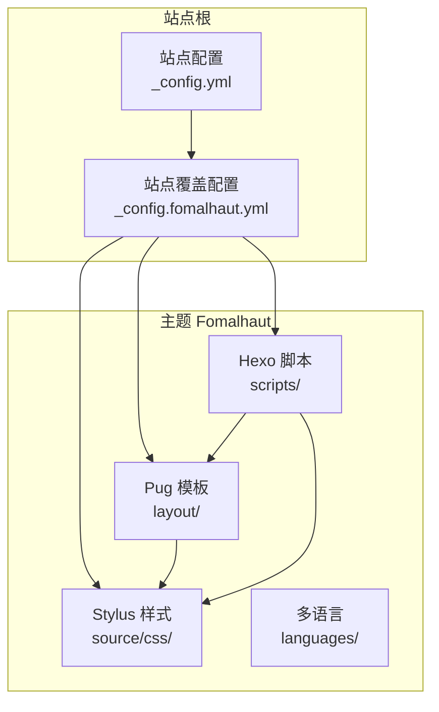
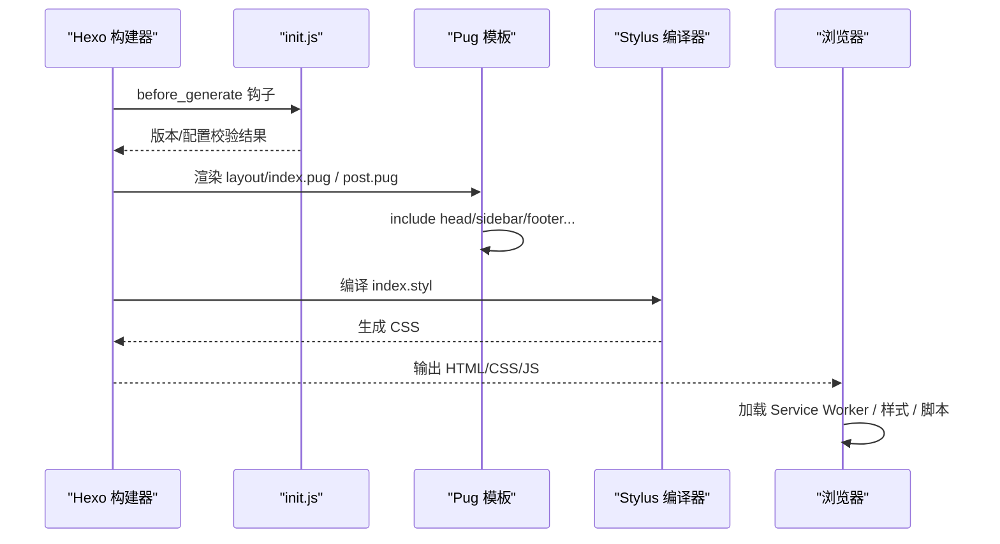
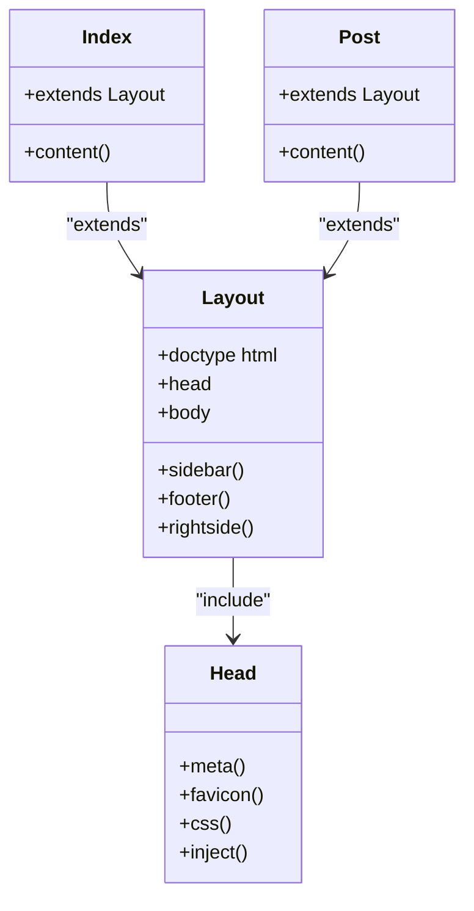
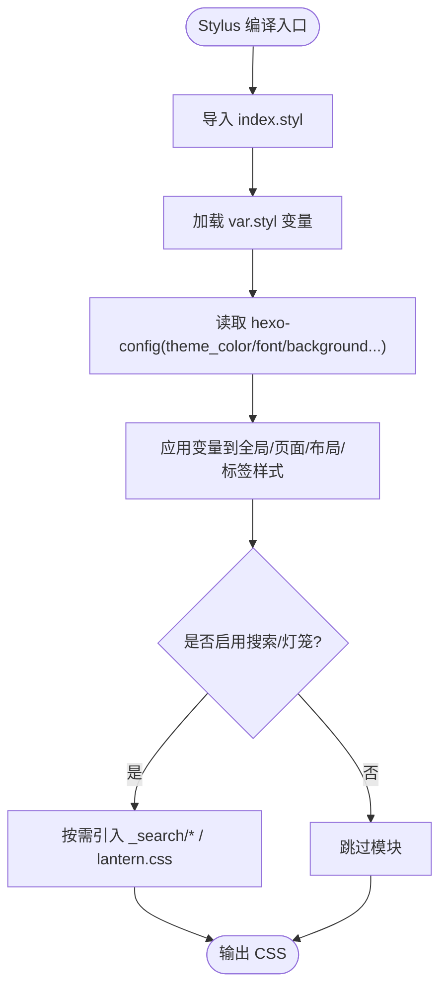
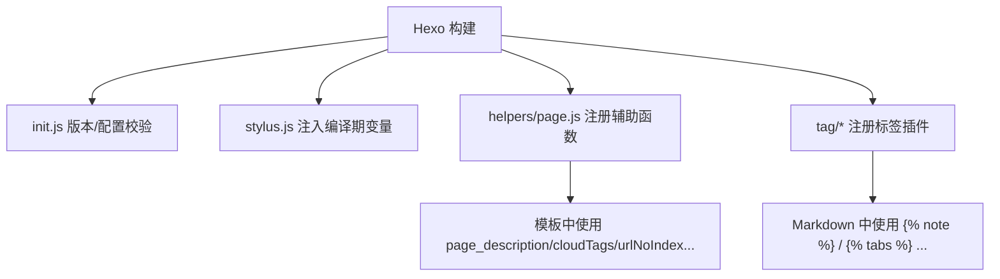
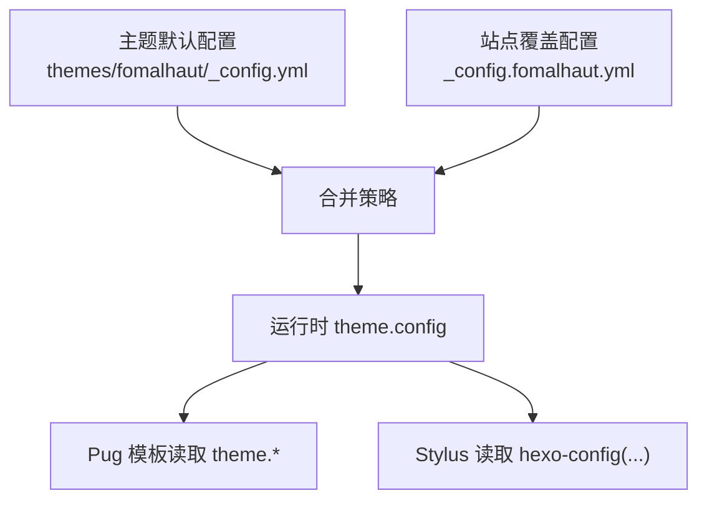
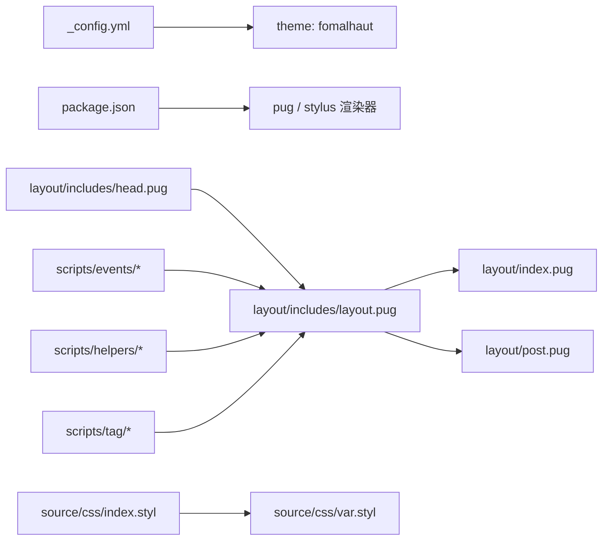

# 主题架构详解

<cite>
**本文引用的文件**   
- [package.json](file://themes/fomalhaut/package.json)
- [_config.yml](file://_config.yml)
- [_config.fomalhaut.yml](file://_config.fomalhaut.yml)
- [themes/fomalhaut/_config.yml](file://themes/fomalhaut/_config.yml)
- [themes/fomalhaut/layout/includes/layout.pug](file://themes/fomalhaut/layout/includes/layout.pug)
- [themes/fomalhaut/layout/index.pug](file://themes/fomalhaut/layout/index.pug)
- [themes/fomalhaut/layout/post.pug](file://themes/fomalhaut/layout/post.pug)
- [themes/fomalhaut/layout/includes/head.pug](file://themes/fomalhaut/layout/includes/head.pug)
- [themes/fomalhaut/source/css/index.styl](file://themes/fomalhaut/source/css/index.styl)
- [themes/fomalhaut/source/css/var.styl](file://themes/fomalhaut/source/css/var.styl)
- [themes/fomalhaut/scripts/events/init.js](file://themes/fomalhaut/scripts/events/init.js)
- [themes/fomalhaut/scripts/events/stylus.js](file://themes/fomalhaut/scripts/events/stylus.js)
- [themes/fomalhaut/scripts/helpers/page.js](file://themes/fomalhaut/scripts/helpers/page.js)
</cite>

## 目录
1. [引言](#引言)
2. [项目结构](#项目结构)
3. [核心组件](#核心组件)
4. [架构总览](#架构总览)
5. [详细组件分析](#详细组件分析)
6. [依赖关系分析](#依赖关系分析)
7. [性能与可维护性](#性能与可维护性)
8. [故障排查指南](#故障排查指南)
9. [结论](#结论)

## 引言
Fomalhaut 是基于 Butterfly 深度二次开发的 Hexo 主题，采用 Pug 模板系统与 Stylus 样式系统，并通过 Hexo 的脚本事件、过滤器、辅助函数和标签插件机制扩展能力。站点根目录的 `_config.fomalhaut.yml` 提供面向用户的配置入口，主题内置默认配置位于 `themes/fomalhaut/_config.yml`，两者共同决定最终渲染行为。本文从架构、目录组织、配置优先级、模板继承、样式变量体系、上游 Butterfly 关系以及“不修改源码即可定制”的方法进行系统化说明。

## 项目结构
Fomalhaut 的主题代码集中在 `themes/fomalhaut/` 下，主要划分为：
- layout/Pug 模板系统：页面骨架、布局继承、局部组件拼装
- source/css/Stylus 样式系统：变量定义、全局样式、页面样式、第三方样式按需引入
- scripts/插件系统：Hexo 事件钩子、过滤器、辅助函数、标签插件
- languages/多语言文案
- source/js 前端资源（由站点或主题注入）

**图示来源**
- [_config.yml:131-131](file://_config.yml#L131-L131)
- [_config.fomalhaut.yml:1-10](file://_config.fomalhaut.yml#L1-L10)
- [themes/fomalhaut/package.json:24-27](file://themes/fomalhaut/package.json#L24-L27)

**章节来源**
- [_config.yml:128-132](file://_config.yml#L128-L132)
- [themes/fomalhaut/package.json:24-27](file://themes/fomalhaut/package.json#L24-L27)

## 核心组件
- 模板系统（Pug）
  - 根布局：`includes/layout.pug` 定义 HTML 骨架、Service Worker 注册、背景层、侧边栏、主体内容区、页脚、右侧工具栏等
  - 页面模板：`index.pug`、`post.pug` 等通过 `extends includes/layout.pug` 继承根布局并填充 `block content`
  - 局部组件：`includes/head.pug`、`includes/header/*`、`includes/widget/*`、`includes/third-party/*` 等按功能拆分
- 样式系统（Stylus）
  - 入口：`source/css/index.styl` 统一导入变量、全局、高亮、页面、布局、标签、模式、自定义样式，并按配置条件引入搜索、灯笼等模块
  - 变量：`source/css/var.styl` 集中定义颜色、字体、尺寸、组件默认值，支持从 `theme_color`、`font`、`background` 等配置项注入
- 脚本系统（Hexo）
  - 事件：`scripts/events/init.js` 校验 Hexo 版本与弃用配置；`scripts/events/stylus.js` 向 Stylus 编译期暴露 highlight/prismjs 开关
  - 辅助函数：`scripts/helpers/page.js` 提供 SEO 描述、云标签、URL 规范化、MD5、HTML 注入、归档标题查找等
  - 标签插件：`scripts/tag/*` 提供 note/tabs/gallery 等 Markdown 增强标签
- 配置机制
  - 主题默认配置：`themes/fomalhaut/_config.yml`
  - 站点覆盖配置：`_config.fomalhaut.yml`（推荐），同时保留旧版兼容检查

**章节来源**
- [themes/fomalhaut/layout/includes/layout.pug:1-127](file://themes/fomalhaut/layout/includes/layout.pug#L1-L127)
- [themes/fomalhaut/layout/index.pug:1-11](file://themes/fomalhaut/layout/index.pug#L1-L11)
- [themes/fomalhaut/layout/post.pug:1-36](file://themes/fomalhaut/layout/post.pug#L1-L36)
- [themes/fomalhaut/layout/includes/head.pug:1-79](file://themes/fomalhaut/layout/includes/head.pug#L1-L79)
- [themes/fomalhaut/source/css/index.styl:1-26](file://themes/fomalhaut/source/css/index.styl#L1-L26)
- [themes/fomalhaut/source/css/var.styl:1-185](file://themes/fomalhaut/source/css/var.styl#L1-L185)
- [themes/fomalhaut/scripts/events/init.js:1-22](file://themes/fomalhaut/scripts/events/init.js#L1-L22)
- [themes/fomalhaut/scripts/events/stylus.js:1-16](file://themes/fomalhaut/scripts/events/stylus.js#L1-L16)
- [themes/fomalhaut/scripts/helpers/page.js:1-99](file://themes/fomalhaut/scripts/helpers/page.js#L1-L99)

## 架构总览
Fomalhaut 的构建与渲染流程如下：
- Hexo 启动后加载主题，读取站点配置 `_config.yml` 与主题覆盖配置 `_config.fomalhaut.yml`
- 主题在 `before_generate` 阶段执行初始化校验（如 Hexo 版本、弃用配置）
- 模板引擎渲染 Pug 模板，组合 head、header、main、aside、footer、third-party 等局部
- Stylus 编译时根据配置注入变量与条件样式
- 最终输出静态页面，浏览器加载 JS/CSS 资源

**图示来源**
- [themes/fomalhaut/scripts/events/init.js:3-21](file://themes/fomalhaut/scripts/events/init.js#L3-L21)
- [themes/fomalhaut/layout/includes/layout.pug:7-25](file://themes/fomalhaut/layout/includes/layout.pug#L7-L25)
- [themes/fomalhaut/source/css/index.styl:1-26](file://themes/fomalhaut/source/css/index.styl#L1-L26)

## 详细组件分析

### 模板继承与页面组装
- 根布局 `includes/layout.pug`
  - 设置 `<html>` 的语言、主题模式、侧边栏隐藏类名
  - 注册 Service Worker（本地开发自动注销，生产环境注册并提示安装）
  - 根据配置决定是否显示预加载动画、背景层、侧边栏、页脚
  - 非 404 页面渲染 header、main、widget、footer、rightside、search、rightmenu、additional-js
- 页面模板
  - `index.pug`：继承根布局，使用 mixin 渲染文章列表，包含分页
  - `post.pug`：继承根布局，渲染文章内容、版权、标签、打赏、分页、相关推荐、评论
- 头部 `includes/head.pug`
  - 动态生成标题、关键词、作者、主题色 meta
  - 引入 favicon、canonical、预连接、站点验证、PWA、主 CSS、Font Awesome、Snackbar、Fancybox、广告、统计、字体、全局配置、noscript、注入脚本与 HTML

**图示来源**
- [themes/fomalhaut/layout/includes/layout.pug:1-127](file://themes/fomalhaut/layout/includes/layout.pug#L1-L127)
- [themes/fomalhaut/layout/index.pug:1-11](file://themes/fomalhaut/layout/index.pug#L1-L11)
- [themes/fomalhaut/layout/post.pug:1-36](file://themes/fomalhaut/layout/post.pug#L1-L36)
- [themes/fomalhaut/layout/includes/head.pug:1-79](file://themes/fomalhaut/layout/includes/head.pug#L1-L79)

**章节来源**
- [themes/fomalhaut/layout/includes/layout.pug:1-127](file://themes/fomalhaut/layout/includes/layout.pug#L1-L127)
- [themes/fomalhaut/layout/index.pug:1-11](file://themes/fomalhaut/layout/index.pug#L1-L11)
- [themes/fomalhaut/layout/post.pug:1-36](file://themes/fomalhaut/layout/post.pug#L1-L36)
- [themes/fomalhaut/layout/includes/head.pug:1-79](file://themes/fomalhaut/layout/includes/head.pug#L1-L79)

### 样式系统与变量体系
- 入口 `index.styl`
  - 条件引入 normalize、变量、全局、高亮、页面、布局、标签、模式、自定义样式
  - 根据配置条件引入 Algolia/Local Search、灯笼等模块
- 变量 `var.styl`
  - 主题色、链接色、滚动条色、引用块色、按钮色、搜索高亮、Note/Tabs/Timeline 等组件默认值
  - 字体族、字号、行高、背景图、顶部图高度、侧边栏宽度等全局变量
  - 所有变量均优先读取 `hexo-config('theme_color.*')`、`hexo-config('font.*')`、`hexo-config('background.*')` 等站点覆盖配置

**图示来源**
- [themes/fomalhaut/source/css/index.styl:1-26](file://themes/fomalhaut/source/css/index.styl#L1-L26)
- [themes/fomalhaut/source/css/var.styl:1-185](file://themes/fomalhaut/source/css/var.styl#L1-L185)

**章节来源**
- [themes/fomalhaut/source/css/index.styl:1-26](file://themes/fomalhaut/source/css/index.styl#L1-L26)
- [themes/fomalhaut/source/css/var.styl:1-185](file://themes/fomalhaut/source/css/var.styl#L1-L185)

### 脚本系统与插件机制
- 事件钩子
  - `scripts/events/init.js`：在 `before_generate` 中检查 Hexo 版本不低于 5.3，并拒绝使用已弃用的 `butterfly.yml`
  - `scripts/events/stylus.js`：向 Stylus 暴露 `$highlight_enable`、`$highlight_line_number`、`$prismjs_enable`、`$prismjs_line_number` 等编译期变量
- 辅助函数
  - `scripts/helpers/page.js`：提供 `page_description`、`cloudTags`、`urlNoIndex`、`md5`、`injectHtml`、`findArchivesTitle` 等
- 标签插件
  - `scripts/tag/*`：note、tabs、gallery、timeline、button、hide、inlineImg、label、mermaid 等

**图示来源**
- [themes/fomalhaut/scripts/events/init.js:3-21](file://themes/fomalhaut/scripts/events/init.js#L3-L21)
- [themes/fomalhaut/scripts/events/stylus.js:7-15](file://themes/fomalhaut/scripts/events/stylus.js#L7-L15)
- [themes/fomalhaut/scripts/helpers/page.js:13-99](file://themes/fomalhaut/scripts/helpers/page.js#L13-L99)

**章节来源**
- [themes/fomalhaut/scripts/events/init.js:1-22](file://themes/fomalhaut/scripts/events/init.js#L1-L22)
- [themes/fomalhaut/scripts/events/stylus.js:1-16](file://themes/fomalhaut/scripts/events/stylus.js#L1-L16)
- [themes/fomalhaut/scripts/helpers/page.js:1-99](file://themes/fomalhaut/scripts/helpers/page.js#L1-L99)

### 配置机制与优先级
- 默认配置：`themes/fomalhaut/_config.yml`
- 站点覆盖配置：`_config.fomalhaut.yml`（推荐）
- 兼容性检查：`scripts/events/init.js` 会检测并拒绝使用已弃用的 `butterfly.yml`
- 典型覆盖项示例
  - 导航菜单、社交图标、搜索（Algolia/Local）、数学公式（MathJax/KaTeX）、图片与封面、文章元信息、目录、分享、评论系统、聊天服务、页脚、分析、广告、站点验证、美化效果、字体、背景、侧边栏卡片、右下角按钮、灯箱、标签插件、Pjax、音乐、通知、预取等
- 主题与站点的职责边界
  - 主题默认配置提供完整字段与注释
  - 站点覆盖配置仅声明需要变更的键，未声明的键沿用主题默认值

**图示来源**
- [themes/fomalhaut/_config.yml:1-20](file://themes/fomalhaut/_config.yml#L1-L20)
- [_config.fomalhaut.yml:1-20](file://_config.fomalhaut.yml#L1-L20)
- [themes/fomalhaut/scripts/events/init.js:13-20](file://themes/fomalhaut/scripts/events/init.js#L13-L20)

**章节来源**
- [themes/fomalhaut/_config.yml:1-20](file://themes/fomalhaut/_config.yml#L1-L20)
- [_config.fomalhaut.yml:1-20](file://_config.fomalhaut.yml#L1-L20)
- [themes/fomalhaut/scripts/events/init.js:13-20](file://themes/fomalhaut/scripts/events/init.js#L13-L20)

### 与上游 Butterfly 的关系
- 主题定位：基于 Butterfly 的深度二次开发，保留其配置结构与部分约定，同时增加自身特性（如卡片式 UI、多线路分流、PWA、美化面板、全站自定义注入）
- 兼容性保护：通过 `scripts/events/init.js` 明确拒绝使用已弃用的 `butterfly.yml`，引导用户迁移至 `_config.fomalhaut.yml`
- 升级建议：优先通过站点覆盖配置调整行为，避免直接修改主题源码，以便后续升级主题时减少冲突

**章节来源**
- [themes/fomalhaut/package.json:2-5](file://themes/fomalhaut/package.json#L2-L5)
- [themes/fomalhaut/scripts/events/init.js:13-20](file://themes/fomalhaut/scripts/events/init.js#L13-L20)

### 不修改源码的定制方法
- 外观与主题色
  - 通过 `_config.fomalhaut.yml` 的 `theme_color.*` 覆盖主色、链接色、滚动条色、引用块色、按钮悬停色等
  - 通过 `font.*`、`blog_title_font.*`、`background.*` 覆盖字体与背景
- 内容与展示
  - 通过 `menu`、`social`、`cover.*`、`post_meta.*`、`toc.*`、`related_post.*`、`comments.use` 等控制导航、社交、封面、文章元信息、目录、相关推荐、评论系统
- 功能开关
  - 通过 `algolia_search`、`local_search`、`mathjax`、`katex`、`sharejs`、`pjax`、`snackbar`、`preloader`、`lantern`、`ai_chat` 等开关控制功能
- 注入与扩展
  - 使用 `inject.head`、`inject.bottom` 注入外部 CSS/JS
  - 使用 `scripts/tag/*` 新增 Markdown 标签，使用 `scripts/helpers/*` 新增辅助函数，使用 `scripts/events/*` 扩展构建流程
- 样式覆盖
  - 在 `source/css/_custom/custom.css` 追加覆盖规则，或使用 `source/css/_custom/lantern.css` 等按模块覆盖

**章节来源**
- [_config.fomalhaut.yml:1-20](file://_config.fomalhaut.yml#L1-L20)
- [_config.fomalhaut.yml:460-520](file://_config.fomalhaut.yml#L460-L520)
- [_config.fomalhaut.yml:754-800](file://_config.fomalhaut.yml#L754-L800)
- [_config.fomalhaut.yml:1547-1568](file://_config.fomalhaut.yml#L1547-L1568)
- [themes/fomalhaut/source/css/index.styl:1-26](file://themes/fomalhaut/source/css/index.styl#L1-L26)

## 依赖关系分析
- 主题依赖 Hexo 渲染器：`hexo-renderer-pug`、`hexo-renderer-stylus`
- 站点根 `_config.yml` 指定主题名为 `fomalhaut`
- 主题内部依赖关系
  - `layout/includes/layout.pug` 被 `index.pug`、`post.pug` 继承
  - `layout/includes/head.pug` 被 `layout.pug` 引入
  - `source/css/index.styl` 聚合所有样式模块
  - `scripts/events/*`、`scripts/helpers/*`、`scripts/tag/*` 为模板与样式提供数据与逻辑支撑

**图示来源**
- [_config.yml:131-131](file://_config.yml#L131-L131)
- [themes/fomalhaut/package.json:24-27](file://themes/fomalhaut/package.json#L24-L27)
- [themes/fomalhaut/layout/includes/layout.pug:1-127](file://themes/fomalhaut/layout/includes/layout.pug#L1-L127)
- [themes/fomalhaut/layout/index.pug:1-11](file://themes/fomalhaut/layout/index.pug#L1-L11)
- [themes/fomalhaut/layout/post.pug:1-36](file://themes/fomalhaut/layout/post.pug#L1-L36)
- [themes/fomalhaut/layout/includes/head.pug:1-79](file://themes/fomalhaut/layout/includes/head.pug#L1-L79)
- [themes/fomalhaut/source/css/index.styl:1-26](file://themes/fomalhaut/source/css/index.styl#L1-L26)
- [themes/fomalhaut/source/css/var.styl:1-185](file://themes/fomalhaut/source/css/var.styl#L1-L185)

**章节来源**
- [_config.yml:128-132](file://_config.yml#L128-L132)
- [themes/fomalhaut/package.json:24-27](file://themes/fomalhaut/package.json#L24-L27)

## 性能与可维护性
- 构建期优化
  - 通过 `stylus:renderer` 暴露 highlight/prismjs 开关，避免不必要的样式编译
  - 通过 `fragment_cache` 缓存注入的头部脚本与 HTML，减少重复计算
- 运行期优化
  - Service Worker 在生产环境注册以提升缓存与离线体验
  - 按需引入第三方样式与脚本（如搜索、灯笼）
- 可维护性
  - 模板按功能拆分为 includes 局部，便于定位与维护
  - 样式变量集中管理，便于统一换肤与主题色定制
  - 配置分层清晰，站点覆盖配置与主题默认配置分离，降低升级冲突风险

[本节为通用指导，无需具体文件引用]

## 故障排查指南
- 构建失败或报错
  - 确认 Hexo 版本不低于 5.3；若低于该版本，`scripts/events/init.js` 会主动终止构建
  - 若仍在使用 `butterfly.yml`，会被拒绝；请迁移至 `_config.fomalhaut.yml`
- 样式异常
  - 检查 `source/css/index.styl` 是否正确引入 `var.styl` 与所需模块
  - 检查 `_config.fomalhaut.yml` 中的 `theme_color.*`、`font.*`、`background.*` 是否语法正确
- 功能未生效
  - 检查对应开关是否开启（如 `algolia_search.enable`、`local_search.enable`、`mathjax.enable`、`comments.use`、`pjax.enable`、`lantern.enable`、`ai_chat.enable`）
  - 检查是否在 `inject.head` 或 `inject.bottom` 中注入了必要的脚本或样式
- 模板变量不生效
  - 确认模板中读取的是 `theme.*`，而非直接读取站点配置
  - 确认相关配置已在 `_config.fomalhaut.yml` 中声明

**章节来源**
- [themes/fomalhaut/scripts/events/init.js:3-21](file://themes/fomalhaut/scripts/events/init.js#L3-L21)
- [themes/fomalhaut/source/css/index.styl:1-26](file://themes/fomalhaut/source/css/index.styl#L1-L26)
- [themes/fomalhaut/source/css/var.styl:1-185](file://themes/fomalhaut/source/css/var.styl#L1-L185)

## 结论
Fomalhaut 以清晰的目录划分、完善的模板继承与组件化设计、集中的样式变量体系以及灵活的脚本扩展机制，提供了高可定制性与良好可维护性的 Hexo 主题。通过站点覆盖配置 `_config.fomalhaut.yml`，可以在不修改主题源码的前提下完成绝大多数定制需求。与上游 Butterfly 保持兼容的同时，主题通过版本与弃用配置检查确保构建安全。建议在升级主题时优先使用覆盖配置与自定义注入，避免直接修改主题源码，以获得更平滑的演进路径。