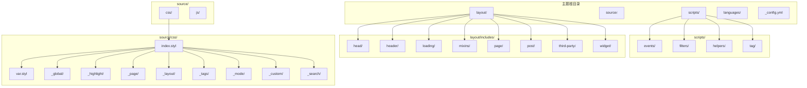
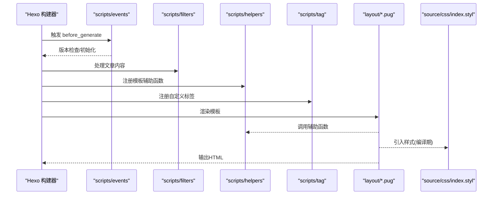
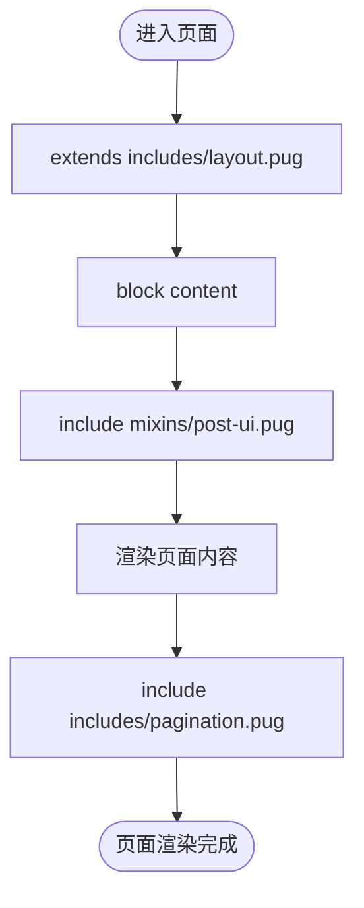
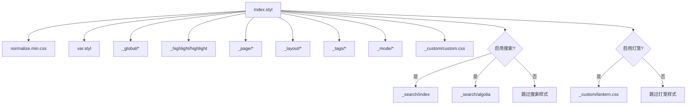
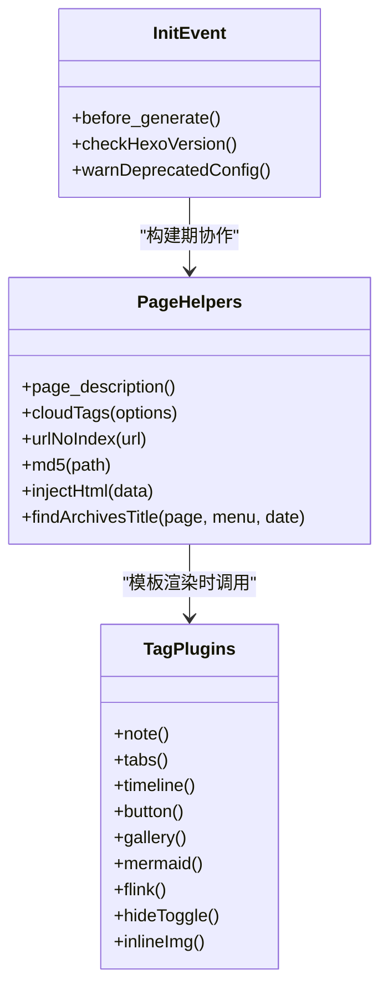
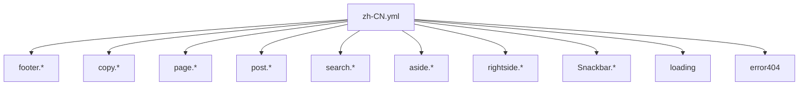
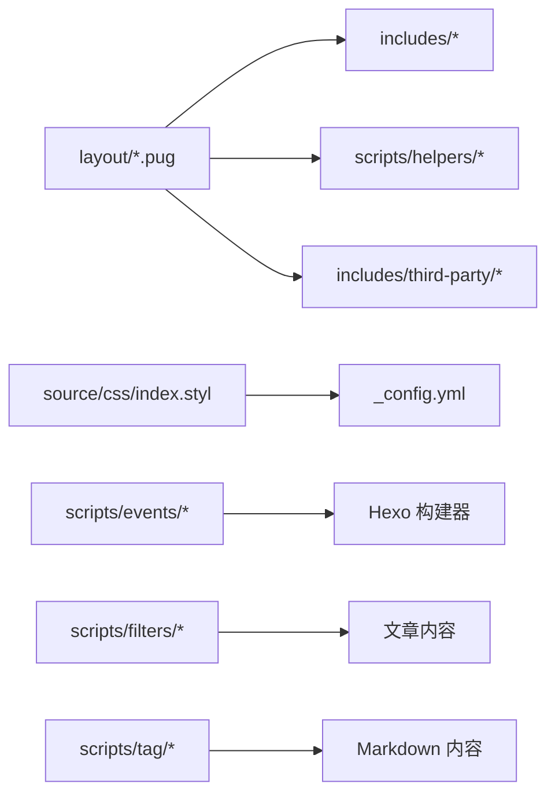
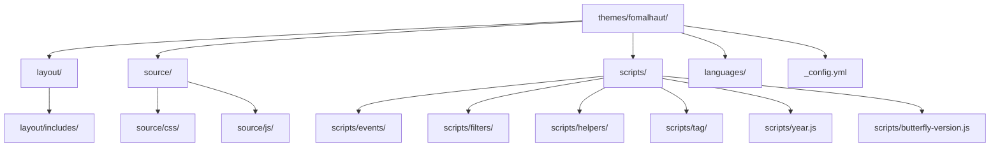

# 主题目录结构

<cite>
**本文引用的文件**   
- [themes/fomalhaut/README.md](file://themes/fomalhaut/README.md)
- [themes/fomalhaut/_config.yml](file://themes/fomalhaut/_config.yml)
- [themes/fomalhaut/layout/index.pug](file://themes/fomalhaut/layout/index.pug)
- [themes/fomalhaut/layout/post.pug](file://themes/fomalhaut/layout/post.pug)
- [themes/fomalhaut/source/css/index.styl](file://themes/fomalhaut/source/css/index.styl)
- [themes/fomalhaut/scripts/events/init.js](file://themes/fomalhaut/scripts/events/init.js)
- [themes/fomalhaut/scripts/helpers/page.js](file://themes/fomalhaut/scripts/helpers/page.js)
- [themes/fomalhaut/languages/zh-CN.yml](file://themes/fomalhaut/languages/zh-CN.yml)
</cite>

## 目录
1. [引言](#引言)
2. [项目结构总览](#项目结构总览)
3. [核心目录与职责](#核心目录与职责)
4. [架构总览](#架构总览)
5. [详细组件分析](#详细组件分析)
6. [依赖关系分析](#依赖关系分析)
7. [性能与构建特性](#性能与构建特性)
8. [常见问题与排错](#常见问题与排错)
9. [结论](#结论)
10. [附录：目录树与最佳实践](#附录目录树与最佳实践)

## 引言
本文件聚焦 Fomalhaut 主题的目录结构与组织方式，重点说明 themes/fomalhaut/ 下 layout（Pug 模板）、source/css（Stylus 样式）、scripts（插件脚本）、languages（多语言）等子目录的职责、包含的文件类型以及相互依赖关系。文档同时提供目录树图与文件组织最佳实践，帮助读者快速定位并扩展主题功能。

## 项目结构总览
Fomalhaut 主题基于 Hexo 的 theme 机制，采用“模板 + 样式 + 脚本 + 配置 + 多语言”的分层组织方式：
- layout：页面级 Pug 模板与可复用 includes 组件
- source/css：Stylus 样式入口与模块化样式
- scripts：Hexo 生命周期事件、过滤器、模板助手、自定义标签
- languages：多语言文案
- _config.yml：主题默认配置（被站点根目录的 _config.fomalhaut.yml 覆盖）

图表来源
- [themes/fomalhaut/layout/index.pug:1-11](file://themes/fomalhaut/layout/index.pug#L1-L11)
- [themes/fomalhaut/source/css/index.styl:1-26](file://themes/fomalhaut/source/css/index.styl#L1-L26)
- [themes/fomalhaut/scripts/events/init.js:1-22](file://themes/fomalhaut/scripts/events/init.js#L1-L22)
- [themes/fomalhaut/scripts/helpers/page.js:1-99](file://themes/fomalhaut/scripts/helpers/page.js#L1-L99)

章节来源
- [themes/fomalhaut/README.md:7-20](file://themes/fomalhaut/README.md#L7-L20)

## 核心目录与职责
- layout/Pug 模板
  - 作用：定义首页、文章页、归档、分类、标签、通用页面等页面骨架，并通过 includes/ 复用头部、侧边栏、分页、第三方组件等片段。
  - 关键文件：index.pug、post.pug、page.pug、archive.pug、category.pug、tag.pug；includes/ 下的 head、header、loading、mixins、page、post、third-party、widget 等。
  - 典型行为：extends includes/layout.pug，block content 注入页面内容，include/partial 引用组件。

- source/css/Stylus 样式
  - 作用：统一入口 index.styl 聚合全局变量、基础样式、高亮、页面样式、布局、标签样式、模式切换、搜索、自定义样式等。
  - 关键文件：index.styl、var.styl；_global、_highlight、_page、_layout、_tags、_mode、_search、_custom 等模块。
  - 典型行为：根据 hexo-config() 条件导入 Algolia/本地搜索、灯笼等可选样式。

- scripts/插件脚本
  - events：在构建生命周期钩子中执行初始化、版本检查、CDN 预解析、评论初始化等。
  - filters：构建期过滤器，如图片懒加载、随机封面。
  - helpers：模板辅助函数，如 page_description、cloudTags、md5、injectHtml、findArchivesTitle 等。
  - tag：自定义 Hexo 标签渲染逻辑，如 note、tabs、timeline、button、gallery、mermaid、flink、hideToggle、inlineImg 等。

- languages/多语言文件
  - 作用：集中管理界面文案，支持 zh-CN、zh-TW、en、default 等语言包。
  - 使用方式：模板或脚本通过 i18n API 读取对应键值，实现界面文本国际化。

- _config.yml 主题默认配置
  - 作用：提供菜单、代码高亮、社交、搜索、数学公式、图片、文章元信息、分享、评论、聊天、页脚、分析、广告、美化、字体、侧边栏、灯箱、标签插件、Pjax、Snackbar 等大量开关与参数。
  - 覆盖规则：站点根目录的 _config.fomalhaut.yml 会覆盖该默认配置。

章节来源
- [themes/fomalhaut/layout/index.pug:1-11](file://themes/fomalhaut/layout/index.pug#L1-L11)
- [themes/fomalhaut/layout/post.pug:1-36](file://themes/fomalhaut/layout/post.pug#L1-L36)
- [themes/fomalhaut/source/css/index.styl:1-26](file://themes/fomalhaut/source/css/index.styl#L1-L26)
- [themes/fomalhaut/scripts/events/init.js:1-22](file://themes/fomalhaut/scripts/events/init.js#L1-L22)
- [themes/fomalhaut/scripts/helpers/page.js:1-99](file://themes/fomalhaut/scripts/helpers/page.js#L1-L99)
- [themes/fomalhaut/languages/zh-CN.yml:1-124](file://themes/fomalhaut/languages/zh-CN.yml#L1-L124)
- [themes/fomalhaut/_config.yml:1-800](file://themes/fomalhaut/_config.yml#L1-L800)

## 架构总览
Fomalhaut 的主题运行流程可以概括为：
- 构建阶段：scripts/events 注册 before_generate 钩子进行环境校验与初始化；scripts/filters 对内容进行预处理；scripts/helpers 向模板暴露辅助方法；scripts/tag 注册自定义标签。
- 渲染阶段：layout/*.pug 作为页面模板，组合 includes/* 组件，调用 helpers 提供的数据与方法，最终输出 HTML。
- 样式阶段：source/css/index.styl 作为 Stylus 入口，按条件引入各模块样式，生成最终 CSS。
- 运行时：浏览器加载生成的 HTML/CSS/JS，结合 languages 文案与用户交互逻辑完成页面展示。

图表来源
- [themes/fomalhaut/scripts/events/init.js:1-22](file://themes/fomalhaut/scripts/events/init.js#L1-L22)
- [themes/fomalhaut/scripts/helpers/page.js:1-99](file://themes/fomalhaut/scripts/helpers/page.js#L1-L99)
- [themes/fomalhaut/source/css/index.styl:1-26](file://themes/fomalhaut/source/css/index.styl#L1-L26)
- [themes/fomalhaut/layout/index.pug:1-11](file://themes/fomalhaut/layout/index.pug#L1-L11)

## 详细组件分析

### layout/Pug 模板
- 页面模板
  - index.pug：继承 includes/layout.pug，注入 postUI 混入与分页。
  - post.pug：继承 includes/layout.pug，渲染文章内容、版权、标签、打赏、广告、分页、相关推荐与评论。
- 组件 includes
  - head/header：站点头信息与导航、菜单项、社交图标等。
  - loading：多种加载动画风格与 JS 注入。
  - mixins：post-ui、article-sort 等可复用逻辑。
  - page：分类、标签、友情链接、重定向等页面组件。
  - post：文章版权、打赏等。
  - third-party：评论、分享、数学公式、PrismJS、Pjax、字幕等第三方集成。
  - widget：侧边栏卡片（作者、公告、最近文章、分类、标签、归档、友链、最新评论、目录、网站信息等）。

图表来源
- [themes/fomalhaut/layout/index.pug:1-11](file://themes/fomalhaut/layout/index.pug#L1-L11)

章节来源
- [themes/fomalhaut/layout/index.pug:1-11](file://themes/fomalhaut/layout/index.pug#L1-L11)
- [themes/fomalhaut/layout/post.pug:1-36](file://themes/fomalhaut/layout/post.pug#L1-L36)

### source/css/Stylus 样式
- 入口 index.styl
  - 条件导入 normalize、全局变量 var.styl、_global/*、高亮样式、页面样式、布局样式、标签样式、模式样式、自定义样式。
  - 条件导入搜索模块（Algolia/本地搜索）与灯笼样式。
- 模块划分
  - _global：全局函数与基础样式。
  - _highlight：代码高亮主题与 PrismJS 样式。
  - _page：各页面专属样式（首页、归档、分类、标签、404、友链等）。
  - _layout：布局相关（侧边栏、页脚、分页、评论、右侧工具栏等）。
  - _tags：自定义标签样式（按钮、画廊、笔记、标签云、时间线等）。
  - _mode：深色/阅读模式等。
  - _search：搜索 UI 与交互样式。
  - _custom：用户自定义样式与灯笼特效。

图表来源
- [themes/fomalhaut/source/css/index.styl:1-26](file://themes/fomalhaut/source/css/index.styl#L1-L26)

章节来源
- [themes/fomalhaut/source/css/index.styl:1-26](file://themes/fomalhaut/source/css/index.styl#L1-L26)

### scripts/插件脚本
- events/init.js
  - 在 before_generate 钩子中检查 Hexo 版本，要求不低于 5.3；检测并提示弃用的 butterfly.yml，强制迁移到 _config.fomalhaut.yml。
- helpers/page.js
  - 提供 page_description、cloudTags、urlNoIndex、md5、injectHtml、findArchivesTitle 等模板辅助函数，用于生成描述、标签云、URL 规范化、缓存指纹、注入 HTML、归档标题等。
- tag/*
  - 注册自定义标签渲染逻辑，如 note、tabs、timeline、button、gallery、mermaid、flink、hideToggle、inlineImg 等，供 Markdown 中使用。
- filters/*
  - 构建期过滤器，如图片懒加载、随机封面，优化内容与资源。

图表来源
- [themes/fomalhaut/scripts/events/init.js:1-22](file://themes/fomalhaut/scripts/events/init.js#L1-L22)
- [themes/fomalhaut/scripts/helpers/page.js:1-99](file://themes/fomalhaut/scripts/helpers/page.js#L1-L99)

章节来源
- [themes/fomalhaut/scripts/events/init.js:1-22](file://themes/fomalhaut/scripts/events/init.js#L1-L22)
- [themes/fomalhaut/scripts/helpers/page.js:1-99](file://themes/fomalhaut/scripts/helpers/page.js#L1-L99)

### languages/多语言文件
- 文件组织
  - zh-CN.yml、zh-TW.yml、en.yml、default.yml 分别提供简体中文、繁体中文、英文与默认语言包。
- 常用键值
  - footer、copy、page、post、search、pagination、aside、rightside、Snackbar、loading、error404 等分组键，涵盖页脚、复制、页面标题、文章元信息、搜索、分页、侧边栏、右侧工具栏、提示框、加载与错误文案。
- 使用方式
  - 模板或脚本通过 i18n API 读取对应键值，实现界面文本国际化。

图表来源
- [themes/fomalhaut/languages/zh-CN.yml:1-124](file://themes/fomalhaut/languages/zh-CN.yml#L1-L124)

章节来源
- [themes/fomalhaut/languages/zh-CN.yml:1-124](file://themes/fomalhaut/languages/zh-CN.yml#L1-L124)

### _config.yml 主题默认配置
- 主要配置分组
  - 菜单、代码高亮、复制、社交、搜索（Algolia/本地）、数学公式（MathJax/KaTeX）、图片与封面、404、文章元信息、字数统计、目录、版权声明、打赏、编辑、相关文章、分页、过期提醒、分享系统、评论系统、聊天服务、页脚、分析、广告、站点验证、美化效果、字体、分隔线、副标题、加载动画、侧边栏、访问统计、运行时间、最新评论、右侧工具栏、灯箱、标签插件、Pjax、aplayerInject、Snackbar、预加载等。
- 覆盖机制
  - 站点根目录的 _config.fomalhaut.yml 会覆盖该默认配置，主题 README 明确说明不要直接修改主题内的 _config.yml。

章节来源
- [themes/fomalhaut/_config.yml:1-800](file://themes/fomalhaut/_config.yml#L1-L800)
- [themes/fomalhaut/README.md:33-36](file://themes/fomalhaut/README.md#L33-L36)

## 依赖关系分析
- 模板与组件
  - layout/*.pug 依赖 includes/* 组件，尤其是 includes/layout.pug、includes/mixins/*、includes/widget/*、includes/third-party/*。
- 模板与脚本
  - layout/*.pug 通过 partial/include 调用 includes 组件，并在 post.pug 中调用 related_posts 等由 helpers 提供的辅助函数。
- 样式与配置
  - source/css/index.styl 通过 hexo-config() 读取主题配置，按需引入搜索与灯笼样式。
- 构建与生命周期
  - scripts/events/init.js 在 before_generate 钩子中执行环境检查与配置迁移提示。
  - scripts/helpers/page.js 向模板暴露辅助函数，供模板渲染时使用。
  - scripts/tag/* 注册自定义标签，供 Markdown 使用。

图表来源
- [themes/fomalhaut/layout/post.pug:1-36](file://themes/fomalhaut/layout/post.pug#L1-L36)
- [themes/fomalhaut/source/css/index.styl:1-26](file://themes/fomalhaut/source/css/index.styl#L1-L26)
- [themes/fomalhaut/scripts/events/init.js:1-22](file://themes/fomalhaut/scripts/events/init.js#L1-L22)

章节来源
- [themes/fomalhaut/layout/post.pug:1-36](file://themes/fomalhaut/layout/post.pug#L1-L36)
- [themes/fomalhaut/source/css/index.styl:1-26](file://themes/fomalhaut/source/css/index.styl#L1-L26)
- [themes/fomalhaut/scripts/events/init.js:1-22](file://themes/fomalhaut/scripts/events/init.js#L1-L22)

## 性能与构建特性
- 条件样式加载
  - 通过 hexo-config() 控制是否引入搜索与灯笼样式，减少不必要的 CSS 体积。
- 构建期优化
  - filters/* 提供图片懒加载与随机封面，有助于提升首屏加载体验。
- 模板辅助函数
  - helpers/page.js 提供 md5 等工具，可用于资源指纹与缓存策略。
- 版本与环境检查
  - events/init.js 强制最低 Hexo 版本，避免兼容性问题导致的性能退化。

[本节为通用指导，不直接分析具体文件]

## 常见问题与排错
- 版本过低导致构建失败
  - 现象：构建时报错并要求升级 Hexo。
  - 原因：events/init.js 检查 Hexo 版本低于 5.3。
  - 解决：升级 Hexo 至 5.3.0 或更高版本。
- 配置文件未生效
  - 现象：修改 themes/fomalhaut/_config.yml 后不生效。
  - 原因：主题默认配置会被站点根目录的 _config.fomalhaut.yml 覆盖。
  - 解决：在站点根目录创建或修改 _config.fomalhaut.yml。
- 旧配置名警告
  - 现象：构建时报 butterfly.yml 已弃用。
  - 原因：init.js 检测到 butterfly.yml 并提示迁移。
  - 解决：将配置迁移到 _config.fomalhaut.yml。

章节来源
- [themes/fomalhaut/scripts/events/init.js:1-22](file://themes/fomalhaut/scripts/events/init.js#L1-L22)
- [themes/fomalhaut/README.md:33-36](file://themes/fomalhaut/README.md#L33-L36)

## 结论
Fomalhaut 主题以清晰的目录分层与模块化组织，将模板、样式、脚本与多语言解耦，便于维护与扩展。layout 负责页面骨架与组件复用，source/css 通过 Stylus 入口统一管理样式模块，scripts 提供构建期与运行时能力，languages 集中管理文案，_config.yml 提供丰富且可覆盖的配置项。遵循本文的组织规范与最佳实践，可高效定制与扩展主题功能。

[本节为总结性内容，不直接分析具体文件]

## 附录：目录树与最佳实践

### 目录树图

图表来源
- [themes/fomalhaut/layout/index.pug:1-11](file://themes/fomalhaut/layout/index.pug#L1-L11)
- [themes/fomalhaut/source/css/index.styl:1-26](file://themes/fomalhaut/source/css/index.styl#L1-L26)
- [themes/fomalhaut/scripts/events/init.js:1-22](file://themes/fomalhaut/scripts/events/init.js#L1-L22)
- [themes/fomalhaut/scripts/helpers/page.js:1-99](file://themes/fomalhaut/scripts/helpers/page.js#L1-L99)
- [themes/fomalhaut/languages/zh-CN.yml:1-124](file://themes/fomalhaut/languages/zh-CN.yml#L1-L124)

### 文件组织最佳实践
- 模板
  - 页面模板尽量薄，业务逻辑下沉到 includes 与 helpers。
  - 使用 mixins 封装重复逻辑，保持模板可读性。
- 样式
  - 通过 index.styl 统一入口，按模块拆分样式文件，避免全局污染。
  - 使用 hexo-config() 条件导入，按需加载样式，减小体积。
- 脚本
  - events 仅做环境检查与初始化；filters 做内容预处理；helpers 提供模板辅助；tag 注册自定义标签。
  - 避免在模板中直接写复杂逻辑，优先使用 helpers。
- 多语言
  - 所有用户可见文案放入 languages/*，新增文案时同步补充默认语言包。
- 配置
  - 不在主题内修改 _config.yml，使用站点根目录的 _config.fomalhaut.yml 覆盖默认配置。

[本节为通用指导，不直接分析具体文件]