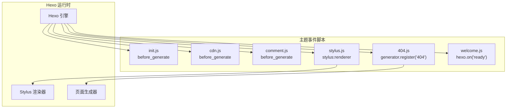
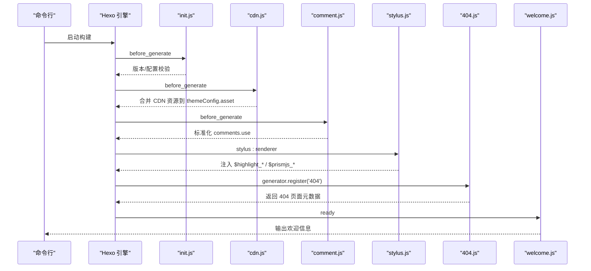
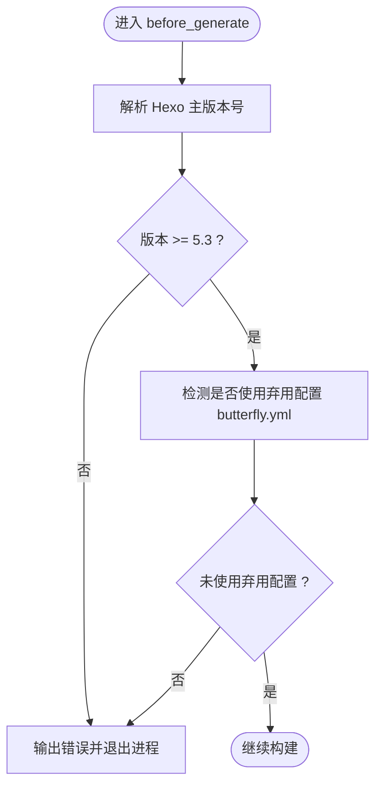
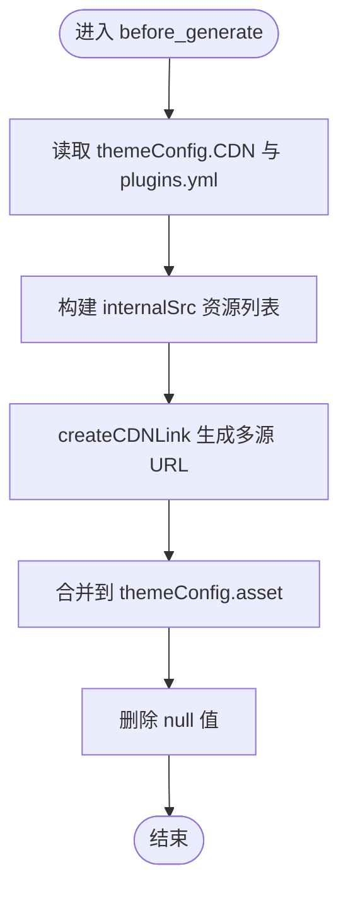
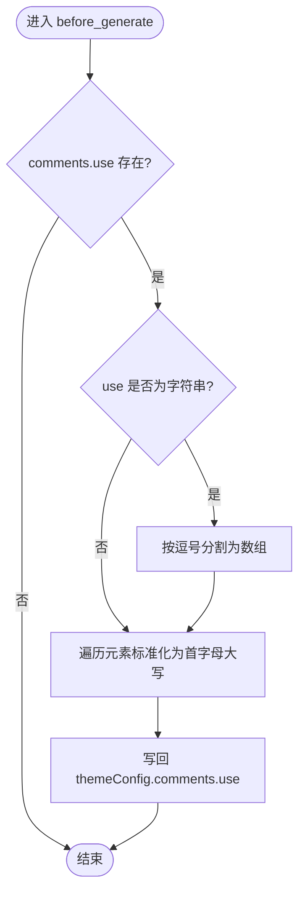
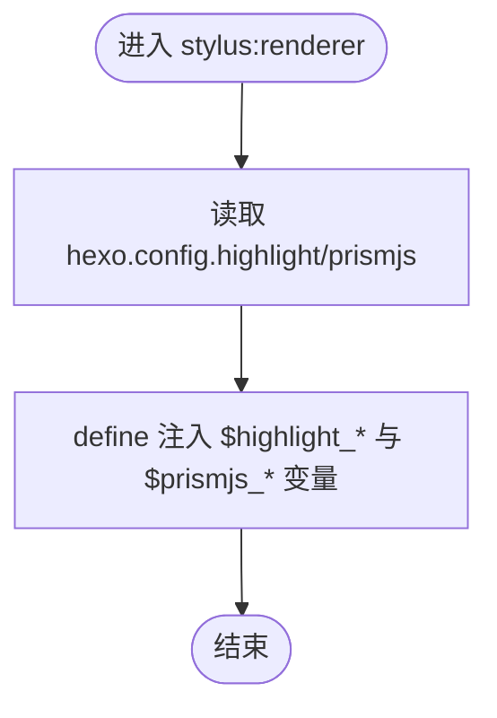
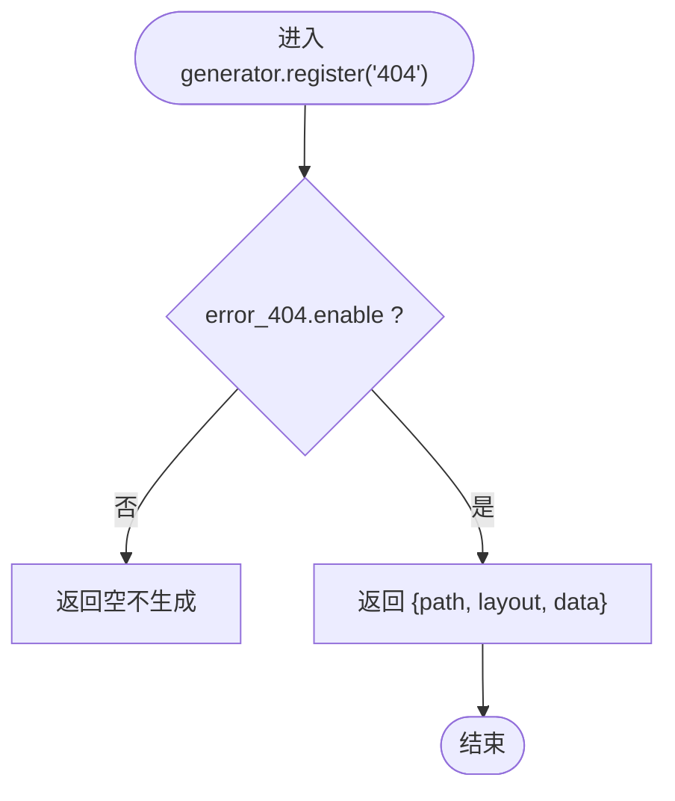
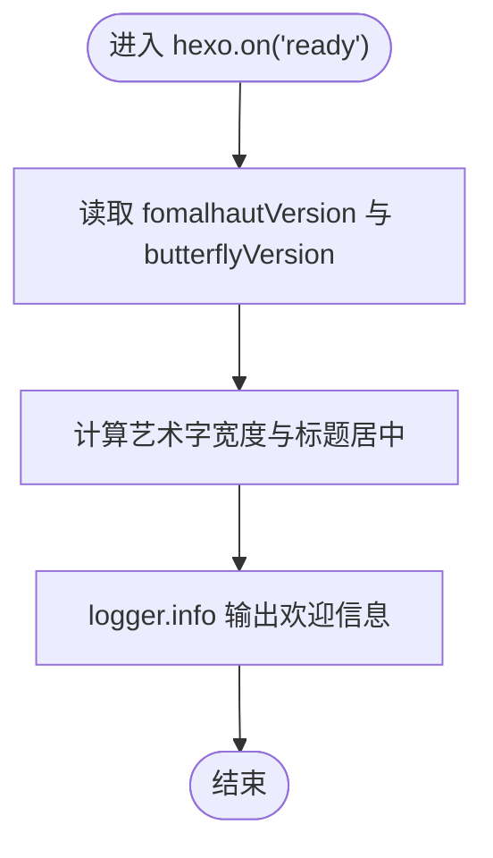
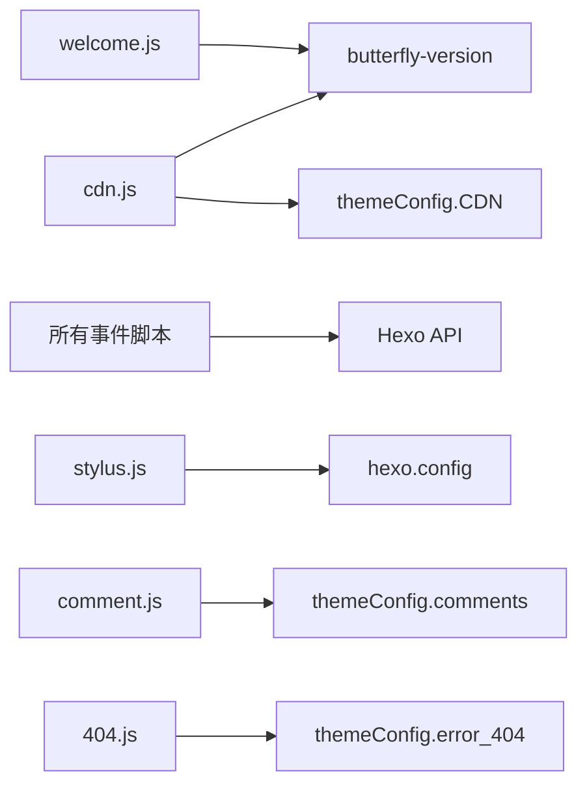

# 事件钩子系统

<cite>
**本文引用的文件**   
- [init.js](file://themes/fomalhaut/scripts/events/init.js)
- [cdn.js](file://themes/fomalhaut/scripts/events/cdn.js)
- [comment.js](file://themes/fomalhaut/scripts/events/comment.js)
- [stylus.js](file://themes/fomalhaut/scripts/events/stylus.js)
- [404.js](file://themes/fomalhaut/scripts/events/404.js)
- [welcome.js](file://themes/fomalhaut/scripts/events/welcome.js)
- [_config.yml](file://themes/fomalhaut/_config.yml)
</cite>

## 目录
1. [引言](#引言)
2. [项目结构](#项目结构)
3. [核心组件](#核心组件)
4. [架构总览](#架构总览)
5. [详细组件分析](#详细组件分析)
6. [依赖关系分析](#依赖关系分析)
7. [性能与构建特性](#性能与构建特性)
8. [故障排查与调试技巧](#故障排查与调试技巧)
9. [结论](#结论)
10. [附录：在自定义插件中扩展事件钩子](#附录在自定义插件中扩展事件钩子)

## 引言
本主题的事件钩子系统基于 Hexo 的过滤器、生成器与生命周期事件机制，围绕站点构建期（before_generate）、样式编译期（stylus:renderer）以及启动完成（ready）等关键阶段，提供初始化校验、CDN 资源合并、评论系统名称规范化、Stylus 变量注入、404 页面生成与欢迎信息输出等功能。该文档面向希望理解并扩展主题行为的开发者，既给出各事件的触发时机与执行顺序，也提供在自定义插件中注册监听与扩展的实践指南。

## 项目结构
主题的事件钩子脚本统一位于 themes/fomalhaut/scripts/events 目录下，每个文件对应一个职责单一的生命周期任务：
- init.js：Hexo 版本与配置兼容性检查
- cdn.js：第三方与内部资源的 CDN 地址合并与格式化
- comment.js：评论系统名称标准化处理
- stylus.js：向 Stylus 渲染器注入全局变量
- 404.js：注册 404 页面生成器
- welcome.js：在 Hexo 启动完成后打印欢迎信息

图表来源
- [init.js:3-21](file://themes/fomalhaut/scripts/events/init.js#L3-L21)
- [cdn.js:11-95](file://themes/fomalhaut/scripts/events/cdn.js#L11-L95)
- [comment.js:5-13](file://themes/fomalhaut/scripts/events/comment.js#L5-L13)
- [stylus.js:7-15](file://themes/fomalhaut/scripts/events/stylus.js#L7-L15)
- [404.js:8-18](file://themes/fomalhaut/scripts/events/404.js#L8-L18)
- [welcome.js:9-29](file://themes/fomalhaut/scripts/events/welcome.js#L9-L29)

章节来源
- [init.js:1-22](file://themes/fomalhaut/scripts/events/init.js#L1-L22)
- [cdn.js:1-96](file://themes/fomalhaut/scripts/events/cdn.js#L1-L96)
- [comment.js:1-14](file://themes/fomalhaut/scripts/events/comment.js#L1-L14)
- [stylus.js:1-16](file://themes/fomalhaut/scripts/events/stylus.js#L1-L16)
- [404.js:1-19](file://themes/fomalhaut/scripts/events/404.js#L1-L19)
- [welcome.js:1-30](file://themes/fomalhaut/scripts/events/welcome.js#L1-L30)

## 核心组件
- 初始化校验（init.js）
  - 钩子：before_generate
  - 作用：校验 Hexo 最低版本要求；检测已弃用配置文件并阻止继续构建
- CDN 资源合并（cdn.js）
  - 钩子：before_generate
  - 作用：读取主题配置与插件清单，合并 internal 与 third-party 资源为统一的 asset 对象，支持多种 CDN 源与自定义模板
- 评论系统名称标准化（comment.js）
  - 钩子：before_generate
  - 作用：将 comments.use 字符串或数组统一为标准化的首字母大写数组
- Stylus 变量注入（stylus.js）
  - 钩子：stylus:renderer
  - 作用：将 highlight/prismjs 相关开关与行号选项注入 Stylus 全局变量，控制样式按需引入
- 404 页面生成（404.js）
  - 钩子：generator.register('404')
  - 作用：根据 error_404.enable 决定是否生成 404.html 页面
- 欢迎信息（welcome.js）
  - 钩子：hexo.on('ready')
  - 作用：在 Hexo 启动完成后输出主题版本与上游 Butterfly 版本的艺术字提示

章节来源
- [init.js:3-21](file://themes/fomalhaut/scripts/events/init.js#L3-L21)
- [cdn.js:11-95](file://themes/fomalhaut/scripts/events/cdn.js#L11-L95)
- [comment.js:5-13](file://themes/fomalhaut/scripts/events/comment.js#L5-L13)
- [stylus.js:7-15](file://themes/fomalhaut/scripts/events/stylus.js#L7-L15)
- [404.js:8-18](file://themes/fomalhaut/scripts/events/404.js#L8-L18)
- [welcome.js:9-29](file://themes/fomalhaut/scripts/events/welcome.js#L9-L29)

## 架构总览
下图展示事件钩子在 Hexo 构建流程中的位置与交互关系：

图表来源
- [init.js:3-21](file://themes/fomalhaut/scripts/events/init.js#L3-L21)
- [cdn.js:11-95](file://themes/fomalhaut/scripts/events/cdn.js#L11-L95)
- [comment.js:5-13](file://themes/fomalhaut/scripts/events/comment.js#L5-L13)
- [stylus.js:7-15](file://themes/fomalhaut/scripts/events/stylus.js#L7-L15)
- [404.js:8-18](file://themes/fomalhaut/scripts/events/404.js#L8-L18)
- [welcome.js:9-29](file://themes/fomalhaut/scripts/events/welcome.js#L9-L29)

## 详细组件分析

### 初始化事件（init.js）
- 触发时机：before_generate
- 行为要点：
  - 解析 hexo.version 前两段，若低于 5.3 则输出错误日志并退出进程
  - 检测是否存在已弃用的 butterfly.yml 数据，存在则输出错误日志并退出进程
- 错误处理：通过 logger.error 输出中英双语错误信息，并使用 process.exit(-1) 终止构建
- 扩展建议：可在该钩子中增加更多环境前置校验（如 Node 版本、必要依赖）

图表来源
- [init.js:3-21](file://themes/fomalhaut/scripts/events/init.js#L3-L21)

章节来源
- [init.js:1-22](file://themes/fomalhaut/scripts/events/init.js#L1-L22)

### CDN 配置事件（cdn.js）
- 触发时机：before_generate
- 行为要点：
  - 读取 themeConfig.CDN 与 plugins.yml 清单
  - 定义 internalSrc（主题内置资源），按不同 CDN 提供商生成链接
  - 提供 minFile 工具函数，自动追加 .min 后缀
  - createCDNLink 根据 type（internal_provider/third_party_provider）与 cond（internal）生成最终 URL
  - 合并 internal 与 third-party 资源到 themeConfig.asset，并清理 null 值
- 关键数据结构：
  - internalSrc：包含 name、file、version 等资源描述
  - cdnSource：local/jsdelivr/unpkg/cdnjs/custom 多源 URL
- 性能考量：
  - 使用 renderSync 同步读取 YAML 清单，避免异步带来的时序问题
  - 通过 Object.assign 合并对象，减少多次赋值开销

图表来源
- [cdn.js:11-95](file://themes/fomalhaut/scripts/events/cdn.js#L11-L95)

章节来源
- [cdn.js:1-96](file://themes/fomalhaut/scripts/events/cdn.js#L1-L96)

### 评论系统事件（comment.js）
- 触发时机：before_generate
- 行为要点：
  - 若 comments.use 不存在则直接返回
  - 若 use 为字符串，则按逗号分割为数组
  - 对每个元素进行小写化后首字母大写，形成标准化数组
- 适用场景：确保后续逻辑能稳定以数组形式访问评论系统名称

图表来源
- [comment.js:5-13](file://themes/fomalhaut/scripts/events/comment.js#L5-L13)

章节来源
- [comment.js:1-14](file://themes/fomalhaut/scripts/events/comment.js#L1-L14)

### 样式处理事件（stylus.js）
- 触发时机：stylus:renderer
- 行为要点：
  - 从 hexo.config 读取 highlight 与 prismjs 配置
  - 通过 style.define 注入 $highlight_enable、$highlight_line_number、$prismjs_enable、$prismjs_line_number 四个全局变量
- 影响范围：主题 Stylus 样式可按这些变量条件引入高亮库与行号样式

图表来源
- [stylus.js:7-15](file://themes/fomalhaut/scripts/events/stylus.js#L7-L15)

章节来源
- [stylus.js:1-16](file://themes/fomalhaut/scripts/events/stylus.js#L1-L16)

### 404 页面事件（404.js）
- 触发时机：generator.register('404')
- 行为要点：
  - 若 error_404.enable 为 false，则不生成 404 页面
  - 否则返回 path='404.html'、layout=['page']、data={type:'404', top_img:false}
- 注意：该钩子仅负责生成元数据，具体页面内容由 layout/page.pug 与 includes/404.pug 等模板渲染

图表来源
- [404.js:8-18](file://themes/fomalhaut/scripts/events/404.js#L8-L18)

章节来源
- [404.js:1-19](file://themes/fomalhaut/scripts/events/404.js#L1-L19)

### 欢迎信息事件（welcome.js）
- 触发时机：hexo.on('ready')
- 行为要点：
  - 读取主题自有版本与上游 Butterfly 版本
  - 计算艺术字宽度与标题居中填充空格
  - 使用 logger.info 输出带边框的主题版本信息
- 用途：便于用户在控制台快速确认当前主题版本与继承关系

图表来源
- [welcome.js:9-29](file://themes/fomalhaut/scripts/events/welcome.js#L9-L29)

章节来源
- [welcome.js:1-30](file://themes/fomalhaut/scripts/events/welcome.js#L1-L30)

## 依赖关系分析
- 模块内依赖
  - cdn.js 依赖 ../butterfly-version 与 path 模块
  - welcome.js 依赖 ../butterfly-version 与 hexo-log
- 外部依赖
  - 所有事件脚本均依赖 Hexo 提供的 API：hexo.extend.filter、hexo.extend.generator、hexo.on
  - stylus.js 依赖 Hexo 的 stylus:renderer 钩子
- 配置依赖
  - _config.yml 中的 comments、error_404、highlight、prismjs 等配置项直接影响事件行为

图表来源
- [cdn.js:8-12](file://themes/fomalhaut/scripts/events/cdn.js#L8-L12)
- [welcome.js:3-7](file://themes/fomalhaut/scripts/events/welcome.js#L3-L7)
- [stylus.js:7-13](file://themes/fomalhaut/scripts/events/stylus.js#L7-L13)
- [comment.js:5-13](file://themes/fomalhaut/scripts/events/comment.js#L5-L13)
- [404.js:8-18](file://themes/fomalhaut/scripts/events/404.js#L8-L18)

章节来源
- [cdn.js:1-96](file://themes/fomalhaut/scripts/events/cdn.js#L1-L96)
- [welcome.js:1-30](file://themes/fomalhaut/scripts/events/welcome.js#L1-L30)
- [stylus.js:1-16](file://themes/fomalhaut/scripts/events/stylus.js#L1-L16)
- [comment.js:1-14](file://themes/fomalhaut/scripts/events/comment.js#L1-L14)
- [404.js:1-19](file://themes/fomalhaut/scripts/events/404.js#L1-L19)

## 性能与构建特性
- 同步渲染 YAML 清单：cdn.js 使用 renderSync 读取 plugins.yml，保证 in-memory 数据一致性，避免异步竞态
- 最小化对象操作：通过 Object.assign 一次性合并 asset，减少多次赋值
- 条件引入样式：stylus.js 注入变量，使 Stylus 仅在启用时引入高亮库与行号样式，降低 CSS 体积
- 早期失败策略：init.js 在 before_generate 阶段即进行版本与配置校验，尽早失败，缩短无效构建时间

[本节为通用指导，无需特定文件引用]

## 故障排查与调试技巧
- 版本不兼容导致构建中断
  - 现象：控制台输出升级 Hexo 的错误信息并退出
  - 排查：确认 Hexo 版本不低于 5.3
  - 参考：[init.js:3-11](file://themes/fomalhaut/scripts/events/init.js#L3-L11)
- 弃用配置导致构建中断
  - 现象：检测到 butterfly.yml 后输出弃用警告并退出
  - 排查：迁移至 _config.fomalhaut.yml
  - 参考：[init.js:13-20](file://themes/fomalhaut/scripts/events/init.js#L13-L20)
- 评论系统名称大小写不一致
  - 现象：评论系统加载异常或名称显示不规范
  - 排查：确认 comments.use 为字符串或数组，事件会自动标准化为首字母大写数组
  - 参考：[comment.js:5-13](file://themes/fomalhaut/scripts/events/comment.js#L5-L13)
- 代码高亮样式缺失
  - 现象：代码块无高亮或行号
  - 排查：检查 hexo.config.highlight 与 prismjs 配置，确认 stylus.js 注入的变量正确
  - 参考：[stylus.js:7-13](file://themes/fomalhaut/scripts/events/stylus.js#L7-L13)
- 404 页面未生成
  - 现象：访问 /404.html 返回 404
  - 排查：确认 error_404.enable 为 true
  - 参考：[404.js:8-18](file://themes/fomalhaut/scripts/events/404.js#L8-L18)
- 欢迎信息未显示
  - 现象：控制台无主题版本信息
  - 排查：确认 Hexo 正常启动并完成 ready 事件
  - 参考：[welcome.js:9-29](file://themes/fomalhaut/scripts/events/welcome.js#L9-L29)

章节来源
- [init.js:3-21](file://themes/fomalhaut/scripts/events/init.js#L3-L21)
- [comment.js:5-13](file://themes/fomalhaut/scripts/events/comment.js#L5-L13)
- [stylus.js:7-13](file://themes/fomalhaut/scripts/events/stylus.js#L7-L13)
- [404.js:8-18](file://themes/fomalhaut/scripts/events/404.js#L8-L18)
- [welcome.js:9-29](file://themes/fomalhaut/scripts/events/welcome.js#L9-L29)

## 结论
本主题的事件钩子系统围绕 Hexo 的关键生命周期节点，提供了稳健的初始化校验、资源合并、样式注入与页面生成能力。通过清晰的职责划分与可配置的钩子点，用户可以在不侵入主题核心逻辑的前提下，实现功能扩展与个性化定制。建议在自定义插件中优先复用现有钩子，遵循“早失败、少副作用”的原则，并确保与主题配置保持一致。

[本节为总结性内容，无需特定文件引用]

## 附录：在自定义插件中扩展事件钩子
以下示例展示如何在自定义插件中利用主题已有的事件钩子进行扩展。请根据实际业务替换占位符与路径。

- 在 before_generate 中追加自定义逻辑
  - 注册过滤器：hexo.extend.filter.register('before_generate', () => { /* 你的逻辑 */ })
  - 典型用途：预处理 themeConfig、校验外部服务可用性、生成临时数据
  - 参考：[init.js:3-21](file://themes/fomalhaut/scripts/events/init.js#L3-L21)、[cdn.js:11-95](file://themes/fomalhaut/scripts/events/cdn.js#L11-L95)、[comment.js:5-13](file://themes/fomalhaut/scripts/events/comment.js#L5-L13)

- 在 stylus:renderer 中注入自定义变量
  - 注册渲染器：hexo.extend.filter.register('stylus:renderer', function (style) { style.define('$your_var', value); })
  - 典型用途：暴露站点级常量给 Stylus，如站点名、语言、主题色等
  - 参考：[stylus.js:7-15](file://themes/fomalhaut/scripts/events/stylus.js#L7-L15)

- 注册自定义页面生成器
  - 注册生成器：hexo.extend.generator.register('your_page', function (locals) { return { path: 'your-page.html', layout: ['page'], data: { ... } }; })
  - 典型用途：生成静态页面或聚合页
  - 参考：[404.js:8-18](file://themes/fomalhaut/scripts/events/404.js#L8-L18)

- 在 ready 事件中输出诊断信息
  - 监听事件：hexo.on('ready', () => { console.log('Your plugin is ready'); })
  - 典型用途：打印插件版本、初始化状态或统计信息
  - 参考：[welcome.js:9-29](file://themes/fomalhaut/scripts/events/welcome.js#L9-L29)

- 错误处理与调试建议
  - 使用 try/catch 包裹可能抛出的逻辑，并通过 logger.error 输出可读信息
  - 在 before_generate 中尽早失败，避免无效构建
  - 使用 hexo.log 或 hexo-log 进行结构化日志记录
  - 结合 _config.yml 中的开关字段，动态启用/禁用扩展逻辑

[本节为实践指导，无需特定文件引用]