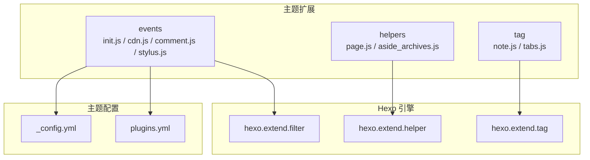
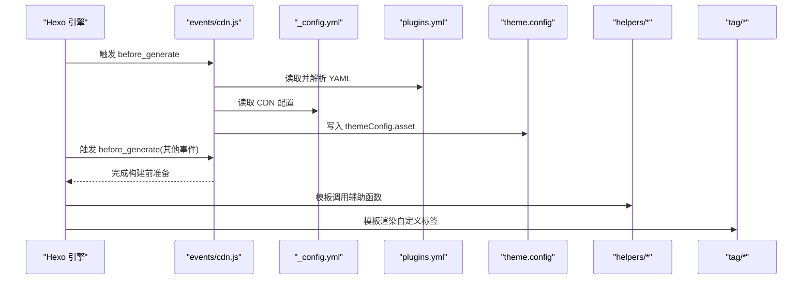
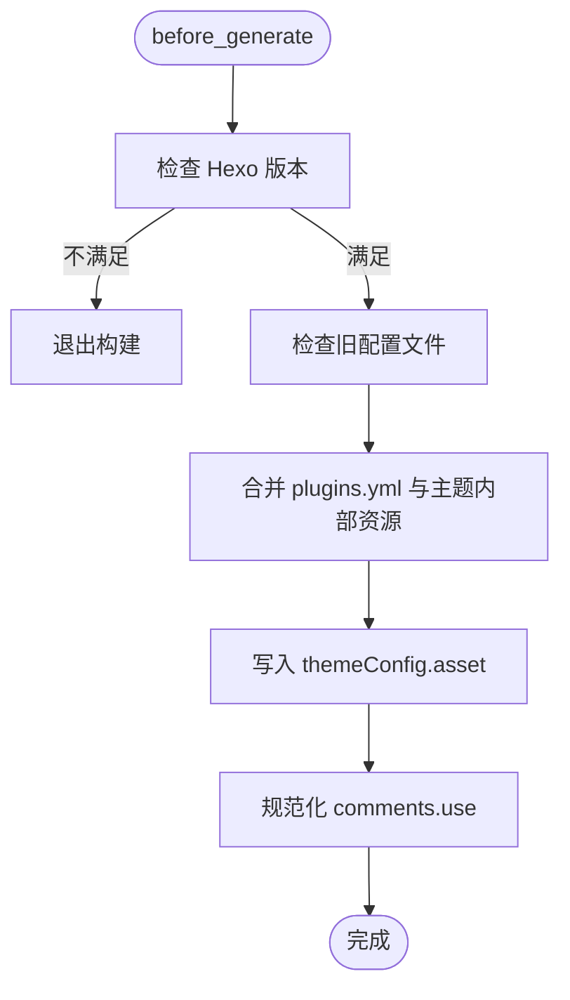
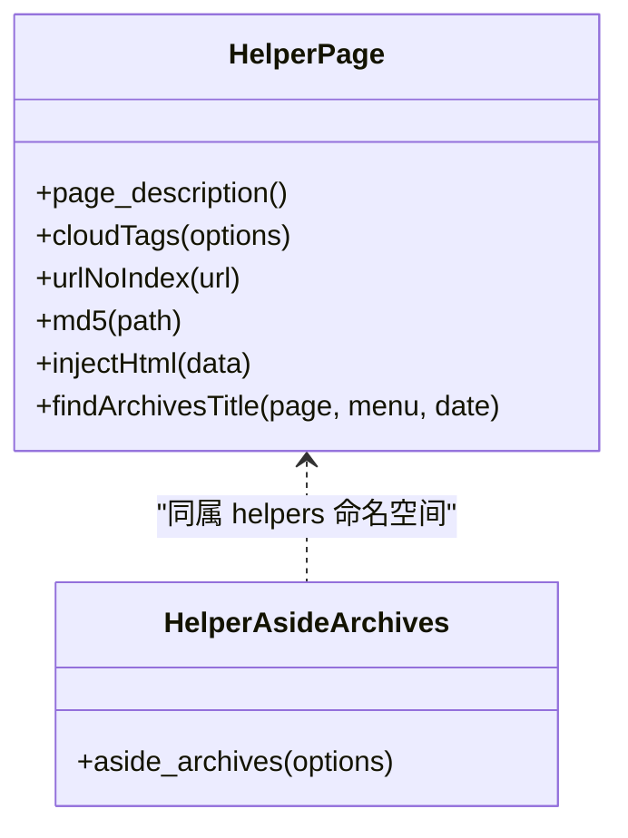
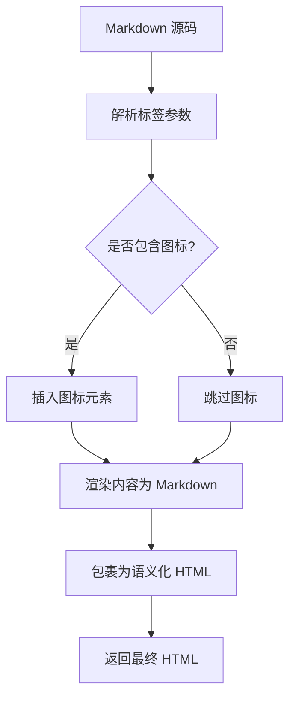
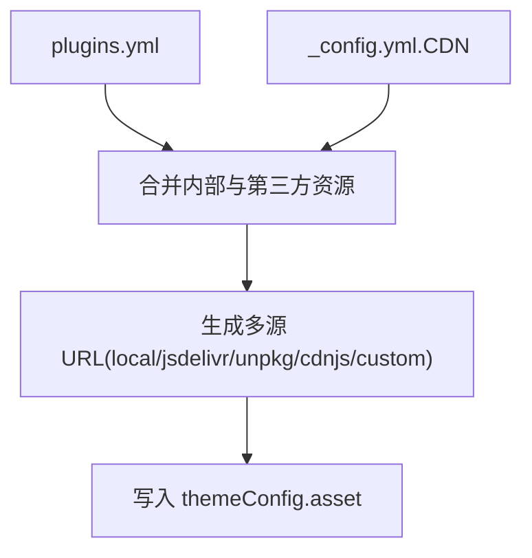
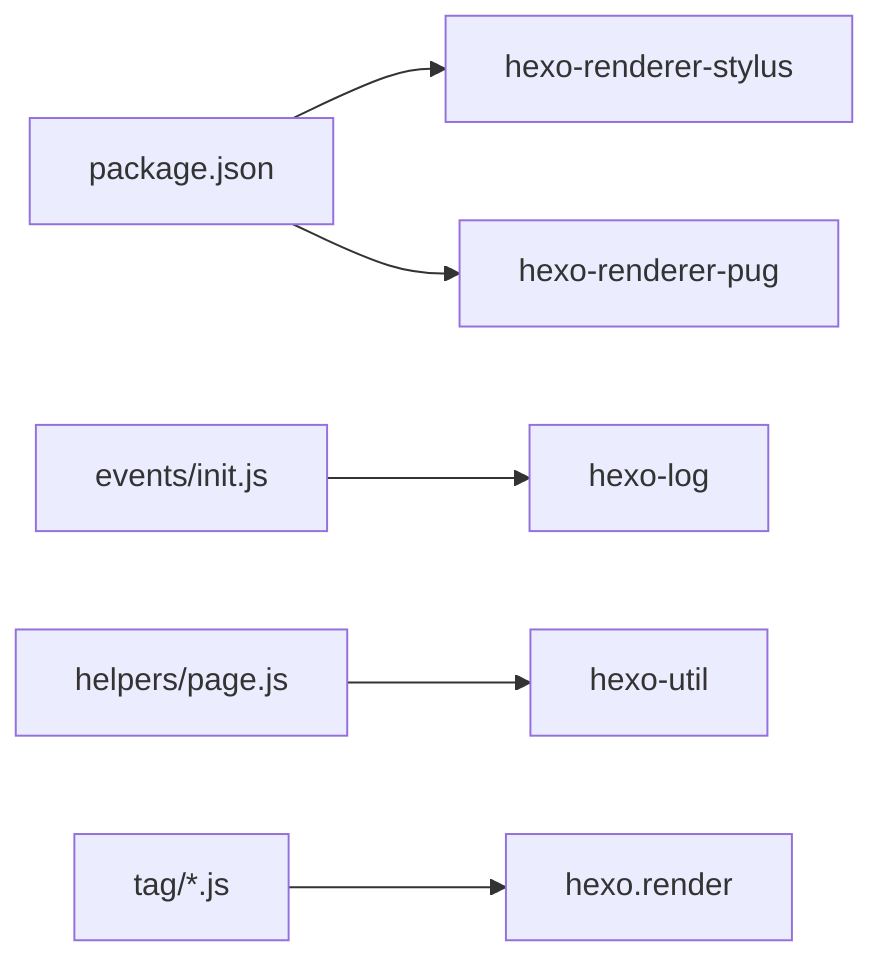

# 插件扩展机制

<cite>
**本文引用的文件**   
- [themes/fomalhaut/plugins.yml](file://themes/fomalhaut/plugins.yml)
- [themes/fomalhaut/scripts/events/init.js](file://themes/fomalhaut/scripts/events/init.js)
- [themes/fomalhaut/scripts/events/cdn.js](file://themes/fomalhaut/scripts/events/cdn.js)
- [themes/fomalhaut/scripts/events/comment.js](file://themes/fomalhaut/scripts/events/comment.js)
- [themes/fomalhaut/scripts/events/stylus.js](file://themes/fomalhaut/scripts/events/stylus.js)
- [themes/fomalhaut/scripts/helpers/page.js](file://themes/fomalhaut/scripts/helpers/page.js)
- [themes/fomalhaut/scripts/helpers/aside_archives.js](file://themes/fomalhaut/scripts/helpers/aside_archives.js)
- [themes/fomalhaut/scripts/tag/note.js](file://themes/fomalhaut/scripts/tag/note.js)
- [themes/fomalhaut/scripts/tag/tabs.js](file://themes/fomalhaut/scripts/tag/tabs.js)
- [themes/fomalhaut/_config.yml](file://themes/fomalhaut/_config.yml)
- [themes/fomalhaut/package.json](file://themes/fomalhaut/package.json)
</cite>

## 目录
1. [引言](#引言)
2. [项目结构](#项目结构)
3. [核心组件](#核心组件)
4. [架构总览](#架构总览)
5. [详细组件分析](#详细组件分析)
6. [依赖关系分析](#依赖关系分析)
7. [性能与构建特性](#性能与构建特性)
8. [故障排查指南](#故障排查指南)
9. [结论](#结论)
10. [附录：自定义插件开发指南](#附录自定义插件开发指南)

## 引言
本文件系统性说明 Hexo 主题 Fomalhaut 的插件扩展机制，重点覆盖以下方面：
- 事件钩子（scripts/events）的工作原理与生命周期接入点
- 辅助函数（scripts/helpers）的开发与注册方式
- 自定义标签（scripts/tag）的实现方法与语法约定
- 第三方资源清单 plugins.yml 的作用与 CDN 注入流程
- 基于仓库现有实现的完整开发指南与示例路径

## 项目结构
Fomalhaut 主题的扩展能力集中在 scripts 目录下的三类脚本：
- events：在 Hexo 构建生命周期中执行，用于环境检查、配置预处理、样式编译注入等
- helpers：向模板暴露辅助函数，供布局与页面渲染使用
- tag：定义 Markdown 中的自定义块级或行内标签，如 note、tabs 等

此外，plugins.yml 集中声明第三方库的版本与路径，cdn.js 在构建前将其合并为可用的 CDN 地址。

图表来源
- [themes/fomalhaut/scripts/events/cdn.js:11-95](file://themes/fomalhaut/scripts/events/cdn.js#L11-L95)
- [themes/fomalhaut/scripts/helpers/page.js:13-99](file://themes/fomalhaut/scripts/helpers/page.js#L13-L99)
- [themes/fomalhaut/scripts/tag/note.js:26-27](file://themes/fomalhaut/scripts/tag/note.js#L26-L27)
- [themes/fomalhaut/scripts/tag/tabs.js:60-62](file://themes/fomalhaut/scripts/tag/tabs.js#L60-L62)

章节来源
- [themes/fomalhaut/package.json:1-32](file://themes/fomalhaut/package.json#L1-L32)

## 核心组件
- 事件钩子（events）
  - before_generate：在生成静态页面前统一处理配置、校验版本、规范化评论名称、注入 Stylus 变量等
  - stylus:renderer：在样式编译阶段注入主题所需的全局变量
- 辅助函数（helpers）
  - 提供页面描述、云标签、URL 清理、MD5、HTML 注入、归档侧边栏等常用方法
- 自定义标签（tag）
  - 支持 note/subnote、tabs/subtabs/subsubtabs 等块级标签，内部将内容以 Markdown 渲染并包裹语义化 HTML
- 资源清单（plugins.yml）
  - 集中管理第三方库名、文件路径、版本号及可选别名，配合 cdn.js 生成多源 CDN 链接

章节来源
- [themes/fomalhaut/scripts/events/init.js:3-21](file://themes/fomalhaut/scripts/events/init.js#L3-L21)
- [themes/fomalhaut/scripts/events/stylus.js:7-15](file://themes/fomalhaut/scripts/events/stylus.js#L7-L15)
- [themes/fomalhaut/scripts/helpers/page.js:13-99](file://themes/fomalhaut/scripts/helpers/page.js#L13-L99)
- [themes/fomalhaut/scripts/tag/note.js:9-27](file://themes/fomalhaut/scripts/tag/note.js#L9-L27)
- [themes/fomalhaut/scripts/tag/tabs.js:9-62](file://themes/fomalhaut/scripts/tag/tabs.js#L9-L62)
- [themes/fomalhaut/plugins.yml:1-182](file://themes/fomalhaut/plugins.yml#L1-L182)

## 架构总览
下图展示从构建到渲染的关键流程：Hexo 触发 before_generate，主题通过 cdn.js 读取 plugins.yml 与 _config.yml，计算并写入 themeConfig.asset；同时初始化版本检查、评论名称规范化、Stylus 变量注入；随后模板渲染时调用注册的 helpers 与 tags。

图表来源
- [themes/fomalhaut/scripts/events/cdn.js:11-95](file://themes/fomalhaut/scripts/events/cdn.js#L11-L95)
- [themes/fomalhaut/scripts/events/init.js:3-21](file://themes/fomalhaut/scripts/events/init.js#L3-L21)
- [themes/fomalhaut/scripts/events/comment.js:5-13](file://themes/fomalhaut/scripts/events/comment.js#L5-L13)
- [themes/fomalhaut/scripts/events/stylus.js:7-15](file://themes/fomalhaut/scripts/events/stylus.js#L7-L15)

## 详细组件分析

### 事件钩子（events）
- init.js
  - 在 before_generate 中检查 Hexo 版本，不满足最低要求则终止构建
  - 检测旧配置文件 butterfly.yml 并提示迁移至 _config.fomalhaut.yml
- cdn.js
  - 在 before_generate 中加载 plugins.yml，合并内部资源与第三方资源
  - 根据 CDN 配置生成 local/jsdelivr/unpkg/cdnjs/custom 等多源 URL，并写入 themeConfig.asset
- comment.js
  - 在 before_generate 中将 comments.use 字符串或数组标准化为首字母大写的数组
- stylus.js
  - 在 stylus:renderer 中注入 highlight/prismjs 相关布尔变量，供样式文件条件编译

图表来源
- [themes/fomalhaut/scripts/events/init.js:3-21](file://themes/fomalhaut/scripts/events/init.js#L3-L21)
- [themes/fomalhaut/scripts/events/cdn.js:11-95](file://themes/fomalhaut/scripts/events/cdn.js#L11-L95)
- [themes/fomalhaut/scripts/events/comment.js:5-13](file://themes/fomalhaut/scripts/events/comment.js#L5-L13)

章节来源
- [themes/fomalhaut/scripts/events/init.js:1-22](file://themes/fomalhaut/scripts/events/init.js#L1-L22)
- [themes/fomalhaut/scripts/events/cdn.js:1-96](file://themes/fomalhaut/scripts/events/cdn.js#L1-L96)
- [themes/fomalhaut/scripts/events/comment.js:1-14](file://themes/fomalhaut/scripts/events/comment.js#L1-L14)
- [themes/fomalhaut/scripts/events/stylus.js:1-16](file://themes/fomalhaut/scripts/events/stylus.js#L1-L16)

### 辅助函数（helpers）
- page.js
  - page_description：提取并截断页面描述，过滤 HTML 标签
  - cloudTags：按标签长度动态计算字号与颜色，输出带数量的标签云
  - urlNoIndex：清理 URL，去除 trailing index/html
  - md5：对资源 URL 计算 MD5，便于缓存控制
  - injectHtml：拼接注入的 HTML 片段
  - findArchivesTitle：根据菜单与日期信息推导归档标题
- aside_archives.js
  - aside_archives：按年/月聚合文章，生成分组归档列表，支持格式化、排序、限制数量

图表来源
- [themes/fomalhaut/scripts/helpers/page.js:13-99](file://themes/fomalhaut/scripts/helpers/page.js#L13-L99)
- [themes/fomalhaut/scripts/helpers/aside_archives.js:8-100](file://themes/fomalhaut/scripts/helpers/aside_archives.js#L8-L100)

章节来源
- [themes/fomalhaut/scripts/helpers/page.js:1-99](file://themes/fomalhaut/scripts/helpers/page.js#L1-L99)
- [themes/fomalhaut/scripts/helpers/aside_archives.js:1-114](file://themes/fomalhaut/scripts/helpers/aside_archives.js#L1-L114)

### 自定义标签（tag）
- note.js
  - 注册 note 与 subnote 两个结束型标签
  - 支持 style 参数（flat/modern/simple/disabled），自动追加默认样式
  - 支持图标类名前缀 fa*，自动插入图标并调整间距
  - 内部将 content 以 Markdown 渲染后包裹在语义化 div 中
- tabs.js
  - 注册 tabs/subtabs/subsubtabs 三个结束型标签
  - 使用注释分隔符 <!-- tab ... --> 与 <!-- endtab --> 分割多个选项卡
  - 每个选项卡支持标题与图标，自动生成唯一 id 与激活状态
  - 内部将选项卡内容以 Markdown 渲染，并附加“回到顶部”按钮

图表来源
- [themes/fomalhaut/scripts/tag/note.js:9-27](file://themes/fomalhaut/scripts/tag/note.js#L9-L27)
- [themes/fomalhaut/scripts/tag/tabs.js:9-62](file://themes/fomalhaut/scripts/tag/tabs.js#L9-L62)

章节来源
- [themes/fomalhaut/scripts/tag/note.js:1-28](file://themes/fomalhaut/scripts/tag/note.js#L1-L28)
- [themes/fomalhaut/scripts/tag/tabs.js:1-63](file://themes/fomalhaut/scripts/tag/tabs.js#L1-L63)

### 资源清单（plugins.yml）与 CDN 注入
- plugins.yml
  - 每个条目包含 name（npm 包名）、file（相对路径）、version（版本号），部分条目含 other_name（CDN 别名）
  - 统一管理搜索、评论、分享、数学公式、动画、图片缩放、字体图标、代码高亮等第三方库
- cdn.js
  - 读取 plugins.yml 与主题内部资源，根据 CDN 配置生成多源 URL
  - 支持 internal_provider 与 third_party_provider 两种来源策略
  - 支持 custom_format 自定义模板，替换 ${name}/${version}/${file} 等占位符
  - 将结果写入 themeConfig.asset，供模板引用

图表来源
- [themes/fomalhaut/plugins.yml:1-182](file://themes/fomalhaut/plugins.yml#L1-L182)
- [themes/fomalhaut/scripts/events/cdn.js:11-95](file://themes/fomalhaut/scripts/events/cdn.js#L11-L95)

章节来源
- [themes/fomalhaut/plugins.yml:1-182](file://themes/fomalhaut/plugins.yml#L1-L182)
- [themes/fomalhaut/scripts/events/cdn.js:1-96](file://themes/fomalhaut/scripts/events/cdn.js#L1-L96)
- [themes/fomalhaut/_config.yml:257-363](file://themes/fomalhaut/_config.yml#L257-L363)

## 依赖关系分析
- 主题依赖 hexo-renderer-stylus 与 hexo-renderer-pug，分别负责样式与模板渲染
- events 依赖 hexo-log 进行日志输出
- helpers 依赖 hexo-util 进行 HTML 清理与 URL 美化
- tag 依赖 hexo.render 将 Markdown 内容渲染为 HTML

图表来源
- [themes/fomalhaut/package.json:24-27](file://themes/fomalhaut/package.json#L24-L27)
- [themes/fomalhaut/scripts/events/init.js:1-1](file://themes/fomalhaut/scripts/events/init.js#L1-L1)
- [themes/fomalhaut/scripts/helpers/page.js:10-10](file://themes/fomalhaut/scripts/helpers/page.js#L10-L10)
- [themes/fomalhaut/scripts/tag/note.js:23-23](file://themes/fomalhaut/scripts/tag/note.js#L23-L23)

章节来源
- [themes/fomalhaut/package.json:1-32](file://themes/fomalhaut/package.json#L1-L32)

## 性能与构建特性
- 构建前预处理
  - 版本与环境检查避免无效构建
  - 评论名称规范化减少运行时判断
- 样式编译优化
  - 通过 stylus:renderer 注入布尔变量，按需启用代码高亮与行号
- 资源加载优化
  - 通过 plugins.yml 与 cdn.js 集中管理第三方库版本与多源 CDN，便于缓存与回退
  - 内部资源与第三方资源分离，便于本地开发与生产发布切换

[本节为通用指导，不直接分析具体文件]

## 故障排查指南
- 构建失败且提示需要升级 Hexo
  - 现象：控制台输出需升级到 V5.3.0 或以上
  - 原因：init.js 在 before_generate 中检查 Hexo 版本
  - 解决：升级 Hexo 至指定版本以上
- 构建失败且提示 butterfly.yml 已弃用
  - 现象：控制台提示使用 _config.fomalhaut.yml
  - 原因：init.js 检测到旧配置文件
  - 解决：将配置迁移至 _config.fomalhaut.yml
- 评论系统未正确显示
  - 现象：comments.use 未生效或名称大小写不一致
  - 原因：comment.js 会规范化 comments.use 的名称格式
  - 解决：确保 comments.use 配置为字符串或数组，并在 _config.yml 中正确填写对应评论系统的参数
- 样式变量未生效
  - 现象：highlight/prismjs 相关样式未按预期启用
  - 原因：stylus:renderer 注入的变量取决于 hexo.config.highlight/prismjs.enable
  - 解决：检查 Hexo 根配置中 highlight 与 prismjs 的 enable 字段

章节来源
- [themes/fomalhaut/scripts/events/init.js:3-21](file://themes/fomalhaut/scripts/events/init.js#L3-L21)
- [themes/fomalhaut/scripts/events/comment.js:5-13](file://themes/fomalhaut/scripts/events/comment.js#L5-L13)
- [themes/fomalhaut/scripts/events/stylus.js:7-15](file://themes/fomalhaut/scripts/events/stylus.js#L7-L15)
- [themes/fomalhaut/_config.yml:257-363](file://themes/fomalhaut/_config.yml#L257-L363)

## 结论
Fomalhaut 主题通过 events、helpers、tag 三类扩展点，结合 plugins.yml 的资源清单与 cdn.js 的注入逻辑，形成清晰的构建期预处理与渲染期增强体系。开发者可据此快速实现环境检查、配置预处理、样式变量注入、模板辅助函数与自定义标签，从而在不侵入核心逻辑的前提下扩展主题功能。

[本节为总结性内容，不直接分析具体文件]

## 附录：自定义插件开发指南

### 开发事件钩子（scripts/events）
- 目标：在构建生命周期中执行环境检查、配置预处理、样式变量注入等
- 步骤：
  - 在 themes/fomalhaut/scripts/events 下新建 .js 文件
  - 使用 hexo.extend.filter.register('before_generate', ...) 注册构建前钩子
  - 如需注入样式变量，使用 hexo.extend.filter.register('stylus:renderer', ...)
- 参考实现路径：
  - [themes/fomalhaut/scripts/events/init.js:3-21](file://themes/fomalhaut/scripts/events/init.js#L3-L21)
  - [themes/fomalhaut/scripts/events/cdn.js:11-95](file://themes/fomalhaut/scripts/events/cdn.js#L11-L95)
  - [themes/fomalhaut/scripts/events/stylus.js:7-15](file://themes/fomalhaut/scripts/events/stylus.js#L7-L15)

### 开发辅助函数（scripts/helpers）
- 目标：向模板暴露可复用的辅助方法
- 步骤：
  - 在 themes/fomalhaut/scripts/helpers 下新建 .js 文件
  - 使用 hexo.extend.helper.register('函数名', function(){...}) 注册
  - 在模板中通过 {{ helperName(...) }} 调用
- 参考实现路径：
  - [themes/fomalhaut/scripts/helpers/page.js:13-99](file://themes/fomalhaut/scripts/helpers/page.js#L13-L99)
  - [themes/fomalhaut/scripts/helpers/aside_archives.js:8-100](file://themes/fomalhaut/scripts/helpers/aside_archives.js#L8-L100)

### 开发自定义标签（scripts/tag）
- 目标：在 Markdown 中使用自定义块级或行内标签
- 步骤：
  - 在 themes/fomalhaut/scripts/tag 下新建 .js 文件
  - 使用 hexo.extend.tag.register('标签名', function(args, content){...}, { ends: true }) 注册结束型标签
  - 在 Markdown 中以  内容  使用
- 参考实现路径：
  - [themes/fomalhaut/scripts/tag/note.js:9-27](file://themes/fomalhaut/scripts/tag/note.js#L9-L27)
  - [themes/fomalhaut/scripts/tag/tabs.js:9-62](file://themes/fomalhaut/scripts/tag/tabs.js#L9-L62)

### 管理第三方资源（plugins.yml）
- 目标：集中管理第三方库版本与路径，并通过 cdn.js 注入多源 CDN
- 步骤：
  - 在 themes/fomalhaut/plugins.yml 中添加新条目，包含 name、file、version，必要时添加 other_name
  - 在 _config.yml 中配置 CDN 策略（internal_provider/third_party_provider/custom_format）
  - 在模板中通过 themeConfig.asset 访问生成的多源 URL
- 参考实现路径：
  - [themes/fomalhaut/plugins.yml:1-182](file://themes/fomalhaut/plugins.yml#L1-L182)
  - [themes/fomalhaut/scripts/events/cdn.js:11-95](file://themes/fomalhaut/scripts/events/cdn.js#L11-L95)
  - [themes/fomalhaut/_config.yml:257-363](file://themes/fomalhaut/_config.yml#L257-L363)

### 示例清单（仅路径，不含代码内容）
- 事件钩子示例
  - [themes/fomalhaut/scripts/events/init.js:3-21](file://themes/fomalhaut/scripts/events/init.js#L3-L21)
  - [themes/fomalhaut/scripts/events/cdn.js:11-95](file://themes/fomalhaut/scripts/events/cdn.js#L11-L95)
  - [themes/fomalhaut/scripts/events/comment.js:5-13](file://themes/fomalhaut/scripts/events/comment.js#L5-L13)
  - [themes/fomalhaut/scripts/events/stylus.js:7-15](file://themes/fomalhaut/scripts/events/stylus.js#L7-L15)
- 辅助函数示例
  - [themes/fomalhaut/scripts/helpers/page.js:13-99](file://themes/fomalhaut/scripts/helpers/page.js#L13-L99)
  - [themes/fomalhaut/scripts/helpers/aside_archives.js:8-100](file://themes/fomalhaut/scripts/helpers/aside_archives.js#L8-L100)
- 自定义标签示例
  - [themes/fomalhaut/scripts/tag/note.js:9-27](file://themes/fomalhaut/scripts/tag/note.js#L9-L27)
  - [themes/fomalhaut/scripts/tag/tabs.js:9-62](file://themes/fomalhaut/scripts/tag/tabs.js#L9-L62)
- 资源清单与配置
  - [themes/fomalhaut/plugins.yml:1-182](file://themes/fomalhaut/plugins.yml#L1-L182)
  - [themes/fomalhaut/_config.yml:257-363](file://themes/fomalhaut/_config.yml#L257-L363)