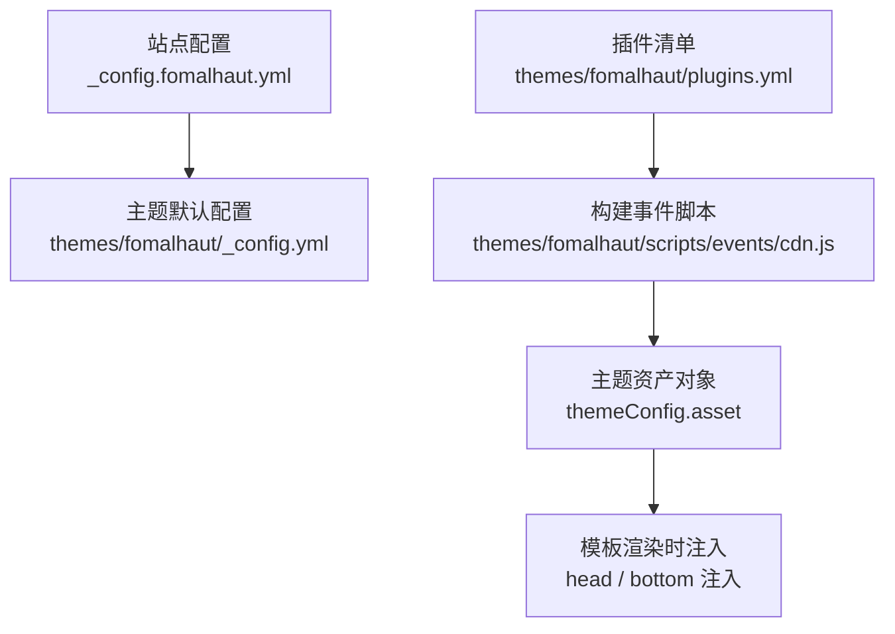
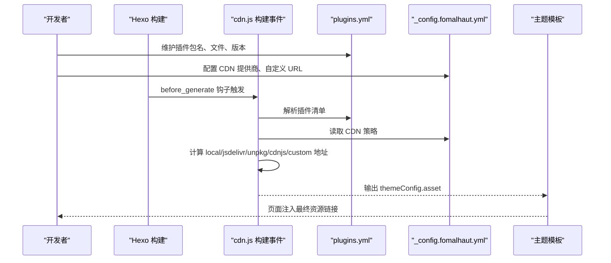
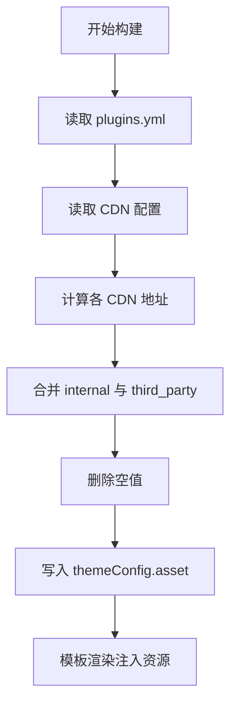

# 插件清单配置

<cite>
**本文引用的文件**   
- [plugins.yml](file://themes/fomalhaut/plugins.yml)
- [cdn.js](file://themes/fomalhaut/scripts/events/cdn.js)
- [_config.fomalhaut.yml](file://_config.fomalhaut.yml)
- [_config.yml](file://themes/fomalhaut/_config.yml)
- [README.md（主题）](file://themes/fomalhaut/README.md)
</cite>

## 目录
1. [引言](#引言)
2. [项目结构中的插件体系](#项目结构中的插件体系)
3. [核心组件](#核心组件)
4. [架构总览](#架构总览)
5. [详细组件分析](#详细组件分析)
6. [依赖与版本管理](#依赖与版本管理)
7. [CDN 与自动安装机制](#cdn-与自动安装机制)
8. [插件元数据、配置参数与扩展点](#插件元数据配置参数与扩展点)
9. [打包、发布与分发流程](#打包发布与分发流程)
10. [第三方插件集成示例](#第三方插件集成示例)
11. [本地插件开发示例](#本地插件开发示例)
12. [性能与稳定性建议](#性能与稳定性建议)
13. [故障排查指南](#故障排查指南)
14. [结论](#结论)

## 引言
本文件面向 Hexo 博客站点和 fomalhaut 主题使用者，系统性说明 `plugins.yml` 插件清单的作用、字段含义、依赖与版本控制方式、CDN 自动生成逻辑，以及如何通过站点配置完成第三方插件接入和本地资源替换。文档同时给出插件打包、发布与分发的可操作流程，并解释该仓库中“插件”的实际语义：它不是 Hexo 的 Node 插件，而是主题在构建期加载的前端静态资源清单。

## 项目结构中的插件体系
在本仓库中，“插件”主要指两类内容：
- 前端第三方库与主题内部脚本：由 `themes/fomalhaut/plugins.yml` 声明，并由构建事件脚本生成 CDN 链接或本地路径。
- 站点级 Hexo 插件：位于根目录 `scripts/`，用于构建期处理文章、注入脚本等，不属于本文件的范围。

**图表来源**
- [plugins.yml:1-182](file://themes/fomalhaut/plugins.yml#L1-L182)
- [cdn.js:11-95](file://themes/fomalhaut/scripts/events/cdn.js#L11-L95)
- [_config.fomalhaut.yml:1400-1450](file://_config.fomalhaut.yml#L1400-L1450)

**章节来源**
- [README.md（主题）:33-36](file://themes/fomalhaut/README.md#L33-L36)

## 核心组件
- `plugins.yml`：集中声明所有第三方前端资源包名、目标文件名、版本号，以及可选别名。
- `scripts/events/cdn.js`：Hexo 构建钩子，读取 `plugins.yml`，根据 CDN 策略生成最终资源地址，并写入 `themeConfig.asset`。
- `_config.fomalhaut.yml`：站点实际使用的主题配置，包含 `CDN` 段，决定使用哪个 CDN、是否带版本号、是否覆盖某个资源的 URL。
- `themes/fomalhaut/_config.yml`：主题默认配置模板，提供开关和默认值；真正生效的配置应放在站点根目录的 `_config.fomalhaut.yml`。

**章节来源**
- [plugins.yml:1-182](file://themes/fomalhaut/plugins.yml#L1-L182)
- [cdn.js:11-95](file://themes/fomalhaut/scripts/events/cdn.js#L11-L95)
- [_config.fomalhaut.yml:1400-1450](file://_config.fomalhaut.yml#L1400-L1450)
- [_config.yml:33-36](file://themes/fomalhaut/_config.yml#L33-L36)

## 架构总览
下图展示从清单到页面注入的关键链路：

**图表来源**
- [cdn.js:11-95](file://themes/fomalhaut/scripts/events/cdn.js#L11-L95)
- [plugins.yml:1-182](file://themes/fomalhaut/plugins.yml#L1-L182)
- [_config.fomalhaut.yml:1400-1450](file://_config.fomalhaut.yml#L1400-L1450)

## 详细组件分析

### plugins.yml：插件清单定义
`plugins.yml` 是主题内第三方资源的“注册表”。每个键代表一个资源项，常见字段包括：
- `name`：npm 包名，例如 `algoliasearch`、`@fancyapps/ui`、`butterfly-extsrc`。
- `file`：资源相对路径，通常是 npm 包内的 `dist/...` 或主题自托管路径。
- `version`：固定版本号，用于锁定依赖，避免上游升级导致样式或行为变化。
- `other_name`：可选别名，主要用于 cdnjs 路径映射，当包名与 cdnjs 上的名称不一致时使用。

该文件还体现了一些设计模式：
- 同一包可能拆成多个条目，例如 JS 与 CSS 分开，如 `waline_js` 与 `waline_css`。
- 主题自托管资源使用 `butterfly-extsrc` 作为统一包名，便于按版本统一拉取。
- 数学公式、评论系统、分享、懒加载、图片灯箱、音乐播放器、代码高亮等能力都通过该清单统一管理。

**章节来源**
- [plugins.yml:1-182](file://themes/fomalhaut/plugins.yml#L1-L182)

### cdn.js：构建期 CDN 合并与注入
`cdn.js` 在 Hexo 的 `before_generate` 钩子中执行，负责：
1. 读取主题配置中的 `CDN` 段。
2. 解析 `plugins.yml`，得到第三方资源列表。
3. 定义主题内部资源 `internalSrc`，包括主脚本、工具脚本、翻译脚本、搜索相关脚本等。
4. 为每个资源计算多种来源：
   - `local`：本地路径，内部资源走主题 `source/`，外部资源走 `/pluginsSrc/{name}/{file}`。
   - `jsdelivr`：基于 jsDelivr 的 npm 镜像。
   - `unpkg`：基于 unpkg 的 npm 直链。
   - `cdnjs`：基于 Cloudflare CDN，使用 `other_name` 或包名进行路径映射。
   - `custom`：支持用户自定义格式，通过 `${name}`、`${version}`、`${file}` 等占位符拼接。
5. 将结果写入 `themeConfig.asset`，供模板渲染时引用。

关键实现要点：
- 自动补 `.min`：对 JS/CSS 文件自动选择最小化版本。
- 内部资源特殊处理：内部脚本会改写为 `source/` 前缀，并在需要时注入 `main_css`。
- 空值清理：移除未配置的 CDN 选项，避免模板渲染出错。

**章节来源**
- [cdn.js:11-95](file://themes/fomalhaut/scripts/events/cdn.js#L11-L95)

### _config.fomalhaut.yml：站点级 CDN 与插件覆盖
站点配置中的 `CDN` 段决定最终资源来源：
- `third_party_provider`：第三方资源使用的 CDN 类型，例如 `jsdelivr`、`unpkg`、`cdnjs`、`local`、`custom`。
- `internal_provider`：主题内部资源使用的 CDN 类型。
- `version`：是否在 CDN URL 中加入 `@version`。
- `custom_format`：自定义 CDN 格式字符串，支持 `${name}`、`${version}`、`${file}` 等变量。
- 具体资源覆盖：可以直接为某个插件键赋值完整 URL，覆盖清单生成的地址。

在本仓库中，站点配置大量注释掉了默认 CDN，改为指向国内镜像或本地路径，例如：
- Algolia、InstantSearch、Twikoo、Lazyload、Typed、Fancybox、FontAwesome、APlayer、Meting 等。
- 部分资源直接指向站点本地路径，如 `/js/coin.js`、`/css/coin.css`。

这种写法适合生产环境稳定访问，也方便企业内网或离线部署。

**章节来源**
- [_config.fomalhaut.yml:1400-1450](file://_config.fomalhaut.yml#L1400-L1450)

## 依赖与版本管理
`plugins.yml` 采用“显式版本锁定”的方式管理依赖：
- 每个资源项都有 `version`，确保构建结果可复现。
- 同一包的多个资源共享版本号，例如 `katex` 的 CSS 与 copy-tex 插件共用 `0.16.0`。
- 主题自托管资源统一使用 `butterfly-extsrc` 的 `1.1.3`，便于整体升级。
- 构建脚本不会自动升级依赖；升级需人工修改 `plugins.yml` 和站点 CDN 覆盖。

依赖关系方面，清单本身不表达运行时依赖图，但可通过命名约定识别耦合：
- 评论系统通常对应 JS 与 CSS 两个条目，如 `gitalk` 与 `gitalk_css`、`disqusjs` 与 `disqusjs_css`、`waline_js` 与 `waline_css`。
- 数学公式类资源常成组出现，如 `mathjax`、`katex`、`katex_copytex`。
- 图片灯箱类资源常成组出现，如 `fancybox_css_v4` 与 `fancybox_v4`。
- 代码高亮类资源常成组出现，如 `prismjs_js`、`prismjs_lineNumber_js`、`prismjs_autoloader`。

**章节来源**
- [plugins.yml:1-182](file://themes/fomalhaut/plugins.yml#L1-L182)

## CDN 与自动安装机制
需要明确的是：本仓库没有“自动下载并安装 npm 包”的逻辑。`plugins.yml` 只是声明，`cdn.js` 只生成 URL。真正的资源获取发生在浏览器请求阶段，或由站点构建流程提前把资源放到指定位置。

当前实现的“自动”体现在：
- 自动选择最小化文件。
- 自动根据 `other_name` 生成 cdnjs 路径。
- 自动根据 `CDN.version` 决定是否追加 `@version`。
- 自动合并内部资源与第三方资源到 `themeConfig.asset`。
- 支持自定义 CDN 格式，便于接入企业内部镜像。

如果希望完全本地化：
- 将第三方资源下载到站点目录，例如 `/pluginsSrc/{name}/{file}`。
- 在站点配置中将对应插件键赋值为本地路径。
- 或将 `third_party_provider` 设为 `local`，并确保资源路径符合脚本预期。

**图表来源**
- [cdn.js:11-95](file://themes/fomalhaut/scripts/events/cdn.js#L11-L95)

**章节来源**
- [cdn.js:11-95](file://themes/fomalhaut/scripts/events/cdn.js#L11-L95)

## 插件元数据、配置参数与扩展点

### 插件元数据
`plugins.yml` 中的元数据主要包括：
- 包标识：`name`。
- 资源定位：`file`。
- 版本锁定：`version`。
- CDN 别名：`other_name`。

这些字段共同决定最终生成的资源地址。若缺少必要字段，可能导致 CDN 地址错误、404 或样式错乱。

### 配置参数
站点级配置通过 `_config.fomalhaut.yml` 的 `CDN` 段控制：
- 选择 CDN 提供商。
- 控制版本号是否进入 URL。
- 提供自定义 URL 格式。
- 覆盖单个插件的最终地址。

主题默认配置 `_config.yml` 则提供功能开关，例如评论系统、分享、懒加载、图片灯箱、音乐播放器、Pjax、动画效果等。这些开关与 `plugins.yml` 配合：开关启用后，模板才会注入对应资源。

### 扩展点
可扩展点主要体现在：
- 新增插件：在 `plugins.yml` 添加条目，并在站点配置中启用对应功能。
- 更换 CDN：修改 `CDN.third_party_provider` 或 `CDN.custom_format`。
- 本地化资源：在站点配置中为特定插件赋值本地 URL。
- 主题内部资源：通过 `internalSrc` 扩展，但一般不建议修改，以免与主题升级冲突。

**章节来源**
- [plugins.yml:1-182](file://themes/fomalhaut/plugins.yml#L1-L182)
- [_config.fomalhaut.yml:1400-1450](file://_config.fomalhaut.yml#L1400-L1450)
- [_config.yml:236-363](file://themes/fomalhaut/_config.yml#L236-L363)

## 打包、发布与分发流程

### 第三方插件打包
由于本仓库不自动安装 npm 包，推荐流程如下：
1. 确定所需插件及其版本，参考 `plugins.yml` 中的 `name` 与 `version`。
2. 从官方 npm 源或可信镜像下载对应资源文件。
3. 将资源放入站点目录，路径应与 `plugins.yml` 中的 `file` 一致，或按站点配置覆盖。
4. 在站点配置中确认 `CDN` 策略指向本地或可用 CDN。
5. 重新构建站点，检查浏览器网络面板是否成功加载资源。

### 主题内部资源发布
主题内部资源集中在 `butterfly-extsrc` 包中，例如分享、画布特效、点击特效、Meting 适配等。发布时应：
- 保持 `plugins.yml` 中 `butterfly-extsrc` 的版本号与资源路径一致。
- 更新主题源码中的 `internalSrc`，如需新增内部脚本。
- 同步更新站点配置中的 CDN 覆盖，确保生产环境可访问。

### 站点分发
站点分发时需注意：
- 若使用外部 CDN，确保 CDN 可被目标网络访问。
- 若使用本地资源，确保构建产物中包含 `/pluginsSrc/` 或站点自定义路径下的资源。
- 若使用 `custom_format`，确保占位符替换后的 URL 有效。
- 若覆盖单个插件 URL，优先使用绝对路径或同源路径，避免跨域问题。

**章节来源**
- [plugins.yml:51-104](file://themes/fomalhaut/plugins.yml#L51-L104)
- [cdn.js:16-43](file://themes/fomalhaut/scripts/events/cdn.js#L16-L43)
- [_config.fomalhaut.yml:1400-1450](file://_config.fomalhaut.yml#L1400-L1450)

## 第三方插件集成示例

### 评论系统集成
以 Waline 为例：
- 清单中有 `waline_js` 与 `waline_css`，分别对应 JS 与 CSS。
- 站点配置中启用评论系统，并填写服务器地址等参数。
- 若默认 CDN 不可用，可在站点配置中为 `waline_js` 和 `waline_css` 赋值本地或镜像 URL。

类似模式适用于 Gitalk、DisqusJS、Twikoo、Valine 等评论系统。

### 数学公式集成
数学公式通常有两种方案：
- MathJax：启用 `mathjax` 资源。
- KaTeX：启用 `katex` 与 `katex_copytex` 资源。

站点配置中分别有 `mathjax` 与 `katex` 开关，按需启用其一即可。

### 图片灯箱集成
Fancybox v4 与 Medium Zoom 是两种图片灯箱方案：
- Fancybox 对应 `fancybox_css_v4` 与 `fancybox_v4`。
- Medium Zoom 对应 `medium_zoom`。

站点配置中只能选择一种，避免重复加载。

**章节来源**
- [plugins.yml:13-50](file://themes/fomalhaut/plugins.yml#L13-L50)
- [plugins.yml:59-72](file://themes/fomalhaut/plugins.yml#L59-L72)
- [plugins.yml:121-134](file://themes/fomalhaut/plugins.yml#L121-L134)
- [_config.fomalhaut.yml:1400-1450](file://_config.fomalhaut.yml#L1400-L1450)

## 本地插件开发示例

### 新增本地静态资源
步骤：
1. 在站点目录创建资源文件，例如 `/js/my-plugin.js`。
2. 在站点配置中为某个插件键赋值该路径，或直接注入到 `inject.head` / `inject.bottom`。
3. 若该资源属于第三方包，也可在 `plugins.yml` 中添加条目，并将 `file` 指向本地路径。
4. 构建后检查资源是否被正确注入。

### 新增主题内部脚本
步骤：
1. 将脚本放入主题 `source/js/` 目录。
2. 在 `cdn.js` 的 `internalSrc` 中添加条目，指定包名、文件与版本。
3. 在模板中通过 `themeConfig.asset` 引用该脚本。
4. 注意保持与主题升级兼容，避免覆盖主题核心逻辑。

### 自定义 CDN 格式
若企业使用私有 npm 镜像，可在站点配置中设置 `CDN.custom_format`，例如：
- 使用 `${name}`、`${version}`、`${file}` 占位符。
- 确保镜像路径与 npm 包结构一致。
- 测试构建后 URL 是否正确。

**章节来源**
- [cdn.js:49-78](file://themes/fomalhaut/scripts/events/cdn.js#L49-L78)
- [_config.fomalhaut.yml:1400-1450](file://_config.fomalhaut.yml#L1400-L1450)

## 性能与稳定性建议
- 固定版本：始终在 `plugins.yml` 中锁定 `version`，避免上游升级破坏站点。
- 减少重复加载：不要同时启用多个同类功能，例如同时启用 Fancybox 与 Medium Zoom。
- 合理使用 CDN：优先选择稳定、低延迟的 CDN；必要时切换到本地资源。
- 最小化资源：清单已自动选择 `.min` 文件，无需手动再压缩。
- 按需启用：关闭不需要的评论、分享、动画、统计等插件，减少首屏负担。
- 监控构建产物：构建后检查 HTML 中注入的资源数量与大小，避免冗余。

[本节为通用建议，不直接分析具体文件]

## 故障排查指南

### 资源 404
可能原因：
- `plugins.yml` 中 `file` 路径错误。
- CDN 地址无效或被墙。
- 站点配置覆盖了错误 URL。
- 本地资源未放置到预期路径。

排查步骤：
1. 打开浏览器开发者工具，查看 Network 面板。
2. 核对失败资源的 URL 是否与站点配置一致。
3. 检查 `plugins.yml` 中的 `name`、`file`、`version`。
4. 尝试切换 CDN 提供商或改用本地路径。

### 样式错乱或功能异常
可能原因：
- 插件版本与主题期望不一致。
- 同时启用了冲突插件。
- 自定义 CDN 格式拼写错误。

排查步骤：
1. 回滚到已知稳定的 `plugins.yml` 版本。
2. 关闭可疑插件，逐步启用定位问题。
3. 检查站点配置中是否有覆盖 URL 导致版本不一致。

### 构建后未注入资源
可能原因：
- 对应功能开关未启用。
- 站点配置中资源 URL 为空或无效。
- `cdn.js` 未执行或抛出异常。

排查步骤：
1. 检查主题配置中对应功能的 enable 开关。
2. 检查站点配置中 `CDN` 段与具体插件 URL。
3. 重新运行构建，查看控制台是否有报错。

**章节来源**
- [plugins.yml:1-182](file://themes/fomalhaut/plugins.yml#L1-L182)
- [cdn.js:11-95](file://themes/fomalhaut/scripts/events/cdn.js#L11-L95)
- [_config.fomalhaut.yml:1400-1450](file://_config.fomalhaut.yml#L1400-L1450)

## 结论
`plugins.yml` 是本主题前端资源管理的核心清单。它与 `cdn.js` 和站点配置 `_config.fomalhaut.yml` 协同工作，实现插件依赖的版本锁定、CDN 地址生成与资源注入。虽然它不提供 npm 自动安装能力，但通过清晰的元数据、灵活的 CDN 策略和站点级覆盖机制，能够稳定支撑第三方插件集成、本地资源替换与企业镜像接入。维护该清单时，应重点关注版本一致性、CDN 可达性与功能开关的正确性，从而保证站点构建可复现、运行稳定、性能可控。

[本节为总结性内容，不直接分析具体文件]