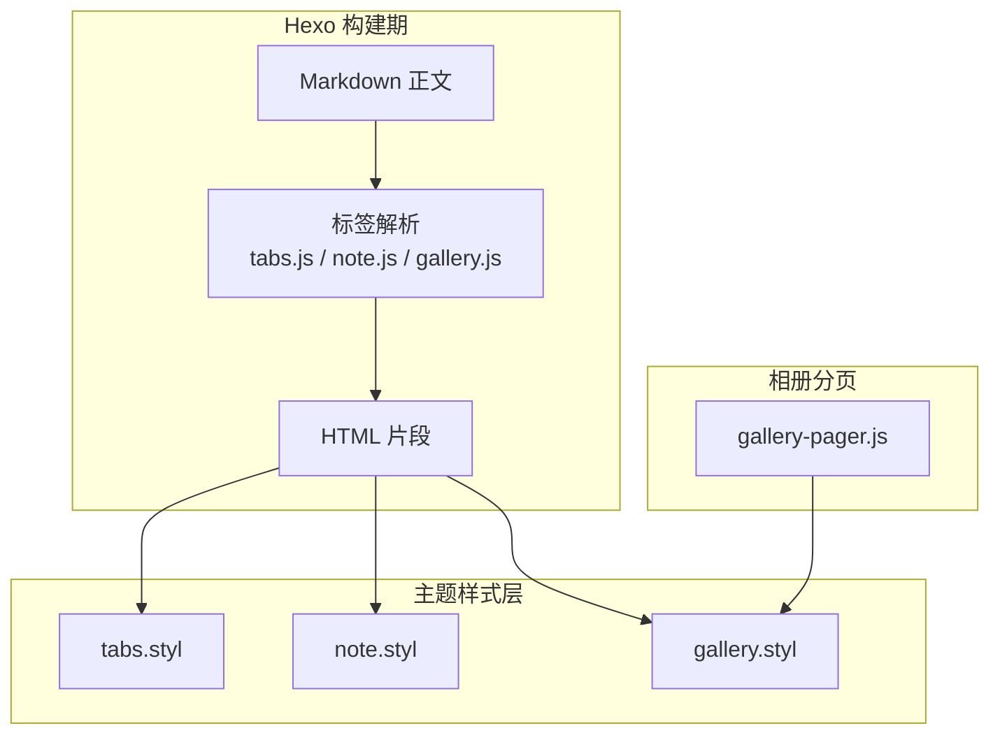
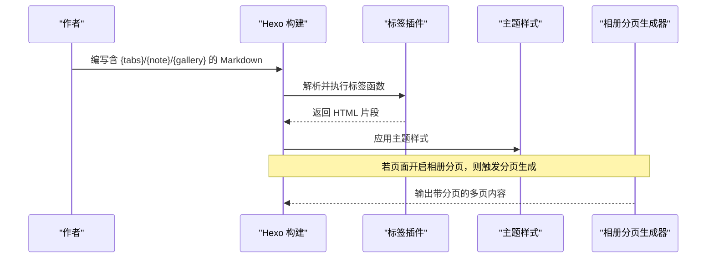
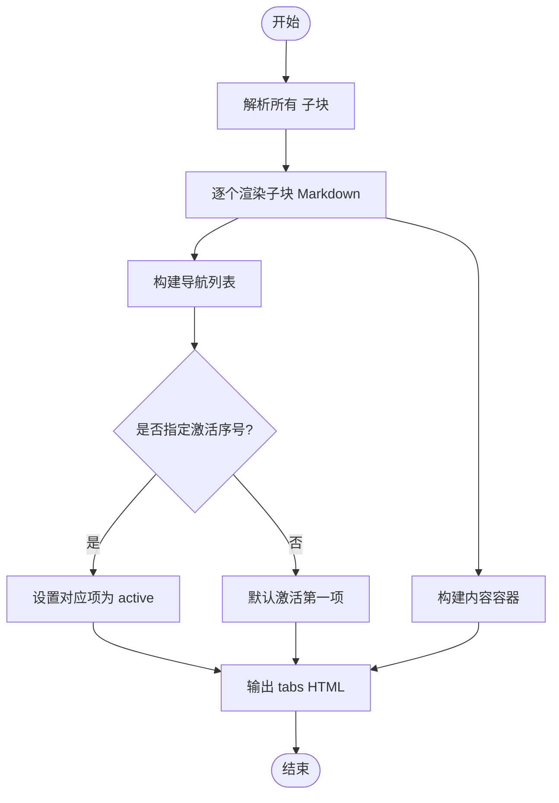
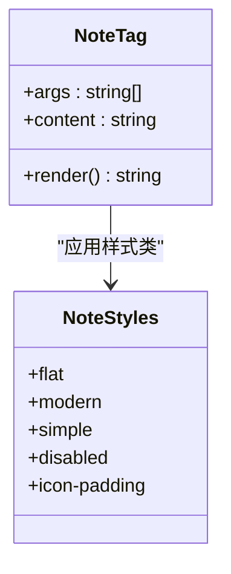
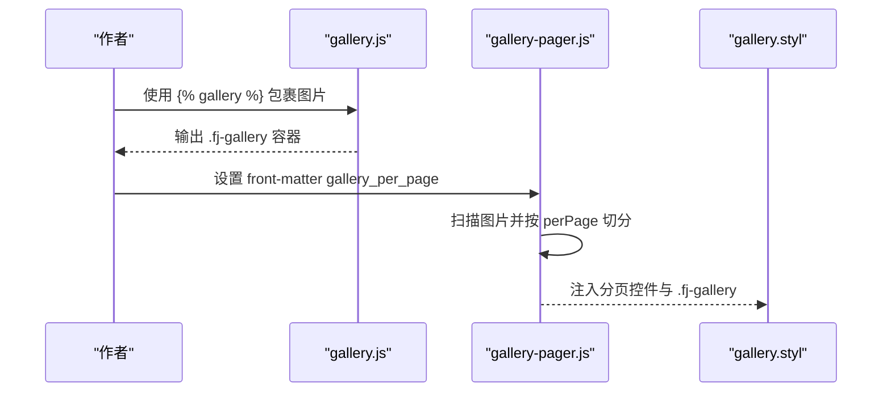
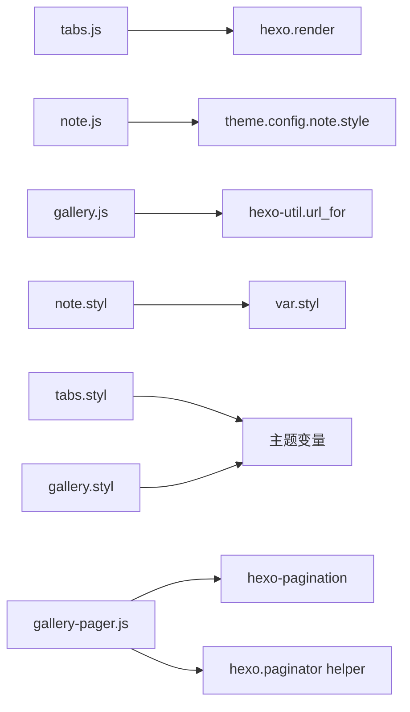

# 内容布局标签

<cite>
**本文引用的文件**   
- [tabs.js](file://themes/fomalhaut/scripts/tag/tabs.js)
- [note.js](file://themes/fomalhaut/scripts/tag/note.js)
- [gallery.js](file://themes/fomalhaut/scripts/tag/gallery.js)
- [tabs.styl](file://themes/fomalhaut/source/css/_tags/tabs.styl)
- [note.styl](file://themes/fomalhaut/source/css/_tags/note.styl)
- [gallery.styl](file://themes/fomalhaut/source/css/_tags/gallery.styl)
- [gallery-pager.js](file://scripts/gallery-pager.js)
- [var.styl](file://themes/fomalhaut/source/css/var.styl)
</cite>

## 目录
1. [简介](#简介)
2. [项目结构](#项目结构)
3. [核心组件](#核心组件)
4. [架构总览](#架构总览)
5. [详细组件分析](#详细组件分析)
6. [依赖关系分析](#依赖关系分析)
7. [性能与可访问性](#性能与可访问性)
8. [故障排查](#故障排查)
9. [结论](#结论)
10. [附录：配置与样式指南](#附录配置与样式指南)

## 简介
本文件面向 Hexo 主题中的“内容组织与布局”标签，重点说明以下三个标签的实现原理、使用方法与扩展方式：
- 选项卡（tabs）：用于在同一页面内以多面板切换的方式组织内容。
- 笔记框（note）：用于展示富文本笔记，支持多种风格与图标。
- 图片画廊（gallery）：用于展示图片集合，并提供相册自动分页能力。

这些标签由 Hexo 的标签插件机制在构建期渲染为 HTML，再由主题样式进行视觉呈现；其中 gallery 还配套了相册自动分页生成器，便于按固定数量对图片进行分页展示。

## 项目结构
与内容布局标签相关的代码主要分布在以下位置：
- 标签脚本：themes/fomalhaut/scripts/tag/{tabs,note,gallery}.js
- 标签样式：themes/fomalhaut/source/css/_tags/{tabs,note,gallery}.styl
- 变量定义：themes/fomalhaut/source/css/var.styl
- 相册分页生成器：scripts/gallery-pager.js

图表来源
- [tabs.js:9-58](file://themes/fomalhaut/scripts/tag/tabs.js#L9-L58)
- [note.js:9-24](file://themes/fomalhaut/scripts/tag/note.js#L9-L24)
- [gallery.js:10-34](file://themes/fomalhaut/scripts/tag/gallery.js#L10-L34)
- [tabs.styl:1-75](file://themes/fomalhaut/source/css/_tags/tabs.styl#L1-L75)
- [note.styl:1-122](file://themes/fomalhaut/source/css/_tags/note.styl#L1-L122)
- [gallery.styl:1-102](file://themes/fomalhaut/source/css/_tags/gallery.styl#L1-L102)
- [gallery-pager.js:56-144](file://scripts/gallery-pager.js#L56-L144)

章节来源
- [tabs.js:1-63](file://themes/fomalhaut/scripts/tag/tabs.js#L1-L63)
- [note.js:1-28](file://themes/fomalhaut/scripts/tag/note.js#L1-L28)
- [gallery.js:1-35](file://themes/fomalhaut/scripts/tag/gallery.js#L1-L35)
- [tabs.styl:1-75](file://themes/fomalhaut/source/css/_tags/tabs.styl#L1-L75)
- [note.styl:1-122](file://themes/fomalhaut/source/css/_tags/note.styl#L1-L122)
- [gallery.styl:1-102](file://themes/fomalhaut/source/css/_tags/gallery.styl#L1-L102)
- [gallery-pager.js:1-170](file://scripts/gallery-pager.js#L1-L170)

## 核心组件
- 选项卡（tabs）：通过正则匹配子块，将 Markdown 内容渲染为多个 tab 项，并生成导航与内容容器。默认激活第一个或指定序号的选项卡，并为每个内容区提供“回到顶部”按钮。
- 笔记框（note）：根据参数选择样式（flat/modern/simple/disabled），可选插入图标，并将内部 Markdown 渲染为富文本。
- 图片画廊（gallery）：包裹一组图片，配合相册分页生成器实现自动分页；同时提供 galleryGroup 卡片式分组入口。

章节来源
- [tabs.js:9-58](file://themes/fomalhaut/scripts/tag/tabs.js#L9-L58)
- [note.js:9-24](file://themes/fomalhaut/scripts/tag/note.js#L9-L24)
- [gallery.js:10-34](file://themes/fomalhaut/scripts/tag/gallery.js#L10-L34)

## 架构总览
标签渲染流程如下：
- 作者编写 Markdown，使用自定义标签语法。
- Hexo 在构建期调用标签插件函数，将标签体渲染为 HTML。
- 主题样式文件对生成的 HTML 进行视觉修饰。
- 相册分页生成器扫描包含图片的页面，按每页固定数量拆分并注入分页控件。

图表来源
- [tabs.js:9-58](file://themes/fomalhaut/scripts/tag/tabs.js#L9-L58)
- [note.js:9-24](file://themes/fomalhaut/scripts/tag/note.js#L9-L24)
- [gallery.js:10-34](file://themes/fomalhaut/scripts/tag/gallery.js#L10-L34)
- [gallery-pager.js:56-144](file://scripts/gallery-pager.js#L56-L144)

## 详细组件分析

### 选项卡（tabs）
- 功能要点
  - 支持嵌套层级：tabs、subtabs、subsubtabs 共用同一实现。
  - 子项语法：<!-- tab 标题@图标 --><!-- endtab -->。
  - 自动渲染子项内容为 Markdown。
  - 自动生成唯一 href，支持默认激活项或指定激活序号。
  - 为每个内容区追加“回到顶部”按钮，提升长内容体验。
- 交互流程
  - 构建期：解析所有 <!-- tab ... --> 块，生成导航列表与内容容器。
  - 运行期：由主题样式控制显示/隐藏与动画过渡。
- 关键实现路径
  - 正则提取子项与内容：[tabs.js:10-27](file://themes/fomalhaut/scripts/tag/tabs.js#L10-L27)
  - 渲染 Markdown 并生成 DOM：[tabs.js:29-52](file://themes/fomalhaut/scripts/tag/tabs.js#L29-L52)
  - 注册标签：[tabs.js:60-62](file://themes/fomalhaut/scripts/tag/tabs.js#L60-L62)
- 样式要点
  - 导航栏与内容区的布局、悬停与激活态：[tabs.styl:10-49](file://themes/fomalhaut/source/css/_tags/tabs.styl#L10-L49)
  - 内容区显隐与入场动画：[tabs.styl:50-62](file://themes/fomalhaut/source/css/_tags/tabs.styl#L50-L62)
  - “回到顶部”按钮定位与颜色：[tabs.styl:63-68](file://themes/fomalhaut/source/css/_tags/tabs.styl#L63-L68)

图表来源
- [tabs.js:10-52](file://themes/fomalhaut/scripts/tag/tabs.js#L10-L52)

章节来源
- [tabs.js:9-62](file://themes/fomalhaut/scripts/tag/tabs.js#L9-L62)
- [tabs.styl:1-75](file://themes/fomalhaut/source/css/_tags/tabs.styl#L1-L75)

### 笔记框（note）
- 功能要点
  - 支持样式参数：flat、modern、simple、disabled，未传时回退到主题配置。
  - 可选图标：传入以 fa 开头的类名，自动添加图标与内边距。
  - 内部内容按 Markdown 渲染，支持富文本。
- 关键实现路径
  - 样式参数处理与默认值：[note.js:10-14](file://themes/fomalhaut/scripts/tag/note.js#L10-L14)
  - 图标检测与注入：[note.js:16-21](file://themes/fomalhaut/scripts/tag/note.js#L16-L21)
  - 渲染 Markdown 并输出容器：[note.js:23-24](file://themes/fomalhaut/scripts/tag/note.js#L23-L24)
  - 注册标签：[note.js:26-27](file://themes/fomalhaut/scripts/tag/note.js#L26-L27)
- 样式要点
  - 基础布局、圆角、图标定位与内边距：[note.styl:1-18](file://themes/fomalhaut/source/css/_tags/note.styl#L1-L18)
  - 类型色与 flat/modern/simple 变体：[note.styl:19-47](file://themes/fomalhaut/source/css/_tags/note.styl#L19-L47)
  - 内置图标与类型前缀伪元素：[note.styl:76-122](file://themes/fomalhaut/source/css/_tags/note.styl#L76-L122)

图表来源
- [note.js:9-24](file://themes/fomalhaut/scripts/tag/note.js#L9-L24)
- [note.styl:1-122](file://themes/fomalhaut/source/css/_tags/note.styl#L1-L122)

章节来源
- [note.js:1-28](file://themes/fomalhaut/scripts/tag/note.js#L1-L28)
- [note.styl:1-122](file://themes/fomalhaut/source/css/_tags/note.styl#L1-L122)

### 图片画廊（gallery）
- 功能要点
  - gallery 标签：包裹一段 Markdown，统一输出 fj-gallery 容器。
  - galleryGroup 标签：生成卡片式分组入口，包含封面图、名称、描述与跳转链接。
  - 相册分页：通过 gallery-pager.js 自动识别图片并按每页固定数量拆分，注入分页控件。
- 关键实现路径
  - gallery 标签：[gallery.js:10-13](file://themes/fomalhaut/scripts/tag/gallery.js#L10-L13)
  - galleryGroup 标签：[gallery.js:15-31](file://themes/fomalhaut/scripts/tag/gallery.js#L15-L31)
  - 相册分页生成器：[gallery-pager.js:56-144](file://scripts/gallery-pager.js#L56-L144)
- 样式要点
  - 画廊容器与卡片布局、悬浮动效：[gallery.styl:1-92](file://themes/fomalhaut/source/css/_tags/gallery.styl#L1-L92)
  - 相册容器与辅助类：[gallery.styl:93-102](file://themes/fomalhaut/source/css/_tags/gallery.styl#L93-L102)

图表来源
- [gallery.js:10-34](file://themes/fomalhaut/scripts/tag/gallery.js#L10-L34)
- [gallery-pager.js:56-144](file://scripts/gallery-pager.js#L56-L144)
- [gallery.styl:1-102](file://themes/fomalhaut/source/css/_tags/gallery.styl#L1-L102)

章节来源
- [gallery.js:1-35](file://themes/fomalhaut/scripts/tag/gallery.js#L1-L35)
- [gallery-pager.js:1-170](file://scripts/gallery-pager.js#L1-L170)
- [gallery.styl:1-102](file://themes/fomalhaut/source/css/_tags/gallery.styl#L1-L102)

## 依赖关系分析
- 标签脚本依赖
  - tabs.js：仅依赖 Hexo 渲染 API 与日志接口。
  - note.js：依赖主题配置 hexo.theme.config.note.style。
  - gallery.js：依赖 hexo-util.url_for 生成资源 URL。
- 样式依赖
  - note.styl：引用 var.styl 中定义的 $note-types 等变量。
  - tabs.styl：使用主题变量控制边框、背景与激活态颜色。
  - gallery.styl：使用主题变量控制画廊颜色与响应式断点。
- 相册分页依赖
  - gallery-pager.js：依赖 hexo-pagination 与 Hexo 助手 paginator，注入 #pagination 控件。

图表来源
- [tabs.js:9-58](file://themes/fomalhaut/scripts/tag/tabs.js#L9-L58)
- [note.js:9-24](file://themes/fomalhaut/scripts/tag/note.js#L9-L24)
- [gallery.js:10-34](file://themes/fomalhaut/scripts/tag/gallery.js#L10-L34)
- [note.styl:87-122](file://themes/fomalhaut/source/css/_tags/note.styl#L87-L122)
- [var.styl:109-118](file://themes/fomalhaut/source/css/var.styl#L109-L118)
- [gallery-pager.js:17-33](file://scripts/gallery-pager.js#L17-L33)

章节来源
- [tabs.js:1-63](file://themes/fomalhaut/scripts/tag/tabs.js#L1-L63)
- [note.js:1-28](file://themes/fomalhaut/scripts/tag/note.js#L1-L28)
- [gallery.js:1-35](file://themes/fomalhaut/scripts/tag/gallery.js#L1-L35)
- [note.styl:1-122](file://themes/fomalhaut/source/css/_tags/note.styl#L1-L122)
- [var.styl:109-118](file://themes/fomalhaut/source/css/var.styl#L109-L118)
- [gallery-pager.js:1-170](file://scripts/gallery-pager.js#L1-L170)

## 性能与可访问性
- 构建期渲染
  - 标签均在构建期完成 Markdown 渲染与 HTML 生成，运行时开销低。
- 动画与过渡
  - tabs 的内容区切换带有入场动画，注意避免过多大尺寸内容导致首屏重绘压力。
- 可访问性
  - tabs 为每个内容区提供“回到顶部”按钮，改善长内容阅读体验。
  - galleryGroup 的封面图与figcaption结构清晰，利于语义化与屏幕阅读器。

[本节为通用指导，不直接分析具体文件]

## 故障排查
- tabs 未生效
  - 检查是否正确使用了 <!-- tab 标题@图标 --> 与 <!-- endtab --> 成对标记。
  - 确认 tabName 唯一且未留空，否则会有警告日志。
  - 参考：[tabs.js:22-27](file://themes/fomalhaut/scripts/tag/tabs.js#L22-L27)
- note 样式异常
  - 确认传入的样式参数为 flat/modern/simple/disabled 之一，否则会自动使用主题配置。
  - 如需图标，请传入以 fa 开头的类名，确保字体库已加载。
  - 参考：[note.js:10-21](file://themes/fomalhaut/scripts/tag/note.js#L10-L21)
- gallery 图片未分页
  - 确认页面 front-matter 设置了 gallery_per_page。
  - 确认正文中包含标准 Markdown 图片语法行，或手动插入 <!-- pagebreak --> 强制分页。
  - 参考：[gallery-pager.js:57-87](file://scripts/gallery-pager.js#L57-L87)

章节来源
- [tabs.js:22-27](file://themes/fomalhaut/scripts/tag/tabs.js#L22-L27)
- [note.js:10-21](file://themes/fomalhaut/scripts/tag/note.js#L10-L21)
- [gallery-pager.js:57-87](file://scripts/gallery-pager.js#L57-L87)

## 结论
- tabs 提供了轻量、可扩展的多面板组织方案，适合文档、教程与对比型内容。
- note 提供了丰富的笔记样式与图标能力，适合提示、警告、说明等富文本场景。
- gallery 结合相册分页生成器，能高效地展示大量图片，并保持统一的视觉风格与分页体验。
- 三者均遵循“构建期渲染 + 主题样式驱动”的模式，易于维护与扩展。

[本节为总结性内容，不直接分析具体文件]

## 附录：配置与样式指南

### 选项卡（tabs）
- 基本用法
  - 外层容器：{tabs 唯一名称, 默认激活序号}
  - 子项：<!-- tab 标题@图标 --> 内容 <!-- endtab -->
  - 支持 subtabs、subsubtabs 嵌套。
- 配置项
  - 唯一名称：用于生成 id 与锚点，需全局唯一。
  - 默认激活序号：从 1 开始，未传则默认第一项。
- 样式定制
  - 导航背景、激活边框、悬停背景等可通过主题变量覆盖。
  - 参考样式：[tabs.styl:10-49](file://themes/fomalhaut/source/css/_tags/tabs.styl#L10-L49)

章节来源
- [tabs.js:9-58](file://themes/fomalhaut/scripts/tag/tabs.js#L9-L58)
- [tabs.styl:1-75](file://themes/fomalhaut/source/css/_tags/tabs.styl#L1-L75)

### 笔记框（note）
- 基本用法
  - {note 样式 图标类名} 内容 {/note}
  - 样式：flat / modern / simple / disabled，未传时使用主题配置。
  - 图标：传入以 fa 开头的类名，自动添加图标与内边距。
- 配置项
  - 主题配置 note.style：默认样式回退。
  - 主题变量 $note-types：定义可用类型与图标。
- 样式定制
  - 圆角、边框、背景与文字颜色均可通过主题变量调整。
  - 参考样式：[note.styl:1-47](file://themes/fomalhaut/source/css/_tags/note.styl#L1-L47)
  - 类型与图标映射：[note.styl:87-122](file://themes/fomalhaut/source/css/_tags/note.styl#L87-L122)
  - 类型变量定义：[var.styl:109-118](file://themes/fomalhaut/source/css/var.styl#L109-L118)

章节来源
- [note.js:9-24](file://themes/fomalhaut/scripts/tag/note.js#L9-L24)
- [note.styl:1-122](file://themes/fomalhaut/source/css/_tags/note.styl#L1-L122)
- [var.styl:109-118](file://themes/fomalhaut/source/css/var.styl#L109-L118)

### 图片画廊（gallery）
- 基本用法
  - 单页画廊：{gallery} 若干 Markdown 图片 {/gallery}
  - 分组入口：{galleryGroup 名称 描述 链接 封面图}
  - 自动分页：在页面 front-matter 设置 gallery_per_page，正文按顺序写图片即可。
- 配置项
  - gallery_per_page：每页图片数，默认 12。
  - 强制分页：单独一行写入 <!-- pagebreak -->。
- 样式定制
  - 卡片宽高、悬浮效果、标题与描述排版等。
  - 参考样式：[gallery.styl:1-92](file://themes/fomalhaut/source/css/_tags/gallery.styl#L1-L92)
  - 相册容器与辅助类：[gallery.styl:93-102](file://themes/fomalhaut/source/css/_tags/gallery.styl#L93-L102)

章节来源
- [gallery.js:10-34](file://themes/fomalhaut/scripts/tag/gallery.js#L10-L34)
- [gallery-pager.js:56-144](file://scripts/gallery-pager.js#L56-L144)
- [gallery.styl:1-102](file://themes/fomalhaut/source/css/_tags/gallery.styl#L1-L102)