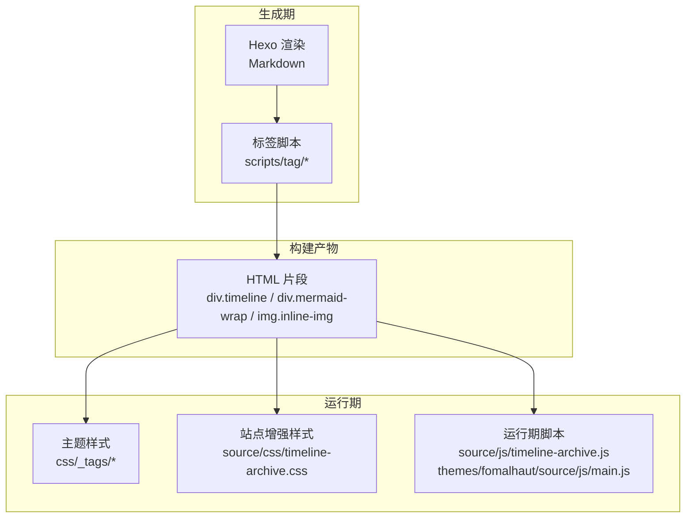
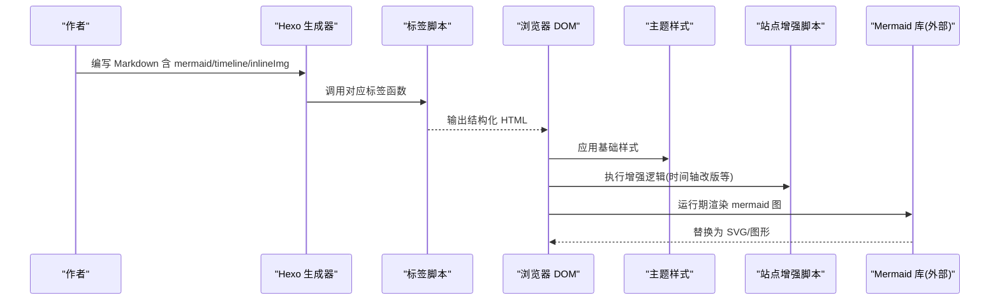
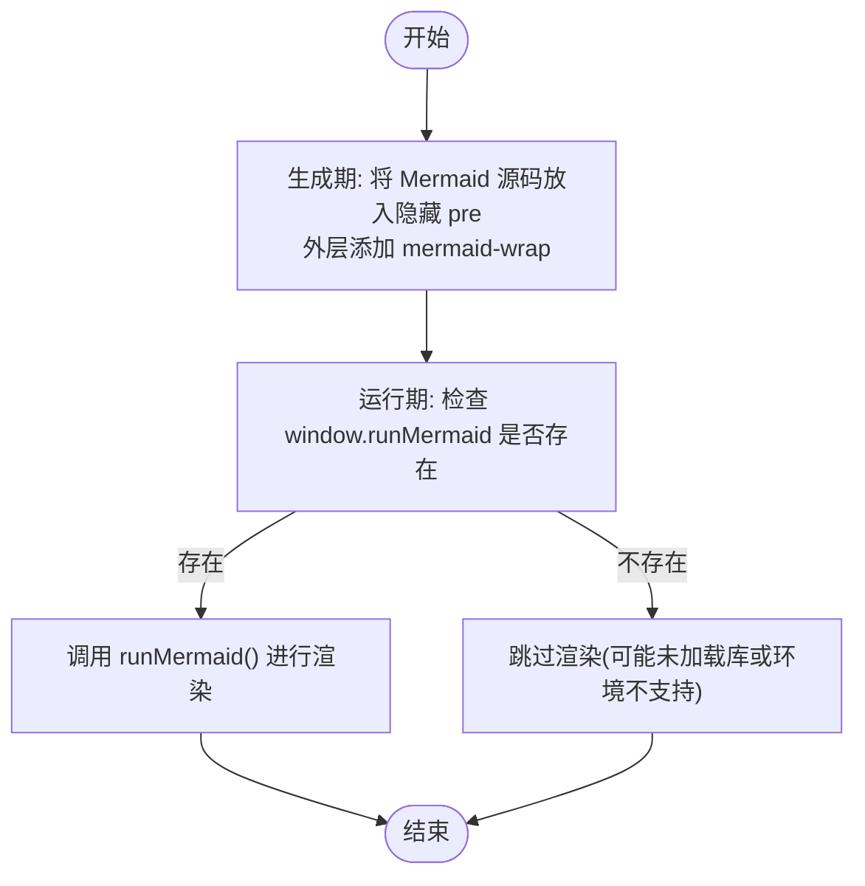
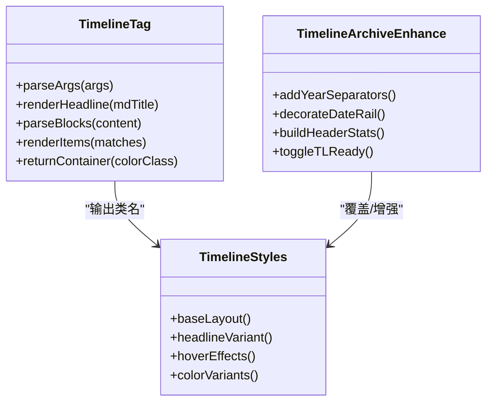
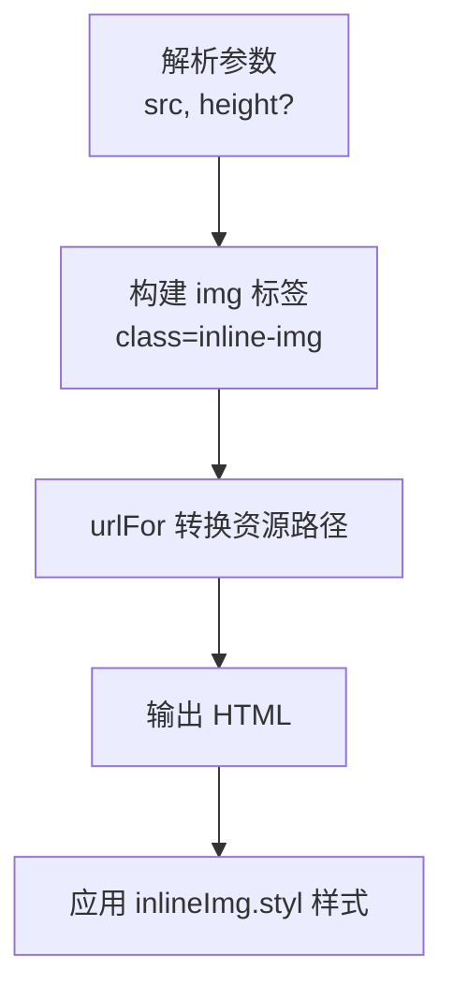
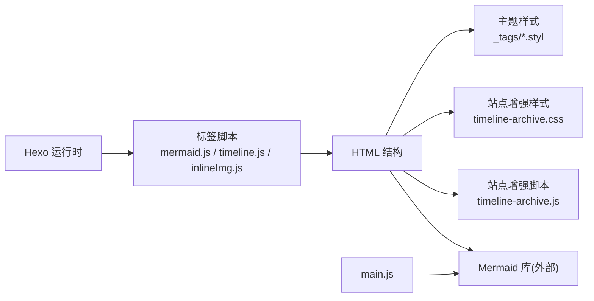

# 可视化展示标签

<cite>
**本文引用的文件**   
- [mermaid.js](file://themes/fomalhaut/scripts/tag/mermaid.js)
- [timeline.js](file://themes/fomalhaut/scripts/tag/timeline.js)
- [inlineImg.js](file://themes/fomalhaut/scripts/tag/inlineImg.js)
- [timeline.styl](file://themes/fomalhaut/source/css/_tags/timeline.styl)
- [inlineImg.styl](file://themes/fomalhaut/source/css/_tags/inlineImg.styl)
- [main.js](file://themes/fomalhaut/source/js/main.js)
- [timeline-archive.css](file://source/css/timeline-archive.css)
- [timeline-archive.js](file://source/js/timeline-archive.js)
- [_config.fomalhaut.yml](file://_config.fomalhaut.yml)
- [外挂标签速查.md](file://source/_posts/2026-10-02-外挂标签速查.md)
</cite>

## 目录
1. [引言](#引言)
2. [项目结构](#项目结构)
3. [核心组件](#核心组件)
4. [架构总览](#架构总览)
5. [详细组件分析](#详细组件分析)
6. [依赖关系分析](#依赖关系分析)
7. [性能与优化建议](#性能与优化建议)
8. [故障排查指南](#故障排查指南)
9. [结论](#结论)
10. [附录：语法与配置速查](#附录语法与配置速查)

## 引言
本文件面向使用 Hexo + Fomalhaut 主题的博客作者，系统说明三类可视化展示标签的实现机制与使用方法：Mermaid 图表、时间线（timeline）和内联图片（inlineImg）。文档从“生成期标签脚本 → 渲染期 DOM 结构 → 运行期样式与行为”的完整链路出发，解释如何绘制流程图与架构图、创建时间轴展示，以及如何优化内联图片显示效果。同时给出语法规范、配置项说明和性能优化建议，并附带实际案例路径，便于快速上手与二次扩展。

## 项目结构
可视化标签在主题中采用“脚本层 + 样式层 + 站点增强层”的分层组织方式：
- 脚本层：位于 themes/fomalhaut/scripts/tag/，负责把 Markdown 中的自定义标签转换为 HTML。
- 样式层：位于 themes/fomalhaut/source/css/_tags/，定义标签的基础外观。
- 站点增强层：位于 source/css 与 source/js，提供页面级增强样式与交互逻辑（如旧时光时间轴改版）。

**图示来源**
- [mermaid.js:11-17](file://themes/fomalhaut/scripts/tag/mermaid.js#L11-L17)
- [timeline.js:8-41](file://themes/fomalhaut/scripts/tag/timeline.js#L8-L41)
- [inlineImg.js:10-17](file://themes/fomalhaut/scripts/tag/inlineImg.js#L10-L17)
- [timeline.styl:1-68](file://themes/fomalhaut/source/css/_tags/timeline.styl#L1-L68)
- [inlineImg.styl:1-6](file://themes/fomalhaut/source/css/_tags/inlineImg.styl#L1-L6)
- [timeline-archive.css:1-31](file://source/css/timeline-archive.css#L1-L31)
- [timeline-archive.js:1-19](file://source/js/timeline-archive.js#L1-L19)
- [main.js:492-493](file://themes/fomalhaut/source/js/main.js#L492-L493)

**章节来源**
- [mermaid.js:11-17](file://themes/fomalhaut/scripts/tag/mermaid.js#L11-L17)
- [timeline.js:8-41](file://themes/fomalhaut/scripts/tag/timeline.js#L8-L41)
- [inlineImg.js:10-17](file://themes/fomalhaut/scripts/tag/inlineImg.js#L10-L17)
- [timeline.styl:1-68](file://themes/fomalhaut/source/css/_tags/timeline.styl#L1-L68)
- [inlineImg.styl:1-6](file://themes/fomalhaut/source/css/_tags/inlineImg.styl#L1-L6)
- [timeline-archive.css:1-31](file://source/css/timeline-archive.css#L1-L31)
- [timeline-archive.js:1-19](file://source/js/timeline-archive.js#L1-L19)
- [main.js:492-493](file://themes/fomalhaut/source/js/main.js#L492-L493)

## 核心组件
本节聚焦三个可视化标签的核心职责与输出结构：
- Mermaid：将 Mermaid 源码包裹为隐藏节点，等待运行期渲染。
- Timeline：解析标题与条目块，生成带类名的容器与条目节点，支持可选颜色主题。
- inlineImg：根据参数生成内联图片元素，支持高度控制。

**章节来源**
- [mermaid.js:11-17](file://themes/fomalhaut/scripts/tag/mermaid.js#L11-L17)
- [timeline.js:8-41](file://themes/fomalhaut/scripts/tag/timeline.js#L8-L41)
- [inlineImg.js:10-17](file://themes/fomalhaut/scripts/tag/inlineImg.js#L10-L17)

## 架构总览
下图展示了从 Markdown 到最终可视化的关键流程：

**图示来源**
- [mermaid.js:11-17](file://themes/fomalhaut/scripts/tag/mermaid.js#L11-L17)
- [timeline.js:8-41](file://themes/fomalhaut/scripts/tag/timeline.js#L8-L41)
- [inlineImg.js:10-17](file://themes/fomalhaut/scripts/tag/inlineImg.js#L10-L17)
- [timeline.styl:1-68](file://themes/fomalhaut/source/css/_tags/timeline.styl#L1-L68)
- [timeline-archive.css:1-31](file://source/css/timeline-archive.css#L1-L31)
- [timeline-archive.js:1-19](file://source/js/timeline-archive.js#L1-L19)
- [main.js:492-493](file://themes/fomalhaut/source/js/main.js#L492-L493)

## 详细组件分析

### Mermaid 图表标签
- 生成期行为：标签函数将 Mermaid 源码放入一个隐藏的 pre 节点，外层用 mermaid-wrap 包裹，避免直接渲染阻塞构建。
- 运行期行为：主入口脚本检测全局 runMermaid 函数并调用，完成图表渲染。
- 适用场景：流程图、架构图、时序图等任意 Mermaid 支持的图表类型。

**图示来源**
- [mermaid.js:11-17](file://themes/fomalhaut/scripts/tag/mermaid.js#L11-L17)
- [main.js:492-493](file://themes/fomalhaut/source/js/main.js#L492-L493)

实现要点与建议：
- 确保运行期已加载 Mermaid 库并提供 window.runMermaid。
- 若需自定义主题或缩放，可在运行期初始化前设置 Mermaid 配置。
- 大量图表时考虑懒加载或按需渲染，避免首屏压力。

**章节来源**
- [mermaid.js:11-17](file://themes/fomalhaut/scripts/tag/mermaid.js#L11-L17)
- [main.js:492-493](file://themes/fomalhaut/source/js/main.js#L492-L493)

### 时间线（timeline）标签
- 生成期行为：
  - 支持可选标题参数，作为 headline 条目。
  - 通过正则匹配 <!-- timeline ... --> 与 <!-- endtimeline --> 之间的内容，分别渲染标题与正文。
  - 输出 .timeline 容器，内部包含多个 .timeline-item，每个条目包含 .timeline-item-title 与 .timeline-item-content。
  - 支持通过第二个参数传入颜色类名，用于主题色切换。
- 样式层：
  - 基础样式定义在 timeline.styl，包括左侧轨道、圆点、悬停高亮、headline 放大等。
- 站点增强：
  - timeline-archive.css 与 timeline-archive.js 对“旧时光”页面进行增强：年份分组、日期轨、卡片装饰条、统计头部等，且以 .tl-ready 作为开关，保证降级回退。

**图示来源**
- [timeline.js:8-41](file://themes/fomalhaut/scripts/tag/timeline.js#L8-L41)
- [timeline.styl:1-68](file://themes/fomalhaut/source/css/_tags/timeline.styl#L1-L68)
- [timeline-archive.css:1-31](file://source/css/timeline-archive.css#L1-L31)
- [timeline-archive.js:1-19](file://source/js/timeline-archive.js#L1-L19)

实现要点与建议：
- 使用  包裹多条 <!-- timeline 日期 --> ... <!-- endtimeline --> 条目。
- 可通过第二个参数指定颜色类名，配合主题变量实现多主题。
- 在“旧时光”页面启用增强样式与脚本后，会自动增加年份分隔、统计头部等结构。

**章节来源**
- [timeline.js:8-41](file://themes/fomalhaut/scripts/tag/timeline.js#L8-L41)
- [timeline.styl:1-68](file://themes/fomalhaut/source/css/_tags/timeline.styl#L1-L68)
- [timeline-archive.css:1-31](file://source/css/timeline-archive.css#L1-L31)
- [timeline-archive.js:1-19](file://source/js/timeline-archive.js#L1-L19)

### 内联图片（inlineImg）标签
- 生成期行为：根据 src 与可选 height 参数，生成 ，并使用 urlFor 处理资源路径。
- 样式层：inlineImg.styl 定义内联图片的行内布局、行间距与垂直对齐，使其与文本基线对齐。
- 优化建议：
  - 使用合适的 height 值保持行高稳定，避免换行抖动。
  - 结合主题 lazyload 配置，减少首屏压力。
  - 使用 WebP/AVIF 等现代格式，提升加载速度。

**图示来源**
- [inlineImg.js:10-17](file://themes/fomalhaut/scripts/tag/inlineImg.js#L10-L17)
- [inlineImg.styl:1-6](file://themes/fomalhaut/source/css/_tags/inlineImg.styl#L1-L6)

实现要点与建议：
- 推荐在文章中使用 ，高度单位可为 px/em/rem。
- 如需响应式，可结合 CSS 媒体查询调整 inline-img 的 max-width 与 height。
- 与主题 lazyload 配合，开启 blur 占位以提升感知性能。

**章节来源**
- [inlineImg.js:10-17](file://themes/fomalhaut/scripts/tag/inlineImg.js#L10-L17)
- [inlineImg.styl:1-6](file://themes/fomalhaut/source/css/_tags/inlineImg.styl#L1-L6)

## 依赖关系分析
- 标签脚本依赖 Hexo 提供的 render 与 urlFor 能力。
- Mermaid 渲染依赖运行期的 window.runMermaid，通常由主题或第三方脚本注入。
- Timeline 样式依赖主题变量（如 --theme-color），增强脚本依赖 .tl-ready 开关。
- inlineImg 依赖 urlFor 正确解析静态资源路径。

**图示来源**
- [mermaid.js:11-17](file://themes/fomalhaut/scripts/tag/mermaid.js#L11-L17)
- [timeline.js:8-41](file://themes/fomalhaut/scripts/tag/timeline.js#L8-L41)
- [inlineImg.js:10-17](file://themes/fomalhaut/scripts/tag/inlineImg.js#L10-L17)
- [timeline.styl:1-68](file://themes/fomalhaut/source/css/_tags/timeline.styl#L1-L68)
- [timeline-archive.css:1-31](file://source/css/timeline-archive.css#L1-L31)
- [timeline-archive.js:1-19](file://source/js/timeline-archive.js#L1-L19)
- [main.js:492-493](file://themes/fomalhaut/source/js/main.js#L492-L493)

**章节来源**
- [mermaid.js:11-17](file://themes/fomalhaut/scripts/tag/mermaid.js#L11-L17)
- [timeline.js:8-41](file://themes/fomalhaut/scripts/tag/timeline.js#L8-L41)
- [inlineImg.js:10-17](file://themes/fomalhaut/scripts/tag/inlineImg.js#L10-L17)
- [timeline.styl:1-68](file://themes/fomalhaut/source/css/_tags/timeline.styl#L1-L68)
- [timeline-archive.css:1-31](file://source/css/timeline-archive.css#L1-L31)
- [timeline-archive.js:1-19](file://source/js/timeline-archive.js#L1-L19)
- [main.js:492-493](file://themes/fomalhaut/source/js/main.js#L492-L493)

## 性能与优化建议
- Mermaid
  - 仅在需要时渲染：确保 runMermaid 只在可见区域或用户交互后触发。
  - 控制复杂度：避免单图节点过多；必要时拆分多图。
  - 主题与缩放：在运行期初始化前设置合适 theme 与 zoom，减少重绘。
- Timeline
  - 使用 .tl-ready 开关：仅对目标页面启用增强样式与脚本，避免无关开销。
  - 控制条目数量：长列表分页或折叠，减少一次性渲染成本。
  - 利用主题变量：通过 --theme-color 派生配色，避免硬编码导致的额外计算。
- inlineImg
  - 合理设置 height：保持行高稳定，避免重排。
  - 启用 lazyload：结合 _config.fomalhaut.yml 中的 lazyload 配置，减少首屏负载。
  - 使用现代图片格式：WebP/AVIF，配合响应式 srcset（可扩展）。

[本节为通用指导，不直接分析具体文件]

## 故障排查指南
- Mermaid 不渲染
  - 检查是否加载了 Mermaid 库以及 window.runMermaid 是否存在。
  - 确认 main.js 中是否正确调用 runMermaid。
- Timeline 样式异常
  - 检查 .timeline 容器是否包含正确的子节点类名。
  - 在“旧时光”页面确认 .tl-ready 是否被脚本添加。
- inlineImg 错位或尺寸异常
  - 检查 height 参数是否有效。
  - 确认 inlineImg.styl 未被其他样式覆盖。
- 主题色不一致
  - 检查 timeline.styl 中的颜色变量映射。
  - 确认 _config.fomalhaut.yml 中是否启用了相关样式注入。

**章节来源**
- [main.js:492-493](file://themes/fomalhaut/source/js/main.js#L492-L493)
- [timeline.styl:1-68](file://themes/fomalhaut/source/css/_tags/timeline.styl#L1-L68)
- [timeline-archive.css:1-31](file://source/css/timeline-archive.css#L1-L31)
- [timeline-archive.js:1-19](file://source/js/timeline-archive.js#L1-L19)
- [inlineImg.styl:1-6](file://themes/fomalhaut/source/css/_tags/inlineImg.styl#L1-L6)
- [_config.fomalhaut.yml:1147-1154](file://_config.fomalhaut.yml#L1147-L1154)

## 结论
Mermaid、timeline 与 inlineImg 三类标签分别从“生成期结构输出、运行期渲染、样式与增强”三个层面协作，形成完整的可视化展示体系。通过合理的语法与配置，可以在博客中轻松绘制流程图与架构图、创建时间轴展示，并优化内联图片的显示效果。建议在大规模图表与长列表场景中引入懒加载与条件渲染，以获得更优的性能体验。

[本节为总结性内容，不直接分析具体文件]

## 附录：语法与配置速查
- Mermaid
  - 语法：...
  - 示例参考：[外链标签速查.md:103-110](file://source/_posts/2026-10-02-外挂标签速查.md#L103-L110)
- Timeline
  - 语法：<!-- timeline 日期 -->内容<!-- endtimeline -->
  - 示例参考：[外链标签速查.md:84-101](file://source/_posts/2026-10-02-外挂标签速查.md#L84-L101)
- inlineImg
  - 语法：
  - 示例参考：[外链标签速查.md:82-92](file://source/_posts/2026-10-02-外挂标签速查.md#L82-L92)
- Lazyload 配置
  - 位置：_config.fomalhaut.yml
  - 关键项：enable、field、placeholder、blur

**章节来源**
- [外挂标签速查.md:82-115](file://source/_posts/2026-10-02-外挂标签速查.md#L82-L115)
- [_config.fomalhaut.yml:1147-1154](file://_config.fomalhaut.yml#L1147-L1154)