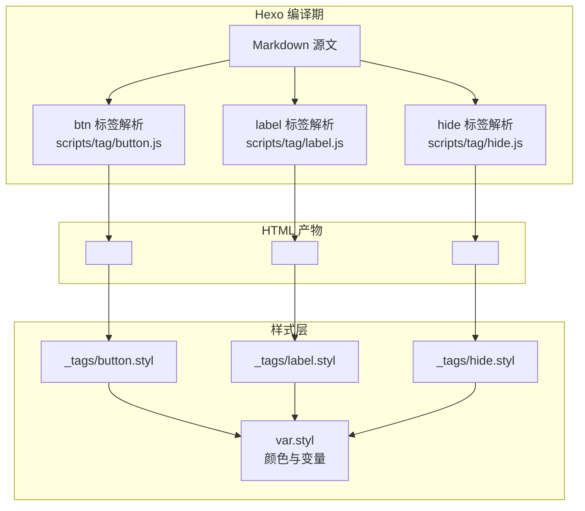
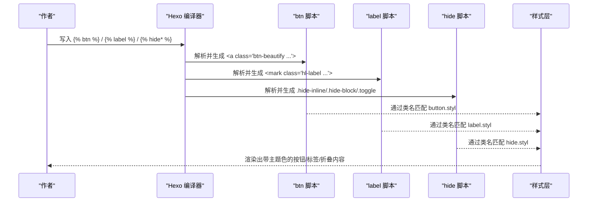
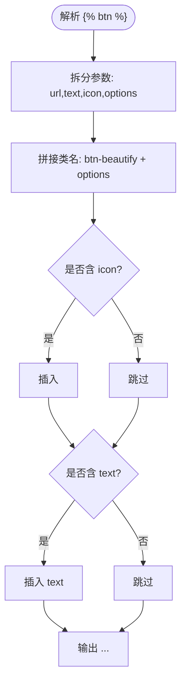
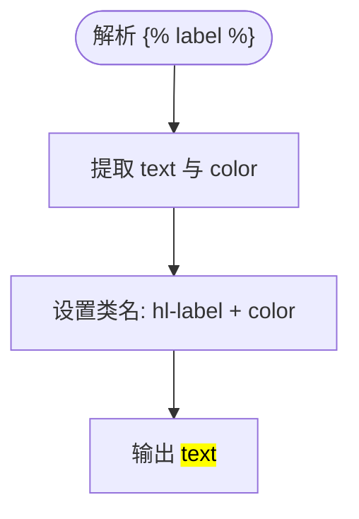
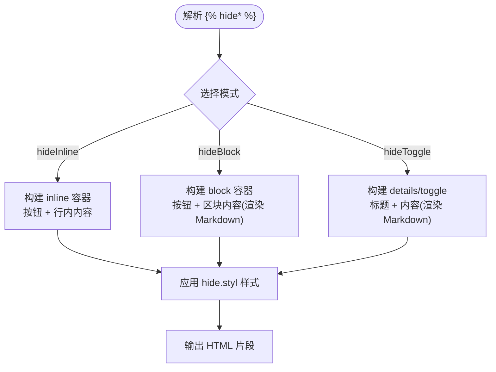
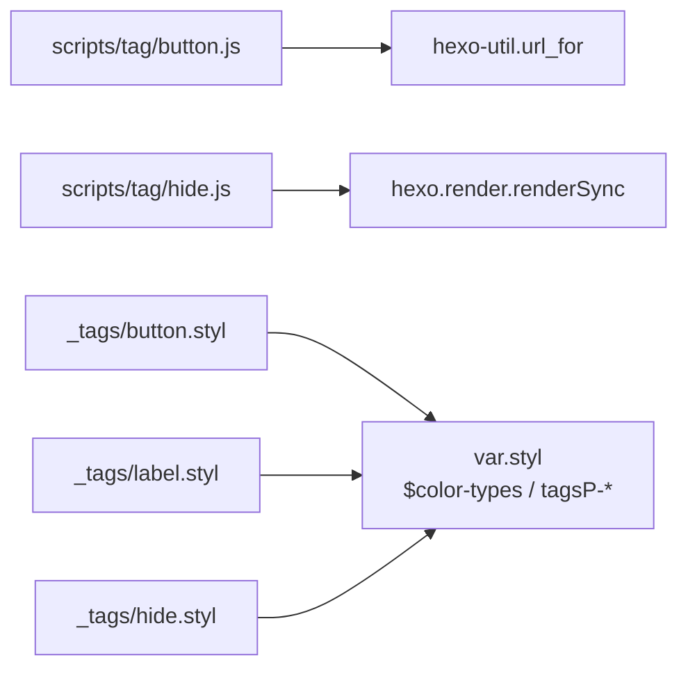

# 基础标签组件

<cite>
**本文引用的文件**   
- [button.js](file://themes/fomalhaut/scripts/tag/button.js)
- [label.js](file://themes/fomalhaut/scripts/tag/label.js)
- [hide.js](file://themes/fomalhaut/scripts/tag/hide.js)
- [button.styl](file://themes/fomalhaut/source/css/_tags/button.styl)
- [label.styl](file://themes/fomalhaut/source/css/_tags/label.styl)
- [hide.styl](file://themes/fomalhaut/source/css/_tags/hide.styl)
- [var.styl](file://themes/fomalhaut/source/css/var.styl)
</cite>

## 目录
1. [简介](#简介)
2. [项目结构](#项目结构)
3. [核心组件](#核心组件)
4. [架构总览](#架构总览)
5. [详细组件分析](#详细组件分析)
6. [依赖关系分析](#依赖关系分析)
7. [性能与可访问性](#性能与可访问性)
8. [故障排查](#故障排查)
9. [结论](#结论)
10. [附录：语法速查与示例](#附录语法速查与示例)

## 简介
本文聚焦 Hexo 主题中的基础标签组件，包括按钮（btn）、标签标记（label）和隐藏内容（hide）。文档将说明它们的语法、参数、渲染产物、样式体系以及自定义覆盖方法，并提供可直接复用的使用示例。

## 项目结构
这些基础组件由“脚本标签 + 样式”两部分组成：
- 脚本位于 themes/fomalhaut/scripts/tag，负责在 Markdown 编译阶段把自定义标签转换为 HTML。
- 样式位于 themes/fomalhaut/source/css/_tags，负责定义按钮、标签、隐藏内容的视觉表现。
- 颜色变量集中在 var.styl，统一提供主题色、标签色系等变量。

图表来源
- [button.js:1-29](file://themes/fomalhaut/scripts/tag/button.js#L1-L29)
- [label.js:1-17](file://themes/fomalhaut/scripts/tag/label.js#L1-L17)
- [hide.js:1-71](file://themes/fomalhaut/scripts/tag/hide.js#L1-L71)
- [button.styl:1-56](file://themes/fomalhaut/source/css/_tags/button.styl#L1-L56)
- [label.styl:1-12](file://themes/fomalhaut/source/css/_tags/label.styl#L1-L12)
- [hide.styl:1-46](file://themes/fomalhaut/source/css/_tags/hide.styl#L1-L46)
- [var.styl:166-175](file://themes/fomalhaut/source/css/var.styl#L166-L175)

章节来源
- [button.js:1-29](file://themes/fomalhaut/scripts/tag/button.js#L1-L29)
- [label.js:1-17](file://themes/fomalhaut/scripts/tag/label.js#L1-L17)
- [hide.js:1-71](file://themes/fomalhaut/scripts/tag/hide.js#L1-L71)
- [button.styl:1-56](file://themes/fomalhaut/source/css/_tags/button.styl#L1-L56)
- [label.styl:1-12](file://themes/fomalhaut/source/css/_tags/label.styl#L1-L12)
- [hide.styl:1-46](file://themes/fomalhaut/source/css/_tags/hide.styl#L1-L46)
- [var.styl:166-175](file://themes/fomalhaut/source/css/var.styl#L166-L175)

## 核心组件
- btn：生成带链接的按钮，支持颜色、轮廓、居中、块级、放大等修饰类。
- label：生成彩色小标签，支持多种预设颜色。
- hide：提供三种隐藏交互模式：行内展开、区块折叠、原生 details 切换。

章节来源
- [button.js:1-29](file://themes/fomalhaut/scripts/tag/button.js#L1-L29)
- [label.js:1-17](file://themes/fomalhaut/scripts/tag/label.js#L1-L17)
- [hide.js:1-71](file://themes/fomalhaut/scripts/tag/hide.js#L1-L71)

## 架构总览
下图展示从 Markdown 到最终页面的数据流：用户编写自定义标签 → Hexo 调用对应脚本生成 HTML → 样式层根据类名应用主题配色与交互效果。

图表来源
- [button.js:12-28](file://themes/fomalhaut/scripts/tag/button.js#L12-L28)
- [label.js:9-16](file://themes/fomalhaut/scripts/tag/label.js#L9-L16)
- [hide.js:19-70](file://themes/fomalhaut/scripts/tag/hide.js#L19-L70)
- [button.styl:6-55](file://themes/fomalhaut/source/css/_tags/button.styl#L6-L55)
- [label.styl:1-12](file://themes/fomalhaut/source/css/_tags/label.styl#L1-L12)
- [hide.styl:1-46](file://themes/fomalhaut/source/css/_tags/hide.styl#L1-L46)

## 详细组件分析

### 按钮（btn）
- 语法
  - 基本形式：
  - 参数说明
    - url：跳转地址（会被自动处理为站点相对路径）
    - text：按钮文案
    - icon：图标类名（如 Font Awesome 类名）
    - options：可选修饰类，支持 color、outline、center、block、larger
      - color：默认值或颜色类型（blue/pink/red/purple/orange/green）
      - outline：轮廓按钮
      - center：水平居中（配合 block 使用）
      - block：整行宽度
      - larger：加大尺寸
- 渲染产物
  - 输出一个 <a> 元素，带有 btn-beautify 基础类与用户传入的修饰类；当存在 icon 时，内部包含 <i> 图标；当存在 text 时，内部包含  文本。
- 样式要点
  - 基础类 btn-beautify 控制内边距、背景色、文字颜色、行高等。
  - 颜色通过循环 $color-types 注入 CSS 变量，实现多色主题。
  - outline 模式下边框与文字同色，悬停填充背景。
  - block + center/right 支持对齐。
  - larger 增大内边距。
- 使用示例
  - 蓝色实心按钮：
  - 红色轮廓按钮：
  - 绿色块级居中按钮：
  - 橙色加大按钮：

图表来源
- [button.js:12-28](file://themes/fomalhaut/scripts/tag/button.js#L12-L28)
- [button.styl:6-55](file://themes/fomalhaut/source/css/_tags/button.styl#L6-L55)

章节来源
- [button.js:1-29](file://themes/fomalhaut/scripts/tag/button.js#L1-L29)
- [button.styl:1-56](file://themes/fomalhaut/source/css/_tags/button.styl#L1-L56)
- [var.styl:166-175](file://themes/fomalhaut/source/css/var.styl#L166-L175)

### 标签标记（label）
- 语法
  - 基本形式：
  - 参数说明
    - text：标签显示文本
    - color：颜色类型，默认 default，可选 blue/pink/red/purple/orange/green
- 渲染产物
  - 输出 <mark class="hl-label color">text</mark>。
- 样式要点
  - hl-label 提供圆角、内边距与默认背景。
  - 通过 $color-types 循环注入各颜色的背景色。
- 使用示例
  - 默认标签：
  - 蓝色标签：
  - 红色标签：
  - 紫色标签：
  - 绿色标签：

图表来源
- [label.js:9-16](file://themes/fomalhaut/scripts/tag/label.js#L9-L16)
- [label.styl:1-12](file://themes/fomalhaut/source/css/_tags/label.styl#L1-L12)

章节来源
- [label.js:1-17](file://themes/fomalhaut/scripts/tag/label.js#L1-L17)
- [label.styl:1-12](file://themes/fomalhaut/source/css/_tags/label.styl#L1-L12)
- [var.styl:166-175](file://themes/fomalhaut/source/css/var.styl#L166-L175)

### 隐藏内容（hide）
hide 提供三种模式：
- hideInline：行内展开/收起
  - 语法：
  - 参数
    - content：要隐藏的文本（不能包含引号，可用 &apos; 替代）
    - display：按钮文案，默认 Click
    - bg：背景色（可选）
    - color：文字颜色（可选）
  - 产物：<button class="hide-button">...</button>content
- hideBlock：区块折叠
  - 语法： ... 
  - 参数同上，但 content 支持 Markdown 渲染。
  - 产物：
<button class="hide-button">...</button>
rendered markdown

- hideToggle：原生 details 切换
  - 语法： ... 
  - 产物：

...

rendered markdown

图表来源
- [hide.js:19-70](file://themes/fomalhaut/scripts/tag/hide.js#L19-L70)
- [hide.styl:1-46](file://themes/fomalhaut/source/css/_tags/hide.styl#L1-L46)

章节来源
- [hide.js:1-71](file://themes/fomalhaut/scripts/tag/hide.js#L1-L71)
- [hide.styl:1-46](file://themes/fomalhaut/source/css/_tags/hide.styl#L1-L46)

## 依赖关系分析
- 脚本依赖
  - btn 使用 hexo-util.url_for 对链接进行规范化处理。
  - hideBlock 与 hideToggle 使用 hexo.render.renderSync 将内容按 Markdown 引擎渲染。
- 样式依赖
  - 所有组件的颜色均基于 var.styl 中定义的 $color-types 与各 tagsP-* 颜色变量。
  - 按钮与标签的背景色通过 CSS 变量 --btn-beautify-color 与 lookup() 动态映射。

图表来源
- [button.js:10-28](file://themes/fomalhaut/scripts/tag/button.js#L10-L28)
- [hide.js:47-65](file://themes/fomalhaut/scripts/tag/hide.js#L47-L65)
- [button.styl:14-17](file://themes/fomalhaut/source/css/_tags/button.styl#L14-L17)
- [label.styl:9-11](file://themes/fomalhaut/source/css/_tags/label.styl#L9-L11)
- [var.styl:166-175](file://themes/fomalhaut/source/css/var.styl#L166-L175)

章节来源
- [button.js:10-28](file://themes/fomalhaut/scripts/tag/button.js#L10-L28)
- [hide.js:47-65](file://themes/fomalhaut/scripts/tag/hide.js#L47-L65)
- [button.styl:14-17](file://themes/fomalhaut/source/css/_tags/button.styl#L14-L17)
- [label.styl:9-11](file://themes/fomalhaut/source/css/_tags/label.styl#L9-L11)
- [var.styl:166-175](file://themes/fomalhaut/source/css/var.styl#L166-L175)

## 性能与可访问性
- 性能
  - hideBlock 与 hideToggle 会在编译期对内容进行 Markdown 渲染，避免运行时重复解析，有利于首屏性能。
  - 按钮与标签均为静态 HTML，无额外 JS 开销。
- 可访问性
  - hideInline/hideBlock 使用 <button> 触发，具备键盘焦点与语义化行为。
  - hideToggle 使用原生 
/
，天然支持无障碍与浏览器内置折叠体验。
  - 建议为按钮与标签提供足够的对比度，必要时通过 CSS 变量调整文字颜色。

[本节为通用指导，不直接分析具体文件]

## 故障排查
- 链接未生效
  - 检查 url 是否为空或非法；确保使用 url_for 处理的相对路径。
  - 参考：[button.js:19-25](file://themes/fomalhaut/scripts/tag/button.js#L19-L25)
- 颜色不生效
  - 确认传入的 color 属于 $color-types 定义集合（blue/pink/red/purple/orange/green/default）。
  - 若需新增颜色，需在 var.styl 中扩展 $color-types 与 tagsP-* 变量。
  - 参考：[var.styl:166-175](file://themes/fomalhaut/source/css/var.styl#L166-L175)
- 隐藏内容未显示
  - hideInline 的 content 不可包含引号，如需单引号请使用 &apos;。
  - hideBlock/hideToggle 的内容会按 Markdown 渲染，注意语法正确性。
  - 参考：[hide.js:19-33](file://themes/fomalhaut/scripts/tag/hide.js#L19-L33)、[hide.js:35-48](file://themes/fomalhaut/scripts/tag/hide.js#L35-L48)、[hide.js:50-66](file://themes/fomalhaut/scripts/tag/hide.js#L50-L66)
- 样式被覆盖
  - 检查是否存在更具体的选择器或 !important 覆盖。
  - 建议在自定义 CSS 中使用更高优先级或更具体的选择器覆盖。

章节来源
- [button.js:19-25](file://themes/fomalhaut/scripts/tag/button.js#L19-L25)
- [hide.js:19-33](file://themes/fomalhaut/scripts/tag/hide.js#L19-L33)
- [hide.js:35-48](file://themes/fomalhaut/scripts/tag/hide.js#L35-L48)
- [hide.js:50-66](file://themes/fomalhaut/scripts/tag/hide.js#L50-L66)
- [var.styl:166-175](file://themes/fomalhaut/source/css/var.styl#L166-L175)

## 结论
- btn、label、hide 三个基础组件通过“脚本标签 + 样式”解耦的方式，提供了可扩展、易维护的交互能力。
- 颜色体系集中管理于 var.styl，便于全局主题定制。
- 推荐使用 outline/block/center/larger 等修饰类快速组合按钮样式；使用预设颜色类快速创建标签；根据场景选择合适的 hide 模式以实现内容折叠。

[本节为总结，不直接分析具体文件]

## 附录：语法速查与示例

- 按钮（btn）
  - 语法：
  - 常用选项：color、outline、center、block、larger
  - 示例
    - 蓝色按钮：
    - 红色轮廓按钮：
    - 绿色块级居中按钮：
    - 橙色加大按钮：

- 标签（label）
  - 语法：
  - 示例
    - 蓝色标签：
    - 红色标签：
    - 紫色标签：
    - 绿色标签：

- 隐藏内容（hide）
  - 行内展开：
  - 区块折叠：
    - 
    - 这里是 Markdown 内容，支持代码、列表等。
    - 
  - 原生切换：
    - 
    - 这里也是 Markdown 内容。
    - 

- 自定义样式覆盖最佳实践
  - 按钮
    - 通过添加自定义类或使用现有修饰类（outline/block/center/larger）调整布局与尺寸。
    - 如需新增颜色，扩展 var.styl 中的 $color-types 与 tagsP-* 变量，并在 button.styl 中保持循环逻辑一致。
  - 标签
    - 复用现有颜色类；如需新颜色，同样在 var.styl 中扩展。
  - 隐藏内容
    - 通过 style 属性传入 bg 与 color 微调按钮外观。
    - 如需改变整体风格，可在 hide.styl 中调整 .hide-inline/.hide-block/.toggle 的样式。

章节来源
- [button.js:1-29](file://themes/fomalhaut/scripts/tag/button.js#L1-L29)
- [label.js:1-17](file://themes/fomalhaut/scripts/tag/label.js#L1-L17)
- [hide.js:1-71](file://themes/fomalhaut/scripts/tag/hide.js#L1-L71)
- [button.styl:1-56](file://themes/fomalhaut/source/css/_tags/button.styl#L1-L56)
- [label.styl:1-12](file://themes/fomalhaut/source/css/_tags/label.styl#L1-L12)
- [hide.styl:1-46](file://themes/fomalhaut/source/css/_tags/hide.styl#L1-L46)
- [var.styl:166-175](file://themes/fomalhaut/source/css/var.styl#L166-L175)