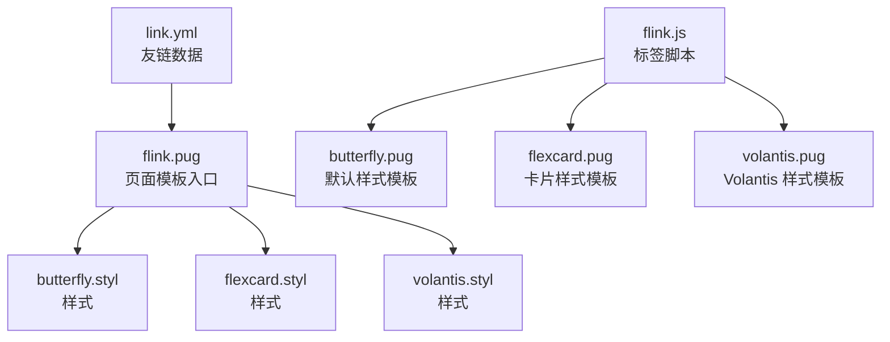
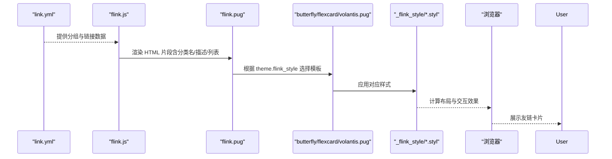
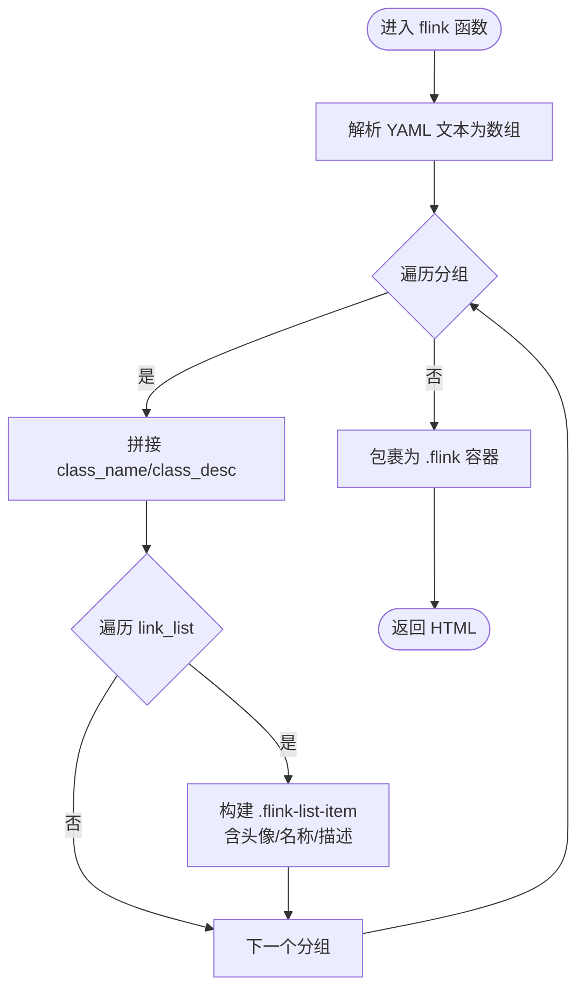
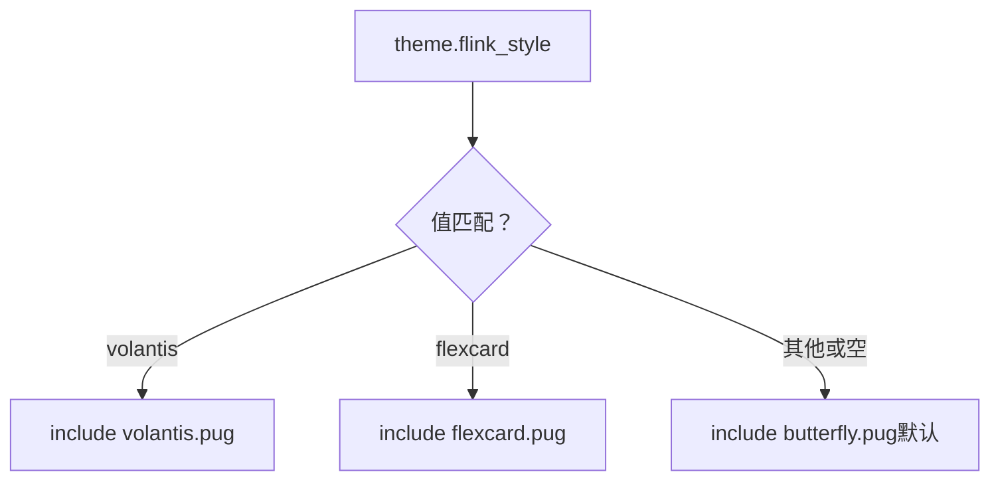
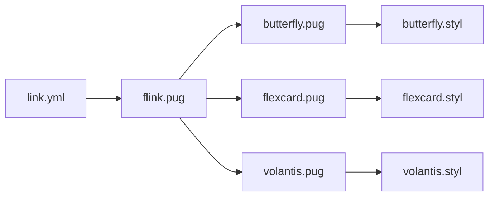

# 社交集成标签

<cite>
**本文引用的文件**   
- [themes/fomalhaut/scripts/tag/flink.js](file://themes/fomalhaut/scripts/tag/flink.js)
- [themes/fomalhaut/layout/includes/page/flink.pug](file://themes/fomalhaut/layout/includes/page/flink.pug)
- [themes/fomalhaut/layout/includes/page/flink_style/butterfly.pug](file://themes/fomalhaut/layout/includes/page/flink_style/butterfly.pug)
- [themes/fomalhaut/layout/includes/page/flink_style/flexcard.pug](file://themes/fomalhaut/layout/includes/page/flink_style/flexcard.pug)
- [themes/fomalhaut/layout/includes/page/flink_style/volantis.pug](file://themes/fomalhaut/layout/includes/page/flink_style/volantis.pug)
- [source/_data/link.yml](file://source/_data/link.yml)
- [themes/fomalhaut/source/css/_flink_style/butterfly.styl](file://themes/fomalhaut/source/css/_flink_style/butterfly.styl)
- [themes/fomalhaut/source/css/_flink_style/flexcard.styl](file://themes/fomalhaut/source/css/_flink_style/flexcard.styl)
- [themes/fomalhaut/source/css/_flink_style/volantis.styl](file://themes/fomalhaut/source/css/_flink_style/volantis.styl)
</cite>

## 目录
1. [简介](#简介)
2. [项目结构](#项目结构)
3. [核心组件](#核心组件)
4. [架构总览](#架构总览)
5. [详细组件分析](#详细组件分析)
6. [依赖关系分析](#依赖关系分析)
7. [性能与体验优化](#性能与体验优化)
8. [故障排查指南](#故障排查指南)
9. [结论](#结论)
10. [附录：配置与样式定制](#附录配置与样式定制)

## 简介
本文聚焦于主题中的“社交集成标签”，重点说明友情链接（flink）标签的实现与使用方式。内容包括：
- flink 标签的数据解析、HTML 生成流程
- 链接卡片展示、头像加载与错误回退
- 分类标题与描述渲染
- 三种内置样式风格（butterfly、flexcard、volantis）的切换与差异
- 数据源 link.yml 的配置格式与扩展机制
- 自定义样式与二次开发建议

## 项目结构
与 flink 功能直接相关的代码分布在以下位置：
- 标签脚本：themes/fomalhaut/scripts/tag/flink.js
- 页面模板入口：themes/fomalhaut/layout/includes/page/flink.pug
- 样式风格模板：layout/includes/page/flink_style/*.pug
- 样式表：source/css/_flink_style/*.styl
- 数据源：source/_data/link.yml



图表来源
- [themes/fomalhaut/layout/includes/page/flink.pug:71-77](file://themes/fomalhaut/layout/includes/page/flink.pug#L71-L77)
- [themes/fomalhaut/scripts/tag/flink.js:9-39](file://themes/fomalhaut/scripts/tag/flink.js#L9-L39)
- [themes/fomalhaut/source/css/_flink_style/butterfly.styl:1-87](file://themes/fomalhaut/source/css/_flink_style/butterfly.styl#L1-L87)
- [themes/fomalhaut/source/css/_flink_style/flexcard.styl:1-116](file://themes/fomalhaut/source/css/_flink_style/flexcard.styl#L1-L116)
- [themes/fomalhaut/source/css/_flink_style/volantis.styl:1-79](file://themes/fomalhaut/source/css/_flink_style/volantis.styl#L1-L79)

章节来源
- [themes/fomalhaut/layout/includes/page/flink.pug:71-77](file://themes/fomalhaut/layout/includes/page/flink.pug#L71-L77)
- [themes/fomalhaut/scripts/tag/flink.js:9-39](file://themes/fomalhaut/scripts/tag/flink.js#L9-L39)

## 核心组件
- 标签脚本 flink.js：负责将 YAML 内容渲染为 HTML，输出包含分类名、分类描述、链接列表等结构的 DOM 节点。
- 页面模板 flink.pug：作为页面级入口，根据主题配置选择不同样式模板（butterfly/flexcard/volantis）。
- 样式模板 butterfly.pug / flexcard.pug / volantis.pug：分别实现不同的卡片布局与信息呈现方式。
- 样式表 butterfly.styl / flexcard.styl / volantis.styl：定义各风格的视觉表现与响应式行为。
- 数据源 link.yml：集中管理友链分组、站点信息、头像与截图等字段。

章节来源
- [themes/fomalhaut/scripts/tag/flink.js:9-39](file://themes/fomalhaut/scripts/tag/flink.js#L9-L39)
- [themes/fomalhaut/layout/includes/page/flink.pug:71-77](file://themes/fomalhaut/layout/includes/page/flink.pug#L71-L77)
- [themes/fomalhaut/layout/includes/page/flink_style/butterfly.pug:1-19](file://themes/fomalhaut/layout/includes/page/flink_style/butterfly.pug#L1-L19)
- [themes/fomalhaut/layout/includes/page/flink_style/flexcard.pug:1-20](file://themes/fomalhaut/layout/includes/page/flink_style/flexcard.pug#L1-L20)
- [themes/fomalhaut/layout/includes/page/flink_style/volantis.pug:1-32](file://themes/fomalhaut/layout/includes/page/flink_style/volantis.pug#L1-L32)
- [source/_data/link.yml:1-35](file://source/_data/link.yml#L1-L35)

## 架构总览
下图展示了从数据到最终页面的完整链路：数据源 → 模板/标签 → 样式 → 浏览器渲染。



图表来源
- [themes/fomalhaut/scripts/tag/flink.js:9-39](file://themes/fomalhaut/scripts/tag/flink.js#L9-L39)
- [themes/fomalhaut/layout/includes/page/flink.pug:71-77](file://themes/fomalhaut/layout/includes/page/flink.pug#L71-L77)
- [themes/fomalhaut/layout/includes/page/flink_style/butterfly.pug:1-19](file://themes/fomalhaut/layout/includes/page/flink_style/butterfly.pug#L1-L19)
- [themes/fomalhaut/layout/includes/page/flink_style/flexcard.pug:1-20](file://themes/fomalhaut/layout/includes/page/flink_style/flexcard.pug#L1-L20)
- [themes/fomalhaut/layout/includes/page/flink_style/volantis.pug:1-32](file://themes/fomalhaut/layout/includes/page/flink_style/volantis.pug#L1-L32)

## 详细组件分析

### flink 标签脚本（flink.js）
- 功能要点
  - 解析标签内嵌的 YAML 文本，转换为结构化数据。
  - 遍历每个分组，输出分类名（class_name）与分类描述（class_desc）。
  - 遍历 link_list，为每个链接生成卡片结构，包括：
    - 头像 img（带 onerror 回退至主题配置的 error_img.flink）
    - 名称 name
    - 描述 descr（以 title 属性提示）
  - 返回包裹在 .flink 容器内的完整 HTML。

- 关键流程


图表来源
- [themes/fomalhaut/scripts/tag/flink.js:9-39](file://themes/fomalhaut/scripts/tag/flink.js#L9-L39)

章节来源
- [themes/fomalhaut/scripts/tag/flink.js:9-39](file://themes/fomalhaut/scripts/tag/flink.js#L9-L39)

### 页面模板入口（flink.pug）
- 功能要点
  - 通过 theme.flink_style 决定引入哪个样式模板（butterfly/flexcard/volantis）。
  - 当未显式设置时，默认使用 butterfly 样式模板。
  - 预留了通过外部 JSON 动态加载友链的逻辑（当前被注释），以及直接从 site.data.link 读取数据的逻辑（也被注释）。

- 样式选择分支


图表来源
- [themes/fomalhaut/layout/includes/page/flink.pug:71-77](file://themes/fomalhaut/layout/includes/page/flink.pug#L71-L77)

章节来源
- [themes/fomalhaut/layout/includes/page/flink.pug:71-77](file://themes/fomalhaut/layout/includes/page/flink.pug#L71-L77)

### 样式模板与数据绑定

#### butterfly.pug（默认）
- 特点
  - 直接遍历 site.data.link，按分组输出 h2 分类名、flink-desc 分类描述、.flink-list 列表。
  - 每个链接项包含头像 img（no-lightbox）、名称、描述（title 提示）。
  - 头像加载失败时回退到 theme.error_img.flink。

章节来源
- [themes/fomalhaut/layout/includes/page/flink_style/butterfly.pug:1-19](file://themes/fomalhaut/layout/includes/page/flink_style/butterfly.pug#L1-L19)

#### flexcard.pug（卡片封面风格）
- 特点
  - 每个链接项为 a.flink-list-card，外层包含封面图 wrapper.cover 与悬浮信息 info。
  - 封面图优先使用 siteshot；若未提供，则调用第三方服务生成缩略图。
  - 头像 img 同样支持 onerror 回退。
  - 通过 data-title 承载描述信息，配合 hover 动画显示。

章节来源
- [themes/fomalhaut/layout/includes/page/flink_style/flexcard.pug:1-20](file://themes/fomalhaut/layout/includes/page/flink_style/flexcard.pug#L1-L20)

#### volantis.pug（Volantis 风格）
- 特点
  - 使用 .site-card-group 与 .site-card 结构，适配 Volantis 风格。
  - 对特定分类名（如推荐网站、技术支持、宝藏网站）采用大图+头像+描述的布局。
  - 其他分类走 mini-link 模式，支持通过 item.theme_color 设置背景色。
  - 封面图优先使用 siteshot，否则调用第三方服务生成。

章节来源
- [themes/fomalhaut/layout/includes/page/flink_style/volantis.pug:1-32](file://themes/fomalhaut/layout/includes/page/flink_style/volantis.pug#L1-L32)

### 样式表（Stylus）

#### butterfly.styl
- 布局与交互
  - 三列网格，移动端自适应为两列/一列。
  - 悬停时图标区域收缩，背景缩放出现。
  - 头像圆角、覆盖裁剪，名称与描述单行省略。

章节来源
- [themes/fomalhaut/source/css/_flink_style/butterfly.styl:1-87](file://themes/fomalhaut/source/css/_flink_style/butterfly.styl#L1-L87)

#### flexcard.styl
- 布局与交互
  - 四列网格，移动端自适应为三列/两列。
  - 悬停时 info 上移、封面图放大，顶部浮出标题条（data-title）。
  - 深色模式下调整遮罩与标题条颜色。

章节来源
- [themes/fomalhaut/source/css/_flink_style/flexcard.styl:1-116](file://themes/fomalhaut/source/css/_flink_style/flexcard.styl#L1-L116)

#### volantis.styl
- 布局与交互
  - Flex 布局，卡片间距统一，多断点自适应列数。
  - 图片区域与文字信息分离，hover 时阴影增强，标题高亮。

章节来源
- [themes/fomalhaut/source/css/_flink_style/volantis.styl:1-79](file://themes/fomalhaut/source/css/_flink_style/volantis.styl#L1-L79)

## 依赖关系分析
- 数据依赖
  - link.yml 提供分组与链接数据，供模板渲染。
- 模板依赖
  - flink.pug 根据 theme.flink_style 选择具体样式模板。
  - 各样式模板依赖 site.data.link 与 theme.error_img.* 变量。
- 样式依赖
  - 各 .styl 文件定义布局、响应式与交互效果。
- 运行时依赖
  - 头像与封面图的 onerror 处理依赖 url_for 与主题配置的错误图路径。



图表来源
- [themes/fomalhaut/layout/includes/page/flink.pug:71-77](file://themes/fomalhaut/layout/includes/page/flink.pug#L71-L77)
- [themes/fomalhaut/layout/includes/page/flink_style/butterfly.pug:1-19](file://themes/fomalhaut/layout/includes/page/flink_style/butterfly.pug#L1-L19)
- [themes/fomalhaut/layout/includes/page/flink_style/flexcard.pug:1-20](file://themes/fomalhaut/layout/includes/page/flink_style/flexcard.pug#L1-L20)
- [themes/fomalhaut/layout/includes/page/flink_style/volantis.pug:1-32](file://themes/fomalhaut/layout/includes/page/flink_style/volantis.pug#L1-L32)

章节来源
- [themes/fomalhaut/layout/includes/page/flink.pug:71-77](file://themes/fomalhaut/layout/includes/page/flink.pug#L71-L77)

## 性能与体验优化
- 图片加载
  - 头像与封面图均提供 onerror 回退，避免空白占位影响体验。
  - 建议使用稳定的 CDN 托管头像与截图，减少跨域与延迟问题。
- 渲染性能
  - 大量链接时，建议合理分页或使用懒加载策略（可在上层页面层扩展）。
- 交互体验
  - 悬停动效已启用，注意在低端设备上适当降低动画复杂度。
- 可访问性
  - 头像 img 提供 alt 文本；描述通过 title 提示，确保语义化与可读性。

[本节为通用指导，不直接分析具体文件]

## 故障排查指南
- 头像无法显示
  - 检查 avatar 地址是否可达，确认 onerror 回退路径 theme.error_img.flink 是否正确配置。
  - 参考：头像 onerror 处理位于各样式模板中。
- 分类名/描述未显示
  - 确认 link.yml 中 class_name 与 class_desc 是否存在且非空。
  - 参考：butterfly.pug 中对 class_name/class_desc 的条件渲染。
- 样式不生效
  - 确认 theme.flink_style 的值是否为 butterfly/flexcard/volantis 之一。
  - 检查对应 .styl 文件是否被正确编译与引入。
- 封面图异常
  - 若未提供 siteshot，模板会调用第三方服务生成缩略图；请检查网络连通性与第三方服务可用性。

章节来源
- [themes/fomalhaut/layout/includes/page/flink_style/butterfly.pug:1-19](file://themes/fomalhaut/layout/includes/page/flink_style/butterfly.pug#L1-L19)
- [themes/fomalhaut/layout/includes/page/flink_style/flexcard.pug:1-20](file://themes/fomalhaut/layout/includes/page/flink_style/flexcard.pug#L1-L20)
- [themes/fomalhaut/layout/includes/page/flink_style/volantis.pug:1-32](file://themes/fomalhaut/layout/includes/page/flink_style/volantis.pug#L1-L32)

## 结论
flink 标签通过清晰的数据驱动与模板分层，实现了灵活的友链展示能力。用户可通过 link.yml 配置分组与链接，并通过 theme.flink_style 切换三种内置样式。头像与封面图具备完善的错误回退机制，保证基础体验。开发者可基于现有模板与样式进行二次扩展，满足更多场景需求。

[本节为总结性内容，不直接分析具体文件]

## 附录：配置与样式定制

### 数据源配置（link.yml）
- 基本结构
  - 顶层为数组，每项为一个分组。
  - 分组字段
    - class_name：分组标题（可选）
    - class_desc：分组描述（可选）
    - link_list：链接数组
  - 链接字段
    - name：站点名称
    - link：站点地址
    - avatar：头像地址
    - descr：站点描述
    - siteshot：站点截图（可选，用于 flexcard/volantis 封面）
    - theme_color：主题色（可选，仅 volantis 的 mini-link 模式使用）

- 示例结构示意
```yaml
- class_name: "推荐站点"
  class_desc: "赞助商与常用工具"
  link_list:
    - name: "示例站点A"
      link: "https://example.com/"
      avatar: "https://picsum.photos/id/1018/200/200"
      descr: "这是一个示例友链"
      siteshot: "https://picsum.photos/id/1041/800/450"
```

章节来源
- [source/_data/link.yml:1-35](file://source/_data/link.yml#L1-L35)

### 样式风格切换
- 在主题配置中设置 theme.flink_style 为以下值之一：
  - butterfly：默认紧凑卡片风格
  - flexcard：封面卡片风格
  - volantis：Volantis 风格（支持主题色与多种布局）

章节来源
- [themes/fomalhaut/layout/includes/page/flink.pug:71-77](file://themes/fomalhaut/layout/includes/page/flink.pug#L71-L77)

### 自定义样式指南
- 修改布局与尺寸
  - 针对 butterfly.styl：调整 .flink-list > .flink-list-item 的宽度与高度，以及响应式断点。
  - 针对 flexcard.styl：调整 .flink-list > a 的宽度与高度，以及 hover 动画参数。
  - 针对 volantis.styl：调整 .site-card 的宽度与间距，以及媒体查询断点。
- 修改交互效果
  - 调整 :hover 伪类的 transform、transition 时长与缓动函数。
  - 调整阴影、边框、圆角等视觉属性。
- 新增样式风格
  - 新建 pug 模板与 styl 文件，并在 flink.pug 中添加 case 分支以支持新风格。
  - 遵循现有命名规范与结构约定，确保类名一致。

章节来源
- [themes/fomalhaut/source/css/_flink_style/butterfly.styl:1-87](file://themes/fomalhaut/source/css/_flink_style/butterfly.styl#L1-L87)
- [themes/fomalhaut/source/css/_flink_style/flexcard.styl:1-116](file://themes/fomalhaut/source/css/_flink_style/flexcard.styl#L1-L116)
- [themes/fomalhaut/source/css/_flink_style/volantis.styl:1-79](file://themes/fomalhaut/source/css/_flink_style/volantis.styl#L1-L79)
- [themes/fomalhaut/layout/includes/page/flink.pug:71-77](file://themes/fomalhaut/layout/includes/page/flink.pug#L71-L77)