# 自定义标签实现

<cite>
**本文引用的文件**   
- [button.js](file://themes/fomalhaut/scripts/tag/button.js)
- [flink.js](file://themes/fomalhaut/scripts/tag/flink.js)
- [gallery.js](file://themes/fomalhaut/scripts/tag/gallery.js)
- [hide.js](file://themes/fomalhaut/scripts/tag/hide.js)
- [inlineImg.js](file://themes/fomalhaut/scripts/tag/inlineImg.js)
- [label.js](file://themes/fomalhaut/scripts/tag/label.js)
- [mermaid.js](file://themes/fomalhaut/scripts/tag/mermaid.js)
- [note.js](file://themes/fomalhaut/scripts/tag/note.js)
- [tabs.js](file://themes/fomalhaut/scripts/tag/tabs.js)
- [timeline.js](file://themes/fomalhaut/scripts/tag/timeline.js)
- [button.styl](file://themes/fomalhaut/source/css/_tags/button.styl)
- [hide.styl](file://themes/fomalhaut/source/css/_tags/hide.styl)
- [inlineImg.styl](file://themes/fomalhaut/source/css/_tags/inlineImg.styl)
- [label.styl](file://themes/fomalhaut/source/css/_tags/label.styl)
- [note.styl](file://themes/fomalhaut/source/css/_tags/note.styl)
- [tabs.styl](file://themes/fomalhaut/source/css/_tags/tabs.styl)
- [timeline.styl](file://themes/fomalhaut/source/css/_tags/timeline.styl)
- [gallery.styl](file://themes/fomalhaut/source/css/_tags/gallery.styl)
</cite>

## 目录
1. [简介](#简介)
2. [项目结构](#项目结构)
3. [核心组件](#核心组件)
4. [架构总览](#架构总览)
5. [详细组件分析](#详细组件分析)
6. [依赖关系分析](#依赖关系分析)
7. [性能考量](#性能考量)
8. [故障排查指南](#故障排查指南)
9. [结论](#结论)
10. [附录](#附录)

## 简介
本文面向 Hexo 主题 fomalhaut 的“自定义标签”体系，系统梳理各内置标签的实现机制、参数语法、HTML 输出与样式集成方式，并给出完整的自定义标签开发流程（解析→参数处理→HTML 生成→样式集成）以及扩展指南。涉及的标签包括：按钮、友情链接、图片画廊、隐藏内容、内联图片、标签标记、Mermaid 图表、笔记框、选项卡和时间线。

## 项目结构
主题将“标签脚本”统一放在 themes/fomalhaut/scripts/tag 下，每个标签一个 JS 文件；对应的样式位于 themes/fomalhaut/source/css/_tags 下的同名 styl 文件。Hexo 在渲染阶段通过 hexo.extend.tag.register 注册标签，并在文章 Markdown 中调用。

```mermaid
graph TB
subgraph "主题脚本"
T_btn["scripts/tag/button.js"]
T_flink["scripts/tag/flink.js"]
T_gallery["scripts/tag/gallery.js"]
T_hide["scripts/tag/hide.js"]
T_inlineImg["scripts/tag/inlineImg.js"]
T_label["scripts/tag/label.js"]
T_mermaid["scripts/tag/mermaid.js"]
T_note["scripts/tag/note.js"]
T_tabs["scripts/tag/tabs.js"]
T_timeline["scripts/tag/timeline.js"]
end
subgraph "主题样式"
S_btn["source/css/_tags/button.styl"]
S_flink["source/css/_tags/flink.styl"]
S_gallery["source/css/_tags/gallery.styl"]
S_hide["source/css/_tags/hide.styl"]
S_inlineImg["source/css/_tags/inlineImg.styl"]
S_label["source/css/_tags/label.styl"]
S_note["source/css/_tags/note.styl"]
S_tabs["source/css/_tags/tabs.styl"]
S_timeline["source/css/_tags/timeline.styl"]
end
T_btn --> S_btn
T_flink --> S_flink
T_gallery --> S_gallery
T_hide --> S_hide
T_inlineImg --> S_inlineImg
T_label --> S_label
T_mermaid --> S_note
T_note --> S_note
T_tabs --> S_tabs
T_timeline --> S_timeline
```

图示来源
- [button.js:1-29](file://themes/fomalhaut/scripts/tag/button.js#L1-L29)
- [flink.js:1-40](file://themes/fomalhaut/scripts/tag/flink.js#L1-L40)
- [gallery.js:1-35](file://themes/fomalhaut/scripts/tag/gallery.js#L1-L35)
- [hide.js:1-71](file://themes/fomalhaut/scripts/tag/hide.js#L1-L71)
- [inlineImg.js:1-18](file://themes/fomalhaut/scripts/tag/inlineImg.js#L1-L18)
- [label.js:1-17](file://themes/fomalhaut/scripts/tag/label.js#L1-L17)
- [mermaid.js:1-18](file://themes/fomalhaut/scripts/tag/mermaid.js#L1-L18)
- [note.js:1-28](file://themes/fomalhaut/scripts/tag/note.js#L1-L28)
- [tabs.js:1-63](file://themes/fomalhaut/scripts/tag/tabs.js#L1-L63)
- [timeline.js:1-42](file://themes/fomalhaut/scripts/tag/timeline.js#L1-L42)
- [button.styl:1-56](file://themes/fomalhaut/source/css/_tags/button.styl#L1-L56)
- [hide.styl:1-46](file://themes/fomalhaut/source/css/_tags/hide.styl#L1-L46)
- [inlineImg.styl:1-6](file://themes/fomalhaut/source/css/_tags/inlineImg.styl#L1-L6)
- [label.styl:1-12](file://themes/fomalhaut/source/css/_tags/label.styl#L1-L12)
- [note.styl:1-122](file://themes/fomalhaut/source/css/_tags/note.styl#L1-L122)
- [tabs.styl:1-75](file://themes/fomalhaut/source/css/_tags/tabs.styl#L1-L75)
- [timeline.styl:1-68](file://themes/fomalhaut/source/css/_tags/timeline.styl#L1-L68)
- [gallery.styl:1-102](file://themes/fomalhaut/source/css/_tags/gallery.styl#L1-L102)

章节来源
- [button.js:1-29](file://themes/fomalhaut/scripts/tag/button.js#L1-L29)
- [flink.js:1-40](file://themes/fomalhaut/scripts/tag/flink.js#L1-L40)
- [gallery.js:1-35](file://themes/fomalhaut/scripts/tag/gallery.js#L1-L35)
- [hide.js:1-71](file://themes/fomalhaut/scripts/tag/hide.js#L1-L71)
- [inlineImg.js:1-18](file://themes/fomalhaut/scripts/tag/inlineImg.js#L1-L18)
- [label.js:1-17](file://themes/fomalhaut/scripts/tag/label.js#L1-L17)
- [mermaid.js:1-18](file://themes/fomalhaut/scripts/tag/mermaid.js#L1-L18)
- [note.js:1-28](file://themes/fomalhaut/scripts/tag/note.js#L1-L28)
- [tabs.js:1-63](file://themes/fomalhaut/scripts/tag/tabs.js#L1-L63)
- [timeline.js:1-42](file://themes/fomalhaut/scripts/tag/timeline.js#L1-L42)

## 核心组件
本节概述各标签的功能、语法与输出要点。

- 按钮 button
  - 功能：生成带图标和文本的按钮链接，支持颜色、轮廓、居中、块级、放大等修饰类。
  - 语法：
  - 输出：a.btn-beautify + 可选 i.icon + span.text，使用 url_for 处理链接。
  - 样式：button.styl 定义基础、变体、轮廓、块级、居中等样式。

- 友情链接 flink
  - 功能：从 YAML 数据渲染分类标题、描述与链接列表卡片。
  - 语法：YAML 内容
  - 输出：div.flink 包裹多个分类区块，内部为 div.flink-list 与 div.flink-list-item 卡片。
  - 样式：由页面布局样式控制（本仓库未提供 _tags/flink.styl）。

- 图片画廊 gallery / galleryGroup
  - 功能：gallery 包裹 Markdown 图片；galleryGroup 生成图组卡片（封面、名称、描述、外链）。
  - 语法：
    - ...Markdown 图片...
    - 
  - 输出：fj-gallery 容器；figure.gallery-group 图组。
  - 样式：gallery.styl 定义图组悬停、说明文字、响应式布局等。

- 隐藏内容 hideInline / hideBlock / hideToggle
  - 功能：行内/块级隐藏内容与可折叠开关。
  - 语法：
    - 
    - 内容
    - 内容
  - 输出：span.hide-inline/div.hide-block + button.hide-button + span/div.hide-content；details.toggle 用于折叠。
  - 样式：hide.styl 定义按钮、隐藏区、折叠区样式。

- 内联图片 inlineImg
  - 功能：行内插入图片，支持设置高度。
  - 语法：
  - 输出：img.inline-img，height 以 style 注入。
  - 样式：inlineImg.styl 定义行内对齐与尺寸。

- 标签标记 label
  - 功能：高亮小标签，支持默认与多种颜色类。
  - 语法：
  - 输出：mark.hl-label.colorClass。
  - 样式：label.styl 定义背景色与颜色类型循环。

- Mermaid 图表 mermaid
  - 功能：将 Mermaid 源码安全地嵌入页面，供前端渲染器处理。
  - 语法：Mermaid 源码
  - 输出：div.mermaid-wrap > pre.mermaid-src[hidden] 包裹转义后的源码。
  - 样式：无特定样式，依赖外部渲染器。

- 笔记框 note / subnote
  - 功能：多风格笔记框（flat/modern/simple/disabled），支持图标与主题配置。
  - 语法：内容
  - 行为：若末参非预设风格，则自动追加主题默认风格；若倒数第二参为 fa* 图标类名，则注入图标并添加 icon-padding。
  - 输出：div.note.style... 包含可选图标与 Markdown 内容。
  - 样式：note.styl 定义边框、背景、图标位置、现代/扁平风格等。

- 选项卡 tabs / subtabs / subsubtabs
  - 功能：基于注释分块的选项卡，支持标题、图标、激活项、滚动回顶按钮。
  - 语法：
    - 
      <!-- tab 标题@图标 -->
      内容
      <!-- endtab -->
    - 
  - 输出：div.tabs > ul.nav-tabs + div.tab-contents，含 active 类与 id 锚点。
  - 样式：tabs.styl 定义导航栏、激活态、动画等。

- 时间线 timeline
  - 功能：按条目渲染时间线，支持首行 headline 与主题色。
  - 语法：
    - 
      <!-- timeline 子标题 -->
      子内容
      <!-- endtimeline -->
    - 
  - 输出：div.timeline.color > .timeline-item（headline 与普通条目）。
  - 样式：timeline.styl 定义轴线、圆点、条目背景与悬停效果。

章节来源
- [button.js:1-29](file://themes/fomalhaut/scripts/tag/button.js#L1-L29)
- [flink.js:1-40](file://themes/fomalhaut/scripts/tag/flink.js#L1-L40)
- [gallery.js:1-35](file://themes/fomalhaut/scripts/tag/gallery.js#L1-L35)
- [hide.js:1-71](file://themes/fomalhaut/scripts/tag/hide.js#L1-L71)
- [inlineImg.js:1-18](file://themes/fomalhaut/scripts/tag/inlineImg.js#L1-L18)
- [label.js:1-17](file://themes/fomalhaut/scripts/tag/label.js#L1-L17)
- [mermaid.js:1-18](file://themes/fomalhaut/scripts/tag/mermaid.js#L1-L18)
- [note.js:1-28](file://themes/fomalhaut/scripts/tag/note.js#L1-L28)
- [tabs.js:1-63](file://themes/fomalhaut/scripts/tag/tabs.js#L1-L63)
- [timeline.js:1-42](file://themes/fomalhaut/scripts/tag/timeline.js#L1-L42)

## 架构总览
下图展示“文章 Markdown → Hexo 标签解析 → HTML 片段 → 样式渲染”的整体流程。

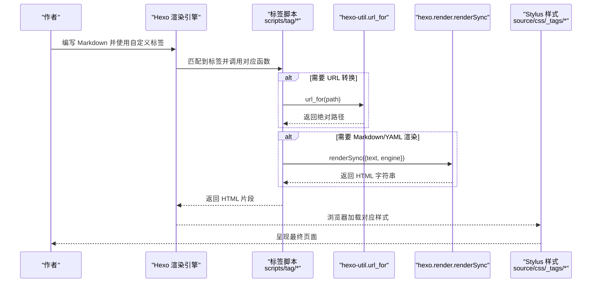

图示来源
- [button.js:10-25](file://themes/fomalhaut/scripts/tag/button.js#L10-L25)
- [flink.js:7-36](file://themes/fomalhaut/scripts/tag/flink.js#L7-L36)
- [gallery.js:8-34](file://themes/fomalhaut/scripts/tag/gallery.js#L8-L34)
- [hide.js:19-66](file://themes/fomalhaut/scripts/tag/hide.js#L19-L66)
- [inlineImg.js:8-14](file://themes/fomalhaut/scripts/tag/inlineImg.js#L8-L14)
- [label.js:9-13](file://themes/fomalhaut/scripts/tag/label.js#L9-L13)
- [mermaid.js:9-14](file://themes/fomalhaut/scripts/tag/mermaid.js#L9-L14)
- [note.js:9-23](file://themes/fomalhaut/scripts/tag/note.js#L9-L23)
- [tabs.js:9-57](file://themes/fomalhaut/scripts/tag/tabs.js#L9-L57)
- [timeline.js:8-38](file://themes/fomalhaut/scripts/tag/timeline.js#L8-L38)

## 详细组件分析

### 按钮（button.js）
- 解析与参数
  - 输入：url,text,icon,options（逗号分隔）
  - 清理：trim 去除空白
- HTML 生成
  - 输出 a.btn-beautify + 可选 i.icon + span.text
  - 链接经 url_for 处理
- 样式集成
  - button.styl 定义基础、颜色循环、hover、outline、block、center、larger 等
- 复杂度
  - O(1)，仅字符串拼接与 trim

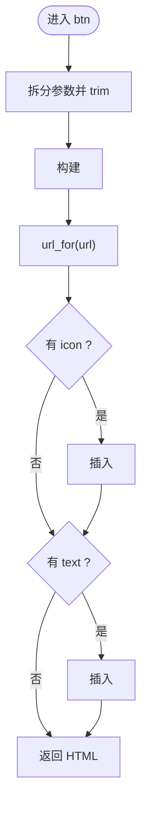

图示来源
- [button.js:12-25](file://themes/fomalhaut/scripts/tag/button.js#L12-L25)
- [button.styl:6-55](file://themes/fomalhaut/source/css/_tags/button.styl#L6-L55)

章节来源
- [button.js:1-29](file://themes/fomalhaut/scripts/tag/button.js#L1-L29)
- [button.styl:1-56](file://themes/fomalhaut/source/css/_tags/button.styl#L1-L56)

### 友情链接（flink.js）
- 解析与参数
  - 接收 YAML 内容，renderSync(engine:'yaml') 解析为数组
- HTML 生成
  - 遍历分类，生成 flink-name、flink-desc、flink-list、flink-list-item
  - 头像 onerror 回退至主题配置的 error_img.flink
- 样式集成
  - 由页面布局样式控制（本仓库未提供 _tags/flink.styl）
- 复杂度
  - O(n) 遍历 link_list

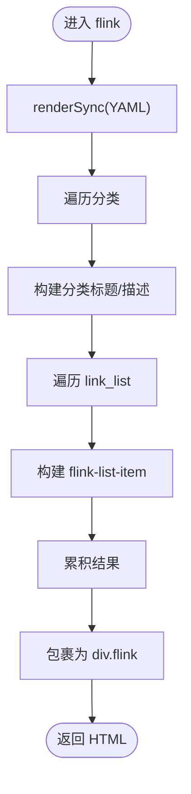

图示来源
- [flink.js:9-36](file://themes/fomalhaut/scripts/tag/flink.js#L9-L36)

章节来源
- [flink.js:1-40](file://themes/fomalhaut/scripts/tag/flink.js#L1-L40)

### 图片画廊（gallery.js）
- 解析与参数
  - gallery：包裹 Markdown 图片
  - galleryGroup：name, desc, url, img
- HTML 生成
  - gallery 将内容用 Markdown 渲染后放入 fj-gallery
  - galleryGroup 输出 figure.gallery-group，含 img、figcaption、a
- 样式集成
  - gallery.styl 定义图组悬停、说明文字、响应式布局等
- 复杂度
  - O(1) 单次渲染

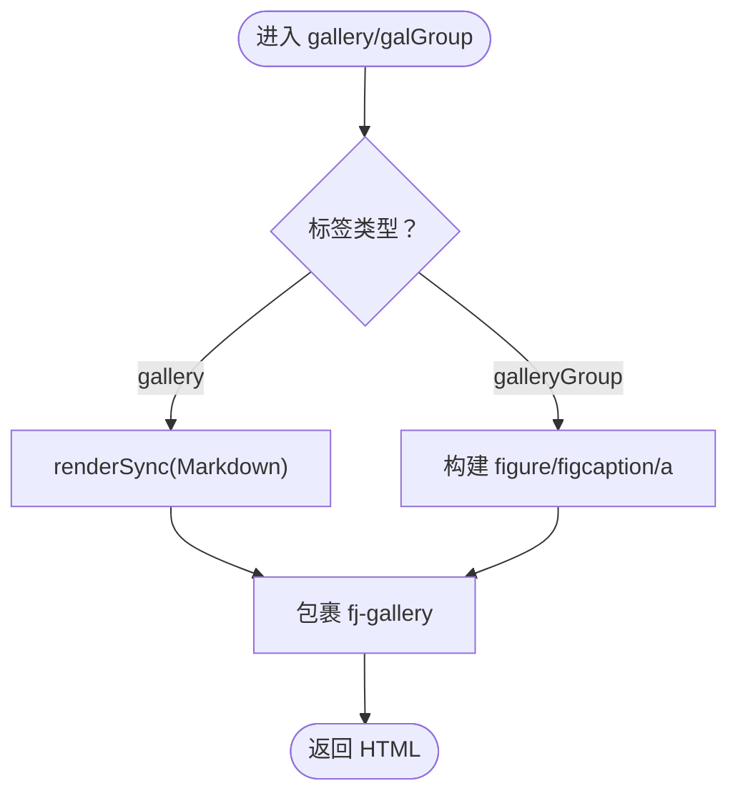

图示来源
- [gallery.js:10-34](file://themes/fomalhaut/scripts/tag/gallery.js#L10-L34)
- [gallery.styl:1-102](file://themes/fomalhaut/source/css/_tags/gallery.styl#L1-L102)

章节来源
- [gallery.js:1-35](file://themes/fomalhaut/scripts/tag/gallery.js#L1-L35)
- [gallery.styl:1-102](file://themes/fomalhaut/source/css/_tags/gallery.styl#L1-L102)

### 隐藏内容（hide.js）
- 解析与参数
  - hideInline：content,display,bg,color
  - hideBlock：display,bg,color
  - hideToggle：display,bg,color
- HTML 生成
  - 行内/块级分别输出 span.hide-inline / div.hide-block + button.hide-button + 内容区
  - toggle 使用 details/summary 原生折叠
  - 内容经 Markdown 渲染（block/toggle）
- 样式集成
  - hide.styl 定义按钮、隐藏区、toggle 样式
- 复杂度
  - O(1)

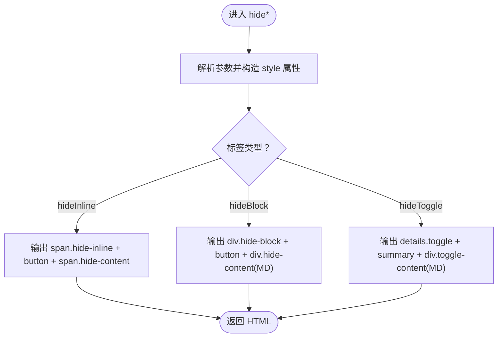

图示来源
- [hide.js:19-66](file://themes/fomalhaut/scripts/tag/hide.js#L19-L66)
- [hide.styl:1-46](file://themes/fomalhaut/source/css/_tags/hide.styl#L1-L46)

章节来源
- [hide.js:1-71](file://themes/fomalhaut/scripts/tag/hide.js#L1-L71)
- [hide.styl:1-46](file://themes/fomalhaut/source/css/_tags/hide.styl#L1-L46)

### 内联图片（inlineImg.js）
- 解析与参数
  - src,height（可选）
- HTML 生成
  - img.inline-img，height 以 style 注入
- 样式集成
  - inlineImg.styl 定义行内对齐与高度
- 复杂度
  - O(1)

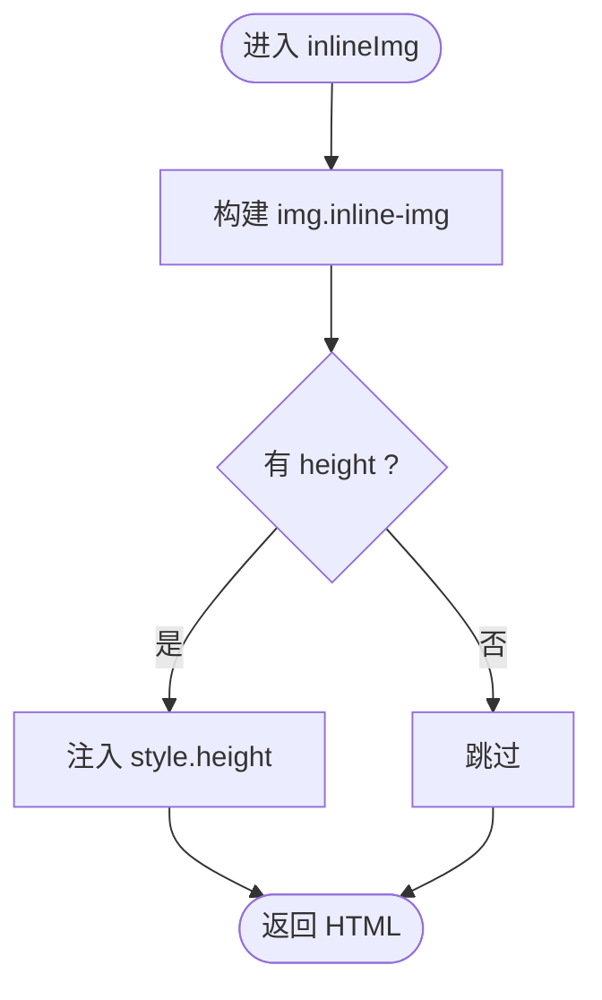

图示来源
- [inlineImg.js:10-14](file://themes/fomalhaut/scripts/tag/inlineImg.js#L10-L14)
- [inlineImg.styl:1-6](file://themes/fomalhaut/source/css/_tags/inlineImg.styl#L1-L6)

章节来源
- [inlineImg.js:1-18](file://themes/fomalhaut/scripts/tag/inlineImg.js#L1-L18)
- [inlineImg.styl:1-6](file://themes/fomalhaut/source/css/_tags/inlineImg.styl#L1-L6)

### 标签标记（label.js）
- 解析与参数
  - text,colorClass（默认 default）
- HTML 生成
  - mark.hl-label.colorClass
- 样式集成
  - label.styl 定义背景色与颜色类型循环
- 复杂度
  - O(1)

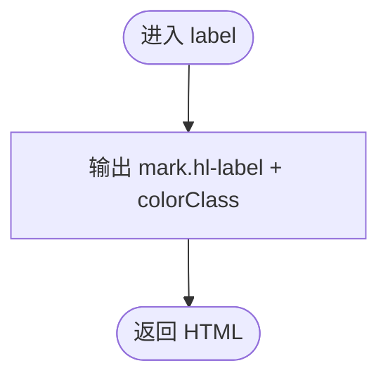

图示来源
- [label.js:9-13](file://themes/fomalhaut/scripts/tag/label.js#L9-L13)
- [label.styl:1-12](file://themes/fomalhaut/source/css/_tags/label.styl#L1-L12)

章节来源
- [label.js:1-17](file://themes/fomalhaut/scripts/tag/label.js#L1-L17)
- [label.styl:1-12](file://themes/fomalhaut/source/css/_tags/label.styl#L1-L12)

### Mermaid 图表（mermaid.js）
- 解析与参数
  - 无参数，接收代码块内容
- HTML 生成
  - div.mermaid-wrap > pre.mermaid-src[hidden]，内容经 escapeHTML 转义
- 样式集成
  - 无特定样式，依赖外部渲染器
- 复杂度
  - O(n) 转义

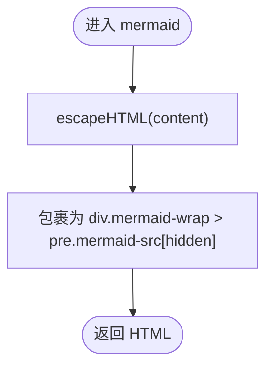

图示来源
- [mermaid.js:11-14](file://themes/fomalhaut/scripts/tag/mermaid.js#L11-L14)

章节来源
- [mermaid.js:1-18](file://themes/fomalhaut/scripts/tag/mermaid.js#L1-L18)

### 笔记框（note.js）
- 解析与参数
  - args 末尾为风格（flat/modern/simple/disabled），否则追加主题默认风格
  - 倒数第二参若为 fa* 图标类名，则注入图标并添加 icon-padding
- HTML 生成
  - div.note.style... 包含可选图标与 Markdown 内容
- 样式集成
  - note.styl 定义边框、背景、图标位置、现代/扁平风格等
- 复杂度
  - O(1)

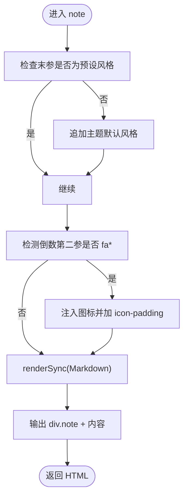

图示来源
- [note.js:9-23](file://themes/fomalhaut/scripts/tag/note.js#L9-L23)
- [note.styl:1-122](file://themes/fomalhaut/source/css/_tags/note.styl#L1-L122)

章节来源
- [note.js:1-28](file://themes/fomalhaut/scripts/tag/note.js#L1-L28)
- [note.styl:1-122](file://themes/fomalhaut/source/css/_tags/note.styl#L1-L122)

### 选项卡（tabs.js）
- 解析与参数
  - tabName,activeIndex
  - 内容中以注释 <!-- tab 标题@图标 --> ... <!-- endtab --> 划分
- HTML 生成
  - 解析所有 tab 块，生成 nav 与 contents，计算 id 与 active 类
  - 每个内容块附加“回到顶部”按钮
- 样式集成
  - tabs.styl 定义导航、激活态、动画等
- 复杂度
  - O(k) k 为 tab 数量

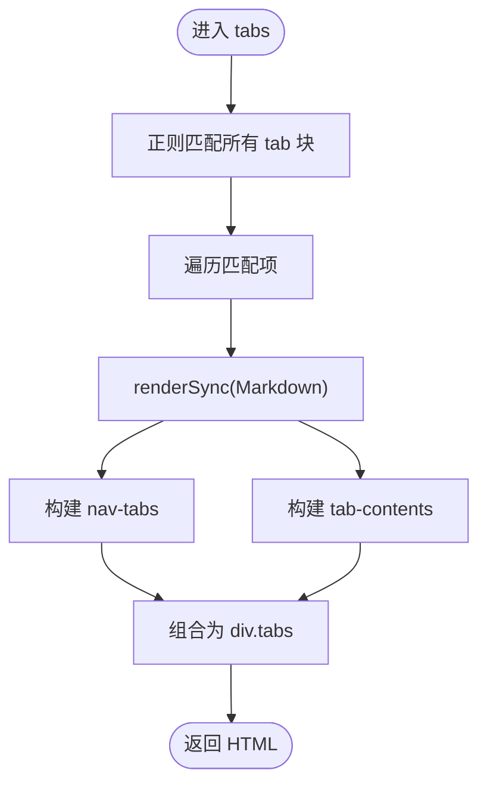

图示来源
- [tabs.js:9-57](file://themes/fomalhaut/scripts/tag/tabs.js#L9-L57)
- [tabs.styl:1-75](file://themes/fomalhaut/source/css/_tags/tabs.styl#L1-L75)

章节来源
- [tabs.js:1-63](file://themes/fomalhaut/scripts/tag/tabs.js#L1-L63)
- [tabs.styl:1-75](file://themes/fomalhaut/source/css/_tags/tabs.styl#L1-L75)

### 时间线（timeline.js）
- 解析与参数
  - 首参可为 headline 标题（Markdown），color 为主题色类
  - 内容中以注释 <!-- timeline 子标题 --> ... <!-- endtimeline --> 划分
- HTML 生成
  - 渲染 headline 与若干 timeline-item（title + content）
- 样式集成
  - timeline.styl 定义轴线、圆点、条目背景与悬停效果
- 复杂度
  - O(k) k 为条目数

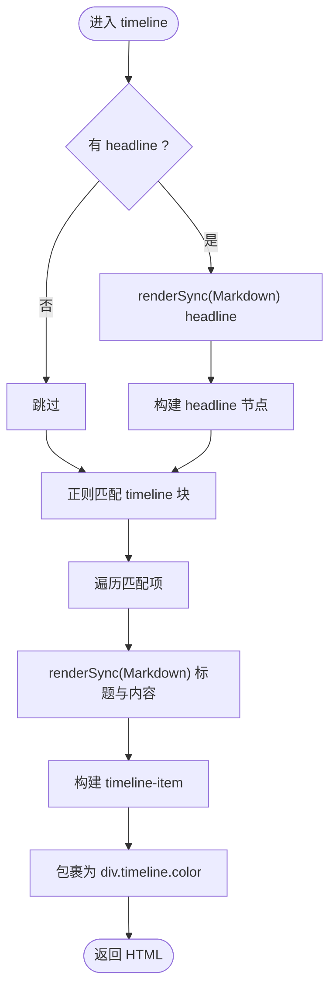

图示来源
- [timeline.js:8-38](file://themes/fomalhaut/scripts/tag/timeline.js#L8-L38)
- [timeline.styl:1-68](file://themes/fomalhaut/source/css/_tags/timeline.styl#L1-L68)

章节来源
- [timeline.js:1-42](file://themes/fomalhaut/scripts/tag/timeline.js#L1-L42)
- [timeline.styl:1-68](file://themes/fomalhaut/source/css/_tags/timeline.styl#L1-L68)

## 依赖关系分析
- 外部依赖
  - hexo-util.url_for：用于资源路径规范化（button、flink、gallery、inlineImg）
  - hexo-util.escapeHTML：用于安全转义（mermaid）
  - hexo.render.renderSync：用于 Markdown/YAML 渲染（gallery、hide、note、tabs、timeline、flink）
- 耦合与内聚
  - 各标签脚本独立，职责单一，内聚度高
  - 样式与脚本一一对应，便于维护
- 潜在循环依赖
  - 无直接循环依赖

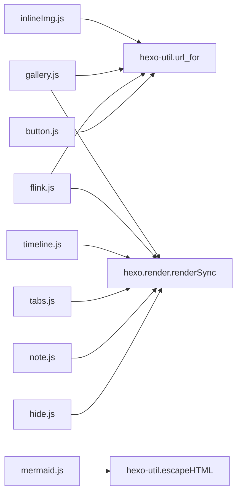

图示来源
- [button.js:10-25](file://themes/fomalhaut/scripts/tag/button.js#L10-L25)
- [flink.js:7-36](file://themes/fomalhaut/scripts/tag/flink.js#L7-L36)
- [gallery.js:8-34](file://themes/fomalhaut/scripts/tag/gallery.js#L8-L34)
- [inlineImg.js:8-14](file://themes/fomalhaut/scripts/tag/inlineImg.js#L8-L14)
- [mermaid.js:9-14](file://themes/fomalhaut/scripts/tag/mermaid.js#L9-L14)
- [hide.js:35-66](file://themes/fomalhaut/scripts/tag/hide.js#L35-L66)
- [note.js:9-23](file://themes/fomalhaut/scripts/tag/note.js#L9-L23)
- [tabs.js:36-57](file://themes/fomalhaut/scripts/tag/tabs.js#L36-L57)
- [timeline.js:16-38](file://themes/fomalhaut/scripts/tag/timeline.js#L16-L38)

章节来源
- [button.js:1-29](file://themes/fomalhaut/scripts/tag/button.js#L1-L29)
- [flink.js:1-40](file://themes/fomalhaut/scripts/tag/flink.js#L1-L40)
- [gallery.js:1-35](file://themes/fomalhaut/scripts/tag/gallery.js#L1-L35)
- [hide.js:1-71](file://themes/fomalhaut/scripts/tag/hide.js#L1-L71)
- [inlineImg.js:1-18](file://themes/fomalhaut/scripts/tag/inlineImg.js#L1-L18)
- [label.js:1-17](file://themes/fomalhaut/scripts/tag/label.js#L1-L17)
- [mermaid.js:1-18](file://themes/fomalhaut/scripts/tag/mermaid.js#L1-L18)
- [note.js:1-28](file://themes/fomalhaut/scripts/tag/note.js#L1-L28)
- [tabs.js:1-63](file://themes/fomalhaut/scripts/tag/tabs.js#L1-L63)
- [timeline.js:1-42](file://themes/fomalhaut/scripts/tag/timeline.js#L1-L42)

## 性能考量
- 渲染开销
  - 大量使用 renderSync 会阻塞构建期，建议仅在必要时启用 Markdown/YAML 渲染（如 hide/tabs/timeline/note/galery/flink）
- 字符串拼接
  - 当前采用模板字符串拼接，简单高效；大数据量时可考虑流式或模板引擎优化
- 样式体积
  - 各标签样式独立，按需引入可减少体积；注意避免重复选择器
- 图片与资源
  - 使用 url_for 确保缓存与 CDN 友好；头像 onerror 回退提升鲁棒性

## 故障排查指南
- 链接不生效
  - 确认使用 url_for 处理路径；检查参数顺序与逗号分隔
  - 参考：[button.js:19-25](file://themes/fomalhaut/scripts/tag/button.js#L19-L25)
- 图片不显示
  - 检查 src 是否正确；inlineImg 的高度需带单位
  - 参考：[inlineImg.js:10-14](file://themes/fomalhaut/scripts/tag/inlineImg.js#L10-L14)
- 隐藏内容无法展开
  - 检查 hideInline/hideBlock/hideToggle 的参数顺序与引号使用
  - 参考：[hide.js:19-66](file://themes/fomalhaut/scripts/tag/hide.js#L19-L66)
- 选项卡无交互
  - 确认注释分隔符 <!-- tab ... --> 与 <!-- endtab --> 成对出现
  - 参考：[tabs.js:10-57](file://themes/fomalhaut/scripts/tag/tabs.js#L10-L57)
- 时间线样式异常
  - 检查 headline 与条目注释格式，确认 color 类名存在
  - 参考：[timeline.js:8-38](file://themes/fomalhaut/scripts/tag/timeline.js#L8-L38)
- 笔记框图标未显示
  - 确认倒数第二参为 fa* 类名，且主题启用了图标
  - 参考：[note.js:16-23](file://themes/fomalhaut/scripts/tag/note.js#L16-L23)

章节来源
- [button.js:19-25](file://themes/fomalhaut/scripts/tag/button.js#L19-L25)
- [inlineImg.js:10-14](file://themes/fomalhaut/scripts/tag/inlineImg.js#L10-L14)
- [hide.js:19-66](file://themes/fomalhaut/scripts/tag/hide.js#L19-L66)
- [tabs.js:10-57](file://themes/fomalhaut/scripts/tag/tabs.js#L10-L57)
- [timeline.js:8-38](file://themes/fomalhaut/scripts/tag/timeline.js#L8-L38)
- [note.js:16-23](file://themes/fomalhaut/scripts/tag/note.js#L16-L23)

## 结论
本主题通过统一的标签脚本与样式组织，提供了丰富且易用的内容增强能力。各标签职责清晰、依赖明确，遵循“解析→参数处理→HTML 生成→样式集成”的标准流程。开发者可据此快速扩展新的标签，保持与现有生态一致的行为与外观。

## 附录

### 自定义标签开发流程
- 步骤
  1. 新建脚本：themes/fomalhaut/scripts/tag/yourTag.js
  2. 注册标签：hexo.extend.tag.register('yourTag', handler, { ends: true/false })
  3. 参数解析：args.join(' ').split(',') 或正则提取
  4. 资源处理：使用 url_for 规范化路径
  5. 内容渲染：必要时使用 renderSync({ text, engine })
  6. HTML 生成：模板字符串拼接，注意转义与安全
  7. 样式集成：在 source/css/_tags/yourTag.styl 中添加样式
  8. 测试验证：在 Markdown 中使用标签，检查输出与样式
- 最佳实践
  - 保持参数顺序稳定并提供默认值
  - 对不可信内容进行转义（如 mermaid）
  - 使用语义化 class 命名，便于样式扩展
  - 避免在构建期进行重型计算

### 常用示例速查
- 按钮
  - 语法：
  - 参考：[button.js:12-25](file://themes/fomalhaut/scripts/tag/button.js#L12-L25)
- 友情链接
  - 语法：YAML 内容
  - 参考：[flink.js:9-36](file://themes/fomalhaut/scripts/tag/flink.js#L9-L36)
- 图片画廊
  - 语法：... / 
  - 参考：[gallery.js:10-34](file://themes/fomalhaut/scripts/tag/gallery.js#L10-L34)
- 隐藏内容
  - 语法： / ... / ...
  - 参考：[hide.js:19-66](file://themes/fomalhaut/scripts/tag/hide.js#L19-L66)
- 内联图片
  - 语法：
  - 参考：[inlineImg.js:10-14](file://themes/fomalhaut/scripts/tag/inlineImg.js#L10-L14)
- 标签标记
  - 语法：
  - 参考：[label.js:9-13](file://themes/fomalhaut/scripts/tag/label.js#L9-L13)
- Mermaid 图表
  - 语法：源码
  - 参考：[mermaid.js:11-14](file://themes/fomalhaut/scripts/tag/mermaid.js#L11-L14)
- 笔记框
  - 语法：内容
  - 参考：[note.js:9-23](file://themes/fomalhaut/scripts/tag/note.js#L9-L23)
- 选项卡
  - 语法：<!-- tab 标题@图标 -->内容<!-- endtab -->
  - 参考：[tabs.js:9-57](file://themes/fomalhaut/scripts/tag/tabs.js#L9-L57)
- 时间线
  - 语法：<!-- timeline 子标题 -->内容<!-- endtimeline -->
  - 参考：[timeline.js:8-38](file://themes/fomalhaut/scripts/tag/timeline.js#L8-L38)