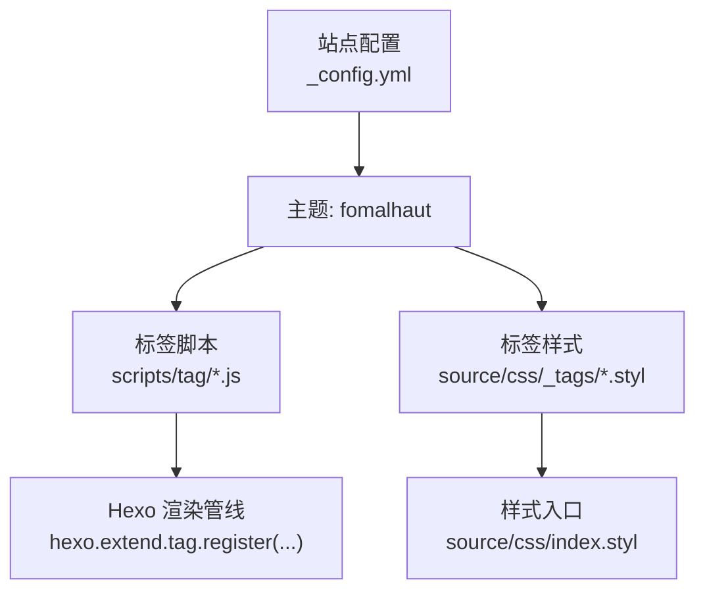
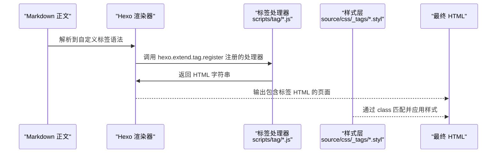
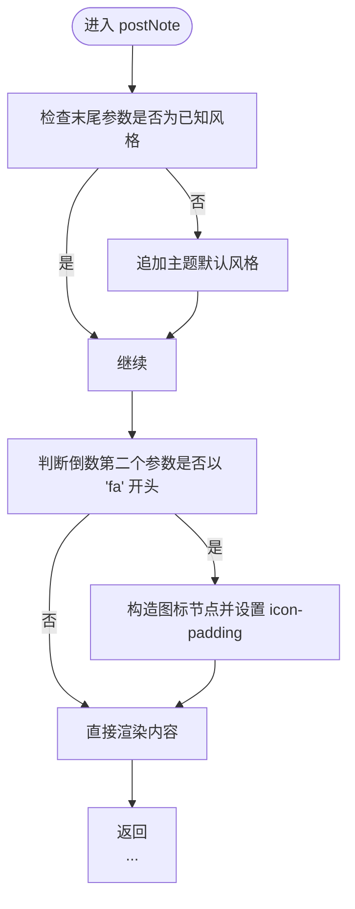
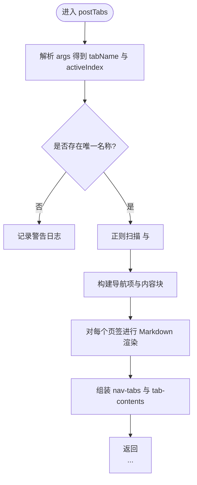
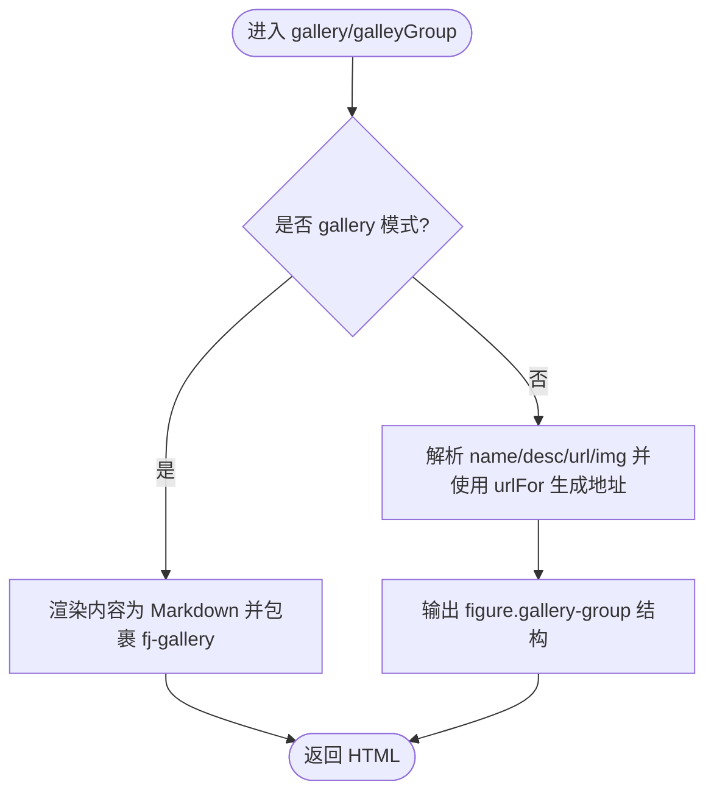
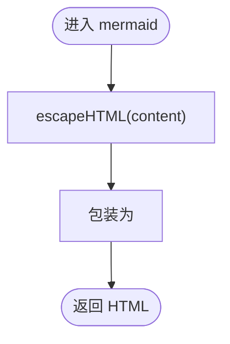
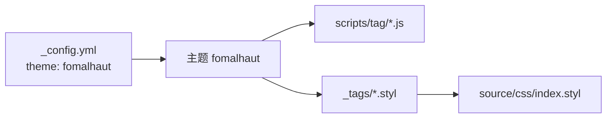

# 自定义标签开发指南

<cite>
**本文引用的文件**   
- [themes/fomalhaut/scripts/tag/note.js](file://themes/fomalhaut/scripts/tag/note.js)
- [themes/fomalhaut/scripts/tag/tabs.js](file://themes/fomalhaut/scripts/tag/tabs.js)
- [themes/fomalhaut/scripts/tag/gallery.js](file://themes/fomalhaut/scripts/tag/gallery.js)
- [themes/fomalhaut/scripts/tag/mermaid.js](file://themes/fomalhaut/scripts/tag/mermaid.js)
- [themes/fomalhaut/scripts/tag/label.js](file://themes/fomalhaut/scripts/tag/label.js)
- [themes/fomalhaut/source/css/_tags/note.styl](file://themes/fomalhaut/source/css/_tags/note.styl)
- [themes/fomalhaut/source/css/_tags/tabs.styl](file://themes/fomalhaut/source/css/_tags/tabs.styl)
- [themes/fomalhaut/source/css/_tags/gallery.styl](file://themes/fomalhaut/source/css/_tags/gallery.styl)
- [themes/fomalhaut/source/css/_tags/hexo.styl](file://themes/fomalhaut/source/css/_tags/hexo.styl)
- [themes/fomalhaut/source/css/index.styl](file://themes/fomalhaut/source/css/index.styl)
- [_config.yml](file://_config.yml)
</cite>

## 目录
1. [引言](#引言)
2. [项目结构](#项目结构)
3. [核心概念](#核心概念)
4. [架构总览](#架构总览)
5. [详细组件分析](#详细组件分析)
6. [依赖关系分析](#依赖关系分析)
7. [性能与优化](#性能与优化)
8. [安全与错误处理](#安全与错误处理)
9. [调试与排错](#调试与排错)
10. [最佳实践清单](#最佳实践清单)
11. [从零开始：创建一个自定义标签](#从零开始创建一个自定义标签)
12. [结论](#结论)

## 引言
本指南面向希望在 Hexo 主题中开发“外挂标签”的开发者。我们将基于当前仓库中的 Fomalhaut 主题，系统讲解 Hexo 标签系统的核心概念、注册方式、参数解析、HTML 生成、样式集成，并通过现有标签的实现模式总结出一套可复用的开发流程。同时提供错误处理、安全考虑、性能优化、调试技巧与最佳实践，帮助你从零开始构建高质量、可维护的自定义标签。

## 项目结构
Fomalhaut 主题的标签实现集中在 themes/fomalhaut/scripts/tag 目录下，每个标签一个 JS 文件；对应的样式放在 themes/fomalhaut/source/css/_tags 下，并由主题样式入口统一引入。站点根目录的 _config.yml 指定使用 fomalhaut 主题，从而让主题下的标签脚本在构建时被加载。

图表来源
- [_config.yml:128-131](file://_config.yml#L128-L131)
- [themes/fomalhaut/source/css/index.styl:1-13](file://themes/fomalhaut/source/css/index.styl#L1-L13)

章节来源
- [_config.yml:128-131](file://_config.yml#L128-L131)
- [themes/fomalhaut/source/css/index.styl:1-13](file://themes/fomalhaut/source/css/index.styl#L1-L13)

## 核心概念
- 标签注册：通过 hexo.extend.tag.register(name, handler, options) 将 Markdown 中的语法（如 ）映射到 JS 函数。
- 处理器签名：handler(args, content)，args 为标签行参数字符串数组，content 为标签体内容（当 ends: true 时）。
- 渲染输出：返回 HTML 字符串，由 Hexo 注入到最终页面。
- 样式集成：标签生成的类名需与 source/css/_tags 下的 Stylus 样式对应，并由 index.styl 统一引入。
- 配置驱动：可通过 hexo.theme.config 读取主题配置，控制标签行为或默认值。

章节来源
- [themes/fomalhaut/scripts/tag/note.js:9-24](file://themes/fomalhaut/scripts/tag/note.js#L9-L24)
- [themes/fomalhaut/scripts/tag/tabs.js:9-57](file://themes/fomalhaut/scripts/tag/tabs.js#L9-L57)
- [themes/fomalhaut/scripts/tag/gallery.js:10-30](file://themes/fomalhaut/scripts/tag/gallery.js#L10-L30)
- [themes/fomalhaut/scripts/tag/mermaid.js:11-14](file://themes/fomalhaut/scripts/tag/mermaid.js#L11-L14)
- [themes/fomalhaut/scripts/tag/label.js:9-13](file://themes/fomalhaut/scripts/tag/label.js#L9-L13)

## 架构总览
下图展示了从 Markdown 到最终 HTML 的完整路径，以及标签脚本与样式之间的协作关系。

图表来源
- [themes/fomalhaut/scripts/tag/note.js:26-27](file://themes/fomalhaut/scripts/tag/note.js#L26-L27)
- [themes/fomalhaut/source/css/index.styl:10-13](file://themes/fomalhaut/source/css/index.styl#L10-L13)

## 详细组件分析

### note 标签
note 标签用于在文章中插入带样式的提示块，支持多种风格与图标。

- 参数解析
  - 最后一个参数作为风格开关（flat/modern/simple/disabled），若未提供则回退到主题配置。
  - 倒数第二个参数若以 fa 开头，视为图标类名，自动添加 icon-padding 类。
- HTML 生成
  - 外层容器类名为 note，内部包裹经 Markdown 渲染后的内容。
  - 支持动态注入图标节点。
- 样式集成
  - 样式位于 _tags/note.styl，根据类型和风格组合出边框、背景、文字颜色等。
  - 支持主题变量与 hexo-config 控制圆角、图标开关等。

图表来源
- [themes/fomalhaut/scripts/tag/note.js:9-24](file://themes/fomalhaut/scripts/tag/note.js#L9-L24)

章节来源
- [themes/fomalhaut/scripts/tag/note.js:9-24](file://themes/fomalhaut/scripts/tag/note.js#L9-L24)
- [themes/fomalhaut/source/css/_tags/note.styl:1-122](file://themes/fomalhaut/source/css/_tags/note.styl#L1-L122)

### tabs 标签
tabs 标签用于创建多页签内容区块，支持名称、激活页索引、图标与标题。

- 参数解析
  - 第一个参数为唯一 tabName，第二个参数为默认激活页索引。
  - 标签体内使用注释分隔符 <!-- tab name@icon --> 与 <!-- endtab --> 定义各页签。
- 内容处理
  - 对每个页签内容进行 Markdown 渲染，并拼接“回到顶部”按钮。
  - 自动生成 id 与 href，确保锚点跳转可用。
- 样式集成
  - 样式位于 _tags/tabs.styl，包含导航栏、激活态、移动端适配与动画。

图表来源
- [themes/fomalhaut/scripts/tag/tabs.js:9-57](file://themes/fomalhaut/scripts/tag/tabs.js#L9-L57)

章节来源
- [themes/fomalhaut/scripts/tag/tabs.js:9-57](file://themes/fomalhaut/scripts/tag/tabs.js#L9-L57)
- [themes/fomalhaut/source/css/_tags/tabs.styl:1-75](file://themes/fomalhaut/source/css/_tags/tabs.styl#L1-L75)

### gallery 与 galleryGroup
gallery 标签用于包裹一组图片，galleryGroup 用于展示图片分组卡片。

- gallery
  - 将 body 内容按 Markdown 渲染后放入 fj-gallery 容器。
- galleryGroup
  - 接收 name、description、url、img 四个参数，使用 urlFor 生成资源地址。
  - 输出 figure.gallery-group 结构，包含封面图、标题、描述与链接区域。
- 样式集成
  - 样式位于 _tags/gallery.styl，包含悬浮动效、响应式布局与隐藏 alt 文本。

图表来源
- [themes/fomalhaut/scripts/tag/gallery.js:10-30](file://themes/fomalhaut/scripts/tag/gallery.js#L10-L30)

章节来源
- [themes/fomalhaut/scripts/tag/gallery.js:10-30](file://themes/fomalhaut/scripts/tag/gallery.js#L10-L30)
- [themes/fomalhaut/source/css/_tags/gallery.styl:1-102](file://themes/fomalhaut/source/css/_tags/gallery.styl#L1-L102)

### mermaid 标签
mermaid 标签用于在文章中嵌入 Mermaid 图表，构建期仅输出结构化标记，交由前端渲染。

- 安全处理
  - 使用 escapeHTML 对内容进行转义，避免 XSS。
- 输出结构
  - 输出 .mermaid-wrap 包裹的 pre.mermaid-src 节点，隐藏源码供运行时渲染。

图表来源
- [themes/fomalhaut/scripts/tag/mermaid.js:11-14](file://themes/fomalhaut/scripts/tag/mermaid.js#L11-L14)

章节来源
- [themes/fomalhaut/scripts/tag/mermaid.js:11-14](file://themes/fomalhaut/scripts/tag/mermaid.js#L11-L14)

### label 标签
label 标签用于内联高亮文本，支持默认与多种颜色类。

- 参数解析
  - 第一个参数为显示文本，第二个可选参数为颜色类名（默认为 default）。
- 输出结构
  - 输出 <mark class="hl-label ...">text</mark>。
- 样式集成
  - 样式位于 _tags/label.styl，基于主题颜色变量与 $color-types 循环生成变体。

章节来源
- [themes/fomalhaut/scripts/tag/label.js:9-13](file://themes/fomalhaut/scripts/tag/label.js#L9-L13)
- [themes/fomalhaut/source/css/_tags/label.styl:1-12](file://themes/fomalhaut/source/css/_tags/label.styl#L1-L12)

## 依赖关系分析
- 主题样式入口
  - source/css/index.styl 统一引入 _tags/*，确保所有标签样式生效。
- 站点配置
  - _config.yml 指定 theme: fomalhaut，使主题下的标签脚本与样式被加载。
- 标签脚本
  - 每个标签文件独立注册，互不耦合，便于扩展与维护。

图表来源
- [_config.yml:128-131](file://_config.yml#L128-L131)
- [themes/fomalhaut/source/css/index.styl:10-13](file://themes/fomalhaut/source/css/index.styl#L10-L13)

章节来源
- [_config.yml:128-131](file://_config.yml#L128-L131)
- [themes/fomalhaut/source/css/index.styl:10-13](file://themes/fomalhaut/source/css/index.styl#L10-L13)

## 性能与优化
- 减少重复渲染
  - 对于需要多次渲染的内容（如 tabs 的多个页签），尽量合并逻辑，避免不必要的 DOM 操作。
- 合理使用 Markdown 渲染
  - 仅在必要时调用 hexo.render.renderSync，避免对大段文本进行重复渲染。
- 样式按需加载
  - 保持样式模块化，利用 index.styl 的统一引入机制，避免冗余样式。
- 资源路径优化
  - 使用 urlFor 生成稳定资源路径，减少 404 与重定向开销。

[本节为通用建议，不直接分析具体文件]

## 安全与错误处理
- 输入校验
  - 对 args 进行边界检查，避免空值或非法索引访问。
- 输出转义
  - 对用户可控内容使用 escapeHTML 转义，防止 XSS（参考 mermaid 标签）。
- 日志与降级
  - 对缺失必要参数给出警告（如 tabs 的唯一名称），并提供合理的默认行为。
- 异常捕获
  - 在关键步骤增加 try/catch，保证渲染失败时不影响整体页面构建。

章节来源
- [themes/fomalhaut/scripts/tag/tabs.js:22-23](file://themes/fomalhaut/scripts/tag/tabs.js#L22-L23)
- [themes/fomalhaut/scripts/tag/mermaid.js:9-14](file://themes/fomalhaut/scripts/tag/mermaid.js#L9-L14)

## 调试与排错
- 启用日志
  - 使用 hexo.log.warn 或 hexo.log.error 输出诊断信息。
- 最小化复现
  - 在 Markdown 中仅保留标签语法，逐步增加内容定位问题。
- 检查样式
  - 确认目标 class 是否正确生成，并在浏览器开发者工具中验证样式是否命中。
- 检查资源路径
  - 使用 urlFor 生成的路径是否正确，避免静态资源 404。

章节来源
- [themes/fomalhaut/scripts/tag/tabs.js:22-23](file://themes/fomalhaut/scripts/tag/tabs.js#L22-L23)
- [themes/fomalhaut/scripts/tag/gallery.js:18-19](file://themes/fomalhaut/scripts/tag/gallery.js#L18-L19)

## 最佳实践清单
- 明确参数契约：文档化 args 的顺序、含义与默认值。
- 提供默认行为：当缺少参数时使用主题配置或合理默认值。
- 安全优先：对用户输入进行转义与校验。
- 样式分离：HTML 结构与样式解耦，便于维护与定制。
- 可测试性：为复杂逻辑编写单元测试或手动用例。
- 渐进增强：在不影响基础功能的前提下，提供高级特性（如图标、动画）。

[本节为通用建议，不直接分析具体文件]

## 从零开始：创建一个自定义标签
以下以“进度条标签 progress”为例，演示完整的开发流程。你可以将示例替换为你自己的业务需求。

- 步骤一：创建标签脚本
  - 新建 themes/fomalhaut/scripts/tag/progress.js。
  - 实现处理器函数，解析参数（如百分比、颜色、文案），生成 HTML 结构。
  - 使用 hexo.extend.tag.register('progress', handler, { ends: false }) 注册。
  - 安全处理：对用户输入进行 escapeHTML。
  - 默认值：当缺少百分比时，使用主题配置或固定默认值。

- 步骤二：创建样式文件
  - 新建 themes/fomalhaut/source/css/_tags/progress.styl。
  - 定义 .progress-bar 容器、进度条轨道、填充条与文案样式。
  - 使用主题变量与 hexo-config 控制颜色与尺寸。

- 步骤三：引入样式
  - 确保 source/css/index.styl 已引入 _tags/*（当前已包含 @import '_tags/*'）。

- 步骤四：在文章中使用
  - 在 Markdown 中写 。
  - 构建后查看 HTML 结构与样式是否正确。

- 步骤五：调试与优化
  - 使用浏览器开发者工具检查 DOM 与样式。
  - 对大段落或高频使用的标签进行性能评估，必要时缓存结果或减少渲染次数。

[本节为概念性指导，不直接分析具体文件]

## 结论
通过本指南，你已经了解了 Hexo 标签系统的核心概念与实现模式，掌握了从注册、参数解析、HTML 生成到样式集成的完整流程，并学习了安全、性能与调试的最佳实践。在实际项目中，建议遵循“小步快跑、持续迭代”的原则，先实现最小可用版本，再逐步增强功能与体验。

[本节为总结性内容，不直接分析具体文件]