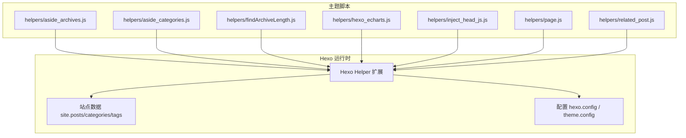
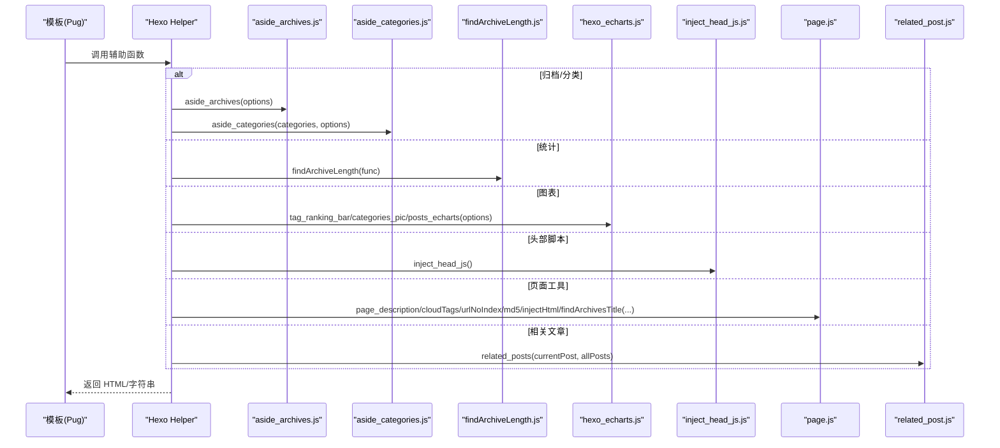
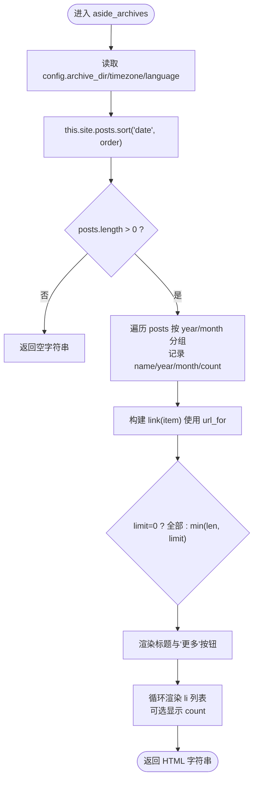
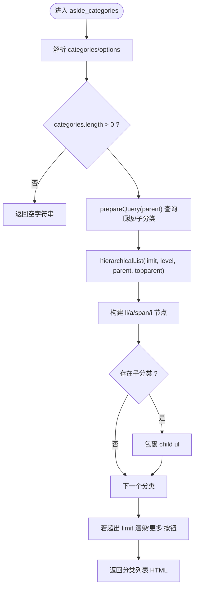
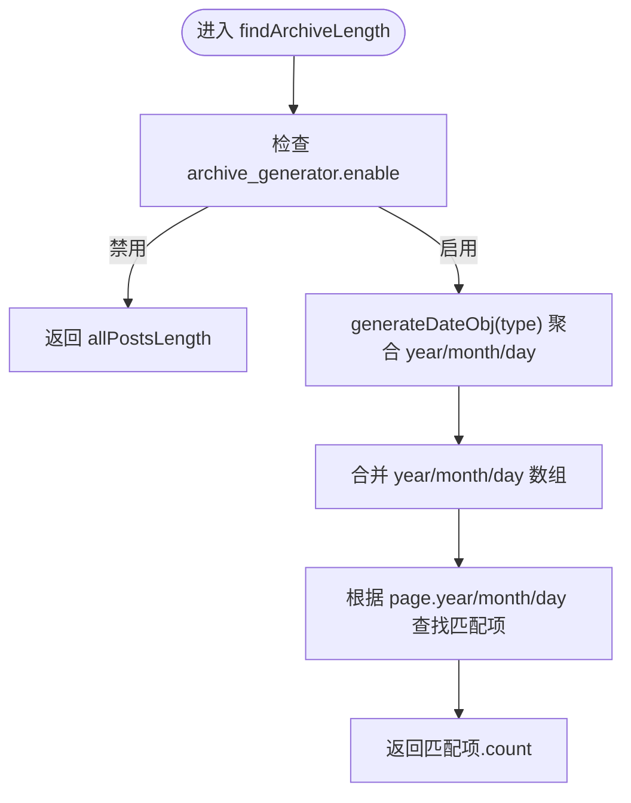
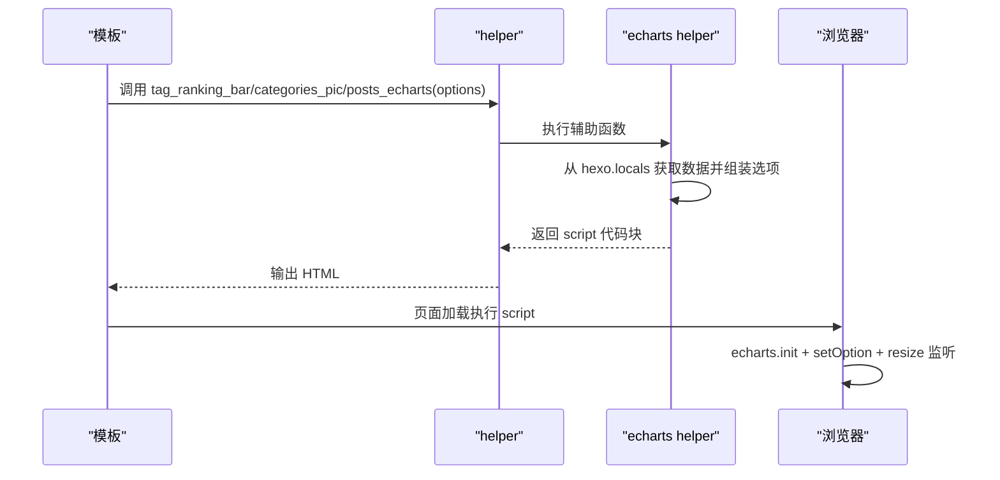
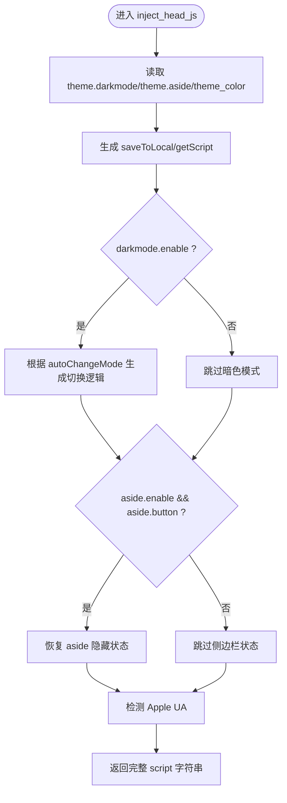
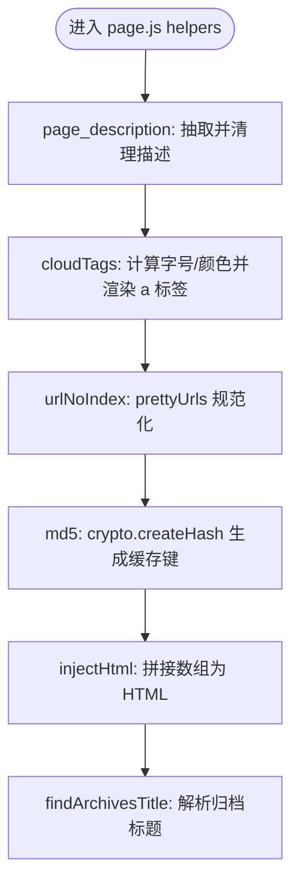
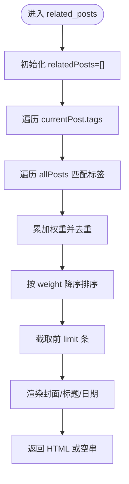
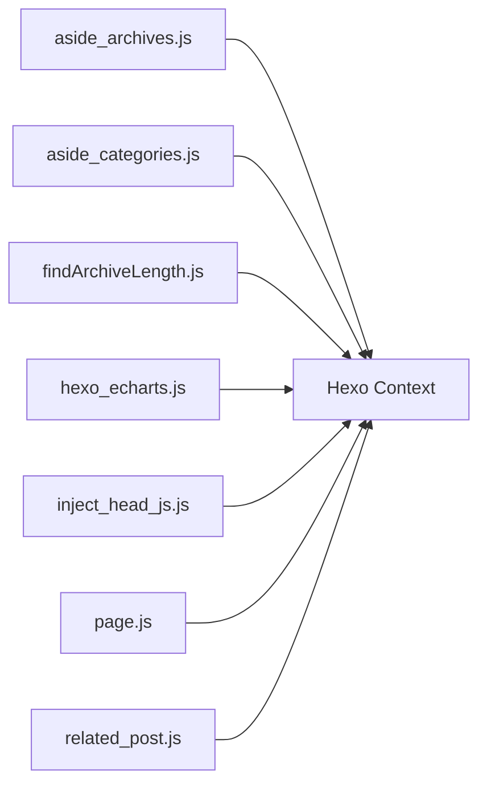

# 辅助函数开发

<cite>
**本文引用的文件**   
- [aside_archives.js](file://themes/fomalhaut/scripts/helpers/aside_archives.js)
- [aside_categories.js](file://themes/fomalhaut/scripts/helpers/aside_categories.js)
- [findArchiveLength.js](file://themes/fomalhaut/scripts/helpers/findArchiveLength.js)
- [hexo_echarts.js](file://themes/fomalhaut/scripts/helpers/hexo_echarts.js)
- [inject_head_js.js](file://themes/fomalhaut/scripts/helpers/inject_head_js.js)
- [page.js](file://themes/fomalhaut/scripts/helpers/page.js)
- [related_post.js](file://themes/fomalhaut/scripts/helpers/related_post.js)
</cite>

## 目录
1. [简介](#简介)
2. [项目结构](#项目结构)
3. [核心组件](#核心组件)
4. [架构总览](#架构总览)
5. [详细组件分析](#详细组件分析)
6. [依赖关系分析](#依赖关系分析)
7. [性能与优化建议](#性能与优化建议)
8. [故障排查指南](#故障排查指南)
9. [结论](#结论)
10. [附录：自定义辅助函数开发指南](#附录自定义辅助函数开发指南)

## 简介
本文围绕 Hexo 主题辅助函数的开发与注册机制，系统梳理以下辅助函数的职责、参数、返回值与模板调用方式：
- 侧边栏归档 aside_archives.js
- 分类管理 aside_categories.js
- 归档长度计算 findArchiveLength.js
- ECharts 集成 hexo_echarts.js
- 头部脚本注入 inject_head_js.js
- 页面工具 page.js
- 相关文章推荐 related_post.js

同时提供自定义辅助函数的开发范式、参数传递约定、返回值处理规范以及模板调用最佳实践。

## 项目结构
本仓库的主题位于 themes/fomalhaut，辅助函数统一放在 scripts/helpers 目录下，通过 Hexo 的 helper 扩展机制注册，供模板（Pug）在渲染阶段调用。

图表来源
- [aside_archives.js:8-99](file://themes/fomalhaut/scripts/helpers/aside_archives.js#L8-L99)
- [aside_categories.js:8-97](file://themes/fomalhaut/scripts/helpers/aside_categories.js#L8-L97)
- [findArchiveLength.js:1-58](file://themes/fomalhaut/scripts/helpers/findArchiveLength.js#L1-L58)
- [hexo_echarts.js:1-249](file://themes/fomalhaut/scripts/helpers/hexo_echarts.js#L1-L249)
- [inject_head_js.js:8-151](file://themes/fomalhaut/scripts/helpers/inject_head_js.js#L8-L151)
- [page.js:13-98](file://themes/fomalhaut/scripts/helpers/page.js#L13-L98)
- [related_post.js:9-72](file://themes/fomalhaut/scripts/helpers/related_post.js#L9-L72)

章节来源
- [aside_archives.js:8-99](file://themes/fomalhaut/scripts/helpers/aside_archives.js#L8-L99)
- [aside_categories.js:8-97](file://themes/fomalhaut/scripts/helpers/aside_categories.js#L8-L97)
- [findArchiveLength.js:1-58](file://themes/fomalhaut/scripts/helpers/findArchiveLength.js#L1-L58)
- [hexo_echarts.js:1-249](file://themes/fomalhaut/scripts/helpers/hexo_echarts.js#L1-L249)
- [inject_head_js.js:8-151](file://themes/fomalhaut/scripts/helpers/inject_head_js.js#L8-L151)
- [page.js:13-98](file://themes/fomalhaut/scripts/helpers/page.js#L13-L98)
- [related_post.js:9-72](file://themes/fomalhaut/scripts/helpers/related_post.js#L9-L72)

## 核心组件
本节对每个辅助函数进行职责说明、输入输出与关键逻辑要点总结。

- aside_archives.js
  - 作用：生成侧边栏归档卡片，支持按月或按年分组、格式化日期、计数、限制显示数量、国际化语言与 URL 构建。
  - 输入：options（type/format/transform/show_count/order/limit）。
  - 输出：HTML 字符串（归档列表 + “更多”按钮）。
  - 关键点：使用 this.site.posts 排序；根据 timezone 调整时间；moment 本地化；url_for 生成链接。

- aside_categories.js
  - 作用：生成侧边栏分类卡片，支持层级展开、排序、深度控制、计数与“更多”按钮。
  - 输入：categories（可选）、options（show_count/depth/orderby/order/expand/limit）。
  - 输出：HTML 字符串（分类树 + “更多”按钮）。
  - 关键点：递归构建分类树；根据 expand 策略添加展开类；url_for 生成分类路径。

- findArchiveLength.js
  - 作用：根据当前页面类型（年/月/日）返回对应归档的文章数量，用于统计展示。
  - 输入：回调函数 func（用于构造归档对象数组）。
  - 输出：数字（匹配当前归档维度的文章数）。
  - 关键点：读取 archive_generator 配置；遍历 posts 聚合 year/month/day 维度；根据当前 page.year/month/day 匹配 count。

- hexo_echarts.js
  - 作用：提供三类 ECharts 图表辅助函数：标签排行柱状图、分类玫瑰饼图、近一年发布趋势折线图。
  - 输入：options（id/title/color/yAxisName/seriesName/topNum/titlePosition 等）。
  - 输出：包含 echarts.init/setOption 的 script 代码块。
  - 关键点：从 hexo.locals 获取 tags/categories/posts；动态适配 dark/light 主题；监听 resize 自适应。

- inject_head_js.js
  - 作用：向 <head> 注入运行期 JS，包括本地存储封装、按需加载 getScript、暗色模式切换、侧边栏状态恢复、Apple 设备检测。
  - 输入：无。
  - 输出：script 标签字符串。
  - 关键点：读取 theme.darkmode 与 theme.aside 配置；根据 autoChangeMode 分支实现自动切换；写入 meta theme-color。

- page.js
  - 作用：页面级工具函数集合，包括描述提取、标签云、URL 规范化、MD5 缓存键、HTML 片段注入、归档标题解析。
  - 输入：各函数独立 options 或上下文 this。
  - 输出：字符串或数值。
  - 关键点：stripHTML/escapeHTML 清理内容；crypto.md5 生成缓存键；prettyUrls 规范化 URL；findArchivesTitle 解析菜单映射。

- related_post.js
  - 作用：基于标签相似度计算并渲染“相关文章”卡片列表。
  - 输入：currentPost、allPosts。
  - 输出：HTML 字符串（相关帖子列表），若无结果返回空串。
  - 关键点：标签匹配累加权重；按权重降序；支持 limit 与 date_type（created/updated）。

章节来源
- [aside_archives.js:8-99](file://themes/fomalhaut/scripts/helpers/aside_archives.js#L8-L99)
- [aside_categories.js:8-97](file://themes/fomalhaut/scripts/helpers/aside_categories.js#L8-L97)
- [findArchiveLength.js:1-58](file://themes/fomalhaut/scripts/helpers/findArchiveLength.js#L1-L58)
- [hexo_echarts.js:1-249](file://themes/fomalhaut/scripts/helpers/hexo_echarts.js#L1-L249)
- [inject_head_js.js:8-151](file://themes/fomalhaut/scripts/helpers/inject_head_js.js#L8-L151)
- [page.js:13-98](file://themes/fomalhaut/scripts/helpers/page.js#L13-L98)
- [related_post.js:9-72](file://themes/fomalhaut/scripts/helpers/related_post.js#L9-L72)

## 架构总览
辅助函数在 Hexo 构建阶段被注册为模板可用的 helper，模板在渲染时调用这些函数，最终产出 HTML。ECharts 辅助函数会输出内联脚本，由浏览器在页面加载后初始化图表。

图表来源
- [aside_archives.js:8-99](file://themes/fomalhaut/scripts/helpers/aside_archives.js#L8-L99)
- [aside_categories.js:8-97](file://themes/fomalhaut/scripts/helpers/aside_categories.js#L8-L97)
- [findArchiveLength.js:1-58](file://themes/fomalhaut/scripts/helpers/findArchiveLength.js#L1-L58)
- [hexo_echarts.js:1-249](file://themes/fomalhaut/scripts/helpers/hexo_echarts.js#L1-L249)
- [inject_head_js.js:8-151](file://themes/fomalhaut/scripts/helpers/inject_head_js.js#L8-L151)
- [page.js:13-98](file://themes/fomalhaut/scripts/helpers/page.js#L13-L98)
- [related_post.js:9-72](file://themes/fomalhaut/scripts/helpers/related_post.js#L9-L72)

## 详细组件分析

### 侧边栏归档 aside_archives.js
- 功能要点
  - 支持 monthly/yearly 两种分组模式。
  - 支持自定义日期格式 format 与名称转换 transform。
  - show_count 控制是否显示文章计数。
  - order 控制排序方向。
  - limit 控制显示条目数，超过则渲染“更多”按钮。
  - 使用 this.url_for 生成归档链接，遵循 archive_dir 配置。
  - 使用 moment 本地化日期显示。
- 复杂度
  - 遍历 posts 一次 O(n)，分组聚合 O(n)。
- 错误处理
  - 无 posts 直接返回空字符串。
- 模板调用示例（示意）
  - {{ aside_archives({ type:'monthly', limit:5 }) }}

图表来源
- [aside_archives.js:8-99](file://themes/fomalhaut/scripts/helpers/aside_archives.js#L8-L99)

章节来源
- [aside_archives.js:8-99](file://themes/fomalhaut/scripts/helpers/aside_archives.js#L8-L99)

### 分类管理 aside_categories.js
- 功能要点
  - 支持传入 categories 或默认 this.site.categories。
  - depth 控制层级深度；orderby/order 控制排序。
  - expand 控制顶层父分类是否可展开。
  - limit 控制显示数量，超过则渲染“更多”按钮。
  - 递归构建分类树，支持子分类嵌套 ul/li。
- 复杂度
  - 递归遍历分类树，整体 O(N+M)（N 为分类节点数，M 为子节点总数）。
- 错误处理
  - 无分类或长度为 0 返回空字符串。
- 模板调用示例（示意）
  - {{ aside_categories(null, { depth:2, limit:10, expand:true }) }}

图表来源
- [aside_categories.js:8-97](file://themes/fomalhaut/scripts/helpers/aside_categories.js#L8-L97)

章节来源
- [aside_categories.js:8-97](file://themes/fomalhaut/scripts/helpers/aside_categories.js#L8-L97)

### 归档长度计算 findArchiveLength.js
- 功能要点
  - 当 archive_generator.enable=false 时直接返回所有文章数。
  - 根据 yearly/monthly/daily 配置分别生成 year/month/day 三个维度的归档对象数组。
  - 根据当前 page.year/month/day 匹配对应归档项的 count。
- 复杂度
  - 遍历 posts 一次 O(n)，聚合 O(n)。
- 错误处理
  - 未找到匹配归档时可能返回 undefined（需在上层模板判空）。
- 模板调用示例（示意）
  - {{ findArchiveLength(function(createArchiveObj){ return createArchiveObj(); }) }}

图表来源
- [findArchiveLength.js:1-58](file://themes/fomalhaut/scripts/helpers/findArchiveLength.js#L1-L58)

章节来源
- [findArchiveLength.js:1-58](file://themes/fomalhaut/scripts/helpers/findArchiveLength.js#L1-L58)

### ECharts 集成 hexo_echarts.js
- 功能要点
  - tag_ranking_bar：标签统计柱状图，支持 topNum、颜色、Y轴名、系列名、titlePosition。
  - categories_pic：分类玫瑰饼图，支持 titlePosition。
  - posts_echarts：近一年月度发布趋势折线图，使用 moment 计算时间范围。
  - 均输出包含 echarts.init/setOption 的 script 代码块，并在 window.resize 时自适应。
- 复杂度
  - 数据聚合 O(n)（n 为 tags/categories/posts 数量）。
- 错误处理
  - 缺少 id/type 等必填参数时直接返回 undefined。
- 模板调用示例（示意）
  - {{ tag_ranking_bar({ id:'tag-bar', type:'tag', topNum:10, title:'标签排行' }) }}
  - {{ categories_pic({ id:'cat-pie', title:'分类占比' }) }}
  - {{ posts_echarts({ id:'posts-line', title:'发布趋势' }) }}

图表来源
- [hexo_echarts.js:1-249](file://themes/fomalhaut/scripts/helpers/hexo_echarts.js#L1-L249)

章节来源
- [hexo_echarts.js:1-249](file://themes/fomalhaut/scripts/helpers/hexo_echarts.js#L1-L249)

### 头部脚本注入 inject_head_js.js
- 功能要点
  - 注入 win.saveToLocal（带过期时间的 localStorage 封装）。
  - 注入 win.getScript（异步加载外部脚本）。
  - 暗色模式：根据 theme.darkmode.autoChangeMode 分支实现自动切换，支持系统偏好与时间段。
  - 侧边栏状态：根据 theme.aside.button 恢复 hide-aside 状态。
  - Apple 设备检测：UA 判断并添加 apple 类。
- 复杂度
  - 仅字符串拼接与条件判断，O(1)。
- 错误处理
  - 未启用 darkmode/aside 时跳过相应逻辑。
- 模板调用示例（示意）
  - {{ inject_head_js() }}

图表来源
- [inject_head_js.js:8-151](file://themes/fomalhaut/scripts/helpers/inject_head_js.js#L8-L151)

章节来源
- [inject_head_js.js:8-151](file://themes/fomalhaut/scripts/helpers/inject_head_js.js#L8-L151)

### 页面工具 page.js
- 功能要点
  - page_description：提取页面描述，优先 page.description，其次 content/title/config.description，并进行 HTML 剥离与转义。
  - cloudTags：根据 source 标签集生成随机颜色与字号的云标签 HTML。
  - urlNoIndex：去除 trailing index/html 的 URL 规范化。
  - md5：对资源 URL 生成 MD5 缓存键。
  - injectHtml：将数组元素拼接为 HTML 字符串。
  - findArchivesTitle：根据 menu 与 page 信息解析归档页标题。
- 复杂度
  - 主要为字符串处理与简单遍历，O(n)。
- 错误处理
  - 缺失输入时返回空字符串或未定义。
- 模板调用示例（示意）
  - {{ page_description() }}
  - {{ cloudTags(source, 12, 24, 50) }}
  - {{ urlNoIndex() }}
  - {{ md5('/css/main.css') }}
  - {{ injectHtml(['hello']) }}
  - {{ findArchivesTitle(page, menu, date) }}

图表来源
- [page.js:13-98](file://themes/fomalhaut/scripts/helpers/page.js#L13-L98)

章节来源
- [page.js:13-98](file://themes/fomalhaut/scripts/helpers/page.js#L13-L98)

### 相关文章推荐 related_post.js
- 功能要点
  - 基于 currentPost.tags 与 allPosts 的标签匹配，累计权重。
  - 排除自身文章，按权重降序排序。
  - 根据 theme.related_post.limit 与 date_type 渲染列表。
- 复杂度
  - 双重遍历 O(n*m)，n 为 currentPost.tags 数量，m 为 allPosts 数量。
- 错误处理
  - 无相关文章时返回空字符串。
- 模板调用示例（示意）
  - {{ related_posts(post, site.posts) }}

图表来源
- [related_post.js:9-72](file://themes/fomalhaut/scripts/helpers/related_post.js#L9-L72)

章节来源
- [related_post.js:9-72](file://themes/fomalhaut/scripts/helpers/related_post.js#L9-L72)

## 依赖关系分析
- 内部依赖
  - aside_archives.js 依赖 this.site.posts、config.archive_dir、config.timezone、this.url_for、this._p、moment 本地化。
  - aside_categories.js 依赖 this.site.categories、this.url_for、this._p。
  - findArchiveLength.js 依赖 hexo.config.archive_generator、this.site.posts、this.page。
  - hexo_echarts.js 依赖 hexo.locals.get('tags'|'categories'|'posts')、moment（posts_echarts）。
  - inject_head_js.js 依赖 this.theme.darkmode/aside、hexo.theme.config.theme_color。
  - page.js 依赖 hexo-util（stripHTML/escapeHTML/prettyUrls）、crypto。
  - related_post.js 依赖 hexo.config、this.theme.config、this.date、this.escape_html、this.url_for。
- 耦合度
  - 各辅助函数相对独立，主要耦合于 Hexo 提供的 this 上下文与全局 hexo 对象。
- 潜在循环依赖
  - 无直接循环依赖；均为单向 helper 注册。

图表来源
- [aside_archives.js:8-99](file://themes/fomalhaut/scripts/helpers/aside_archives.js#L8-L99)
- [aside_categories.js:8-97](file://themes/fomalhaut/scripts/helpers/aside_categories.js#L8-L97)
- [findArchiveLength.js:1-58](file://themes/fomalhaut/scripts/helpers/findArchiveLength.js#L1-L58)
- [hexo_echarts.js:1-249](file://themes/fomalhaut/scripts/helpers/hexo_echarts.js#L1-L249)
- [inject_head_js.js:8-151](file://themes/fomalhaut/scripts/helpers/inject_head_js.js#L8-L151)
- [page.js:13-98](file://themes/fomalhaut/scripts/helpers/page.js#L13-L98)
- [related_post.js:9-72](file://themes/fomalhaut/scripts/helpers/related_post.js#L9-L72)

章节来源
- [aside_archives.js:8-99](file://themes/fomalhaut/scripts/helpers/aside_archives.js#L8-L99)
- [aside_categories.js:8-97](file://themes/fomalhaut/scripts/helpers/aside_categories.js#L8-L97)
- [findArchiveLength.js:1-58](file://themes/fomalhaut/scripts/helpers/findArchiveLength.js#L1-L58)
- [hexo_echarts.js:1-249](file://themes/fomalhaut/scripts/helpers/hexo_echarts.js#L1-L249)
- [inject_head_js.js:8-151](file://themes/fomalhaut/scripts/helpers/inject_head_js.js#L8-L151)
- [page.js:13-98](file://themes/fomalhaut/scripts/helpers/page.js#L13-L98)
- [related_post.js:9-72](file://themes/fomalhaut/scripts/helpers/related_post.js#L9-L72)

## 性能与优化建议
- 避免重复遍历
  - related_post.js 的双重循环在大站点上可能较慢，建议在预处理阶段预建 tag→posts 索引，降低 O(n*m) 到近似 O(n+k)。
- 分页与限制
  - aside_archives/aside_categories 已支持 limit，应合理设置以控制 DOM 规模。
- 图表初始化
  - hexo_echarts.js 已在 window.resize 中调用 resize，确保容器尺寸稳定，避免频繁重绘。
- 本地存储
  - inject_head_js.js 的 saveToLocal 已实现过期策略，注意 TTL 设置避免无效数据堆积。
- 字符串拼接
  - 大量 HTML 拼接建议使用模板引擎或更高效的模板库，减少内存分配。

[本节为通用建议，不直接分析具体文件]

## 故障排查指南
- 归档为空
  - 检查是否有 posts 且 date 字段有效；确认 archive_generator 配置与 page.year/month/day 是否正确。
  - 参考：[findArchiveLength.js:1-58](file://themes/fomalhaut/scripts/helpers/findArchiveLength.js#L1-L58)
- 分类树不显示
  - 检查 categories 是否为空；确认 orderby/order 与 depth 配置；查看是否存在子分类。
  - 参考：[aside_categories.js:8-97](file://themes/fomalhaut/scripts/helpers/aside_categories.js#L8-L97)
- ECharts 不渲染
  - 确认 id 唯一且 DOM 存在；检查 hexo.locals 数据是否可用；确认浏览器控制台无 JS 错误。
  - 参考：[hexo_echarts.js:1-249](file://themes/fomalhaut/scripts/helpers/hexo_echarts.js#L1-L249)
- 暗色模式异常
  - 检查 theme.darkmode.enable/autoChangeMode 配置；确认 meta[name="theme-color"] 是否存在。
  - 参考：[inject_head_js.js:8-151](file://themes/fomalhaut/scripts/helpers/inject_head_js.js#L8-L151)
- 页面描述为空
  - 检查 page.description/content/title/config.description 优先级；确认 stripHTML/escapeHTML 行为。
  - 参考：[page.js:13-23](file://themes/fomalhaut/scripts/helpers/page.js#L13-L23)
- 相关文章为空
  - 检查 currentPost.tags 与 allPosts 数据；确认 theme.related_post.limit 与 date_type。
  - 参考：[related_post.js:9-72](file://themes/fomalhaut/scripts/helpers/related_post.js#L9-L72)

章节来源
- [findArchiveLength.js:1-58](file://themes/fomalhaut/scripts/helpers/findArchiveLength.js#L1-L58)
- [aside_categories.js:8-97](file://themes/fomalhaut/scripts/helpers/aside_categories.js#L8-L97)
- [hexo_echarts.js:1-249](file://themes/fomalhaut/scripts/helpers/hexo_echarts.js#L1-L249)
- [inject_head_js.js:8-151](file://themes/fomalhaut/scripts/helpers/inject_head_js.js#L8-L151)
- [page.js:13-23](file://themes/fomalhaut/scripts/helpers/page.js#L13-L23)
- [related_post.js:9-72](file://themes/fomalhaut/scripts/helpers/related_post.js#L9-L72)

## 结论
本主题通过 Hexo 的 helper 扩展机制，将归档、分类、统计、图表、头部脚本、页面工具与相关文章等功能模块化，便于在模板中复用与扩展。各辅助函数职责清晰、参数明确、返回值一致，配合合理的配置与模板调用，可实现丰富的站点展示效果。

[本节为总结性内容，不直接分析具体文件]

## 附录：自定义辅助函数开发指南

- 开发步骤
  1. 在 themes/fomalhaut/scripts/helpers 下新建 .js 文件。
  2. 使用 hexo.extend.helper.register('yourHelperName', function (params) {...}) 注册。
  3. 在模板中以 {{ yourHelperName(params) }} 调用。
- 参数传递
  - 推荐使用 options 对象，便于扩展与向后兼容。
  - 常见参数：id、type、limit、show_count、orderby、order、depth、expand、title、color、seriesName、topNum、titlePosition 等。
- 返回值处理
  - 多数辅助函数返回 HTML 字符串；部分返回数字或空串。
  - 模板中可直接输出；如需进一步处理，可在模板中进行二次包装。
- 模板调用方式
  - 基础调用：{{ yourHelperName() }}
  - 带参调用：{{ yourHelperName({ key: value }) }}
  - 组合调用：{{ yourHelperName(options).replace(...) }}
- 最佳实践
  - 校验必填参数（如 id、type），缺失时尽早返回以避免错误。
  - 使用 this.url_for 生成安全 URL；使用 this._p 进行多语言文案。
  - 对大数据集进行限制（limit）与分页，避免渲染过多 DOM。
  - 对敏感内容进行 escapeHTML 处理，防止 XSS。
  - 对图表类辅助函数，确保容器尺寸稳定并监听 resize。
  - 对本地存储操作，设置合适的 TTL 并处理过期数据。
- 示例路径（不含代码内容）
  - 归档侧边栏：[aside_archives.js:8-99](file://themes/fomalhaut/scripts/helpers/aside_archives.js#L8-L99)
  - 分类侧边栏：[aside_categories.js:8-97](file://themes/fomalhaut/scripts/helpers/aside_categories.js#L8-L97)
  - 归档长度统计：[findArchiveLength.js:1-58](file://themes/fomalhaut/scripts/helpers/findArchiveLength.js#L1-L58)
  - ECharts 图表：[hexo_echarts.js:1-249](file://themes/fomalhaut/scripts/helpers/hexo_echarts.js#L1-L249)
  - 头部脚本注入：[inject_head_js.js:8-151](file://themes/fomalhaut/scripts/helpers/inject_head_js.js#L8-L151)
  - 页面工具：[page.js:13-98](file://themes/fomalhaut/scripts/helpers/page.js#L13-L98)
  - 相关文章：[related_post.js:9-72](file://themes/fomalhaut/scripts/helpers/related_post.js#L9-L72)

[本节为通用指导，不直接分析具体文件]