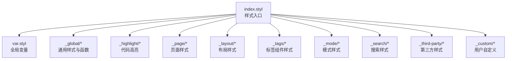
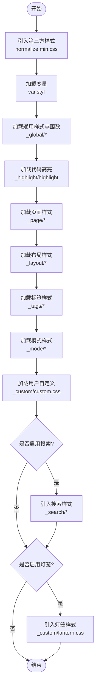
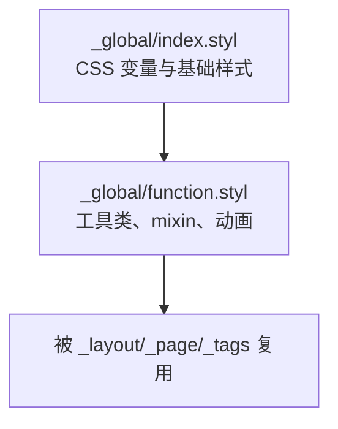
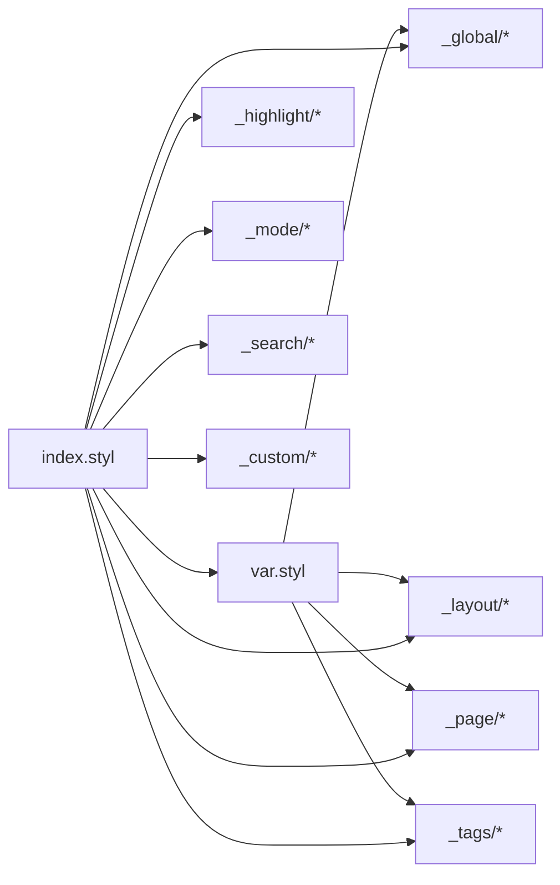

# CSS 文件组织结构

<cite>
**本文引用的文件**   
- [themes/fomalhaut/source/css/index.styl](file://themes/fomalhaut/source/css/index.styl)
- [themes/fomalhaut/source/css/var.styl](file://themes/fomalhaut/source/css/var.styl)
- [themes/fomalhaut/source/css/_global/index.styl](file://themes/fomalhaut/source/css/_global/index.styl)
- [themes/fomalhaut/source/css/_global/function.styl](file://themes/fomalhaut/source/css/_global/function.styl)
- [themes/fomalhaut/source/css/_layout/post.styl](file://themes/fomalhaut/source/css/_layout/post.styl)
- [themes/fomalhaut/source/css/_page/homepage.styl](file://themes/fomalhaut/source/css/_page/homepage.styl)
</cite>

## 目录
1. [简介](#简介)
2. [项目结构](#项目结构)
3. [核心组件](#核心组件)
4. [架构总览](#架构总览)
5. [详细组件分析](#详细组件分析)
6. [依赖关系分析](#依赖关系分析)
7. [性能与可维护性建议](#性能与可维护性建议)
8. [故障排查指南](#故障排查指南)
9. [结论](#结论)

## 简介
本文件系统性说明主题样式（Stylus）的目录结构与组织原则，重点解释：
- _global 目录下通用样式与函数的职责
- _layout 目录下布局相关样式的边界与职责
- _page 目录下页面特定样式的管理方式
- _tags 目录下标签组件样式的组织方法
- index.styl 作为入口文件的导入机制与编译顺序
- 命名约定与模块化设计原则

## 项目结构
主题样式位于 themes/fomalhaut/source/css 下，采用按职责分层的目录划分：
- var.styl：全局变量与主题色、字体、尺寸等基础值
- _global/*：全局样式与通用函数、动画、响应式工具
- _highlight/*：代码高亮主题与差异对比样式
- _page/*：各页面（首页、归档、分类、标签、友链、404 等）专属样式
- _layout/*：布局级样式（文章、侧边栏、页脚、分页、评论、第三方集成等）
- _tags/*：标签插件（note、tabs、timeline、button、gallery 等）样式
- _mode/*：模式切换（深色/阅读模式）样式
- _search/*：搜索功能（Algolia/本地搜索）样式
- _third-party/*：第三方库样式（如 normalize）
- _custom/*：用户自定义覆盖样式
- index.styl：样式入口，统一导入并控制编译顺序

图表来源
- [themes/fomalhaut/source/css/index.styl:1-26](file://themes/fomalhaut/source/css/index.styl#L1-L26)

章节来源
- [themes/fomalhaut/source/css/index.styl:1-26](file://themes/fomalhaut/source/css/index.styl#L1-L26)

## 核心组件
- 入口文件 index.styl：负责引入第三方样式、定义变量、按序引入 _global、_highlight、_page、_layout、_tags、_mode，并根据配置条件引入搜索与灯笼等可选模块。
- 变量中心 var.styl：集中定义主题色、字体、字号、间距、滚动条、按钮、表格、引用块、搜索、评论、标签插件等变量，供全局复用。
- 通用层 _global：提供 CSS 变量映射、基础元素重置、滚动条、链接、图片、引用块、通用工具类、响应式 mixin、动画 keyframes 等。
- 布局层 _layout：针对具体布局区域（文章、侧边栏、页脚、分页、评论、第三方组件等）编写样式。
- 页面层 _page：为不同路由页面（首页、归档、分类、标签、友链、404）提供独立样式。
- 标签层 _tags：封装常用内容增强标签（note、tabs、timeline、button、gallery、hide、inlineImg、label、hexo 扩展）的样式。

章节来源
- [themes/fomalhaut/source/css/index.styl:1-26](file://themes/fomalhaut/source/css/index.styl#L1-L26)
- [themes/fomalhaut/source/css/var.styl:1-185](file://themes/fomalhaut/source/css/var.styl#L1-L185)
- [themes/fomalhaut/source/css/_global/index.styl:1-220](file://themes/fomalhaut/source/css/_global/index.styl#L1-L220)
- [themes/fomalhaut/source/css/_global/function.styl:1-252](file://themes/fomalhaut/source/css/_global/function.styl#L1-L252)

## 架构总览
样式编译由入口文件 index.styl 驱动，遵循“先变量、后通用、再页面/布局/标签”的顺序，确保下游样式能稳定使用上游定义的变量与工具。

图表来源
- [themes/fomalhaut/source/css/index.styl:1-26](file://themes/fomalhaut/source/css/index.styl#L1-L26)

## 详细组件分析

### 入口文件 index.styl 的导入机制与编译顺序
- 条件引入 nib：当开启 css_prefix 时引入 nib，以支持前缀处理。
- 引入第三方样式：优先引入 normalize.min.css，保证基础一致性。
- 变量与通用层：先加载 var.styl，再加载 _global/*，确保后续样式可使用变量与工具。
- 代码高亮：在通用层之后引入 _highlight/highlight，避免被覆盖。
- 页面与布局：_page/* 在前，_layout/* 在后，便于布局样式对页面样式进行覆盖或补充。
- 标签与模式：_tags/* 与 _mode/* 紧随其后，保证组件与模式样式可用。
- 用户自定义：最后引入 _custom/custom.css，允许用户覆盖主题默认样式。
- 条件模块：根据 hexo-config 决定是否引入搜索（Algolia/本地）与灯笼样式。

章节来源
- [themes/fomalhaut/source/css/index.styl:1-26](file://themes/fomalhaut/source/css/index.styl#L1-L26)

### _global 目录：通用样式与函数
- 全局 CSS 变量映射：将 Stylus 变量映射到 CSS 变量，便于运行时切换主题与动态样式。
- 基础元素样式：body、h1-h6、hr、table、blockquote、a、img、placeholder 等基础样式。
- 滚动条样式：兼容 Webkit 与 Firefox 的滚动条外观。
- 背景图容器：根据配置渲染 #web_bg 背景。
- 通用工具类：居中、浮动、单行/多行省略、卡片悬停、图片悬停等。
- 响应式 mixin：maxWidth/minWidth 系列 mixin，简化媒体查询。
- 动画与关键帧：统一的入场、标题缩放、侧边菜单、打赏弹窗等动画。

图表来源
- [themes/fomalhaut/source/css/_global/index.styl:1-220](file://themes/fomalhaut/source/css/_global/index.styl#L1-L220)
- [themes/fomalhaut/source/css/_global/function.styl:1-252](file://themes/fomalhaut/source/css/_global/function.styl#L1-L252)

章节来源
- [themes/fomalhaut/source/css/_global/index.styl:1-220](file://themes/fomalhaut/source/css/_global/index.styl#L1-L220)
- [themes/fomalhaut/source/css/_global/function.styl:1-252](file://themes/fomalhaut/source/css/_global/function.styl#L1-L252)

### _layout 目录：布局相关样式
- 职责边界：负责页面骨架与区域布局，如文章正文、侧边栏、页脚、分页、评论、第三方组件、加载动画、背景图等。
- 示例：post.styl 定义了文章容器、标题美化、列表、锚点、版权信息、过期提示、广告位等；同时包含暗黑模式下的局部覆盖。
- 复用策略：通过 _global 提供的工具类与变量保持一致风格，避免重复定义。

章节来源
- [themes/fomalhaut/source/css/_layout/post.styl:1-517](file://themes/fomalhaut/source/css/_layout/post.styl#L1-L517)

### _page 目录：页面特定样式
- 职责边界：为不同路由页面提供专属样式，如首页、归档、分类、标签、友链、404 等。
- 示例：homepage.styl 定义了首页文章卡片布局、封面图、标题、元信息、摘要等，并通过配置选择不同卡片风格（slidecard/multicard）。
- 组合方式：页面样式通常复用 _global 的工具类与 _layout 的基础组件样式，保持整体一致性。

章节来源
- [themes/fomalhaut/source/css/_page/homepage.styl:1-119](file://themes/fomalhaut/source/css/_page/homepage.styl#L1-L119)

### _tags 目录：标签组件样式
- 职责边界：封装博客中常用的内容增强标签样式，包括 note、tabs、timeline、button、gallery、hide、inlineImg、label、hexo 扩展等。
- 设计要点：每个标签一个文件，便于按需引入与维护；样式基于 _global 的变量与工具类，确保主题一致性。
- 扩展性：新增标签时，建议在 _tags 下新建同名 .styl 文件，并在需要处引入。

章节来源
- [themes/fomalhaut/source/css/index.styl:1-26](file://themes/fomalhaut/source/css/index.styl#L1-L26)

### 变量中心 var.styl
- 作用：集中定义主题色、字体、字号、间距、滚动条、按钮、表格、引用块、搜索、评论、标签插件等变量。
- 可配置性：大量变量通过 hexo-config 读取配置，未设置时使用默认值，便于主题定制。
- 使用范围：被 _global、_layout、_page、_tags 广泛引用，是样式一致性的基石。

章节来源
- [themes/fomalhaut/source/css/var.styl:1-185](file://themes/fomalhaut/source/css/var.styl#L1-L185)

## 依赖关系分析
- 入口依赖：index.styl 依赖 var.styl 与 _global/*，随后依次引入 _highlight、_page、_layout、_tags、_mode，最后引入 _custom 与条件模块。
- 变量依赖：所有子目录样式均依赖 var.styl 中的变量，确保颜色、字体、尺寸的一致性。
- 工具依赖：_layout、_page、_tags 复用 _global 的工具类与 mixin，减少重复代码。
- 条件依赖：搜索与灯笼样式仅在对应配置开启时引入，降低不必要的体积。

图表来源
- [themes/fomalhaut/source/css/index.styl:1-26](file://themes/fomalhaut/source/css/index.styl#L1-L26)
- [themes/fomalhaut/source/css/var.styl:1-185](file://themes/fomalhaut/source/css/var.styl#L1-L185)

## 性能与可维护性建议
- 保持导入顺序：严格遵循 index.styl 的导入顺序，避免变量未定义或样式覆盖异常。
- 合理使用条件引入：仅引入需要的模块（搜索、灯笼），减少最终 CSS 体积。
- 复用工具类与变量：在 _layout/_page/_tags 中尽量复用 _global 的工具类与 var.styl 变量，避免硬编码。
- 组件化拆分：每个标签或复杂组件拆分为独立文件，便于定位与维护。
- 响应式与动画：优先使用 _global 提供的 mixin 与动画，保持行为一致。

## 故障排查指南
- 样式不生效：检查是否在 index.styl 中正确引入对应文件，确认导入顺序是否正确。
- 变量未定义：确认 var.styl 已先于使用该变量的文件被引入。
- 主题色不生效：检查 hexo-config('theme_color.*') 配置是否正确，且 var.styl 中对应变量未被覆盖。
- 搜索样式缺失：确认 hexo-config('algolia_search.enable') 或 hexo-config('local_search.enable') 已开启。
- 自定义样式无效：确保 _custom/custom.css 放在 index.styl 的最后引入位置，以便覆盖默认样式。

## 结论
该主题的样式体系以 index.styl 为入口，采用“变量集中、通用层抽象、页面/布局/标签分层”的组织方式，配合条件引入与工具类复用，既保证了样式的一致性与可维护性，又提供了良好的扩展能力。遵循本文的目录规范与导入顺序，可在不破坏主题结构的前提下安全地扩展与定制样式。