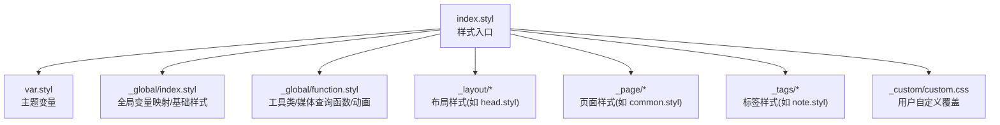
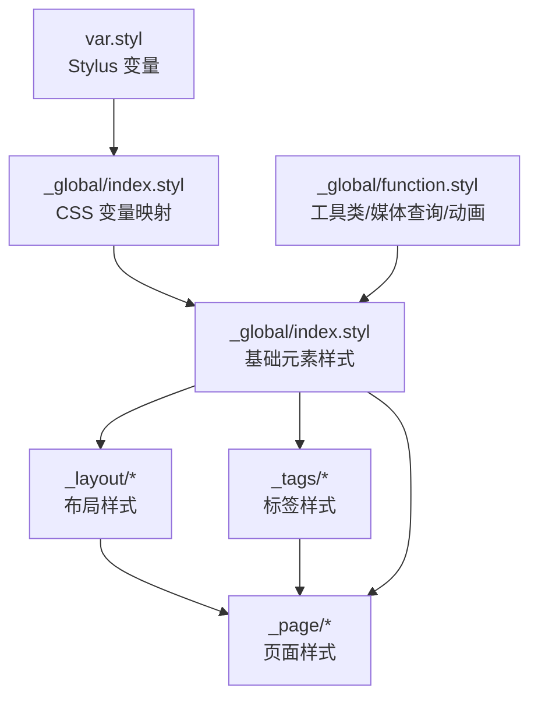
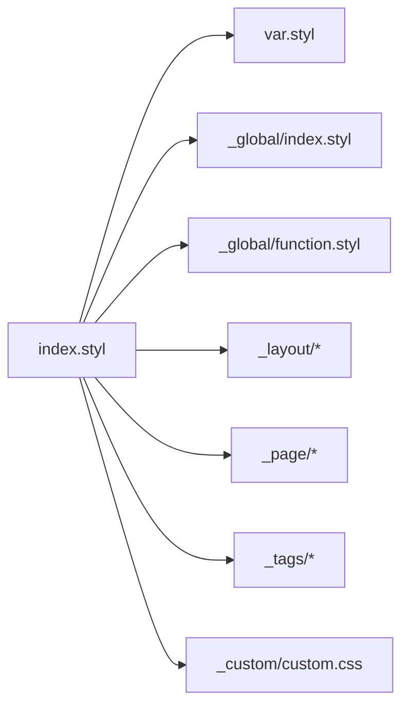

# 全局样式系统

<cite>
**本文引用的文件**   
- [themes/fomalhaut/source/css/index.styl](file://themes/fomalhaut/source/css/index.styl)
- [themes/fomalhaut/source/css/var.styl](file://themes/fomalhaut/source/css/var.styl)
- [themes/fomalhaut/source/css/_global/index.styl](file://themes/fomalhaut/source/css/_global/index.styl)
- [themes/fomalhaut/source/css/_global/function.styl](file://themes/fomalhaut/source/css/_global/function.styl)
- [themes/fomalhaut/source/css/_layout/head.styl](file://themes/fomalhaut/source/css/_layout/head.styl)
- [themes/fomalhaut/source/css/_page/common.styl](file://themes/fomalhaut/source/css/_page/common.styl)
- [themes/fomalhaut/source/css/_tags/note.styl](file://themes/fomalhaut/source/css/_tags/note.styl)
</cite>

## 目录
1. [简介](#简介)
2. [项目结构](#项目结构)
3. [核心组件](#核心组件)
4. [架构总览](#架构总览)
5. [详细组件分析](#详细组件分析)
6. [依赖关系分析](#依赖关系分析)
7. [性能与可维护性](#性能与可维护性)
8. [常见问题排查](#常见问题排查)
9. [结论](#结论)

## 简介
本文件系统性说明主题的全局样式体系，重点围绕 _global 目录下的通用样式、CSS 变量、函数定义，以及 var.styl 中主题变量的组织方式。文档解释全局样式的优先级与作用域管理，并给出在不同组件中复用基础样式的具体路径与示例位置，帮助读者快速理解并扩展主题样式。

## 项目结构
主题样式入口统一在 index.styl 中按顺序引入：第三方重置、主题变量、全局样式、高亮、页面、布局、标签、模式、自定义等。_global 目录提供全局 CSS 变量映射、基础元素样式与通用工具类；var.styl 集中定义主题色板、字体、间距、组件默认值等 Stylus 变量。

图表来源
- [themes/fomalhaut/source/css/index.styl:1-26](file://themes/fomalhaut/source/css/index.styl#L1-L26)

章节来源
- [themes/fomalhaut/source/css/index.styl:1-26](file://themes/fomalhaut/source/css/index.styl#L1-L26)

## 核心组件
- var.styl：集中定义主题色板、字体、图标、按钮、滚动条、表格、搜索、评论、预加载器、标签插件等所有 Stylus 变量，并提供基于配置的变量推导逻辑。
- _global/index.styl：将 Stylus 变量映射为 :root 下的 CSS 变量，同时定义 body、标题、hr、table、blockquote、a、img 等基础元素样式。
- _global/function.styl：提供常用工具类（单行省略、卡片悬停、图片缩放）、响应式媒体查询函数、通用动画 keyframes。
- 布局与页面：head.styl、common.styl 等使用上述变量与工具类构建具体界面。
- 标签组件：note.styl 等通过循环和 lookup 动态生成多类型样式，依赖 var.styl 中的颜色与配置。

章节来源
- [themes/fomalhaut/source/css/var.styl:1-185](file://themes/fomalhaut/source/css/var.styl#L1-L185)
- [themes/fomalhaut/source/css/_global/index.styl:1-220](file://themes/fomalhaut/source/css/_global/index.styl#L1-L220)
- [themes/fomalhaut/source/css/_global/function.styl:1-252](file://themes/fomalhaut/source/css/_global/function.styl#L1-L252)
- [themes/fomalhaut/source/css/_layout/head.styl:1-370](file://themes/fomalhaut/source/css/_layout/head.styl#L1-L370)
- [themes/fomalhaut/source/css/_page/common.styl:1-61](file://themes/fomalhaut/source/css/_page/common.styl#L1-L61)
- [themes/fomalhaut/source/css/_tags/note.styl:1-122](file://themes/fomalhaut/source/css/_tags/note.styl#L1-L122)

## 架构总览
全局样式系统的职责分层如下：
- 变量层（var.styl）：声明主题色板、字体、尺寸、组件默认值，支持通过 hexo-config 动态覆盖。
- 映射层（_global/index.styl）：将 Stylus 变量转换为 CSS 变量，供运行时主题切换与 JS 读取。
- 基础样式层（_global/index.styl）：定义全局元素、排版、滚动条、选择器、链接、引用块等。
- 工具层（_global/function.styl）：提供工具类、媒体查询函数、动画 keyframes。
- 业务层（_layout/*, _page/*, _tags/*）：组合变量、工具类与基础样式，实现具体 UI。

图表来源
- [themes/fomalhaut/source/css/var.styl:1-185](file://themes/fomalhaut/source/css/var.styl#L1-L185)
- [themes/fomalhaut/source/css/_global/index.styl:1-220](file://themes/fomalhaut/source/css/_global/index.styl#L1-L220)
- [themes/fomalhaut/source/css/_global/function.styl:1-252](file://themes/fomalhaut/source/css/_global/function.styl#L1-L252)

## 详细组件分析

### var.styl：主题变量定义与使用
- 颜色变量：主色、分页色、文本选中色、链接色、HR 色、代码前景/背景、TOC 色、引用边框/背景、按钮色、滚动条色、标签插件色等，均支持通过 theme_color.* 配置项覆盖。
- 字体变量：全局字体、代码字体、站点名称字体，支持通过 font.* 与 blog_title_font.* 配置项覆盖。
- 间距与尺寸：全局字号、代码行高、侧边栏宽度、索引顶部图高度、信息区定位等。
- 组件默认值：按钮、滚动条、表格、搜索、评论开关、预加载器、右侧面板、烟花层级、Note/Tabs/Timeline 等标签插件的默认配色与行为。
- 配置驱动：大量变量通过 hexo-config('...') 判断是否启用或取值，未设置时回退到默认值。

示例路径（不展示代码内容）：
- 主题色与文本选中色：[var.styl:6-14](file://themes/fomalhaut/source/css/var.styl#L6-L14)
- 字体与代码字体：[var.styl:16-20](file://themes/fomalhaut/source/css/var.styl#L16-L20)
- 全局字号与行高：[var.styl:29-33](file://themes/fomalhaut/source/css/var.styl#L29-L33)
- 按钮与滚动条：[var.styl:69-75](file://themes/fomalhaut/source/css/var.styl#L69-L75)
- Note 类型与颜色：[var.styl:109-165](file://themes/fomalhaut/source/css/var.styl#L109-L165)
- Tabs/Timeline 默认色：[var.styl:176-185](file://themes/fomalhaut/source/css/var.styl#L176-L185)

章节来源
- [themes/fomalhaut/source/css/var.styl:1-185](file://themes/fomalhaut/source/css/var.styl#L1-L185)

### _global/index.styl：CSS 变量映射与基础样式
- CSS 变量映射：在 :root 下将 Stylus 变量映射为 CSS 变量，例如 --global-font-size、--global-bg、--font-color、--card-bg、--btn-hover-color、--scrollbar-color 等，便于运行时与 JS 访问。
- 基础元素样式：body、h1-h6、hr、table、blockquote、a、img、input::placeholder、滚动条等，统一使用 CSS 变量与 Stylus 变量混合控制。
- 条件样式：根据 hexo-config 控制复制禁用、懒加载模糊效果、HR 图标显示等。
- 工具类：is-center、pull-left、pull-right、copy-true 等。

示例路径（不展示代码内容）：
- :root 变量映射：[index.styl:1-36](file://themes/fomalhaut/source/css/_global/index.styl#L1-L36)
- body 与滚动条：[index.styl:37-64](file://themes/fomalhaut/source/css/_global/index.styl#L37-L64)
- hr 与 table：[index.styl:98-141](file://themes/fomalhaut/source/css/_global/index.styl#L98-L141)
- a 与 img：[index.styl:153-196](file://themes/fomalhaut/source/css/_global/index.styl#L153-L196)
- blockquote：[index.styl:205-220](file://themes/fomalhaut/source/css/_global/index.styl#L205-L220)

章节来源
- [themes/fomalhaut/source/css/_global/index.styl:1-220](file://themes/fomalhaut/source/css/_global/index.styl#L1-L220)

### _global/function.styl：工具类、媒体查询函数与动画
- 工具类：.limit-one-line、.limit-more-line、.cardHover、.imgHover、.postImgHover、.list-beauty 等，用于统一交互与视觉表现。
- 媒体查询函数：maxWidth600()、minWidth768()、maxWidth1024() 等，封装 @media 规则，提升可读性与复用性。
- 动画：底部入场、头部入场、标题缩放、滚动提示、头像旋转、子菜单展开等 keyframes，配合 hexo-config('enter_transitions') 与 avatar.effect 控制启用。

示例路径（不展示代码内容）：
- 工具类：[function.styl:1-73](file://themes/fomalhaut/source/css/_global/function.styl#L1-L73)
- 媒体查询函数：[function.styl:74-104](file://themes/fomalhaut/source/css/_global/function.styl#L74-L104)
- 动画与 keyframes：[function.styl:106-252](file://themes/fomalhaut/source/css/_global/function.styl#L106-L252)

章节来源
- [themes/fomalhaut/source/css/_global/function.styl:1-252](file://themes/fomalhaut/source/css/_global/function.styl#L1-L252)

### 布局与页面：对全局样式的继承与扩展
- head.styl：头部区域样式，广泛使用 CSS 变量（如 --white、--light-grey、--font-color）与工具类（如 minWidth768()），体现对全局样式的继承。
- common.styl：页面主体布局，使用 .cardHover 工具类与媒体查询函数，保持风格一致。

示例路径（不展示代码内容）：
- 头部样式与变量使用：[head.styl:1-147](file://themes/fomalhaut/source/css/_layout/head.styl#L1-L147)
- 导航与下拉菜单：[head.styl:236-370](file://themes/fomalhaut/source/css/_layout/head.styl#L236-L370)
- 页面布局与卡片样式：[common.styl:1-61](file://themes/fomalhaut/source/css/_page/common.styl#L1-L61)

章节来源
- [themes/fomalhaut/source/css/_layout/head.styl:1-370](file://themes/fomalhaut/source/css/_layout/head.styl#L1-L370)
- [themes/fomalhaut/source/css/_page/common.styl:1-61](file://themes/fomalhaut/source/css/_page/common.styl#L1-L61)

### 标签组件：以 note.styl 为例的变量复用
- note.styl 通过 for $type in $color-types 与 lookup('$tagsP-' + $type + '-color') 动态生成多种颜色变体，依赖 var.styl 中的颜色变量。
- 支持 modern/simple/flat 三种风格，并通过 hexo-config('note.icons') 控制图标显示与内边距。

示例路径（不展示代码内容）：
- 颜色类型循环与样式生成：[note.styl:19-33](file://themes/fomalhaut/source/css/_tags/note.styl#L19-L33)
- 风格与图标逻辑：[note.styl:34-86](file://themes/fomalhaut/source/css/_tags/note.styl#L34-L86)
- Note 类型与图标内容：[note.styl:87-122](file://themes/fomalhaut/source/css/_tags/note.styl#L87-L122)

章节来源
- [themes/fomalhaut/source/css/_tags/note.styl:1-122](file://themes/fomalhaut/source/css/_tags/note.styl#L1-L122)

## 依赖关系分析
样式入口 index.styl 按顺序引入各模块，确保变量先于样式生效，基础样式先于布局与页面样式，从而保证正确的优先级与作用域。

图表来源
- [themes/fomalhaut/source/css/index.styl:1-26](file://themes/fomalhaut/source/css/index.styl#L1-L26)

章节来源
- [themes/fomalhaut/source/css/index.styl:1-26](file://themes/fomalhaut/source/css/index.styl#L1-L26)

## 性能与可维护性
- 变量集中化：所有主题相关值集中在 var.styl，便于统一管理与按需覆盖。
- CSS 变量运行时：通过 :root 映射，避免重复计算，提高主题切换与 JS 读写的效率。
- 工具类与媒体查询函数：减少重复代码，提升可读性与一致性。
- 条件编译：通过 hexo-config 控制可选功能（如 HR 图标、懒加载模糊、进入动画），减少无用样式体积。
- 建议：新增主题色或字体时，优先在 var.styl 中添加变量并在 _global/index.styl 中映射为 CSS 变量，再在业务样式中引用，保持层次清晰。

## 常见问题排查
- 主题色未生效：检查 var.styl 中 themeColorEnable 与 hexo-config('theme_color.*') 是否正确配置，确认最终变量是否被覆盖。
- CSS 变量未生效：确认 _global/index.styl 中 :root 映射是否存在，且对应 Stylus 变量已正确赋值。
- 工具类无效：确认 _global/function.styl 已被引入，且使用的媒体查询函数名与参数匹配。
- 标签样式异常：检查 note.styl 中 note.icons 与 note.border_radius 配置，确认颜色类型是否在 $color-types 与 $note-types 范围内。

章节来源
- [themes/fomalhaut/source/css/var.styl:6-14](file://themes/fomalhaut/source/css/var.styl#L6-L14)
- [themes/fomalhaut/source/css/_global/index.styl:1-36](file://themes/fomalhaut/source/css/_global/index.styl#L1-L36)
- [themes/fomalhaut/source/css/_global/function.styl:74-104](file://themes/fomalhaut/source/css/_global/function.styl#L74-L104)
- [themes/fomalhaut/source/css/_tags/note.styl:1-122](file://themes/fomalhaut/source/css/_tags/note.styl#L1-L122)

## 结论
该全局样式系统通过 var.styl 集中管理主题变量，_global/index.styl 完成变量到 CSS 变量的映射与基础样式定义，_global/function.styl 提供工具类与动画，布局与页面样式在此基础上进行组合与扩展。整体设计层次清晰、可配置性强、易于维护与扩展。遵循“变量集中、映射统一、工具复用”的原则，可在不同组件中稳定复用基础样式，并确保主题切换与运行时修改的一致性。